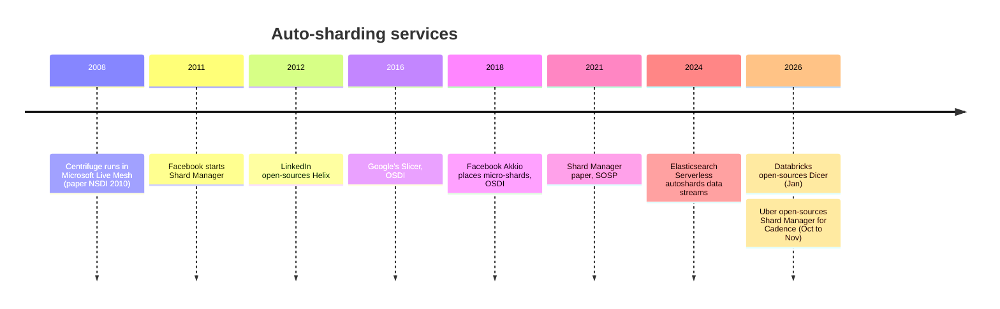
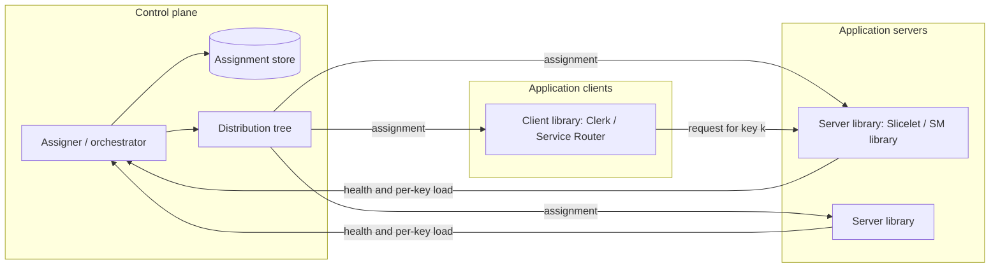
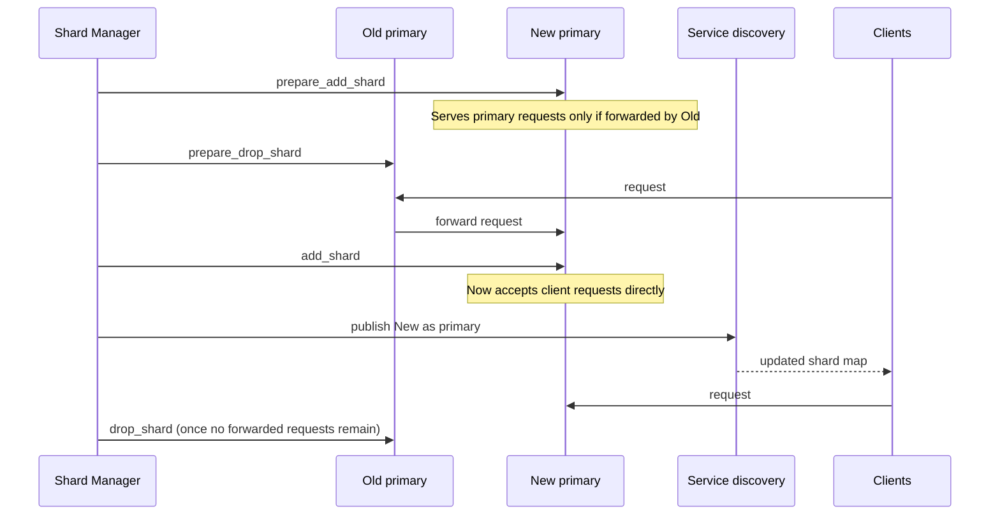
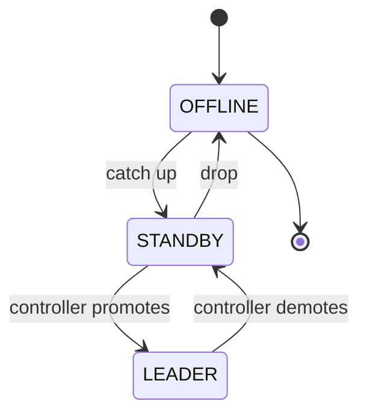

---
tags:
  - distributed-systems
  - auto-sharding
  - sharding
  - load-balancing
  - control-plane
  - infrastructure
status: draft
sources:
  - https://static.usenix.org/events/nsdi10/tech/full_papers/adya.pdf
  - https://cs.ubc.ca/~andy/538w-2016/papers/osdi16-adya.pdf
  - https://research.facebook.com/file/245575980870853/Shard-Manager-A-Generic-Shard-Management-Framework-for-Geo-distributed-Applications.pdf
  - https://engineering.fb.com/2020/08/24/production-engineering/scaling-services-with-shard-manager/
  - https://cacm.acm.org/research/metas-hyperscale-infrastructure-overview-and-insights
  - https://www.usenix.org/system/files/osdi18-annamalai.pdf
  - https://engineering.linkedin.com/cluster-management/announcing-helix-open-source-cluster-management-system
  - https://helix.apache.org/Concepts.html
  - https://learn.microsoft.com/en-us/azure/service-fabric/service-fabric-cluster-resource-manager-introduction
  - https://www.databricks.com/blog/open-sourcing-dicer-databricks-auto-sharder
  - https://github.com/databricks/dicer
  - https://www.uber.com/blog/introducing-shard-manager/
  - https://www.elastic.co/search-labs/blog/datastream-autosharding-serverless
created: 2026-11-26
updated: 2026-11-26
---

## Table Of Contents

- [[#TL;DR|TL;DR]]
- [[#The Problem|The Problem]]
- [[#Foundations|Foundations]]
    - [[#Two Maps, One Controller|Two Maps, One Controller]]
    - [[#Strong Ownership vs Affinity|Strong Ownership vs Affinity]]
    - [[#Balance Costs Churn|Balance Costs Churn]]
- [[#How We Got Here|How We Got Here]]
- [[#How It Works|How It Works]]
    - [[#The Common Architecture|The Common Architecture]]
    - [[#Hashed Keys vs Application Shards|Hashed Keys vs Application Shards]]
    - [[#Choosing Moves|Choosing Moves]]
    - [[#Leases and Ownership|Leases and Ownership]]
    - [[#Moving a Shard Without Dropping Requests|Moving a Shard Without Dropping Requests]]
    - [[#Planned Restarts Are the Main Event|Planned Restarts Are the Main Event]]
    - [[#Hot Keys|Hot Keys]]
    - [[#Declaring the Target State|Declaring the Target State]]
- [[#Where It Is Now|Where It Is Now]]
    - [[#Open-Source Auto-Sharders Arrive|Open-Source Auto-Sharders Arrive]]
    - [[#Inside the Large Fleets|Inside the Large Fleets]]
    - [[#Auto-Sharding Inside Products|Auto-Sharding Inside Products]]
- [[#Trade-offs & Open Problems|Trade-offs & Open Problems]]
- [[#Resources|Resources]]
- [[#Related Notes|Related Notes]]

## ***TL;DR***
---
*Auto-sharding is a shared control-plane service that decides which server owns which slice of an application's keys, and keeps changing that answer as load, failures and restarts change. It lets ordinary services keep state in memory, near the request, without each team building its own [[Partitioning]] and failover machinery.*

- **What it does.** A controller (Slicer's *Assigner*, Shard Manager's *orchestrator*, Dicer's *Assigner*) watches server health and per-key load, computes an assignment of key ranges or shards to servers, and pushes it to a server library and a client library. Requests then go straight from client to owner; the controller is never on the request path.
- **Why it exists.** Static schemes like consistent hashing ignore load and restarts. In Slicer's production comparison, the median job's hottest task carried **63% less load** than under static sharding ([Adya et al., OSDI 2016](https://cs.ubc.ca/~andy/538w-2016/papers/osdi16-adya.pdf)); Uber's 2026 auto-sharder cut the hottest-to-average host ratio from about **2.3× to 1.4×** ([Uber, Nov 2026](https://www.uber.com/blog/introducing-shard-manager/)).
- **The core trade.** Every move improves balance but costs *churn*: keys whose owner changes lose their warm state. Slicer spends a fixed **churn budget of 9% of the keyspace** per rebalance.
- **The design fork.** *Strong ownership* (at most one server believes it owns a key, enforced with [[Leases and Fencing|leases]]) versus *affinity* (owners may briefly overlap, for availability). Centrifuge and Slicer's consistent mode do the first; Dicer, open-sourced in January 2026, chose the second.
- **What dominates in practice.** Planned restarts, not crashes. Meta found planned container stops "≈1000 times more frequent than unplanned failures" ([Shard Manager, SOSP 2021](https://research.facebook.com/file/245575980870853/Shard-Manager-A-Generic-Shard-Management-Framework-for-Geo-distributed-Applications.pdf)); Databricks reports planned restarts are about 99.9% of all restarts ([Databricks, Jan 2026](https://www.databricks.com/blog/open-sourcing-dicer-databricks-auto-sharder)).

## ***The Problem***
---
*Stateless services push every request to a database or remote cache, which costs latency and CPU. Keeping state in a server's memory is faster, but only if the same keys keep landing on the same server, through load shifts, crashes and rolling deploys.*

Databricks lists what a stateless design pays: every request hits the database, and a remote cache adds network latency, serialization CPU and "overread" of large objects ([Databricks](https://www.databricks.com/blog/open-sourcing-dicer-databricks-auto-sharder)). The fix is key affinity: route all requests for user 42 to one server, which keeps user 42's data warm. That is [[Partitioning]] applied to a service rather than a database.

The trouble is keeping that mapping good:

- **Load is uneven and moves.** An even count of shards per host doesn't give even load. Uber's Cadence fleet had a host at 2.22× the average, and since a cluster is sized for its hottest host, the rest of the capacity sat idle ([Uber](https://www.uber.com/blog/introducing-shard-manager/)).
- **Membership is fuzzy.** With a gossip hash ring (Uber's earlier Ringpop), nodes can disagree about membership, so there's "no authoritative record of ownership", and operators can't steer placement without changing membership ([Uber](https://www.uber.com/blog/introducing-shard-manager/)). See [[Gossip and Membership]].
- **Restarts are constant.** Databricks saw static sharding cause downtime during restarts and autoscaling, split-brain or dropped traffic during failures, and hot keys that could cascade ([Databricks](https://www.databricks.com/blog/open-sourcing-dicer-databricks-auto-sharder)).
- **Every team rebuilds it.** Facebook built Shard Manager because many teams had written their own sharding with overlapping features, usually with failover but little load balancing ([Meta Engineering, Aug 2020](https://engineering.fb.com/2020/08/24/production-engineering/scaling-services-with-shard-manager/)).

## ***Foundations***
---
*Auto-sharding rests on three ideas: two separate mappings (key to shard, shard to server) with a controller owning the second; a choice of how strictly ownership is enforced; and the fact that rebalancing always trades balance against lost state.*

### Two Maps, One Controller

*Fix the first map so clients can compute it; let a controller own the second so it can change freely.*

| Map | Who computes it | Changes when |
|---|---|---|
| **Key → shard (or slice)** | Fixed function, usually a hash. Slicer hashes each key to a 63-bit *slice key*; Dicer's *SliceKey* is also a hash of the key | Almost never; Slicer and Dicer *split* and *merge* ranges of the hashed space instead |
| **Shard → server(s)** | The controller, from health and load signals | Continuously, on load shifts, failures, restarts and scaling |

A *slice* is a contiguous range of the hashed keyspace; an *assignment* is a set of non-overlapping slices covering the whole keyspace, each mapped to one or more servers ([Dicer README](https://github.com/databricks/dicer); [Adya et al.](https://cs.ubc.ca/~andy/538w-2016/papers/osdi16-adya.pdf)). Hashing first spreads keys evenly, so the controller only has to fix *load* skew, not *key* skew. The [[Partitioning]] note covers the hash and range schemes themselves.

### Strong Ownership vs Affinity

*Can two servers ever both think they own the same key? The answer decides whether you can use auto-sharding for correctness or only for performance.*

| Mode | Guarantee | Cost | Examples |
|---|---|---|---|
| **Strong (consistent)** | "No task believes it owns a key unless the Assigner agrees"; with one replica per key, at most one server holds it | Ownership must be leased, so a key is briefly unavailable while a lease is recalled | Centrifuge, Slicer consistent mode, Shard Manager primary-only |
| **Affinity (eventually consistent)** | Owners may overlap briefly during a change | A key may be served by two servers for a moment; the app must tolerate that | Slicer affinity mode, Dicer |

Sources: [Adya et al.](https://cs.ubc.ca/~andy/538w-2016/papers/osdi16-adya.pdf), [Shard Manager paper](https://research.facebook.com/file/245575980870853/Shard-Manager-A-Generic-Shard-Management-Framework-for-Geo-distributed-Applications.pdf), [Databricks](https://www.databricks.com/blog/open-sourcing-dicer-databricks-auto-sharder).

Affinity is enough for caches: a duplicate owner just means a cache miss. A system that uses ownership to decide *who may write* (a leader, a lock holder) needs the strong form plus fencing, for the reasons in [[Leases and Fencing]] and [[Consistency Models]].

### Balance Costs Churn

*Each key that changes owner loses its warm state, so a good rebalance buys the most balance per key moved.*

Slicer measures imbalance as the hottest task's load over the mean, and scores each candidate move by how much imbalance it removes per unit of keyspace it moves ([Adya et al.](https://cs.ubc.ca/~andy/538w-2016/papers/osdi16-adya.pdf)):

$$
\text{imbalance} = \frac{\max_i L_i}{\frac{1}{N}\sum_i L_i}
\qquad
\text{weight}(m) = \frac{\Delta\,\text{imbalance}(m)}{\text{churn}(m)}
$$

**In plain English:** $L_i$ is the load on task $i$ of $N$. A perfectly balanced job has imbalance 1. A move's weight is how much closer to 1 it gets you for each percent of keys it moves. Slicer applies moves from the highest weight down until 9% of the keyspace has moved.

**Worked example.** Three tasks carry loads A = 60, B = 30, C = 30 (mean 40, imbalance 60/40 = 1.5). Two candidate moves:

| Move | Slice load | Keyspace moved | Loads after | Imbalance after | Weight |
|---|---|---|---|---|---|
| Slice *s*: A → B | 15 | 3% | 45, 45, 30 | 45/40 = 1.125 | 0.375 / 3 = 0.125 |
| Slice *t*: A → C | 10 | 1% | 50, 30, 40 | 50/40 = 1.25 | 0.25 / 1 = 0.25 |

Move *s* balances better, but *t* gets more balance per key moved, so it goes first. With 8% of the budget left, the planner then re-scores the remaining moves from the new loads.

## ***How We Got Here***
---
*The idea started as a lease manager for in-memory servers at Microsoft, became a general service at Google and Facebook, and in 2026 reached open source. One researcher, Atul Adya, is an author of Centrifuge, Slicer and Dicer.*

- **Centrifuge (deployed April 2008, NSDI 2010).** Microsoft's Live Mesh had pools of in-memory servers and network load balancers that "cannot prevent requests for the same state from reaching different servers". Centrifuge combined leases with partitioning: a Paxos-replicated Manager hands out ranges of a consistent-hashing ring as exclusive leases. By March 2009, five Live Mesh services used it across hundreds of servers ([Adya, Dunagan and Wolman, NSDI 2010](https://static.usenix.org/events/nsdi10/tech/full_papers/adya.pdf)).
- **Shard Manager (about 2011).** Facebook's August 2020 post dates its start to "nine years ago", built because teams kept writing their own sharding ([Meta Engineering](https://engineering.fb.com/2020/08/24/production-engineering/scaling-services-with-shard-manager/)).
- **Helix (October 2012).** LinkedIn's "generic cluster management system for managing partitioned and replicated resources", used by Espresso, Databus and Search-as-a-Service ([LinkedIn Engineering](https://engineering.linkedin.com/cluster-management/announcing-helix-open-source-cluster-management-system)).
- **Slicer (OSDI 2016).** Google made auto-sharding a general service with load-aware splits, merges and moves, used by 22 services at publication ([Adya et al.](https://cs.ubc.ca/~andy/538w-2016/papers/osdi16-adya.pdf)).
- **Akkio (OSDI 2018).** Facebook pushed the unit smaller: application-defined *µ-shards* averaging about 200 KB, placed in the datacenter that reads them most ([Annamalai et al.](https://www.usenix.org/system/files/osdi18-annamalai.pdf)).
- **Shard Manager paper (SOSP 2021).** Described the system at Meta scale, with geo-distributed placement and integration with the Twine container manager ([Lee et al.](https://research.facebook.com/file/245575980870853/Shard-Manager-A-Generic-Shard-Management-Framework-for-Geo-distributed-Applications.pdf)).
- **2026, open source.** Databricks released Dicer, an auto-sharder in the Slicer line, and Uber released a Go sharding service for Cadence modeled on Shard Manager, Slicer, Service Fabric and Helix (see [[#Where It Is Now|Where It Is Now]]).

## ***How It Works***
---
*Every system here has the same skeleton: a controller off the request path, a server library that is told what it owns, and a client library that caches the map. They differ in what a shard is, how moves are chosen, and how strictly ownership is enforced.*

### The Common Architecture

*The controller computes; libraries in clients and servers cache; requests never touch the controller.*

| Role | Slicer (Google) | Shard Manager (Meta) | Dicer (Databricks) | Shard Manager (Uber) |
|---|---|---|---|---|
| Controller | Assigner, several worldwide | Orchestrator + allocator, split across mini-SMs | Assigner, multi-tenant, one per region | One elected leader per namespace |
| Server library | Slicelet | SM library (`add_shard`, `drop_shard`) | Slicelet | Executor |
| Client library | Clerk (C++, Java, Go) | Service Router | Clerk | Spectator |
| Distribution | Two-tier Distributor tree, pull model | Service discovery, multi-level tree | From the Assigner | Streamed from the controller |
| State store | Backend store; Chubby for leases | ZooKeeper | No ZooKeeper-style dependency | etcd |

Sources: [Adya et al.](https://cs.ubc.ca/~andy/538w-2016/papers/osdi16-adya.pdf), [Shard Manager paper](https://research.facebook.com/file/245575980870853/Shard-Manager-A-Generic-Shard-Management-Framework-for-Geo-distributed-Applications.pdf), [Databricks](https://www.databricks.com/blog/open-sourcing-dicer-databricks-auto-sharder), [Dicer README](https://github.com/databricks/dicer), [Uber](https://www.uber.com/blog/introducing-shard-manager/).

Slicer's numbers show why keeping the controller off the path matters: across a week, 99.98% of task selections succeeded, only 0.004% of 272 billion requests were misrouted, and the whole service used 0.3% of the CPU and 0.2% of the RAM of the services it sharded ([Adya et al.](https://cs.ubc.ca/~andy/538w-2016/papers/osdi16-adya.pdf)). The map itself is the kind of small, consistent metadata [[Coordination Services]] are built to hold.

### Hashed Keys vs Application Shards

*Hash every key and the framework can split anywhere; let the application define shards and you keep locality, but the framework has less room to balance.*

| Approach | Unit | You get | You give up |
|---|---|---|---|
| **Framework hashes keys** (Slicer, Dicer) | Ranges of a hashed keyspace, split and merged freely | Fine-grained balancing with no app changes | Key order, so no prefix or range scans |
| **Application defines shards** (Shard Manager) | App-chosen shard IDs, e.g. index shards built by MapReduce | Prefix scans, per-shard placement rules | Coarser units, harder to balance |
| **Micro-shards for locality** (Akkio) | App-defined µ-shards, a few hundred bytes to a few MB | Data placed where it's read | A separate placement service and per-access counters |

Shard Manager's paper makes the contrast explicit: Slicer uses "UUID-key, framework-sharding", Shard Manager "app-key, app-sharding". The reason is workloads like Meta's Laser, which handles nearly one billion queries per second at peak, 9% of them prefix scans ([Lee et al.](https://research.facebook.com/file/245575980870853/Shard-Manager-A-Generic-Shard-Management-Framework-for-Geo-distributed-Applications.pdf)). Akkio sits on top of datastores such as ZippyDB and Cassandra and moves µ-shards between datacenters; it reported up to 50% lower access latency, up to 50% less cross-datacenter traffic and up to 40% less storage ([Annamalai et al.](https://www.usenix.org/system/files/osdi18-annamalai.pdf)).

### Choosing Moves

*The controller turns load reports into a small set of moves, under a budget on how much state it disturbs.*

**Slicer's weighted move**, run on each rebalance ([Adya et al.](https://cs.ubc.ca/~andy/538w-2016/papers/osdi16-adya.pdf)):

1. Reassign keys away from tasks that have left the job.
2. Adjust replica counts to meet redundancy settings.
3. Merge adjacent cold slices, if a task has more than 50 slices, at most 1% of the keyspace moves, and the receiving task stays under its maximum load.
4. Apply moves in order of weight (imbalance removed per key churn) until 9% of the keyspace has moved.
5. Split hot slices (at least twice the mean slice load) without changing who owns them, while tasks have fewer than 150 slices, so the next run has finer pieces to move.

For jobs balanced on CPU, rebalancing is skipped when even the busiest task is below 25% load, since balance doesn't matter at low load. Compared with load-aware consistent hashing, weighted move reached better balance with about an order of magnitude less key churn; in one cache rollout, the hottest task under consistent hashing was 50% hotter than the mean.

**Shard Manager's constraint solver.** Meta expresses placement as hard constraints (server capacity) plus prioritized soft goals (region preference, spreading replicas across fault domains), solved by ReBalancer with local search rather than mixed-integer programming. 75K shards on 1K servers solve in about 30 seconds; in production P90 is about 10 seconds and P99 about 50 seconds ([Lee et al.](https://research.facebook.com/file/245575980870853/Shard-Manager-A-Generic-Shard-Management-Framework-for-Geo-distributed-Applications.pdf)).

**Simple thresholds work too.** Centrifuge moves virtual nodes from any owner more than 10% above the mean to the least-loaded owner ([Adya et al., NSDI 2010](https://static.usenix.org/events/nsdi10/tech/full_papers/adya.pdf)). Uber's heuristic came within 5% of a constraint solver's optimum in 23 of 24 workload snapshots, and within 1% in 14 ([Uber](https://www.uber.com/blog/introducing-shard-manager/)).

Moves aren't instant: Slicer's median time to reassign after a load shift was 480 seconds, and 95% of assignments reached clients within 1.7 seconds of being made ([Adya et al.](https://cs.ubc.ca/~andy/538w-2016/papers/osdi16-adya.pdf)). Auto-sharding fixes skew that lasts minutes, not bursts that last seconds; those need [[Reliability Patterns|load shedding and caching]].

### Leases and Ownership

*Strong ownership needs leases: a server may act as owner only while it holds a lease the controller has promised not to reassign.*

**Centrifuge: the partition is the lease.** The Manager maps keys to ranges with consistent hashing, 64 virtual nodes per owner, and grants each owner its ranges *as* leases, so no separate partitioning protocol is needed ("manager-directed leasing"). Leases last 60 seconds and owners renew every 15. The Manager waits 65 seconds before reassigning a lapsed lease, and that margin is the safety argument ([Adya et al., NSDI 2010](https://static.usenix.org/events/nsdi10/tech/full_papers/adya.pdf)):

$$
T_{\text{reassign}} > T_{\text{lease}} \quad \text{(with clock rates assumed synchronized)}
$$

**In plain English:** the old owner stops acting when its 60-second lease runs out by its own clock; the Manager waits 65 seconds by its clock before giving the range away. As long as the owner's clock runs no more than about 8% slower than the Manager's (65/60 ≈ 1.08), the two never overlap.

**Worked example.** Owner O renews at t = 0 and then freezes in a long pause. Its lease ends at t = 60 by O's clock. The Manager hears nothing and reassigns O's ranges to P at t = 65. If O wakes at t = 62, it sees its lease has expired and rejects requests. If O's clock ran 10% slow, O would read only about 56 at real time 62, and its lease would not end until real time ≈ 66.7, so O and P would both act as owner from 65 to 66.7. That is the clock assumption doing real work, and why [[Leases and Fencing]] adds fencing tokens on top. See [[Time and Clocks]].

**Slicer: three Chubby locks.** Slicer's consistent mode uses three [[Coordination Services|Chubby]] locks per job: a job lease, a guard lease, and a *bridge lease* that keeps unchanged slices serving while an assignment changes. Lease recall took a median 2.6 seconds (p99 4.1 s) in a benchmark, and the bridge lease raised requests served during transitions from 99.19% to 99.85% ([Adya et al.](https://cs.ubc.ca/~andy/538w-2016/papers/osdi16-adya.pdf)).

**Dicer: no leases yet.** Dicer's assignments are eventually consistent, "a deliberate design choice that prioritizes availability and fast recovery"; its leader selection is affinity-based only, and stronger guarantees like Slicer's and Centrifuge's are planned ([Databricks](https://www.databricks.com/blog/open-sourcing-dicer-databricks-auto-sharder)).

### Moving a Shard Without Dropping Requests

*The simple move (drop, then add) is safe but leaves a gap; the graceful one forwards requests through the handover.*

Shard Manager's basic move calls `drop_shard` on the source, waits for success, then `add_shard` on the destination. That keeps at most one primary but leaves the shard briefly unavailable ([Meta Engineering](https://engineering.fb.com/2020/08/24/production-engineering/scaling-services-with-shard-manager/)). For user-facing apps it uses a graceful primary migration with no dropped in-flight requests ([Lee et al.](https://research.facebook.com/file/245575980870853/Shard-Manager-A-Generic-Shard-Management-Framework-for-Geo-distributed-Applications.pdf)):

The trick is that, at every step, exactly one server *decides* primary requests: before the forward begins it's Old, after it's New, and in between Old forwards rather than serves. Clients with a stale map still reach a server that knows where to send them. This is the same copy, catch up, cut over, fence sequence described in [[Partitioning]], applied to a live in-memory owner.

### Planned Restarts Are the Main Event

*Most ownership changes come from deploys and maintenance, which you can see coming, so the sharder should negotiate with the cluster manager rather than react after the fact.*

Shard Manager hooks into Meta's Twine container manager through a *TaskController*: Twine announces pending container operations, and the TaskController approves only those that won't endanger shard availability, capping how many run at once and how many replicas may be down ([Lee et al.](https://research.facebook.com/file/245575980870853/Shard-Manager-A-Generic-Shard-Management-Framework-for-Geo-distributed-Applications.pdf)). In its evaluation, without graceful migration request success fell from about 100% to about 98% during restarts, and below 90% with neither mechanism. This is the same cooperation between workloads and the scheduler covered in [[Cluster Scheduling]].

Dicer's 2026 post makes the same point: planned restarts are roughly 99.9% of restarts in Databricks' fleet. Its state-transfer feature, still being built, kept a remote cache (Softstore) at about 85% hit rate through rolling restarts, where hit rates otherwise drop by about 30% ([Databricks](https://www.databricks.com/blog/open-sourcing-dicer-databricks-auto-sharder)).

### Hot Keys

*When one key is hotter than a whole server can take, splitting stops helping; you replicate that key across several servers.*

- **Slicer:** "asymmetric key redundancy" gives hot slices extra replicas ([Adya et al.](https://cs.ubc.ca/~andy/538w-2016/papers/osdi16-adya.pdf)).
- **Dicer:** detects hot keys, splits each into its own slice, and assigns that slice to several pods, as in its example isolating user ID 42 on two pods ([Databricks](https://www.databricks.com/blog/open-sourcing-dicer-databricks-auto-sharder)).

Replicating a key only works for reads or for state that tolerates several owners; a hot *write* key still needs app-level help such as salting or mergeable counters ([[CRDTs]]). The planned [[Hot Keys and Cache Stampedes]] note covers those techniques.

### Declaring the Target State

*Helix models each shard replica as a small state machine and lets a controller drive actual state toward a declared ideal.*

In Helix, a *resource* (a database, an index) has *partitions*, each with *replicas* that move through a state model such as LEADER / STANDBY / OFFLINE. The *IdealState* says where each replica should be and in what state; each node reports its *CurrentState*; the controller runs its rebalancer on every cluster event, computes the transitions that close the gap, and issues them; spectators read the aggregated *ExternalView*. The cluster is stable when IdealState = CurrentState = ExternalView ([Helix concepts](https://helix.apache.org/Concepts.html)).

This level-triggered "desired vs actual" loop is the same pattern as Kubernetes controllers; see the planned [[Reconciliation and Control Loops]] note. Azure Service Fabric's Cluster Resource Manager takes a related stance: it "moves *services* to where they make the most sense, expecting traffic or load to follow", unlike a load balancer, which moves traffic to where services already are ([Microsoft Learn](https://learn.microsoft.com/en-us/azure/service-fabric/service-fabric-cluster-resource-manager-introduction)).

## ***Where It Is Now***
---
*As of November 2026: auto-sharding has moved from internal infrastructure at a few large companies to open-source projects you can run, but the open-source options lean toward affinity rather than strong ownership, and graceful state transfer is still being built.*

### Open-Source Auto-Sharders Arrive

| System | Status (Nov 2026) | Notable |
|---|---|---|
| **Databricks Dicer** | Open-sourced Jan 13, 2026, Apache-2.0, Bazel build ([GitHub](https://github.com/databricks/dicer)) | Authors include Atul Adya (Centrifuge, Slicer). Eventually consistent assignments; hot-key isolation and asymmetric replication; state transfer, stronger leader guarantees, and Java and Rust libraries are planned ([Databricks](https://www.databricks.com/blog/open-sourcing-dicer-databricks-auto-sharder)) |
| **Uber Shard Manager** | Announced Oct 30, 2026 (Cadence blog), Uber blog Nov 11, 2026; open source under the cadence-workflow organization ([Uber](https://www.uber.com/blog/introducing-shard-manager/)) | Go, gRPC and etcd. Runs Cadence Matching in production; hottest host CPU down 38%, the same traffic on about 40% fewer hosts. Cadence History is next |
| **Apache Helix** | Open source since 2012 ([LinkedIn](https://engineering.linkedin.com/cluster-management/announcing-helix-open-source-cluster-management-system)) | Uber passed on it because its Java interface was hard to use from Go and it depends on ZooKeeper; Dicer makes the same no-ZooKeeper point ([Uber](https://www.uber.com/blog/introducing-shard-manager/); [Dicer README](https://github.com/databricks/dicer)) |

Dicer's production numbers: Unity Catalog moved from stateless to a sharded in-memory cache with a 90% to 95% hit rate, and a SQL query orchestration engine stopped seeing availability dips during rolling restarts. Its listed uses go beyond caches to GPU serving (LLM sessions and LoRA adapters), work partitioning, batching, soft leader selection and rendezvous ([Databricks](https://www.databricks.com/blog/open-sourcing-dicer-databricks-auto-sharder)). Uber flags one migration hazard worth knowing: while a service moves to a new sharder, every component must agree which system owns each shard, or processing stalls; Uber moved that switch into its database-backed configuration store ([Uber](https://www.uber.com/blog/introducing-shard-manager/)).

### Inside the Large Fleets

- **Meta.** At the 2021 paper, Shard Manager served hundreds of applications (about 54% of Meta's sharded applications), on over one million servers and nearly 100 million shards; the largest deployment had about 19K servers and 2.6M shards ([Lee et al.](https://research.facebook.com/file/245575980870853/Shard-Manager-A-Generic-Shard-Management-Framework-for-Geo-distributed-Applications.pdf)). A CACM overview of Meta's infrastructure describes it as the "common sharding framework" for stateful services, beneath ZippyDB and above the Service Router, with ML inference models managed like data shards ([CACM](https://cacm.acm.org/research/metas-hyperscale-infrastructure-overview-and-insights)).
- **Google.** Slicer served 22 services, 263 jobs and 11,387 tasks at 2 to 7 million requests per second when published ([Adya et al.](https://cs.ubc.ca/~andy/538w-2016/papers/osdi16-adya.pdf)). No newer public numbers were found.

### Auto-Sharding Inside Products

The same idea now hides inside managed systems. Elasticsearch Serverless (December 2024) picks a data stream's shard count from its measured write load, adds shards on rollover after a 4.5-minute cooldown, and removes them only after 3 days, so brief dips don't trigger shrinking ([Elastic](https://www.elastic.co/search-labs/blog/datastream-autosharding-serverless)). Databases that split and move ranges on load (Spanner, CockroachDB, DynamoDB, TiDB) are covered in [[Partitioning]] and [[Distributed SQL]].

## ***Trade-offs & Open Problems***
---
*Auto-sharding moves risk from uneven load to the control plane: it balances better, but now ownership, metadata freshness and restarts all depend on one service working correctly.*

| Choice | You get | You pay |
|---|---|---|
| Strong ownership (leases) | Safe for writers and leaders | Brief unavailability on each move; clock assumptions |
| Affinity only | Availability, fast recovery | Brief double ownership; app must tolerate it |
| Framework-hashed keys | Fine-grained, automatic balancing | No ordered scans; app can't pick shard boundaries |
| App-defined shards | Locality, prefix scans, custom placement | Coarse units, harder balancing |
| Large churn budget | Faster convergence to balance | More cold caches and state transfer per rebalance |
| Constraint solver | Many goals at once (capacity, regions, fault domains) | Solve time of seconds to a minute; harder to explain decisions |
| Heuristics | Simple, fast | Can miss global optima (Uber: usually within 5%) |

**Open problems.**

- **Strong guarantees in open source.** Dicer ships affinity only and lists stronger ownership as future work; until then, anything that needs "exactly one writer" must add its own [[Leases and Fencing|fencing]].
- **State transfer.** Moving the *warm state*, not just the key, is what makes a rebalance cheap. Dicer's is still under test; Shard Manager leaves it to each app's `add_shard`.
- **Reaction time.** Minutes to react (Slicer's median 480 s) is fine for drift, too slow for spikes; the gap is filled by shedding and caching ([[Reliability Patterns]]) and hedging (planned [[Tail Latency and Hedging]]).
- **Two controllers on the same machines.** The sharder and the autoscaler or cluster scheduler both move things; without the kind of negotiation Shard Manager does with Twine, they can fight ([[Cluster Scheduling]]).
- **Slow, not dead, servers.** Load signals can make a [[Gray and Fail-Slow Failures|fail-slow]] server look lightly loaded (it answers fewer requests), so the sharder may send it more.
- **The control plane as a shared dependency.** A bad assignment pushed to every client is a fleet-wide outage; Slicer keeps a Backup Distributor that reads assignments straight from storage for this reason ([Adya et al.](https://cs.ubc.ca/~andy/538w-2016/papers/osdi16-adya.pdf)). Testing these paths is a good fit for [[Deterministic Simulation Testing]] and [[Formal Methods in Practice]].

## ***Resources***
---
*Read Slicer first for the algorithm and the ownership modes, the Shard Manager paper for planned restarts and graceful migration at scale, and Centrifuge for the lease design both build on. The Dicer and Uber posts show what's available to run today.*

**Primary papers**
- [Centrifuge: Integrated Lease Management and Partitioning for Cloud Services](https://static.usenix.org/events/nsdi10/tech/full_papers/adya.pdf): Adya, Dunagan and Wolman, NSDI 2010.
- [Slicer: Auto-Sharding for Datacenter Applications](https://cs.ubc.ca/~andy/538w-2016/papers/osdi16-adya.pdf): Adya et al., OSDI 2016.
- [Sharding the Shards: Managing Datastore Locality at Scale with Akkio](https://www.usenix.org/system/files/osdi18-annamalai.pdf): Annamalai et al., OSDI 2018.
- [Shard Manager: A Generic Shard Management Framework for Geo-distributed Applications](https://research.facebook.com/file/245575980870853/Shard-Manager-A-Generic-Shard-Management-Framework-for-Geo-distributed-Applications.pdf): Lee et al., SOSP 2021.

**Practitioners and teams**
- [Scaling services with Shard Manager](https://engineering.fb.com/2020/08/24/production-engineering/scaling-services-with-shard-manager/): Meta Engineering, Aug 2020.
- [Meta's Hyperscale Infrastructure: Overview and Insights](https://cacm.acm.org/research/metas-hyperscale-infrastructure-overview-and-insights): CACM.
- [Open sourcing Dicer: Databricks' auto-sharder](https://www.databricks.com/blog/open-sourcing-dicer-databricks-auto-sharder): Databricks, Jan 2026.
- [Introducing Shard Manager](https://www.uber.com/blog/introducing-shard-manager/): Uber Engineering, Nov 2026.
- [Announcing Helix](https://engineering.linkedin.com/cluster-management/announcing-helix-open-source-cluster-management-system): LinkedIn Engineering, Oct 2012.
- [Autosharding in Elasticsearch Serverless for data streams](https://www.elastic.co/search-labs/blog/datastream-autosharding-serverless): Elastic, Dec 2024.

**Docs and code**
- [Dicer repository](https://github.com/databricks/dicer): README with the Helix comparison and component layout.
- [Apache Helix concepts](https://helix.apache.org/Concepts.html).
- [Service Fabric Cluster Resource Manager](https://learn.microsoft.com/en-us/azure/service-fabric/service-fabric-cluster-resource-manager-introduction).

## Related Notes

- [[Partitioning]] — The hash and range schemes auto-sharders build on, and the copy, catch up, cut over, fence sequence.
- [[Leases and Fencing]] — Why strong ownership needs leases plus fencing tokens.
- [[Coordination Services]] — Chubby, ZooKeeper and etcd as the home for leases and assignment state.
- [[Cluster Scheduling]] — Twine, Borg and Kubernetes, which move containers under the sharder.
- [[Distributed SQL]] — Databases that auto-split and move ranges internally.
- [[Sharded Postgres]] — Postgres sharding, where shard moves are mostly operator-driven.
- [[Replication]] — Primary-secondary shard roles and how replicas of a shard are placed.
- [[Gossip and Membership]] — The hash-ring membership that auto-sharders replace with an authoritative map.
- [[Consistency Models]] — What "eventually consistent assignments" do and don't promise.
- [[Time and Clocks]] — The clock-rate assumption behind lease safety.
- [[Reliability Patterns]] — Shedding and caching for spikes too fast to rebalance.
- [[Gray and Fail-Slow Failures]] — Slow servers that skew load signals.
- [[CRDTs]] — Mergeable state for hot keys with many writers.
- [[Deterministic Simulation Testing]] — Testing moves and handovers under faults.
- [[Formal Methods in Practice]] — Checking ownership-transfer protocols.
- [[Hot Keys and Cache Stampedes]] — Salting, leases and coalescing for keys no split can fix.
- [[Reconciliation and Control Loops]] — Planned: the desired-vs-actual loop Helix uses.
- [[Cluster Metadata and Routing]] — how shard maps reach clients.
- [[Tail Latency and Hedging]] — Planned: handling slow owners at request time.
