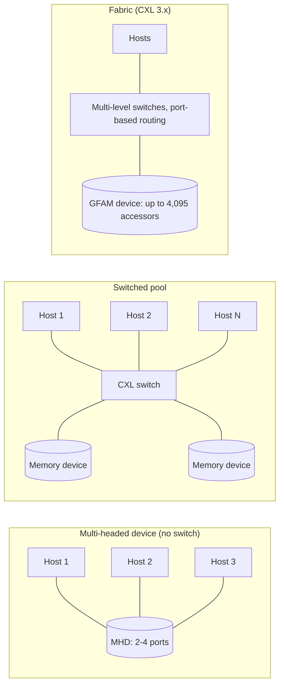
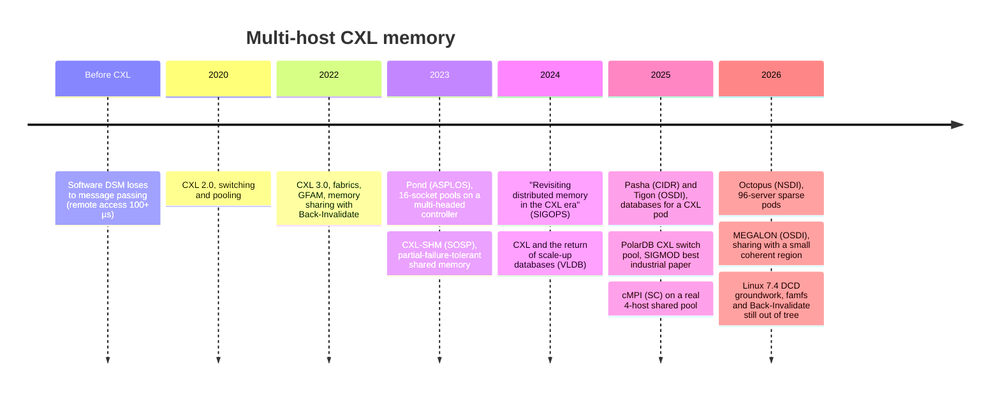
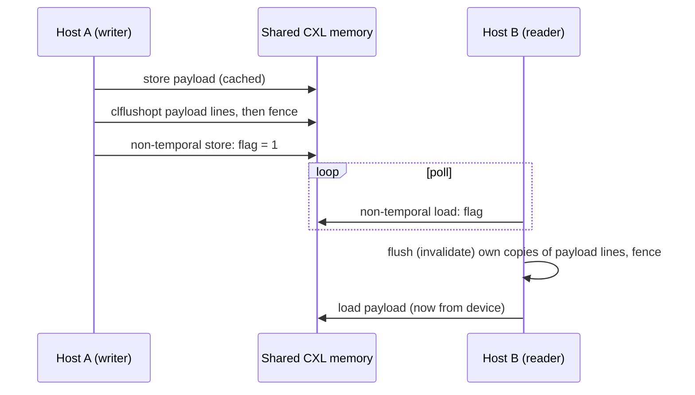

---
tags:
  - distributed-systems
  - infrastructure
  - cxl
  - memory-pooling
  - distributed-shared-memory
  - disaggregation
  - partial-failure
aliases:
  - CXL Pooling
  - CXL Memory Sharing
  - CXL Pods
status: complete
sources:
  - https://arxiv.org/pdf/2203.00241
  - https://arxiv.org/html/2501.09020v3
  - https://www.usenix.org/conference/nsdi26/presentation/zhong
  - https://computeexpresslink.org/wp-content/uploads/2023/12/CXL_3.0_white-paper_FINAL.pdf
  - https://arxiv.org/pdf/2404.03245
  - https://www.sigops.org/2024/revisiting-distributed-memory-in-the-cxl-era/
  - https://madsys.cs.tsinghua.edu.cn/publication/partial-failure-resilient-memory-management-system-for-cxl-based-distributed-shared-memory/SOSP23-zhang.pdf
  - https://vldb.org/cidrdb/2025/pasha-an-efficient-scalable-database-architecture-for-cxl-pods.html
  - https://www.cs.utexas.edu/~vijay/slides/pasha-slides.pdf
  - https://www.usenix.org/conference/osdi25/presentation/huang-yibo
  - https://dx-tang.github.io/paper/tigon-osdi25.pdf
  - https://www.usenix.org/system/files/osdi26-hu-jiyu.pdf
  - https://arxiv.org/pdf/2502.11046
  - https://arxiv.org/pdf/2510.05476
  - https://arxiv.org/pdf/2401.01150
  - https://netdevconf.info/0x1A/docs/netdev-0x1a-paper21-talk-paper.pdf
  - https://computeexpresslink.org/?p=4527
  - https://lwn.net/Articles/1082687/
  - https://phoronix.com/news/Linux-7.3-Preps-Toward-FAMFS
  - https://lpc.events/event/19/contributions/2178/attachments/1843/4003/famfs-lpc-2025.pdf
  - https://lwn.net/Articles/1085643/
  - https://phoronix.com/news/Linux-7.4-CXL
  - https://futurumgroup.com/insights/marvell-scales-ai-memory-to-48tb-behind-a-single-cxl-switch-at-fms-2026/
created: 2026-11-28
updated: 2026-11-28
---

## Table Of Contents

---

- [[#TL;DR|TL;DR]]
- [[#The Problem|The Problem]]
- [[#Foundations|Foundations]]
    - [[#Pooling Versus Sharing|Pooling Versus Sharing]]
    - [[#Three Ways to Wire a Pod|Three Ways to Wire a Pod]]
    - [[#Why Pooling Saves Memory|Why Pooling Saves Memory]]
- [[#How We Got Here|How We Got Here]]
- [[#How It Works|How It Works]]
    - [[#Pooling: Slices, a Pool Manager and a Buffer|Pooling: Slices, a Pool Manager and a Buffer]]
    - [[#Sparse Pods: Octopus|Sparse Pods: Octopus]]
    - [[#Sharing: Hardware Coherence Is Small|Sharing: Hardware Coherence Is Small]]
    - [[#Software Coherence in Practice|Software Coherence in Practice]]
    - [[#Partial Failure: Shared Memory Is a Distributed System|Partial Failure: Shared Memory Is a Distributed System]]
    - [[#Databases on a CXL Pod|Databases on a CXL Pod]]
- [[#Where It Is Now|Where It Is Now]]
- [[#Trade-offs & Open Problems|Trade-offs & Open Problems]]
- [[#Resources|Resources]]
- [[#Related Notes|Related Notes]]

> This note covers the **multi-host** side of CXL: pools, pods, shared memory and their failure behaviour. CXL versions, device types and how Linux tiers pages between DRAM and CXL on one machine are in [[CXL and Memory Tiering]] (Operating Systems). The wider picture of splitting servers into pools is in [[Disaggregated Systems]].

## ***TL;DR***
---
*CXL lets several servers attach to the same memory hardware. Giving each server its own slice of that memory ("pooling") is a resource-allocation problem and works today; letting servers read and write the same bytes ("sharing") turns a rack into a distributed shared-memory machine, with all the coherence and partial-failure problems that implies.*

- **Pooling** carves one device's (or switch's) memory into slices owned by one host at a time. Microsoft's Pond showed pools of **8 to 16 sockets** capture most of the savings, cutting Azure DRAM by about **7 to 9%**, with **1 GB** slices moved between hosts by a pool manager ([Pond, ASPLOS 2023](https://arxiv.org/pdf/2203.00241)).
- **Topology is the cost driver.** A CXL switch adds at least **220 ns** per round trip and makes CXL devices about **12%** of server cost. Octopus (NSDI 2026) wires small 4-port devices in a sparse pattern so **96 servers** pool memory with no switch, at about **5%** of server cost ([Octopus](https://arxiv.org/html/2501.09020v3)).
- **Sharing** lets hosts map the same region. CXL 3.0 added hardware coherence across hosts (Back-Invalidate), but snoop-filter cost means only a **small** region (tens to hundreds of MB) is expected to be hardware-coherent; the rest needs software flushes, which cost about **2.8x** in latency ([Tigon](https://dx-tang.github.io/paper/tigon-osdi25.pdf); [cMPI, SC 2025](https://arxiv.org/pdf/2510.05476)).
- **Partial failure is the hard part.** A host can crash while holding a lock or a reference in shared memory; nothing cleans up for it. CXL-SHM (SOSP 2023) built crash-tolerant reference counting; most CXL-pod databases (Tigon, MEGALON) still assume fail-stop: one crash restarts everything.
- **Status, Nov 2026.** Pooling silicon is demoed and Alibaba runs a switch pool in canary; cross-host coherent sharing "exists far more completely on paper than in silicon" ([Netdev 0x1A](https://netdevconf.info/0x1A/docs/netdev-0x1a-paper21-talk-paper.pdf)). Linux 7.4 merged dynamic-capacity groundwork but not DCD itself; Back-Invalidate support and the famfs shared-memory file system are still out of tree.

## ***The Problem***
---
*Every server is sized for its own peak memory, so a fleet holds far more DRAM than it ever uses at once. Sharing that memory across machines used to mean a network and microseconds; CXL makes it nanoseconds, but only inside a rack and only if software copes with memory that other machines also touch.*

- **Stranded memory.** In Azure, 3% to 27% of DRAM is stranded (no VM can use it) at the 95th percentile, and the median VM never touches half its memory ([Pond](https://arxiv.org/pdf/2203.00241)). DRAM can be about half the cost of a cloud server ([Pond](https://arxiv.org/pdf/2203.00241)), so a few percent is real money. See also [[Overcommit and Vertical Autoscaling]] for the software answers to the same waste.
- **Remote memory used to be slow.** RDMA cut remote access from 100+ µs to a few µs ([Ma and Zhang, SIGOPS 2024](https://www.sigops.org/2024/revisiting-distributed-memory-in-the-cxl-era/)), good enough to page to but not to load from (see [[Disaggregated Systems]]). A 64-byte read on a direct CXL device takes 230 to 270 ns; through a top-of-rack RDMA path, about 3,550 ns ([Octopus, Fig. 2](https://arxiv.org/html/2501.09020v3)).
- **Shared-nothing has its own tax.** Distributed databases partition data so each node owns a piece, then pay for every cross-partition transaction with messages and [[Distributed Transactions|two-phase commit]]. If the rack had one shared memory, a multi-node transaction could become a single-node one ([Pasha, CIDR 2025](https://vldb.org/cidrdb/2025/pasha-an-efficient-scalable-database-architecture-for-cxl-pods.html)).

So the question is not "can servers share memory" but: **how big a group can share cheaply, what does the hardware actually keep coherent, and what happens when one member of the group dies mid-operation?**

## ***Foundations***
---
*Know the difference between pooling and sharing, the three physical ways to connect hosts to memory, and the arithmetic that makes a shared pool smaller than the sum of private ones.*

### Pooling Versus Sharing

| | **Pooling** (CXL 2.0) | **Sharing** (CXL 3.0+) |
|---|---|---|
| Who can touch a byte | One host at a time | Several hosts at once |
| What moves between hosts | Ownership of capacity (slices, extents) | Data, through caches |
| Coherence across hosts | Not needed | Needed: hardware (Back-Invalidate) or software (flush and fence) |
| Failure question | "Whose memory was on the dead device?" | "What did the dead host leave half-written or locked?" |
| Software view | A new [[NUMA]] node that grows and shrinks | Distributed shared memory (DSM) |

The CXL 3.0 white paper defines pooling as treating CXL memory as a "fungible resource that can be flexibly allocated and deallocated to different servers," and sharing as one region "accessed by more than one host" with hardware keeping every host's view current ([CXL 3.0 white paper](https://computeexpresslink.org/wp-content/uploads/2023/12/CXL_3.0_white-paper_FINAL.pdf)).

### Three Ways to Wire a Pod

A **CXL pod** is the group of hosts that can reach the same memory: in current research, about 8 to 16 hosts ([Tigon](https://dx-tang.github.io/paper/tigon-osdi25.pdf)), up to 96 in sparse designs ([Octopus](https://arxiv.org/html/2501.09020v3)).

- **Multi-headed device (MHD).** One memory controller with several CXL ports, each to a different host; each host sees it as its own memory device. Pond's External Memory Controller is one ([Pond §4.1](https://arxiv.org/pdf/2203.00241)). Low latency, but the port count (2 to 4 today) caps the fully connected pod. Octopus calls these *multi-ported devices*.
- **Switch.** Any host reaches any device through a switch. Bigger pods, but the switch adds latency (P50 490 to 600 ns for a 64-byte read, against 260 to 300 ns for an MHD) and cost ([Octopus, Fig. 2](https://arxiv.org/html/2501.09020v3)).
- **Fabric.** CXL 3.0's port-based routing supports non-tree topologies of up to **4,096 nodes**; a Global Fabric-Attached Memory (GFAM) device can be reached by up to 4,095 of them ([CXL 3.0 white paper](https://computeexpresslink.org/wp-content/uploads/2023/12/CXL_3.0_white-paper_FINAL.pdf)). Physical reach is about 2 m even with retimers ([Netdev 0x1A](https://netdevconf.info/0x1A/docs/netdev-0x1a-paper21-talk-paper.pdf)), so "fabric" still means one or two racks.

### Why Pooling Saves Memory

Private memory must cover each host's own peak. A pool only has to cover the peak of the total, and peaks rarely line up.

$$M_{\text{private}} = \sum_{i} \max_{t}\, d_i(t) \;\;\ge\;\; M_{\text{pooled}} = \max_{t} \sum_{i} d_i(t)$$

*In words: the sum of peaks is never smaller than the peak of the sum. The gap is what pooling saves, and it grows with more hosts and less correlated demand.*

**Worked example (illustrative numbers).** Four hosts each need 400 GB at their own peak, but the peaks come at different hours; at the busiest moment the four together need 1,450 GB. Private provisioning buys $4 \times 400 = 1{,}600$ GB. A pod that gives each host 300 GB locally and pools the rest needs $4 \times 300 = 1{,}200$ GB local plus a pool sized for the worst-case overflow, $1{,}450 - 1{,}200 = 250$ GB, so 1,450 GB total: **150 GB (about 9%) saved**, close to Pond's measured 7 to 9%. Two caveats sit in this sum: the pool must be sized for a high percentile of overflow, not the average, and only memory placed in the pool pays CXL latency, which is why Pond only pools memory a VM is predicted not to touch or not to care about.

## ***How We Got Here***
---
*Distributed shared memory is an old idea that lost to message passing because remote memory was slow. CXL brought remote memory back to load-store speed inside a rack, and the research since 2023 is rediscovering DSM's coherence and failure problems with new hardware.*

- **DSM, then and now.** Message passing won because a remote access cost 100+ µs; Ma and Zhang argue CXL's 300 to 500 ns remote access reopens the case, since DSM passes references instead of copying payloads and rebalancing only moves ownership metadata, not data ([SIGOPS blog, Jan 2024](https://www.sigops.org/2024/revisiting-distributed-memory-in-the-cxl-era/)).
- **Pooling first.** Pond (2023) designed the economics and the control plane for pooling only; it explicitly avoided sharing.
- **The scale-up argument.** Lerner and Alonso argue CXL could turn "a rack into a single shared-memory machine," reversing two decades of scale-out databases, while noting that coherence traffic might dominate access time and that CXL loads were about 35% slower than NUMA in Intel's measurements ([PVLDB 17(10), 2024](https://arxiv.org/pdf/2401.01150)).
- **Then the sharing systems** (2023 to 2026), all of which hit the same two walls: coherence is small and failures are partial.

## ***How It Works***
---
*Pooling is a control-plane problem: who owns which slice, and how fast it can move. Sharing is a data-plane and fault-tolerance problem: keep caches consistent across hosts with little hardware help, and survive a host that dies holding something.*

### Pooling: Slices, a Pool Manager and a Buffer

Pond's design is the reference point ([Pond §4](https://arxiv.org/pdf/2203.00241)):

- **Slices.** Pool memory is managed in **1 GB slices**, each owned by at most one host. The controller keeps a permission table (768 bytes covers 1 TB and 64 hosts) and checks every access; a disallowed access is a fatal memory error, which is how isolation is enforced in hardware.
- **Pool Manager.** A control-plane service calls `Add_capacity(host, slice)` (the host driver hot-plugs the range; the controller adds the host to the slice's permissions) and `Release_capacity(host, slice)` (the host offlines it; permission is reset).
- **Asymmetric speeds.** Onlining takes microseconds per GB, but offlining takes **10 to 100 ms per GB**, because the host must evict whatever it put there. So Pond keeps a buffer of unallocated pool memory for VM starts and refills it asynchronously when VMs end. This is the same pattern as keeping warm spares in [[Cluster Scheduling]].
- **What goes in the pool.** A model predicts which VMs are latency-insensitive and how much memory each will leave untouched; that part lands in the pool as a zero-core NUMA node. See [[CXL and Memory Tiering]] for how the OS keeps the hot part local.

CXL 3.0's **Dynamic Capacity Device (DCD)** standardizes the same move: a Fabric Manager adds and releases *extents* to hosts at runtime. In an April 2026 demo, Montage moved 8 GB extents between two hosts on one dual-port controller without reboots (host 1: 64 → 80 → 64 GB; host 0: 32 → 40 GB) ([CXL Consortium blog](https://computeexpresslink.org/?p=4527)). It was an evaluation board, not a deployment.

### Sparse Pods: Octopus

Switches are expensive and slow; MHDs are cheap and fast but have only a few ports. Octopus asks: what if each host connects to *several* small MHDs, and each MHD connects to a *different* subset of hosts ([Zhong et al., NSDI 2026](https://arxiv.org/html/2501.09020v3))?

It uses a **balanced incomplete block design (BIBD)**: within an "island" of $v$ servers, every MHD has $k$ ports, and every pair of servers shares exactly one MHD. The standard BIBD counts then give the number of devices $b$ and ports per server $r$:

$$b = \frac{v(v-1)}{k(k-1)}, \qquad r = \frac{v-1}{k-1}$$

*In words: count all server pairs, divide by the pairs each device covers, and you get how many devices are needed; each server must then plug into enough devices to meet the other $v-1$ servers, $k-1$ at a time.*

**Worked example.** With 4-port MHDs ($k = 4$) and a 16-server island ($v = 16$): $b = 16 \cdot 15 / 12 = 20$ devices and $r = 15 / 3 = 5$ ports per server. That matches the paper's island: 5 of each server's 8 CXL ports go to island MHDs, the other 3 to external MHDs that link 6 islands into a **96-server pod** with 192 MHDs. Other valid islands: $v = 13$ ($r = 4$, 13 devices) and $v = 25$ ($r = 8$, 50 devices).

| Design | Devices per server (modeled) | Share of server capex | Memory saved by pooling |
|---|---|---|---|
| Octopus-96 | about $1,548 | about 5% | about 16% |
| Switch, 90 servers (optimistic) | about $3,460 | about 12% | about 16% |
| Switch, fully connected, 20 servers | not reported | not reported | about 12% |

Because MHD latency is lower, Octopus estimates about 65% of DRAM can live in the pool versus about 35% behind a switch. Hosts in the same island also talk through their shared MHD: a median RPC of **1.2 µs** on a 3-server prototype, against 3.8 µs over RDMA. Hosts in different islands relay through an intermediate host, which costs about as much as RDMA. All cost numbers are the authors' models.

### Sharing: Hardware Coherence Is Small

On one server, the CPU's caches stay coherent because every core snoops or consults a directory. Across hosts, CXL 3.0 makes the **memory device** keep a snoop filter of which hosts cache which lines, and lets it **Back-Invalidate (BI)** a host's cached copy before another host writes ([CXL 3.0 white paper](https://computeexpresslink.org/wp-content/uploads/2023/12/CXL_3.0_white-paper_FINAL.pdf)). The problem is size:

- Precise 64-byte tracking for terabytes is impractical; coarse 4 KB tracking causes needless invalidations. AMD's engineers propose a precise filter only for a small region (atomics, semaphores, queue metadata) and software coherence for the rest ([Jain et al., HCDS 2024](https://arxiv.org/pdf/2404.03245)).
- For a 16-host rack, a worst-case snoop filter at a GFAM device would need about **1.8 billion entries (14.4 GB)**, roughly 16 times a single NUMA snoop filter; on an FPGA prototype each remote invalidation round trip took about **850 ns**, and filter-conflict evictions add three more CXL round trips ([CTXNL, arXiv 2025](https://arxiv.org/pdf/2502.11046)).
- So systems assume a **small hardware-coherent region** (Tigon caps it at **200 MB**, citing AMD's expectation of "dozens to hundreds of MBs") and a **large non-coherent region** ([Tigon](https://dx-tang.github.io/paper/tigon-osdi25.pdf); [MEGALON](https://www.usenix.org/system/files/osdi26-hu-jiyu.pdf)).

The common split, in every sharing system above: **synchronization metadata** (locks, latches, versions, queue heads) goes in the coherent region; **bulk data** goes in the non-coherent region and is protected by that metadata.

### Software Coherence in Practice

Without hardware help, a host's CPU cache can hold a stale copy of a line another host just wrote. The fix is manual: the writer flushes its lines to the device, the reader invalidates its lines before reading, and a flag says when data is ready.

This is exactly cMPI's protocol on a real 4-host, switchless FPGA pool (Niagara 2.0, PCIe 4.0, 1 TB DDR4): flush and fence after every write, fence and flush before every read, and non-temporal loads and stores for flags and queue pointers ([cMPI, SC 2025](https://arxiv.org/pdf/2510.05476)). The cost:

| Path | Latency | Bandwidth |
|---|---|---|
| Local DRAM | 100 ns | 132.8 GB/s |
| CXL shared, no flushing (unsafe) | 790 ns | 9.9 GB/s |
| CXL shared, with flushing | 2.2 µs | 9.5 GB/s |
| RoCEv2 (ConnectX-6 Dx) | 1.6 µs | 10.8 GB/s |
| TCP (ConnectX-6 Dx) | 18 µs | 11.5 GB/s |

Flushing makes shared CXL **2.8x** slower; on this PCIe 4.0 prototype it beats TCP by 7 to 8x but not RDMA. That is the honest baseline for any "CXL replaces the network" claim: on today's hardware it beats kernel networking, and matching RDMA needs faster links or hardware coherence. (MTRR-uncacheable mappings were worse: over 4,000 µs for data above 2 KB.)

### Partial Failure: Shared Memory Is a Distributed System

In one process, a crash takes everything with it. In a CXL pod, a host can die while the memory, and the other hosts, keep running. Whatever it was in the middle of stays in shared memory. This is the [[Failure Models|partial failure]] problem, now at load-store granularity.

**What can go wrong.** A host holds a lock in shared memory and crashes: everyone else blocks forever, the reason [[Leases and Fencing]] exist. A host passes an object reference to another host and crashes: free it and the other host has a dangling pointer; don't free it and it may leak forever ([CXL-SHM](https://madsys.cs.tsinghua.edu.cn/publication/partial-failure-resilient-memory-management-system-for-cxl-based-distributed-shared-memory/SOSP23-zhang.pdf)).

**CXL-SHM (Zhang et al., SOSP 2023)** makes reference counting crash-safe without blocking other clients:

1. Each client keeps an **era** number; a shared era matrix records which era of each client others have seen.
2. To attach a reference, the client logs the intended new count, then does **one compare-and-swap** on the object's count: that CAS is the commit point.
3. It then sets the pointer (idempotent, so recovery can redo it) and advances its era.
4. If the client dies, a recovery service checks the object header and the era matrix to decide whether the CAS happened, and redoes the pointer step if so. Frees that might leak are marked and scanned later instead of being redone.

It ran on real CXL 2.0 hardware (two hosts, one shared device) with software cache invalidation, recovered about **23.5 million objects per second**, and found no leaks, double frees or wild pointers across 100,000+ fault-injection runs. Its pass-by-reference RPC reached 3.8 to 4.6 times the throughput of RDMA RPC for 64-byte payloads, because nothing is copied.

**Most others assume fail-stop.** Tigon and MEGALON treat any host or memory failure as a whole-pod failure and recover from logs or disk ([Tigon](https://dx-tang.github.io/paper/tigon-osdi25.pdf); [MEGALON](https://www.usenix.org/system/files/osdi26-hu-jiyu.pdf)). Pasha's authors name the goal they haven't reached: a dead process should recover and rejoin (they estimate 1 to 15 ms restart, about 10 ms recovery) while the rest stay up, which needs non-blocking structures or lock ownership plus logs ([Pasha slides](https://www.cs.utexas.edu/~vijay/slides/pasha-slides.pdf)).

**The pool itself can fail too.** Pond limits blast radius by not interleaving a host's memory across controllers: a controller failure hits only VMs with memory on that controller, and a Pool Manager failure blocks reallocation but not the data path ([Pond §4.2](https://arxiv.org/pdf/2203.00241)). That is [[Zonal Isolation and Cell-Based Architecture|cell thinking]] at rack scale.

### Databases on a CXL Pod

| System | Where data lives | Coherence | Failure model | Reported result (vendor/author numbers) |
|---|---|---|---|---|
| **Pasha** (CIDR 2025) | Partitions in local DRAM; cross-host active tuples moved to CXL | HW for sync metadata, SW for tuples | Partial failure as future work | 5.9x over a network Sundial on TPC-C NewOrder+Payment at 60/90% cross-warehouse, 8 VMs ([slides](https://www.cs.utexas.edu/~vijay/slides/pasha-slides.pdf)) |
| **Tigon** (OSDI 2025) | Same idea; indexes, latches and 2PL locks in the 200 MB coherent region | Per-row bitmap of hosts allowed to cache; others flush | Fail-stop, logs on local SSD | Up to 2.5x a CXL-transport shared-nothing DB on TPC-C; 1 to 8 hosts scaled 5.7x vs 2.4x ([paper](https://dx-tang.github.io/paper/tigon-osdi25.pdf)) |
| **MEGALON** (OSDI 2026) | Index replicated in each host's DRAM; tiny coherence records (lock bit, free bit, counter) in coherent memory; a shared log keeps index replicas in sync | Seqlock-style readers flush stale lines | Fail-stop | 3 to 14x over a design keeping all metadata coherent on YCSB; 12x larger datasets without churn ([paper](https://www.usenix.org/system/files/osdi26-hu-jiyu.pdf)) |
| **CTXNL** (arXiv 2025) | Records in GFAM | Strict for metadata, loose for records with explicit sync at commit | n/a | Up to 2.08x vanilla CXL sharing; vanilla sharing was 2.51x slower than local DRAM ([paper](https://arxiv.org/pdf/2502.11046)) |

The pattern: a cross-host transaction stops being [[Distributed Transactions|two-phase commit]] over messages and becomes a single-host transaction using locks in shared memory. Tigon's own numbers show the limit: with no multi-partition transactions, the shared-nothing baseline was up to **37% faster**, so a pod helps only when work really crosses partitions. MEGALON's shared log for keeping replicas consistent is the [[Logs and Streaming|log-as-truth]] idea in miniature.

Two caveats apply to the whole table. Tigon, Pasha and MEGALON were evaluated on **emulation** (VMs or sockets of one machine sharing a CXL card, so cross-"host" coherence is the CPU's own, faster than real inter-host coherence), and Tigon's 15.9 to 18.5x lead over the RDMA system Motor was against a 25 Gb/s network.

## ***Where It Is Now***
---
*As of November 2026, pooling hardware and its control plane exist in demos, one canary database and vendor switches; cross-host coherent sharing is a spec feature waiting for silicon, and research systems emulate it.*

**Hardware.**
- **Pooling devices:** Montage's CXL 3.2 controller showed DCD with a multi-headed device across two hosts (Apr 2026); Montage says sharing of the same region is next ([CXL Consortium blog](https://computeexpresslink.org/?p=4527)). Marvell's Structera S switch connects 16 or 32 hosts to up to 48 TB at under 460 ns round trip, with no named hyperscaler ([Futurum, Aug 2026](https://futurumgroup.com/insights/marvell-scales-ai-memory-to-48tb-behind-a-single-cxl-switch-at-fms-2026/)). Alibaba's PolarDB runs a CXL 2.0 switch pool in canary release (details in [[Disaggregated Systems]]).
- **Sharing:** The cross-host coherent fabric "exists far more completely on paper than in silicon," and multi-host coherent switch silicon is "nascent" (Jump Trading's PJ Waskiewicz, [Netdev 0x1A](https://netdevconf.info/0x1A/docs/netdev-0x1a-paper21-talk-paper.pdf)). Real shared-pool research uses FPGA prototypes without hardware coherence (cMPI's Niagara 2.0, CXL-SHM's CXL 2.0 setup).

**Linux.**

| Piece | State, Nov 2026 |
|---|---|
| DCD groundwork (mailbox, partitions, interrupts) | Merged in **Linux 7.4** (26 Oct 2026); DCD itself "not enabled yet" ([Phoronix](https://phoronix.com/news/Linux-7.4-CXL)) |
| Back-Invalidate (HDM-DB) discovery and setup | Patch v6 posted 27 Jul 2026 targeting 7.3; author: "there is no Type 2 + BI hardware out there," GFAM not implemented ([LWN](https://lwn.net/Articles/1085643/)). Not in the 7.4 CXL pull; I could not confirm it merged. |
| **famfs** (Micron's file system for shared fabric memory) | DAX preparation merged in 7.3 (Aug 2026); famfs itself not merged. At LSFMM+BPF (Jul 2026) maintainers agreed a path through a generic "FUSE map" layer ([LWN](https://lwn.net/Articles/1082687/), [Phoronix](https://phoronix.com/news/Linux-7.3-Preps-Toward-FAMFS)) |

famfs is worth knowing because it is the first mainstream-kernel answer to "Linux cannot online memory shared with other hosts": format the shared DAX device as a file system, let one master node create pre-allocated files, and let every host `mmap` them. It targets mostly static data loaded once and read by many hosts (Micron showed a 4.6 TB graph analysed across four nodes); for writes, "the application is responsible" ([LPC 2025 slides](https://lpc.events/event/19/contributions/2178/attachments/1843/4003/famfs-lpc-2025.pdf); [LWN](https://lwn.net/Articles/1082687/)).

**Research.** Octopus (NSDI 2026) moved the topology question from "how big a switch" to "how sparse a graph." MEGALON (OSDI 2026) moved the coherence question from "fit all metadata in the coherent region" to "keep only per-object coherence records there." Partial-failure tolerance beyond CXL-SHM's allocator is still mostly an open problem.

## ***Trade-offs & Open Problems***
---
*Pooling trades a little latency and a new shared component for fewer DIMMs; sharing trades messages for coherence and failure handling that hardware does not yet provide. The open questions are about size: how big a pod, how big a coherent region, how big a blast radius.*

| Choice | You get | You pay |
|---|---|---|
| Multi-headed devices | Lowest latency, no switch | Few ports per device; small pods unless wired sparsely |
| Switches and fabrics | Any host to any device; big pools | 220+ ns more per round trip; cost; one more box to fail |
| Sparse topology (Octopus) | Big pods at MHD latency and cost | Not every host pair shares a device; cross-island messages relay |
| Pooling only | No coherence problem; hardware isolation per slice | Slow release (10 to 100 ms per GB); buffer memory held in reserve |
| Hardware-coherent sharing | Ordinary loads, stores and atomics across hosts | Small coherent region; snoop-filter cost; silicon not shipping |
| Software-coherent sharing | Works on today's hardware | 2.8x latency for flushes; every access path must be written carefully |
| Fail-stop pod design | Simple recovery from logs | One host crash restarts every host |

**Open problems.**

- **Partial failure at load-store speed.** Locks, references and half-written records left by a dead host. Leases need a clock or a fencing check on the access path ([[Leases and Fencing]]); CXL-SHM's era-based approach covers memory management, not general data structures.
- **How big is the coherent region, really?** Every design is tuned for "tens to hundreds of MB," an estimate, not a measured product.
- **Emulation gap.** Most sharing results run on one machine pretending to be several. Earlier CXL measurements found NUMA-based emulation off by 35% to 3x on plain loads ([Sun et al., MICRO 2023](https://arxiv.org/pdf/2303.15375)); inter-host coherence costs are likely worse.
- **Is pooling worth the box?** Octopus models a 3% capex saving, but a switched design *increases* capex by 3.3% against servers with no CXL ([Octopus](https://arxiv.org/html/2501.09020v3)). Savings depend entirely on topology and on how much memory workloads let you pool.
- **Isolation and security.** A pool is a shared resource: noisy neighbours on device bandwidth (CXL bandwidth is 5 to 25 GB/s depending on access pattern, per [Pasha's slides](https://www.cs.utexas.edu/~vijay/slides/pasha-slides.pdf)) and the need to zero memory before reassigning it ([Jain et al.](https://arxiv.org/pdf/2404.03245)). See [[Multi-Tenant Storage QoS]] and [[Resource Fairness]] for the same problems one tier down.
- **CXL vs RDMA.** For messaging, today's shared pools beat TCP but not RDMA; for whole-rack transactions, they beat message-passing designs only when work crosses partitions.

## ***Resources***
---
*Start with Pond for pooling, Octopus for topology, Ma and Zhang's blog for why sharing is DSM again, CXL-SHM for partial failure, then Tigon and MEGALON for what databases do with it.*

**Pooling**
- [Pond: CXL-Based Memory Pooling Systems for Cloud Platforms](https://arxiv.org/pdf/2203.00241): Li et al., Microsoft and CMU, ASPLOS 2023.
- [Octopus: Enhancing CXL Memory Pods via Sparse Topology](https://arxiv.org/html/2501.09020v3): Zhong, Kazhamiaka, Zardoshti, Teng, Fonseca, Hill and Berger, Columbia, Microsoft Azure, UW-Madison, UW; [NSDI 2026 page](https://www.usenix.org/conference/nsdi26/presentation/zhong).
- [CXL DCD with multi-head device demo](https://computeexpresslink.org/?p=4527): Montage, CXL Consortium blog, Apr 2026 (vendor).

**Spec and hardware**
- [CXL 3.0 white paper](https://computeexpresslink.org/wp-content/uploads/2023/12/CXL_3.0_white-paper_FINAL.pdf): CXL Consortium (pooling, sharing, Back-Invalidate, GFAM, 4,096-node fabrics).
- [Memory Sharing with CXL: Hardware and Software Design Approaches](https://arxiv.org/pdf/2404.03245): Jain, Yeleswarapu, Maruf and Gupta, AMD, HCDS 2024.
- [Past Memory Expansion: The Bandwidth Wall and the Road to Native Cluster Execution on Coherent CXL Fabrics](https://netdevconf.info/0x1A/docs/netdev-0x1a-paper21-talk-paper.pdf): PJ Waskiewicz, Jump Trading, Netdev 0x1A.

**Sharing and failure**
- [Revisiting Distributed Memory in the CXL Era](https://www.sigops.org/2024/revisiting-distributed-memory-in-the-cxl-era/): Teng Ma and Mingxing Zhang, SIGOPS blog, Jan 2024.
- [Partial Failure Resilient Memory Management System for (CXL-based) Distributed Shared Memory](https://madsys.cs.tsinghua.edu.cn/publication/partial-failure-resilient-memory-management-system-for-cxl-based-distributed-shared-memory/SOSP23-zhang.pdf): Zhang et al., Tsinghua, Alibaba, Intel, SOSP 2023.
- [cMPI: Using CXL Memory Sharing for MPI One-Sided and Two-Sided Inter-Node Communications](https://arxiv.org/pdf/2510.05476): Wang et al., SC 2025.

**Databases on a pod**
- [Pasha: An Efficient, Scalable Database Architecture for CXL Pods](https://vldb.org/cidrdb/2025/pasha-an-efficient-scalable-database-architecture-for-cxl-pods.html): Huang, Ni, Chidambaram, Witchel and Tang, UT Austin, CIDR 2025; [slides](https://www.cs.utexas.edu/~vijay/slides/pasha-slides.pdf).
- [Tigon: A Distributed Database for a CXL Pod](https://dx-tang.github.io/paper/tigon-osdi25.pdf): Huang et al., UT Austin and UIUC, OSDI 2025; [USENIX page](https://www.usenix.org/conference/osdi25/presentation/huang-yibo).
- [MEGALON: Efficient Data Sharing for Partly Coherent CXL Memory](https://www.usenix.org/system/files/osdi26-hu-jiyu.pdf): Hu et al., UIUC and NVIDIA, OSDI 2026.
- [Enabling Efficient Transaction Processing on CXL-Based Memory Sharing](https://arxiv.org/pdf/2502.11046): Wang et al., Peking University, Alibaba DAMO, SJTU, arXiv 2025.
- [CXL and the Return of Scale-Up Database Engines](https://arxiv.org/pdf/2401.01150): Lerner and Alonso, PVLDB 17(10), 2024.

**Linux**
- [Merging famfs?](https://lwn.net/Articles/1082687/): Jake Edge, LWN, Jul 2026.
- [Linux 7.3 preps toward famfs](https://phoronix.com/news/Linux-7.3-Preps-Toward-FAMFS): Phoronix, Aug 2026.
- [famfs at LPC 2025](https://lpc.events/event/19/contributions/2178/attachments/1843/4003/famfs-lpc-2025.pdf): John Groves, Micron.
- [cxl: Support Back-Invalidate, v6](https://lwn.net/Articles/1085643/): Davidlohr Bueso, Jul 2026.
- [Linux 7.4 CXL changes](https://phoronix.com/news/Linux-7.4-CXL): Phoronix, Oct 2026.

## Related Notes

- [[CXL and Memory Tiering]] — CXL versions, device types and how Linux tiers pages on one host (Operating Systems).
- [[Disaggregated Systems]] — The wider split of compute, memory and storage; CXL deployments (Azure, PolarDB, Marvell).
- [[NUMA]] — How pool memory appears to a host: a CPU-less node.
- [[Failure Models]] — Fail-stop vs partial failure, the core question for shared pools.
- [[Leases and Fencing]] — What a crashed lock holder in shared memory needs.
- [[Distributed Transactions]] — The two-phase commit that CXL-pod databases replace with shared-memory locks.
- [[Consistency Models]] — What "every host sees the latest write" means, and what software coherence weakens.
- [[Logs and Streaming]] — MEGALON's shared log keeping index replicas consistent.
- [[Zonal Isolation and Cell-Based Architecture]] — Limiting blast radius, as Pond does per memory controller.
- [[Overcommit and Vertical Autoscaling]] — The software answer to the same stranded memory.
- [[Cluster Scheduling]] — Placing VMs and keeping spare capacity, as Pond's buffer does.
- [[Resource Fairness]] — Sharing device bandwidth among tenants.
- [[Multi-Tenant Storage QoS]] — Noisy neighbours on shared devices, one tier down.
- [[Gray and Fail-Slow Failures]] — A slow pool device slows every attached host.
- [[RDMA and Datacenter Transports]] — The network alternative CXL pods are measured against.
- [[Disaggregated Memory Indexes]] — B-trees and LSMs built for RDMA and CXL memory pools.
- [[GPU Cluster Infrastructure]] — Where CXL pools are pitched as a KV cache tier.
