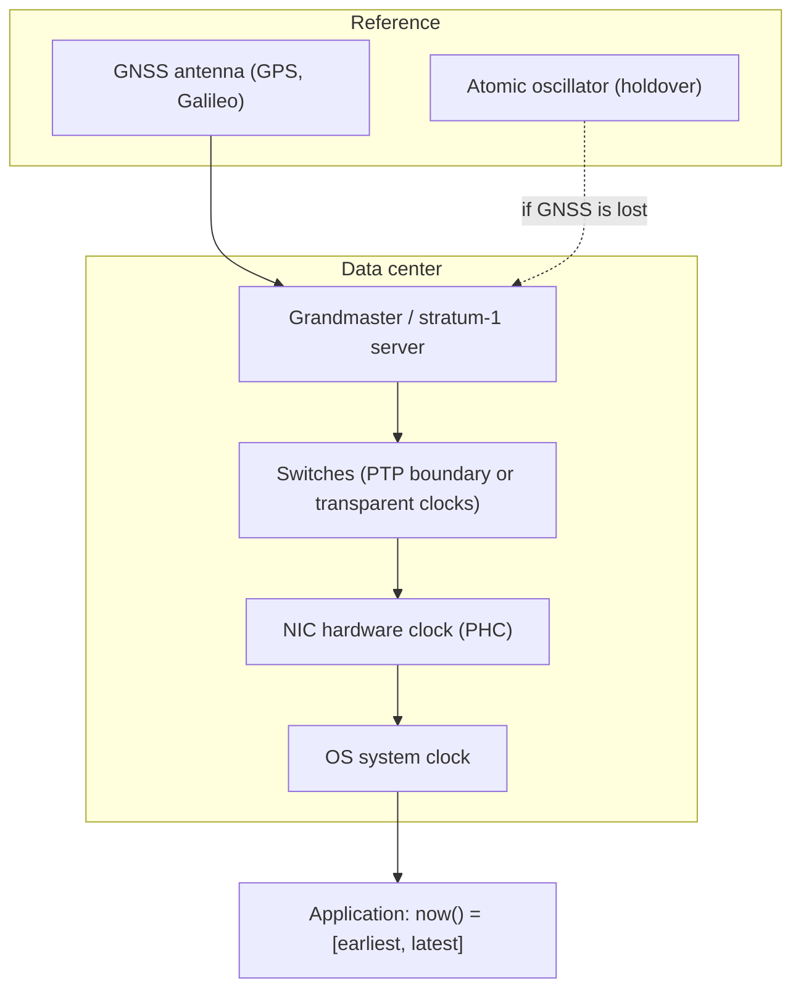
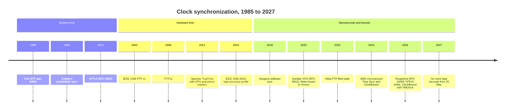
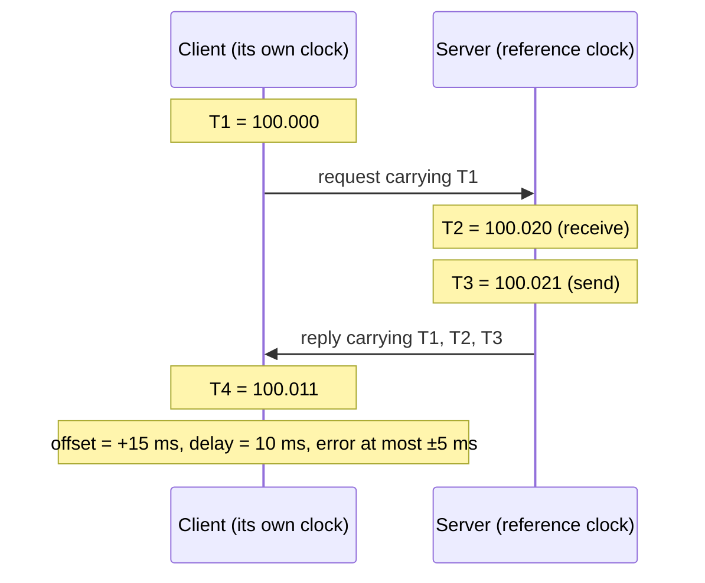

---
tags:
  - distributed-systems
  - infrastructure
  - clock-synchronization
  - time-and-clocks
status: draft
sources:
  - https://www.rfc-editor.org/rfc/rfc5905
  - https://web.eecs.umich.edu/~manosk/assets/papers/Cristian.pdf
  - https://www.rfc-editor.org/rfc/rfc8915
  - https://www.rfc-editor.org/rfc/rfc10049.html
  - https://datatracker.ietf.org/doc/html/draft-ietf-ntp-ntpv5-09
  - https://www.cs.princeton.edu/courses/archive/fall15/cos518/papers/spanner.pdf
  - https://www.usenix.org/conference/nsdi18/presentation/geng
  - https://usenix.org/conference/osdi20/presentation/li-yuliang
  - https://engineering.fb.com/production-engineering/ntp-service/
  - https://engineering.fb.com/2021/08/11/open-source/time-appliance/
  - https://engineering.fb.com/2022/11/21/production-engineering/precision-time-protocol-at-meta/
  - https://engineering.fb.com/2025/02/03/production-engineering/how-precision-time-protocol-ptp-handles-leap-seconds/
  - https://developers.google.com/time/smear
  - https://aws.amazon.com/blogs/compute/its-about-time-microsecond-accurate-clocks-on-amazon-ec2-instances
  - https://github.com/aws/clock-bound
  - https://docs.rs/crate/clock-bound-vmclock/2.0.3/source/README.md
  - https://techcrunch.com/2022/03/16/clockwork-raises-21m-to-keep-server-clocks-in-sync/
  - https://lkml.rescloud.iu.edu/hypermail/linux/kernel/2605.1/11673.html
  - https://uapi-group.org/specifications/specs/vmclock/
  - https://docs.cloud.google.com/spanner-omni/true-time-external-consistency
  - https://muratbuffalo.blogspot.com/2025/01/use-of-time-in-distributed-databases_14.html
  - https://www.bipm.org/committees/cg/cgpm/28-2026/resolution-5
created: 2026-11-26
updated: 2026-11-26
---

## Table Of Contents

---

- [[#TL;DR|TL;DR]]
- [[#The Problem|The Problem]]
- [[#Foundations|Foundations]]
    - [[#Offset, Drift and Error Bound|Offset, Drift and Error Bound]]
    - [[#Reference Clocks and the Time Hierarchy|Reference Clocks and the Time Hierarchy]]
    - [[#Stepping vs Slewing|Stepping vs Slewing]]
- [[#How We Got Here|How We Got Here]]
- [[#How It Works|How It Works]]
    - [[#The Four-Timestamp Exchange|The Four-Timestamp Exchange]]
    - [[#Choosing Which Servers to Believe|Choosing Which Servers to Believe]]
    - [[#Turning a Sync Into an Error Bound|Turning a Sync Into an Error Bound]]
    - [[#PTP and Hardware Timestamps|PTP and Hardware Timestamps]]
    - [[#Huygens and Sundial|Huygens and Sundial]]
    - [[#Leap Seconds and Smearing|Leap Seconds and Smearing]]
    - [[#Securing Time|Securing Time]]
    - [[#Which Technique for Which Job|Which Technique for Which Job]]
- [[#Where It Is Now|Where It Is Now]]
- [[#Trade-offs & Open Problems|Trade-offs & Open Problems]]
- [[#Resources|Resources]]
- [[#Related Notes|Related Notes]]

## ***TL;DR***
---
*Clock synchronization is the plumbing under every timestamp a distributed system compares. It works by exchanging timestamped messages with a better clock, and its real output is not "the time" but the time plus an honest bound on how wrong it might be.*

- **The mechanism:** a client and a server exchange four timestamps. From them the client computes its **offset** (how far its clock is from the server's) and the **round-trip delay**. Because it can't tell how the delay splits between the two directions, half the round trip is a hard floor on the error ([RFC 5905](https://www.rfc-editor.org/rfc/rfc5905)).
- **Three generations:** **NTP** (1985 onward) over ordinary networks gets milliseconds over the internet and tens to hundreds of microseconds in a data center. **PTP** (IEEE 1588) timestamps packets in NIC and switch hardware and gets sub-microsecond. Research systems such as **Huygens** (NSDI 2018) and **Sundial** (OSDI 2020) reach tens to around a hundred nanoseconds ([Huygens](https://www.usenix.org/conference/nsdi18/presentation/geng), [Sundial](https://usenix.org/conference/osdi20/presentation/li-yuliang)).
- **Why databases care:** systems such as Spanner, Aurora DSQL and CockroachDB wait out or reason about clock uncertainty, so tighter sync turns directly into lower commit latency and fewer retries. See [[Time and Clocks]], [[Distributed SQL]] and [[Distributed Transactions]].
- **Where it is now (Nov 2026):** clouds sell microsecond time with an error bound (AWS ClockBound, now with a VMClock path that survives live migration), Meta runs PTP fleet-wide with a ~436 ns uncertainty window, the IETF published **Roughtime** as RFC 10049 (Oct 2026) and is finishing **NTPv5**, and leap seconds stop after 20 May 2027 ([CGPM Resolution 5](https://www.bipm.org/committees/cg/cgpm/28-2026/resolution-5)).

## ***The Problem***
---
*Every server has its own clock, and every clock drifts. Correcting them means asking another machine what time it is, but the answer arrives after an unknown delay, so the correction is itself uncertain.*

A quartz oscillator in a server typically runs 5 to 10 µs per second away from true rate and can reach 30 µs/s ([Huygens, NSDI 2018](https://www.usenix.org/conference/nsdi18/presentation/geng)). Left alone, two clocks 10 µs/s apart separate by 0.86 s a day. So every machine runs a sync daemon that periodically measures and corrects its clock.

The hard part is not reading a reference clock. It is that:

| Difficulty | Why it matters | Example |
|---|---|---|
| Unknown one-way delay | Only the round trip is measurable; the split between directions is a guess. | A 10 ms round trip leaves up to ±5 ms of doubt about the offset. |
| Queuing noise | Packets that sit in a switch queue make the delay look longer and lopsided. | Under load, data-center round trips swing by tens of µs, swamping sub-µs targets. |
| Liars and failures | A server can be misconfigured, broken or malicious; a GPS antenna can be jammed. | A wrong upstream server can drag every client with it. |
| Bad corrections | Jumping a clock backwards breaks code that subtracts timestamps. | Leap-second handling caused real outages (see [[Time and Clocks]]). |

The consequence for systems: everything that compares timestamps from different machines inherits sync error. [[Leases and Fencing|Leases]] assume a bound on clock rate, [[Distributed SQL|HLC databases]] assume a maximum offset, and Spanner waits out the uncertainty on every commit ([Spanner](https://www.cs.princeton.edu/courses/archive/fall15/cos518/papers/spanner.pdf)). If sync silently breaks those assumptions, the database is wrong rather than slow.

## ***Foundations***
---
*Three ideas carry the whole topic: the numbers that describe a clock's error, the hierarchy that carries time from atomic clocks to your process, and the two ways a daemon can correct a clock.*

#### **Offset, Drift and Error Bound**
| Term | Meaning |
|---|---|
| **Offset** $\theta$ | How far this clock is from the reference right now. |
| **Drift (frequency error)** | How fast the offset grows, in ppm or µs/s. |
| **Delay** $\delta$ | Round-trip time of a sync exchange, minus the server's processing time. |
| **Dispersion** | NTP's estimate of accumulated error, which grows with time since the last good sync ([RFC 5905](https://www.rfc-editor.org/rfc/rfc5905)). |
| **Error bound** $\varepsilon$ | A guaranteed (or high-confidence) limit on $|\text{clock} - \text{true time}|$. This is what [[Time and Clocks|TrueTime-style APIs]] expose. |

Precision and accuracy are different things: two clocks can agree with each other to 10 ns (precise) while both being 2 ms off UTC (inaccurate). Most distributed algorithms need the first; regulations and logs that cross organizations need the second.

#### **Reference Clocks and the Time Hierarchy**
Time flows down a tree. At the top are **reference clocks**: GNSS receivers (GPS, Galileo) or atomic clocks. NTP numbers the levels as **strata**: stratum 0 is the reference device, stratum 1 a server directly attached to one, stratum 2 a server syncing from stratum 1, and so on; stratum 16 means unsynchronized ([RFC 5905](https://www.rfc-editor.org/rfc/rfc5905)). Error accumulates at every hop.

When the GNSS signal is lost, a grandmaster keeps time on a local oscillator; this is **holdover**, and its quality (rubidium beats quartz) decides how long the error bound stays small. Meta's open-source **Time Card**, a PCIe card with a GNSS receiver and an atomic oscillator, was built to make such grandmasters cheap ([Meta, Aug 2021](https://engineering.fb.com/2021/08/11/open-source/time-appliance/)).

#### **Stepping vs Slewing**
A daemon can fix an offset two ways:

- **Step:** set the clock to the right value at once. Fast, but the clock can jump backwards.
- **Slew:** run the clock slightly fast or slow until the offset is gone. The clock stays monotonic, but a large offset takes a long time to remove.

Daemons slew small offsets and step only large ones, usually at startup. Code that measures durations should still use a monotonic clock, as [[Time and Clocks#Wall Clocks vs Monotonic Clocks|Time and Clocks]] explains, because a step or leap second can still move the wall clock.

## ***How We Got Here***
---
*The story is a steady march from seconds to nanoseconds, and from "trust the server" to "report how much you might be wrong". Each step moved the timestamp closer to the wire, or added a way to catch bad clocks.*

| Year | Step | Problem it answered | Source |
|---|---|---|---|
| 1985 to 2010 | **NTP** (v1 to v4). A hierarchy of servers, the four-timestamp exchange, filtering and server selection, and a clock-discipline loop. | Keeping internet hosts within milliseconds of UTC. | [RFC 5905](https://www.rfc-editor.org/rfc/rfc5905) |
| 1989 | **Probabilistic clock sync.** Ask a time server, measure the round trip, and retry until the round trip is short enough that its half meets the required precision. | Unbounded message delay made deterministic sync impossible. | [Cristian](https://web.eecs.umich.edu/~manosk/assets/papers/Cristian.pdf) |
| 2002 to 2019 | **PTP / IEEE 1588.** Timestamps taken in hardware at the network interface, and switches that correct for their own queuing. | Software timestamps and switch queues limited NTP to microseconds. | [Meta](https://engineering.fb.com/2022/11/21/production-engineering/precision-time-protocol-at-meta/) |
| 2012 | **TrueTime.** GPS and atomic "Armageddon" masters in each data center, and an API that returns an interval, typically 1 to 7 ms wide. | Spanner needed a bound, not a best guess. | [Spanner](https://www.cs.princeton.edu/courses/archive/fall15/cos518/papers/spanner.pdf) |
| 2018 | **Huygens.** Software-only sync to tens of nanoseconds with probe filtering, a learned model and a network effect. | PTP needs special switches; NTP is too coarse. | [Geng et al.](https://www.usenix.org/conference/nsdi18/presentation/geng) |
| 2020 | **Sundial.** Hardware-assisted sync with a ~100 ns uncertainty bound under failures, more than 100x better than prior work. | Bounds blew up whenever a link or clock failed. | [Li et al.](https://usenix.org/conference/osdi20/presentation/li-yuliang) |
| 2020 | **NTS (RFC 8915).** Authenticated NTP with a TLS key exchange. | NTP packets could be spoofed. | [RFC 8915](https://www.rfc-editor.org/rfc/rfc8915) |
| 2020 to 2022 | **Meta: ntpd to chrony, then PTP.** Chrony took fleet accuracy from about 10 ms to about 100 µs; PTP then went sub-µs. | Fleet time precision was too coarse for its databases. | [Meta 2020](https://engineering.fb.com/production-engineering/ntp-service/), [Meta 2022](https://engineering.fb.com/2022/11/21/production-engineering/precision-time-protocol-at-meta/) |
| 2023 | **AWS microsecond Time Sync and ClockBound.** | Bounded clocks were only available inside a few companies. | [AWS](https://aws.amazon.com/blogs/compute/its-about-time-microsecond-accurate-clocks-on-amazon-ec2-instances) |

## ***How It Works***
---
*Every protocol here is the same idea with better instruments: send a timestamp, get one back, estimate offset and delay, distrust anything noisy, and widen the bound with time. What changes is where the timestamp is taken and how many measurements you combine.*

#### **The Four-Timestamp Exchange**
NTP and PTP both rest on four timestamps. The client records $T_1$ when it sends, the server records $T_2$ on receipt and $T_3$ when it replies, and the client records $T_4$ on receipt ([RFC 5905](https://www.rfc-editor.org/rfc/rfc5905)).

$$
\theta = \frac{(T_2 - T_1) + (T_3 - T_4)}{2}, \qquad \delta = (T_4 - T_1) - (T_3 - T_2), \qquad |\theta_{\text{true}} - \theta| \le \frac{\delta}{2}
$$

*In plain English: the offset is the average of "how far ahead the server looked on the way out" and "on the way back". The delay is the round trip minus the server's processing time. If the trip was lopsided, the offset estimate is off by half the difference between the two directions, which can never exceed half the round trip.*

Worked example, using the timestamps in the diagram:

- $\theta = ((100.020 - 100.000) + (100.021 - 100.011)) / 2 = (0.020 + 0.010)/2 = 0.015$ s. The client is 15 ms behind and should move forward.
- $\delta = (100.011 - 100.000) - (100.021 - 100.020) = 0.011 - 0.001 = 0.010$ s.
- If both directions took 5 ms, the estimate is exact. If the request took 9 ms and the reply 1 ms, the true offset is 11 ms, and the estimate is off by $(9-1)/2 = 4$ ms, inside the $\pm\delta/2 = \pm 5$ ms bound.

This is the same insight Cristian published in 1989: the reply can only have been generated somewhere inside the round trip, so the round trip bounds the error, and short round trips give tight estimates. NTP therefore keeps a small window of recent samples per server and trusts the one with the lowest delay (its **clock filter**) ([RFC 5905](https://www.rfc-editor.org/rfc/rfc5905)).

#### **Choosing Which Servers to Believe**
A client talks to several servers so that one broken server can't move it. Each server's sample becomes an interval, $[\theta - \lambda, \theta + \lambda]$, where $\lambda$ is that server's error bound. NTP's **selection algorithm**, a variant of Marzullo's intersection algorithm, looks for the largest set of intervals that share a common point. Servers in that set are **truechimers**; the rest are **falsetickers** and are discarded. NTP then clusters and combines the survivors ([RFC 5905](https://www.rfc-editor.org/rfc/rfc5905)).

Worked example with three servers (offsets in ms):

| Server | Offset estimate | Error | Interval |
|---|---|---|---|
| A | +10 | ±2 | [8, 12] |
| B | +12 | ±1 | [11, 13] |
| C | +14.5 | ±0.5 | [14, 15] |

A and B overlap on [11, 12]; C overlaps neither. The majority clique is {A, B}, so C is a falseticker even though it reports the smallest error. The client's answer lies in [11, 12]. With only two servers, a disagreement can't be resolved, which is why the usual advice is at least three or four sources. This is the same majority logic as tolerating faulty nodes in [[Byzantine Fault Tolerance]], applied to clocks.

#### **Turning a Sync Into an Error Bound**
A one-off estimate is not enough: between syncs the clock drifts, so the bound has to grow until the next good sample. NTP carries two values down the hierarchy: **root delay**, the total round trip to the reference, and **root dispersion**, the total accumulated error. Dispersion grows at an assumed maximum drift rate, which RFC 5905 sets at 15 ppm ([RFC 5905](https://www.rfc-editor.org/rfc/rfc5905)). In simplified form they give the **root distance** (RFC 5905 also adds the local link's own delay, dispersion and jitter):

$$
\lambda = \frac{\text{root delay}}{2} + \text{root dispersion}
$$

An error-bounded clock API adds the current offset and the drift since the last update:

$$
\varepsilon(t) = |\theta| + \frac{\text{root delay}}{2} + \text{root dispersion} + \phi_{\max}\cdot(t - t_{\text{last sync}})
$$

*In plain English: the bound is what the last sync couldn't see (half the path to the reference, plus everything upstream servers admitted to) plus how far the clock may have wandered since.*

Worked example: a VM synced 2 s ago with offset 3 µs, root delay 40 µs and root dispersion 10 µs, assuming 15 ppm maximum drift: $\varepsilon = 3 + 20 + 10 + 15 \times 2 = 63$ µs. A database using this clock knows "now" to within ±63 µs, and can [[Distributed Transactions|commit-wait]] or set read uncertainty accordingly.

AWS **ClockBound** uses exactly the first three terms, $|\text{local offset}| + \text{root dispersion} + \text{root delay}/2$, read from the sync daemon (or a PHC or VMClock source), and publishes the resulting `[earliest, latest]` interval in a shared-memory segment that clients read without system calls ([ClockBound](https://github.com/aws/clock-bound)); the drift term is how dispersion grows between updates. Google's **TrueTime** works the same way: its daemons poll time masters every 30 seconds and widen the bound by an assumed worst-case drift of 200 µs/s in between, giving the 1 to 7 ms sawtooth ([Spanner](https://www.cs.princeton.edu/courses/archive/fall15/cos518/papers/spanner.pdf)).

#### **PTP and Hardware Timestamps**
NTP timestamps are taken in software, so interrupt latency, the kernel's network stack and switch queues all add noise. **PTP (IEEE 1588)** moves the timestamp into hardware ([Meta, Nov 2022](https://engineering.fb.com/2022/11/21/production-engineering/precision-time-protocol-at-meta/)):

- **Hardware timestamping:** the NIC stamps each packet against its own **PTP hardware clock (PHC)** as it crosses the wire, so software delays vanish from the measurement.
- **Same math, different messages:** the grandmaster sends **Sync** (and a **Follow_Up** carrying the exact send time); the client sends **Delay_Req** and gets **Delay_Resp**. Those four times are $T_1$ to $T_4$ above.
- **Switches join in:** a **transparent clock** adds the time a packet spent inside the switch to a correction field, so queuing stops looking like path delay; a **boundary clock** terminates PTP and acts as a new master for the next hop.
- **Best Master Clock Algorithm (BMCA):** clocks advertise their quality, and the network elects the best grandmaster automatically, re-electing on failure.
- **From NIC to OS:** a daemon disciplines the host system clock from the PHC, and the bound must cover that last hop too.

Meta's deployment gives a feel for the numbers: around 92 ns end-to-end error and a window of uncertainty of about 436 ns at six nines, exposed to applications through its `fbclock` library ([Meta, Nov 2022](https://engineering.fb.com/2022/11/21/production-engineering/precision-time-protocol-at-meta/)).

#### **Huygens and Sundial**
Both are research systems that pushed past PTP's limits in data centers.

**Huygens** (Stanford and Google, NSDI 2018) uses commodity NICs and no special switches ([Geng et al.](https://www.usenix.org/conference/nsdi18/presentation/geng)):

1. **Coded probes:** send two packets back to back. If they arrive with the same spacing they left with, neither was delayed by queuing; keep only those "pure" pairs.
2. **A learned fit:** fit a support vector machine to the pure samples to estimate offset and drift between each pair of nodes, rather than trusting single samples.
3. **The network effect:** offsets around any loop of nodes must sum to zero. If A→B is +3, B→C is +2 and C→A is −4, the loop sums to +1, so the errors are corrected jointly across the whole mesh.

The result was synchronization to within tens of nanoseconds in software. Clockwork, founded by Huygens authors Yilong Geng and Balaji Prabhakar with Deepak Merugu, commercializes the team's Stanford research ([TechCrunch, Mar 2022](https://techcrunch.com/2022/03/16/clockwork-raises-21m-to-keep-server-clocks-in-sync/)).

**Sundial** (Google, OSDI 2020) targets the bound rather than the average. Hardware sends sync messages very frequently so failures are detected fast, and a precomputed backup plan reroutes sync around a failed link or clock. It keeps a time-uncertainty bound around 100 ns even during failures, more than two orders of magnitude below prior work, and was evaluated on a testbed of more than 500 machines ([Li et al.](https://usenix.org/conference/osdi20/presentation/li-yuliang)).

#### **Leap Seconds and Smearing**
UTC has occasionally inserted a 61st second (23:59:60). Many systems can't represent that, so large operators **smear** instead: they run their clocks very slightly slow over a long window so the extra second is absorbed with no jump. Google's public NTP servers smear linearly over the 24 hours from noon to noon UTC around the leap; a 1 s smear over 86,400 s is a rate change of about 11.6 ppm, well under NTP's 500 ppm maximum slew. Earlier Google smears were 20 hours long, cosine-shaped in 2008 and linear in 2012 to 2016 ([Google](https://developers.google.com/time/smear)). Meta's public NTP service smeared over about 18 hours on a sine curve ([Meta, Mar 2020](https://engineering.fb.com/production-engineering/ntp-service/)). Meta keeps TAI internally and smears in `fbclock` ([Meta, Feb 2025](https://engineering.fb.com/2025/02/03/production-engineering/how-precision-time-protocol-ptp-handles-leap-seconds/)).

The catch is that smeared and unsmeared clocks disagree by up to half a second during the window, so a fleet must never mix sources. NTPv5 makes this explicit with a timescale field that says whether a server serves UTC, TAI, UT1 or leap-smeared UTC ([draft-ietf-ntp-ntpv5-09](https://datatracker.ietf.org/doc/html/draft-ietf-ntp-ntpv5-09)). After 20 May 2027 no new leap seconds will be added ([CGPM Resolution 5](https://www.bipm.org/committees/cg/cgpm/28-2026/resolution-5)), so smearing becomes legacy.

#### **Securing Time**
Plain NTP is unauthenticated UDP, so an attacker on the path can shift a client's clock, which breaks certificate checks, token expiry and anything else time-based. Three defenses:

| Mechanism | What it does | Status |
|---|---|---|
| **NTS (Network Time Security)** | A TLS 1.3 key exchange hands the client cookies and keys; NTP packets are then authenticated, and the server keeps no per-client state. | RFC 8915, Sept 2020 ([RFC 8915](https://www.rfc-editor.org/rfc/rfc8915)) |
| **Roughtime** | Signed replies (Ed25519) with a midpoint and a radius; servers sign batches of requests via a Merkle tree; a client chains requests across several servers so a lying server leaves cryptographic proof. Accuracy is "rough", for bootstrapping things like certificate validation. | RFC 10049, Oct 2026, Experimental ([RFC 10049](https://www.rfc-editor.org/rfc/rfc10049.html)) |
| **Multiple independent sources** | Majority selection (above) discards a minority of lying or broken servers. | Built into NTP and chrony |

The physical layer is a separate risk: GNSS signals are weak and can be jammed or spoofed, which is why serious deployments keep atomic holdover and several independent references.

#### **Which Technique for Which Job**
| Need | Technique | Typical error |
|---|---|---|
| Laptops, internet hosts | NTP or chrony to public servers, with NTS | Milliseconds |
| Ordinary servers, logs that roughly line up | NTP or chrony in the data center | Tens to hundreds of µs |
| HLC databases with small uncertainty windows, leases | Cloud time service with an error bound (ClockBound) | Under 100 µs, often under 40 µs ([AWS](https://aws.amazon.com/blogs/compute/its-about-time-microsecond-accurate-clocks-on-amazon-ec2-instances)) |
| Commit-wait or [[Clock-Assisted Consensus|clock-ordered consensus fast paths]] | PTP with hardware timestamps, or Huygens/Sundial-class sync | Sub-µs |
| Bootstrapping a clock securely with no trust in one server | Roughtime | Seconds-level radius |

## ***Where It Is Now***
---
*As of November 2026, sub-microsecond time is routine inside large operators, clouds sell microsecond time with a bound, and the standards work is about making time secure and making the bound survive virtualization.*

- **Clouds sell bounded time.** AWS exposes a PTP hardware clock on Nitro instances, with a clock error bound typically under 40 µs, and ClockBound turns it into an interval ([AWS](https://aws.amazon.com/blogs/compute/its-about-time-microsecond-accurate-clocks-on-amazon-ec2-instances)). **ClockBound 2.x** ships a VMClock reader (crate `clock-bound-vmclock` 2.0.3) ([docs.rs](https://docs.rs/crate/clock-bound-vmclock/2.0.3/source/README.md)). **VMClock** is a shared-memory structure the hypervisor fills in: a reference time tied to a hardware counter, estimated and maximum error, a clock status (synchronized, free-running, unreliable), the TAI offset, and a **disruption marker** that changes on events such as live migration, with advance-warning flags. After a disruption the guest must treat its clock as unreliable and discard its own NTP refinement until it resynchronizes; the spec warns that ignoring this can corrupt data where database consistency depends on timestamps ([UAPI group spec](https://uapi-group.org/specifications/specs/vmclock/)). Google's self-managed Spanner Omni instead runs a software TrueTime and simply forbids live migration because it can break the bound ([Google](https://docs.cloud.google.com/spanner-omni/true-time-external-consistency)).
- **The kernel is catching up.** In May 2026 an RFC patch series proposed adding feed-forward clock discipline via VMClock to Linux timekeeping, so a guest can follow the host's clock directly instead of re-estimating it ([LKML, May 2026](https://lkml.rescloud.iu.edu/hypermail/linux/kernel/2605.1/11673.html)).
- **Databases are spending the better clocks.** Aurora DSQL and YugabyteDB use ClockBound's bounds directly, and Accord and Nezha use clocks for a consensus fast path with a fallback when clocks disagree ([Demirbas, Jan 2025](https://muratbuffalo.blogspot.com/2025/01/use-of-time-in-distributed-databases_14.html)). See [[Time and Clocks]], [[Leaderless Consensus]] and [[Clock-Assisted Consensus]].
- **Standards:** Roughtime became RFC 10049 in October 2026 as an Experimental RFC by Watson Ladd (Akamai) and Marcus Dansarie (Netnod) ([RFC 10049](https://www.rfc-editor.org/rfc/rfc10049.html)). **NTPv5** reached draft -09 in July 2026 (with a -10 since): client-server mode only, explicit timescales including leap-smeared UTC, an era number that extends the unambiguous range from about 136 years to about 35,000, a Bloom filter of 120-bit reference IDs for loop detection, a PTP-like correction field, and authentication by MAC or NTS ([draft-ietf-ntp-ntpv5-09](https://datatracker.ietf.org/doc/html/draft-ietf-ntp-ntpv5-09)).
- **Leap seconds end.** Continuous UTC takes effect on 20 May 2027, removing one cause of clock jumps and, eventually, the need for smearing ([CGPM Resolution 5](https://www.bipm.org/committees/cg/cgpm/28-2026/resolution-5)).

## ***Trade-offs & Open Problems***
---
*Better time costs hardware, network support and operational care, and the bound is only as good as its assumptions. The open questions are about catching a clock that is wrong while claiming to be right.*

| Choice | Gain | Cost |
|---|---|---|
| NTP/chrony only | Runs anywhere, no special hardware | Bound limited by software timestamps and queuing |
| PTP | Sub-µs | PTP-aware NICs and switches; grandmasters; a new failure domain |
| Huygens-style software | Tens of ns without special switches | Many probes; a central model; mostly proprietary today |
| Smearing leap seconds | No backwards jump | Up to 0.5 s disagreement with unsmeared sources during the window |
| Tight assumed drift bound | Smaller $\varepsilon$, faster commits | Unsafe if a bad oscillator drifts faster than assumed |

Open problems worth tracking:

- **A bound that lies.** Demirbas's point stands: an error-bounded clock causes a bug only if the clock is wrong *and* the bound keeps reporting confidence ([Demirbas](https://muratbuffalo.blogspot.com/2025/01/use-of-time-in-distributed-databases_14.html)). Detecting that fast, across drift, failing oscillators and [[Gray and Fail-Slow Failures|gray failures]] in the sync path, is open.
- **Virtualization.** Live migration, VM pauses and noisy neighbours all disturb guest clocks. VMClock and the kernel work above address this, but they are new.
- **Asymmetric paths.** Every protocol assumes the two directions take about the same time. Asymmetric routes bias the offset in a way no amount of averaging removes.
- **GNSS dependence.** Most of the world's reference time comes from satellite signals that can be jammed or spoofed; holdover and terrestrial backups are the mitigation.
- **Testing clock faults.** Clock jumps and skew are hard to reproduce; [[Deterministic Simulation Testing]] and Jepsen inject them deliberately.

## ***Resources***
---
*Read RFC 5905's sections on the on-wire protocol and selection algorithm first, then Meta's PTP post for a modern deployment, then the Huygens and Sundial papers for the frontier.*

**Primary specs and papers**
- [RFC 5905: NTPv4 Protocol and Algorithms](https://www.rfc-editor.org/rfc/rfc5905): Mills et al., 2010. The four-timestamp exchange, clock filter, selection and root distance.
- [Probabilistic Clock Synchronization](https://web.eecs.umich.edu/~manosk/assets/papers/Cristian.pdf): Flaviu Cristian, Distributed Computing, 1989. Why the round trip bounds the error.
- [RFC 8915: Network Time Security for NTP](https://www.rfc-editor.org/rfc/rfc8915): 2020.
- [RFC 10049: Roughtime](https://www.rfc-editor.org/rfc/rfc10049.html): Ladd and Dansarie, Oct 2026.
- [draft-ietf-ntp-ntpv5-09](https://datatracker.ietf.org/doc/html/draft-ietf-ntp-ntpv5-09): Lichvar and Mizrahi, Jul 2026.
- [Spanner](https://www.cs.princeton.edu/courses/archive/fall15/cos518/papers/spanner.pdf): Corbett et al., OSDI 2012, section 3 on TrueTime's implementation.
- [Huygens](https://www.usenix.org/conference/nsdi18/presentation/geng): Geng et al., NSDI 2018.
- [Sundial](https://usenix.org/conference/osdi20/presentation/li-yuliang): Li et al., OSDI 2020.
- [VMClock specification](https://uapi-group.org/specifications/specs/vmclock/): UAPI group.

**Engineering posts from the teams that built it**
- [Building a More Accurate Time Service at Facebook Scale](https://engineering.fb.com/production-engineering/ntp-service/): Meta, Mar 2020.
- [Open Sourcing a More Precise Time Appliance](https://engineering.fb.com/2021/08/11/open-source/time-appliance/): Meta, Aug 2021.
- [Precision Time Protocol at Meta](https://engineering.fb.com/2022/11/21/production-engineering/precision-time-protocol-at-meta/): Meta, Nov 2022, and [How PTP Handles Leap Seconds](https://engineering.fb.com/2025/02/03/production-engineering/how-precision-time-protocol-ptp-handles-leap-seconds/), Feb 2025.
- [It's About Time: Microsecond-Accurate Clocks on EC2](https://aws.amazon.com/blogs/compute/its-about-time-microsecond-accurate-clocks-on-amazon-ec2-instances): AWS, Nov 2023, and [ClockBound](https://github.com/aws/clock-bound).
- [Leap Smear](https://developers.google.com/time/smear): Google Public NTP.
- [Spanner Omni: TrueTime and External Consistency](https://docs.cloud.google.com/spanner-omni/true-time-external-consistency): Google Cloud docs.

**Analysis**
- [Use of Time in Distributed Databases, Part 5](https://muratbuffalo.blogspot.com/2025/01/use-of-time-in-distributed-databases_14.html): Murat Demirbas, Jan 2025.
- [Sundial review](https://muratbuffalo.blogspot.com/2021/03/sundial-fault-tolerant-clock.html): Murat Demirbas, Mar 2021.

## Related Notes

- [[Time and Clocks]] — What systems do with synchronized clocks: HLC, TrueTime, commit wait and uncertainty restarts.
- [[Leases and Fencing]] — Lease safety depends on a bound on clock rate, which sync provides.
- [[Distributed SQL]] — Spanner, CockroachDB, YugabyteDB and Aurora DSQL each spend clock bounds differently.
- [[Distributed Transactions]] — Commit timestamps, snapshot reads and commit wait.
- [[Leaderless Consensus]] — Accord and Nezha use synchronized clocks for their fast paths.
- [[Clock-Assisted Consensus]] — Clocks for speed, not safety.
- [[Byzantine Fault Tolerance]] — Majority selection of truechimers is fault tolerance applied to clocks.
- [[Failure Models]] — Timing assumptions and partial synchrony.
- [[Gray and Fail-Slow Failures]] — A drifting oscillator or a congested sync path is a gray failure.
- [[Deterministic Simulation Testing]] — Injecting clock skew and jumps on purpose.
- [[Coordination Services]] — Session leases and timeouts rely on clock rates.
