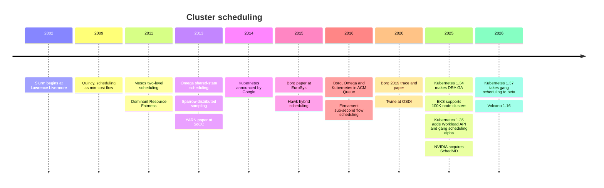
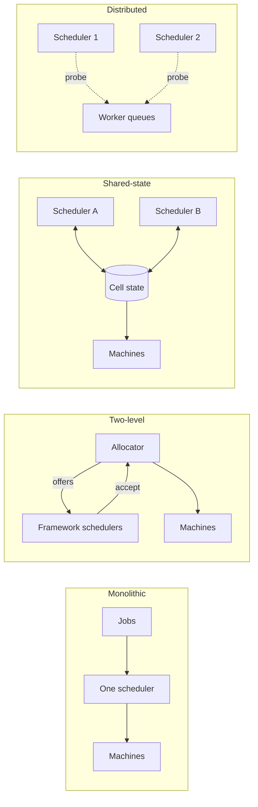
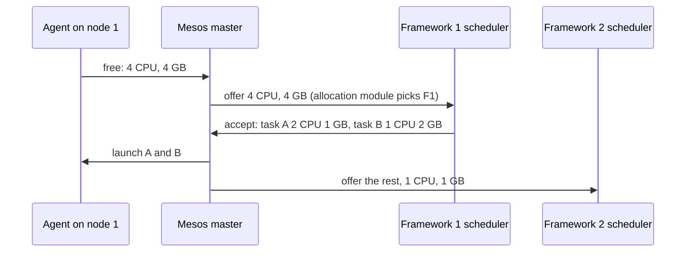
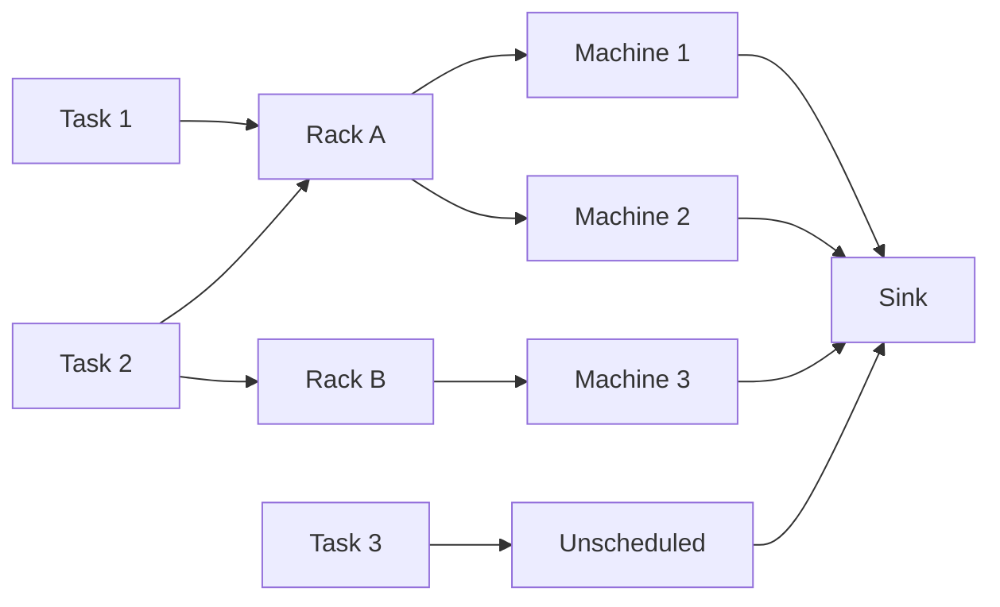
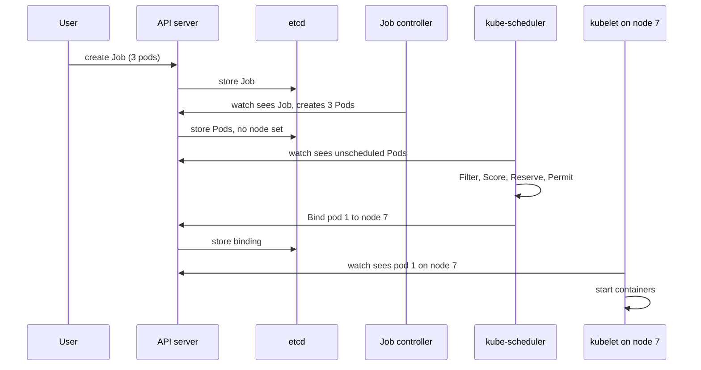

---
tags:
  - distributed-systems
  - cluster-scheduling
  - kubernetes
  - resource-management
  - gpu
status: draft
sources:
  - https://research.google.com/pubs/archive/43438.pdf
  - https://dl.acm.org/doi/pdf/10.1145/3342195.3387517
  - https://core.ac.uk/download/323304887.pdf
  - https://research.google/blog/yet-more-google-compute-cluster-trace-data/
  - https://queue.acm.org/detail.cfm?ID=2898444
  - https://sites.cs.ucsb.edu/~rich/class/cs293-cloud/papers/k8.pdf
  - https://cs.brown.edu/~malte/pub/papers/2013-eurosys-omega.pdf
  - https://people.csail.mit.edu/matei/papers/2011/nsdi_mesos.pdf
  - https://opencourse.inf.ed.ac.uk/sites/default/files/2023-10/yarn-socc13.pdf
  - https://amplab.cs.berkeley.edu/wp-content/uploads/2013/11/p69-ousterhout.pdf
  - https://www.usenix.org/conference/atc15/technical-session/presentation/delgado
  - https://vm-web.pdos.csail.mit.edu/papers/firmament:osdi16.pdf
  - https://files.usenix.org/s3fs-public/cdn/osdi20-tang.pdf
  - https://people.eecs.berkeley.edu/~alig/papers/drf.pdf
  - https://www.kubernetes.dev/resources/keps/624/
  - https://github.com/kubernetes/enhancements/blob/master/keps/sig-scheduling/4671-gang-scheduling/README.md
  - https://www.kubernetes.io/docs/concepts/scheduling-eviction/gang-scheduling/
  - https://www.kubernetes.io/blog/2025/12/29/kubernetes-v1-35-introducing-workload-aware-scheduling/
  - https://kubernetes.io/blog/2026/05/13/kubernetes-v1-36-advancing-workload-aware-scheduling/
  - https://kubernetes.io/blog/2026/08/26/kubernetes-v1-37-release/
  - https://kubernetes.io/blog/2026/09/08/kubernetes-v1-37-advancing-workload-aware-scheduling/
  - https://kubernetes.io/blog/2026/09/03/kubernetes-v1-37-dra-updates/
  - https://kubernetes.io/blog/2025/09/01/kubernetes-v1-34-dra-updates/
  - https://opensource.googleblog.com/2025/09/kubernetes-134-is-available-on-gke.html
  - https://www.cncf.io/blog/2026/02/23/kubernetes-as-ais-operating-system-1-35-release-signals/
  - https://www.networkworld.com/article/4214824/kubernetes-1-37-advances-workload-aware-scheduling-and-cluster-networking.html
  - https://cloudnativenow.com/features/kubernetes-v1-37-enhances-dynamic-resource-allocation/
  - https://www.fairwinds.com/blog/kubernetes-1.37-is-here-pod-rightsizing-dra-and-gang-scheduling
  - https://www.softwareseni.com/kubernetes-1-37-for-ai-workloads-and-how-to-verify-what-shipped/
  - https://infoq.com/news/2026/09/kubernetes-1-37
  - https://www.k8s.dev/resources/release/
  - https://kueue.sigs.k8s.io/docs/overview
  - https://groups.google.com/a/kubernetes.io/g/wg-batch/c/63pxFJOeokg
  - https://jobset.sigs.k8s.io/docs/overview/
  - https://www.cncf.io/blog/2026/10/28/volcano-v1-16-released-namespacequeue-fairshare-and-a-broader-hypernode-ecosystem/
  - https://aws.amazon.com/blogs/containers/under-the-hood-amazon-eks-ultra-scale-clusters
  - https://slurm.schedmd.com/sched_config.html
  - https://slurm.schedmd.com/priority_multifactor.html
  - https://slurm.schedmd.com/classic_fair_share.html
  - https://slurm.schedmd.com/fair_tree.html
  - https://slurm.schedmd.com/MISC26/Slurm_CUG_2026.pdf
  - https://blogs.nvidia.com/blog/nvidia-acquires-schedmd
  - https://developer.nvidia.com/blog/running-large-scale-gpu-workloads-on-kubernetes-with-slurm/
  - https://groups.google.com/g/slurm-users/c/k03FWLE-0g4
  - https://www.hpcwire.com/2026/05/15/slurm-vs-kubernetes-in-the-age-of-ai/
  - https://arxiv.org/pdf/2607.28223
created: 2026-11-26
updated: 2026-11-26
---

## Table Of Contents

---

- [[#TL;DR|TL;DR]]
- [[#The Problem|The Problem]]
- [[#Foundations|Foundations]]
    - [[#Placement Is Multi-Dimensional Bin Packing|Placement Is Multi-Dimensional Bin Packing]]
    - [[#Priority, Quota and Preemption|Priority, Quota and Preemption]]
    - [[#Fairness Across Several Resources|Fairness Across Several Resources]]
    - [[#All-or-Nothing Gangs|All-or-Nothing Gangs]]
- [[#How We Got Here|How We Got Here]]
- [[#How It Works|How It Works]]
    - [[#Five Scheduler Architectures|Five Scheduler Architectures]]
    - [[#Borg, the Monolithic Design|Borg, the Monolithic Design]]
    - [[#Mesos and YARN, Two-Level|Mesos and YARN, Two-Level]]
    - [[#Omega, Shared State|Omega, Shared State]]
    - [[#Sparrow and Hawk, Distributed and Hybrid|Sparrow and Hawk, Distributed and Hybrid]]
    - [[#Quincy and Firmament, Flow-Based|Quincy and Firmament, Flow-Based]]
    - [[#Kubernetes|Kubernetes]]
    - [[#Twine, One Control Plane per Region|Twine, One Control Plane per Region]]
    - [[#Slurm and HPC Batch|Slurm and HPC Batch]]
    - [[#Gang Scheduling for ML on Kubernetes|Gang Scheduling for ML on Kubernetes]]
- [[#Where It Is Now|Where It Is Now]]
    - [[#Kubernetes Becomes Workload-Aware|Kubernetes Becomes Workload-Aware]]
    - [[#DRA and GPUs as Claimable Devices|DRA and GPUs as Claimable Devices]]
    - [[#Slurm Under NVIDIA, and on Kubernetes|Slurm Under NVIDIA, and on Kubernetes]]
    - [[#Slurm or Kubernetes for GPU Clusters|Slurm or Kubernetes for GPU Clusters]]
- [[#Trade-offs & Open Problems|Trade-offs & Open Problems]]
- [[#Resources|Resources]]
- [[#Related Notes|Related Notes]]

## ***TL;DR***
---
*A cluster scheduler decides which job runs on which machine, and when. It is bin packing with several resource dimensions, under constant arrivals and failures, while three goals pull against each other: high utilization, low scheduling latency, and fairness between users.*

- **The job:** take a stream of jobs, each asking for CPU, memory, GPUs and constraints, and place their tasks on thousands of machines so the fleet is busy, important work starts fast and no team starves.
- **Five architectures:** *monolithic* (one scheduler sees everything: Borg, Kubernetes' default scheduler), *two-level* (a resource manager hands resources to per-framework schedulers: Mesos, YARN), *shared-state* (several schedulers race on a shared copy of cluster state with optimistic concurrency: Omega), *distributed* (many independent schedulers sample machines: Sparrow), and *hybrid* (central for big jobs, distributed for small ones: Hawk). *Flow-based* schedulers (Quincy, Firmament) solve placement as min-cost max-flow.
- **Borg is the template.** Priorities, quotas, preemption, overcommit and mixing production with batch work on the same machines; the paper found that splitting them apart would need 20–30% more machines ([Verma et al., 2015](https://research.google.com/pubs/archive/43438.pdf)). Kubernetes is Borg's open-source descendant, with Omega's shared store behind an API server and reconciliation controllers ([Burns et al., 2016](https://queue.acm.org/detail.cfm?ID=2898444)).
- **Fairness formula:** Dominant Resource Fairness equalizes each user's share of whichever resource they use most ([Ghodsi et al., NSDI 2011](https://people.eecs.berkeley.edu/~alig/papers/drf.pdf)).
- **ML changed the unit of work** from one task to a *gang* that must start all at once on GPUs that sit close together.
- **Now (Nov 2026):** Kubernetes has GA Dynamic Resource Allocation for GPUs (since 1.34, Aug 2025), and native gang scheduling reached beta, off by default, in 1.37 (Aug 2026); queueing and fair sharing still come from Kueue or Volcano. NVIDIA bought SchedMD, the company behind Slurm, in December 2025, and runs Slurm inside Kubernetes with Slinky. Kubernetes 1.38 is scheduled for December 16, 2026.

## ***The Problem***
---
*Machines are expensive and jobs are lumpy. A scheduler that packs tightly but starts jobs late, or starts them fast but leaves machines half empty, or lets one team take everything, wastes money in different ways.*

A scheduler receives *jobs*, each made of one or more *tasks*, and each task asks for a vector of resources (cores, RAM, GPUs, disk, ports) plus constraints (this zone, not the same rack as its siblings, a machine with a particular kernel). It must choose a machine for each task, keep track of what's left, and react when machines fail or higher-priority work arrives.

| Goal | What it means | What hurts it |
|---|---|---|
| **Utilization** | Few idle cores, little RAM stranded behind a full CPU | Separate pools per team or workload; requests far above real usage |
| **Latency** | Time from submit to running, and service tail latency once running | Big searches for the best fit; queueing behind big jobs; interference from neighbors |
| **Fairness and isolation** | Each tenant gets a fair or guaranteed share, and bad neighbors can't hurt good ones | Greedy placement; one heavy user; no preemption |

**Why sharing matters.** Borg's evaluation repacked real workloads into as few machines as possible ("cell compaction"). Segregating production and non-production work would need 20–30% more machines in the median cell, and splitting users into their own cells would need 2–16× as many cells and 20–150% more machines ([Verma et al., §5.2](https://research.google.com/pubs/archive/43438.pdf)). Facebook's Twine paper tells the same story from the other side: moving from private per-team pools to one shared pool, its shared fleet still averaged only about 30% CPU and 40% memory utilization in October 2020 ([Tang et al., OSDI 2020](https://files.usenix.org/s3fs-public/cdn/osdi20-tang.pdf)).

**Why it's a distributed systems problem.** The scheduler's view of the cluster is always a little stale; machines fail mid-placement ([[Failure Models]]); several schedulers may decide at once and collide ([[Distributed Transactions|transactions]] and optimistic concurrency); and the state itself lives in a replicated store ([[Coordination Services]], [[Raft]], [[Paxos]]). At scale, the scheduler is a hot, latency-sensitive service in its own right.

## ***Foundations***
---
*Four ideas recur in every system below: placement is a bin-packing heuristic with a score, priority and preemption decide who loses when the cluster is full, fairness needs a definition that works across several resources, and parallel jobs need all their pieces at once.*

### Placement Is Multi-Dimensional Bin Packing

*Exact bin packing is NP-hard, so every production scheduler filters machines that can't fit a task, scores the rest with a heuristic, and picks the best. The heuristic decides whether the cluster packs tightly or spreads load.*

- **Filter, then score.** Borg first checks *feasibility* (enough free resources, constraints met), then *scores* the feasible machines on preemption cost, whether the task's packages are already there, failure-domain spreading and the priority mix on the machine ([Verma et al., §3.2](https://research.google.com/pubs/archive/43438.pdf)). Kubernetes' scheduling framework has the same Filter and Score stages ([KEP-624](https://www.kubernetes.dev/resources/keps/624/)).
- **Best fit vs worst fit.** *Best fit* puts a task on the fullest machine that still fits it, leaving whole machines free for big tasks but punishing any error in the resource estimate. *Worst fit* (Borg's earlier E-PVM scoring) spreads load, which leaves headroom for spikes but fragments the cluster so large tasks stop fitting. Borg's hybrid scorer packed 3–5% better than best fit (§3.2).
- **Stranding.** A machine with free CPU and no free RAM is idle CPU nobody can use. That's why fairness and packing must look at all resources together, not CPU alone.

*Worked example:* two machines, each with 8 cores free. Tasks arrive asking for 4, 4, then 8 cores. Worst fit puts the first 4 on machine 1, the second 4 on machine 2 (the emptier one), and the 8-core task fits nowhere. Best fit puts both 4-core tasks on machine 1 and the 8-core task on machine 2.

### Priority, Quota and Preemption

*Priority decides who may displace whom on a full cluster; quota decides how much each user may ask for at each priority. Together they let a cluster run production services and opportunistic batch work on the same machines.*

Borg's version is the reference design ([Verma et al., §2.5](https://research.google.com/pubs/archive/43438.pdf)):

- **Priority bands**, highest first: *monitoring*, *production*, *batch*, *best effort* (testing or free). "Prod" means the top two. A higher-priority task can preempt a lower one, except that production-band tasks don't preempt each other, which stops preemption cascades.
- **Quota** is checked at *admission*, not during placement: a job without enough quota at its priority is rejected on submission. Production quota is limited to the cell's real capacity, while every user has effectively unlimited quota at priority zero, so free work can soak up idle capacity.
- **Preempted tasks** go back to the pending queue instead of being migrated (§3.2).

**Overcommit and reclamation.** Users ask for more than they use. Borg sets each task's *reservation* at its limit, then decays it after 300 seconds toward actual usage plus a safety margin; the gap between limit and reservation is reclaimed for non-prod work. Prod tasks are scheduled against their limits, non-prod tasks may use reclaimed resources, and about 20% of the workload in a median cell ran in reclaimed resources (§5.5).

*Worked example:* a prod task asks for 4 cores and uses about 1.5. After five minutes its reservation decays to, say, 2 cores (usage plus margin). The other 2 cores of its limit can host a batch task. If the prod task's usage climbs, its reservation grows quickly and the batch task is the one that gets squeezed or preempted.

### Fairness Across Several Resources

*With one resource, fair means equal shares. With CPU and memory and GPUs, users want different mixes, so "equal" needs a definition. Dominant Resource Fairness (DRF) gives one that can't be gamed.*

Each user's *dominant share* is its largest fraction of any single resource:

$$
s_i = \max_j \frac{u_{i,j}}{r_j}
$$

*In words:* user $i$ holds $u_{i,j}$ of resource $j$ out of a total $r_j$; its dominant share is whichever of those fractions is biggest. DRF applies max-min fairness to dominant shares: repeatedly give the next task to the user with the smallest dominant share, as long as it fits ([Ghodsi et al., NSDI 2011](https://people.eecs.berkeley.edu/~alig/papers/drf.pdf)).

*Worked example (the paper's own):* a cluster with 9 CPUs and 18 GB. User A's tasks need ⟨1 CPU, 4 GB⟩, so memory is its dominant resource (4/18 = 2/9 per task). User B's tasks need ⟨3 CPU, 1 GB⟩, so CPU is dominant (3/9 = 1/3 per task). Progressive filling:

| Step | Pick (lowest dominant share) | A holds | A's share | B holds | B's share | CPUs used |
|---|---|---|---|---|---|---|
| 1 | A (tie at 0) | 1 CPU, 4 GB | 2/9 | 0 | 0 | 1 |
| 2 | B | 1 CPU, 4 GB | 2/9 | 3 CPU, 1 GB | 1/3 | 4 |
| 3 | A | 2 CPU, 8 GB | 4/9 | 3 CPU, 1 GB | 1/3 | 5 |
| 4 | B | 2 CPU, 8 GB | 4/9 | 6 CPU, 2 GB | 2/3 | 8 |
| 5 | A | 3 CPU, 12 GB | 2/3 | 6 CPU, 2 GB | 2/3 | 9 |

CPUs are full, so allocation stops: A runs 3 tasks, B runs 2, and both have a dominant share of 2/3. The paper writes this as maximizing $(x, y)$ subject to $x + 3y \le 9$, $4x + y \le 18$ and $\frac{2x}{9} = \frac{y}{3}$, which gives $x = 3$, $y = 2$.

**Why DRF and not something simpler.** DRF has *sharing incentive* (no user does better with a static $1/n$ slice), *strategy-proofness* (lying about demand can't raise your share), *envy-freeness* and *Pareto efficiency*. It isn't *resource monotonic* (adding resources can shrink someone's share), and the authors argue no policy gets that together with the first and last properties. It was implemented in Mesos; in trace-driven simulations of a Facebook Hadoop cluster it cut completion times of large jobs by up to 66%, and on EC2 it beat slot-based fair sharing (the Hadoop Fair Scheduler's approach) ([Ghodsi et al.](https://people.eecs.berkeley.edu/~alig/papers/drf.pdf)). Kueue and Volcano bring fair sharing between tenants to Kubernetes ([[#Gang Scheduling for ML on Kubernetes|below]]).

### All-or-Nothing Gangs

*A distributed training or MPI job is useless until every worker is running, so a scheduler that places some of its tasks and waits for the rest wastes the placed ones and can deadlock with other half-placed jobs.*

*Worked example:* 6 free GPUs, and two jobs each need 4 GPUs at once. A task-at-a-time scheduler places 3 workers of job 1 and 3 of job 2. Both are stuck waiting for a fourth GPU that will never free up, and 6 GPUs sit idle. A gang scheduler places all 4 workers of job 1 and keeps job 2 waiting whole.

Omega's paper names the two ways out. Two-level schedulers like Mesos can only gang-schedule by *hoarding* offered resources until enough arrive, which can deadlock; a shared-state scheduler can commit the whole gang in one all-or-nothing transaction ([Schwarzkopf et al., EuroSys 2013](https://cs.brown.edu/~malte/pub/papers/2013-eurosys-omega.pdf)). Kubernetes' scheduler, which places one pod at a time, needed a new API to express gangs at all; see [[#Gang Scheduling for ML on Kubernetes|below]].

## ***How We Got Here***
---
*HPC batch queues came first, then Google's Borg showed that services and batch can share machines. Academia explored splitting the scheduler (Mesos, Omega, Sparrow), Kubernetes brought Borg's ideas to everyone, and the GPU era is now pulling the HPC and cloud-native lines back together.*

**HPC queues (2000s).** Batch systems ran one job per set of nodes, in priority order, with backfill to fill gaps. Slurm came out of Lawrence Livermore in 2002 and now runs on most of the largest supercomputers ([HPCwire, May 2026](https://www.hpcwire.com/2026/05/15/slurm-vs-kubernetes-in-the-age-of-ai/); [NVIDIA, Dec 2025](https://blogs.nvidia.com/blog/nvidia-acquires-schedmd)).

**Borg (in production for about a decade before 2015).** Google merged long-running services and batch jobs onto shared machines, which raised utilization and set the vocabulary: cells, jobs, tasks, allocs, priority bands, quota ([Verma et al., 2015](https://research.google.com/pubs/archive/43438.pdf)).

**Splitting the scheduler (2009–2016).** Academic work asked what breaks when one scheduler can't keep up or can't specialize. Quincy (2009) and Firmament (2016) treated placement as a flow problem and made it fast ([Gog et al., OSDI 2016](https://vm-web.pdos.csail.mit.edu/papers/firmament:osdi16.pdf)). Mesos (2011) handed resources to framework schedulers ([Hindman et al.](https://people.csail.mit.edu/matei/papers/2011/nsdi_mesos.pdf)); YARN (2013) did the same for Hadoop ([Vavilapalli et al.](https://opencourse.inf.ed.ac.uk/sites/default/files/2023-10/yarn-socc13.pdf)). Omega (2013) let parallel schedulers share state with optimistic concurrency, and Sparrow (2013) dropped central state entirely for sub-second tasks ([Ousterhout et al.](https://amplab.cs.berkeley.edu/wp-content/uploads/2013/11/p69-ousterhout.pdf)).

**Kubernetes (2014 on).** Google's third system kept Borg's model but put the cluster state in a store behind an API server and drove everything with reconciliation loops ([Burns et al., 2016](https://sites.cs.ucsb.edu/~rich/class/cs293-cloud/papers/k8.pdf)). It won the cloud-native world; HPC stayed on Slurm.

**GPUs (2023 on).** Training jobs need gangs, topology and exclusive accelerators. Kubernetes added DRA and in-tree gang scheduling, NVIDIA bought SchedMD, and Slurm now runs inside Kubernetes ([[GPU Cluster Infrastructure]]).

## ***How It Works***
---
*Each architecture answers two questions differently: who sees the cluster state, and who decides placement. The systems after the architecture table are the production versions you'll actually meet.*

### Five Scheduler Architectures

*The taxonomy comes from the Omega paper (monolithic, statically partitioned, two-level, shared-state), extended by later work with fully distributed and hybrid designs.*

| Architecture | Who decides | Cluster view | Concurrency | Strength | Weakness | Examples |
|---|---|---|---|---|---|---|
| Monolithic | One scheduler | Full | None, decisions serialized | Global policy, good packing | Throughput limit; head-of-line blocking behind slow decisions | Borg, kube-scheduler |
| Statically partitioned | One per partition | Its partition | None | Simple | Fragmentation, low utilization | Separate clusters per team |
| Two-level | Central allocator offers; framework schedulers accept | Only what's offered | Pessimistic: offered resources are locked | Framework-specific logic | No global view, hoarding for gangs | Mesos, YARN |
| Shared-state | Several full schedulers | Full (private copy) | Optimistic transactions | Parallelism with global view | Conflicts and retries | Omega |
| Distributed | Many independent schedulers | Sampled | None | Millisecond decisions at huge scale | Poor decisions under high load | Sparrow |
| Hybrid | Central for long jobs, distributed for short | Mixed | Mixed | Best of both on mixed workloads | Two systems to run | Hawk |

Sources: [Schwarzkopf et al., Table 1](https://cs.brown.edu/~malte/pub/papers/2013-eurosys-omega.pdf); [Ousterhout et al.](https://amplab.cs.berkeley.edu/wp-content/uploads/2013/11/p69-ousterhout.pdf); [Delgado et al.](https://www.usenix.org/conference/atc15/technical-session/presentation/delgado).

### Borg, the Monolithic Design

*One logically central scheduler per cell, made fast with caching and batching tricks, enforcing priorities, quotas and overcommit across a mixed workload.*

- **Shape.** A *cell* is the set of machines one Borg manages; the median cell has about 10,000 machines. A *job* is a set of identical *tasks*, each a containerized Linux process; an *alloc* is a reserved slice of a machine that several tasks can share ([Verma et al., §2](https://research.google.com/pubs/archive/43438.pdf)).
- **Control plane.** The Borgmaster is replicated five times with its state in a Paxos-based store; one elected master makes all changes, and failover takes about 10 seconds, up to a minute in a big cell (§3.1). Borg reached 99.99% availability in practice (§4). See [[Paxos]] and [[Leases and Fencing]].
- **Mixed workload.** In a representative cell, prod jobs got about 70% of allocated CPU and used about 60% of CPU, and got about 55% of allocated memory but used about 85% of memory (§2.1). 98% of machines in shared cells ran both prod and non-prod tasks (§5.2).
- **Making one scheduler scale.** Three tricks: *score caching* (reuse a machine's score until it or the task changes), *equivalence classes* (score once for a group of identical tasks) and *relaxed randomization* (score a random sample of machines, not all). Scheduling a whole cell's workload from scratch took a few hundred seconds with them and didn't finish in three days without them; an online pass over the pending queue takes under half a second (§3.4).
- **Startup.** Median task startup was about 25 seconds, and package installation was about 80% of it, which is why scoring prefers machines that already have the packages (§3.2).

**The 2019 trace.** Google released a month of data from 8 cells (May 2019) and compared it with its 2011 trace ([Google Research, Apr 2020](https://research.google/blog/yet-more-google-compute-cluster-trace-data/)). Best-effort batch grew to about 20% of capacity, allocations ran "consistently ... well above 100%" of deployed capacity (overcommit), and job submissions rose about 3.5× per hour. The workload is extremely heavy-tailed: the top 1% of jobs used 99.2% of CPU and 99.1% of memory ([Tirmazi et al., EuroSys 2020](https://core.ac.uk/download/323304887.pdf)). Fully autoscaled jobs cut peak CPU slack by more than 25% for the vast majority of jobs.

### Mesos and YARN, Two-Level

*A central component divides resources among frameworks; each framework's own scheduler decides what to run. Mesos pushes offers to frameworks; YARN lets each job pull with requests.*

- **Mesos** ([Hindman et al., NSDI 2011](https://people.csail.mit.edu/matei/papers/2011/nsdi_mesos.pdf)): the master decides *how much* to offer each framework through a pluggable allocation module (DRF or strict priority); the framework decides *which* offers to accept. Frameworks can set filters to avoid useless offers. With a short *delay scheduling* wait, Hadoop's data locality rose from 18% under static partitioning to over 90% (1 s wait) and 95% (5 s). The master keeps only soft state, with ZooKeeper for leader election ([[Coordination Services]]). It scaled to 50,000 emulated agents with sub-second task launch overhead.
- **Mesos' limits** (from Omega's simulations): offers lock resources while a framework decides, so a slow service scheduler starves others; frameworks can't see the whole cluster or preempt; gangs need hoarding. "Mesos works best when tasks are short-lived and relinquish resources frequently" ([Schwarzkopf et al.](https://cs.brown.edu/~malte/pub/papers/2013-eurosys-omega.pdf)).
- **YARN** ([Vavilapalli et al., SoCC 2013](https://opencourse.inf.ed.ac.uk/sites/default/files/2023-10/yarn-socc13.pdf)): split Hadoop's JobTracker into a cluster-wide *ResourceManager* and a per-application *ApplicationMaster* that *requests* containers with locality preferences, and a *NodeManager* per machine. On Yahoo's 2,500-node cluster, jobs per day went from about 77k to a sustained 125k, which Yahoo called "equivalent to adding 1000 machines."

### Omega, Shared State

*Give every scheduler the whole cluster state, let them decide in parallel, and resolve collisions at commit time, the same optimistic concurrency databases use.*

- Each scheduler keeps a private copy of the *cell state*, makes decisions against it, then commits them as an atomic transaction to the shared state. "At most one such commit will succeed in the case of conflict"; the loser resyncs and retries ([Schwarzkopf et al., EuroSys 2013](https://cs.brown.edu/~malte/pub/papers/2013-eurosys-omega.pdf)). See [[Distributed Transactions]] for the same pattern in databases.
- **Conflicts were rare.** With realistic decision times, conflict fractions stayed low; they only got bad when a service scheduler took around 10 seconds per job. Running three batch schedulers in parallel tripled throughput at a conflict rate of about 0.1.
- **Incremental vs all-or-nothing.** Incremental transactions accept the non-conflicting part of a commit; all-or-nothing transactions give gang semantics but roughly double conflicts. The authors' verdict: "incremental transactions should be the default."
- **Fate.** Omega didn't replace Borg; many of its ideas, including multiple schedulers, were folded back into Borg, and its store-centric design shaped Kubernetes ([Burns et al.](https://sites.cs.ucsb.edu/~rich/class/cs293-cloud/papers/k8.pdf)).

### Sparrow and Hawk, Distributed and Hybrid

*For sub-second tasks, a central scheduler can't keep up, so many stateless schedulers each sample a few machines. Sampling works well until the cluster is busy, which is where hybrid designs step in.*

**Sparrow** ([Ousterhout et al., SOSP 2013](https://amplab.cs.berkeley.edu/wp-content/uploads/2013/11/p69-ousterhout.pdf)) adapts the *power of two choices*:

- **Batch sampling:** for a job with $m$ tasks, probe $d \cdot m$ random workers (default $d = 2$) and place on the least loaded.
- **Late binding:** instead of trusting reported queue lengths, workers queue a reservation and ask for a task when they're actually free; the first $m$ to ask get the tasks. In simulation at 80% load this came within 5% of an omniscient scheduler.
- **Results:** on a 110-machine cluster running TPC-H queries, median response time was within 12% of an ideal scheduler, with median queueing delay under 9 ms and scheduler failover under 120 ms. Spark's own centralized scheduler topped out around 1,500 tasks per second.

*Worked example:* a job of $m = 3$ tasks with $d = 2$ probes 6 workers. Four of them have empty queues; the first three to respond with "I'm free" get the tasks, and the remaining reservations are cancelled.

**Hawk** ([Delgado et al., USENIX ATC 2015](https://www.usenix.org/conference/atc15/technical-session/presentation/delgado)) is hybrid: long jobs go through a central scheduler, short jobs are placed in a distributed way, a small slice of the cluster is reserved for short jobs, and idle workers steal queued short tasks. Under high load it beat Sparrow by 80% (median) and 90% (90th percentile) for short jobs.

### Quincy and Firmament, Flow-Based

*Model the whole cluster as a flow network and solve for the cheapest assignment of all tasks at once. It gives globally optimal placements for the chosen cost model; the hard part is solving fast enough.*

Each task is a source of one unit of flow; flow reaches the sink either through a machine (placed) or through an "unscheduled" node (left waiting). Arc costs encode policy: data locality, interference, waiting time. Aggregator nodes for racks keep the graph small. Min-cost max-flow then yields the best placement for every task together ([Gog et al., OSDI 2016](https://vm-web.pdos.csail.mit.edu/papers/firmament:osdi16.pdf)).

- **Quincy (2009)** introduced the approach, but its solver was too slow at Google scale: on a 12,500-machine trace, solver runtime had a median of 64 s, and placement latency was 25–60 s at 90% slot utilization.
- **Firmament** found that the *relaxation* algorithm, despite a poor worst case, averages under 200 ms on these graphs, and runs it in parallel with incremental cost scaling, taking whichever finishes first. Result: sub-second placement at 12,500 machines and about 150,000 tasks, more than 20× faster than Quincy with the same (optimal) quality. Its network-aware policy beat Sparrow's 99th-percentile batch response time by 6.2× on a 40-machine testbed.

### Kubernetes

*Kubernetes keeps Borg's monolithic scheduler but changes everything around it: all state lives in etcd behind an API server, and independent controllers each reconcile one piece of desired state.*

**Lineage.** Burns, Grant, Oppenheimer, Brewer and Wilkes describe three systems: Borg, Omega ("built from the ground up to have a more consistent, principled architecture", with a Paxos-based transactional store and optimistic concurrency), and Kubernetes, whose shared store is accessed through an API server that "applies higher-level versioning, validation, semantics, and policy" ([Burns et al., ACM Queue 2016](https://queue.acm.org/detail.cfm?ID=2898444); [PDF](https://sites.cs.ucsb.edu/~rich/class/cs293-cloud/papers/k8.pdf)). Lessons carried over from Borg:

| Borg | Kubernetes | Why |
|---|---|---|
| One IP per machine; ports scheduled as a resource | One IP per pod | "Don't make the container system manage port numbers" |
| Jobs as numbered task vectors | Labels and selectors | "Don't just number containers: give them labels" |
| Monolithic master; Omega's clients touching the store directly | Every component goes through the API server | "Don't expose raw state" |
| Jobs the only grouping | Pods group containers; controllers adopt and orphan pods by label | Quarantine a bad pod by relabeling it |

**Reconciliation.** Each controller compares desired state with observed state and acts to converge them, so after a crash it simply looks again; the paper calls this "control through choreography." The store under the API server is etcd, a [[Raft]] group ([[Coordination Services]]).

**The scheduling framework.** kube-scheduler places one pod at a time through plugin extension points, stable since 1.19: Queue sort → PreFilter → Filter → PostFilter (runs only when nothing fits; preemption lives here) → PreScore → Score → Reserve → Permit → PreBind → Bind → PostBind ([KEP-624](https://www.kubernetes.dev/resources/keps/624/)). *Permit* can approve, deny or make a pod *wait*; "If a timeout occurs, wait becomes deny." That hook is how the first, alpha version of in-tree gang scheduling held pods until the group was ready ([KEP-4671](https://github.com/kubernetes/enhancements/blob/master/keps/sig-scheduling/4671-gang-scheduling/README.md)).

**Scale.** Twine's authors (2020) wrote that Kubernetes' central components "limit Kubernetes' scalability to 5K machines" ([Tang et al.](https://files.usenix.org/s3fs-public/cdn/osdi20-tang.pdf)); a Red Hat engineer quoted in May 2026 still gave about 5,000 nodes as the practical figure, against about 30,000 for Slurm ([HPCwire](https://www.hpcwire.com/2026/05/15/slurm-vs-kubernetes-in-the-age-of-ai/)). Providers push past it: in July 2025 AWS announced 100,000-node EKS clusters, with a rebuilt etcd and a tuned scheduler reaching about 500 pods per second, noting that the default scheduler "processes pods serially" ([AWS, Jul 2025](https://aws.amazon.com/blogs/containers/under-the-hood-amazon-eks-ultra-scale-clusters)).

### Twine, One Control Plane per Region

*Meta's answer to "Kubernetes clusters are too small": shard the control plane and bind jobs to quotas, not to physical clusters.*

- **Scale:** one control plane manages up to one million machines across a region. Schedulers are sharded by *entitlement*; the largest shard handled about 170K machines, and "a single job must fit in a single scheduler shard" ([Tang et al., OSDI 2020](https://files.usenix.org/s3fs-public/cdn/osdi20-tang.pdf)). See [[Partitioning]].
- **Entitlements:** a quota that acts as a pseudo-cluster; machines move between entitlements dynamically. "Twine binds a job to an entitlement," not to a cluster, so hardware refreshes don't force job migrations (which had taken a median 7.5 days).
- **Allocator vs scheduler:** the *scheduler* manages job and task lifecycles (the paper maps it to Kubernetes controllers); the *allocator* places tasks on machines (mapped to kube-scheduler) at up to about 1,000 job allocations per second, with an asynchronous ReBalancer for global optimization.
- **Applications get a vote.** *TaskControl* lets a service approve or delay restarts and moves, for example updating a ZooKeeper ensemble's followers before its leader. *Host profiles* retune kernel and hardware settings per workload; without them web and memcache would regress by about 10%.
- **Results:** the shared pool grew from about 15% of the fleet (January 2019) to 56% (October 2020); small one-socket, 64 GB machines saved 17% in TCO.

### Slurm and HPC Batch

*Slurm schedules jobs, not services: a priority queue of whole-node or multi-node jobs with time limits, where backfill fills the holes and a fair-share factor keeps heavy users from dominating.*

**Priority.** A job's priority is a weighted sum of factors, each between 0 and 1: age, association, fair-share, job size, partition, QOS, per-resource (TRES) factors and a site factor, minus nice; every weight defaults to 0 until configured ([Slurm multifactor docs](https://slurm.schedmd.com/priority_multifactor.html)).

**Fair share.** The classic factor is

$$
F = 2^{-U/S}
$$

*In words:* $S$ is your normalized share of the cluster, $U$ your normalized recent usage, with older usage decayed by a configurable half-life (the full form divides by a dampening factor $d$, default 1) ([Slurm classic fair-share](https://slurm.schedmd.com/classic_fair_share.html)). Using exactly your share gives $F = 0.5$; using nothing gives 1; using twice your share gives 0.25. *Example:* a group entitled to $S = 0.25$ that used $U = 0.5$ of the cluster last week gets $F = 2^{-2} = 0.25$, while a group with $S = 0.25$ and $U = 0.1$ gets $2^{-0.4} \approx 0.76$ and jumps ahead in the queue. Since Slurm 19.05 the default is *Fair Tree*, which computes $LF = S/U$ among siblings at each level of the account tree and ranks users by a depth-first walk, so every user under an under-served account outranks every user under an over-served sibling ([Fair Tree docs](https://slurm.schedmd.com/fair_tree.html)).

**Backfill.** The backfill scheduler will "start lower priority jobs if doing so does not delay the expected start time of any higher priority job," so it relies on jobs declaring time limits; it runs every 30 seconds by default and plans one day ahead ([Slurm scheduling docs](https://slurm.schedmd.com/sched_config.html)).

*Worked example:* 10 nodes. Job R runs on 8 nodes and ends in 2 hours. Top-priority job B needs all 10, so Slurm reserves them for $t = 2$ h. Next in line, job C needs 2 nodes for 1 hour: it fits in the 2 idle nodes and finishes before B's reservation, so it backfills now. Job D needs 2 nodes for 3 hours: it would still hold them at $t = 2$ h and delay B, so it waits.

**Topology.** For GPU clusters, Slurm 25.11 (November 2025) orders nodes by network topology and lets jobs map onto *blocks* of tightly connected nodes ([Jacobsen, CUG 2026](https://slurm.schedmd.com/MISC26/Slurm_CUG_2026.pdf)).

### Gang Scheduling for ML on Kubernetes

*Kubernetes grew a stack of layers for batch and ML: an API to describe a multi-part training job, a queue that admits whole jobs against quota, a scheduler that places them all at once, and a device API that understands GPUs.*

| Layer | Project | What it does |
|---|---|---|
| Job shape | **JobSet** | A group of Jobs managed as a unit, with *replicatedJobs* for leaders and workers, failure and success policies, startup ordering, a headless service for pod-to-pod DNS, and exclusive placement of each child job in one rack or zone. API v1alpha2, release v0.13.0 when read ([JobSet docs](https://jobset.sigs.k8s.io/docs/overview/)) |
| Admission and quota | **Kueue** | Decides when a job waits, is admitted (its pods may be created) or is preempted, against ClusterQueues, cohorts and resource flavors with fair sharing; kube-scheduler still places the pods ([Kueue docs](https://kueue.sigs.k8s.io/docs/overview)) |
| Batch scheduler | **Volcano** | A replacement scheduler with queues, quotas, PodGroups with `minMember` gangs and network-topology-aware placement through *HyperNodes* ([CNCF, Oct 2026](https://www.cncf.io/blog/2026/10/28/volcano-v1-16-released-namespacequeue-fairshare-and-a-broader-hypernode-ecosystem/)) |
| In-tree gangs | **Workload and PodGroup APIs** | kube-scheduler places a PodGroup all or nothing once `minCount` pods can fit ([Kubernetes docs](https://www.kubernetes.io/docs/concepts/scheduling-eviction/gang-scheduling/)) |
| Devices | **Dynamic Resource Allocation** | GPUs and NICs described as devices drivers publish, which pods claim, instead of opaque integer counts |

**How in-tree gang scheduling works** ([KEP-4671](https://github.com/kubernetes/enhancements/blob/master/keps/sig-scheduling/4671-gang-scheduling/README.md)): a *Workload* is a static template with up to 8 pod-group templates, each with a `gang` policy and a `minCount`; controllers create *PodGroup* objects from it, and each pod names its PodGroup. The scheduler's PreEnqueue holds pods until the PodGroup exists and at least `minCount` pods are present, then a workload scheduling cycle tries to place the group against one snapshot, rejecting and backing off the whole group if `minCount` can't be met. The KEP notes gang scheduling "has been implemented outside of kube-scheduler at least 4 times," and keeps fairness and multiple queues out of scope: "Kueue and Volcano.sh will continue to provide this."

## ***Where It Is Now***
---
*As of November 2026: Kubernetes has spent five releases turning a pod-at-a-time scheduler into a workload-aware one, with GPUs as first-class claimable devices; Slurm is now owned by NVIDIA and increasingly runs inside Kubernetes; and the two worlds are converging rather than one winning.*

### Kubernetes Becomes Workload-Aware

*Five releases, from August 2025 to August 2026, moved Kubernetes from placing one pod at a time toward placing whole workloads, with gangs, group preemption and topology.*

| Release | Date | Scheduling and batch changes |
|---|---|---|
| 1.34 | Aug 2025 | DRA core APIs GA; prioritized device lists and admin access beta and on by default ([Kubernetes, Sep 2025](https://kubernetes.io/blog/2025/09/01/kubernetes-v1-34-dra-updates/); [Google, Sep 2025](https://opensource.googleblog.com/2025/09/kubernetes-134-is-available-on-gke.html)) |
| 1.35 | Dec 2025 | Workload API and basic gang scheduling (alpha), opportunistic batching of identical pods ([Kubernetes, Dec 2025](https://www.kubernetes.io/blog/2025/12/29/kubernetes-v1-35-introducing-workload-aware-scheduling/)); in-place pod resize GA ([CNCF, Feb 2026](https://www.cncf.io/blog/2026/02/23/kubernetes-as-ais-operating-system-1-35-release-signals/)) |
| 1.36 | Apr 2026 | Workload split into a static template and a runtime PodGroup API; a PodGroup scheduling cycle; first versions of topology-aware scheduling and workload-aware preemption; ResourceClaims for PodGroups ([Kubernetes, May 2026](https://kubernetes.io/blog/2026/05/13/kubernetes-v1-36-advancing-workload-aware-scheduling/)) |
| 1.37 | Aug 2026 | Workload and PodGroup APIs, gang scheduling and workload-aware preemption beta; shared DRA ResourceClaims for PodGroups beta; new CompositePodGroup API for hierarchical groups such as JobSet and LeaderWorkerSet ([Kubernetes, Sep 2026](https://kubernetes.io/blog/2026/09/08/kubernetes-v1-37-advancing-workload-aware-scheduling/)) |
| 1.38 | Scheduled Dec 16, 2026 | Not released at the time of writing; code freeze began November 16–17, 2026 ([release schedule](https://www.k8s.dev/resources/release/)). KEP-4671 plans to promote the gang API to v1 in 1.38 ([KEP-4671](https://github.com/kubernetes/enhancements/blob/master/keps/sig-scheduling/4671-gang-scheduling/README.md)) |

- **Status of gangs in 1.37 (Aug 26, 2026; 67 enhancements: 16 stable, 23 beta, 27 alpha, 1 removal) ([Kubernetes](https://kubernetes.io/blog/2026/08/26/kubernetes-v1-37-release/)):** gang scheduling is "Beta since Kubernetes v1.37" and *disabled by default*, behind the single `GenericWorkload` feature gate on the API server, scheduler and controller manager ([Kubernetes docs](https://www.kubernetes.io/docs/concepts/scheduling-eviction/gang-scheduling/)). That gate replaced the separate `GangScheduling` and `WorkloadAwarePreemption` gates, and alpha PodGroup objects must be deleted before upgrading ([Fairwinds](https://www.fairwinds.com/blog/kubernetes-1.37-is-here-pod-rightsizing-dra-and-gang-scheduling); [SoftwareSeni](https://www.softwareseni.com/kubernetes-1-37-for-ai-workloads-and-how-to-verify-what-shipped/)). One practitioner's verdict: "None of this is production-ready yet" ([Fairwinds](https://www.fairwinds.com/blog/kubernetes-1.37-is-here-pod-rightsizing-dra-and-gang-scheduling)).
- **Workload-aware preemption (KEP-5710, beta):** when evicting, the scheduler treats a PodGroup as one victim instead of picking off individual pods, which would break a gang ([Network World, Aug 2026](https://www.networkworld.com/article/4214824/kubernetes-1-37-advances-workload-aware-scheduling-and-cluster-networking.html)).
- **Queues stay outside.** In-tree gangs give atomic placement but no queue; quotas, fair sharing and multi-cluster admission still need Kueue or Volcano ([SoftwareSeni](https://www.softwareseni.com/kubernetes-1-37-for-ai-workloads-and-how-to-verify-what-shipped/)). Kueue 0.18 (May 29, 2026) continued topology-aware scheduling work, made MultiKueue aggregate quota across worker clusters, and took its DRA integration to beta ([wg-batch, May 2026](https://groups.google.com/a/kubernetes.io/g/wg-batch/c/63pxFJOeokg)). Volcano 1.16 (Oct 28, 2026) added per-namespace hierarchical queues, a fair-share plugin based on decayed historical usage, and topology anti-affinity across HyperNode domains ([CNCF](https://www.cncf.io/blog/2026/10/28/volcano-v1-16-released-namespacequeue-fairshare-and-a-broader-hypernode-ecosystem/)).

### DRA and GPUs as Claimable Devices

*Device plugins exposed a GPU as an integer count like `nvidia.com/gpu: 8`, which can't say which GPUs, how they're connected or whether they can be shared. DRA has drivers publish devices with attributes, and pods claim devices that match.*

- **Model:** drivers publish *ResourceSlices* describing devices; a *DeviceClass* groups them; a pod's *ResourceClaim* asks for devices, and the scheduler allocates matching ones. Without published ResourceSlices nothing gets allocated ([SoftwareSeni](https://www.softwareseni.com/kubernetes-1-37-for-ai-workloads-and-how-to-verify-what-shipped/)).
- **GA in 1.34 (Aug 2025)** for "selecting, assigning, sharing and configuring" GPUs, TPUs and NICs ([Google, Sep 2025](https://opensource.googleblog.com/2025/09/kubernetes-134-is-available-on-gke.html)).
- **1.37 (Aug 2026):** *extended resource* support is GA, so a plain `example.com/gpu` request can be satisfied through DRA "with no ResourceClaim needed on the workload's part" ([Kubernetes, Sep 2026](https://kubernetes.io/blog/2026/09/03/kubernetes-v1-37-dra-updates/)); *device taints and tolerations* are stable, so an operator can mark a broken or degraded GPU and keep new work off it ([Network World](https://www.networkworld.com/article/4214824/kubernetes-1-37-advances-workload-aware-scheduling-and-cluster-networking.html)); claim status is GA, and NUMA-aware co-allocation attributes arrived as alpha ([Fairwinds](https://www.fairwinds.com/blog/kubernetes-1.37-is-here-pod-rightsizing-dra-and-gang-scheduling)); a single claim shared by a whole PodGroup is beta ([Cloud Native Now, Aug 2026](https://cloudnativenow.com/features/kubernetes-v1-37-enhances-dynamic-resource-allocation/)).

### Slurm Under NVIDIA, and on Kubernetes

*The HPC scheduler now belongs to the GPU vendor, which promises to keep it open and is putting it inside Kubernetes.*

- **Acquisition (December 15, 2025):** NVIDIA bought SchedMD and says it will keep developing and distributing Slurm as "open-source, vendor-neutral software." Slurm runs on more than half of the top 10 and top 100 TOP500 systems ([NVIDIA](https://blogs.nvidia.com/blog/nvidia-acquires-schedmd)).
- **Releases:** majors every six months with 18 months of support; 25.05 (May 2025), 25.11 (Nov 2025), 26.05 planned for May 2026 with GPU statistics in its OpenMetrics output, and 26.11 being scoped, per an April 2026 roadmap talk ([Jacobsen, CUG 2026](https://slurm.schedmd.com/MISC26/Slurm_CUG_2026.pdf)). I couldn't confirm the 26.05 ship date from a release note.
- **Slinky** runs Slurm on Kubernetes two ways: *slurm-operator* runs whole Slurm clusters with each daemon as a pod, and *slurm-bridge* lets Slurm schedule native Kubernetes pods. NVIDIA runs slurm-operator in production on clusters of more than 1,000 GPU nodes and 8,000 GPUs, with NCCL benchmarks matching bare-metal Slurm ([NVIDIA, Apr 2026](https://developer.nvidia.com/blog/running-large-scale-gpu-workloads-on-kubernetes-with-slurm/)). Slinky 1.2.0 shipped July 2, 2026 ([slurm-users](https://groups.google.com/g/slurm-users/c/k03FWLE-0g4)).

### Slurm or Kubernetes for GPU Clusters

*The practical answer in 2026 is "both, layered": Slurm's queue for training, Kubernetes for everything that has to stay up.*

| | Slurm | Kubernetes |
|---|---|---|
| Unit of work | Batch job with a time limit | Long-running pods and controllers; batch via Job, JobSet |
| Gangs | Native: a job gets all its nodes or waits | Beta in 1.37, off by default; or Volcano, coscheduling, Kueue admission |
| Filling gaps | Backfill using declared time limits | No backfill in kube-scheduler; Kueue and Volcano add queueing and preemption |
| Fair share | Multifactor priority, Fair Tree | Kueue fair sharing, Volcano queues and fair-share plugin |
| Topology | Topology and block plugins | Topology-aware scheduling in Kueue and Volcano; in-tree work since 1.36 |
| Serving and failover | Weak: no built-in failover for user-facing services | Strong: controllers restart and reroute |
| Practical scale | About 30,000 nodes | About 5,000 nodes without provider changes |

Scale figures and the serving comparison are from Red Hat's Stephen Watt as reported by [HPCwire (May 2026)](https://www.hpcwire.com/2026/05/15/slurm-vs-kubernetes-in-the-age-of-ai/); the same article puts Slurm on about 60% of TOP500 systems (Intersect360, 2024 data). Research is catching up with Kubernetes-native batch: a 2026 preprint models Kueue admission as a multi-class queueing network, proves that optimal admission ordering with multi-dimensional demands is NP-hard (by reduction from vector bin packing), and finds that Erlang-C wait estimates overshoot observed waits by 2.3–18× ([Kunkerkar, 2026](https://arxiv.org/pdf/2607.28223)).

## ***Trade-offs & Open Problems***
---
*Every scheduler trades decision quality against decision speed, and utilization against tail latency and fairness. The GPU era added problems the CPU-era designs never faced: gangs, topology, and devices that fail silently.*

| Choice | You get | You pay |
|---|---|---|
| Monolithic | Global view, one policy, good packing | Throughput ceiling; head-of-line blocking behind slow decisions |
| Two-level | Framework-specific logic | No global view; locked offers; hoarding for gangs |
| Shared-state | Parallel schedulers with full view | Conflicts and retries under contention |
| Distributed sampling | Millisecond decisions at scale | Poor placement under high load |
| Flow-based | Globally optimal placement for the cost model | Solver cost; policy must fit a flow network |
| Overcommit | 20% or more extra work on the same machines ([Borg](https://research.google.com/pubs/archive/43438.pdf)) | Interference and OOM risk for low-priority work |
| Preemption | Production starts quickly on a full cluster | Lost batch work; gangs need group-aware preemption |
| Tight packing | Fewer machines | Less headroom for spikes, larger failure blast radius |

Open problems worth tracking:
- **Gangs vs utilization.** Holding GPUs until a whole gang fits idles them; backfill helps only if jobs give honest time limits. Elastic training (Kueue's workload slices) is one answer ([wg-batch](https://groups.google.com/a/kubernetes.io/g/wg-batch/c/63pxFJOeokg)).
- **Topology.** A training job's speed depends on which GPUs share NVLink or a switch, which flat resource counts can't express; Slurm blocks, Volcano HyperNodes and Kubernetes' topology-aware scheduling are three separate answers. See [[GPU Cluster Infrastructure]].
- **Devices that misbehave.** A slow or degraded GPU stalls a whole gang. DRA device taints let operators fence it off, but detecting it is still the operator's job ([[Gray and Fail-Slow Failures]], [[Silent Data Corruption]]). The 1.37 gang scheduler can evict whole groups but can't yet release a DRA device from a running claim ([SoftwareSeni](https://www.softwareseni.com/kubernetes-1-37-for-ai-workloads-and-how-to-verify-what-shipped/)).
- **Control-plane scale.** Twine shards by entitlement, EKS rebuilt etcd; Kubernetes upstream still assumes one etcd group and a serial scheduler ([[Coordination Services]]).
- **Requests vs usage.** Users over-ask, so schedulers overcommit and autoscale vertically (Borg's 2019 data shows allocations well above capacity); getting it wrong trades waste for OOM kills.
- **Fairness with heterogeneous hardware.** DRF assumes interchangeable units of each resource; one H100 hour is not one older-GPU hour, and multi-cluster queueing adds another level.
- **Feedback loops.** Preemption, retries and autoscaling interacting badly can keep a cluster overloaded after the trigger is gone; see [[Reliability Patterns]].

## ***Resources***
---
*Read the Borg paper first, then "Borg, Omega, and Kubernetes" for the lineage, then the Omega paper for the architecture taxonomy and DRF for fairness. For today, read the KEP-4671 gang scheduling proposal and the Kubernetes 1.37 workload-aware scheduling post, then HPCwire's Slurm vs Kubernetes piece.*

**Primary papers**
- [Large-scale cluster management at Google with Borg](https://research.google.com/pubs/archive/43438.pdf): Verma, Pedrosa, Korupolu, Oppenheimer, Tune and Wilkes, EuroSys 2015. The reference design.
- [Borg: the Next Generation](https://dl.acm.org/doi/pdf/10.1145/3342195.3387517): Tirmazi et al., EuroSys 2020 ([open copy](https://core.ac.uk/download/323304887.pdf)). The 2019 trace analysis.
- [Borg, Omega, and Kubernetes](https://queue.acm.org/detail.cfm?ID=2898444): Burns, Grant, Oppenheimer, Brewer and Wilkes, ACM Queue 2016 ([PDF copy](https://sites.cs.ucsb.edu/~rich/class/cs293-cloud/papers/k8.pdf)). Lineage and lessons.
- [Omega: flexible, scalable schedulers for large compute clusters](https://cs.brown.edu/~malte/pub/papers/2013-eurosys-omega.pdf): Schwarzkopf, Konwinski, Abd-El-Malek and Wilkes, EuroSys 2013. The architecture taxonomy.
- [Mesos: A Platform for Fine-Grained Resource Sharing in the Data Center](https://people.csail.mit.edu/matei/papers/2011/nsdi_mesos.pdf): Hindman et al., NSDI 2011.
- [Dominant Resource Fairness](https://people.eecs.berkeley.edu/~alig/papers/drf.pdf): Ghodsi, Zaharia, Hindman, Konwinski, Shenker and Stoica, NSDI 2011.
- [Apache Hadoop YARN: Yet Another Resource Negotiator](https://opencourse.inf.ed.ac.uk/sites/default/files/2023-10/yarn-socc13.pdf): Vavilapalli et al., SoCC 2013.
- [Sparrow: Distributed, Low Latency Scheduling](https://amplab.cs.berkeley.edu/wp-content/uploads/2013/11/p69-ousterhout.pdf): Ousterhout, Wendell, Zaharia and Stoica, SOSP 2013.
- [Hawk: Hybrid Datacenter Scheduling](https://www.usenix.org/conference/atc15/technical-session/presentation/delgado): Delgado, Dinu, Kermarrec and Zwaenepoel, USENIX ATC 2015.
- [Firmament: Fast, Centralized Cluster Scheduling at Scale](https://vm-web.pdos.csail.mit.edu/papers/firmament:osdi16.pdf): Gog, Schwarzkopf, Gleave, Watson and Hand, OSDI 2016. Also the best summary of Quincy.
- [Twine: A Unified Cluster Management System for Shared Infrastructure](https://files.usenix.org/s3fs-public/cdn/osdi20-tang.pdf): Tang et al. (Facebook), OSDI 2020.
- [Queue-Theoretic Admission Control for Multi-Tenant GPU Clusters](https://arxiv.org/pdf/2607.28223): Kunkerkar (Red Hat), preprint 2026. Kueue admission as a queueing network.

**Analysis**
- [Slurm vs. Kubernetes in the Age of AI](https://www.hpcwire.com/2026/05/15/slurm-vs-kubernetes-in-the-age-of-ai/): Alex Woodie, HPCwire, May 2026.
- [Kubernetes 1.37 for AI workloads: what actually shipped](https://www.softwareseni.com/kubernetes-1-37-for-ai-workloads-and-how-to-verify-what-shipped/): SoftwareSeni, 2026. Feature gates and gaps.
- [Kubernetes 1.37 is here](https://www.fairwinds.com/blog/kubernetes-1.37-is-here-pod-rightsizing-dra-and-gang-scheduling): Fairwinds, 2026.
- [Kubernetes 1.37 advances workload-aware scheduling](https://www.networkworld.com/article/4214824/kubernetes-1-37-advances-workload-aware-scheduling-and-cluster-networking.html): Network World, Aug 2026.
- [Under the hood: Amazon EKS ultra scale clusters](https://aws.amazon.com/blogs/containers/under-the-hood-amazon-eks-ultra-scale-clusters): AWS, Jul 2025.

**Docs and project pages**
- [KEP-624: Scheduling Framework](https://www.kubernetes.dev/resources/keps/624/) and [KEP-4671: Gang Scheduling](https://github.com/kubernetes/enhancements/blob/master/keps/sig-scheduling/4671-gang-scheduling/README.md).
- [Kubernetes gang scheduling docs](https://www.kubernetes.io/docs/concepts/scheduling-eviction/gang-scheduling/).
- Kubernetes blog: [1.35 workload-aware scheduling](https://www.kubernetes.io/blog/2025/12/29/kubernetes-v1-35-introducing-workload-aware-scheduling/), [1.36](https://kubernetes.io/blog/2026/05/13/kubernetes-v1-36-advancing-workload-aware-scheduling/), [1.37](https://kubernetes.io/blog/2026/09/08/kubernetes-v1-37-advancing-workload-aware-scheduling/), [1.37 DRA updates](https://kubernetes.io/blog/2026/09/03/kubernetes-v1-37-dra-updates/), [1.34 DRA GA](https://kubernetes.io/blog/2025/09/01/kubernetes-v1-34-dra-updates/).
- [Kueue](https://kueue.sigs.k8s.io/docs/overview), [JobSet](https://jobset.sigs.k8s.io/docs/overview/), [Volcano 1.16](https://www.cncf.io/blog/2026/10/28/volcano-v1-16-released-namespacequeue-fairshare-and-a-broader-hypernode-ecosystem/).
- Slurm: [scheduling and backfill](https://slurm.schedmd.com/sched_config.html), [multifactor priority](https://slurm.schedmd.com/priority_multifactor.html), [classic fair share](https://slurm.schedmd.com/classic_fair_share.html), [Fair Tree](https://slurm.schedmd.com/fair_tree.html), [2026 roadmap](https://slurm.schedmd.com/MISC26/Slurm_CUG_2026.pdf).
- [NVIDIA acquires SchedMD](https://blogs.nvidia.com/blog/nvidia-acquires-schedmd): Dec 2025; [Slinky on Kubernetes](https://developer.nvidia.com/blog/running-large-scale-gpu-workloads-on-kubernetes-with-slurm/): Apr 2026.

## Related Notes

- [[Coordination Services]] — etcd under Kubernetes, ZooKeeper under Mesos, and EKS's rebuilt etcd for 100K nodes.
- [[Raft]] — The consensus inside etcd that stores every Kubernetes object.
- [[Paxos]] — Borg's and Omega's replicated state stores.
- [[Leases and Fencing]] — Keeping one active Borgmaster or scheduler leader at a time.
- [[Distributed Transactions]] — Omega's optimistic, all-or-nothing commits to shared cell state.
- [[Failure Models]] — Machines and schedulers fail mid-placement; the scheduler must reconcile.
- [[Partitioning]] — Twine shards its control plane by entitlement.
- [[GPU Cluster Infrastructure]] — The accelerators, interconnects and topology that gang and DRA scheduling serve.
- [[Gray and Fail-Slow Failures]] — Slow GPUs and nodes that stall whole gangs.
- [[Silent Data Corruption]] — Bad devices the scheduler must learn to avoid.
- [[Reliability Patterns]] — Load shedding, priorities and retry storms in the jobs a scheduler runs.
- [[Disaggregated Systems]] — Separating compute from storage changes what a scheduler must co-locate.
- [[Auto-Sharding]] — Shard Manager's TaskController negotiates container restarts with Twine.
