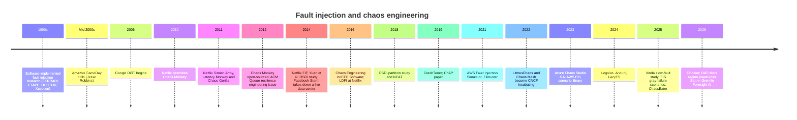
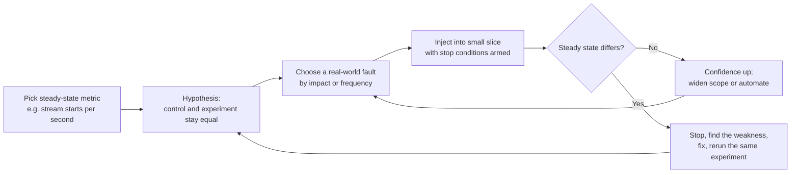
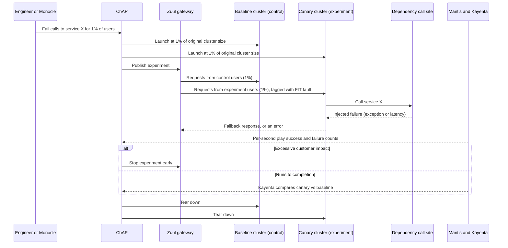

---
tags:
  - distributed-systems
  - infrastructure
  - fault-injection
  - chaos-engineering
  - resilience-testing
  - testing
status: complete
sources:
  - https://principlesofchaos.org/
  - https://arxiv.org/pdf/1702.05843
  - https://arxiv.org/pdf/1905.04648
  - https://www.infoq.com/news/2012/07/chaos-monkey
  - https://techblog.netflix.com/2011/07/netflix-simian-army.html
  - https://www.infoq.com/news/2014/12/failure-injection-production
  - https://par.nsf.gov/servlets/purl/10053503
  - https://queue.acm.org/detail.cfm?id=2371516
  - https://everythingsysadmin.com/2012/09/devops-have-more-outages-part.html
  - https://spectrum.ieee.org/facebook-engineers-crash-data-centers-in-realworld-stress-test
  - https://engineering.fb.com/2026/06/03/data-center-engineering/lights-out-systems-on-validating-instant-power-loss-readiness/
  - https://www.inf.ed.ac.uk/teaching/courses/seoc/2006_2007/resources/BasicConcepts.pdf
  - https://ntrs.nasa.gov/api/citations/19970022435/downloads/19970022435.pdf
  - https://www.eecg.utoronto.ca/~stumm/Papers/Yuan-OSDI-14.pdf
  - https://www.usenix.org/conference/osdi18/presentation/alquraan
  - https://sosp19.rcs.uwaterloo.ca/slides/lu.pdf
  - https://rohan.padhye.org/files/filibuster-socc21.pdf
  - https://www.usenix.org/conference/nsdi24/presentation/wu-haoze
  - https://web.eecs.umich.edu/~ryanph/paper/legolas-nsdi24-preprint.pdf
  - https://www.microsoft.com/en-us/research/?p=1068138
  - https://www.vldb.org/pvldb/vol17/p3017-ramos.pdf
  - https://jepsen.io/analyses/nats-2.12.1
  - https://www.usenix.org/system/files/nsdi25-lu.pdf
  - https://arxiv.org/pdf/2509.26529
  - https://www.usenix.org/system/files/nsdi26-gu.pdf
  - https://docs.aws.amazon.com/fis/latest/userguide/doc-history.html
  - https://docs.aws.amazon.com/fis/latest/userguide/stop-conditions.html
  - https://cncf.io/blog/2022/01/11/litmuschaos-becomes-a-cncf-incubating-project/
  - https://cncf.io/blog/2022/02/16/chaos-mesh-moves-to-the-cncf-incubator
  - https://aws.amazon.com/about-aws/whats-new/2025/11/aws-fis-test-scenarios-partial-failures
  - https://aws.amazon.com/about-aws/whats-new/2026/01/amazon-dynamodb-global-tables-with-mrsc-fis/
  - https://aws.amazon.com/about-aws/whats-new/2026/08/aws-resilience-hub/
  - https://www.infoq.com/news/2023/11/azure-chaos-studio-ga/
  - https://chaos-mesh.org/docs/basic-features
  - https://www.cncf.io/blog/2026/08/06/litmuschaos-q1-q2-2026-update-community-contributions-and-project-progress/
  - https://github.com/SHopify/toxiproxy
  - https://arxiv.org/abs/2501.11107
  - https://arxiv.org/html/2511.07865v1
  - https://web.eecs.umich.edu/~ryanph/paper/anduril-sosp24.pdf
  - https://infoq.com/news/2026/10/gremlin-foresight-ai
  - https://www.newswire.ca/news-releases/jane-street-leads-antithesis-s-105m-series-a-to-make-deterministic-simulation-testing-the-new-standard-821237228.html
  - https://arxiv.org/html/2509.14931v2
  - https://arxiv.org/pdf/2607.16161
  - https://advisera.com/dora-regulation/testing-of-ict-tools-and-systems/
  - https://www.fma.gv.at/en/dora-digital-operational-resilience/
  - https://aws.amazon.com/blogs/industries/dora-scenario-testing-with-aws-fault-injection-service/
created: 2026-11-28
updated: 2026-11-28
---

## Table Of Contents

---

- [[#TL;DR|TL;DR]]
- [[#The Problem|The Problem]]
- [[#Foundations|Foundations]]
    - [[#Fault, Error, Failure|Fault, Error, Failure]]
    - [[#Why Error Handling Is Where Systems Break|Why Error Handling Is Where Systems Break]]
    - [[#The Fault Space Is Huge|The Fault Space Is Huge]]
- [[#How We Got Here|How We Got Here]]
- [[#How It Works|How It Works]]
    - [[#The Experiment Loop|The Experiment Loop]]
    - [[#Where Faults Are Injected|Where Faults Are Injected]]
    - [[#Request-Scoped Injection in Production|Request-Scoped Injection in Production]]
    - [[#Telling Signal from Noise|Telling Signal from Noise]]
    - [[#Searching the Fault Space Instead of Sampling It|Searching the Fault Space Instead of Sampling It]]
    - [[#Slow Faults|Slow Faults]]
    - [[#Storage and Power-Loss Faults|Storage and Power-Loss Faults]]
    - [[#Disaster Drills|Disaster Drills]]
    - [[#Safety Rails|Safety Rails]]
    - [[#The Testing Spectrum|The Testing Spectrum]]
- [[#Where It Is Now|Where It Is Now]]
- [[#Trade-offs & Open Problems|Trade-offs & Open Problems]]
- [[#Resources|Resources]]
- [[#Related Notes|Related Notes]]

## ***TL;DR***
---
*Fault injection means breaking a system on purpose, under control, to see whether it handles the failure the way you think it does. Chaos engineering is the production-facing discipline built on it: state what "healthy" looks like, inject a realistic fault into a small slice of real traffic, and try to prove yourself wrong.*

- **Why bother:** in a study of 198 production failures in Cassandra, HBase, HDFS, MapReduce and Redis, 92% of the catastrophic ones came from incorrect handling of errors the software had already signaled, and 58% could have been caught by simply testing the error-handling code ([Yuan et al., OSDI 2014](https://www.eecg.utoronto.ca/~stumm/Papers/Yuan-OSDI-14.pdf)). Fault injection is how you exercise those paths.
- **Chaos engineering** is "the discipline of experimenting on a system in order to build confidence in the system's capability to withstand turbulent conditions in production" ([Principles of Chaos](https://principlesofchaos.org/)). Its loop: define a measurable steady state, hypothesize it holds, inject real-world faults, look for a difference.
- **Netflix made it mainstream:** Chaos Monkey (described December 2010) killed instances at random; FIT (2014) attached faults to individual requests; ChAP (2019 paper) ran automated experiments on 1% of users against a control group of 1%, with automatic stop and a 5% per-region traffic cap ([Basiri et al.](https://arxiv.org/pdf/1905.04648)).
- **Random is not enough.** Crash-recovery and partial-failure bugs hide in narrow timing windows and specific code points. Targeted injectors (LDFI, CrashTuner, Legolas, Anduril, CSnake) search the fault space using lineage, code analysis or feedback and find bugs random injection almost never hits; CrashTuner found one bug per ~50 runs versus ~5,000 for random crashes.
- **Slow faults are their own category.** A 1 ms network delay degrades Cassandra, HBase and Kafka by over 25%, damage is non-monotonic in the delay, and every system studied used static timeouts ([Lu et al., NSDI 2025](https://www.usenix.org/system/files/nsdi25-lu.pdf)). See [[Gray and Fail-Slow Failures]].
- **Now (Nov 2026):** fault injection is a managed cloud service (AWS FIS added gray-failure scenarios in Nov 2025; Resilience Hub generates FIS tests since Aug 2026), Kubernetes tools are mature (Chaos Mesh, LitmusChaos), whole-region power-loss drills run at Meta, AI agents are starting to plan and run experiments (ChaosEater, Gremlin Foresight AI), and research has moved to cascading failures and Kubernetes operators.

## ***The Problem***
---
*Distributed systems are built to survive failures, but the code that handles failure runs rarely, so it is the least tested code in the system. You only learn whether it works when the failure happens, which is the worst possible time to find out.*

Every distributed system makes claims about the faults it tolerates: a crashed replica, a dropped packet, a dead availability zone. Those claims live in two places that drift apart: the design (often proven, see [[Formal Methods in Practice]]) and the code (written by people under deadline). The gap shows up in three ways:

| Gap | What happens | Evidence |
|---|---|---|
| **Untested handlers** | The handler for a rare error is empty, logs and continues, or aborts the whole process. | 35% of catastrophic failures came from trivial handler mistakes: 25% ignored errors, 8% aborts on over-caught exceptions, 2% handlers still marked TODO ([Yuan et al.](https://www.eecg.utoronto.ca/~stumm/Papers/Yuan-OSDI-14.pdf)). |
| **Unmodeled faults** | The system survives the faults its authors imagined, not the ones that happen: partial partitions, slow disks, lost unsynced writes. | 136 partition-caused failures across 25 systems; most were catastrophic and most could be triggered by isolating a single node ([Alquraan et al., OSDI 2018](https://www.usenix.org/conference/osdi18/presentation/alquraan)). |
| **Untested recovery and dependencies** | Failover depends on a service that is also down, a runbook is out of date, a backup can't be restored. | Google's DiRT found a database restore failing on an outdated command and too little disk; an emergency bridge that held only 40 callers ([Krishnan, ACM Queue 2012](https://queue.acm.org/detail.cfm?id=2371516)). |

Waiting for real failures to test these paths is slow and expensive. Injecting faults deliberately turns a rare event into a scheduled one.

## ***Foundations***
---
*Three ideas carry the rest of the note: the vocabulary of faults, errors and failures; the evidence that error handling is where systems actually break; and the size of the space of possible faults, which is why how you choose faults matters more than how many you inject.*

### Fault, Error, Failure

The dependability literature separates cause from effect ([Avižienis et al., IEEE TDSC 2004](https://www.inf.ed.ac.uk/teaching/courses/seoc/2006_2007/resources/BasicConcepts.pdf)):

- **Failure:** "an event that occurs when the delivered service deviates from correct service." What the user sees.
- **Error:** "the part of the total state of the system that may lead to its subsequent service failure." Many errors never reach the user.
- **Fault:** "the adjudged or hypothesized cause of an error." A dead disk, a bug, a cut cable.

A fault activates, produces an error, the error propagates to the service interface, and that is a failure; to every system that depends on this one, the failure arrives as a fault. **Fault injection** introduces the cause and watches whether the chain stops early (the error is detected and masked) or runs all the way to a user-visible failure. That is why chaos experiments measure user-facing output, not internal state: the question is whether the chain was broken in time.

The faults a system claims to tolerate are its fault model (crash-stop, crash-recovery, omission, Byzantine, see [[Failure Models]]). An injector is only as good as its match to reality: injecting only clean crashes tests a crash-stop model, while production delivers slow disks, flapping links and torn writes.

### Why Error Handling Is Where Systems Break

Yuan et al. studied 198 user-reported failures sampled from 17,216 reports across Cassandra, HBase, HDFS, Hadoop MapReduce and Redis ([OSDI 2014](https://www.eecg.utoronto.ca/~stumm/Papers/Yuan-OSDI-14.pdf)). Their findings explain why fault injection works and how it should be shaped:

| Finding | Number | What it means for testing |
|---|---|---|
| Catastrophic failures from incorrect handling of signaled, non-fatal errors | 92% | The bug is usually in the reaction to a fault, not the fault itself. |
| Catastrophic failures detectable by simple tests of error-handling code | 58% | Most need no exotic tooling, just executing the handler once. |
| Failures that show up on 3 or fewer nodes | 98% | Small test clusters suffice; you don't need production scale to reproduce most bugs. |
| Failures needing more than one input event | 77% | A single injected fault is often not enough; order and combinations matter. |
| Failures needing 3 or fewer input events | 90% | But the combinations are short. |
| Deterministic failures | 74% | Once you hit the right sequence, it reproduces. |

"Input events" includes ordinary inputs like a client write or a configuration change, not only faults. The combined lesson: most catastrophic failures sit behind a short, specific sequence of events that ends in a poorly tested handler. Fault injection is the tool for reaching that handler; the hard part is finding the sequence.

### The Fault Space Is Huge

Suppose a request touches $n$ places where a fault could be injected (RPC call sites, disk writes, timers), and you allow up to $k$ simultaneous faults. The number of distinct fault scenarios is

$$
N(n, k) = \sum_{i=0}^{k} \binom{n}{i}, \qquad N(n, n) = 2^{n}.
$$

*In plain English:* every subset of injection points is a scenario, so the count grows combinatorially with how many faults you allow at once.

*Worked example.* For Netflix's App Boot request class, brute-force exploration would need roughly $2^{100} \approx 1.3 \times 10^{30}$ experiments, i.e. about $n = 100$ points ([Alvaro et al., SoCC 2016](https://par.nsf.gov/servlets/purl/10053503)). Capping at small $k$:

| $k$ (faults at once) | Scenarios for $n = 100$ |
|---|---|
| 1 | $1 + 100 = 101$ |
| 2 | $101 + 4{,}950 = 5{,}051$ |
| 3 | $5{,}051 + 161{,}700 = 166{,}751$ |

Even three simultaneous faults is 166,751 production experiments, before considering timing. Lineage-driven fault injection covered App Boot's space in "just under 200 experiments" and found 11 new critical failures, several involving combinations of service faults, by only trying fault sets that could actually break the computation that produced a good outcome (see [[#Searching the Fault Space Instead of Sampling It|Searching the Fault Space]]).

Timing makes it worse. If a crash only causes a bug when it lands in a window of width $w$ inside a run of length $T$, a crash injected at a uniformly random time hits it with probability

$$
p = \frac{w}{T}, \qquad \mathbb{E}[\text{runs until hit}] = \frac{T}{w}.
$$

*Worked example (illustrative):* a 10 ms window in a 60 s test run gives $p = 1/6000$, so about 6,000 runs. At two minutes per run that is 200 hours to expect one hit. This matches what CrashTuner measured on real systems: random crash injection found one bug per ~5,000 runs (~91 hours), while crashing at targeted code points found one per ~50 runs (~1.7 hours) ([Lu et al., SOSP 2019](https://sosp19.rcs.uwaterloo.ca/slides/lu.pdf)).

## ***How We Got Here***
---
*Fault injection began in 1990s dependability research on hardware and operating systems, moved into web operations as staged disaster drills in the mid 2000s, became continuous random production chaos at Netflix around 2010, and then split into two lines that are converging again: production experimentation platforms and research tools that search the fault space systematically.*

**Dependability research (1990s).** Fault injection started as a way to measure hardware and OS dependability. Hsueh, Tsai and Iyer's survey groups techniques into hardware-implemented (pin-level probes, heavy-ion radiation, electromagnetic interference), software-implemented (at compile time or at runtime via traps, timeouts and inserted code) and simulation-based, with tools like FERRARI (CPU, memory and bus faults via software traps), FTAPE (bit flips and emulated disk errors) and DOCTOR (CPU, memory and network faults) ([IEEE Computer, 1997](https://ntrs.nasa.gov/api/citations/19970022435/downloads/19970022435.pdf)).

**Drills (mid 2000s).** Jesse Robbins, whose title at Amazon was "Master of Disaster", built GameDay on his firefighting training before leaving Amazon in 2006 ([Limoncelli](https://everythingsysadmin.com/2012/09/devops-have-more-outages-part.html)). Google's Disaster Recovery Testing (DiRT), run since 2006, is an annual company-wide event lasting several days that breaks live systems: taking down a data center to simulate a Bay Area earthquake, taking source control offline, running a facility on generators ([Krishnan, ACM Queue 2012](https://queue.acm.org/detail.cfm?id=2371516)).

**Continuous random chaos (2010 to 2012).** Netflix moved to AWS and decided instances must be expected to fail at any time. "One of the first systems our engineers built in AWS is called the Chaos Monkey" (December 2010, quoted by [InfoQ](https://www.infoq.com/news/2012/07/chaos-monkey)). The 2011 Simian Army added Latency Monkey, which "induces artificial delays in our RESTful client-server communication layer", and Chaos Gorilla, which simulates losing a whole availability zone ([Netflix](https://techblog.netflix.com/2011/07/netflix-simian-army.html)). Chaos Monkey was open-sourced on July 30, 2012.

**Experiments, not random breakage (2014 to 2019).** Netflix's Failure Injection Testing (FIT) attached failure metadata to requests at the Zuul gateway, so a test could start with one account or device and widen to a percentage of production ([InfoQ, Dec 2014](https://www.infoq.com/news/2014/12/failure-injection-production)). The 2016 *IEEE Software* paper named the discipline and its principles ([Basiri et al.](https://arxiv.org/pdf/1702.05843)), and ChAP automated control-versus-experiment runs ([Basiri et al., 2019](https://arxiv.org/pdf/1905.04648)). In parallel, academic work showed where to aim: Yuan et al. (2014) on error handlers, Alvaro's lineage-driven fault injection (SIGMOD 2015, Netflix deployment SoCC 2016), Alquraan et al. (2018) on partitions, CrashTuner (2019) on crash timing.

**Productization (2020s).** AWS launched its Fault Injection Simulator in March 2021 (renamed Fault Injection Service in November 2023) ([AWS docs](https://docs.aws.amazon.com/fis/latest/userguide/doc-history.html)); Azure Chaos Studio reached GA in November 2023 after two years in preview ([InfoQ](https://www.infoq.com/news/2023/11/azure-chaos-studio-ga/)); LitmusChaos (CNCF incubating since [January 2022](https://cncf.io/blog/2022/01/11/litmuschaos-becomes-a-cncf-incubating-project/)) and Chaos Mesh ([incubating since February 2022](https://cncf.io/blog/2022/02/16/chaos-mesh-moves-to-the-cncf-incubator)) brought it to Kubernetes.

## ***How It Works***
---
*A chaos experiment is a controlled experiment with a fault as the treatment and user-facing health as the outcome. The engineering is in three places: where the fault is injected, how a difference is detected against noise, and how the experiment is kept from becoming the outage.*

### The Experiment Loop

The Principles of Chaos give four steps ([principlesofchaos.org](https://principlesofchaos.org/)):

1. "Start by defining 'steady state' as some measurable output of a system that indicates normal behavior."
2. "Hypothesize that this steady state will continue in both the control group and the experimental group."
3. "Introduce variables that reflect real world events like servers that crash, hard drives that malfunction" and similar.
4. "Try to disprove the hypothesis by looking for a difference in steady state."

And five advanced principles: build the hypothesis around steady-state *output* "rather than internal attributes"; vary real-world events, prioritized "by potential impact or estimated frequency"; run in production; automate experiments to run continuously; and minimize blast radius.

Netflix's canonical steady-state metric is **stream starts per second (SPS)**: it reflects users succeeding at the system boundary, it varies slowly and predictably over the day, and engineers have intuition for its normal wobble ([Basiri et al., 2016](https://arxiv.org/pdf/1702.05843)). The design choice is deliberate: an output metric catches failures you didn't think to instrument, while internal metrics (CPU, queue depth) only catch the ones you predicted.

### Where Faults Are Injected

| Layer | Faults | Example tools |
|---|---|---|
| **Infrastructure** | Terminate instances, kill pods, power off an AZ or region, exhaust capacity | Chaos Monkey, AWS FIS (`aws:ec2:asg-insufficient-instance-capacity-error`, AZ power interruption), Chaos Mesh PodChaos, Meta Storm |
| **Network** | Partition, delay, jitter, loss, reorder, bandwidth limits, connection resets, DNS failure | Linux `tc` netem (used by Blockade), Toxiproxy (`latency`, `timeout`, `reset_peer`, `slicer`, `limit_data`) ([Shopify](https://github.com/SHopify/toxiproxy)), Chaos Mesh NetworkChaos and DNSChaos, FIS cross-AZ slowdown |
| **Storage** | I/O latency, read/write errors, pause I/O, disk fill, lost unsynced writes, torn writes, bit flips | FIS `aws:ebs:volume-io-latency` and `aws:ebs:pause-volume-io`, Chaos Mesh IOChaos ("I/O delays and read/write failures"), CharybdeFS, LazyFS |
| **Process and OS** | Crash, pause (SIGSTOP), CPU or memory stress, clock jumps, kernel faults | Jepsen nemeses, Chaos Mesh StressChaos, TimeChaos ("simulates clock jumps"), KernelChaos ([Chaos Mesh](https://chaos-mesh.org/docs/basic-features)) |
| **Application and RPC** | Exceptions, error codes, added latency at a specific call site, for specific requests | Netflix FIT, Filibuster, Chaos Mesh HTTPChaos and JVMChaos, FIS Lambda invocation faults |
| **Whole simulation** | Every fault above, deterministically, at simulation speed | [[Deterministic Simulation Testing]] (FoundationDB, TigerBeetle VOPR, Antithesis) |

The lower the layer, the more realistic and indiscriminate the fault: killing a VM hits every request on it. The higher the layer, the more precise: an RPC-level fault can hit one call site for one user. Production chaos tends to start low (instances, zones) and move up as it matures; research injectors work almost entirely at the code level because that is where they can aim.

### Request-Scoped Injection in Production

Killing instances at random only tests one fault, and its blast radius is everyone on the instance. Netflix's answer was to attach the fault to the request, not the machine.

**FIT.** At the edge, a Zuul filter adds failure metadata to the request context. Each injection point inside the services (the Hystrix command wrapper, the Ribbon RPC client, EVCache, Astyanax for Cassandra) checks the context and, if its component is named, adds latency, returns an error status or throws. "FIT allows the impact of failure to be controlled by supplying metadata that indicates the limits of the test" ([InfoQ, 2014](https://www.infoq.com/news/2014/12/failure-injection-production)).

**ChAP** turns FIT into a controlled experiment ([Basiri et al., 2019](https://arxiv.org/pdf/1905.04648)):

Details that matter:

- **Users, not requests, are assigned.** Zuul annotates all requests from a selected user, so a user's experience is consistently in one group.
- **Separate small clusters for both groups.** The control runs on a fresh baseline cluster of the same size as the canary (in the worked example, each is 1% of a 180-server API cluster, two servers), so the comparison isn't confounded by long-running production instances.
- **Fast telemetry for the kill switch.** Netflix's Atlas metrics are about five minutes old, too slow to stop a bad experiment, so ChAP watches a Mantis stream reporting play success and failure every second.
- **Monocle generates experiments.** It mines Hystrix and RPC client configs and traces, then creates three kinds of experiment per dependency: failure, latency just below the timeout, and latency that causes failure. It ranks them by criticality (dependency priority × traffic share × retry factor × interactions) and weights failure 3, latency 2, latency-causing-failure 1.
- **Findings were mostly configuration.** Timeouts were inconsistent: a 1,000 ms Hystrix timeout wrapping a 4,000 ms RPC client timeout. Some services were more business-critical than their owners believed. A timeout too high for its thread pool caused rejections and fallback short-circuiting; lowering it fixed the problem.

### Telling Signal from Noise

A production experiment is a statistics problem: did the fault change the steady-state metric, or is the difference noise? A standard way to compare success rates between two groups is a two-proportion $z$-test:

$$
z = \frac{\hat p_c - \hat p_e}{\sqrt{\bar p (1 - \bar p)\left(\frac{1}{n_c} + \frac{1}{n_e}\right)}}
$$

where $\hat p_c, \hat p_e$ are the success rates in control and experiment, $n_c, n_e$ the attempts in each, and $\bar p$ the pooled rate. *In plain English:* divide the observed gap by how big a gap you'd expect from chance alone at this sample size.

*Worked example (illustrative numbers).* Control plays succeed 99.50% of the time, the experiment group 99.30%, a 0.2-point drop. Pooled $\bar p = 0.994$, so $\bar p(1-\bar p) = 0.005964$.

| Attempts per group | Standard error | $z$ | Verdict at 5% (two-sided, $\lvert z \rvert > 1.96$) |
|---|---|---|---|
| 10,000 | $\sqrt{0.005964 \times 2/10^4} = 0.00109$ | 1.83 | Not significant: the regression slips through |
| 100,000 | $\sqrt{0.005964 \times 2/10^5} = 0.000345$ | 5.79 | Clearly significant |

To detect this drop with 80% power you need roughly $n \approx 2\bar p(1-\bar p)(1.96 + 0.84)^2 / 0.002^2 \approx 23{,}000$ attempts per group. That is the tension at the heart of production chaos: a small blast radius means less data, so either run longer or accept that small regressions are invisible. Netflix reports the practical version of this: error counts were noisy enough that the automatic-stop threshold for errors had to be raised substantially, and failures in small device sub-populations were hard to see in aggregate success counts ([Basiri et al., 2019](https://arxiv.org/pdf/1905.04648)). Kayenta, Netflix's canary analysis service, does the statistical comparison; the kill switch uses a cruder threshold because it has to act within seconds.

### Searching the Fault Space Instead of Sampling It

Random injection samples the fault space; the research line since 2015 tries to search it, using some signal about which faults could matter.

| Approach | Signal used to choose faults | Result |
|---|---|---|
| **LDFI** (Alvaro et al., SIGMOD 2015; Netflix SoCC 2016) | Lineage of a successful outcome: which alternative computations could produce it. A Boolean formula over those alternatives gives the fault sets that could break every path; each is tested and pruned. At Netflix, traces stood in for lineage. | App Boot's ~$2^{100}$ space covered in just under 200 experiments; 11 new critical failures ([SoCC 2016](https://par.nsf.gov/servlets/purl/10053503)) |
| **Filibuster** (Meiklejohn et al., SoCC 2021) | Existing passing functional tests. Each remote call in a test gets a scheduled run that injects a `Timeout`, `ConnectionError` or plausible HTTP error there, explored recursively. Dynamic reduction uses service boundaries to skip redundant combinations. | Found every bug in a 12-app corpus, four of which recreate industry chaos experiments at Audible, Expedia, Mailchimp and Netflix; Netflix example ran 4,670 of 18,653 tests after reduction ([paper](https://rohan.padhye.org/files/filibuster-socc21.pdf)) |
| **CrashTuner** (Lu et al., SOSP 2019) | "Meta-info" variables (node, container, server IDs) found from logs and types. Crash a node just before a read or just after a write of one. | 21 new crash-recovery bugs in YARN, HDFS, HBase, ZooKeeper and Cassandra; one bug per ~50 runs vs ~5,000 for random crashes ([slides](https://sosp19.rcs.uwaterloo.ca/slides/lu.pdf)) |
| **NEAT** (Alquraan et al., OSDI 2018) | Partition shapes from a failure study: complete, partial and simplex partitions, especially isolating one node. | 32 failures in 7 systems ([OSDI 2018](https://www.usenix.org/conference/osdi18/presentation/alquraan)) |
| **Legolas** (Wu, Pan, Huang, NSDI 2024) | Abstract states inferred statically from each thread's control flow (a branch on a state variable guarding a significant action); injection points are grouped by state and chances spread round-robin across states rather than across wall-clock time. | 20 new partial-failure bugs in ZooKeeper, HDFS, Kafka, HBase, Cassandra and Flink. In the same setup a random policy found 3, CrashTuner 4, FATE 1, and the off-the-shelf injectors CharybdeFS, tcconfig and byte-monkey none ([NSDI 2024](https://www.usenix.org/conference/nsdi24/presentation/wu-haoze), [preprint](https://web.eecs.umich.edu/~ryanph/paper/legolas-nsdi24-preprint.pdf)) |
| **Anduril** (Pan et al., SOSP 2024) | Feedback from a failure log. Log messages seen only in the failure are symptoms; static causal analysis ranks fault sites by distance to them; each run that fails to reproduce lowers the priority of symptoms it did produce, and fault occurrences are ranked by how many log messages separate them from the symptom, which picks the moment ([paper](https://web.eecs.umich.edu/~ryanph/paper/anduril-sosp24.pdf)). | Reproduced all 22 real fault-induced failures from five systems, median 8 minutes in ZooKeeper, HDFS, HBase, Kafka and Cassandra ([MSR](https://www.microsoft.com/en-us/research/?p=1068138)) |
| **CSnake** (Qian, Tan, Zhang, EuroSys 2026) | Causal stitching: single-fault runs from different workloads, each compared to a fault-free profile, are linked into fault-propagation chains that loop back on themselves. | 15 bugs causing self-sustaining cascading failures in HDFS, HBase, Ozone and Flink; 5 confirmed, 2 fixed ([arXiv](https://arxiv.org/pdf/2509.26529)) |

The common move: instead of "inject fault X at a random time", ask "which (fault, location, moment) could plausibly break this?", using program structure as the guide. These tools mostly run before production, on small clusters, which Yuan's 98%-on-3-nodes finding says is enough for most bugs.

### Slow Faults

A dead node is easy: heartbeats stop and the system fails over. A slow node keeps answering, just late, and many systems never notice (see [[Gray and Fail-Slow Failures]]). Injecting slowness is a separate discipline because the outcomes are not monotonic.

Lu et al.'s Xinda pipeline injected network delay (100 µs to 1 s, via Blockade over Linux `tc`), packet loss (1 to 70%) and filesystem delay (1 ms to 1 s, via the FUSE-based CharybdeFS) into one node of Cassandra, HBase, HDFS, etcd, CockroachDB and Kafka, repeating each experiment 50 times ([NSDI 2025](https://www.usenix.org/system/files/nsdi25-lu.pdf)):

- **Small delays hurt a lot.** 1 ms of network delay caused over 25% degradation in Cassandra, HBase and Kafka; 10 ms reached 70%. CockroachDB and etcd needed around 100 ms for a similar drop.
- **More slowness can hurt less.** In CockroachDB a 1 s filesystem delay caused 44% degradation versus 48% for 10 ms; Kafka showed 68% versus 74%. Very slow components trip timeouts and get routed around; moderately slow ones don't.
- **Danger zones are narrow.** Most systems have a band of severity where degradation jumps sharply, spanning only a few milliseconds or percentage points, so a coarse sweep can miss it entirely.
- **Followers can matter more than leaders.** In etcd under a flaky network, slow followers caused about 1.5x the degradation of a slow leader.
- **More cores, worse impact.** For etcd at 10 ms delay, degradation was 7%, 26% and 72% at 1, 2 and 5 cores, because a faster baseline makes the same delay relatively larger.
- **Tail metrics can hide it.** etcd's p99.9 latency rose only 0.4 to 7.2 ms under 10 ms delay, so a tail-latency alarm could miss a severe slowdown.
- **Current practice falls short.** All six systems used static timeouts, and their own slow-fault tests were unit tests with sleeps, not end-to-end injection.

Practical consequence: sweep slow-fault severity finely, inject at followers as well as leaders, and test with production-like resource sizes. AWS FIS added "AZ: Application Slowdown" and "Cross-AZ: Traffic Slowdown" scenarios in November 2025 precisely for these "gray failures", with a `flowsPercent` parameter so only part of the traffic is slowed ([AWS](https://aws.amazon.com/about-aws/whats-new/2025/11/aws-fis-test-scenarios-partial-failures)).

### Storage and Power-Loss Faults

Disks don't just die; they lose writes that were acknowledged by the OS but never fsynced, tear large writes, and flip bits. Simulating that requires sitting between the system and the disk.

**LazyFS** is a FUSE file system that keeps its own page cache with no background flushing. Data reaches the backing file system only on an fsync-type call, on LRU eviction, or when a fault says so. A `clear-cache` command drops everything unsynced while the system keeps running, which models a power failure without restarting the machine; a write handler can persist only parts of large writes to produce torn writes ([Ramos et al., VLDB 2024](https://www.vldb.org/pvldb/vol17/p3017-ramos.pdf)). Across PostgreSQL, etcd, ZooKeeper, Redis, LevelDB, PebblesDB and Lightning Network it reproduced five known bugs with hard reproduction steps, explained seven ambiguous ones and found eight new bugs causing data loss, corruption or unavailability.

Kyle Kingsbury of Jepsen is a co-author, and Jepsen uses it in its analyses. In December 2025, Jepsen's NATS 2.12.1 analysis combined process pauses, crashes, partitions, packet loss, bit flips and truncation in data files, and LazyFS power failures. It found that NATS acknowledges writes before its periodic (roughly two-minute) flush, so correlated power failures can lose committed data, and that "this fault requires nothing more than a single power failure" combined with pauses or partitions to leave "a persistent split-brain which continued after all nodes were restarted and the network healed" ([Jepsen](https://jepsen.io/analyses/nats-2.12.1)). This is the fault class behind [[Write-Ahead Logging]] and [[Silent Data Corruption]].

### Disaster Drills

Some faults can't be scoped to 1% of users: losing a data center, a region or a shared dependency like authentication. Those are tested as scheduled drills.

- **Google DiRT** is annual, lasts several days and involves hundreds of engineers. A centrally staffed command center watches tests and reverts them; each test has a rollback plan reviewed by a cross-functional team. Services known to fail a test can be exempted ("prefail"), but none can skip by "prepassing". The scenario that taught the most was an earthquake drill: when the data center hosting internal systems went down and the Mountain View campus was disconnected, authentication failures locked most teams out of their own machines ([ACM Queue, 2012](https://queue.acm.org/detail.cfm?id=2371516)). "Copious documentation on how something should work doesn't mean anyone will use it, or that it will work if they do."
- **Facebook Storm** began after Hurricane Sandy (2012) threatened two data centers. In 2014 it took down a live data center on a normal workday; it was messy internally, but users didn't seem to notice ([IEEE Spectrum, 2016](https://spectrum.ieee.org/facebook-engineers-crash-data-centers-in-realworld-stress-test)). "It's easier to take a data center down than to put it back together."
- **Meta's Instantaneous PowerLoss Storm (June 2026)** de-energizes an entire *region*, a set of co-located buildings about 50 to 60 times the size of a typical fault domain, with no notice and no preemptive actions. It was staged: pre-production and shadow regions first, then the smallest production regions, then large ones holding critical storage, AI and data-warehouse workloads. It found circular dependencies (control-plane services needed to start the region they live in) and a "boomerang": shutdown signals reaching the orchestrator's own control plane, orphaning services. The fix for the latter was to have control-plane services ignore power-related shutdown signals ([Meta Engineering](https://engineering.fb.com/2026/06/03/data-center-engineering/lights-out-systems-on-validating-instant-power-loss-readiness/)).

Drills test what experiments can't: recovery, bootstrapping from cold, people and processes. They are where circular dependencies surface, the same kind that turned the October 2025 AWS outage into congestive collapse (see [[Reliability Patterns]]).

### Safety Rails

The injector is itself a privileged control plane that can cause outages. Production programs converge on the same rails:

| Rail | Example |
|---|---|
| **Small, consistent cohort** | ChAP: 1% of users in each group, assigned per user ([Basiri et al., 2019](https://arxiv.org/pdf/1905.04648)) |
| **Global budget** | ChAP: all concurrent experiments together may affect at most 5% of traffic in any one region |
| **Business hours only** | Chaos Monkey runs only during working hours; ChAP weekdays 9 AM to 5 PM |
| **Don't stack on real incidents** | ChAP runs nothing during a regional failover |
| **Automatic stop conditions** | ChAP halts on excessive customer impact from a per-second stream; FIS stops an experiment when a CloudWatch alarm on the steady-state metric fires, and a stopped experiment can't be resumed ([AWS docs](https://docs.aws.amazon.com/fis/latest/userguide/stop-conditions.html)) |
| **Global kill switch** | FIS "safety levers" (Sep 2024) stop all running experiments and block new ones ([AWS docs](https://docs.aws.amazon.com/fis/latest/userguide/doc-history.html)) |
| **Dry run** | FIS `skip-all` actions mode previews targets without injecting (Mar 2024) |
| **Escalation path** | DiRT's central command center can revert any test; Meta stages power-loss tests from shadow regions up |
| **Access control** | Chaos Mesh limits experiments by namespace annotation and Kubernetes RBAC ([docs](https://chaos-mesh.org/docs/basic-features)) |

### The Testing Spectrum

Fault injection is one family of techniques that trade realism for control:

| Technique | Where | Faults | Oracle | Reproducible? |
|---|---|---|---|---|
| Unit-level SFIT (Filibuster) | Developer machine, CI | RPC errors and timeouts | The test's own assertions | Yes |
| [[Deterministic Simulation Testing]] | Simulator | Everything, including clocks and disks | Invariants and assertions | Yes, from a seed |
| Targeted injectors (CrashTuner, Legolas, Anduril, CSnake) | Small test cluster | Crashes, partial failures, propagation chains | Exceptions, hangs, checker | Mostly |
| Jepsen | Test cluster, real binaries | Partitions, pauses, crashes, clocks, disk faults | History checkers (see [[Isolation Testing]]) | Sometimes |
| Production chaos (Chaos Monkey, ChAP, FIS, Chaos Studio) | Production | Instance, zone, dependency, latency | Steady-state metric vs control | Rarely |
| Disaster drills (DiRT, Storm, GameDay) | Production, people included | Data center, region, shared services | Recovery time, human judgment | No |

The left end finds bugs cheaply and reproducibly but only within its fault model; the right end tests the real system including configuration, capacity and people but finds problems late and can't replay them. Mature programs use several.

## ***Where It Is Now***
---
*As of November 2026, fault injection is a managed cloud feature and a CNCF commodity, gray and slow failures have become first-class scenarios, whole-region drills are being run at hyperscalers, and the newest work uses AI agents to plan experiments and program analysis to find cascading failures. Evidence for the AI tools is still mostly the vendors' own.*

### Managed Cloud Services

- **AWS FIS** has grown from instance and network actions into a library of fault-domain scenarios: Cross-Region Connectivity and AZ Availability: Power Interruption (Nov 2023), DynamoDB global-table replication pause (Apr 2024), Lambda invocation faults (Oct 2024), safety levers (Sep 2024), ARC [[Zonal Isolation and Cell-Based Architecture#Evacuating a Zone|zonal autoshift]] in the AZ power scenario (Mar 2025), EBS I/O latency (Sep 2025), gray-failure slowdown scenarios with partial-flow targeting (Nov 2025), Direct Connect BGP disruption (Dec 2025), and non-root ECS sidecars (Sep 2026) ([AWS doc history](https://docs.aws.amazon.com/fis/latest/userguide/doc-history.html)). In January 2026 it added pausing replication for DynamoDB global tables with multi-Region strong consistency ([AWS](https://aws.amazon.com/about-aws/whats-new/2026/01/amazon-dynamodb-global-tables-with-mrsc-fis/)).
- **Generated tests.** Since August 2026, AWS Resilience Hub recommends pre-configured tests from a service's architecture and resilience policy, covering AZ impairment, Regional impairment and dependency failure, runs them through FIS and reports pass or fail against the recovery objectives ([AWS](https://aws.amazon.com/about-aws/whats-new/2026/08/aws-resilience-hub/)). Fault injection is becoming a compliance-style check rather than a bespoke experiment.
- **Azure Chaos Studio** has been GA since November 2023 with agent-based and service-direct faults and templates for scenarios like an AZ going down ([InfoQ](https://www.infoq.com/news/2023/11/azure-chaos-studio-ga/)).

### Kubernetes and Open Source

- **Chaos Mesh** covers pod, network, DNS, HTTP, stress, I/O, time and kernel faults plus AWS, GCP and JVM faults, with workflows for serial and parallel experiments ([docs](https://chaos-mesh.org/docs/basic-features)).
- **LitmusChaos** shipped six releases in the first half of 2026 (3.25 to 3.30), including Prometheus metrics and stopping experiments when infrastructure disconnects, and showed a Model Context Protocol integration at KubeCon India in June 2026. Maintainers report users asking about testing AI inference workloads, which fail differently from traditional services ([CNCF](https://www.cncf.io/blog/2026/08/06/litmuschaos-q1-q2-2026-update-community-contributions-and-project-progress/)).
- **Operators are a weak spot.** An NSDI 2026 study of 412 failures in 13 Kubernetes operators found the biggest source is how operators interact with the applications they manage; its OAT tool, which injects node crashes, network delays and timeouts with Chaos Mesh while an operator reconciles, found 86 new bugs in six operators ([Gu et al.](https://www.usenix.org/system/files/nsdi26-gu.pdf)). See [[Reconciliation and Control Loops]].

### Agents Planning Experiments

- **ChaosEater (preprint Jan 2025, follow-up Nov 2025)** runs the whole loop with LLM agents on Kubernetes: define steady state, plan Chaos Mesh faults, analyze, reconfigure manifests, repeat. A cycle cost $0.2 to $0.8 and took 11 to 25 minutes; it fixed Nginx in 5 of 5 runs and SockShop in 4 of 5. The authors limit it to development environments "due to security concerns" ([arXiv](https://arxiv.org/html/2511.07865v1)).
- **Gremlin Foresight AI (Oct 2026)** uses four agents (analyst, tester, operator, program manager) to recommend, run and re-run tests, drawing on Gremlin's "Failure Atlas" of past experiments; nothing runs or is applied without engineer approval. Gremlin has published no accuracy or false-positive figures ([InfoQ](https://infoq.com/news/2026/10/gremlin-foresight-ai)).
- **Planning for AI infrastructure (Jul 2026).** Meta's ADA-ST models fault propagation across hardware, firmware, management and orchestration layers as a graph and picks cross-layer scenarios to cover it. In its analysis, 49% of one platform's 72,550 repair tickets involved cross-layer propagation, and static new-platform test plans covered only 20.6 to 25.0% of modeled propagation edges. Most results are analytical or replayed against tickets; only four scenarios ran on real hardware ([Kulkarni et al.](https://arxiv.org/pdf/2607.16161)). See [[GPU Cluster Infrastructure]].

### Research and Convergence

- **Cascades and propagation** are the new target: CSnake (EuroSys 2026) for self-sustaining cascades, Anduril (SOSP 2024) for reproducing fault-induced failures, Sieve (ATC 2025) for fail-slow bugs (see [[Gray and Fail-Slow Failures]]). These connect fault injection to [[Reliability Patterns|metastable failures]].
- **Simulation is absorbing some of chaos testing's role.** Antithesis raised a $105M Series A led by Jane Street in December 2025 to make deterministic simulation "the new standard" ([press release](https://www.newswire.ca/news-releases/jane-street-leads-antithesis-s-105m-series-a-to-make-deterministic-simulation-testing-the-new-standard-821237228.html)). Simulation finds protocol and recovery bugs before production; chaos still owns configuration, capacity and people.
- **Practitioners are cooler on production than the principles are.** A gray-literature review of 50 practitioner sources (2019 to May 2024) found "run experiments in production" in only 16, versus about 42 for defining steady state; practitioners favor production only when injection can be tightly controlled ([Fossati et al.](https://arxiv.org/html/2509.14931v2)).
- **Regulation.** EU financial firms under DORA (applying since January 2025) must test critical systems at least annually, and Article 25 lists "scenario-based tests" alongside performance and end-to-end testing ([Advisera](https://advisera.com/dora-regulation/testing-of-ict-tools-and-systems/), [FMA](https://www.fma.gv.at/en/dora-digital-operational-resilience/)); AWS positions FIS for this ([AWS](https://aws.amazon.com/blogs/industries/dora-scenario-testing-with-aws-fault-injection-service/)).

## ***Trade-offs & Open Problems***
---
*Every choice in fault injection trades realism against control, and coverage against cost. The unsolved problems are about knowing what to inject, knowing when something went wrong, and keeping the testing system from becoming a cause of failure.*

- **Production realism vs risk.** Production has the real configuration, traffic and dependencies; it also has real users. Small cohorts reduce harm but also statistical power (see the worked example above), so subtle regressions slip through.
- **The oracle problem.** Steady-state metrics are coarse. Netflix found error counts too noisy for tight stop thresholds and small device populations invisible in aggregates; Xinda found p99.9 barely moves under a slowdown that cuts throughput sharply. Pre-production tools have sharper oracles (assertions, invariants, history checkers) but a narrower fault model.
- **Fault-model fidelity.** You only test what you inject. FIT supported one error type per injection point, so "no servers registered in service discovery" was missed until an incident ([Basiri et al., 2019](https://arxiv.org/pdf/1905.04648)); simulators that replaced whole sectors missed single-bit corruption (see [[Deterministic Simulation Testing]]); slow-fault danger zones are only a few milliseconds wide.
- **Combinations and timing.** Most failures need more than one event, and the fault space grows combinatorially. Targeted tools work for specific bug classes (crash timing, partial failures, propagation chains); no general method covers multi-fault, timing-dependent bugs at production scale.
- **Faults that need load.** Metastable and cascading failures need both a trigger and enough load to sustain the loop. Injecting a trigger at peak load in production is exactly the experiment nobody wants to run; doing it in pre-production needs realistic load (see [[Queueing Theory for Systems]]).
- **Recovery is the least tested path.** Drills keep finding circular dependencies: authentication needed to fix authentication (DiRT), control planes needed to start their own region (Meta). These rarely show up in per-service experiments.
- **The injector as a hazard.** Fault tooling needs broad permissions across the fleet; Meta's power-loss "boomerang" hit its own control plane. Kill switches, RBAC and budgets are now standard, but the injector remains a high-privilege control plane.
- **Adoption and cost.** Netflix's lesson about self-serve ChAP was "even if you build it, they might not come"; automated experiments needed heavy manual analysis to keep false positives down. Library-based injection is slow to roll out across polyglot services, which pushes injection into sidecars and proxies.
- **AI-driven chaos is unproven.** Agents can plan and run experiments cheaply, but published evidence is two small systems (ChaosEater) or vendor claims (Gremlin), and both keep humans or dev-only environments in the loop for safety.

## ***Resources***
---
*Start with the Principles of Chaos page and the 2016 IEEE Software paper for the discipline, Yuan et al. for why it works, and the ChAP paper for what a production platform actually looks like. Then pick the research tool that matches the bug class you care about.*

**Discipline and practice**
- [Principles of Chaos Engineering](https://principlesofchaos.org/) (last updated March 2019).
- Ali Basiri et al., [Chaos Engineering](https://arxiv.org/pdf/1702.05843), *IEEE Software*, 2016.
- Ali Basiri, Lorin Hochstein, Nora Jones, Haley Tucker, [Automating Chaos Experiments in Production](https://arxiv.org/pdf/1905.04648), 2019 (ChAP and Monocle).
- Yury Izrailevsky and Ariel Tseitlin, [The Netflix Simian Army](https://techblog.netflix.com/2011/07/netflix-simian-army.html), Netflix TechBlog, July 2011.
- InfoQ, [Netflix Open Sources Chaos Monkey](https://www.infoq.com/news/2012/07/chaos-monkey), July 2012; [Failure Injection Testing in production](https://www.infoq.com/news/2014/12/failure-injection-production), December 2014.
- Kripa Krishnan, [Weathering the Unexpected](https://queue.acm.org/detail.cfm?id=2371516), *ACM Queue*, 2012 (Google DiRT).
- Tom Limoncelli, [on the ACM Queue resilience engineering roundtable](https://everythingsysadmin.com/2012/09/devops-have-more-outages-part.html), 2012 (GameDay and DiRT history).
- IEEE Spectrum, [Facebook Engineers Crash Data Centers in Real-World Stress Test](https://spectrum.ieee.org/facebook-engineers-crash-data-centers-in-realworld-stress-test), 2016.
- Meta Engineering, [Lights Out Systems On: Validating Instant Power Loss Readiness](https://engineering.fb.com/2026/06/03/data-center-engineering/lights-out-systems-on-validating-instant-power-loss-readiness/), June 2026.
- Stefano Fossati et al., ["Let it be Chaos in the Plumbing!" Usage and Efficacy of Chaos Engineering in DevOps Pipelines](https://arxiv.org/html/2509.14931v2), 2025.

**Foundations and failure studies**
- Algirdas Avižienis, Jean-Claude Laprie, Brian Randell, Carl Landwehr, [Basic Concepts and Taxonomy of Dependable and Secure Computing](https://www.inf.ed.ac.uk/teaching/courses/seoc/2006_2007/resources/BasicConcepts.pdf), *IEEE TDSC*, 2004.
- Mei-Chen Hsueh, Timothy Tsai, Ravishankar Iyer, [Fault Injection Techniques and Tools](https://ntrs.nasa.gov/api/citations/19970022435/downloads/19970022435.pdf), *IEEE Computer*, 1997.
- Ding Yuan et al., [Simple Testing Can Prevent Most Critical Failures](https://www.eecg.utoronto.ca/~stumm/Papers/Yuan-OSDI-14.pdf), OSDI 2014.
- Ahmed Alquraan et al., [An Analysis of Network-Partitioning Failures in Cloud Systems](https://www.usenix.org/conference/osdi18/presentation/alquraan), OSDI 2018.
- Ruiming Lu et al., [One-Size-Fits-None: Understanding and Enhancing Slow-Fault Tolerance in Modern Distributed Systems](https://www.usenix.org/system/files/nsdi25-lu.pdf), NSDI 2025.

**Targeted fault injection**
- Peter Alvaro et al., [Automating Failure Testing Research at Internet Scale](https://par.nsf.gov/servlets/purl/10053503), SoCC 2016 (LDFI at Netflix).
- Jie Lu et al., [CrashTuner](https://sosp19.rcs.uwaterloo.ca/slides/lu.pdf), SOSP 2019 (slides).
- Christopher Meiklejohn et al., [Service-Level Fault Injection Testing](https://rohan.padhye.org/files/filibuster-socc21.pdf), SoCC 2021 (Filibuster).
- Haoze Wu et al., [Efficient Exposure of Partial Failure Bugs in Distributed Systems with Inferred Abstract States](https://www.usenix.org/conference/nsdi24/presentation/wu-haoze), NSDI 2024 (Legolas).
- Jia Pan, Haoze Wu, Tanakorn Leesatapornwongsa, Suman Nath, Peng Huang, [Efficient Reproduction of Fault-Induced Failures in Distributed Systems with Feedback-Driven Fault Injection](https://web.eecs.umich.edu/~ryanph/paper/anduril-sosp24.pdf), SOSP 2024 (Anduril; [MSR page](https://www.microsoft.com/en-us/research/?p=1068138)).
- Maria Ramos et al., [When Amnesia Strikes: Understanding and Reproducing Data Loss Bugs with Fault Injection](https://www.vldb.org/pvldb/vol17/p3017-ramos.pdf), VLDB 2024 (LazyFS).
- Shangshu Qian, Lin Tan, Yongle Zhang, [CSnake: Detecting Self-Sustaining Cascading Failure via Causal Stitching of Fault Propagations](https://arxiv.org/pdf/2509.26529), EuroSys 2026.
- Jiawei Tyler Gu et al., [Who Watches the Watchers? On the Reliability of Softwarizing Cloud Application Management](https://www.usenix.org/system/files/nsdi26-gu.pdf), NSDI 2026 (OAT).
- Jepsen, [NATS 2.12.1](https://jepsen.io/analyses/nats-2.12.1), December 2025.

**Tools and services**
- AWS, [Fault Injection Service document history](https://docs.aws.amazon.com/fis/latest/userguide/doc-history.html); [partial-failure scenarios](https://aws.amazon.com/about-aws/whats-new/2025/11/aws-fis-test-scenarios-partial-failures), Nov 2025; [DynamoDB MRSC replication pause](https://aws.amazon.com/about-aws/whats-new/2026/01/amazon-dynamodb-global-tables-with-mrsc-fis/), Jan 2026; [Resilience Hub recommended tests](https://aws.amazon.com/about-aws/whats-new/2026/08/aws-resilience-hub/), Aug 2026.
- InfoQ, [Azure Chaos Studio GA](https://www.infoq.com/news/2023/11/azure-chaos-studio-ga/), Nov 2023.
- [Chaos Mesh basic features](https://chaos-mesh.org/docs/basic-features); CNCF, [LitmusChaos H1 2026 update](https://www.cncf.io/blog/2026/08/06/litmuschaos-q1-q2-2026-update-community-contributions-and-project-progress/).
- Shopify, [Toxiproxy](https://github.com/SHopify/toxiproxy).

**Frontier (2025 to 2026)**
- Daisuke Kikuta, Hiroki Ikeuchi, Kengo Tajiri, [ChaosEater: Fully Automating Chaos Engineering with Large Language Models](https://arxiv.org/abs/2501.11107), arXiv, Jan 2025; follow-up [LLM-Powered Fully Automated Chaos Engineering](https://arxiv.org/html/2511.07865v1), Nov 2025.
- InfoQ, [Gremlin Foresight AI](https://infoq.com/news/2026/10/gremlin-foresight-ai), Oct 2026.
- Saurabh Kulkarni et al., [Adaptive Fault Injection Planning for Multi-Layer Self-Healing AI Infrastructure](https://arxiv.org/pdf/2607.16161), arXiv, Jul 2026.
- [Jane Street Leads Antithesis's $105M Series A](https://www.newswire.ca/news-releases/jane-street-leads-antithesis-s-105m-series-a-to-make-deterministic-simulation-testing-the-new-standard-821237228.html), Dec 2025.
- DORA Article 25 ([Advisera](https://advisera.com/dora-regulation/testing-of-ict-tools-and-systems/)); Austrian FMA on [DORA resilience testing](https://www.fma.gv.at/en/dora-digital-operational-resilience/); AWS, [DORA scenario testing with FIS](https://aws.amazon.com/blogs/industries/dora-scenario-testing-with-aws-fault-injection-service/), Feb 2025.

## ***Related Notes***
---
*The fault models being injected, the failure modes they expose, and the other ways to test distributed systems.*

- [[Failure Models]] — The fault model an injector should match; partition studies.
- [[Gray and Fail-Slow Failures]] — Slow and partial faults, Xinda and Sieve, AZ evacuation.
- [[Deterministic Simulation Testing]] — Fault injection inside a reproducible simulator.
- [[Isolation Testing]] — Jepsen's history checkers, the oracle for fault-injection tests of databases.
- [[Formal Methods in Practice]] — Proving the design; fault injection tests the code.
- [[Reliability Patterns]] — Timeouts, retries, circuit breakers and metastable failures that experiments exercise.
- [[Queueing Theory for Systems]] — Why overload and slowdowns cascade; testing under load.
- [[Tail Latency and Hedging]] — Injecting slowness to test tail tolerance.
- [[Silent Data Corruption]] — Bit flips and the limits of sector-level corruption models.
- [[Write-Ahead Logging]] — fsync and durability, which LazyFS-style faults test.
- [[Reconciliation and Control Loops]] — Kubernetes operators and OAT's fault-injection findings.
- [[Time and Clocks]] and [[Clock Synchronization]] — Clock jumps and skew as injected faults.
- [[Leases and Fencing]] — Pauses and partitions that break leases.
- [[Raft]] and [[Paxos]] — Leader crashes, partitions and slow followers in consensus.
- [[Replication]] — Replica loss and repair under injected faults.
- [[Coordination Services]] — ZooKeeper and etcd as frequent fault-injection targets.
- [[Consistency Models]] — What Jepsen's fault-injected histories are checked against.
- [[GPU Cluster Infrastructure]] — Cross-layer faults in AI clusters.
- [[Distributed Training]] — Where one faulty GPU or link stalls a whole job.
- [[AI-Assisted Protocol Design]] — Agents in the systems testing loop.
- [[Zonal Isolation and Cell-Based Architecture]] — Zonal shift, autoshift practice runs and cells, the response chaos drills rehearse.
- [[Safe Configuration Rollout]] — Planned: staged config changes, the other half of failing small.
- [[Crash Consistency]] — Planned: fsync semantics and crash-consistency testing.
- [[Load Testing and Benchmarking]] — Planned: realistic load, which cascading-failure tests need.
- [[Fleet Health and Hardware Screening]] — Planned: burn-in and quarantine of faulty hardware.
