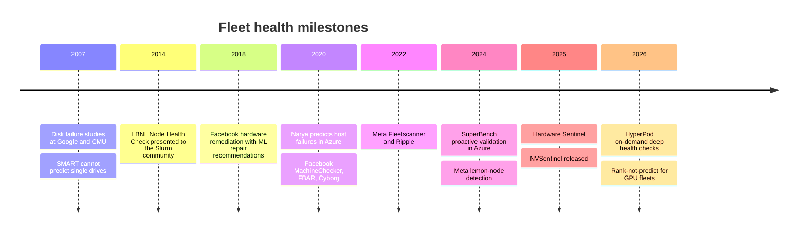
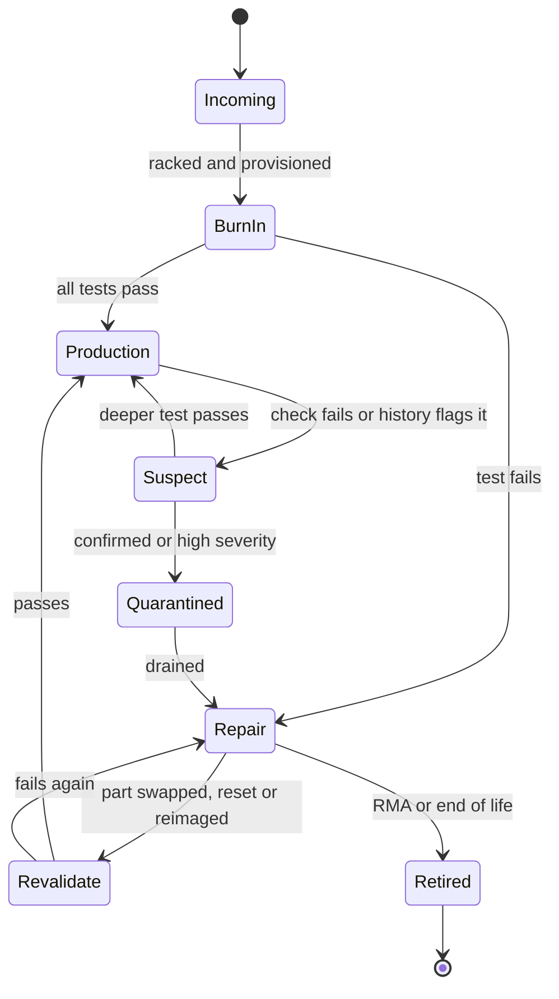
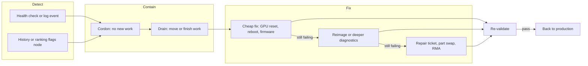

---
tags:
  - distributed-systems
  - infrastructure
  - fleet-health
  - hardware-reliability
  - burn-in
  - health-checks
  - quarantine
status: complete
sources:
  - https://itl.nist.gov/div898/handbook/apr/section1/apr124.htm
  - https://www.allaboutcircuits.com/technical-articles/how-the-weibull-distribution-is-used-in-reliability-engineering/
  - https://www.usenix.org/legacy/event/fast07/tech/schroeder/schroeder_html/
  - https://www.usenix.org/event/fast07/tech/full_papers/pinheiro/pinheiro_html/
  - https://www.backblaze.com/blog/are-hard-drives-getting-better-lets-revisit-the-bathtub-curve/
  - https://github.com/mej/nhc
  - https://Slurm.schedmd.com/SUG14/node_health_check.pdf
  - https://engineering.fb.com/publication/hardware-remediation-at-scale/
  - https://engineering.fb.com/2020/12/09/data-center-engineering/how-facebook-keeps-its-large-scale-infrastructure-hardware-up-and-running/
  - https://web.eecs.umich.edu/~ryanph/paper/narya-osdi20.pdf
  - https://engineering.fb.com/2022/03/17/production-engineering/silent-errors/
  - https://engineering.fb.com/2025/07/22/data-infrastructure/how-meta-keeps-its-ai-hardware-reliable/
  - https://usenix.org/system/files/atc24-xiong.pdf
  - https://arxiv.org/html/2410.21680v2
  - https://ai.meta.com/research/publications/revisiting-reliability-in-large-scale-machine-learning-research-clusters
  - https://docs.nvidia.com/datacenter/dcgm/latest/user-guide/dcgm-diagnostics.html
  - https://docs.nvidia.com/deploy/a100-gpu-mem-error-mgmt/row-remapping.html
  - https://docs.nvidia.com/deploy/a100-gpu-mem-error-mgmt/rma-policy-thresholds-for-row-remapping.html
  - https://docs.kernel.org/arch/x86/ifs.html
  - https://arxiv.org/html/2503.11901v4
  - https://docs.cloud.google.com/kubernetes-engine/docs/how-to/node-auto-repair
  - https://docs.aws.amazon.com/eks/latest/userguide/node-health.html
  - https://docs.aws.amazon.com/sagemaker/latest/dg/sagemaker-hyperpod-eks-resiliency-deep-health-checks.html
  - https://aws.amazon.com/about-aws/whats-new/2026/04/amazon-sagemaker-hyperpod-on-demand-deep-health-check/
  - https://aws.amazon.com/about-aws/whats-new/2026/07/deep-health-check-continuous-slurm/
  - https://developer.nvidia.com/blog/automate-kubernetes-ai-cluster-health-with-nvsentinel
  - https://docs.nvidia.com/nvsentinel/getting-started/overview/
  - https://www.crusoe.ai/resources/blog/how-crusoe-burn-in-tests-every-node-before-it-reaches-you
  - https://arxiv.org/html/2607.15115
  - https://arxiv.org/html/2603.28781
  - https://arxiv.org/abs/2605.17879
created: 2026-11-28
updated: 2026-11-28
---

## Table Of Contents

---

- [[#TL;DR|TL;DR]]
- [[#The Problem|The Problem]]
- [[#Foundations|Foundations]]
    - [[#The Bathtub Curve and Why Burn-In Works|The Bathtub Curve and Why Burn-In Works]]
    - [[#Static, Transient and Silent Faults|Static, Transient and Silent Faults]]
    - [[#Bad Nodes Concentrate|Bad Nodes Concentrate]]
    - [[#Spares Are a Queue|Spares Are a Queue]]
- [[#How We Got Here|How We Got Here]]
- [[#How It Works|How It Works]]
    - [[#The Node Lifecycle|The Node Lifecycle]]
    - [[#Burn-In and Acceptance|Burn-In and Acceptance]]
    - [[#Health Checks in Production|Health Checks in Production]]
    - [[#Deeper Screens - Diagnostics, In-Field Scan and Fleet Sweeps|Deeper Screens - Diagnostics, In-Field Scan and Fleet Sweeps]]
    - [[#Choosing What to Test and When|Choosing What to Test and When]]
    - [[#Lemon Nodes and Historical Evidence|Lemon Nodes and Historical Evidence]]
    - [[#Quarantine, Remediation and Return to Service|Quarantine, Remediation and Return to Service]]
- [[#Where It Is Now|Where It Is Now]]
    - [[#Health Management Became a Product|Health Management Became a Product]]
    - [[#Rank, Don't Predict|Rank, Don't Predict]]
    - [[#What the Hardware Data Says in 2025 and 2026|What the Hardware Data Says in 2025 and 2026]]
- [[#Trade-offs & Open Problems|Trade-offs & Open Problems]]
- [[#Resources|Resources]]
- [[#Related Notes|Related Notes]]

## ***TL;DR***
---
*Fleet health is the operational loop that keeps bad hardware away from work: screen machines before they ship, check them while they run, test them deeply on a schedule, pull suspects out, repair or retire them, and prove them healthy before they come back. Large AI clusters turned it from housekeeping into a first-order systems problem.*

- **Why.** At scale something is always broken. Meta's research clusters lost 19% of GPU runtime to attributed hardware failures even though those failures hit under 1% of jobs, because the jobs they hit are the big ones ([Kokolis et al., HPCA 2025](https://arxiv.org/html/2410.21680v2)).
- **Screen at the door.** Burn-in runs every new or repaired node through stress, diagnostic and fabric tests before any customer job; "Nodes that fail burn-in don't ship" ([Crusoe, May 2026](https://www.crusoe.ai/resources/blog/how-crusoe-burn-in-tests-every-node-before-it-reaches-you)).
- **Check continuously.** Cheap health checks every few minutes (Meta runs them every five) drain or remove nodes on failure, tuned so fewer than 1% of successful jobs ever see a failed check ([Kokolis et al.](https://arxiv.org/html/2410.21680v2)).
- **Test deeply, on a schedule.** Longer diagnostics (NVIDIA DCGM levels 3 and 4, Intel In-Field Scan, Meta's Fleetscanner and Ripple) find what short checks miss; see [[Silent Data Corruption]] for the corruption-specific screens.
- **Use history.** A few "lemon" nodes cause a large share of failures and pass every check: Meta found 40 of them, 1.2 to 1.7% of nodes but 13% of daily jobs, and removing them cut large-job failures from 14% to 4% ([Kokolis et al.](https://arxiv.org/html/2410.21680v2)).
- **Quarantine with brakes.** Every auto-remediation system caps how much capacity it can pull at once ([Meta, Dec 2020](https://engineering.fb.com/2020/12/09/data-center-engineering/how-facebook-keeps-its-large-scale-infrastructure-hardware-up-and-running/); [NVSentinel](https://docs.nvidia.com/nvsentinel/getting-started/overview/)), because a detector that removes healthy capacity is its own outage.
- **Now (Nov 2026).** The loop ships as products: NVIDIA's open-source NVSentinel (stable, about 40,000 GPUs under it by March 2026), EKS and GKE node auto-repair, and SageMaker HyperPod deep health checks on demand (April and July 2026). Research has moved from predicting failures to ranking which nodes are fragile ([HeaRank, KDD 2026](https://arxiv.org/html/2607.15115)).

## ***The Problem***
---
*A distributed system's fault model assumes failures are rare and independent. Fleet health is the work that makes that assumption close enough to true, by finding defective parts before they fail jobs and keeping them from failing the same job twice.*

Protocols such as [[Raft]] or [[Replication]] tolerate a node crashing. They do not stop the scheduler from placing the next job on the same broken node, and they can't help with a node that is alive but wrong or slow ([[Gray and Fail-Slow Failures]], [[Silent Data Corruption]]). Three facts make this hard:

- **Failure rates scale with size.** Meta measured a mean time to failure of 47.7 days for 8-GPU jobs and 7.9 hours for 1,024-GPU jobs, and projected 1.8 hours at 16,384 GPUs and 0.23 hours at 131,072 ([Kokolis et al.](https://arxiv.org/html/2410.21680v2)). A large synchronous training job ([[GPU Cluster Infrastructure]]) is only as healthy as its worst node.
- **Symptoms are ambiguous.** "Users and cluster operators must infer a cause from a potentially ambiguous symptom" ([Kokolis et al.](https://arxiv.org/html/2410.21680v2)): a PCIe failure shows up as an inaccessible GPU in 57% of RSC-1 logs, so one fault fires several checks.
- **Vendor numbers don't match the field.** Disks with datasheet failure rates of 0.58 to 0.88% a year were replaced at 3.01% a year on average, and at 2 to 10 times the datasheet rate in their first five years ([Schroeder and Gibson, FAST 2007](https://www.usenix.org/legacy/event/fast07/tech/schroeder/schroeder_html/)). Operators have to measure their own fleets.

The goal Meta states is the right one: "strive for no second job failure from a bad node" ([Kokolis et al.](https://arxiv.org/html/2410.21680v2)).

## ***Foundations***
---
*Four ideas carry the whole topic: how failure rates change with age (and why burn-in only helps for one part of that curve), the three ways hardware fails, the fact that failures concentrate on a few machines, and the queueing math that sizes the spare pool.*

### The Bathtub Curve and Why Burn-In Works

*The textbook failure curve has a falling early part, a flat middle and a rising end. Burn-in exists to spend the falling part in the operator's test bay instead of in a customer's job.*

NIST describes three regions: early failures with "a high but rapidly decreasing failure rate", typically "several weeks to a few months"; a stable period where the rate "levels off and remains roughly constant"; and wear-out, where "degradation failures occur at an ever increasing rate" ([NIST handbook](https://itl.nist.gov/div898/handbook/apr/section1/apr124.htm)). Reliability engineers usually fit each region with a Weibull distribution, whose hazard (instantaneous failure rate) at age $t$ is:

$$
h(t) = \frac{\beta}{\eta}\left(\frac{t}{\eta}\right)^{\beta - 1}
$$

*In words:* $\eta$ sets the time scale and the shape $\beta$ sets the trend. $\beta < 1$ means the rate falls with age (infant mortality), $\beta = 1$ means a constant rate (the exponential distribution, random failures), and $\beta > 1$ means the rate rises (wear-out) ([All About Circuits, 2019](https://www.allaboutcircuits.com/technical-articles/how-the-weibull-distribution-is-used-in-reliability-engineering/)). Burn-in only pays off while $\beta < 1$: on a flat or rising curve, running a part longer before shipping removes nothing and spends its life.

A falling curve usually comes from a *mixture*: most parts are fine and a few are weak. *Worked example (illustrative numbers):* say 2% of new nodes are weak, with a mean life of 100 hours, and 98% are healthy, with a mean life of 50,000 hours. Then:

| Burn-in length | Weak nodes still in the batch | Share of survivors that are weak | Batch failure rate (per 10,000 node-hours) |
|---|---|---|---|
| None | 100% | 2.00% | 2.2 |
| 72 hours | $e^{-72/100} \approx$ 48.7% | about 0.99% | 1.2 |
| 168 hours (one week) | $e^{-168/100} \approx$ 18.6% | about 0.38% | 0.58 |
| Long run | 0% | 0% | 0.20 (healthy floor) |

A week of burn-in cuts the failure rate of what ships by almost 4x, but nearly a fifth of the weak nodes still get through. An *intermittent* defect is worse: if a test triggers it with probability $q$ per run, the chance of catching it in $n$ runs is $1 - (1-q)^n$, the same arithmetic as in [[Silent Data Corruption#Fleet Screening|SDC fleet screening]]. That is why screening never stops at the door.

The real curves are not textbook. Schroeder and Gibson found "no detectable infant mortality" in some disk populations and rates that rose from the second year: "Early onset of wear-out seems to have a much stronger impact on lifecycle replacement rates than infant mortality" ([FAST 2007](https://www.usenix.org/legacy/event/fast07/tech/schroeder/schroeder_html/)). Google's disk study, the same year, did see early-life failures in its 3-month and 6-month numbers ([Pinheiro et al., FAST 2007](https://www.usenix.org/event/fast07/tech/full_papers/pinheiro/pinheiro_html/)). Backblaze's October 2025 analysis of about 317,000 drives found a failure rate under 1.30% a year in the first year, a flat middle and a peak of 4.25% at about 10 years, more "an ankle-high wall" than a bathtub ([Backblaze, Oct 2025](https://www.backblaze.com/blog/are-hard-drives-getting-better-lets-revisit-the-bathtub-curve/)). For accelerators, ByteDance found only 25% of GPU SDC defects appeared during burn-in and 40% around a year into service (covered in [[Silent Data Corruption#Detected, Corrected and Silent Errors|Silent Data Corruption]]).

### Static, Transient and Silent Faults

*Each class of fault needs a different screen. Simple checks catch the first, induced load catches the second, and only targeted testing or in-job checks catch the third.*

Meta's 2025 taxonomy for AI hardware ([Meta, Jul 2025](https://engineering.fb.com/2025/07/22/data-infrastructure/how-meta-keeps-its-ai-hardware-reliable/)):

| Class | What it looks like | What finds it |
|---|---|---|
| **Static** | Binary: "A device either powers on or powers off." Easiest to triage | Health checks: device present, link up, counts correct |
| **Transient** | Load-dependent or partly observable: thermal runaway, random crashes from uncorrectable errors | Reproducing the conditions with artificial load; recording "sticky" status values so the evidence survives a reboot |
| **Silent** | Wrong results with "no detectable traces", about one per thousand devices | Fleet screens, in-job checks, [[Algorithm-Based Fault Tolerance]]; see [[Silent Data Corruption]] |

A fourth class sits beside these: hardware that is correct but slow, which needs peer comparison rather than pass/fail tests ([[Gray and Fail-Slow Failures]]).

### Bad Nodes Concentrate

*Failures are not spread evenly. A small set of machines fails again and again, which means a node's history is a better signal than its latest telemetry.*

- **Lemon nodes.** At Meta, 40 lemon nodes were 1.2% of RSC-1 and 1.7% of RSC-2 but touched 13% of daily jobs ([Kokolis et al.](https://arxiv.org/html/2410.21680v2)).
- **Fragile machines.** In a StepFun production GPU cluster, over 30% of critical incidents came from under 10% of hosts, and failures followed "a Pareto distribution, concentrating on a small subset of 'fragile' machines" ([Ma et al., KDD 2026](https://arxiv.org/html/2607.15115)).
- **Correlation in time.** Disk replacements were strongly autocorrelated week to week (coefficient 0.72) and month to month (0.79), with long-range dependence ([Schroeder and Gibson](https://www.usenix.org/legacy/event/fast07/tech/schroeder/schroeder_html/)), so independent-failure math understates bad weeks.

*Worked example:* if 1.2% of nodes are lemons and a scheduler places a job at random, the chance a job lands on at least one is $1 - (1 - 0.012)^{N}$:

| Nodes in job $N$ (8 GPUs each) | $P(\text{at least one lemon})$ |
|---|---|
| 1 (8 GPUs) | 1.2% |
| 8 (64 GPUs) | 9.2% |
| 64 (512 GPUs) | 53.8% |
| 128 (1,024 GPUs) | 78.7% |

A rare bad node is a near-certain problem for a big job, which matches Meta's observation that removing lemons cut failures of 512-GPU-and-larger jobs from 14% to 4% ([Kokolis et al.](https://arxiv.org/html/2410.21680v2)). The same shape of arithmetic appears in [[Silent Data Corruption#Fleet Arithmetic|Fleet Arithmetic]].

### Spares Are a Queue

*Nodes leave for repair at some rate and come back after some delay, so the number out at any moment follows Little's law. That number is the spare pool you have to own.*

From [[Queueing Theory for Systems|Little's law]], the average number of nodes out of service is:

$$
L = \lambda \cdot W
$$

*In words:* nodes out of service on average equals the rate they fail times how long each one stays out.

*Worked example:* Meta measured 6.50 node failures per thousand node-days on RSC-1 ([Kokolis et al.](https://arxiv.org/html/2410.21680v2)). A 2,000-node cluster at that rate loses $\lambda = 2000 \times 0.0065 = 13$ nodes a day. If an average repair takes 3 days (an assumed figure), then $L = 13 \times 3 = 39$ nodes, about 2% of the cluster, are out at any time. Halve the repair time and the pool halves too. The NCSA Delta study reached a similar conclusion from the other direction: it projected that keeping 99.9% job-level availability would take about 5% overprovisioning, and that raising per-node availability from about 99.4% to 99.9% would cut that by about 2.5x ([Cui et al., SC '25](https://arxiv.org/html/2503.11901v4)). Faster detection and repair is cheaper than more spares.

## ***How We Got Here***
---
*Fleet health grew from HPC node-check scripts and web-scale auto-remediation into ML-driven test selection and history-based node ranking, pushed along by disk studies in 2007, silent CPU corruption in 2021 and GPU training clusters from 2024.*

| Year | What changed | Why it mattered | Source |
|---|---|---|---|
| 2007 | **Disks in the field.** Replacement rates 2 to 10x datasheets; over 36% of failed drives had zero counts on every SMART variable | Vendor reliability claims and drive self-reporting can't be trusted alone; "it is unlikely that SMART data alone can be effectively used to build models that predict failures of individual drives" | [Schroeder and Gibson](https://www.usenix.org/legacy/event/fast07/tech/schroeder/schroeder_html/); [Pinheiro et al.](https://www.usenix.org/event/fast07/tech/full_papers/pinheiro/pinheiro_html/) |
| By 2014 | **Scheduler-run health checks.** LBNL NHC runs as Slurm's `HealthCheckProgram`, every 300 s in its example config, and drains failing nodes | The node check becomes part of the scheduler, not a cron job | [NHC](https://github.com/mej/nhc); [Slurm User Group 2014 talk](https://Slurm.schedmd.com/SUG14/node_health_check.pdf) |
| 2018 | **Hardware remediation at scale.** Facebook's flow handles transient issues "that are transient and typically have higher rates during heavy load", with ML thresholds and an NLP repair recommender | Repair becomes a pipeline with learned diagnosis | [Meta, 2018](https://engineering.fb.com/publication/hardware-remediation-at-scale/) |
| 2020 | **Predict and mitigate.** Azure's Narya predicts host failures (median lead time 2.44 days) and learns which mitigation to apply with A/B tests and bandits, cutting VM interruptions 26% | Mitigation is an experiment, not a fixed rule | [Levy et al., OSDI 2020](https://web.eecs.umich.edu/~ryanph/paper/narya-osdi20.pdf) |
| 2020 | **Detect, auto-fix, escalate.** Facebook's MachineChecker, FBAR (rate-limited auto-remediation), Cyborg (firmware, kernel, reimage) and repair tickets | The canonical layered remediation loop, in public | [Meta, Dec 2020](https://engineering.fb.com/2020/12/09/data-center-engineering/how-facebook-keeps-its-large-scale-infrastructure-hardware-up-and-running/) |
| 2022 | **Screening never stops.** Fleetscanner (maintenance windows) and Ripple (alongside workloads) | Burn-in of "only a few hours" per CPU is not enough | [Meta, Mar 2022](https://engineering.fb.com/2022/03/17/production-engineering/silent-errors/) |
| 2024 | **Choose tests by risk.** SuperBench gates Azure GPU clusters and picks benchmarks with a survival model | Validation cost becomes something to optimize | [Xiong et al., ATC 2024](https://usenix.org/system/files/atc24-xiong.pdf) |
| 2024 to 2025 | **Lemon nodes.** History-based detection in Meta's research clusters | Some faults are only visible across many jobs | [Kokolis et al., HPCA 2025](https://arxiv.org/html/2410.21680v2) |
| 2025 | **Test-free detection.** Meta's Hardware Sentinel finds SDC from kernel exceptions; NVIDIA open-sources NVSentinel (December) | Detection moves into telemetry and into Kubernetes | [Meta, Jul 2025](https://engineering.fb.com/2025/07/22/data-infrastructure/how-meta-keeps-its-ai-hardware-reliable/); [NVIDIA, Dec 2025](https://developer.nvidia.com/blog/automate-kubernetes-ai-cluster-health-with-nvsentinel) |

## ***How It Works***
---
*Every operator runs some version of one loop: admit, check, test, suspect, quarantine, repair, re-validate. The differences are in which tests run at which stage, how evidence is combined, and how hard the brakes are.*

### The Node Lifecycle

*A node is always in exactly one state, and only a passing validation moves it toward production. This makes fleet health a [[Reconciliation and Control Loops|reconciliation loop]] over node states.*

Every arrow back to Production goes through a test. Meta's rule is that a failed node "is unavailable until fixed and all checks pass" ([Kokolis et al.](https://arxiv.org/html/2410.21680v2)), and Crusoe re-tests a repaired node with the full suite or "a targeted subset of tests scoped to the repair" ([Crusoe](https://www.crusoe.ai/resources/blog/how-crusoe-burn-in-tests-every-node-before-it-reaches-you)).

### Burn-In and Acceptance

*Burn-in is the first and longest test a node gets: stress everything, check every link, and run the real communication patterns, in the environment customers will use.*

Crusoe's published process (May 2026) is a useful template ([Crusoe](https://www.crusoe.ai/resources/blog/how-crusoe-burn-in-tests-every-node-before-it-reaches-you)):

| Domain | Tests (up to 30 in all) |
|---|---|
| Node | Boot, PCIe enumeration, NIC validation, CPU and memory benchmarks, six storage tests, CPU stress |
| NVIDIA GPU | DCGM health checks at two levels, ECC, PCIe link, power validation, pulsed power stress |
| AMD GPU | AGFHC level 5 health check, HBM, compute, full-GPU and HPL stress, mixed system stress |
| Fabric | Link sanity, Ethernet throughput, NVLink, GPU-to-GPU, multi-node RDMA bandwidth, NCCL and RCCL collectives |

Each domain moves from sanity to validation to performance to stress, and tests run inside VMs on the node so the GPU is validated the way customers will use it. Repaired and upgraded nodes get the same treatment for what changed. Crusoe is also candid that "no pre-fleet test eliminates" failures entirely.

SuperBench (Microsoft, ATC 2024) is the same idea as an acceptance gate: it had run in Azure production for about two years as a quality gate before GPU clusters go to customers. On a 90-day build-out dataset of 24,000+ A100 GPUs, it filtered 10.36% of nodes as defective ([Xiong et al.](https://usenix.org/system/files/atc24-xiong.pdf)). Its suite spans micro-benchmarks (GEMM, host-device bandwidth, NVLink all-reduce, InfiniBand loopback), single-node models (ResNet, BERT, GPT-2) and multi-node RDMA and collective tests. It judges results not by fixed thresholds but by distance between the node's result distribution and learned criteria (a similarity threshold of 0.95 in the paper), which catches nodes that are slow rather than broken.

### Health Checks in Production

*Production checks must be cheap, frequent and almost never wrong, because each failure takes a node away from paying work. They run on a timer and around jobs.*

- **When.** Meta runs checks every five minutes, plus before and after jobs through Slurm ([Kokolis et al.](https://arxiv.org/html/2410.21680v2)). NHC hooks into Slurm the same way, and by default drains a failing node with `scontrol update State=DRAIN` and returns it with `State=IDLE` ([NHC](https://github.com/mej/nhc)).
- **What.** Mounts and free space, CPU and memory counts, NIC and InfiniBand links, machine-check logs, required daemons, GPU presence and state ([NHC](https://github.com/mej/nhc)). On Kubernetes, the EKS node monitoring agent turns log-detected problems into node conditions such as `AcceleratedHardwareReady`, `NetworkingReady` and `StorageReady` ([AWS EKS docs](https://docs.aws.amazon.com/eks/latest/userguide/node-health.html)).
- **How severe.** Meta removes a node immediately for high-severity failures (GPU not accessible, uncorrectable ECC, PCI or InfiniBand link errors, missing mounts) and reschedules its jobs; lower-severity failures wait for running jobs to finish ([Kokolis et al.](https://arxiv.org/html/2410.21680v2)).
- **How noisy.** Meta tuned checks so that "less than 1% of successfully completed jobs observe a failed health check" ([Kokolis et al.](https://arxiv.org/html/2410.21680v2)). A check that fires on healthy nodes trains operators to ignore it.
- **Fast or quick-ish.** DCGM's level 1 runs in under 2.5 seconds and NVIDIA suggests it "as a readiness metric" before a workload; level 2 (under 10.5 minutes on 8-GPU Hopper systems) is suggested "as an epilogue on failure" ([DCGM docs](https://docs.nvidia.com/datacenter/dcgm/latest/user-guide/dcgm-diagnostics.html)).

Some checks read state the hardware already keeps. NVIDIA GPUs since Ampere replace degrading HBM rows with spare ones ("row remapping"), up to 512 per GPU, which only takes effect after a GPU reset ([NVIDIA](https://docs.nvidia.com/deploy/a100-gpu-mem-error-mgmt/row-remapping.html)). A pending remap is therefore a reason to drain and reset, and a "row-remapping failure" (for example a ninth uncorrectable-error row in one bank, or 512 total) is NVIDIA's RMA criterion once its field diagnostic confirms it ([NVIDIA RMA policy](https://docs.nvidia.com/deploy/a100-gpu-mem-error-mgmt/rma-policy-thresholds-for-row-remapping.html)).

### Deeper Screens - Diagnostics, In-Field Scan and Fleet Sweeps

*Some defects only appear under long stress, specific instructions or specific temperatures. Deep screens run them, but they take the node out of service, so they run rarely or in slices.*

| Screen | What it runs | Cost | Source |
|---|---|---|---|
| DCGM level 3 | Adds diagnostic, targeted stress, targeted power, nvbandwidth and NCCL tests | Under 35 min on 8-GPU Hopper | [DCGM docs](https://docs.nvidia.com/datacenter/dcgm/latest/user-guide/dcgm-diagnostics.html) |
| DCGM level 4 | Adds memtest and a pulsed power (EDPp) test | Under 2.25 h on 8-GPU Hopper | [DCGM docs](https://docs.nvidia.com/datacenter/dcgm/latest/user-guide/dcgm-diagnostics.html) |
| HyperPod deep health check | DCGM level 4, EFA latency and bandwidth, stress, cluster-wide NCCL; optional short Megatron run that fails on NaN, rising loss or timeout | Tens of minutes per node in AWS's sample log | [AWS docs](https://docs.aws.amazon.com/sagemaker/latest/dg/sagemaker-hyperpod-eks-resiliency-deep-health-checks.html) |
| Intel In-Field Scan | Manufacturing-style structural tests on one core at a time, loaded from firmware images via sysfs | All threads on the core offline up to 200 ms per test | [Linux kernel docs](https://docs.kernel.org/arch/x86/ifs.html) |
| Meta Fleetscanner | Minutes-long tests during reboots, upgrades, reimages and repairs | Lengthens maintenance; average machine once per 180 days in 2022, whole fleet every 45 to 60 days by 2025 | [Meta, Mar 2022](https://engineering.fb.com/2022/03/17/production-engineering/silent-errors/); [Meta, Jul 2025](https://engineering.fb.com/2025/07/22/data-infrastructure/how-meta-keeps-its-ai-hardware-reliable/) |
| Meta Ripple | Hundreds-of-milliseconds tests co-located with workloads | A small "footprint tax"; fleet coverage in days | [Meta, Mar 2022](https://engineering.fb.com/2022/03/17/production-engineering/silent-errors/) |

The two Meta systems found different defects (23% of SDCs only by Fleetscanner, 7% only by Ripple); the full comparison is in [[Silent Data Corruption#Fleet Screening|Silent Data Corruption]]. NVIDIA's own guidance puts levels 3 and 4 in the hands of "an administrator as post-mortem", but HyperPod and Crusoe run them at provisioning, which shows the industry has moved them earlier in the lifecycle.

*Worked example on cadence:* a sweep that visits each machine every $T$ days finds a defect that appears at a random moment on average $T/2$ days later. Meta's move from about 180 days to 45 to 60 days cut that window from about 90 days to 22 to 30. Ripple's days-scale coverage cuts it further, which is why fast, shallow and slow, deep testing coexist.

### Choosing What to Test and When

*Testing every node with every test is too expensive. Risk-based selection spends test time where failure is likely, and skips it where it isn't.*

SuperBench's Selector fits a Cox-Time survival model to each node's history to estimate its incident probability. If that probability is below a threshold it skips validation; otherwise it greedily picks the benchmarks with the most risk reduction per hour of runtime (the exact subset problem is NP-hard). In a 30-day simulation this raised mean time between incidents 22.61x over no validation and 1.11x over running every benchmark, while cutting validation time per node by 92.07% (7.96 h against 100.40 h) ([Xiong et al.](https://usenix.org/system/files/atc24-xiong.pdf)).

Narya applies the same thinking to the response. For a predicted failure it can do nothing, avoid the host for new VMs, mark it unallocatable for a period (default 7 days), live-migrate VMs, soft-reboot the host OS, move VMs off, or send the host to a human. It learns which to use with A/B tests and Thompson-sampling bandits, scoring actions by VM interruptions, and caps how many hosts can be marked unallocatable at once ([Levy et al.](https://web.eecs.umich.edu/~ryanph/paper/narya-osdi20.pdf)).

### Lemon Nodes and Historical Evidence

*Some broken nodes pass every point-in-time check. They show up only as a pattern across jobs, tickets and errors, so detection has to look at history.*

Meta's lemon detector combines per-node signals over time: how many distinct jobs excluded the node, unique XID (GPU driver error) counts, repair tickets, how often the node left the scheduler, and single- and multi-node job failures attributed to it. Thresholds were tuned by hand. It found 40 nodes at over 85% accuracy; their root causes were GPU 28.2%, DIMM 20.5%, PCIe 15.4%, NVIDIA's extended diagnostics (EUD) 10.3%, NIC 7.7%, BIOS 7.7%, power supply 5.1%, CPU 2.6% and optics 2.6% ([Kokolis et al.](https://arxiv.org/html/2410.21680v2)). Observation 11 of that paper is the lesson in one line: "Historic data is necessary to find defective nodes."

Repair diagnosis uses history too. Facebook labels tickets "undiagnosed" or "misdiagnosed", trains a model on past fixes to suggest a repair, sets confidence thresholds per action by its cost, and tries cheap actions (reboot, firmware upgrade) first ([Meta, Dec 2020](https://engineering.fb.com/2020/12/09/data-center-engineering/how-facebook-keeps-its-large-scale-infrastructure-hardware-up-and-running/)).

### Quarantine, Remediation and Return to Service

*Removing a node is easy; removing the right number of nodes, in the right order, without starving the cluster is the engineering. Every mature system has a brake.*

- **Cordon then drain.** NVSentinel cordons nodes from configurable rules, then drains with per-namespace modes (immediate, allow completion, delete after timeout) before any repair action ([NVSentinel docs](https://docs.nvidia.com/nvsentinel/getting-started/overview/)). GKE drains, giving the drain up to an hour, then recreates the node ([GKE docs](https://docs.cloud.google.com/kubernetes-engine/docs/how-to/node-auto-repair)).
- **Cheapest fix first.** NVSentinel's GPU reset "reduces the remediation time from minutes (reboot) to seconds (reset)" and keeps the node's other GPUs running ([NVSentinel docs](https://docs.nvidia.com/nvsentinel/getting-started/overview/)). Facebook escalates from FBAR's scripted fixes to Cyborg's firmware, kernel and reimage work to a technician ticket ([Meta, Dec 2020](https://engineering.fb.com/2020/12/09/data-center-engineering/how-facebook-keeps-its-large-scale-infrastructure-hardware-up-and-running/)).
- **Brakes.** FBAR rate-limits how many servers it repairs at once so enough capacity stays online ([Meta, Dec 2020](https://engineering.fb.com/2020/12/09/data-center-engineering/how-facebook-keeps-its-large-scale-infrastructure-hardware-up-and-running/)); NVSentinel has "a circuit breaker against mass quarantines"; GKE "will repair more nodes in parallel on a larger cluster, but fewer nodes as the number of unhealthy nodes grows" ([GKE docs](https://docs.cloud.google.com/kubernetes-engine/docs/how-to/node-auto-repair)). A fleet-wide signal (a bad driver push, a monitoring outage) looks like every node failing at once, and the brake is what stops a remediation system from draining a healthy cluster. This is the same lesson as velocity limits on failover in [[Reliability Patterns]] and on zone evacuation in [[Zonal Isolation and Cell-Based Architecture]].
- **Hot spares.** SuperBench's repair system keeps an "out for repair" buffer and a "hot buffer" of repaired, validated nodes, and swaps defective nodes for hot ones so jobs keep running ([Xiong et al.](https://usenix.org/system/files/atc24-xiong.pdf)); Crusoe replaces unhealthy nodes from a burn-in-validated spare pool ([Crusoe](https://www.crusoe.ai/resources/blog/how-crusoe-burn-in-tests-every-node-before-it-reaches-you)). Training frameworks then rebuild communicators onto the spare, as in [[GPU Cluster Infrastructure#Detection and Recovery|GPU Cluster Infrastructure]].

## ***Where It Is Now***
---
*As of November 2026, the detect-quarantine-repair loop is packaged by GPU vendors and clouds, burn-in of every node is a selling point for GPU clouds, and the research frontier has shifted from predicting when a node will fail to ranking which nodes are fragile.*

### Health Management Became a Product

*What hyperscalers built in-house is now open source or a managed feature, mostly aimed at Kubernetes GPU clusters.*

- **NVSentinel (NVIDIA, December 2025, updated March 2026).** Open-source Kubernetes components: GPU, syslog and cloud-maintenance monitors; a quarantine module with a circuit breaker; a drainer; remediation via maintenance custom resources (GPU reset or reboot); and an optional preflight that runs GPU diagnostics at pod admission. NVIDIA says it detects and isolates GPU failures "in minutes instead of hours" and had more than 40,000 GPUs under it by March 2026 ([NVIDIA blog](https://developer.nvidia.com/blog/automate-kubernetes-ai-cluster-health-with-nvsentinel)). The docs list v1.33.0 as the latest stable release, and only monitoring is on by default; quarantine, drain and remediation are opt-in ([NVSentinel docs](https://docs.nvidia.com/nvsentinel/getting-started/overview/)).
- **SageMaker HyperPod (AWS, April and July 2026).** Deep health checks can now run on demand against running instance groups or single instances, for EKS and Slurm, and on each node as it joins a Slurm cluster with continuous provisioning. Nodes under test are "automatically isolated from workload scheduling and returned to service upon passing", and with automatic recovery, failed ones are rebooted or replaced ([AWS, Apr 2026](https://aws.amazon.com/about-aws/whats-new/2026/04/amazon-sagemaker-hyperpod-on-demand-deep-health-check/); [AWS, Jul 2026](https://aws.amazon.com/about-aws/whats-new/2026/07/deep-health-check-continuous-slurm/)).
- **Managed Kubernetes.** EKS node auto-repair reacts to the node monitoring agent's accelerator, kernel, network and storage conditions ([AWS EKS docs](https://docs.aws.amazon.com/eks/latest/userguide/node-health.html)); GKE repairs nodes that stay `NotReady` or silent for about 10 minutes, and recreates a whole multi-host TPU slice node pool if one node in it needs repair ([GKE docs](https://docs.cloud.google.com/kubernetes-engine/docs/how-to/node-auto-repair)). That TPU rule is the gang-scheduling view of repair: a slice is only useful whole ([[Gang and Topology-Aware Scheduling]]).
- **Per-job peer comparison.** Amazon's Guard (MLSys 2026) combines in-job peer comparison with offline burn-in sweeps; details are in [[Gray and Fail-Slow Failures#AI Training Made Stragglers a First-Class Problem|Gray and Fail-Slow Failures]] ([Amazon, MLSys 2026](https://arxiv.org/abs/2605.17879)).

### Rank, Don't Predict

*Time-to-failure prediction from GPU telemetry has mostly failed in production. A KDD 2026 paper argues for ranking nodes by historical fragility instead.*

StepFun and CAS researchers tried five models (XGBoost, CNN, LSTM, Transformer, MoE) to predict GPU double-bit errors and "GPU lost" events, which were 43.3% of service-impacting hardware incidents; performance "often approaches random guessing", and the best had a maximum F1 of 0.48. Their HeaRank model instead ranks nodes by relative risk from failure history. In a six-month online study (July 2025 to January 2026), 64% of failures fell in the top 5% of ranked nodes, against 21% for the incumbent health score ([Ma et al., KDD 2026](https://arxiv.org/html/2607.15115)). This lines up with Meta's lemon-node result and with Google's 2007 finding that SMART could not predict individual drives ([Pinheiro et al.](https://www.usenix.org/event/fast07/tech/full_papers/pinheiro/pinheiro_html/)): history ranks well, telemetry predicts poorly.

A smaller study adds a twist on telemetry: at GWDG, GPUs that "fell off the bus" showed almost no numeric warning, but their metrics vanished or scrapes degraded first, and treating missing data as a signal gave more lead time than GPU values alone. It covers only 28 GPUs and 5 complete incidents, so it is a hint, not a result ([Bidollahkhani et al., Apr 2026](https://arxiv.org/html/2603.28781)).

### What the Hardware Data Says in 2025 and 2026

*Newer GPUs fail differently from older ones, disks keep getting better, and memory is the weak point.*

- **GPU memory.** On NCSA's Delta (448 A100s, 608 H100s, 11.7 million GPU hours), H100s had a 3.2x lower per-GPU mean time between uncorrectable memory errors than A100s, mostly from larger capacity, and recovery mechanisms handled about 92% of them; other H100 hardware was much more robust (3 GSP errors against 3,857 on A100s, no NVLink errors) ([Cui et al., SC '25](https://arxiv.org/html/2503.11901v4)). That makes HBM row remapping and memory checks central to health checks.
- **Applications can't absorb it.** The same study found GPU errors "frequently result in job failures" and that "application-based recovery strategies are largely ineffective", so isolation and spares carry the load ([Cui et al.](https://arxiv.org/html/2503.11901v4)).
- **Disks.** Backblaze's 2025 curve is flat for most of a drive's life with a late, low peak (4.25% at about 10 years), against 13.73% at about 3 years in its 2013 data ([Backblaze, Oct 2025](https://www.backblaze.com/blog/are-hard-drives-getting-better-lets-revisit-the-bathtub-curve/)). For disks, the main health problem now is wear-out and silent corruption ([[Silent Data Corruption]]), not infant mortality.

## ***Trade-offs & Open Problems***
---
*Every screening choice trades capacity spent on testing against capacity lost to failures, and every quarantine choice trades false positives against repeat failures. The open problems are faults no test catches, evidence that only builds up over time, and remediation systems that can hurt the fleet.*

| Choice | Buys | Costs |
|---|---|---|
| Long burn-in | Catches weak parts before customers do | Days of idle new hardware; useless for defects that appear with age |
| Frequent cheap checks | Fast detection of static faults | False positives drain healthy nodes; blind to silent and slow faults |
| Deep periodic diagnostics | Finds transient and silent defects | Node offline for minutes to hours; slow fleet coverage |
| Risk-based test selection | Most of the benefit for a fraction of test time (SuperBench) | Needs good history; new hardware has none |
| History-based ranking | Finds lemons and fragile nodes | Evidence accumulates only after jobs fail |
| Aggressive quarantine | No second failure from a bad node | Retires good hardware; fleet-wide false alarms can drain a cluster without a brake |
| Hot spare pool | Fast replacement inside a job | Idle capacity, about $\lambda W$ nodes (see [[#Spares Are a Queue|Spares Are a Queue]]) |

Open problems worth tracking:
- **Faults that escape every screen.** Vendor diagnostics and stress tests miss many defective GPUs (see [[Silent Data Corruption#From Suspicion to Quarantine|From Suspicion to Quarantine]]), and defects keep appearing a year into service, so screening is permanent overhead.
- **Attribution.** One fault fires many checks, and a failed job doesn't say which node or layer caused it ([Kokolis et al.](https://arxiv.org/html/2410.21680v2)). Lemon detection still uses hand-tuned thresholds.
- **When is a node clean?** A repaired node that passes re-validation may still be a lemon; how much history to require before trusting it again is unsettled.
- **Prediction.** GPU failure prediction from telemetry remains weak in production ([Ma et al.](https://arxiv.org/html/2607.15115)); ranking works better but says nothing about timing.
- **The remediation system as a failure source.** Auto-remediation is a [[Reconciliation and Control Loops|control loop]] acting on capacity, and like any controller it can amplify a bad signal; rate limits and circuit breakers are set by hand.

## ***Resources***
---
*Start with Meta's research-cluster paper for the numbers and the lemon-node idea, then SuperBench for validation as an optimization problem, then the 2007 disk studies for why vendor numbers and self-reporting fall short.*

**Papers**
- [Revisiting Reliability in Large-Scale Machine Learning Research Clusters](https://arxiv.org/html/2410.21680v2): Kokolis et al. (Meta), HPCA 2025 ([publication page](https://ai.meta.com/research/publications/revisiting-reliability-in-large-scale-machine-learning-research-clusters)). Health checks, lemon nodes, MTTF and ETTR.
- [SuperBench: Improving Cloud AI Infrastructure Reliability with Proactive Validation](https://usenix.org/system/files/atc24-xiong.pdf): Xiong et al. (Microsoft), USENIX ATC 2024.
- [Narya: Predictive and Adaptive Failure Mitigation to Avert Production Cloud VM Interruptions](https://web.eecs.umich.edu/~ryanph/paper/narya-osdi20.pdf): Levy et al. (Microsoft, Michigan), OSDI 2020.
- [Disk Failures in the Real World](https://www.usenix.org/legacy/event/fast07/tech/schroeder/schroeder_html/): Schroeder and Gibson, FAST 2007.
- [Failure Trends in a Large Disk Drive Population](https://www.usenix.org/event/fast07/tech/full_papers/pinheiro/pinheiro_html/): Pinheiro, Weber and Barroso (Google), FAST 2007.
- [Characterizing GPU Resilience and Impact on AI/HPC Systems](https://arxiv.org/html/2503.11901v4): Cui et al. (UIUC, NCSA), SC '25.
- [Don't Predict, Prioritize: Rethinking GPU Reliability Assessment](https://arxiv.org/html/2607.15115): Ma et al. (CAS, StepFun, Tsinghua), KDD 2026.
- [When GPUs Fail Quietly](https://arxiv.org/html/2603.28781): Bidollahkhani et al. (GWDG), arXiv, Apr 2026.
- [Guard: Scalable Straggler Detection and Node Health Management for Large-Scale Training](https://arxiv.org/abs/2605.17879): Amazon, MLSys 2026.

**Engineering posts**
- [How Facebook keeps its large-scale infrastructure hardware up and running](https://engineering.fb.com/2020/12/09/data-center-engineering/how-facebook-keeps-its-large-scale-infrastructure-hardware-up-and-running/): Meta, Dec 2020. MachineChecker, FBAR, Cyborg, ML repair.
- [Hardware Remediation at Scale](https://engineering.fb.com/publication/hardware-remediation-at-scale/): Meta, 2018.
- [Detecting Silent Errors in the Wild](https://engineering.fb.com/2022/03/17/production-engineering/silent-errors/): Meta, Mar 2022. Fleetscanner and Ripple.
- [How Meta keeps its AI hardware reliable](https://engineering.fb.com/2025/07/22/data-infrastructure/how-meta-keeps-its-ai-hardware-reliable/): Meta, Jul 2025.
- [How Crusoe burn-in tests every node](https://www.crusoe.ai/resources/blog/how-crusoe-burn-in-tests-every-node-before-it-reaches-you): Crusoe, May 2026.
- [Automate Kubernetes AI cluster health with NVSentinel](https://developer.nvidia.com/blog/automate-kubernetes-ai-cluster-health-with-nvsentinel): NVIDIA, Dec 2025, updated Mar 2026.
- [Are hard drives getting better? Let's revisit the bathtub curve](https://www.backblaze.com/blog/are-hard-drives-getting-better-lets-revisit-the-bathtub-curve/): Backblaze, Oct 2025.

**Docs**
- [DCGM Diagnostics](https://docs.nvidia.com/datacenter/dcgm/latest/user-guide/dcgm-diagnostics.html): run levels and durations.
- [NVIDIA row remapping](https://docs.nvidia.com/deploy/a100-gpu-mem-error-mgmt/row-remapping.html) and [RMA thresholds](https://docs.nvidia.com/deploy/a100-gpu-mem-error-mgmt/rma-policy-thresholds-for-row-remapping.html).
- [Intel In-Field Scan](https://docs.kernel.org/arch/x86/ifs.html): Linux kernel documentation.
- [LBNL Node Health Check](https://github.com/mej/nhc): the standard HPC node-check framework.
- [NVSentinel overview](https://docs.nvidia.com/nvsentinel/getting-started/overview/).
- [GKE node auto-repair](https://docs.cloud.google.com/kubernetes-engine/docs/how-to/node-auto-repair), [EKS node health](https://docs.aws.amazon.com/eks/latest/userguide/node-health.html), [HyperPod deep health checks](https://docs.aws.amazon.com/sagemaker/latest/dg/sagemaker-hyperpod-eks-resiliency-deep-health-checks.html).
- [NIST bathtub curve](https://itl.nist.gov/div898/handbook/apr/section1/apr124.htm) and [Weibull shape parameter](https://www.allaboutcircuits.com/technical-articles/how-the-weibull-distribution-is-used-in-reliability-engineering/).

## ***Related Notes***
---
*Fleet health is where hardware failure models meet scheduling and control loops.*

- [[Silent Data Corruption]] — Corruption-specific screens (Fleetscanner, Ripple, Hardware Sentinel, In-Field Scan) and the suspicion-to-quarantine pipeline.
- [[Gray and Fail-Slow Failures]] — Slow but alive hardware, peer comparison and eviction.
- [[Algorithm-Based Fault Tolerance]] — In-computation checks that catch what screens miss.
- [[GPU Cluster Infrastructure]] — Failure data from Llama 3 and in-job detection and recovery.
- [[Failure Models]] — Crash, omission and Byzantine faults, and the hardware faults that don't fit.
- [[Reconciliation and Control Loops]] — Node lifecycle management is a reconciliation loop.
- [[Reliability Patterns]] — Velocity limits and why health checks can cause outages.
- [[Zonal Isolation and Cell-Based Architecture]] — Brakes on automatic evacuation.
- [[Cluster Scheduling]] — Where drained and quarantined nodes leave the pool.
- [[Gang and Topology-Aware Scheduling]] — Why a slice or gang is repaired whole.
- [[Queueing Theory for Systems]] — Little's law for sizing the spare pool.
- [[Fault Injection and Chaos Engineering]] — Testing that remediation behaves under real faults.
- [[Object Storage]] — Disk fleets where scrubbing and replacement run continuously.
- [[Erasure Coding]] — Redundancy that buys time between a disk failing and its replacement.
- [[End-to-End Data Integrity]] — Checksums and scrubbing that catch what screening misses in stored data.
