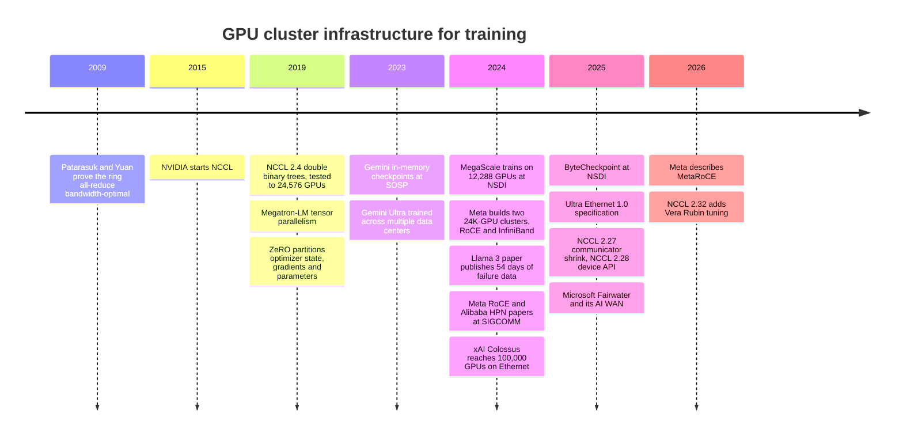
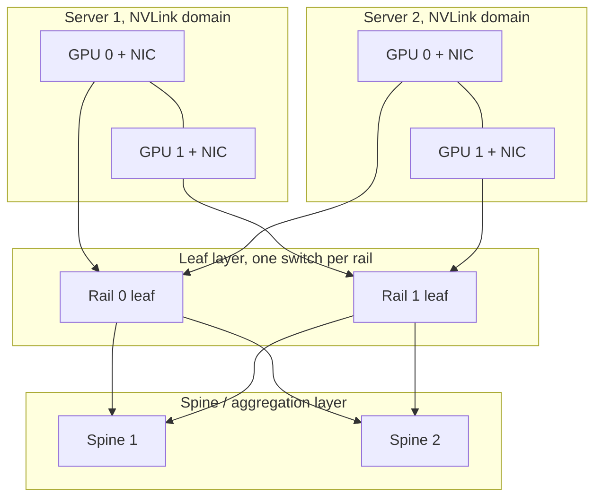
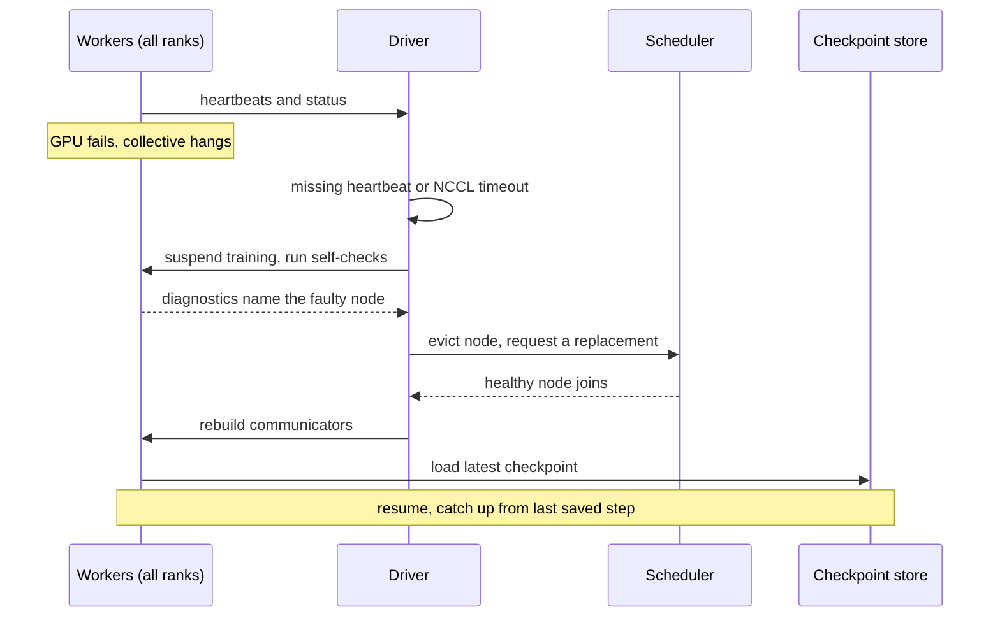

---
tags:
  - distributed-systems
  - gpu-clusters
  - collectives
  - networking
  - ml-training
status: draft
sources:
  - https://arxiv.org/pdf/2407.21783
  - https://www.cs.fsu.edu/~xyuan/paper/09jpdc.pdf
  - https://raw.githubusercontent.com/NVIDIA/nccl-tests/master/doc/PERFORMANCE.md
  - https://developer.nvidia.com/blog/massively-scale-deep-learning-training-nccl-2-4
  - https://arxiv.org/pdf/1909.08053
  - https://arxiv.org/pdf/1910.02054
  - https://www.nvidia.com/en-us/data-center/gb200-nvl72/
  - https://docs.nvidia.com/multi-node-nvlink-systems/multi-node-tuning-guide/overview.html
  - https://engineering.fb.com/2024/03/12/data-center-engineering/building-metas-genai-infrastructure/
  - https://engineering.fb.com/2024/08/05/data-center-engineering/roce-network-distributed-ai-training-at-scale/
  - https://engineering.fb.com/wp-content/uploads/2024/08/sigcomm24-final246.pdf
  - https://atscaleconference.com/?p=533620
  - https://www.theregister.com/2024/06/27/alibaba_network_datacenter_designs_revealed/
  - https://arxiv.org/abs/2307.12169
  - https://www.usenix.org/system/files/nsdi24-jiang-ziheng.pdf
  - https://cdn.amazon.science/29/31/6523473f48e4af52252bac56ef51/gemini-fast-failure-recovery-in-distributed-training-with-in-memory-checkpoints.pdf
  - https://www.usenix.org/conference/nsdi25/presentation/wan-borui
  - https://pytorch.org/blog/reducing-checkpointing-times/
  - https://arxiv.org/pdf/2312.11805
  - https://www.linuxfoundation.org/press/uec-launches-spec-1.0
  - https://www.networkworld.com/article/4006285/ultra-ethernet-consortium-publishes-1-0-specification-readies-ethernet-for-hpc-ai.html
  - https://engineering.fb.com/2026/08/24/networking-traffic/metaroce-rdma-transport-ai-ethernet/
  - https://nvidianews.nvidia.com/news/spectrum-x-ethernet-networking-xai-colossus
  - https://nvidianews.nvidia.com/news/nvidia-introduces-spectrum-xgs-ethernet-to-connect-distributed-data-centers-into-giga-scale-ai-super-factories
  - https://blogs.microsoft.com/blog/2025/09/18/inside-the-worlds-most-powerful-ai-datacenter/
  - https://blogs.microsoft.com/blog/2025/11/12/infinite-scale-the-architecture-behind-the-azure-ai-superfactory/
  - https://blog.google/products/google-cloud/ironwood-tpu-age-of-inference/
  - https://developer.nvidia.com/blog/enabling-fast-inference-and-resilient-training-with-nccl-2-27
  - https://developer.nvidia.com/blog/fusing-communication-and-compute-with-new-device-api-and-copy-engine-collectives-in-nvidia-nccl-2-28/
  - https://docs.nvidia.com/deeplearning/nccl/release-notes/rel_2-32-6.html
  - https://engineering.fb.com/2025/07/22/data-infrastructure/how-meta-keeps-its-ai-hardware-reliable/
  - https://www.usenix.org/conference/osdi26/presentation/lei
created: 2026-11-26
updated: 2026-11-28
---

## Table Of Contents

---

- [[#TL;DR|TL;DR]]
- [[#The Problem|The Problem]]
- [[#Foundations|Foundations]]
    - [[#Synchronous SPMD and the Slowest Worker|Synchronous SPMD and the Slowest Worker]]
    - [[#Parallelism Decides the Traffic|Parallelism Decides the Traffic]]
    - [[#The Collectives|The Collectives]]
    - [[#Scale-Up, Scale-Out, Scale-Across|Scale-Up, Scale-Out, Scale-Across]]
- [[#How We Got Here|How We Got Here]]
- [[#How It Works|How It Works]]
    - [[#Ring All-Reduce and Its Cost|Ring All-Reduce and Its Cost]]
    - [[#Rings, Trees and NCCL|Rings, Trees and NCCL]]
    - [[#Fabrics and Topology|Fabrics and Topology]]
    - [[#Load Balancing and Congestion Control|Load Balancing and Congestion Control]]
    - [[#Failures at Scale|Failures at Scale]]
    - [[#Detection and Recovery|Detection and Recovery]]
    - [[#Checkpointing|Checkpointing]]
- [[#Where It Is Now|Where It Is Now]]
    - [[#Scale-Up Domains Grew to the Rack|Scale-Up Domains Grew to the Rack]]
    - [[#Ethernet Took Over Scale-Out|Ethernet Took Over Scale-Out]]
    - [[#Training Across Data Centers|Training Across Data Centers]]
    - [[#NCCL in 2025 and 2026|NCCL in 2025 and 2026]]
    - [[#Reliability Is Now About Silent and Slow Faults|Reliability Is Now About Silent and Slow Faults]]
- [[#Trade-offs & Open Problems|Trade-offs & Open Problems]]
- [[#Resources|Resources]]
- [[#Related Notes|Related Notes]]

## ***TL;DR***
---
*Training a large model is one synchronous program spread over thousands of GPUs, so it inherits every distributed systems problem at once: the slowest GPU sets the pace, any failure stops everyone, and the network carries the gradients and activations that keep them in step. GPU cluster infrastructure is the collectives, fabrics, failure handling and checkpointing that make that program finish.*

- **Lockstep is the defining constraint.** Every step ends with a collective (usually an all-reduce) that waits for all ranks. "Even a single straggler can slow down thousands of other GPUs" ([Llama 3 paper, 2024](https://arxiv.org/pdf/2407.21783)).
- **The core math:** a bandwidth-optimal all-reduce sends $2(N-1)/N$ times the data size per GPU, so its cost barely grows with $N$ ([Patarasuk and Yuan, 2009](https://www.cs.fsu.edu/~xyuan/paper/09jpdc.pdf)). Latency, not bandwidth, is what grows, which is why NCCL also uses trees.
- **Two networks per GPU:** a *scale-up* domain (NVLink/NVSwitch, now 72 GPUs in a GB200 NVL72 rack at 1.8 TB/s per GPU) and a *scale-out* fabric (InfiniBand or RoCE at 400 to 800 Gbps per GPU) ([NVIDIA](https://www.nvidia.com/en-us/data-center/gb200-nvl72/)).
- **Failures are routine:** Llama 3 405B had 466 job interruptions in a 54-day snapshot, 419 of them unexpected and about 78% from confirmed hardware issues, yet kept above 90% effective training time ([Llama 3 paper](https://arxiv.org/pdf/2407.21783)).
- **Now (Nov 2026):** Ethernet runs the largest fabrics (Meta, xAI, Alibaba, Microsoft); Ultra Ethernet 1.0 shipped in June 2025 and Meta described MetaRoCE, a lossy, packet-spraying RDMA transport, in August 2026; training spans data centers (Microsoft's AI WAN, NVIDIA Spectrum-XGS); and NCCL's newest listed release is 2.32.6 with Vera Rubin tuning ([NCCL docs](https://docs.nvidia.com/deeplearning/nccl/release-notes/rel_2-32-6.html)).

## ***The Problem***
---
*A frontier training run is the largest tightly coupled distributed computation most companies have ever operated. It needs the throughput of tens of thousands of GPUs and the coordination of a single machine, on hardware that fails every few hours.*

Classic distributed systems are loosely coupled: a web service with 10,000 servers keeps working when one dies, because requests are independent. Training is the opposite. Every GPU runs the same program on its own slice of data or model (SPMD, single program multiple data), and every step they must agree on the same gradient before anyone can move on. That makes the job:

| Property | Web service | Synchronous training job |
|---|---|---|
| Coupling | Requests independent | Every step waits on every rank |
| One node fails | Lose a slice of capacity | The whole job stops and restarts from a checkpoint |
| One node slow | Its requests are slow | Every rank is slow |
| Network traffic | Many small flows, high entropy | Few huge, periodic, synchronized flows |
| What "available" means | Requests answered | *Goodput*: useful training time over wall-clock time |

The traffic shape matters as much as the coupling. Alibaba describes cloud traffic as millions of small flows under 10 Gbps, while LLM training produces a small number of periodic, bursty flows of around 400 Gbps per host ([Alibaba HPN talk, 2024](https://atscaleconference.com/?p=533620)). Hash-based load balancing that works for the first breaks on the second.

And scale multiplies failure. If each component fails independently, a job that needs all $N$ of them fails $N$ times as often:

$$
\text{MTBF}_{\text{job}} \approx \frac{\text{MTBF}_{\text{component}}}{N}
$$

*In words:* the job lives only as long as its weakest-luck component. *Worked example:* Llama 3 405B saw 419 unexpected interruptions in 54 days (1,296 hours) on up to 16,384 GPUs ([Llama 3 paper](https://arxiv.org/pdf/2407.21783)): one every $1296 / 419 \approx 3.1$ hours. Spread evenly over the GPUs, that is one interruption per $16{,}384 \times 3.1 \approx 50{,}700$ GPU-hours, nearly six years for any one GPU. Each part is reliable; the job is not. This is the [[Failure Models]] argument at AI-cluster scale.

## ***Foundations***
---
*Four ideas explain the rest: lockstep execution, how each kind of parallelism turns into network traffic, the handful of collective operations that carry it, and the three tiers of network (inside a rack, across a building, across sites).*

### Synchronous SPMD and the Slowest Worker

*Because each step ends at a barrier-like collective, step time is the maximum over all ranks, not the average. Stragglers, failures and network hiccups all show up as idle GPUs everywhere.*

$$
T_{\text{step}} = \max_{i \in \{1..N\}} \left( T^{(i)}_{\text{compute}} \right) + T_{\text{collective}}
$$

*In words:* the step takes as long as the slowest rank's compute plus the communication that can't be hidden. *Worked example:* 1,000 ranks each take 1.00 s per step, except one with a thermally throttled GPU at 1.10 s. Every step now takes at least 1.10 s, so the whole job runs 10% slower because of one GPU in a thousand. MegaScale found about 0.5% of machines ran substantially slower, and removing them improved MFU by roughly 0.7% ([Jiang et al., NSDI 2024](https://www.usenix.org/system/files/nsdi24-jiang-ziheng.pdf)). Llama 3 even saw a diurnal 1 to 2% throughput swing because mid-day temperatures affected GPU voltage and frequency scaling ([Llama 3 paper](https://arxiv.org/pdf/2407.21783)). Slow-but-alive hardware is the [[Gray and Fail-Slow Failures]] problem in its purest form.

The standard efficiency metric is **MFU** (model FLOPs utilization): the fraction of the hardware's peak FLOPs the model actually uses. Llama 3 405B ran at 38 to 43% BF16 MFU; MegaScale reached 55.2% training a 175B model on 12,288 GPUs ([Llama 3 paper](https://arxiv.org/pdf/2407.21783); [Jiang et al.](https://www.usenix.org/system/files/nsdi24-jiang-ziheng.pdf)). The arithmetic behind compute-bound vs bandwidth-bound work is in [[1 - All About Rooflines (NOT DONE)|Rooflines]].

### Parallelism Decides the Traffic

*Each way of splitting a model generates a different collective, at a different frequency, with a different tolerance for slow links. Production runs combine them so the chattiest traffic stays on the fastest wires.*

| Parallelism | What is split | Traffic | How often | Where it runs |
|---|---|---|---|---|
| **Data (DP)** | The batch; each rank has a full model copy | All-reduce of gradients, $2\Psi$ per step for $\Psi$ parameters | Once per step, overlappable with backward | Scale-out fabric |
| **FSDP / ZeRO-3** | Parameters, gradients and optimizer state across DP ranks | All-gather parameters in forward and backward, reduce-scatter gradients: $3\Psi$, 1.5x plain DP | Every layer, every step | Scale-out fabric |
| **Tensor (TP)** | Each layer's matrices | Two all-reduces in forward and two in backward per [[Transformer]] layer | Every layer | Scale-up domain |
| **Pipeline (PP)** | Groups of layers into stages | Point-to-point sends of activations between neighboring stages | Every micro-batch | Either |
| **Context (CP)** | The sequence | Exchange of keys and values between ranks | Every attention layer | Usually scale-up |
| **Expert (EP)** | The experts of a mixture-of-experts layer | All-to-all to send tokens to their experts and back | Every MoE layer | Either; all-to-all is hardest on the fabric |

Sources: ZeRO's stages and the $2\Psi$ vs $3\Psi$ volumes are from [Rajbhandari et al., 2019](https://arxiv.org/pdf/1910.02054); the four all-reduces per layer from Megatron-LM ([Shoeybi et al., 2019](https://arxiv.org/pdf/1909.08053)), which kept tensor-parallel groups inside one server where NVSwitch gave 300 GB/s versus 100 GB/s between servers.

ZeRO's memory argument is why FSDP exists: mixed-precision Adam needs 16 bytes per parameter, so a 7.5B model needs about 120 GB of model state per GPU under plain data parallelism, and about 1.9 GB when 64 ranks partition everything ([Rajbhandari et al.](https://arxiv.org/pdf/1910.02054)). The price is 50% more communication.

**A real layout:** Llama 3 405B pre-training on 16,384 GPUs used TP = 8, PP = 16, DP = 128 at 8K sequence length (400 TFLOPs per GPU, 41% MFU), and TP = 8, CP = 16, PP = 16, DP = 8 at 128K sequence length ([Llama 3 paper, Table 4](https://arxiv.org/pdf/2407.21783)). TP of 8 matches the 8 GPUs that share NVLink in an H100 server.

### The Collectives

*A few operations carry almost all training traffic. Knowing what each one leaves on every GPU, and how many bytes it moves, is enough to reason about most bottlenecks.*

| Collective | Before | After | Bytes on the busiest link, per GPU, for $S$ bytes total |
|---|---|---|---|
| **All-reduce** | Each GPU has its own vector | Every GPU has the sum | $2(N-1)/N \cdot S$ |
| **Reduce-scatter** | Each GPU has its own vector | Each GPU has one $1/N$ chunk of the sum | $(N-1)/N \cdot S$ |
| **All-gather** | Each GPU has one $1/N$ chunk | Every GPU has all chunks | $(N-1)/N \cdot S$ |
| **All-to-all** | Each GPU has $N$ chunks, one per destination | Each GPU has the chunks addressed to it | $(N-1)/N \cdot S$ |
| **Broadcast** | One GPU has the vector | Every GPU has it | $S$ |

The factors are the "bus bandwidth" corrections NVIDIA's `nccl-tests` applies so results compare to link speed ([nccl-tests PERFORMANCE.md](https://raw.githubusercontent.com/NVIDIA/nccl-tests/master/doc/PERFORMANCE.md)). Note that **all-reduce = reduce-scatter + all-gather**, which is exactly how the bandwidth-optimal ring does it and why ZeRO can replace one all-reduce with its two halves at no extra cost.

All-to-all is the odd one out: every GPU talks to every other at once, so it stresses the fabric's bisection bandwidth and suffers most from congestion. That is why expert parallelism is the hardest traffic for a network.

### Scale-Up, Scale-Out, Scale-Across

*GPU clusters have tiers of network that differ by an order of magnitude in bandwidth. The whole design game is keeping each kind of traffic on the tier it can afford.*

| Tier | Technology | Reach | Per-GPU bandwidth (example) |
|---|---|---|---|
| **Scale-up** | NVLink + NVSwitch; Google's ICI | A server (8 GPUs) or a rack (72 GPUs); a TPU pod | 1.8 TB/s per Blackwell GPU, 130 TB/s across an NVL72 ([NVIDIA](https://www.nvidia.com/en-us/data-center/gb200-nvl72/)) |
| **Scale-out** | InfiniBand or RoCE over Ethernet, one NIC per GPU | A building, tens of thousands of GPUs | 400 Gbps (Llama 3) to 800 Gbps (Microsoft Fairwater) |
| **Scale-across** | Long-haul optical WAN | Several data centers | Shared; much lower and higher latency |

NVIDIA puts the gap plainly: 1.8 TB/s of NVLink per GPU is 36 times 400 Gbps Ethernet ([NVIDIA tuning guide](https://docs.nvidia.com/multi-node-nvlink-systems/multi-node-tuning-guide/overview.html)). Google's TPUs get the same effect with a different shape: chips link directly to neighbors in a 3D torus over ICI, with Ironwood pods of up to 9,216 chips; see [[2 - How To Think About TPUs (NOT DONE)|How To Think About TPUs]].

## ***How We Got Here***
---
*The bandwidth-optimal all-reduce came from HPC in 2009. Deep learning adopted it through NCCL, then spent 2019 to 2023 inventing the parallelism schemes that made model size limited by networks rather than memory. Since 2024 the action has been operational: published failure statistics, Ethernet fabrics at 100,000-GPU scale, and training across sites.*

**HPC roots (2009).** Patarasuk and Yuan derived a tight lower bound on the data an all-reduce must move and gave a ring algorithm that meets it on any network with tree connectivity ([Patarasuk and Yuan, 2009](https://www.cs.fsu.edu/~xyuan/paper/09jpdc.pdf)). Deep learning's gradient all-reduce is exactly this problem.

**NCCL (2015 on).** NVIDIA's collective library put rings over NVLink, PCIe and InfiniBand. By 2019, rings' latency, which "scales linearly with the number of GPUs", blocked scaling past hundreds of GPUs, so NCCL 2.4 added double binary trees with logarithmic latency and reported up to 180x improvement at 24k GPUs on the Summit supercomputer ([Jeaugey, Feb 2019](https://developer.nvidia.com/blog/massively-scale-deep-learning-training-nccl-2-4)).

**Parallelism (2019 to 2023).** Megatron-LM split each layer across GPUs in a server with four all-reduces per layer, and trained an 8.3B model on 512 V100s at 15.1 PetaFLOPs ([Shoeybi et al.](https://arxiv.org/pdf/1909.08053)). ZeRO removed the memory redundancy of data parallelism ([Rajbhandari et al.](https://arxiv.org/pdf/1910.02054)). Combining data, tensor and pipeline parallelism ("3D parallelism") became the default recipe.

**The operations era (2023 on).** Once jobs reached 10,000+ GPUs, the papers changed character. Gemini (SOSP 2023) attacked checkpoint cost ([Wang et al.](https://cdn.amazon.science/29/31/6523473f48e4af52252bac56ef51/gemini-fast-failure-recovery-in-distributed-training-with-in-memory-checkpoints.pdf)); MegaScale (NSDI 2024) is mostly about diagnosis, stragglers and network tuning ([Jiang et al.](https://www.usenix.org/system/files/nsdi24-jiang-ziheng.pdf)); the Llama 3 paper published a root-cause table for every interruption ([Llama 3 paper](https://arxiv.org/pdf/2407.21783)); and SIGCOMM 2024 had Meta and Alibaba describe Ethernet fabrics built just for training.

## ***How It Works***
---
*A training step moves bytes through collectives, collectives run as rings or trees over a two-tier topology, the fabric balances and throttles those flows, and when hardware fails the job is detected, diagnosed, shrunk or restarted from a checkpoint.*

### Ring All-Reduce and Its Cost

*Arrange $N$ GPUs in a logical ring and cut each vector into $N$ chunks. A reduce-scatter pass and an all-gather pass, each $N - 1$ steps, leave the full sum everywhere while every link stays busy.*

1. **Reduce-scatter.** In each of $N - 1$ steps, every GPU sends one chunk to its right neighbor and adds the chunk it receives from its left neighbor into its own copy. After $N - 1$ steps, each GPU holds the complete sum for one chunk.
2. **All-gather.** In $N - 1$ more steps, the finished chunks travel around the same ring until every GPU has all of them.

*Worked example, $N = 3$:* GPUs A, B, C hold vectors split into chunks 0, 1, 2. After step 1 of reduce-scatter, B has $a_0 + b_0$, C has $b_1 + c_1$, A has $c_2 + a_2$. After step 2, C has $a_0 + b_0 + c_0$, A has $a_1 + b_1 + c_1$, B has $a_2 + b_2 + c_2$. Two all-gather steps copy those three finished chunks around the ring. Each GPU sent 4 chunks of $S/3$: $\frac{4}{3}S = \frac{2(3-1)}{3}S$.

Each GPU sends $2(N-1)$ chunks of size $S/N$, which Patarasuk and Yuan prove is the minimum ([Patarasuk and Yuan, Lemma 5 and Theorem 1](https://www.cs.fsu.edu/~xyuan/paper/09jpdc.pdf)). With per-message latency $\alpha$ and per-GPU link bandwidth $B$:

$$
T_{\text{ring}} = 2(N-1)\,\alpha \;+\; \frac{2(N-1)}{N}\cdot\frac{S}{B}
$$

*In words:* the bandwidth term approaches $2S/B$ no matter how many GPUs join, but the latency term grows linearly with $N$. *Worked example:* a 5B-parameter model's BF16 gradients are $S = 10$ GB. With $N = 8$, each GPU sends $2 \cdot \frac{7}{8} \cdot 10 = 17.5$ GB. Over a 400 Gbps (50 GB/s) NIC that is about 0.35 s; over NVLink 5's 900 GB/s per direction (half of the 1.8 TB/s total), about 19 ms. Now take a small message across $N = 1024$ ranks with an illustrative $\alpha = 5\,\mu s$: the latency term alone is $2 \cdot 1023 \cdot 5\,\mu s \approx 10$ ms, while a tree's $2 \log_2 1024 \cdot \alpha$ is about 0.1 ms. Big gradients like rings; small messages at large $N$ want trees.

### Rings, Trees and NCCL

*NCCL is the de facto collective library for NVIDIA GPUs. It discovers the topology, builds rings and trees across NVLink and NICs, and picks an algorithm and protocol per call.*

- **Double binary trees.** Two complementary trees, where leaves of one are inner nodes of the other, each carry half the data, so every rank sends and receives about as much as in a ring but with logarithmic latency. NCCL falls back to rings when they give more bandwidth ([Jeaugey, 2019](https://developer.nvidia.com/blog/massively-scale-deep-learning-training-nccl-2-4)).
- **In-network reduction.** NVLink SHARP (the "NVLS" algorithms) and InfiniBand SHARP do the summing inside the switches. NCCL 2.27 extended them to all-gather and reduce-scatter and cut the GPU cores (SMs) spent on communication from 16 or more to 6 or fewer ([NVIDIA, Jul 2025](https://developer.nvidia.com/blog/enabling-fast-inference-and-resilient-training-with-nccl-2-27)).
- **Hierarchy.** Collectives reduce inside the scale-up domain first and only send the reduced data over the slower NICs, which is why the parallelism table puts TP on NVLink.
- **Forks.** Large operators maintain their own: Llama 3 used NCCLX, "based on a fork of Nvidia's NCCL library", which "significantly improves the performance of NCCL, especially for higher latency networks" ([Llama 3 paper](https://arxiv.org/pdf/2407.21783)).

### Fabrics and Topology

*Scale-out networks for training are fat trees (folded Clos) with one NIC per GPU, built close to non-blocking inside a pod and oversubscribed above it. "Rail" wiring keeps each GPU's traffic on its own set of switches.*

- **Rails.** GPU $k$ of every server plugs into the same leaf switch (rail $k$). Data-parallel peers usually have the same local rank, so their traffic stays one switch hop apart. Alibaba gives each of a host's 8 GPUs a dedicated 400 Gbps NIC, calling these "rails", plus a ninth NIC for other traffic ([The Register on Alibaba HPN, Jun 2024](https://www.theregister.com/2024/06/27/alibaba_network_datacenter_designs_revealed/)); MegaScale wires each server's eight 200G NICs to eight different switches ([Jiang et al.](https://www.usenix.org/system/files/nsdi24-jiang-ziheng.pdf)). Wang et al. argue that LLM traffic is local enough to drop the spine entirely ("rail-only"), keeping training performance while cutting network cost by 38 to 77% ([Wang et al., 2023](https://arxiv.org/abs/2307.12169)).
- **Meta, Llama 3 (RoCE).** 24K GPUs, 400 Gbps per GPU, a three-layer Clos: racks of 16 GPUs in two servers, pods of 3,072 GPUs with full bisection bandwidth (192 racks), and a 1:7 oversubscribed aggregation layer above, so jobs are placed to keep heavy traffic inside a pod ([Llama 3 paper](https://arxiv.org/pdf/2407.21783)). Meta's SIGCOMM paper separates a *frontend* network (data loading, checkpointing, logging) from a dedicated *backend* RoCEv2 fabric for training ([Gangidi and Zeng, SIGCOMM 2024](https://engineering.fb.com/2024/08/05/data-center-engineering/roce-network-distributed-ai-training-at-scale/)).
- **Alibaba HPN.** A 2-tier, dual-plane design that connects 15K GPUs in one pod, where a classic design would need three tiers, with dual top-of-rack switches so no single ToR is a point of failure ([Alibaba HPN talk](https://atscaleconference.com/?p=533620)). It uses 51.2 Tbps single-chip switches, partly because multi-chip switches had critical hardware failures at 3.77 times the rate ([The Register](https://www.theregister.com/2024/06/27/alibaba_network_datacenter_designs_revealed/)).
- **InfiniBand vs RoCE.** InfiniBand is a purpose-built, lossless RDMA network (NVIDIA Quantum switches). RoCEv2 carries the same RDMA verbs over UDP/IP on Ethernet, traditionally kept lossless with Priority Flow Control (PFC). Meta built one 24,576-GPU cluster of each, both with 400 Gbps endpoints, and trained Llama 3 on the RoCE one ([Meta, Mar 2024](https://engineering.fb.com/2024/03/12/data-center-engineering/building-metas-genai-infrastructure/)).

### Load Balancing and Congestion Control

*Training traffic has very few, very large flows, so hashing flows onto paths (ECMP) collides, and synchronized bursts cause incast. Operators fix it by creating more flows, pinning or spraying them, and controlling admission at the receiver.*

**The entropy problem.** ECMP hashes each flow's headers to pick one of several equal-cost paths. With a handful of 400 Gbps flows, two can easily land on one link while another sits idle. Meta found ECMP "performed poorly because AI traffic has low flow entropy"; pinning paths by destination degraded fragmented jobs by more than 30%; the fix that worked was *QP scaling* (the collective library spreads each message over several RDMA queue pairs) plus switches hashing on the queue-pair field (E-ECMP), worth up to 40% for all-reduce ([Gangidi and Zeng](https://engineering.fb.com/2024/08/05/data-center-engineering/roce-network-distributed-ai-training-at-scale/)). For Llama 3 the library creates 16 flows between two GPUs instead of one ([Llama 3 paper](https://arxiv.org/pdf/2407.21783)). MegaScale instead split each 400G ToR downlink into two 200G links so uplinks had twice the downlink bandwidth ([Jiang et al.](https://www.usenix.org/system/files/nsdi24-jiang-ziheng.pdf)).

**Congestion control.** RoCE normally pairs PFC with DCQCN, an ECN-based rate controller. The big operators diverged:

| Operator | Approach |
|---|---|
| Meta (Llama 3) | DCQCN disabled at 400G; PFC alone plus deep-buffer spine switches and receiver-driven admission, where receivers send clear-to-send packets before senders post RDMA writes ([Gangidi and Zeng](https://engineering.fb.com/2024/08/05/data-center-engineering/roce-network-distributed-ai-training-at-scale/); [Llama 3 paper](https://arxiv.org/pdf/2407.21783)) |
| ByteDance (MegaScale) | A blend of Swift and DCQCN: precise RTT measurement plus ECN, to reduce PFC head-of-line blocking ([Jiang et al.](https://www.usenix.org/system/files/nsdi24-jiang-ziheng.pdf)) |
| NVIDIA Spectrum-X (xAI Colossus) | Vendor congestion control with SuperNICs; NVIDIA claims 95% data throughput at 100,000 GPUs versus about 60% for standard Ethernet ([NVIDIA, Oct 2024](https://nvidianews.nvidia.com/news/spectrum-x-ethernet-networking-xai-colossus)) |
| Ultra Ethernet, MetaRoCE | Drop the lossless assumption: spray packets over all paths, reorder or place them at the NIC, recover losses selectively (see Where It Is Now) |

### Failures at Scale

*The best public data is Llama 3's 54-day snapshot. GPUs and their memory dominate, the network is a minority, and a small but real share is silent corruption.*

During a 54-day snapshot of pre-training on up to 16K H100s, Meta had **466 job interruptions: 47 planned and 419 unexpected**. "Approximately 78% of the unexpected interruptions are attributed to confirmed hardware issues", and "GPU issues are the largest category, accounting for 58.7% of all unexpected issues". Despite that, the team "achieved higher than 90% effective training time", and "significant manual intervention was required only three times" ([Llama 3 paper, §3.3.4](https://arxiv.org/pdf/2407.21783)). Leading causes from Table 5:

| Component | Count | % (as printed) |
|---|---|---|
| Faulty GPU | 148 | 30.1% |
| GPU HBM3 memory | 72 | 17.2% |
| Software bug | 54 | 12.9% |
| Network switch or cable | 35 | 8.4% |
| Host maintenance | 32 | 7.6% |
| GPU SRAM memory | 19 | 4.5% |
| GPU system processor | 17 | 4.1% |
| NIC | 7 | 1.7% |
| NCCL watchdog timeouts | 7 | 1.7% |
| Silent data corruption | 6 | 1.4% |

(The paper prints 30.1% for faulty GPUs, though 148 of 419 is about 35%; the other rows match a 419 denominator.)

Two second-order effects stand out. Synchronized checkpoints and collective waits make the whole job's power draw swing "on the order of tens of megawatts", a load the power grid sees ([Llama 3 paper](https://arxiv.org/pdf/2407.21783)). And Google expected silent data corruption "to impact training every week or two" at Gemini's scale ([Gemini team, 2023](https://arxiv.org/pdf/2312.11805)); that is [[Silent Data Corruption]], a hardware-made Byzantine fault (see [[Byzantine Fault Tolerance]]).

### Detection and Recovery

*Recovery is a control loop ([[Reconciliation and Control Loops]]): notice the job stalled, find the bad machine, swap it out, restart from state. The engineering goal is shrinking each stage from hours to minutes.*

- **MegaScale** follows this loop: executors heartbeat a driver; on an anomaly the driver suspends training and runs loopback, RNIC-to-RNIC and NCCL all-reduce and all-to-all tests; faulty nodes are evicted and replaced through Kubernetes. Detection and diagnosis averaged under 10 minutes, catching up took under 15 minutes, over 90% of exceptions were handled automatically, and effective training time stayed above 90% across more than 100 restarts ([Jiang et al.](https://www.usenix.org/system/files/nsdi24-jiang-ziheng.pdf)). Heartbeats here play the role failure detectors play in [[Gossip and Membership]].
- **Timeouts cut both ways.** A NIC that flaps for a few seconds tripped NCCL's default timeout, so MegaScale raised it ([Jiang et al.](https://www.usenix.org/system/files/nsdi24-jiang-ziheng.pdf)); too long a timeout wastes the whole cluster while it waits. Llama 3's NCCLX instead monitors the library's state and times out when it detects a stall, and dumps a "flight recorder" of collective metadata and stack traces on watchdog or heartbeat timeouts to localize the culprit ([Llama 3 paper](https://arxiv.org/pdf/2407.21783)). See [[Reliability Patterns]] for timeouts in general.
- **Startup is part of recovery.** Initializing communication groups for 2,048 GPUs took about 1,047 s in Megatron-LM; replacing the blocking TCPStore with Redis and removing global barriers got it under 5 s, and under 30 s for 10,000+ GPUs ([Jiang et al.](https://www.usenix.org/system/files/nsdi24-jiang-ziheng.pdf)). That rendezvous store is a small [[Coordination Services|coordination service]].
- **Elastic shrink instead of restart.** NCCL 2.27's `ncclCommShrink` excludes failed GPUs from a communicator, with an error mode that aborts in-flight operations, so a framework can continue on fewer ranks instead of tearing everything down ([NVIDIA, Jul 2025](https://developer.nvidia.com/blog/enabling-fast-inference-and-resilient-training-with-nccl-2-27)). Shrinking changes the parallel layout, which is why checkpoints must be reshardable (below).
- **Placement.** Meta's scheduler places jobs topology-aware, using a "minimum cut" to reduce cross-zone traffic, and MegaScale places data-heavy jobs under one ToR ([Gangidi and Zeng](https://engineering.fb.com/2024/08/05/data-center-engineering/roce-network-distributed-ai-training-at-scale/); [Jiang et al.](https://www.usenix.org/system/files/nsdi24-jiang-ziheng.pdf)). That belongs to [[Cluster Scheduling]], and the placement mechanisms (Slurm blocks, Kueue TAS, Volcano HyperNodes, ComputeDomains) are in [[Gang and Topology-Aware Scheduling]].

### Checkpointing

*A checkpoint bounds how much work a failure throws away. Writing one stalls training, so the goal is checkpoints that are cheap enough to take often: asynchronous, in memory, and loadable into a different parallel layout.*

Young's classic first-order approximation for the best interval $\tau$ between checkpoints, given a checkpoint cost $C$ and a job MTBF $M$:

$$
\tau^* \approx \sqrt{2\,C\,M}, \qquad \text{wasted fraction} \approx \frac{C}{\tau} + \frac{\tau}{2M}
$$

*In words:* checkpoint more often when checkpoints are cheap or failures frequent; the waste is the time spent saving plus, on average, half an interval of lost work per failure. *Worked example:* with Llama 3's job MTBF of about 3.1 h ($M \approx 11{,}100$ s), a 150 s blocking checkpoint gives $\tau^* \approx 1{,}830$ s (about 30 min) and about 16% waste. Cut the blocking part to 6 s and $\tau^* \approx 370$ s (about 6 min) with about 3% waste, before counting restart time. That is why every system below attacks $C$.

| Technique | How it cuts the stall | Reported result |
|---|---|---|
| **Two-stage / async** | Copy GPU state to host memory (the only pause), then write to storage in the background | PyTorch async checkpointing: 7B-model downtime from 148.8 s to 6.3 s ([PyTorch, Jun 2024](https://pytorch.org/blog/reducing-checkpointing-times/)); MegaScale copies to host in seconds, then to HDFS ([Jiang et al.](https://www.usenix.org/system/files/nsdi24-jiang-ziheng.pdf)) |
| **In-memory, replicated** | Keep checkpoints in the CPU memory of the machine and of peers, interleaving the copies with idle network time | Gemini (SOSP 2023): checkpoint every iteration, failure recovery more than 13x faster; with 2 replicas, 93.3% chance of recovering from memory when 2 of 16 machines fail ([Wang et al.](https://cdn.amazon.science/29/31/6523473f48e4af52252bac56ef51/gemini-fast-failure-recovery-in-distributed-training-with-in-memory-checkpoints.pdf)) |
| **Redundant live state** | Recover from an intact in-memory replica of model state instead of a periodic checkpoint | Gemini Ultra's goodput rose from 85% to 97% ([Gemini team](https://arxiv.org/pdf/2312.11805)) |
| **Reshardable** | Parallelism-agnostic checkpoint format, resharded at load time | ByteCheckpoint (NSDI 2025): 54.20x lower average runtime stalls, up to 9.96x faster saves and 8.80x faster loads than open-source baselines ([Wan et al.](https://www.usenix.org/conference/nsdi25/presentation/wan-borui)) |

Checkpoint state per GPU is small next to the fabric's bandwidth (1 MB to 4 GB per GPU for Llama 3 ([Llama 3 paper](https://arxiv.org/pdf/2407.21783))) but the remote store is shared: Gemini's authors cite 20 Gbps aggregate for their FSx baseline, which is what forces infrequent checkpoints ([Wang et al.](https://cdn.amazon.science/29/31/6523473f48e4af52252bac56ef51/gemini-fast-failure-recovery-in-distributed-training-with-in-memory-checkpoints.pdf)). In-memory replicas are [[Replication]] applied to training state; the durable copy usually lands in [[Object Storage]] or a distributed file system.

## ***Where It Is Now***
---
*As of November 2026: scale-up domains are rack-sized, Ethernet runs the largest scale-out fabrics and is dropping the lossless assumption, training spans data centers, and NCCL has moved communication into GPU kernels. The reliability frontier is silent and slow faults rather than crashes.*

### Scale-Up Domains Grew to the Rack

- **NVIDIA GB200 NVL72:** 72 Blackwell GPUs and 36 Grace CPUs in one liquid-cooled rack, a single NVLink domain with 130 TB/s total and 1.8 TB/s per GPU ([NVIDIA](https://www.nvidia.com/en-us/data-center/gb200-nvl72/)). Microsoft's Fairwater sites (Sep and Nov 2025) are built from these racks, with GB200 and GB300 ([Microsoft, Sep 2025](https://blogs.microsoft.com/blog/2025/09/18/inside-the-worlds-most-powerful-ai-datacenter/); [Microsoft, Nov 2025](https://blogs.microsoft.com/blog/2025/11/12/infinite-scale-the-architecture-behind-the-azure-ai-superfactory/)).
- **Google Ironwood (TPU7x):** announced April 2025 with pods of 256 or 9,216 chips over ICI at 1.2 TB/s bidirectional per chip, 42.5 exaflops per full pod ([Google, Apr 2025](https://blog.google/products/google-cloud/ironwood-tpu-age-of-inference/)). The [[2 - How To Think About TPUs (NOT DONE)|TPU note]] lists it as a 4x4x576 pod.
- **Why it matters:** a bigger scale-up domain lets tensor and expert parallelism (the all-reduce-per-layer and all-to-all traffic) stay off the NICs. NCCL's symmetric-memory kernels work within one NVLink domain, "up to NVL72" ([NVIDIA, Jul 2025](https://developer.nvidia.com/blog/enabling-fast-inference-and-resilient-training-with-nccl-2-27)).

### Ethernet Took Over Scale-Out

*InfiniBand is still in use (Microsoft's Fairwater Wisconsin post names both InfiniBand and Ethernet fabrics at 800 Gbps), but the largest published fabrics since 2024 are Ethernet, and the 2025 to 2026 work is about making Ethernet tolerate loss and spray packets.*

| When | Who | What |
|---|---|---|
| Jul to Aug 2024 | Meta | Llama 3 405B on a 24K-GPU RoCE fabric, 400 Gbps per GPU ([Llama 3 paper](https://arxiv.org/pdf/2407.21783)) |
| Aug 2024 | Alibaba | HPN: 15K GPUs per pod on 2-tier dual-plane Ethernet ([Alibaba HPN talk](https://atscaleconference.com/?p=533620)) |
| Oct 2024 | xAI | Colossus: 100,000 Hopper GPUs on Spectrum-X Ethernet, being doubled to 200,000 ([NVIDIA, Oct 2024](https://nvidianews.nvidia.com/news/spectrum-x-ethernet-networking-xai-colossus)) |
| Jun 2025 | Ultra Ethernet Consortium | Specification 1.0 released June 11, 2025 ([Linux Foundation](https://www.linuxfoundation.org/press/uec-launches-spec-1.0)) |
| Nov 2025 | Microsoft | Fairwater backend: two-tier Ethernet, 800 Gbps GPU-to-GPU, SONiC, packet trimming and packet spray, "hundreds of thousands" of GB200 and GB300 GPUs on one flat network ([Microsoft, Nov 2025](https://blogs.microsoft.com/blog/2025/11/12/infinite-scale-the-architecture-behind-the-azure-ai-superfactory/)) |
| Aug 2026 | Meta | MetaRoCE transport described ([Meta, Aug 2026](https://engineering.fb.com/2026/08/24/networking-traffic/metaroce-rdma-transport-ai-ethernet/)) |

- **Ultra Ethernet 1.0 (June 2025).** Pitched as modern RDMA for Ethernet and IP that "scales to millions of endpoints" ([Linux Foundation](https://www.linuxfoundation.org/press/uec-launches-spec-1.0)). Its transport (UET) is about 75% derived from HPE's Slingshot; it enables packet spraying at the switches with reordering at the NIC, does not depend on a lossless network, lets receivers limit senders, and "does not require new switching infrastructures" ([Network World, Jun 2025](https://www.networkworld.com/article/4006285/ultra-ethernet-consortium-publishes-1-0-specification-readies-ethernet-for-hpc-ai.html)).
- **MetaRoCE (Aug 2026).** A clean-sheet RDMA transport "designed from the ground up for Ethernet at million-GPU scale": per-packet spraying over many paths (distinct UDP source ports), writing out-of-order packets straight to their final memory location, no PFC (a lossy fabric), SACK-based selective retransmit, and ECN plus receiver-hinted congestion control, keeping the standard RDMA verbs API. Meta reports about 86% throughput at 1% packet loss in validation on a 64-node AMD cluster; it does not describe a production rollout, and planned to release the spec and a reference implementation at the October 2026 OCP Global Summit, which this note has not confirmed. Meta ties it to OCP's ESUN initiative rather than to Ultra Ethernet ([Meta, Aug 2026](https://engineering.fb.com/2026/08/24/networking-traffic/metaroce-rdma-transport-ai-ethernet/)).
- **The direction:** both UEC and MetaRoCE move intelligence from switches to NICs, which turns the 2024 tricks (more flows, E-ECMP, careful placement) into a transport feature.

### Training Across Data Centers

*A single site runs out of power before it runs out of demand, so the newest training systems span buildings and regions. It works because data-parallel traffic is periodic and tolerant of latency while tensor-parallel traffic stays local.*

- **Google, 2023:** Gemini Ultra trained on TPUv4 "across multiple datacenters", with model parallelism inside each 4,096-chip SuperPod and data parallelism across SuperPods, since "Google's network latencies and bandwidths are sufficient to support the commonly used synchronous training paradigm" ([Gemini team](https://arxiv.org/pdf/2312.11805)).
- **NVIDIA Spectrum-XGS (Aug 2025):** "scale-across" Ethernet with distance-aware congestion control; NVIDIA claims it nearly doubles NCCL performance across sites, with CoreWeave among the first users. No independent benchmark was given ([NVIDIA, Aug 2025](https://nvidianews.nvidia.com/news/nvidia-introduces-spectrum-xgs-ethernet-to-connect-distributed-data-centers-into-giga-scale-ai-super-factories)).
- **Microsoft AI WAN (Nov 2025):** Fairwater Atlanta connects to Fairwater Wisconsin over a dedicated optical AI WAN (over 120,000 new fiber miles in a year), and training jobs can span sites ([Microsoft, Nov 2025](https://blogs.microsoft.com/blog/2025/11/12/infinite-scale-the-architecture-behind-the-azure-ai-superfactory/)).

### NCCL in 2025 and 2026

- **2.27 (Jul 2025):** symmetric-memory kernels (up to 9x lower all-reduce latency for small messages), SHARP for all-gather and reduce-scatter, and `ncclCommShrink` for fault tolerance ([NVIDIA, Jul 2025](https://developer.nvidia.com/blog/enabling-fast-inference-and-resilient-training-with-nccl-2-27)).
- **2.28 (Nov 2025):** a *device API*, so CUDA kernels start communication themselves, with three modes: load/store over NVLink (LSA), NVLink SHARP multicast (Multimem), and GPU-Initiated Networking (GIN) over the NIC with no CPU in the loop; plus copy-engine collectives that move NVLink traffic off the GPU's compute cores, and the NCCL Inspector profiling plugin ([NVIDIA, Nov 2025](https://developer.nvidia.com/blog/fusing-communication-and-compute-with-new-device-api-and-copy-engine-collectives-in-nvidia-nccl-2-28/)).
- **2.32.6 (newest listed; docs updated Nov 12, 2026):** a cost model tuned for Vera Rubin across Ring, Tree, NVLS and NVLSTree, an experimental "Flow" device API for pipelined collective kernels over LSA and GIN, a latency-oriented all-to-all kernel, and more GIN work ([NCCL 2.32.6 notes](https://docs.nvidia.com/deeplearning/nccl/release-notes/rel_2-32-6.html)). The release notes give no per-version date.
- **The trend:** collectives are becoming device-side code fused with compute, which blurs the old line between "the model" and "the communication library".

### Reliability Is Now About Silent and Slow Faults

- **SDC rates rose.** Meta says silent data corruption now occurs in about one per thousand AI accelerators, against roughly one per million devices historically for soft-error bitflips ([Meta, Jul 2025](https://engineering.fb.com/2025/07/22/data-infrastructure/how-meta-keeps-its-ai-hardware-reliable/)). ByteDance and Tsinghua's AEGIS (OSDI 2026) detects SDC during LLM training at about 0.86% overhead and found 18 real incidents in 35 million GPU hours ([OSDI '26](https://www.usenix.org/conference/osdi26/presentation/lei)). See [[Silent Data Corruption]].
- **Stragglers and fail-slow parts** are handled with fleet-wide health checks and eviction rather than by protocol; see [[Gray and Fail-Slow Failures]]. Burn-in, health checks, lemon-node detection and the repair loop are in [[Fleet Health and Hardware Screening]].
- **Recovery targets minutes, not hours**, through in-memory replicas, async and reshardable checkpoints, and communicator shrink, all covered above.

## ***Trade-offs & Open Problems***
---
*Every design choice trades bandwidth, cost, blast radius and operational simplicity. The open problems are what happens beyond 100,000 GPUs and across sites, where synchronous training's assumptions get expensive.*

| Choice | You get | You pay |
|---|---|---|
| Bigger scale-up domain (NVL72) | TP and EP traffic stays on NVLink | Rack-scale blast radius; liquid cooling; vendor lock-in |
| InfiniBand | Mature lossless RDMA, in-network SHARP | Single vendor; separate management stack |
| RoCE with PFC | Commodity Ethernet, existing tooling | PFC head-of-line blocking and pause storms; heavy tuning (Meta disabled DCQCN) |
| Lossy Ethernet with spraying (UEC, MetaRoCE) | Load balancing without flow hashing; no PFC | New NICs and transports; still early in 2026 |
| Rings | Bandwidth-optimal | Latency grows with $N$ |
| Trees | Logarithmic latency | Can lose bandwidth across switch tiers; NCCL picks per call |
| FSDP / ZeRO-3 | Model state divided by $N$ | 1.5x communication; every layer waits on an all-gather |
| Frequent checkpoints | Less lost work per failure | Stalls, storage bandwidth, the power swings they cause |
| In-memory checkpoint replicas | Recovery in minutes | Host memory, and correlated failures (a whole rack) defeat it |
| Cross-site training | More power and GPUs than one site holds | WAN bandwidth and latency; new failure domains |

Open problems worth tracking:
- **Synchronous training at the limit.** Job MTBF falls as $1/N$; at a few hundred thousand GPUs a 3-hour MTBF becomes minutes. Elastic shrink, hot spares and asynchronous or loosely coupled training are the candidate answers, none settled.
- **Gray failures.** A slow NIC, a flapping link or a throttled GPU slows everyone without failing anything; detection still leans on heuristics and timeouts ([[Gray and Fail-Slow Failures]], [[Failure Models]]).
- **Silent corruption.** Corruption is rare per chip but routine per job; detection without recomputation is open beyond the matrix multiplies that [[Algorithm-Based Fault Tolerance]] covers ([[Silent Data Corruption]]).
- **Which Ethernet transport wins.** UEC 1.0, Spectrum-X, MetaRoCE and Microsoft's own stack all target the same problem with different trade-offs; interoperability at scale is unproven in public data as of November 2026.
- **Power as a distributed systems constraint.** Tens-of-megawatt swings from synchronized steps ([Llama 3 paper](https://arxiv.org/pdf/2407.21783)) couple the job to the grid, and power, not GPUs, pushes training across sites.
- **Scheduling and fragmentation.** Placement decides whether traffic stays inside a pod; fragmented allocations cost Meta over 30% in one routing scheme ([[Cluster Scheduling]]).

## ***Resources***
---
*Read the Llama 3 paper's §3.3 first: it covers topology, collectives, MFU and failure data in a few pages. Then MegaScale for operating a 10,000-GPU job, Patarasuk and Yuan for why the ring all-reduce is optimal, and Meta's and Alibaba's SIGCOMM papers for fabric design.*

**Primary papers**
- [The Llama 3 Herd of Models](https://arxiv.org/pdf/2407.21783): Llama Team, Meta, Jul 2024. §3.3 infrastructure, NCCLX, Table 5 interruptions.
- [Bandwidth Optimal All-reduce Algorithms for Clusters of Workstations](https://www.cs.fsu.edu/~xyuan/paper/09jpdc.pdf): Pitch Patarasuk and Xin Yuan, J. Parallel and Distributed Computing, 2009. The $2(N-1)/N$ bound and ring algorithm.
- [MegaScale: Scaling Large Language Model Training to More Than 10,000 GPUs](https://www.usenix.org/system/files/nsdi24-jiang-ziheng.pdf): Jiang et al. (ByteDance, PKU), NSDI 2024.
- [RDMA over Ethernet for Distributed AI Training at Meta Scale](https://engineering.fb.com/wp-content/uploads/2024/08/sigcomm24-final246.pdf): Gangidi et al., SIGCOMM 2024 ([blog summary](https://engineering.fb.com/2024/08/05/data-center-engineering/roce-network-distributed-ai-training-at-scale/)).
- Alibaba HPN: A Data Center Network for Large Language Model Training: Alibaba Cloud, SIGCOMM 2024 ([@Scale talk abstract](https://atscaleconference.com/?p=533620)).
- [GEMINI: Fast Failure Recovery in Distributed Training with In-Memory Checkpoints](https://cdn.amazon.science/29/31/6523473f48e4af52252bac56ef51/gemini-fast-failure-recovery-in-distributed-training-with-in-memory-checkpoints.pdf): Wang et al. (Rice, AWS), SOSP 2023.
- [ByteCheckpoint: A Unified Checkpointing System for Large Foundation Model Development](https://www.usenix.org/conference/nsdi25/presentation/wan-borui): Wan et al., NSDI 2025.
- [Gemini: A Family of Highly Capable Multimodal Models](https://arxiv.org/pdf/2312.11805): Gemini Team, Google, Dec 2023. Training infrastructure: multi-datacenter, goodput, SDC.
- [Megatron-LM: Training Multi-Billion Parameter Language Models Using Model Parallelism](https://arxiv.org/pdf/1909.08053): Shoeybi et al., 2019.
- [ZeRO: Memory Optimizations Toward Training Trillion Parameter Models](https://arxiv.org/pdf/1910.02054): Rajbhandari et al., 2019.
- [Rail-only: A Low-Cost High-Performance Network for Training LLMs with Trillion Parameters](https://arxiv.org/abs/2307.12169): Wang et al., arXiv 2023 (v5 Sep 2024).
- [Safeguarding LLM Training at Scale (AEGIS)](https://www.usenix.org/conference/osdi26/presentation/lei): Lei et al., OSDI 2026.

**Engineering posts**
- [Massively Scale Your Deep Learning Training with NCCL 2.4](https://developer.nvidia.com/blog/massively-scale-deep-learning-training-nccl-2-4): Sylvain Jeaugey, NVIDIA, Feb 2019. Double binary trees.
- [Building Meta's GenAI Infrastructure](https://engineering.fb.com/2024/03/12/data-center-engineering/building-metas-genai-infrastructure/): Meta, Mar 2024. The two 24K-GPU clusters.
- [MetaRoCE](https://engineering.fb.com/2026/08/24/networking-traffic/metaroce-rdma-transport-ai-ethernet/): Meta, Aug 2026. Lossy, sprayed RDMA transport.
- [How Meta keeps its AI hardware reliable](https://engineering.fb.com/2025/07/22/data-infrastructure/how-meta-keeps-its-ai-hardware-reliable/): Meta, Jul 2025. SDC rates and fleet tooling.
- [Reducing Model Checkpointing Times by Over 10x with PyTorch Distributed Asynchronous Checkpointing](https://pytorch.org/blog/reducing-checkpointing-times/): Meta and IBM, Jun 2024.
- [Enabling Fast Inference and Resilient Training with NCCL 2.27](https://developer.nvidia.com/blog/enabling-fast-inference-and-resilient-training-with-nccl-2-27): NVIDIA, Jul 2025.
- [Fusing Communication and Compute with the Device API and Copy Engine Collectives in NCCL 2.28](https://developer.nvidia.com/blog/fusing-communication-and-compute-with-new-device-api-and-copy-engine-collectives-in-nvidia-nccl-2-28/): NVIDIA, Nov 2025.
- [Inside the world's most powerful AI datacenter](https://blogs.microsoft.com/blog/2025/09/18/inside-the-worlds-most-powerful-ai-datacenter/) and [the architecture behind the Azure AI superfactory](https://blogs.microsoft.com/blog/2025/11/12/infinite-scale-the-architecture-behind-the-azure-ai-superfactory/): Microsoft, Sep and Nov 2025. Fairwater and the AI WAN.

**Docs and project pages**
- [nccl-tests performance notes](https://raw.githubusercontent.com/NVIDIA/nccl-tests/master/doc/PERFORMANCE.md): algorithm vs bus bandwidth and the per-collective factors.
- [NCCL 2.32.6 release notes](https://docs.nvidia.com/deeplearning/nccl/release-notes/rel_2-32-6.html).
- [GB200 NVL72](https://www.nvidia.com/en-us/data-center/gb200-nvl72/) and the [multi-node NVLink tuning guide](https://docs.nvidia.com/multi-node-nvlink-systems/multi-node-tuning-guide/overview.html): NVIDIA.
- [Ironwood TPU announcement](https://blog.google/products/google-cloud/ironwood-tpu-age-of-inference/): Google, Apr 2025.
- [UEC Specification 1.0 press release](https://www.linuxfoundation.org/press/uec-launches-spec-1.0): Linux Foundation, Jun 2025.

**Analysis and news**
- [Ultra Ethernet Consortium publishes 1.0 specification](https://www.networkworld.com/article/4006285/ultra-ethernet-consortium-publishes-1-0-specification-readies-ethernet-for-hpc-ai.html): Network World, Jun 2025. UET's Slingshot roots, spraying, receiver control.
- [Alibaba reveals its network designs](https://www.theregister.com/2024/06/27/alibaba_network_datacenter_designs_revealed/): The Register, Jun 2024. HPN host and switch details from the paper.
- [Spectrum-X in xAI Colossus](https://nvidianews.nvidia.com/news/spectrum-x-ethernet-networking-xai-colossus) and [Spectrum-XGS](https://nvidianews.nvidia.com/news/nvidia-introduces-spectrum-xgs-ethernet-to-connect-distributed-data-centers-into-giga-scale-ai-super-factories): NVIDIA press releases, Oct 2024 and Aug 2025. Vendor claims.

## Related Notes

- [[Failure Models]] — Why job MTBF falls as $1/N$; the Llama 3 interruption data.
- [[Gray and Fail-Slow Failures]] — Stragglers, flapping links and throttled GPUs that slow a lockstep job.
- [[Silent Data Corruption]] — Wrong answers from accelerators, about one per thousand chips by Meta's 2025 count.
- [[Algorithm-Based Fault Tolerance]] — Checksummed matrix multiplies that catch wrong math inside training jobs.
- [[Cluster Scheduling]] — Topology-aware placement, Slurm and Kubernetes for GPU jobs.
- [[Gang and Topology-Aware Scheduling]] — Placing whole jobs inside one NVLink domain, rack or block.
- [[Resource Fairness]] — Sharing GPUs fairly: Themis finish-time fairness, Gavel for mixed GPU types, Kueue and Volcano fair share.
- [[Reliability Patterns]] — Timeouts and their trade-offs, as with NCCL watchdogs.
- [[Replication]] — In-memory checkpoint replicas and redundant model state.
- [[Coordination Services]] — Rendezvous stores and drivers that run recovery.
- [[Gossip and Membership]] — Heartbeats and failure detection.
- [[Byzantine Fault Tolerance]] — SDC as a hardware-made Byzantine fault.
- [[Object Storage]] — Where durable checkpoints land.
- [[Disaggregated Systems]] — RDMA and separating compute from memory and storage.
- [[Partitioning]] — Sharding model state is partitioning by another name.
- [[1 - All About Rooflines (NOT DONE)|Rooflines]] — $T_{\text{comms}}$ vs $T_{\text{math}}$, the arithmetic behind communication bottlenecks.
- [[2 - How To Think About TPUs (NOT DONE)|How To Think About TPUs]] — ICI, 3D tori and TPU pods, Google's scale-up network.
- [[Transformer]] — The layer structure that sets tensor-parallel traffic.
- [[Scaling Laws]] — Why the compute, and so the clusters, keep growing.
- [[Multi-GPU Communication - NVLink and NCCL]] — NVLink, NVSwitch and NCCL from the GPU programmer's side.
- [[GPUDirect RDMA and Storage]] — GPU-to-NIC and GPU-to-storage paths that skip the CPU.
- [[Blackwell Architecture]] — The B200/GB300 chips and NVL72 racks.
- [[Fleet Health and Hardware Screening]] — Keeping bad nodes out of jobs: burn-in, health checks, lemon nodes, quarantine and spares.
