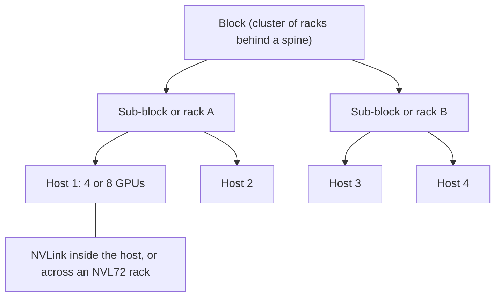
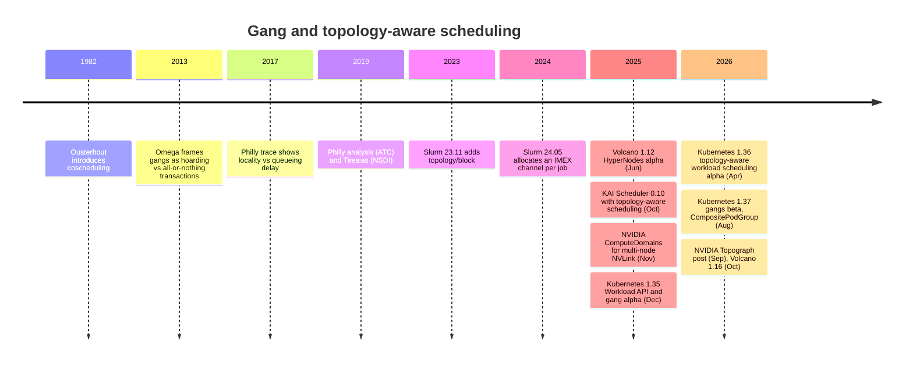
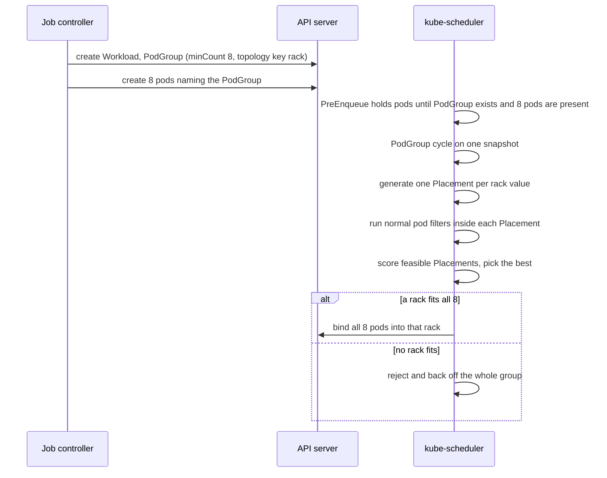

---
tags:
  - distributed-systems
  - cluster-scheduling
  - gang-scheduling
  - topology
  - gpu
  - kubernetes
  - slurm
status: complete
sources:
  - https://www.cse.huji.ac.il/~feit/papers/Cosched95IJPP.pdf
  - https://cs.brown.edu/~malte/pub/papers/2013-eurosys-omega.pdf
  - https://arxiv.org/pdf/1901.05758
  - https://www.usenix.org/conference/nsdi19/presentation/gu
  - https://sands.kaust.edu.sa/classes/CS345/S19/papers/tiresias.pdf
  - https://arxiv.org/html/2508.04953v1
  - https://www.cs.fsu.edu/~xyuan/paper/09jpdc.pdf
  - https://slurm.schedmd.com/gang_scheduling.html
  - https://slurm.schedmd.com/topology.html
  - https://developer.nvidia.com/blog/achieving-peak-system-and-workload-efficiency-on-nvidia-gb200-nvl72-with-slurm-block-scheduling/
  - https://scheduler-plugins.sigs.k8s.io/docs/plugins/coscheduling/
  - https://volcano.sh/en/docs/network_topology_aware_scheduling
  - https://volcano.sh/blog/Volcano-1.12.0-release
  - https://www.cncf.io/blog/2026/10/28/volcano-v1-16-released-namespacequeue-fairshare-and-a-broader-hypernode-ecosystem/
  - https://kueue.sigs.k8s.io/docs/concepts/topology_aware_scheduling/
  - https://docs.cloud.google.com/ai-hypercomputer/docs/workloads/schedule-gke-workloads-tas
  - https://docs.aws.amazon.com/AWSEC2/latest/UserGuide/how-ec2-instance-topology-works.html
  - https://github.com/kubernetes/enhancements/blob/master/keps/sig-scheduling/4671-gang-scheduling/README.md
  - https://www.kubernetes.dev/resources/keps/5732/
  - https://kubernetes.io/docs/concepts/workloads/workload-api/topology-aware-scheduling/
  - https://kubernetes.io/blog/2026/05/13/kubernetes-v1-36-advancing-workload-aware-scheduling/
  - https://kubernetes.io/blog/2026/09/08/kubernetes-v1-37-advancing-workload-aware-scheduling/
  - https://buttondown.com/LastWeekInKubernetes/archive/lwkd-week-ending-october-182026/
  - https://www.k8s.dev/resources/release/
  - https://developer.nvidia.com/blog/enabling-multi-node-nvlink-on-kubernetes-for-gb200-and-beyond/
  - https://developer.nvidia.com/blog/topology-aware-workload-scheduling-with-nvidia-topograph/
  - https://raw.githubusercontent.com/kai-scheduler/KAI-Scheduler/main/README.md
created: 2026-11-27
updated: 2026-11-27
---

## Table Of Contents

---

- [[#TL;DR|TL;DR]]
- [[#The Problem|The Problem]]
- [[#Foundations|Foundations]]
    - [[#The All-or-Nothing Invariant|The All-or-Nothing Invariant]]
    - [[#Why Partial Placement Deadlocks|Why Partial Placement Deadlocks]]
    - [[#Topology as a Tree of Bandwidth|Topology as a Tree of Bandwidth]]
    - [[#Why the Slowest Link Sets the Pace|Why the Slowest Link Sets the Pace]]
- [[#How We Got Here|How We Got Here]]
- [[#How It Works|How It Works]]
    - [[#Three Ways to Build a Gang|Three Ways to Build a Gang]]
    - [[#Describing the Topology|Describing the Topology]]
    - [[#Slurm, Tree and Block|Slurm, Tree and Block]]
    - [[#Kueue Topology-Aware Scheduling|Kueue Topology-Aware Scheduling]]
    - [[#Volcano HyperNodes|Volcano HyperNodes]]
    - [[#Kubernetes In-Tree Placements|Kubernetes In-Tree Placements]]
    - [[#NVLink Domains as a Resource|NVLink Domains as a Resource]]
    - [[#When a Node in the Gang Dies|When a Node in the Gang Dies]]
- [[#Where It Is Now|Where It Is Now]]
- [[#Trade-offs & Open Problems|Trade-offs & Open Problems]]
- [[#Resources|Resources]]
- [[#Related Notes|Related Notes]]

## ***TL;DR***
---
*Distributed training jobs need all their workers at once, and they run fast only if those workers sit close together on the network. Gang scheduling guarantees the first; topology-aware scheduling tries to guarantee the second. Both trade some utilization for job speed.*

- **Gang scheduling** places a group of tasks all together or not at all. The idea comes from 1980s multiprocessors: Ousterhout introduced *coscheduling* in 1982 so that threads which synchronize finely would run at the same time ([Feitelson and Rudolph](https://www.cse.huji.ac.il/~feit/papers/Cosched95IJPP.pdf)). Data-parallel training is the modern case: one missing worker stalls every collective.
- **Topology-aware scheduling** picks *which* machines: inside one NVLink domain, under one leaf switch, in one block of racks. On GB200, bandwidth falls roughly 18× when traffic leaves NVLink (1.8 TB/s per GPU bidirectional, so about 900 GB/s each way) for the scale-out network (typically 50 GB/s) ([NVIDIA, May 2026](https://developer.nvidia.com/blog/achieving-peak-system-and-workload-efficiency-on-nvidia-gb200-nvl72-with-slurm-block-scheduling/)).
- **The cost** is waiting. In Microsoft's Philly cluster, fragmentation caused about 80% of all queueing delay, and two GPUs on one server ran ResNet-50 about 17% faster than two GPUs on different servers ([Jeon et al., ATC 2019](https://arxiv.org/pdf/1901.05758)).
- **The tools (Nov 2026):** Slurm's `topology/tree` and `topology/block` plugins with `--segment`; Kueue's Topology-Aware Scheduling (beta since v0.14); Volcano HyperNodes (alpha in v1.12); NVIDIA's KAI Scheduler; and, in Kubernetes itself, gang scheduling (beta, off by default, in 1.37) plus topology-aware workload scheduling (alpha since 1.36, targeting beta in 1.38, due December 16, 2026).
- **The new unit** is the rack-scale NVLink domain (72 GPUs in a GB200 NVL72). Schedulers now treat it as a rigid block, and NVIDIA's DRA driver exposes it to Kubernetes as a *ComputeDomain*.

## ***The Problem***
---
*A scheduler that places one task at a time can leave a training job half-started and holding GPUs, and a scheduler that ignores the network can start the job on GPUs that talk to each other ten or thirty times slower than they could.*

[[Cluster Scheduling]] treats each task as an independent request for a vector of resources. Two properties of distributed training break that model:

| Property | What the job needs | What goes wrong without it |
|---|---|---|
| **Synchronous progress** | Every worker running at once; each step waits for all of them in a collective such as all-reduce ([[Distributed Training]]) | Workers that started early hold GPUs and spin; with several jobs, partial allocations can deadlock |
| **Communication locality** | Workers that exchange the most data on the fastest links | A job spread across switches or racks is bottlenecked on its slowest hop |

Both are real costs in production. In Microsoft's Philly trace (75 days, Oct–Dec 2017, 96,260 jobs), the scheduler gang-scheduled and waited 2–3 minutes for GPUs with good locality before backing off and retrying, then relaxed locality after a fixed number of retries to avoid starvation. Fragmentation accounted for about 80% of waiting, and 97.9% of delays for jobs over 8 GPUs. Even with two-thirds of GPUs in use, fewer than 4.5% of servers were fully empty ([Jeon et al.](https://arxiv.org/pdf/1901.05758)).

The two goals pull against each other. Insisting on tight locality makes the gang wait for a rare empty block; relaxing it starts the job sooner but runs it slower. [[Resource Fairness]] adds a third pull, because the tenant at the head of the queue may be the one whose gang can't fit.

## ***Foundations***
---
*Four ideas carry the topic: the all-or-nothing invariant, why piecemeal allocation deadlocks, the hierarchy of bandwidth in a cluster, and why a collective runs at the speed of its slowest link.*

### The All-or-Nothing Invariant

A *gang* (a PodGroup in Kubernetes, a job in Slurm) is a set of tasks $G$ with a minimum size $m \le |G|$. The scheduler must keep this invariant at every moment:

$$
|\text{bound}(G)| = 0 \quad \lor \quad |\text{bound}(G)| \ge m
$$

*In plain English:* either none of the gang's tasks holds resources, or at least $m$ of them do. There is no in-between state where a few workers sit on GPUs waiting for the rest.

*Worked example:* a training job with 8 workers and `minCount: 8` on a cluster with 6 free GPUs. A gang scheduler binds nothing and the job waits whole. If two of the 8 are optional (say, evaluation workers) the group can declare $m = 6$, and the scheduler may start it with 6.

Older literature distinguishes *gang scheduling* (only whole groups run) from *coscheduling* (try to run the group together, but run a large fraction if all of it won't fit); the two are "quite similar" ([Feitelson and Rudolph](https://www.cse.huji.ac.il/~feit/papers/Cosched95IJPP.pdf)). Kubernetes' `minCount` and Volcano's `minMember` sit between them: the group is all-or-nothing down to a threshold.

> **Naming trap.** In Slurm, "gang scheduling" means *time-slicing*: two or more jobs are allocated the same resources and "alternately suspended to let one job at a time have dedicated access," with a default slice of 30 seconds ([Slurm docs](https://slurm.schedmd.com/gang_scheduling.html)). Slurm gives every job all its nodes at start by design, so the space-sharing sense of "gang" is simply how Slurm always works.

### Why Partial Placement Deadlocks

The original motivation was synchronization: "Executing processes become blocked waiting for responses from those that are currently not executing" ([Feitelson and Rudolph](https://www.cse.huji.ac.il/~feit/papers/Cosched95IJPP.pdf)). In a cluster the same thing happens in space, not time.

*Worked example (3 nodes, 2 GPUs each, 6 GPUs total):*

1. Job A (4 workers) and job B (4 workers) arrive together.
2. A one-pod-at-a-time scheduler interleaves them: A0, B0, A1, B1, A2, B2. All 6 GPUs are now bound.
3. A needs A3 and B needs B3. Neither can start its first collective; neither will finish to free a GPU.
4. Six GPUs are idle forever. This is the classic deadlock: *hold and wait* plus *circular wait*.

Omega's authors named the two ways out for cluster schedulers: two-level schedulers like Mesos can only gang-schedule by *hoarding* offered resources until enough arrive (which can itself deadlock), while a shared-state scheduler can commit the whole gang as one all-or-nothing transaction ([Schwarzkopf et al., EuroSys 2013](https://cs.brown.edu/~malte/pub/papers/2013-eurosys-omega.pdf)). Every modern design is one of these: reserve-and-wait with a timeout, or decide for the whole group at once.

### Topology as a Tree of Bandwidth

A GPU cluster's network is a hierarchy, and every step up costs bandwidth and adds hops ([[GPU Cluster Infrastructure#Fabrics and Topology|GPU Cluster Infrastructure]]):

Clouds now publish this tree. GKE labels each node with `cloud.google.com/gce-topology-block`, `cloud.google.com/gce-topology-subblock` and `cloud.google.com/gce-topology-host`, and "the more label values two VMs share, the closer they are physically" ([Google Cloud](https://docs.cloud.google.com/ai-hypercomputer/docs/workloads/schedule-gke-workloads-tas)). AWS's `DescribeInstanceTopology` returns one network node per layer (three or four layers); "if the network node connected to any two instances is the same, these instances are physically close to each other" ([AWS](https://docs.aws.amazon.com/AWSEC2/latest/UserGuide/how-ec2-instance-topology-works.html)).

A scheduler sees this tree as nested *domains*. The placement question becomes: what is the lowest level of the tree with one domain that has room for the whole gang?

### Why the Slowest Link Sets the Pace

A bandwidth-optimal ring all-reduce sends this much data per GPU ([Patarasuk and Yuan, 2009](https://www.cs.fsu.edu/~xyuan/paper/09jpdc.pdf)):

$$
D_{\text{per GPU}} = \frac{2(N-1)}{N}\, S \qquad\Rightarrow\qquad T \approx \frac{2(N-1)}{N} \cdot \frac{S}{B_{\min}}
$$

*In plain English:* every GPU ships about twice the gradient size $S$, and because the ring moves in lock-step, each step runs at the speed of the slowest link $B_{\min}$ in the ring. One slow hop slows every GPU.

*Worked example (simplified model, ignoring latency and the hierarchical algorithms real libraries use):* $N = 8$ GPUs all-reduce $S = 1$ GB, so each GPU sends $1.75$ GB.
- All 8 in one NVL72 domain, about 900 GB/s per direction (half of 1.8 TB/s bidirectional): $T \approx 1.75 / 900 \approx 2$ ms.
- Split 4 + 4 across two domains, so two hops of the ring cross the scale-out network at a typical 50 GB/s: $T \approx 1.75 / 50 = 35$ ms, about 18× slower.

Bandwidth figures are NVIDIA's ([NVIDIA, May 2026](https://developer.nvidia.com/blog/achieving-peak-system-and-workload-efficiency-on-nvidia-gb200-nvl72-with-slurm-block-scheduling/)). Libraries such as NCCL soften this with hierarchical algorithms ([[Multi-GPU Communication - NVLink and NCCL]]), but the cross-domain stage still pays the slow link, which is why placement is worth waiting for.

Not every job is equally sensitive. Tiresias found locality mattered mainly for the VGG family and AlexNet, whose largest tensor is 61–77% of the model, against about 4–15% for ResNet, Inception and GoogLeNet; it consolidates a job only when its tensor *skew* passes a learned threshold, and otherwise places to reduce fragmentation ([Gu et al., NSDI 2019](https://sands.kaust.edu.sa/classes/CS345/S19/papers/tiresias.pdf)). Tensor and expert parallelism ([[Mixture of Experts]]) put far more traffic on the fast links than 2019's data-parallel CNNs ([[GPU Cluster Infrastructure]]), which is why today's tools make consolidation the default request.

## ***How We Got Here***
---
*Gang scheduling began on 1980s multiprocessors, came back with deep learning clusters in the late 2010s, and in 2025–2026 moved into the core of Kubernetes while Slurm learned to treat a rack-sized NVLink domain as one block.*

**Multiprocessors (1982 to 1990s).** Ousterhout's "Scheduling techniques for concurrent systems" (3rd ICDCS, 1982) introduced coscheduling; Feitelson and Rudolph later made his matrix algorithm dynamic ([Feitelson and Rudolph](https://www.cse.huji.ac.il/~feit/papers/Cosched95IJPP.pdf)). The concern was time-sharing a machine among parallel programs whose threads spin-wait on each other.

**HPC batch.** Batch schedulers like Slurm start a job only once all its nodes are allocated, so gangs came for free; topology was the harder part. Slurm's `topology/tree` places a job under the lowest switch that can hold it, and `--switches=count@time` lets a job wait for a tighter placement up to a time limit ([Slurm topology guide](https://slurm.schedmd.com/topology.html)).

**Shared clusters (2010s).** General-purpose schedulers placed one task at a time. Omega showed why gangs fit badly into two-level designs ([Schwarzkopf et al.](https://cs.brown.edu/~malte/pub/papers/2013-eurosys-omega.pdf)). Then deep learning arrived: the Philly analysis found that gang scheduling with locality constraints left GPUs fragmented, and fragmentation caused most queueing ([Jeon et al.](https://arxiv.org/pdf/1901.05758)); Tiresias named "all-or-nothing" execution as one of the ways DL jobs break big-data schedulers, and Tiresias showed when consolidation can be relaxed, with placement worth up to 1.67× for sensitive jobs ([Gu et al.](https://sands.kaust.edu.sa/classes/CS345/S19/papers/tiresias.pdf)).

**Kubernetes add-ons (2019 on).** Kubernetes' scheduler places one pod at a time, so gangs came from outside: the `coscheduling` scheduler plugin, Volcano, Kueue's admission, and later NVIDIA's KAI Scheduler. KEP-4671 counts at least four separate implementations outside kube-scheduler ([KEP-4671](https://github.com/kubernetes/enhancements/blob/master/keps/sig-scheduling/4671-gang-scheduling/README.md)).

**Rack-scale NVLink (2024 on).** GB200 NVL72 made the fast domain a rack of 18 trays of 4 GPUs. Slurm's `topology/block` (23.11, built jointly by NVIDIA and SchedMD) models each domain as a block ([NVIDIA, May 2026](https://developer.nvidia.com/blog/achieving-peak-system-and-workload-efficiency-on-nvidia-gb200-nvl72-with-slurm-block-scheduling/)), and Kubernetes gained DRA ComputeDomains ([NVIDIA, Nov 2025](https://developer.nvidia.com/blog/enabling-multi-node-nvlink-on-kubernetes-for-gb200-and-beyond/)).

**Into the core (2025 to 2026).** Kubernetes 1.35 added the Workload API and alpha gangs; 1.36 added a PodGroup scheduling cycle and the first topology-aware scheduling; 1.37 took gangs to beta and added CompositePodGroup for multi-level groups ([Kubernetes, May 2026](https://kubernetes.io/blog/2026/05/13/kubernetes-v1-36-advancing-workload-aware-scheduling/); [Kubernetes, Sep 2026](https://kubernetes.io/blog/2026/09/08/kubernetes-v1-37-advancing-workload-aware-scheduling/)). The release-by-release detail is in [[Cluster Scheduling#Kubernetes Becomes Workload-Aware|Cluster Scheduling]].

## ***How It Works***
---
*Every implementation answers two questions: how to hold back a group until it can start whole, and how to describe the network so the scheduler can pick the tightest domain that fits. Failure handling is the third question, and the least settled.*

### Three Ways to Build a Gang

| Approach | How it works | Used by | Weak spot |
|---|---|---|---|
| **Reserve and wait** | Each pod passes filtering, reserves its node, then waits at a barrier until the group reaches quorum; on timeout, release everything | `coscheduling` plugin, Kubernetes 1.35 alpha | Reserved resources sit idle during the wait; timeouts need tuning |
| **Whole-group cycle** | The scheduler takes all the group's pods and tries to place them against one snapshot; if `minCount` can't fit, reject the whole group | kube-scheduler since 1.36, Volcano, KAI, Slurm | One big search per group; needs a group API |
| **Admit, then place** | A queue admits the whole job against quota (and, with TAS, a chosen domain) before pods exist; the pod scheduler then places them | Kueue | Two components must agree; the placer can still fail |

**Reserve and wait.** The `coscheduling` plugin groups pods by the label `scheduling.x-k8s.io/pod-group`. Its *PreFilter* rejects a group early if fewer than `minMember` pods exist; pods that pass filtering wait at *Permit* until running plus waiting pods reach `minMember`, for up to `permitWaitingTimeSeconds` (default 60); a failed group can be rejected whole and backed off ([scheduler-plugins docs](https://scheduler-plugins.sigs.k8s.io/docs/plugins/coscheduling/)). The Permit hook is generic: "If a timeout occurs, wait becomes deny" ([[Cluster Scheduling#Kubernetes|Cluster Scheduling]]).

**Whole-group cycle.** This is where Kubernetes ended up. The flow for a PodGroup with topology-aware scheduling enabled ([KEP-4671](https://github.com/kubernetes/enhancements/blob/master/keps/sig-scheduling/4671-gang-scheduling/README.md); [KEP-5732](https://www.kubernetes.dev/resources/keps/5732/)):

**Admit, then place.** Kueue decides when a job's pods may be created; with TAS it also writes the chosen topology assignment, and pods are pinned to it ([[#Kueue Topology-Aware Scheduling|below]]). Volcano and KAI replace kube-scheduler instead, doing both jobs in one component.

### Describing the Topology

Schedulers need the tree as data. Three representations dominate:

| Representation | Shape | Who uses it |
|---|---|---|
| **Switch file** | `topology.conf` lists switches and their nodes or child switches; `topology.yaml` holds named topologies per partition (tree, block, or 3D torus) | Slurm ([Slurm topology guide](https://slurm.schedmd.com/topology.html)) |
| **Node labels by level** | Each node carries one label per level (block, rack, host); a *Topology* object lists the label keys from broadest to narrowest | Kueue, KAI, Kubernetes in-tree TAS, GKE |
| **Topology objects** | A tree of custom resources, leaves holding nodes and inner nodes holding children, each with a tier | Volcano HyperNodes |

Labels have to come from somewhere. Clouds set them (GKE, above). On premises, NVIDIA's open-source **Topograph** discovers topology from cloud APIs (Google Cloud, Lambda, Nebius, Nscale, OCI, Crusoe), InfiniBand (`ibnetdiscover`) and NetQ for multi-node NVLink, then writes Slurm `topology.conf` or per-partition topology YAML, or Kubernetes node labels such as `fabric.topograph.run/tier-N` and `accelerator.topograph.run/domain` ([NVIDIA, Sep 2026](https://developer.nvidia.com/blog/topology-aware-workload-scheduling-with-nvidia-topograph/)). Volcano can discover HyperNodes from InfiniBand through NVIDIA UFM or build them from node labels; RoCE discovery is listed as not yet supported ([Volcano docs](https://volcano.sh/en/docs/network_topology_aware_scheduling)).

### Slurm, Tree and Block

**`topology/tree`.** The scheduler finds the lowest-level switch that can satisfy the job, then fills from its leaf switches with best fit. Because best fit uses what's free now, a job "may span more switches than the theoretical optimum." `--switches=count@time` caps the leaf switches and how long to wait for them; admins cap the wait with `max_switch_wait` ([Slurm topology guide](https://slurm.schedmd.com/topology.html)).

**`topology/block`.** Built for rack-scale NVLink. *Base blocks* are contiguous node groups; adjacent ones combine into larger blocks, and `BlockSizes` lists the sizes enforced at each level. Allocation finds the smallest level that fits, picks lower-level blocks within it, and places on base blocks with best fit. Unlike tree, it aims to *reduce fragmentation*, while small jobs can still fill leftover space ([Slurm topology guide](https://slurm.schedmd.com/topology.html)).

**Segments.** `--segment=N` splits a job into atomic groups of N nodes, each of which must land inside one block. *Worked example* on GB200 NVL72, where one block is 18 nodes of 4 GPUs ([NVIDIA, May 2026](https://developer.nvidia.com/blog/achieving-peak-system-and-workload-efficiency-on-nvidia-gb200-nvl72-with-slurm-block-scheduling/)):

| Request | Placement | Why |
|---|---|---|
| `-N16` | Waits for one block with 16 idle nodes | Default: a job stays inside one block |
| `-N12 --segment=4` | Can span three blocks, 4 nodes each | Each 4-node segment keeps NVLink locality |
| `-N32 --segment=16` | Exactly 16 nodes in each of two blocks | Tensor/expert groups of 16 nodes stay on NVLink |
| `--segment=16` vs `--segment=18` | 16 is recommended | A block with up to 2 drained nodes still offers 16 |

That last row is the practical lesson: a segment slightly smaller than the block survives the few broken nodes every rack has. With `--segment=9`, one bad node leaves only 9 usable nodes in that block; with `--segment=16`, the block still contributes 16 until three nodes are out ([NVIDIA, May 2026](https://developer.nvidia.com/blog/achieving-peak-system-and-workload-efficiency-on-nvidia-gb200-nvl72-with-slurm-block-scheduling/)).

**Isolation inside a block.** Jobs sharing one NVLink domain need separate IMEX channels (the driver service that lets GPUs import each other's memory across nodes). `SwitchType=switch/nvidia_imex` (Slurm 24.05) allocates one per job ([NVIDIA, May 2026](https://developer.nvidia.com/blog/achieving-peak-system-and-workload-efficiency-on-nvidia-gb200-nvl72-with-slurm-block-scheduling/)).

### Kueue Topology-Aware Scheduling

Kueue (the Kubernetes batch admission controller, see [[Resource Fairness#Kueue, Fair Sharing of Quota|Resource Fairness]]) adds topology to admission. An admin creates a `Topology` listing node-label levels and points a ResourceFlavor at it with `topologyName`. Each PodSet (a group of identical pods in a job) then picks a mode by annotation ([Kueue docs](https://kueue.sigs.k8s.io/docs/concepts/topology_aware_scheduling/)):

| Annotation | Meaning |
|---|---|
| `kueue.x-k8s.io/podset-required-topology: <level>` | All pods must fit in one domain at that level, or the job isn't admitted |
| `kueue.x-k8s.io/podset-preferred-topology: <level>` | Try the lowest level first, move up; if nothing fits, admit across several domains |
| `kueue.x-k8s.io/podset-unconstrained-topology` | Any nodes; reduces fragmentation |
| `podset-slice-size` + `podset-slice-required-topology` | Split the PodSet into slices, each inside one domain (Kueue's version of Slurm segments) |
| `podset-group-name` | Several PodSets (say, a leader and its workers) share one domain |

Required and preferred placements use a **BestFit** algorithm; unannotated PodSets can use **LeastFreeCapacity**, and an alpha **balanced placement** spreads pods evenly over domains instead of packing greedily. TAS has been beta and on by default since v0.14; multi-layer slices (up to 3 levels, coarse to fine) went beta in v0.19. The docs warn that Kueue must now track every pod and node, which "increases memory use and can slow scheduling" ([Kueue docs](https://kueue.sigs.k8s.io/docs/concepts/topology_aware_scheduling/)).

*Worked example (GKE, four levels from the Google Cloud docs):* a 32-pod training job sets `podset-required-topology: cloud.google.com/gce-topology-block` and `podset-slice-required-topology: cloud.google.com/gce-topology-subblock` with `podset-slice-size: 8`. Kueue admits it only when one block has room for 32 pods arranged as four groups of 8, each group in one sub-block ([Google Cloud](https://docs.cloud.google.com/ai-hypercomputer/docs/workloads/schedule-gke-workloads-tas)).

### Volcano HyperNodes

Volcano models each network domain as a **HyperNode** (`topology.volcano.sh/v1alpha1`), "typically mapped to a switch or tor". HyperNodes form a tree; `spec.tier` sets the level, and a lower tier means faster communication inside it. A job sets `spec.networkTopology` ([Volcano docs](https://volcano.sh/en/docs/network_topology_aware_scheduling)):

- `mode: hard` with `highestTierAllowed: 2`: all tasks must land in one HyperNode of tier 2 or lower, or the job stays Pending.
- `mode: soft`: try to keep tasks together, but spread if needed.

The `network-topology-aware` plugin scores a lower-tier HyperNode higher and, at equal tier, one already running more of the job's pods higher; the docs recommend enabling `binpack` with it. The feature was a preview in v1.11 and alpha in v1.12 (June 2025), which added discovery via UFM ([Volcano 1.12](https://volcano.sh/blog/Volcano-1.12.0-release)). Volcano 1.16 (Oct 2026) added topology anti-affinity across HyperNode domains ([CNCF, Oct 2026](https://www.cncf.io/blog/2026/10/28/volcano-v1-16-released-namespacequeue-fairshare-and-a-broader-hypernode-ecosystem/)).

### Kubernetes In-Tree Placements

KEP-5732 brings topology into kube-scheduler, arguing that "embedding topology awareness deeply into the kube-scheduler is critical enough to warrant standardization" rather than leaving it to Kueue and Volcano ([KEP-5732](https://www.kubernetes.dev/resources/keps/5732/)):

- **API.** `PodGroupTemplate` and `PodGroupSpec` gain an optional `SchedulingConstraints` field holding one `TopologyConstraint` with a node-label `Key` such as `topology.kubernetes.io/rack`.
- **Placement.** A *Placement* is a named candidate set of nodes. A `PlacementGeneratePlugin` proposes them (the new `TopologyPlacementGenerator` makes one per distinct label value), the normal pod filters check each one, and `PlacementScorePlugin`s rank the feasible ones (`NodeResourcesFit` and the new `PodGroupPodsCount`).
- **Status.** Alpha since 1.36, off by default, behind the `TopologyAwareWorkloadScheduling` gate ([Kubernetes docs](https://kubernetes.io/docs/concepts/workloads/workload-api/topology-aware-scheduling/)). The KEP's beta milestone is 1.38, adding multiple generators, early rejection of placements, a `PercentageOfPlacementsToScore` cap and integration with workload-aware preemption; DRA claims are out of scope (KEP-5729).

Placement is a clean idea: it turns "which rack?" into a small outer loop around the existing pod scheduler, so every filter (taints, affinity, DRA) still applies inside each candidate.

### NVLink Domains as a Resource

On Kubernetes, GB200's multi-node NVLink needs more than nearby pods: the pods need a shared IMEX domain. NVIDIA's DRA driver adds a **ComputeDomain** object, "a generalization of IMEX domains." Pods reference it through a ResourceClaimTemplate; the driver forms an IMEX domain "just in time around workload pods" after scheduling, grows or shrinks it with the workload, and tears it down at the end. Physical placement still comes from pod affinity on `nvidia.com/gpu.clique`, a label the GPU Operator sets from the NVLink configuration. Two limits as of the Nov 2025 post: only one pod per node may join a given ComputeDomain, and at most one ComputeDomain per node, so a small domain can strand the rest of a node's GPUs ([NVIDIA, Nov 2025](https://developer.nvidia.com/blog/enabling-multi-node-nvlink-on-kubernetes-for-gb200-and-beyond/)). [[Blackwell Architecture]] covers the hardware.

NVIDIA's own Kubernetes scheduler, **KAI** (Apache 2.0, a CNCF sandbox project), combines gang scheduling, topology-aware scheduling, hierarchical PodGroups for multi-level workloads such as disaggregated inference, and DRA support for GB200/GB300 compute domains ([KAI README](https://raw.githubusercontent.com/kai-scheduler/KAI-Scheduler/main/README.md)).

### When a Node in the Gang Dies

A gang placed in one rack is only as healthy as its weakest node ([[Gray and Fail-Slow Failures]], [[Silent Data Corruption]]). Three strategies:

| Strategy | How | Example |
|---|---|---|
| **Evict and requeue the gang** | Kill all members, put the job back in the queue, restart from a [[Checkpointing|checkpoint]] | Default everywhere; workload-aware preemption treats the group as one victim |
| **Hot swap** | Replace the failed node with one in the same domain, keep the rest | Kueue `TASFailedNodeReplacement` (beta since v0.14): one failure at a time; several cause eviction; with fail-fast it tries once, then evicts and requeues ([Kueue docs](https://kueue.sigs.k8s.io/docs/concepts/topology_aware_scheduling/)) |
| **Slack in the shape** | Ask for less than the domain so spares exist | Slurm `--segment=16` on 18-node blocks ([NVIDIA, May 2026](https://developer.nvidia.com/blog/achieving-peak-system-and-workload-efficiency-on-nvidia-gb200-nvl72-with-slurm-block-scheduling/)) |

Kueue counts a node as failed when it is missing, or not Ready with its workload pods terminating; untolerated `NoSchedule` or `NoExecute` taints can also mark it failed (beta since v0.17), which ties hot swap to DRA device taints that fence off a bad GPU ([Kueue docs](https://kueue.sigs.k8s.io/docs/concepts/topology_aware_scheduling/); [[Cluster Scheduling#DRA and GPUs as Claimable Devices|Cluster Scheduling]]).

## ***Where It Is Now***
---
*As of November 27, 2026, gangs are a core Kubernetes feature in beta, topology is still alpha in-tree, and most production GPU clusters get both from Slurm, Kueue, Volcano or KAI on top of labels that clouds and Topograph now generate.*

| System | Gangs | Topology | Status (Nov 2026) |
|---|---|---|---|
| **Slurm** | Native: whole allocation at start | `topology/tree`, `topology/block` with `--segment`, `topology/torus3d`, per-partition topologies | Mature; NVIDIA owns SchedMD since Dec 2025 |
| **Kubernetes in-tree** | Workload and PodGroup APIs, beta in 1.37, off by default (`GenericWorkload` gate) | `TopologyAwareWorkloadScheduling`, alpha since 1.36 | 1.38 due Dec 16, 2026; KEP-5732 targets beta there |
| **Kueue** | Admits whole jobs | TAS beta since v0.14; multi-layer slices beta since v0.19 | Google's documented TAS path on GKE ([Google Cloud](https://docs.cloud.google.com/ai-hypercomputer/docs/workloads/schedule-gke-workloads-tas)) |
| **Volcano** | PodGroup `minMember` | HyperNodes with hard/soft modes, UFM discovery | Alpha in 1.12 (Jun 2025); 1.16 released Oct 28, 2026 |
| **KAI Scheduler** | Gangs and hierarchical PodGroups | TAS, consumes Topograph labels | CNCF sandbox |

- **Kubernetes is consolidating the API.** 1.37 (Aug 2026) took Workload, PodGroup, gang scheduling, workload-aware preemption and shared DRA claims for PodGroups to beta, and added *CompositePodGroup* "for complex, heterogeneous groups of Pods," aimed at structures like JobSet and LeaderWorkerSet ([Kubernetes, Sep 2026](https://kubernetes.io/blog/2026/09/08/kubernetes-v1-37-advancing-workload-aware-scheduling/)). In October 2026 a change merged for 1.38 let the Job controller express "gang scheduling and topology constraints" through `spec.scheduling` and promoted that gate to beta, still "disabled by default" ([LWKD, Oct 18, 2026](https://buttondown.com/LastWeekInKubernetes/archive/lwkd-week-ending-october-182026/)). Whether in-tree TAS actually ships as beta will only be known at the 1.38 release ([release schedule](https://www.k8s.dev/resources/release/)).
- **NVLink domains are first-class.** Slurm block scheduling with `--segment` is NVIDIA's recommended way to run GB200 NVL72 under Slurm, with IMEX isolation per job ([NVIDIA, May 2026](https://developer.nvidia.com/blog/achieving-peak-system-and-workload-efficiency-on-nvidia-gb200-nvl72-with-slurm-block-scheduling/)); Kubernetes gets the same through ComputeDomains, and Topograph's NetQ provider maps multi-node NVLink domains into scheduler labels ([NVIDIA, Sep 2026](https://developer.nvidia.com/blog/topology-aware-workload-scheduling-with-nvidia-topograph/)).
- **Topology discovery is becoming a product.** Topograph regenerates its view when the cluster changes instead of relying on a hand-kept snapshot, and feeds Slurm, Kueue and KAI from one model ([NVIDIA, Sep 2026](https://developer.nvidia.com/blog/topology-aware-workload-scheduling-with-nvidia-topograph/)). AWS and Google publish topology through APIs and labels.
- **Research has moved from "whether to consolidate" to "how to keep consolidation cheap."** Tesserae (UW–Madison, 2025) treats migration and packing as graph matching solved with the Hungarian algorithm and layers on top of existing policies, reporting about 36% fewer migrations and up to 1.62× lower average job completion time than Tiresias on a 32-GPU cluster ([Bian et al.](https://arxiv.org/html/2508.04953v1)).

## ***Trade-offs & Open Problems***
---
*Every knob here trades start time against run time, and utilization against job speed. The unsolved parts are mostly about failure: a tightly placed gang has no slack, and a rack with one bad node is no longer the rack you asked for.*

| Choice | Buys | Costs |
|---|---|---|
| Required topology (hard mode, `--segment` = block size) | Predictable step time | Long waits for an empty domain; fragmentation |
| Preferred topology (soft mode) | Job starts sooner | Unpredictable speed; a slow placement may run for days |
| Smaller segments or slices | Fits around broken nodes and other jobs | More cross-domain traffic per job |
| Reserve and wait | Simple; reuses pod-level code | Idle reserved GPUs; timeouts to tune |
| Whole-group search | No idle reservations | Search cost grows with group size and number of domains |
| Two layers (Kueue admits, kube-scheduler places) | Separation of quota from placement | Two decisions that can disagree; Kueue mirrors all node state |

- **Waiting vs speed has no general answer.** Philly's operators concluded schedulers should trade queueing delay for locality, and suggested migrating jobs to better machines later ([Jeon et al.](https://arxiv.org/pdf/1901.05758)); Tiresias showed many jobs barely care ([Gu et al.](https://sands.kaust.edu.sa/classes/CS345/S19/papers/tiresias.pdf)). Today's systems make the user declare the answer (required vs preferred), which most users can't estimate.
- **Fragmentation is the hidden tax.** A domain with 17 of 18 nodes free can't take an 18-node job. Slurm's block plugin, Kueue's BestFit and Volcano's binpack recommendation all exist to fill partly used domains first, but there is no shared metric for "how fragmented is this cluster" ([[Queueing Theory for Systems]] is the planned note on why waits explode near full).
- **Failure inside a gang.** Hot swap handles one node; a second failure evicts the gang ([Kueue docs](https://kueue.sigs.k8s.io/docs/concepts/topology_aware_scheduling/)). Elastic training that shrinks instead of restarting ([[Elastic Training and Job Migration]], planned), and spare capacity planned per domain, remain mostly outside the scheduler ([[GPU Cluster Infrastructure]]).
- **Fairness with gangs.** Fair-share policies assume a job can be given a little more or less; a gang needs all of $m$ or nothing, and preempting one member kills the group. Workload-aware preemption treats the group as one victim, but how to be fair to a tenant whose gangs are big is open ([[Resource Fairness]]).
- **Topology data is a single point of trust.** Placement is only as good as the labels. A stale or wrong label silently puts a job across a spine. Auto-discovery (Topograph, Volcano's UFM discoverer) helps, but RoCE discovery was still unsupported in Volcano's docs.
- **Granularity limits.** ComputeDomains allow one pod per node and one domain per node, which strands GPUs on partly used nodes ([NVIDIA, Nov 2025](https://developer.nvidia.com/blog/enabling-multi-node-nvlink-on-kubernetes-for-gb200-and-beyond/)); Kubernetes' in-tree TAS supports one topology constraint per group in its first version ([KEP-5732](https://www.kubernetes.dev/resources/keps/5732/)).
- **Too many schedulers.** Slurm, Slinky, Kueue, Volcano, KAI and kube-scheduler each implement gangs and topology slightly differently; the KEP-4671 count of four out-of-tree gang implementations is the reason Kubernetes is standardizing.

## ***Resources***
---
*Read Ousterhout's idea through Feitelson and Rudolph, then the Philly analysis for why locality and gangs cause queueing, then Tiresias for when locality matters. For today, read the NVIDIA Slurm block-scheduling post, Kueue's TAS page and KEP-5732.*

**Foundations**
- [Coscheduling Based on Run-Time Identification of Activity Working Sets](https://www.cse.huji.ac.il/~feit/papers/Cosched95IJPP.pdf): Feitelson and Rudolph. Definitions of gang scheduling and coscheduling; credits Ousterhout, "Scheduling techniques for concurrent systems", ICDCS 1982.
- [Omega: flexible, scalable schedulers for large compute clusters](https://cs.brown.edu/~malte/pub/papers/2013-eurosys-omega.pdf): Schwarzkopf et al., EuroSys 2013. Hoarding vs all-or-nothing transactions.
- [Bandwidth Optimal All-reduce Algorithms for Clusters of Workstations](https://www.cs.fsu.edu/~xyuan/paper/09jpdc.pdf): Patarasuk and Yuan, JPDC 2009.

**GPU cluster studies and schedulers**
- [Analysis of Large-Scale Multi-Tenant GPU Clusters for DNN Training Workloads](https://arxiv.org/pdf/1901.05758): Jeon et al., USENIX ATC 2019. The Philly trace.
- [Tiresias: A GPU Cluster Manager for Distributed Deep Learning](https://www.usenix.org/conference/nsdi19/presentation/gu): Gu et al., NSDI 2019 ([PDF](https://sands.kaust.edu.sa/classes/CS345/S19/papers/tiresias.pdf)).
- [Tesserae: Scalable Placement Policies for Deep Learning Workloads](https://arxiv.org/html/2508.04953v1): Bian, Mahmood, Agarwal and Venkataraman, 2025.

**Slurm**
- [Topology guide](https://slurm.schedmd.com/topology.html) and [gang scheduling (time-slicing)](https://slurm.schedmd.com/gang_scheduling.html): SchedMD.
- [Achieving Peak System and Workload Efficiency on NVIDIA GB200 NVL72 with Slurm Block Scheduling](https://developer.nvidia.com/blog/achieving-peak-system-and-workload-efficiency-on-nvidia-gb200-nvl72-with-slurm-block-scheduling/): NVIDIA, May 2026.

**Kubernetes**
- [KEP-4671: Gang Scheduling](https://github.com/kubernetes/enhancements/blob/master/keps/sig-scheduling/4671-gang-scheduling/README.md) and [KEP-5732: Topology-aware workload scheduling](https://www.kubernetes.dev/resources/keps/5732/).
- [Topology-Aware Workload Scheduling docs](https://kubernetes.io/docs/concepts/workloads/workload-api/topology-aware-scheduling/); [v1.36](https://kubernetes.io/blog/2026/05/13/kubernetes-v1-36-advancing-workload-aware-scheduling/) and [v1.37](https://kubernetes.io/blog/2026/09/08/kubernetes-v1-37-advancing-workload-aware-scheduling/) workload-aware scheduling posts.
- [Coscheduling plugin](https://scheduler-plugins.sigs.k8s.io/docs/plugins/coscheduling/): kubernetes-sigs scheduler-plugins.
- [Kueue Topology-Aware Scheduling](https://kueue.sigs.k8s.io/docs/concepts/topology_aware_scheduling/) and [GKE TAS guide](https://docs.cloud.google.com/ai-hypercomputer/docs/workloads/schedule-gke-workloads-tas).
- [Volcano network topology aware scheduling](https://volcano.sh/en/docs/network_topology_aware_scheduling), [Volcano 1.12](https://volcano.sh/blog/Volcano-1.12.0-release), [Volcano 1.16](https://www.cncf.io/blog/2026/10/28/volcano-v1-16-released-namespacequeue-fairshare-and-a-broader-hypernode-ecosystem/).
- [KAI Scheduler](https://raw.githubusercontent.com/kai-scheduler/KAI-Scheduler/main/README.md): NVIDIA, CNCF sandbox.
- [Last Week in Kubernetes Development, week ending Oct 18, 2026](https://buttondown.com/LastWeekInKubernetes/archive/lwkd-week-ending-october-182026/).

**Hardware and topology data**
- [Enabling Multi-Node NVLink on Kubernetes for GB200 and Beyond](https://developer.nvidia.com/blog/enabling-multi-node-nvlink-on-kubernetes-for-gb200-and-beyond/): Klues and Gehrcke, NVIDIA, Nov 2025. ComputeDomains.
- [Topology-Aware Workload Scheduling with NVIDIA Topograph](https://developer.nvidia.com/blog/topology-aware-workload-scheduling-with-nvidia-topograph/): Shmulevich and Esker, NVIDIA, Sep 2026.
- [How Amazon EC2 instance topology works](https://docs.aws.amazon.com/AWSEC2/latest/UserGuide/how-ec2-instance-topology-works.html): AWS docs.

## ***Related Notes***
---
*This note zooms in on one part of cluster scheduling; the links below cover the scheduler as a whole, the hardware it places onto and the failures that break tight placements.*

- [[Cluster Scheduling]] — The scheduler architectures, Kubernetes' release history and Slurm vs Kubernetes for GPU clusters.
- [[GPU Cluster Infrastructure]] — NVLink, rails and fat trees: the topology these schedulers try to respect.
- [[Resource Fairness]] — Kueue cohorts and fair sharing, and why gangs complicate fairness.
- [[Gray and Fail-Slow Failures]] — One slow node stalls a whole gang.
- [[Silent Data Corruption]] — Bad GPUs that must be fenced off before they join a gang.
- [[Disaggregated Systems]] — Pooled resources and the rack as the unit of design.
- [[Distributed Training]] — Data, tensor and pipeline parallelism, the workloads that need gangs.
- [[Multi-GPU Communication - NVLink and NCCL]] — The collectives whose speed depends on placement.
- [[Blackwell Architecture]] — GB200 and NVL72, the rack-scale NVLink domain.
- [[Mixture of Experts]] — All-to-all traffic that makes locality matter even more.
- [[Queueing Theory for Systems]] — Planned: why waiting for a whole domain grows so fast near full load.
- [[Overcommit and Vertical Autoscaling]] — The opposite philosophy, packing tighter than requests.
- [[Fleet Health and Hardware Screening]] — Planned: finding the bad nodes that hot swap replaces.
- [[Checkpointing]] — Planned: what an evicted gang restarts from.
- [[Elastic Training and Job Migration]] — Planned: shrinking or moving a gang instead of killing it.
