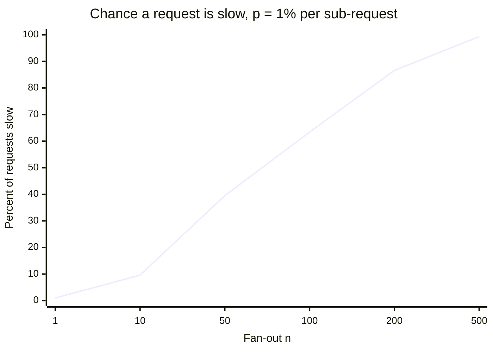
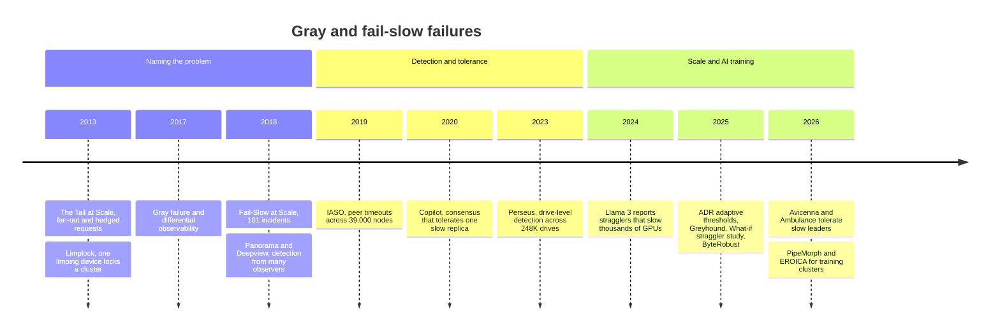
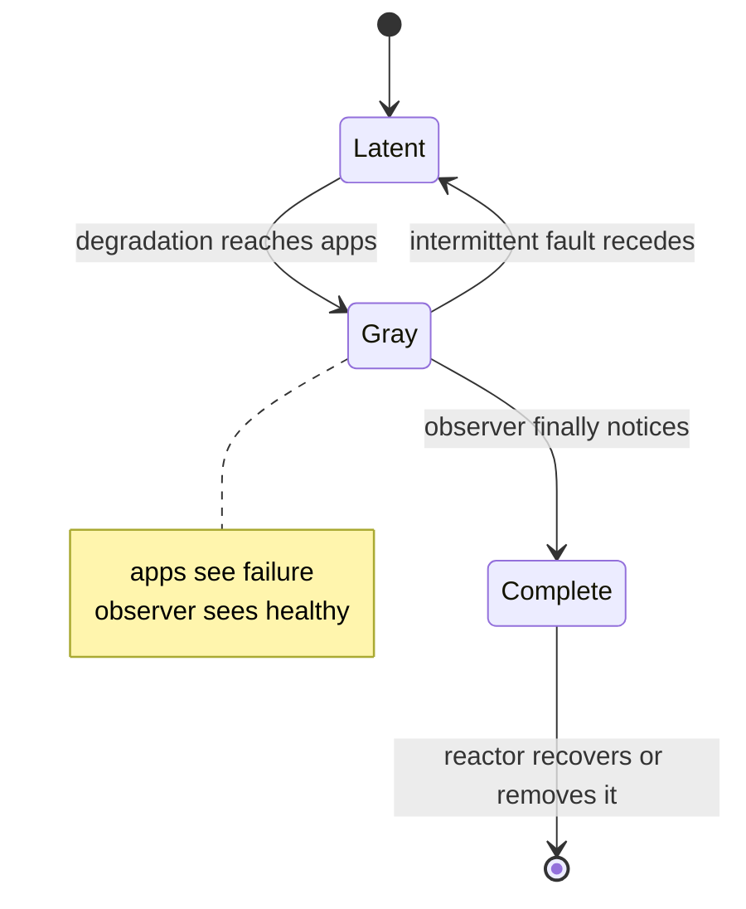
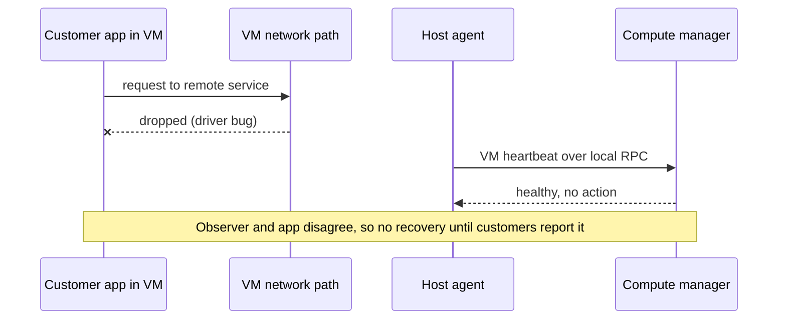

---
tags:
  - distributed-systems
  - infrastructure
  - gray-failure
  - fail-slow
  - tail-latency
  - stragglers
status: draft
sources:
  - https://pages.cs.wisc.edu/~ra/Classes/739-sp20/papers/grayfailure-hotos17.pdf
  - https://www.usenix.org/system/files/conference/fast18/fast18-gunawi.pdf
  - https://courses.grainger.illinois.edu/cs525/sp2015/Limplock.pdf
  - https://pdos.csail.mit.edu/6.824/papers/tail-dean.pdf
  - https://www.usenix.org/conference/osdi18/presentation/huang
  - https://blog.acolyer.org/2018/10/15/capturing-and-enhancing-in-situ-system-observability-for-failure-detection/
  - https://www.usenix.org/conference/nsdi18/presentation/zhang-qiao
  - https://www.usenix.org/conference/atc19/presentation/panda
  - https://www.usenix.org/system/files/atc19-panda_0.pdf
  - https://www.usenix.org/conference/fast23/presentation/lu
  - https://www.usenix.org/publications/loginonline/detecting-fail-slow-failures-large-scale-cloud-storage-systems
  - https://www.sns.cs.princeton.edu/assets/papers/2020-osdi-ngo.pdf
  - https://www.usenix.org/conference/nsdi25/presentation/lu
  - https://www.usenix.org/system/files/nsdi25-lu.pdf
  - https://collaborate.princeton.edu/en/publications/avicenna-masking-slowdowns-in-replicated-state-machines-with-coun/
  - https://www.usenix.org/system/files/osdi26-giridharan.pdf
  - https://www.usenix.org/conference/atc25/presentation/dong
  - https://cs.purdue.edu/homes/lintan/publications/csnake-eurosys26.pdf
  - https://www.usenix.org/conference/fast27/presentation/li
  - https://www.usenix.org/conference/fast27/presentation/zhao
  - https://arxiv.org/pdf/2407.21783
  - https://arxiv.org/html/2410.12588v1
  - https://www.usenix.org/conference/atc25/presentation/wu-tianyuan
  - https://arxiv.org/html/2505.05713v2
  - https://arxiv.org/html/2509.16293v4
  - https://www.usenix.org/conference/nsdi26/presentation/wu-tianyuan
  - https://www.usenix.org/conference/nsdi26/presentation/guan-yu
  - https://arxiv.org/pdf/2605.17879
  - https://docs.aws.amazon.com/pdfs/whitepapers/latest/advanced-multi-az-resilience-patterns/advanced-multi-az-resilience-patterns.pdf
  - https://www.usenix.org/conference/srecon24americas/presentation/li
created: 2026-11-26
updated: 2026-11-26
---

## Table Of Contents

---

- [[#TL;DR|TL;DR]]
- [[#The Problem|The Problem]]
- [[#Foundations|Foundations]]
    - [[#Differential Observability|Differential Observability]]
    - [[#Fail-Slow and Limpware|Fail-Slow and Limpware]]
    - [[#Fan-Out Turns Rare Into Common|Fan-Out Turns Rare Into Common]]
- [[#How We Got Here|How We Got Here]]
- [[#How It Works|How It Works]]
    - [[#How Gray Failures Evolve|How Gray Failures Evolve]]
    - [[#What Fail-Slow Hardware Looks Like|What Fail-Slow Hardware Looks Like]]
    - [[#How One Slow Node Stalls a Cluster|How One Slow Node Stalls a Cluster]]
    - [[#Detection by Callers, Peers and Models|Detection by Callers, Peers and Models]]
    - [[#Tolerance by Hedging, Masking or Eviction|Tolerance by Hedging, Masking or Eviction]]
    - [[#Slow Leaders in Consensus|Slow Leaders in Consensus]]
    - [[#Stragglers in Large Training Jobs|Stragglers in Large Training Jobs]]
    - [[#Gray Failures and Metastable Failures|Gray Failures and Metastable Failures]]
- [[#Where It Is Now|Where It Is Now]]
    - [[#Consensus That Tolerates a Slow Replica|Consensus That Tolerates a Slow Replica]]
    - [[#Testing and Detection in Storage Systems|Testing and Detection in Storage Systems]]
    - [[#AI Training Made Stragglers a First-Class Problem|AI Training Made Stragglers a First-Class Problem]]
    - [[#Industry Practice|Industry Practice]]
- [[#Trade-offs & Open Problems|Trade-offs & Open Problems]]
- [[#Resources|Resources]]
- [[#Related Notes|Related Notes]]

## ***TL;DR***
---
*A gray failure is a component that is broken from its users' point of view but healthy from the system's own point of view; fail-slow is the most common shape it takes, hardware that keeps working at a fraction of its normal speed. Both slip past failure detectors built for crash-stop, and in systems that wait on many components at once, one slow part slows everything.*

- **The defining property** is *differential observability*: "at least one app makes the observation that system is unhealthy, but observer observes that system is healthy" ([Huang et al., HotOS 2017](https://pages.cs.wisc.edu/~ra/Classes/739-sp20/papers/grayfailure-hotos17.pdf)). Heartbeats check one path; the application uses another.
- **Fail-slow is real and slow to find.** 101 incidents from 12 institutions: disks, SSDs, CPUs, memory and NICs running orders of magnitude slower without failing, with 17% taking months to diagnose ([Gunawi et al., FAST 2018](https://www.usenix.org/system/files/conference/fast18/fast18-gunawi.pdf)). Production fleets see annual fail-slow rates around 1% ([Panda et al., ATC 2019](https://www.usenix.org/conference/atc19/presentation/panda)), comparable to fail-stop.
- **Fan-out amplifies it:** if each of $n$ parallel sub-requests is slow with probability $p$, the whole request is slow with probability $1 - (1 - p)^n$. At $p = 1\%$ and $n = 100$ that is 63% ([Dean and Barroso, 2013](https://pdos.csail.mit.edu/6.824/papers/tail-dean.pdf)).
- **Detection moved from heartbeats to callers and peers:** Panorama turns every client into an observer, IASO and Perseus compare a node or drive with its peers or with its own fitted latency model, and ADR replaces static thresholds with adaptive ones.
- **Tolerance:** hedge requests to other replicas, put slow machines on probation, or convert fail-slow to fail-stop by evicting them. Majority quorums already mask slow followers; a slow *leader* is the hard case ([Ngo et al., OSDI 2020](https://www.sns.cs.princeton.edu/assets/papers/2020-osdi-ngo.pdf)).
- **Now (Nov 2026):** large-model training turned stragglers into a top cost (42.5% of ByteDance's large jobs ran at least 10% slower because of them, [Lin et al., OSDI 2025](https://arxiv.org/html/2505.05713v2)); 2026 brought slow-leader-tolerant consensus (Avicenna at EuroSys, Ambulance at OSDI) and new drive-level detectors accepted for FAST '27.

## ***The Problem***
---
*Fault-tolerance machinery is built around a binary: a component is up or down. Real components degrade, flap and fail one path but not another, and the machinery either never notices or reacts in ways that make things worse.*

Most of the machinery in this vault assumes crash-stop or crash-recovery faults (see [[Failure Models]]): heartbeats and timeouts detect a dead node, [[Replication]] and consensus route around it. Gray and fail-slow failures break that assumption in three ways:

| Symptom | Why it is hard | Example |
|---|---|---|
| **Healthy to the detector, broken to users** | The detector watches a different path or signal than the one users depend on | Azure VMs lost network connectivity from a driver bug, but heartbeats relayed through a local host agent kept arriving, so nothing recovered until customers complained ([Huang et al.](https://pages.cs.wisc.edu/~ra/Classes/739-sp20/papers/grayfailure-hotos17.pdf)) |
| **Slow, not dead** | Timeouts sized for crashes don't fire; the slow node stays in every synchronous path | A NIC that degraded from 1 Gbps to 1 Kbps slowed a 100-machine cluster by holding task slots ([Gunawi et al.](https://www.usenix.org/system/files/conference/fast18/fast18-gunawi.pdf)) |
| **Recovery that kills** | Acting on a misread signal removes capacity or blames the wrong layer | A reporting bug hid a full data server; repeated writes crashed and rebooted it, the detector finally removed it, and the extra load on its peers set off a cascade ([Huang et al.](https://pages.cs.wisc.edu/~ra/Classes/739-sp20/papers/grayfailure-hotos17.pdf)) |

The authors of the gray failure paper say, from their production experience at Microsoft, that gray failure is "behind most cloud incidents" ([Huang et al.](https://pages.cs.wisc.edu/~ra/Classes/739-sp20/papers/grayfailure-hotos17.pdf)). The difficulty is the one [[Failure Models]] starts from, a slow node and a dead node look alike from outside, with an extra twist: here the node *answers*, just not well enough, so even a perfect crash detector says all is fine.

## ***Foundations***
---
*Three ideas carry the rest of the note: gray failure is a disagreement between observers, fail-slow is the hardware form of it, and fan-out is the arithmetic that makes a rare slowdown everyone's problem.*

### Differential Observability

*Who says a component is healthy matters as much as what they measure. A gray failure is defined by two observers disagreeing.*

The HotOS 2017 model has four roles ([Huang et al.](https://pages.cs.wisc.edu/~ra/Classes/739-sp20/papers/grayfailure-hotos17.pdf)):

- **System:** provides a service (a storage service, a data center network, an IaaS platform).
- **App:** uses it; a web application, a user, an operator or another system. Apps see end-to-end signals such as query latency and remote I/O errors.
- **Observer:** part of the system; decides whether the system is failing, by active probes or passive signals.
- **Reactor:** part of the system; takes recovery actions on the observer's word.

| | Observer says healthy | Observer says failing |
|---|---|---|
| **App sees healthy** | Normal | False alarm, or a latent fault the system caught early |
| **App sees failing** | **Gray failure** | Ordinary detected failure |

The bottom-left cell is the whole topic. AWS uses the same definition in its multi-AZ guidance: "one of the system consumers detects that the system is unhealthy, but the system's own monitoring does not detect the problem or the impact does not cross an alarm threshold" ([AWS whitepaper, Jul 2023](https://docs.aws.amazon.com/pdfs/whitepapers/latest/advanced-multi-az-resilience-patterns/advanced-multi-az-resilience-patterns.pdf)).

*Worked example, averages hide one user (from that whitepaper):* a service averages 53 ms with an alarm at 60 ms. App 1's latency rises from 50 ms to 70 ms, a 40% jump that may blow its client timeout, while Apps 2 and 3 are unchanged. The service-wide average becomes 59.66 ms, still under the alarm. The service is healthy to itself and broken to App 1.

### Fail-Slow and Limpware

*Fail-slow hardware is "still running and functional but in a degraded mode, slower than its expected performance". It is the most common physical cause of gray failure, and earlier work called it limpware.*

- **Limpware** (2013): "hardware/software with significantly degraded performance"; **limplock** is the performance failure it causes, which sits in a twilight zone where neither failure detection nor recovery kicks in ([Do et al., SoCC 2013](https://courses.grainger.illinois.edu/cs525/sp2015/Limplock.pdf)).
- **Fail-slow** (2018): the FAST paper's term for the same thing in production hardware ([Gunawi et al.](https://www.usenix.org/system/files/conference/fast18/fast18-gunawi.pdf)).
- **Straggler** is the older word from batch and ML systems: one task or worker that finishes late and holds up a job. A straggler can be caused by fail-slow hardware, but in training clusters it is often caused by software or load imbalance instead (see [[#Stragglers in Large Training Jobs|below]]).

Slowness is not only a performance problem. A slow component that keeps responding stays a member of every quorum, lease and connection pool it was in, and holds their resources while it limps.

### Fan-Out Turns Rare Into Common

*When one request waits for many sub-requests, the chance that at least one of them is slow grows quickly with the fan-out. This is why a 1% problem on each server becomes a majority problem for users.*

If each of $n$ independent sub-requests is slow with probability $p$, the request as a whole is slow when any of them is:

$$
P(\text{request slow}) = 1 - (1 - p)^{n}
$$

*In words:* the request is fast only if every sub-request is fast, and the chance of that, $(1-p)^n$, shrinks geometrically with $n$.

*Worked example:* each leaf server takes over 1 s on 1% of requests ($p = 0.01$), and a query fans out to $n = 100$ leaves. Then $(0.99)^{100} \approx 0.366$, so $1 - 0.366 \approx 63.4\%$ of queries take over a second. Dean and Barroso give exactly this case: "63% of user requests will take more than one second" ([Dean and Barroso, CACM 2013](https://pdos.csail.mit.edu/6.824/papers/tail-dean.pdf)). Their second example: with only 1 in 10,000 requests slow per server ($p = 10^{-4}$) and $n = 2{,}000$ servers, $1 - (0.9999)^{2000} \approx 18\%$, "almost 1 in 5".

The same formula explains a gray failure in network fabrics. In a Clos network with $n$ core switches, a request that fans out over $m$ flows avoids one bad core switch with probability $((n-1)/n)^m$, so it is hit with probability $1 - ((n-1)/n)^m$ ([Huang et al.](https://pages.cs.wisc.edu/~ra/Classes/739-sp20/papers/grayfailure-hotos17.pdf)). With 16 core switches and $m = 10$ flows, $1 - (15/16)^{10} \approx 48\%$ of requests touch the silently dropping switch; at $m = 50$ it is 96%. The paper's point: adding core switches for redundancy adds more places for a gray failure, so more redundancy can *lower* availability for high-fan-out workloads.

## ***How We Got Here***
---
*Tail latency at scale was named in 2013, the same year limplock showed one slow device can lock up a whole cluster. Microsoft's gray failure paper (2017) and the FAST fail-slow study (2018) gave the field its vocabulary; detection systems followed from 2018 to 2023, and since 2024 the action has moved to consensus protocols and AI training clusters.*

| Year | Step | Problem it answered | Source |
|---|---|---|---|
| 2013 | **The Tail at Scale.** Fan-out turns rare per-server slowness into common user-visible slowness; hedged and tied requests, micro-partitions and latency-induced probation fix it in the request path. | Variability you can't eliminate must be tolerated. | [Dean and Barroso](https://pdos.csail.mit.edu/6.824/papers/tail-dean.pdf) |
| 2013 | **Limplock.** 56 experiments on 22 protocols in 5 cloud systems (Hadoop, HDFS, ZooKeeper, Cassandra, HBase) with a degraded disk or NIC. | Fault tolerance was built for fail-stop, not for slowness. | [Do et al.](https://courses.grainger.illinois.edu/cs525/sp2015/Limplock.pdf) |
| 2017 | **Gray failure.** A model of observers and apps, four Azure incident patterns, and research directions. | Why "healthy" systems kept having incidents. | [Huang et al.](https://pages.cs.wisc.edu/~ra/Classes/739-sp20/papers/grayfailure-hotos17.pdf) |
| 2018 | **Fail-slow at scale.** 101 reports from 12 institutions, 2000 to 2017. | Evidence that slow hardware is common and has many causes. | [Gunawi et al.](https://www.usenix.org/system/files/conference/fast18/fast18-gunawi.pdf) |
| 2018 | **Panorama** (OSDI) and **Deepview** (NSDI). Detection from the requesters' side, and correlation across the IaaS stack. | Detectors that only look at the component itself. | [Huang et al.](https://www.usenix.org/conference/osdi18/presentation/huang), [Zhang et al.](https://www.usenix.org/conference/nsdi18/presentation/zhang-qiao) |
| 2019 | **IASO.** Fail-slow detection from peer timeouts, deployed at Nutanix. | Cheap detection without per-request latency tracking. | [Panda et al.](https://www.usenix.org/conference/atc19/presentation/panda) |
| 2020 | **Copilot.** Two "pilots" do every step so a slow one can't hold back the group. | Consensus latency collapses when one replica, especially the leader, is slow. | [Ngo et al.](https://www.sns.cs.princeton.edu/assets/papers/2020-osdi-ngo.pdf) |
| 2023 | **Perseus.** Per-node latency-vs-throughput models find fail-slow drives without hand-tuned thresholds; FAST best paper. | Thresholds and peer rules didn't transfer across clusters. | [Lu et al.](https://www.usenix.org/conference/fast23/presentation/lu) |

## ***How It Works***
---
*Gray failures follow a recognizable life cycle, fail-slow hardware has a recognizable set of causes, and the defenses come in three kinds: detect from more viewpoints, tolerate slowness in the request path, or evict the slow component so it becomes an ordinary crash.*

### How Gray Failures Evolve

*Most gray failures start as faults the system quietly absorbs, become visible to apps before the system's own observer, and end as complete failures. The window in between is where damage happens and where early detection pays.*

- **Latent:** minor faults the system suppresses; everything looks fine.
- **Gray:** visible to apps, not to the observer.
- **Complete:** bad enough that the observer sees it too. A memory leak is the textbook case: slower and slower, then out of memory ([Huang et al., §3.3](https://pages.cs.wisc.edu/~ra/Classes/739-sp20/papers/grayfailure-hotos17.pdf)).

Intermittent faults loop through these states repeatedly, which is why they are so hard to catch. In the Azure storage incident, compute nodes saw remote I/O exceptions at some time $t_1$ well before the storage manager acted at $t_2$; correlating those observations across subsystems inside that window could have prevented the cascade.

The four Azure patterns from the paper:

| Pattern | What happened |
|---|---|
| **Redundancy hurts** | Core switches silently dropped packets without triggering rerouting; high fan-out meant nearly every request touched a bad one |
| **Under the radar** | VM network broken, heartbeats healthy via a local path, no recovery until users reported it |
| **Recovery that kills** | A capacity-reporting bug, crash loops, then removal of the server overloaded its peers into a cascade |
| **Blame game** | Storage or network faults crashed VMs; the compute detector blamed the VM stack, and teams pointed at each other |

### What Fail-Slow Hardware Looks Like

*The FAST 2018 study is the reference for what actually goes slow, why, and how long it takes to find. The short answer: every component type, often from causes outside the device, and usually after days to months.*

From 101 reports across 12 institutions with 100 to over 10,000 nodes each ([Gunawi et al.](https://www.usenix.org/system/files/conference/fast18/fast18-gunawi.pdf)):

| Hardware (symptom count) | Examples from the reports |
|---|---|
| Network (28) | 1 Gbps NIC down to 1 Kbps; a 7 Gbps Fibre Channel link collapsing to 2 Kbps; a 1 Gbps link at 150 Mbps with 1% loss |
| Disk (21) | Rack vibration cut throughput to 100 KB/s against 100 MB/s in office tests |
| CPU (20) | A dead power supply throttled four machines sharing two supplies to 50% CPU |
| SSD (19) | I/Os throttled in multiples of 250 µs up to 2 to 3 ms; write amplification from 5x to 600x across models |
| Memory (12) | A memory card at 25% speed caused HBase backlogs, out-of-memory errors and crashes |

**Root causes** (112 counted, some reports had several): internal device errors and wear-out (40) and firmware bugs (20); external causes, about 39%, from environment (18), temperature (11), power (8) and configuration (7); 8 unknown. Because so many causes are outside the device, swapping the part often doesn't fix it.

**Faults change form:**
- *Stop to slow:* one dead power supply throttles the CPUs it no longer feeds.
- *Transient to slow:* 1 to 50% packet loss triggers retries that cut throughput by orders of magnitude.
- *Partial to slow:* bad SSD chips shrink over-provisioned space, so garbage collection runs more often.

**Faults cascade:** one stopped fan made the others run at full speed, and the vibration slowed the disks.

**Time to detect:** 1% in minutes, 13% in hours, 13% in days, 11% in weeks, 17% in months, 45% unknown.

The paper's advice: vendors should raise explicit errors when internal error rates are far above normal and expose device performance statistics; operators should monitor every component (fans, temperature, cables) and correlate across the stack; system designers should make masking explicit and convert fail-slow to fail-stop where they can, while watching for false positives and rebuild load.

### How One Slow Node Stalls a Cluster

*Limplock shows the escalation: an operation waits on one slow device, threads and queues fill up while it waits, and the node, then the whole cluster, stalls. The causes are design choices that are invisible under crash faults.*

| Level | What locks up | Causes found ([Do et al.](https://courses.grainger.illinois.edu/cs525/sp2015/Limplock.pdf)) |
|---|---|---|
| **Operation** | One request is stuck behind the limping device | Single points of failure in the data path, long timeouts, "memoryless" retries that go back to the same slow node |
| **Node** | A healthy node is stuck because its threads or queues are full of operations waiting on the limping one | Exhausted resource pools, unbounded threads and queues |
| **Cluster** | Every node, or the master, is in node limplock | Cascades from the two levels above |

Per system: a limping HDFS master disk or datanode NIC caused limplock at all three levels; in Hadoop, one mapper with a slow NIC slowed every reducer during shuffle, and speculative execution didn't trigger; in ZooKeeper, reads were fine but updates suffered from a limping leader or follower NIC; in Cassandra, weak-consistency operations escaped but full-consistency ones hit limplock; HBase inherited every HDFS limplock ([Do et al.](https://courses.grainger.illinois.edu/cs525/sp2015/Limplock.pdf)).

Twelve years later the same weak spots show up in bug studies. Of 48 real fail-slow hardware failures in cloud systems, the vulnerable code was mostly **synchronization and timeout handling**, and triggering the bugs needed fine-grained slowness, not just "slow or not" ([Dong et al., ATC 2025](https://www.usenix.org/conference/atc25/presentation/dong)).

### Detection by Callers, Peers and Models

*Each detector answers the same question, "is this component slow compared to what it should be?", with a different baseline: what its callers saw, what its peers do, what its own past says, or what the rest of the stack saw at the same time.*

| Approach | Baseline | How it works | Result |
|---|---|---|---|
| **Panorama** (OSDI 2018) | The component's callers | Static analysis finds observation points (exception handlers, boundary calls) and injects hooks; every caller reports positive and negative evidence about the components it calls to a local observation store; a per-observer majority vote yields a verdict | Detected all 15 reproduced gray failures in ZooKeeper, HDFS, HBase and Cassandra in 0.2 to 7 s; existing detectors caught only one of them within 300 s; about 0.7% CPU ([Huang et al.](https://www.usenix.org/conference/osdi18/presentation/huang), [Colyer](https://blog.acolyer.org/2018/10/15/capturing-and-enhancing-in-situ-system-observability-for-failure-detection/)) |
| **Deepview** (NSDI 2018) | The rest of the stack | Links each Azure virtual-disk failure to compute, network and storage components and localizes with Lasso regression and hypothesis testing | Unclassified VHD failure events fell from tens of thousands to several hundred; found unplanned ToR reboots and storage gray failures; detection under 10 minutes ([Zhang et al.](https://www.usenix.org/conference/nsdi18/presentation/zhang-qiao)) |
| **IASO** (ATC 2019) | Peers | Each instance scores its peers from timeout ratios every 5 s; scores rise multiplicatively and fall linearly (like TCP's AIMD); the 30th percentile over 10 minutes is the peer's score, so most observers must agree; outliers are found by clustering | 232 fail-slow incidents in 7 months across 39,000 nodes, isolated "within minutes"; 1.02% annual fail-slow rate ([Panda et al.](https://www.usenix.org/system/files/atc19-panda_0.pdf)) |
| **Perseus** (FAST 2023) | The node's own latency-vs-throughput curve | Fit a polynomial to normal points per node, flag 15-second samples above the prediction's upper bound, keep only sustained slow periods, score drives by duration and severity | 304 fail-slow drives among 248K over 10 months; isolating them cut node-level p99.99 latency 48% ([Lu et al.](https://www.usenix.org/conference/fast23/presentation/lu)) |
| **ADR** (NSDI 2025) | The variable's own recent history | Replace each static slowness threshold in system code with the p99 of a sliding window, and use update frequency to tell a workload change from a fault | HBase under a 100 ms delay: degradation 97% down to 32%; detection in about 1 s; 2.8% overhead ([Lu et al.](https://www.usenix.org/system/files/nsdi25-lu.pdf)) |

Two details explain why the later systems look the way they do.

**Why timeouts blame both sides.** A timeout seen by A about B could mean B is slow, the link is bad, or A is. IASO doesn't try to settle this per observation; it keeps per-pair scores and only flags a peer when most observers agree ([Panda et al.](https://www.usenix.org/system/files/atc19-panda_0.pdf)). Panorama does the same with a majority over observers.

**Why fixed thresholds fail.** Alibaba's engineers tried a fixed latency threshold (workload spikes crossed it), then a peer rule (flag a drive at more than twice the node median for half of a 5-minute window), which took two hours to tune for one 300-node cluster and didn't carry over to another cluster with the same drives; an adapted IASO reached a precision of only 0.48 at drive granularity ([Lu et al., ;login: Feb 2023](https://www.usenix.org/publications/loginonline/detecting-fail-slow-failures-large-scale-cloud-storage-systems)). Perseus instead models what latency *should* be given the current load:

```mermaid
flowchart LR
    A["Per-drive latency and throughput, 15 s samples"] --> B["Group by node"]
    B --> C["PCA then DBSCAN: drop outliers"]
    C --> D["Polynomial fit of latency vs throughput"]
    D --> E["Upper bound, e.g. 99.9% prediction"]
    E --> F["Slowdown ratio = latency / bound"]
    F --> G["Sustained slow periods only"]
    G --> H["Daily risk score per drive"]
    H --> I["Isolate and inspect"]
```

Removing outliers before fitting matters: DBSCAN alone caught 63.83% of slow entries, PCA first raised that to 92.55%, because latency and throughput are correlated and slow points otherwise hide inside the main cluster. The risk score exists because flagging every drive with one slow event would yield about 6,000 "fail-slow" drives on a bad day ([;login:](https://www.usenix.org/publications/loginonline/detecting-fail-slow-failures-large-scale-cloud-storage-systems)).

**Why percentiles mislead.** In the NSDI 2025 study, a 10 ms delay on one etcd node raised p99.9 latency by only 0.4 to 7.2 ms, because slow periods produce far fewer completed requests than normal ones ([Lu et al.](https://www.usenix.org/system/files/nsdi25-lu.pdf)). A slow node shows up as *missing* throughput more than as high latency.

### Tolerance by Hedging, Masking or Eviction

*You can tolerate slowness inside the request (send it twice), inside the protocol (don't wait for the slowest), or outside it (remove the slow part, turning a gray failure into an ordinary crash).*

**Hedged and tied requests.** Send the request to one replica; if it hasn't answered after a short delay, send it to a second and use whichever answers first. In a BigTable benchmark reading 1,000 keys spread over 100 servers, hedging after 10 ms cut p99.9 latency "from 1,800ms to 74ms while sending just 2% more requests"; deferring the hedge until the p95 latency bounds extra load to about 5% ([Dean and Barroso](https://pdos.csail.mit.edu/6.824/papers/tail-dean.pdf)). *Tied* requests go to two servers at once with each told about the other, so the first to start work cancels the copy; with a 1 ms delay this cut p99.9 latency 38% on an idle cluster at under 1% extra disk use.

$$
P(\text{hedged sub-request slow}) \approx p^{2} \quad\Rightarrow\quad P(\text{request slow}) = 1 - (1 - p^{2})^{n}
$$

*In words:* if the two replicas are slow independently, a hedged sub-request is slow only when both are. *Worked example:* $p = 0.01$, $n = 100$. Without hedging, 63.4% of requests are slow (above). With a hedge to an independent replica, each sub-request is slow with probability $10^{-4}$, and $1 - (1 - 10^{-4})^{100} \approx 0.995\%$. The independence assumption is the catch: if both replicas share the slow switch, disk shelf or hot key, the hedge buys nothing.

**Probation and fine-grained placement.** Dean and Barroso's other tools ([CACM 2013](https://pdos.csail.mit.edu/6.824/papers/tail-dean.pdf)):
- *Latency-induced probation:* temporarily stop sending real traffic to a slow machine, keep sending shadow requests to measure it, and readmit it when it recovers. This is fail-slow to fail-stop conversion with a way back.
- *Micro-partitions:* about 20 partitions per machine lets load move off a slow machine in roughly 5% steps (see [[Partitioning]]).
- *Good enough and canary requests:* return a slightly incomplete answer once enough of the corpus responded, and send a query to one or two leaves first and query the rest only if those answer in reasonable time; Google does this for every request in its large fan-out search systems.

**Convert fail-slow to fail-stop.** The FAST study's main design advice ([Gunawi et al.](https://www.usenix.org/system/files/conference/fast18/fast18-gunawi.pdf)), and what IASO does in production: by default it restarts the slow service instance and strips its leadership, and it can shut down the VM or host instead; it quarantines at most one instance at a time so it never drops the cluster below its fault-tolerance level, and it rolls back when the problem clears ([Panda et al.](https://www.usenix.org/system/files/atc19-panda_0.pdf)). At AWS the same idea operates at zone scale: when a gray failure is isolated to one Availability Zone, evacuate the zone (zonal shift) rather than chase the faulty component ([AWS whitepaper](https://docs.aws.amazon.com/pdfs/whitepapers/latest/advanced-multi-az-resilience-patterns/advanced-multi-az-resilience-patterns.pdf)).

Eviction has its own risk: the [[Reliability Patterns]] note describes AWS's October 2025 outage, where flapping health checks failed over healthy capacity. A detector that removes capacity needs a rate limit.

### Slow Leaders in Consensus

*Majority quorums already hide slow followers: the leader waits only for the fastest majority. Nothing hides a slow leader, because every command goes through it, and a slow leader usually keeps sending heartbeats, so it is never replaced.*

In a [[Raft]] or Multi-[[Paxos]] group of $n = 2f + 1$ replicas, the leader commits once $f$ followers have acknowledged. If $d_{(1)} \le d_{(2)} \le \dots \le d_{(2f)}$ are the follower round-trip times in order:

$$
T_{\text{commit}} = T_{\text{leader}} + d_{(f)}
$$

*In words:* commit latency is the leader's own work plus the $f$-th fastest follower; the $f$ slowest followers don't matter.

*Worked example, 5 replicas ($f = 2$):* follower round trips are 1.0, 1.2, 1.5 and 40 ms. $d_{(2)} = 1.2$ ms, so the 40 ms follower is invisible. Make a second follower slow (1.0, 1.2, 40, 40): still 1.2 ms. A third slow follower pushes $d_{(2)}$ to 40 ms. Now make the *leader* slow instead: every command pays the leader's delay, and since the leader sits on the client path twice (receive and order, then commit and reply), Multi-Paxos latency grew by about twice the injected slowdown in Copilot's experiments; "all commands in Multi-Paxos see high latencies when the leader is slow" ([Ngo et al.](https://www.sns.cs.princeton.edu/assets/papers/2020-osdi-ngo.pdf)).

Leader election doesn't save you. Elections fire on missing heartbeats, and a slow leader still sends them. Panorama's ZooKeeper case is this exactly: the leader kept exchanging heartbeats with followers but could no longer serve writes ([Colyer on Panorama](https://blog.acolyer.org/2018/10/15/capturing-and-enhancing-in-situ-system-observability-for-failure-detection/)). The [[Raft]] note covers the opposite case, a partially connected follower that keeps forcing elections, and PreVote and CheckQuorum.

**Copilot** (OSDI 2020) makes two replicas, the *pilot* and *copilot*, both propose orderings for every command; dependencies and deduplication reconcile their proposals, and a *fast takeover* lets the fast pilot finish a slow pilot's work. On 5 replicas with an injected 40 ms pause, Multi-Paxos latency was 40.1 ms and EPaxos 41.5 ms while Copilot's maximum was 12.6 ms; under sustained slowdowns its p50, p90 and p99 stayed within 0.6, 2 and 4 ms of normal. The price is roughly 8 to 13% lower peak throughput than Multi-Paxos with no slow replica ([Ngo et al.](https://www.sns.cs.princeton.edu/assets/papers/2020-osdi-ngo.pdf)).

**A slow follower is not always harmless.** In etcd under a flaky network, a slow follower caused 45% throughput degradation against 31% for a slow leader, because clients kept their gRPC connections to the slow follower: its keepalive still passed, so client and server disagreed about whether it was slow ([Lu et al., NSDI 2025](https://www.usenix.org/system/files/nsdi25-lu.pdf)). That is differential observability again, one layer up.

### Stragglers in Large Training Jobs

*Synchronous data-parallel and pipeline-parallel training is the extreme fan-out: every step waits on every GPU. One slow GPU, link or process sets the pace for thousands, and the causes are as often software and load imbalance as hardware.*

Meta's Llama 3 report put it plainly: "Even a single straggler can slow down thousands of other GPUs, often appearing as functioning but slow communications," and its tooling ranks suspect communications so engineers only check a few ([Llama 3 paper, Jul 2024](https://arxiv.org/pdf/2407.21783)). It also noted a diurnal 1 to 2% throughput swing from mid-day heat affecting GPU frequency scaling, a fleet-wide fail-slow with an environmental cause.

| Study | Setting | Finding |
|---|---|---|
| Greyhound (ATC 2025; preprint titled Falcon, Oct 2024) | Alibaba shared cluster, over 10,000 GPUs | Fail-slows last from under a minute to nearly ten hours and delay large jobs 1.34x on average; 16 of 27 jobs on 512 to 1,024 GPUs hit one. Causes: contention, device degradation, network congestion. Detection over 99% accurate; 1.58x throughput on 256 H800s with injected stragglers ([Wu et al.](https://www.usenix.org/conference/atc25/presentation/wu-tianyuan), [preprint](https://arxiv.org/html/2410.12588v1)) |
| What-if analysis (OSDI 2025) | 3,079 ByteDance LLM pretraining jobs, Jan to May 2024, each 128+ GPUs | 42.5% of jobs were at least 10% slower because of stragglers; at the tail a job wasted 45% of its resources. Slowdowns persist across steps. Single-server hardware or software faults were *not* a significant cause; pipeline stage imbalance, sequence-length imbalance and Python garbage collection were ([Lin et al.](https://arxiv.org/html/2505.05713v2)) |
| ByteRobust (SOSP 2025) | ByteDance, 9,600-GPU jobs for one to three months | Fail-slow shows up as "MFU decline"; stack traces are grouped every 10 s, the parallel group with the most outliers over five rounds is evicted and replaced with warm standbys, accepting a few extra machines evicted to recover faster ([ByteDance and HKU, SOSP 2025](https://arxiv.org/html/2509.16293v4)) |

Greyhound's mitigation is a ladder, cheapest first, inspired by the ski-rental problem: do nothing; shift micro-batches away from the slow data-parallel group; re-plan the parallel topology to route around congested links and pack stragglers into fewer pipeline stages; finally checkpoint and restart on healthy nodes. It climbs a rung only once the slowdown accumulated so far equals the next rung's cost ([preprint](https://arxiv.org/html/2410.12588v1)). Collectives, topology and checkpointing are covered in [[GPU Cluster Infrastructure]].

### Gray Failures and Metastable Failures

*A gray failure is often the trigger and the reaction to it the sustaining effect. Slow components remove capacity without anyone noticing, and retries, timeouts and evictions turn that into self-sustaining overload.*

The [[Reliability Patterns]] note covers metastable failures (a trigger pushes a vulnerable system into overload, a sustaining effect such as retries keeps it there). Gray and fail-slow failures connect to it in three ways:

- **As the trigger.** A fail-slow node is a capacity drop that the observer doesn't see. Huang et al.'s 2022 study used exactly that kind of trigger (a brief 80% CPU capacity drop) to tip MongoDB into a state it didn't leave ([[Reliability Patterns]]).
- **As the sustaining mechanism.** Limplock's "memoryless retry" and unbounded queues are the same retry and queueing feedback loops ([Do et al.](https://courses.grainger.illinois.edu/cs525/sp2015/Limplock.pdf)); Gunawi et al. saw 1 to 50% packet loss turn into retries that collapsed throughput by orders of magnitude ([FAST 2018](https://www.usenix.org/system/files/conference/fast18/fast18-gunawi.pdf)).
- **Through recovery.** Azure's "recovery that kills" pattern is a cascade started by the reactor, not the fault ([Huang et al.](https://pages.cs.wisc.edu/~ra/Classes/739-sp20/papers/grayfailure-hotos17.pdf)).

CSnake (EuroSys 2026) finds these loops by injecting faults, including delays that mimic contention, and stitching the propagation chains together; it found 15 bugs causing self-sustaining cascading failures in five widely used systems ([Qian et al.](https://cs.purdue.edu/homes/lintan/publications/csnake-eurosys26.pdf)).

## ***Where It Is Now***
---
*As of November 2026: consensus research has moved from tolerating a slow follower to tolerating a slow leader without paying for it in the common case; storage detection is moving from one-off detectors to labeling and pattern catalogs; and AI training is where most of the new straggler work lives, much of it from ByteDance and Alibaba production clusters.*

### Consensus That Tolerates a Slow Replica

- **Avicenna (EuroSys '26, April 2026, Princeton).** Keeps one leader for low geo-distributed latency (which already tolerates a slow follower) and watches for a slow leader by comparing current latency with the *counterfactual* latency clients would see under a "shadow leader", promoting the shadow through fast leader rotation when the leader looks slow. The authors report Multi-Paxos-level normal-case latency while tolerating one fail-slow replica; the abstract gives no latency numbers ([Hodsdon et al.](https://collaborate.princeton.edu/en/publications/avicenna-masking-slowdowns-in-replicated-state-machines-with-coun/)).
- **Ambulance (OSDI '26, July 2026).** Brings the same goal to [[Byzantine Fault Tolerance]]. Instead of racing a timeout, replicas race each other: the leader has a two-step certificate path and others a three-step one, and if the leader loses, a randomly chosen lane wins. It reports 1.6 to 3.0x lower peak latency than Autobahn under 1 to 2 s leader slowdowns, and in a 24-hour, 40-replica production run on the Sei blockchain p99 fell from 1.27 s to 662 ms ([Giridharan et al.](https://www.usenix.org/system/files/osdi26-giridharan.pdf)).
- **Static thresholds are the weak point in deployed systems.** The NSDI '25 study (April 2025) of Cassandra, HBase, HDFS, etcd, CockroachDB and Kafka found every system relies on static timeouts; impact is non-monotonic (in CockroachDB a 1 s filesystem delay hurt less than a 10 ms one); a small "danger zone" of slowness does the most damage (etcd's spans 1 to 2 ms of network delay); and more CPU cores made the same 10 ms delay worse for etcd (7% to 72% degradation from 1 to 5 cores) because baseline latency was lower. The testing pipeline, Xinda, is open source ([Lu et al.](https://www.usenix.org/system/files/nsdi25-lu.pdf)).

### Testing and Detection in Storage Systems

- **Fault-injection for fail-slow bugs (July 2025).** Sieve statically finds synchronized and timeout-protected I/O and injects slowness there; it found six unknown bugs in ZooKeeper, Kafka and HDFS, two confirmed ([Dong et al., ATC '25](https://www.usenix.org/conference/atc25/presentation/dong)). See [[Deterministic Simulation Testing]] for the broader case for injecting slow disks in tests.
- **Drive-level detection, FAST '27 (accepted; conference February 2027).** Kratos (UChicago, SJTU, NetApp) catalogs five disk fail-slow patterns, four previously unexamined, and claims 32.8 to 50% more detections than prior methods, over 95% accuracy across a wide threshold range and 3 to 128x speed ([Li et al.](https://www.usenix.org/conference/fast27/presentation/li)). SlowSight (Nankai, Huawei Cloud, Tsinghua) tackles the labeling bottleneck behind every learned detector, reaching F1 of 0.851 and 0.903 on two Huawei Cloud production datasets ([Zhao et al.](https://www.usenix.org/conference/fast27/presentation/zhao)). These are accepted-paper abstracts as of November 2026; the full papers aren't out yet.

### AI Training Made Stragglers a First-Class Problem

- **Pipeline bubbles (NSDI '26, May 2026).** HKUST and Alibaba found training stragglers are mostly *communication* delays (congestion, RNIC or switch defects, topology asymmetry), and that under pipeline parallelism a small delay cascades into "bubbles". PipeMorph adapts the pipeline schedule and moves communication off the GPU to CPU-side RDMA, improving iteration time 1.2 to 3.5x; it won an Outstanding Paper award ([Wu et al.](https://www.usenix.org/conference/nsdi26/presentation/wu-tianyuan)). Note the tension with the ByteDance study, which found computation slowdowns more common; the two clusters and workloads differ.
- **Differential observability, applied (NSDI '26, May 2026).** Alibaba's EROICA profiles training functions online across clusters of about 100,000 GPUs and uses differential observability to localize hardware, software or mixed root causes, reporting 97.5% success on hard performance issues over 1.5 years in production ([Guan et al.](https://www.usenix.org/conference/nsdi26/presentation/guan-yu)).
- **Node health management (MLSys 2026, industry track).** Amazon's Guard compares each node's GPU and network telemetry with its peers in the same job, combined with offline burn-in sweeps; reported results include mean time to failure rising from 6.6 h to 16.7 h and run-to-run step-time variance falling from 20% to 1%. Its classifier still had a 12.4% false-positive and 7.8% false-negative rate ([Liu et al.](https://arxiv.org/pdf/2605.17879)).

### Industry Practice

- **Monitor from the customer's side, per fault domain.** AWS's guidance (July 2023, now marked historical but still the clearest write-up) is to alarm per Availability Zone, test whether errors are skewed across zones with a chi-squared test, and evacuate a zone with zonal shift as the preferred response ([AWS whitepaper](https://docs.aws.amazon.com/pdfs/whitepapers/latest/advanced-multi-az-resilience-patterns/advanced-multi-az-resilience-patterns.pdf)). *Worked example from it:* 100 errors over four zones, expected 25 each, observed 20, 20, 25 and 35, gives $\chi^2 = 6$ with 3 degrees of freedom, not significant at 5%, so no zone is blamed.
- **Azure** still teaches differential observability as the organizing idea; Ze Li (Azure) and Ryan Huang presented its production use at SREcon24 Americas (March 2024) ([USENIX](https://www.usenix.org/conference/srecon24americas/presentation/li)).
- **Detection by peers, eviction by default.** Across IASO, Perseus, ByteRobust and Guard, the deployed pattern is the same: compare against peers or a fitted model, require persistence, then quarantine or evict, often over-evicting to recover quickly.

## ***Trade-offs & Open Problems***
---
*Every defense trades false positives against slow reaction, or extra load against tail latency. The open problems are about thresholds that adapt, blame that is correct, and protocols that pay nothing for slowness tolerance in the common case.*

| Choice | Buys | Costs |
|---|---|---|
| Heartbeat detectors | Cheap, simple, catch crashes | Blind to gray failure; check one path, not the one apps use |
| Caller-side observation (Panorama) | Sees what users see | Code instrumentation; must aggregate and attribute blame |
| Peer comparison (IASO, Guard) | No absolute thresholds | Fails when peers are slow together; needs tuning per cluster ([;login:](https://www.usenix.org/publications/loginonline/detecting-fail-slow-failures-large-scale-cloud-storage-systems)) |
| Model-based detection (Perseus) | Adapts to load per node | Needs clean training data and labels ([SlowSight](https://www.usenix.org/conference/fast27/presentation/zhao)) |
| Hedged requests | Large tail cuts for a few % more load | Useless when slowness is correlated; extra load on an already slow system |
| Evict on suspicion | Turns gray into crash, which protocols handle | False positives remove healthy capacity; rebuild traffic; can trigger cascades |
| Slow-leader-tolerant consensus (Copilot, Avicenna, Ambulance) | Bounded latency with one slow replica | Protocol complexity; Copilot gives up some peak throughput |

Open problems worth tracking:
- **Thresholds that adapt.** Static timeouts are everywhere and fragile; even tuned ones break when the workload shifts ([Lu et al., NSDI 2025](https://www.usenix.org/system/files/nsdi25-lu.pdf)).
- **Blame.** Who is slow, the callee, the caller or the link? Azure's "blame game" ([Huang et al.](https://pages.cs.wisc.edu/~ra/Classes/739-sp20/papers/grayfailure-hotos17.pdf)) is still largely solved by majority vote among observers, which fails when the observers share the fault.
- **Correlated slowness.** Hedging, quorums and peer comparison all assume independent slowness; shared switches, power and cooling (the Llama 3 diurnal swing) break that.
- **Where aggregation lives.** The 2017 paper asked where cross-component observations should be combined; production answers (EROICA, Deepview) are system-specific.
- **Testing.** None of the six systems in the NSDI '25 study tested slow faults end to end; they used unit tests with sleeps ([Lu et al.](https://www.usenix.org/system/files/nsdi25-lu.pdf)). See [[Deterministic Simulation Testing]].
- **Slow and wrong.** A component that is slow *and* occasionally wrong sits between this note and [[Silent Data Corruption]].

## ***Resources***
---
*Read the gray failure paper and The Tail at Scale first; they are short and frame everything else. Then the FAST 2018 study for what fails, Panorama and Perseus for detection, and Copilot for what tolerance looks like inside a protocol.*

**Primary papers**
- [Gray Failure: The Achilles' Heel of Cloud-Scale Systems](https://pages.cs.wisc.edu/~ra/Classes/739-sp20/papers/grayfailure-hotos17.pdf): Peng Huang et al. (Microsoft Research and Azure), HotOS 2017. Differential observability and four Azure patterns.
- [The Tail at Scale](https://pdos.csail.mit.edu/6.824/papers/tail-dean.pdf): Jeffrey Dean and Luiz André Barroso, Communications of the ACM, 2013. Fan-out math, hedged and tied requests, probation.
- [Limplock: Understanding the Impact of Limpware on Scale-Out Cloud Systems](https://courses.grainger.illinois.edu/cs525/sp2015/Limplock.pdf): Do, Hao, Leesatapornwongsa, Patana-anake and Gunawi, SoCC 2013.
- [Fail-Slow at Scale: Evidence of Hardware Performance Faults in Large Production Systems](https://www.usenix.org/system/files/conference/fast18/fast18-gunawi.pdf): Gunawi et al., FAST 2018. The 101-incident study.

**Detection**
- [Capturing and Enhancing In Situ System Observability for Failure Detection (Panorama)](https://www.usenix.org/conference/osdi18/presentation/huang): Huang, Guo, Lorch, Zhou and Dang, OSDI 2018. With [Adrian Colyer's summary](https://blog.acolyer.org/2018/10/15/capturing-and-enhancing-in-situ-system-observability-for-failure-detection/).
- [Deepview: Virtual Disk Failure Diagnosis and Pattern Detection for Azure](https://www.usenix.org/conference/nsdi18/presentation/zhang-qiao): Zhang et al., NSDI 2018.
- [IASO: A Fail-Slow Detection and Mitigation Framework for Distributed Storage Services](https://www.usenix.org/system/files/atc19-panda_0.pdf): Panda et al. (Nutanix, UChicago), USENIX ATC 2019.
- [Perseus: A Fail-Slow Detection Framework for Cloud Storage Systems](https://www.usenix.org/conference/fast23/presentation/lu): Lu et al. (Alibaba, SJTU), FAST 2023, best paper. Read with the [;login: article](https://www.usenix.org/publications/loginonline/detecting-fail-slow-failures-large-scale-cloud-storage-systems), Feb 2023, which explains the failed alternatives.
- [Kratos](https://www.usenix.org/conference/fast27/presentation/li) and [SlowSight](https://www.usenix.org/conference/fast27/presentation/zhao): FAST '27, accepted.

**Tolerance and testing**
- [Tolerating Slowdowns in Replicated State Machines using Copilots](https://www.sns.cs.princeton.edu/assets/papers/2020-osdi-ngo.pdf): Ngo, Sen and Lloyd, OSDI 2020.
- [One-Size-Fits-None: Understanding and Enhancing Slow-Fault Tolerance in Modern Distributed Systems](https://www.usenix.org/system/files/nsdi25-lu.pdf): Lu, Lu, Jiang, Xue and Huang, NSDI 2025. Xinda and ADR.
- [Understanding and Detecting Fail-Slow Hardware Failure Bugs in Cloud Systems](https://www.usenix.org/conference/atc25/presentation/dong): Dong et al., ATC 2025. Sieve.
- [Avicenna: Masking Slowdowns in Replicated State Machines with Counterfactual Evaluation](https://collaborate.princeton.edu/en/publications/avicenna-masking-slowdowns-in-replicated-state-machines-with-coun/): Hodsdon et al., EuroSys 2026.
- [Ambulance: Saving BFT through Racing](https://www.usenix.org/system/files/osdi26-giridharan.pdf): Giridharan et al., OSDI 2026.
- [CSnake: Detecting Self-Sustaining Cascading Failure via Causal Stitching of Fault Propagations](https://cs.purdue.edu/homes/lintan/publications/csnake-eurosys26.pdf): Qian, Tan and Zhang, EuroSys 2026.

**Stragglers in ML training**
- [The Llama 3 Herd of Models](https://arxiv.org/pdf/2407.21783): Meta, Jul 2024. Section 3.3.4 on stragglers and NCCLX.
- [Greyhound: Hunting Fail-Slows in Hybrid-Parallel Training at Scale](https://www.usenix.org/conference/atc25/presentation/wu-tianyuan): Wu et al. (HKUST, Alibaba), ATC 2025; [Falcon preprint](https://arxiv.org/html/2410.12588v1), Oct 2024.
- [Understanding Stragglers in Large Model Training Using What-if Analysis](https://arxiv.org/html/2505.05713v2): Lin et al. (NYU, ByteDance), OSDI 2025.
- [Robust LLM Training Infrastructure at ByteDance (ByteRobust)](https://arxiv.org/html/2509.16293v4): SOSP 2025.
- [Attack of the Bubbles: Straggler-Resilient Pipeline Parallelism](https://www.usenix.org/conference/nsdi26/presentation/wu-tianyuan) and [EROICA](https://www.usenix.org/conference/nsdi26/presentation/guan-yu): NSDI 2026.
- [Guard: Scalable Straggler Detection and Node Health Management](https://arxiv.org/pdf/2605.17879): Amazon, MLSys 2026 industry track.

**Industry guidance**
- [Advanced Multi-AZ Resilience Patterns](https://docs.aws.amazon.com/pdfs/whitepapers/latest/advanced-multi-az-resilience-patterns/advanced-multi-az-resilience-patterns.pdf): AWS whitepaper, Jul 2023. Gray failures, chi-squared outlier detection, zonal shift.
- [Gray Failure: The Achilles' Heel of Cloud-Scale Systems (talk)](https://www.usenix.org/conference/srecon24americas/presentation/li): Ze Li and Ryan Huang, SREcon24 Americas, Mar 2024.

## Related Notes

- [[Failure Models]] — The crash, omission and Byzantine models that gray and fail-slow failures fall between.
- [[Reliability Patterns]] — Timeouts, retries, circuit breakers and metastable failures; the reactions that turn slowness into outages.
- [[Raft]] — Partial partitions, PreVote and CheckQuorum; a slow leader keeps its heartbeats and its job.
- [[Paxos]] — Multi-Paxos pays twice for a slow leader; Copilot and Avicenna build on it.
- [[Replication]] — Synchronous replication waits on the slowest required copy.
- [[Byzantine Fault Tolerance]] — Ambulance tolerates slow BFT leaders; gray failures blur crash and Byzantine.
- [[Gossip and Membership]] — Failure detectors that flap under one-way reachability and partial loss.
- [[Leases and Fencing]] — A slow lease holder is the classic partially failed node.
- [[Partitioning]] — Micro-partitions let load move off a slow machine in small steps.
- [[Deterministic Simulation Testing]] — Injecting slow disks and flaky links before production does.
- [[Silent Data Corruption]] — The other failure mode that passes health checks.
- [[GPU Cluster Infrastructure]] — Collectives, checkpointing and straggler handling for training.
- [[Cluster Scheduling]] — Where eviction, quarantine and warm standbys are carried out.
- [[Disaggregated Systems]] — Compute separated from storage, as in Azure's virtual-disk gray failures.
- [[Time and Clocks]] — Timeouts and the limits of what silence can tell you.
- [[Hot Keys and Cache Stampedes]] — How a slow or lost cache becomes a database overload that sustains itself.
- [[Erasure Coding]] — Slow or missing fragments turn reads into degraded reads that decode from $k$ others.
