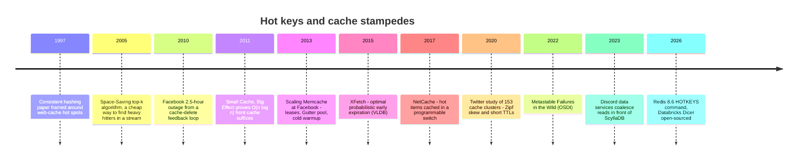
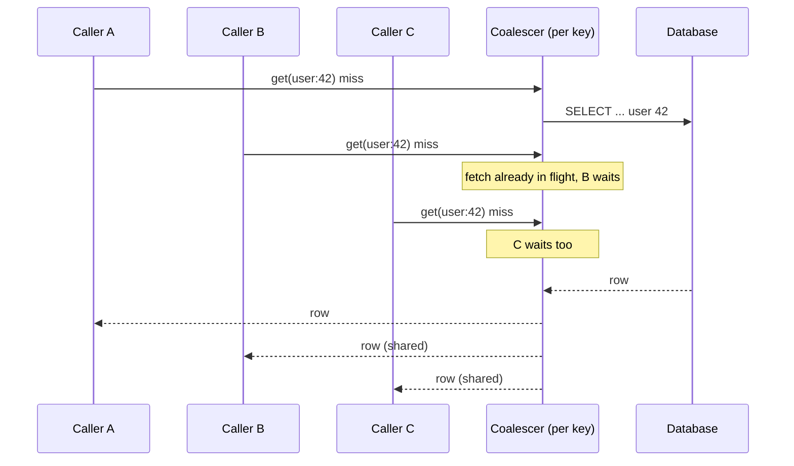
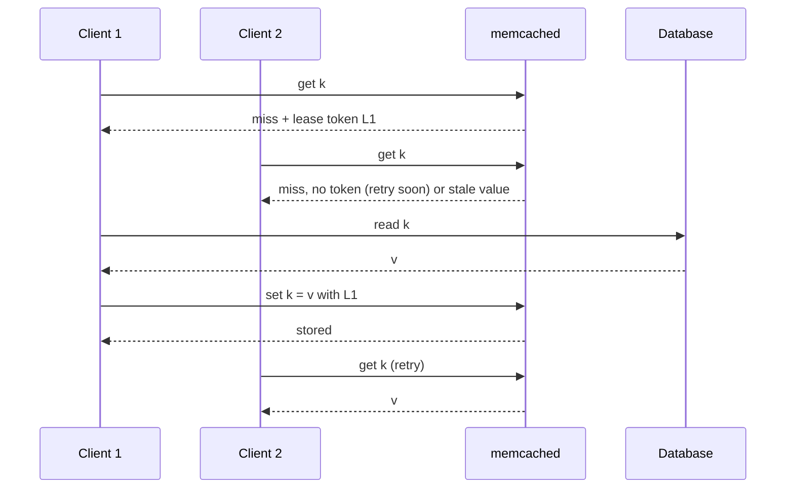

---
tags:
  - distributed-systems
  - caching
  - hot-keys
  - cache-stampede
  - thundering-herd
  - request-coalescing
  - infrastructure
status: draft
sources:
  - https://pdos.csail.mit.edu/6.824/papers/memcache-fb.pdf
  - https://upenn.ferric.systems/dbscholar/vldb_papers/2015/p886-vattani.pdf
  - https://en.wikipedia.org/wiki/Cache_stampede
  - https://builder.aws.com/content/3K9TeXp6strMiJ4vhakpRD7BQWO/caching-challenges-and-strategies
  - https://engineering.fb.com/2010/09/23/uncategorized/more-details-on-today-s-outage/
  - https://www.pdl.cmu.edu/ftp/HECStorage/socc11_caching.pdf
  - https://www.cs.yale.edu/homes/soule/pubs/sosp2017.pdf
  - https://www.pdl.cmu.edu/PDL-FTP/associated/OSDI20_TwemcacheWorkload.pdf
  - https://usenix.org/node/281493
  - https://pkg.go.dev/golang.org/x/sync/singleflight
  - https://discord.com/blog/how-discord-stores-trillions-of-messages
  - https://www.fastly.com/documentation/guides/concepts/edge-state/cache/request-collapsing/
  - https://www.varnish.org/docs/users-guide/vcl-grace/
  - https://www.f5.com/company/blog/nginx/nginx-caching-guide
  - https://docs.aws.amazon.com/amazondynamodb/latest/developerguide/bp-partition-key-sharding.html
  - https://usenix.org/system/files/atc22-elhemali.pdf
  - https://firebase.google.com/docs/firestore/solutions/counters
  - https://www.databricks.com/blog/open-sourcing-dicer-databricks-auto-sharder
  - https://redis.io/docs/latest/commands/hotkeys/
  - https://redis.io/blog/announcing-redis-86-performance-improvements-streams/
  - https://www.uber.com/en-AE/blog/how-uber-serves-over-150-million-reads
  - https://arxiv.org/pdf/2611.13412
  - https://cse.hkust.edu.hk/~raywong/comp5331/References/EfficientComputationOfFrequentAndTop-kElementsInDataStreams.pdf
created: 2026-11-26
updated: 2026-11-28
---

## Table Of Contents

- [[#TL;DR|TL;DR]]
- [[#The Problem|The Problem]]
- [[#Foundations|Foundations]]
    - [[#Skew Is Normal|Skew Is Normal]]
    - [[#The Cache Is Load-Bearing|The Cache Is Load-Bearing]]
    - [[#A Small Cache Fixes Read Skew|A Small Cache Fixes Read Skew]]
    - [[#Reads Copy, Writes Divide|Reads Copy, Writes Divide]]
- [[#How We Got Here|How We Got Here]]
- [[#How It Works|How It Works]]
    - [[#Finding Hot Keys|Finding Hot Keys]]
    - [[#Request Coalescing|Request Coalescing]]
    - [[#Leases|Leases]]
    - [[#Serving Stale|Serving Stale]]
    - [[#Probabilistic Early Expiration|Probabilistic Early Expiration]]
    - [[#Replicating Hot Reads|Replicating Hot Reads]]
    - [[#Dividing Hot Writes|Dividing Hot Writes]]
    - [[#When the Cache Itself Fails|When the Cache Itself Fails]]
- [[#Where It Is Now|Where It Is Now]]
- [[#Trade-offs & Open Problems|Trade-offs & Open Problems]]
- [[#Resources|Resources]]
- [[#Related Notes|Related Notes]]

## ***TL;DR***
---
*A hot key is one key that gets far more traffic than its shard can serve; a cache stampede is many clients missing the same cache entry at once and all hitting the database. They're two faces of one problem: real traffic is skewed, and the cache in front of the database is load-bearing, so losing a hot entry for even a second can take the backend down.*

- **Why splitting doesn't help.** [[Partitioning]] and [[Auto-Sharding]] can isolate a hot key on its own shard, but they can't divide one key. Past that point the fixes live above the storage layer.
- **Stampede defenses** all make sure only one caller refills a missing entry: *request coalescing* (one fetch per key, everyone else waits for it), *leases* (Facebook's memcache hands out one refill token per key at most every 10 seconds; peak database load in their test fell from **17K to 1.3K queries/s**), *serving stale* while one background refresh runs, and *probabilistic early expiration* (XFetch, VLDB 2015), where callers refresh a little before expiry at random so the refreshes don't line up.
- **Hot read defenses** copy the key: replicate it across cache servers, or put a small cache in front. Theory says a front cache of only **O(n log n)** entries for *n* back-end nodes is enough to balance any read workload ([Fan et al., SoCC 2011](https://www.pdl.cmu.edu/ftp/HECStorage/socc11_caching.pdf)).
- **Hot write defenses** divide the key: salt it into *s* sub-keys (writes per shard ÷ *s*, reads fan out × *s*), use sharded counters, or use mergeable [[CRDTs]].
- **Where it is now (Nov 2026).** Redis 8.6 (Feb 2026) added a built-in `HOTKEYS` command; Databricks' open-sourced Dicer (Jan 2026) replicates hot slices automatically; and a Nov 2026 preprint shows the same stampede-and-collapse loop in LLM agent serving, where the "cache" is the KV prefix cache.

## ***The Problem***
---
*Skewed traffic and synchronized cache misses each overload one component; together they can push a healthy system into a state it can't leave on its own. The history of large outages shows the cache is not an optimization you can lose safely.*

Two shapes of overload:

| | Hot key | Cache stampede (thundering herd, dogpile) |
|---|---|---|
| **What happens** | One key's traffic exceeds what one shard or cache server can serve | A popular entry expires, is invalidated or is evicted, and every concurrent reader misses at once |
| **Who suffers** | The shard that owns the key, and everything else on that shard | The database or service behind the cache |
| **Typical trigger** | A celebrity account, a viral post, a global config value, a counter, a low-cardinality index value ([[Secondary Indexes]]) | TTL expiry, a write that invalidates, a cache node restart, a deploy that empties local caches |
| **Why splitting fails** | A split can isolate one key but not divide it | The backend sees N copies of the same query |

They feed each other. A hot key is exactly the key whose miss causes the biggest stampede, and a stampede on a hot key overloads the backend shard that owns it.

**How bad it gets.** On September 23, 2010, Facebook was down or unreachable for about 2.5 hours, "the worst outage we've had in over four years." A configuration value was "interpreted as invalid", so every client queried a database cluster to fix it. When the overloaded database returned errors, clients took the error as another invalid value and "deleted the corresponding cache key." In Facebook's words: "As long as the databases failed to service some of the requests, they were causing even more requests to themselves." The only way out was to stop all traffic to that cluster, which meant taking the site down ([Facebook Engineering, Sept 2010](https://engineering.fb.com/2010/09/23/uncategorized/more-details-on-today-s-outage/)).

That is a *metastable failure*: a trigger pushes the system into a bad state that keeps itself going after the trigger is gone. Huang et al.'s illustration is a cache: a database that handles 300 requests/s behind a 90% hit-rate cache serves about 3,000 requests/s, and "a cache failure can overwhelm the database with more requests that it can handle" ([Huang et al., ;login: 2022](https://usenix.org/node/281493)). See [[Reliability Patterns]] and [[Gray and Fail-Slow Failures]].

**How common the ingredients are.** Twitter's study of 153 production cache clusters found popularity "follow[s] approximate Zipfian popularity distribution, sometimes with very high skew", that request-rate spikes are "very common" and "often are the results of hot keys", and that 66% of clusters have a mean TTL of 12 hours or less, with over 25% under 20 minutes ([Yang et al., OSDI 2020](https://www.pdl.cmu.edu/PDL-FTP/associated/OSDI20_TwemcacheWorkload.pdf)). Short TTLs on skewed keys mean expirations of hot entries happen constantly.

## ***Foundations***
---
*Four ideas carry the whole topic: access is heavily skewed, the backend is sized for the cache's hit rate rather than the full load, a surprisingly small cache can absorb read skew, and reads can be copied while writes can only be divided or merged.*

### Skew Is Normal

*Under a Zipf distribution, the most popular key alone can carry several percent of all traffic, which is many times what one shard's fair share is.*

A Zipf distribution with exponent $\alpha$ says the key of popularity rank $i$ out of $N$ gets a share

$$
p(i) = \frac{1/i^{\alpha}}{\sum_{j=1}^{N} 1/j^{\alpha}}
$$

*In words:* the second most popular key gets half as much traffic as the first (when $\alpha = 1$), the third a third, and so on. The denominator for $\alpha = 1$ is the harmonic number $H_N \approx \ln N + 0.577$.

*Worked example.* One million keys, $\alpha = 1$: $H_N \approx 13.8 + 0.58 = 14.4$, so the top key gets $1/14.4 \approx 7\%$ of all requests. Spread over 100 shards, the average shard gets 1%, so the shard holding the top key gets at least **7×** its fair share from that key alone. Twitter measured $\alpha$ mostly between 1 and 2.5 ([Yang et al.](https://www.pdl.cmu.edu/PDL-FTP/associated/OSDI20_TwemcacheWorkload.pdf)), and a larger $\alpha$ makes the head even heavier.

Facebook saw the same thing in memcache: "a single key can account for 20% of a server's requests" ([Nishtala et al., NSDI 2013](https://pdos.csail.mit.edu/6.824/papers/memcache-fb.pdf)).

### The Cache Is Load-Bearing

*The database is sized for the misses, not the full traffic. A small drop in hit rate is a large jump in backend load.*

$$
\text{backend load} = R \times (1 - h)
$$

where $R$ is the request rate and $h$ the hit rate.

*In words:* the backend only sees misses, so its load scales with the *miss* rate.

*Worked example* (the numbers from Huang et al.'s illustration): $R = 3{,}000$/s at $h = 0.9$ sends 300/s to a database built for 300/s. If $h$ slips to 0.8 the database gets 600/s, double its capacity. If one hot entry worth 7% of traffic expires and 50 servers each miss it at once, the database briefly sees 50 identical queries instead of one.

### A Small Cache Fixes Read Skew

*If the front cache is fast and holds the most popular O(n log n) keys, no back-end node can be overloaded by skew, whatever the workload.*

Fan, Lim, Andersen and Kaminsky prove that for $n$ back-end nodes with keys placed at random, a front-end cache whose size "depends only on the total number of back-end nodes" keeps load balanced: with $c = k \cdot n \log n + 1$ entries and $k = 8$, the most loaded node does at most about 20% more work than average. Their example: a 100-node store with 1 KiB entries needs about **4 MB** of fast cache. The conditions matter: the cache must never be the bottleneck, and the adversary must not know which keys live on which node ([Fan et al., SoCC 2011](https://www.pdl.cmu.edu/ftp/HECStorage/socc11_caching.pdf)). NetCache later put exactly this cache in a programmable switch ([Jin et al., SOSP 2017](https://www.cs.yale.edu/homes/soule/pubs/sosp2017.pdf)).

### Reads Copy, Writes Divide

*A read-hot key can be served by many copies because all copies agree. A write-hot key can't be copied; it has to be split into pieces that are combined on read, or made commutative so writes merge.*

| Hot reads | Hot writes |
|---|---|
| Replicate the value on several servers | Salt the key into $s$ sub-keys |
| Put a small front cache or client-side cache in front | Shard a counter into $s$ shard documents |
| Coalesce concurrent misses into one fetch | Use mergeable types ([[CRDTs]]) or batch in the application |
| Cost: staleness ([[Consistency Models]]) | Cost: reads fan out to $s$ pieces |

## ***How We Got Here***
---
*The ideas came from web caches and big social networks: first recognizing hot spots, then learning, mostly through outages, that misses must be throttled, and finally proving how much caching is enough.*

- **Hot spots first.** Consistent hashing was introduced for web caching and framed around hot spots (see [[Partitioning]]). Spreading keys evenly turned out not to spread *load* evenly.
- **Facebook's lessons.** After the 2010 outage, the 2013 memcache paper wrote down a full toolkit: leases against stampedes and stale sets, replication of hot key sets within a pool, a small *Gutter* pool to catch failed servers' traffic, and controlled warmup of cold clusters ([Nishtala et al.](https://pdos.csail.mit.edu/6.824/papers/memcache-fb.pdf)).
- **Theory catches up.** Fan et al. (2011) bounded how much caching balances reads; Vattani, Chierichetti and Lowenstein (2015), working from Goodreads traffic, showed that early refresh with *exponentially* distributed timing is close to optimal, where the uniform jitter used by tools like Perl's CHI is not ([Vattani et al., PVLDB 2015](https://upenn.ferric.systems/dbscholar/vldb_papers/2015/p886-vattani.pdf)).
- **The pattern spreads.** HTTP caches (Varnish, NGINX, Fastly) coalesce requests and serve stale content by default or by config; language libraries like Go's `singleflight` make in-process coalescing a one-liner; Discord built a whole service tier mainly to coalesce reads (2023).

## ***How It Works***
---
*Each technique attacks one link in the chain: finding the hot key, stopping duplicate misses, keeping something servable while refreshing, spreading the key's load, and keeping the backend alive when the cache tier itself fails.*

### Finding Hot Keys

*You can't fix what you can't name, and counting every key exactly is too expensive. Systems use sampled, bounded-memory top-k counters.*

- **Streaming top-k.** Space-Saving keeps a fixed number of counters and, when a new key arrives with no free counter, replaces the smallest counter's key and inherits its count. It finds the frequent keys with bounded error in fixed memory ([Metwally, Agrawal and El Abbadi, ICDT 2005](https://cse.hkust.edu.hk/~raywong/comp5331/References/EfficientComputationOfFrequentAndTop-kElementsInDataStreams.pdf)).
- **Redis `HOTKEYS` (8.6, Feb 2026).** `HOTKEYS START METRICS 2 CPU NET COUNT 10` tracks, for a time window, the keys taking the largest share of CPU time and of network bytes. Metrics go into "a probabilistic data structure" from which you fetch the top K; `SAMPLE` lowers overhead at some cost in accuracy, `SLOTS` limits tracking to chosen hash slots, and only one tracking session runs at a time ([Redis docs](https://redis.io/docs/latest/commands/hotkeys/); [Redis, Feb 10 2026](https://redis.io/blog/announcing-redis-86-performance-improvements-streams/)). Measuring CPU and bytes, not just request counts, catches a key that's hot because it's huge.
- **Inside storage engines.** DynamoDB detects "single-hot-item and sequentially accessed key ranges" and declines to split for them, since a split wouldn't help ([Elhemali et al., ATC 2022](https://usenix.org/system/files/atc22-elhemali.pdf)). Auto-sharders such as Dicer detect hot keys from per-key load reports ([[Auto-Sharding]]).

### Request Coalescing

*When many callers want the same missing value, let one fetch it and hand the result to all. It's the simplest stampede fix, but it only collapses requests that meet at the same place.*

- **In process.** Go's `singleflight` "provides a duplicate function call suppression mechanism": `Do(key, fn)` makes sure "only one execution is in-flight for a given key at a time", and a duplicate caller "waits for the original to complete and receives the same results"; the `shared` return value says whether the result went to several callers ([Go docs](https://pkg.go.dev/golang.org/x/sync/singleflight)). Caching the *in-flight future* instead of the value is the same idea.
- **Across a fleet, route first.** In-process coalescing on $M$ servers still lets up to $M$ identical misses through. Discord's Rust data services sit between its API and ScyllaDB, and "the big feature our data services provide is request coalescing": "If multiple users are requesting the same row at the same time, we'll only query the database once." To make that work across instances they added "consistent hash-based routing", keyed by channel ID, so requests for one channel reach one instance ([Discord, Mar 2023](https://discord.com/blog/how-discord-stores-trillions-of-messages)).
- **In HTTP caches.** Varnish "will send one request to the backend and place the others on hold", automatically ([Varnish docs](https://www.varnish.org/docs/users-guide/vcl-grace/)). NGINX's `proxy_cache_lock` lets "only the first of those requests" through to the origin ([F5/NGINX](https://www.f5.com/company/blog/nginx/nginx-caching-guide)). Fastly keeps a "waiting list" per object, and *shielding* funnels traffic through a POP near the origin, giving "up to four opportunities for Fastly to collapse requests" ([Fastly docs](https://www.fastly.com/documentation/guides/concepts/edge-state/cache/request-collapsing/)).
- **The trap: uncacheable responses.** If the one fetch comes back uncacheable, it can't satisfy the queue, so "the remaining requests will form a new queue, resulting in the requests being sent consecutively": coalescing turns into serialization. Fastly's fix is a *hit-for-pass* marker that says "don't collapse requests for this resource" ([Fastly docs](https://www.fastly.com/documentation/guides/concepts/edge-state/cache/request-collapsing/)). The same applies to errors: decide whether waiters get the error, retry, or fall back to stale.

### Leases

*Facebook's memcache gives the first client that misses a key a token that lets it, and only it, refill the key. Everyone else waits or takes a stale value. One mechanism fixes both stampedes and stale writes.*

From Section 3.2.1 of [Nishtala et al.](https://pdos.csail.mit.edu/6.824/papers/memcache-fb.pdf):

- On a miss, the server returns a lease: "a 64-bit token bound to the specific key the client originally requested." The client fetches from the database and sets the value *with the token*.
- **Stale sets.** A delete (invalidation) of the key invalidates its outstanding tokens, so a slow client can't overwrite a newer invalidation with an old value it read before the write.
- **Thundering herds.** Servers "return a token only once every 10 seconds per key." Other clients that miss within that window are told to wait briefly and retry, by which time the holder has usually filled the key.
- **Stale reads.** "A get request can return a lease token or data that is marked as stale", so applications that tolerate staleness don't wait at all.
- **Result:** "a peak database query rate of 17K/s" without leases versus "1.3K/s" with them.

$$
\text{refills of key } k \text{ per server} \le \frac{1}{T_{\text{lease}}}
$$

*In words:* however many clients miss, each cache server lets at most one refill per key per lease interval reach the database. *Example:* with $T_{\text{lease}} = 10$ s and 2,000 clients missing a hot key in the same second, the database sees one query for that key from that server; the other 1,999 retry in a few milliseconds and hit.

These are not the leases of [[Leases and Fencing]]. A memcache lease is a short permission to *fill a cache slot*, and a lost token only costs a cache miss; a lock or ownership lease protects correctness and needs fencing tokens.

### Serving Stale

*Keep the old value past its freshness deadline and serve it while one refresh runs. Users get a slightly old answer instead of a slow one, and the backend gets one request instead of a herd.*

- **Soft and hard TTL.** AWS's Builders' Library describes a soft TTL that triggers refresh attempts and a hard TTL after which data can't be served: if the downstream service fails or doesn't respond, clients keep serving cached data until the hard TTL. The AWS IAM client works this way ([Chhabra, AWS Builders' Library](https://builder.aws.com/content/3K9TeXp6strMiJ4vhakpRD7BQWO/caching-challenges-and-strategies)).
- **Varnish grace.** Serve the object "for some time after the TTL has expired, while Varnish fetches a new version"; "the backend fetch happens asynchronously." *Keep* holds the object longer still so Varnish can send a conditional request and get a cheap 304 ([Varnish docs](https://www.varnish.org/docs/users-guide/vcl-grace/)).
- **NGINX.** `proxy_cache_use_stale updating` delivers "stale content when clients request an item that is expired or is in the process of being updated", and `proxy_cache_background_update` does the refresh in the background ([F5/NGINX](https://www.f5.com/company/blog/nginx/nginx-caching-guide)).

Stale-while-revalidate is the friendliest fix when the data tolerates it, and it's also a resilience feature: a dead origin turns into old answers, not errors. The limit is correctness: a permission check or a balance may not tolerate staleness ([[Consistency Models]]).

### Probabilistic Early Expiration

*Instead of every reader noticing expiry at the same instant, each reader flips a weighted coin and occasionally refreshes a little early. The odds rise as expiry nears and scale with how long the refresh takes.*

The XFetch rule ([Vattani et al., PVLDB 2015](https://upenn.ferric.systems/dbscholar/vldb_papers/2015/p886-vattani.pdf); pseudocode as on [Wikipedia](https://en.wikipedia.org/wiki/Cache_stampede)): store with each value the time $\Delta$ its last recomputation took, and on every read recompute if

$$
t_{\text{now}} - \Delta \cdot \beta \cdot \ln(U) \ \ge\ t_{\text{expiry}}, \qquad U \sim \text{Uniform}(0, 1)
$$

*In words:* $-\ln U$ is an exponential random number with mean 1, so each read pretends the clock is a random amount ahead, typically about $\Delta\beta$. With $g = t_{\text{expiry}} - t_{\text{now}}$ left, one read triggers with probability $e^{-g/(\Delta\beta)}$. $\beta = 1$ is the default and works well in practice; larger $\beta$ refreshes earlier. The authors stress that it "requires no parameter tuning", because it doesn't need to know the request rate.

*Worked example.* Recompute takes $\Delta = 2$ s, $\beta = 1$, and the key gets $r = 1{,}000$ reads/s. Expected triggers per second are $r \cdot e^{-g/2}$, which reaches 1 when $g = 2\ln 1000 \approx 13.8$ s. So the first refresh typically starts about 14 seconds before expiry, long before the herd would form, and only a couple more reads trigger during the 2 seconds it runs. The general lead time is about $\Delta\beta \ln r$, growing only with the *log* of the traffic.

On Goodreads traffic with 10-second regenerations (about 140 requests per regeneration window), XFetch's stampedes were mostly 1 or 2 and never above 8, while uniform early expiration averaged around 10 with occasional bursts of 20 or more. Under bursty load XFetch was "practically immune" ([Vattani et al.](https://upenn.ferric.systems/dbscholar/vldb_papers/2015/p886-vattani.pdf)). The cost is storing $\Delta$ (and the expiry) with every value, and doing a few early recomputations.

### Replicating Hot Reads

*Once misses are throttled, the hot key still lands on one server. Copy it to several servers, or catch it in a small cache in front, so no single node carries it.*

- **Replicated key sets.** Facebook replicates a category of hot keys across servers in a pool so "a client's request for 100 keys can be sent to any replica", which in their example "reduces the load per server to 500k requests per second" from 1M ([Nishtala et al.](https://pdos.csail.mit.edu/6.824/papers/memcache-fb.pdf)).
- **Small front cache.** The O(n log n) result above: cache the head of the distribution in a faster layer (an app-local cache, a proxy, or a switch). NetCache serves hot items from switch ASICs; "a single switch can process 2+ billion queries per second for 64K items", improving throughput 3.6× to 10× as Zipf skew goes from 0.9 to 0.99 ([Jin et al., SOSP 2017](https://www.cs.yale.edu/homes/soule/pubs/sosp2017.pdf)).
- **Hot slices in auto-sharders.** Dicer detects hot keys, puts each in its own slice and assigns that slice to several pods ([Databricks, Jan 2026](https://www.databricks.com/blog/open-sourcing-dicer-databricks-auto-sharder)). This only works for reads or state that tolerates several owners ([[Auto-Sharding]]).

Every copy is another place a stale value can live, so invalidation has to reach all of them.

### Dividing Hot Writes

*Writes can't be copied, so a write-hot key has to be split into pieces that absorb writes independently and are combined on read.*

- **Key salting (write sharding).** Append a suffix so one logical key becomes $s$ physical keys. AWS's example salts a date with suffixes 1 to 200 (`2014-07-09.1` … `2014-07-09.200`); a *calculated* suffix (hash of the item ID mod 200) lets a single-item read recompute where the item lives ([AWS docs](https://docs.aws.amazon.com/amazondynamodb/latest/developerguide/bp-partition-key-sharding.html)). The arithmetic and a worked example are in [[Partitioning#Hot Keys and Skew|Partitioning]].
- **Sharded counters.** Firestore's distributed counter is a document with a subcollection of shards; "the value of the counter is the sum of the value of the shards", and "a distributed counter with 10 shards can handle 10x as many writes as a traditional counter." Its sample code assumes each shard takes about one increment per second ([Firebase docs](https://firebase.google.com/docs/firestore/solutions/counters)). *Example:* a like button getting 40 likes/s needs about 40 shards, and every read of the total sums 40 documents (or reads a periodically rolled-up total).
- **Mergeable state.** If updates commute (counts, sets, max), [[CRDTs]] let several replicas accept writes and merge later, trading read freshness for write scale.
- **Batch in the application.** Buffer increments in memory for a few hundred milliseconds and write one combined update. Fewer, larger writes, at the cost of losing the buffer on a crash.

Hot keys under contention also hurt transactions: lock queues, restarts and aborts in every design ([[Distributed Transactions]], [[Distributed SQL]]).

### When the Cache Itself Fails

*A cache server dying or restarting empty is a stampede on every key it held. Protect the backend with a spare pool, careful warmup, negative caching, and by never letting errors delete cache entries.*

- **Gutter pool.** Facebook keeps about 1% of memcached servers as *Gutter*, which "take[s] over the responsibilities of a few failed servers" instead of rehashing their keys onto survivors (rehashing risks moving a 20%-of-traffic key onto an already busy server). Gutter "converts 10%–25% of failures into hits each day" and reduces client-visible failures by 99% ([Nishtala et al.](https://pdos.csail.mit.edu/6.824/papers/memcache-fb.pdf)).
- **Cold warmup.** A new memcache cluster reads from a warm cluster instead of the database, which brings it to full capacity "in a few hours instead of a few days"; deletes to the cold cluster carry a two-second hold-off to avoid races ([Nishtala et al.](https://pdos.csail.mit.edu/6.824/papers/memcache-fb.pdf)).
- **Cold starts of local caches.** New servers start empty, which hurts most during deployments and fleet-wide flushes; request coalescing helps here too ([AWS Builders' Library](https://builder.aws.com/content/3K9TeXp6strMiJ4vhakpRD7BQWO/caching-challenges-and-strategies)).
- **Negative caching.** Cache "not found" and error responses too, with their own TTL, so callers don't keep "bombarding" a failing dependency ([AWS Builders' Library](https://builder.aws.com/content/3K9TeXp6strMiJ4vhakpRD7BQWO/caching-challenges-and-strategies)). Facebook's 2010 outage was the opposite: errors *removed* cache entries, multiplying load.
- **Shed load and bound retries.** Once the backend is overloaded, retries are the most common thing that keeps a metastable failure going ([Huang et al.](https://usenix.org/node/281493)); see [[Reliability Patterns]].

## ***Where It Is Now***
---
*As of November 2026, the techniques are settled and increasingly built in: caches report hot keys themselves, auto-sharders replicate hot slices, and the same stampede dynamics are being rediscovered in LLM serving caches.*

- **Redis 8.6 (GA Feb 10, 2026)** added `HOTKEYS` for CPU- and network-weighted hot key detection, plus `volatile-lrm` and `allkeys-lrm` eviction policies that refresh recency only on *writes*, so keys that are read constantly but no longer updated can be evicted ([Redis, Feb 2026](https://redis.io/blog/announcing-redis-86-performance-improvements-streams/)). Some cluster clients (redis-py, go-redis cluster clients, redis-rs async cluster) don't support `HOTKEYS` yet, so you connect to a single node ([Redis docs](https://redis.io/docs/latest/commands/hotkeys/)).
- **Databricks Dicer (open-sourced Jan 13, 2026)** detects hot keys and replicates their slices across pods automatically ([Databricks](https://www.databricks.com/blog/open-sourcing-dicer-databricks-auto-sharder)).
- **Uber CacheFront (Aug 2025)** serves more than 150 million rows per second at peak from a Redis cache integrated into its Docstore query engine. Its default onboarding TTL is "just 5 minutes"; invalidations come from a binlog tailer that writes "special invalidation markers" instead of deleting entries, and now also from the write path; racing cache fills are deduplicated by row timestamp in a Lua script. Uber notes negative caching can cause "read-own-inserts" anomalies until the entry expires ([Uber, Aug 2025](https://www.uber.com/en-AE/blog/how-uber-serves-over-150-million-reads)).
- **Stampedes in LLM serving (preprint, late 2026).** Huang and Liu show that in agent serving with prefix caching, a short burst can push vLLM into a persistent degraded state: slower service keeps more sessions active, their contexts outgrow the KV cache, LRU evicts each prefix before its next turn, and the hit ratio falls from about 0.95 to about 0.1 and stays there after the burst ends. Admission alone rescued only 2 of 8 collapsed runs; a budgeter that suspends sessions against the KV pool limit recovered 17 of 17 ([Huang and Liu, arXiv 2611.13412](https://arxiv.org/pdf/2611.13412)). It's the memcache lesson in a new layer: when the cache is load-bearing, losing it creates load that prevents it from refilling. See [[GPU Cluster Infrastructure]].

## ***Trade-offs & Open Problems***
---
*Every fix trades something: freshness, latency for the waiters, memory, or read cost. The open problems are about doing this automatically and safely across tiers.*

| Technique | What it buys | What it costs |
|---|---|---|
| Request coalescing | One backend fetch per key per coalescing point | Waiters share one fetch's latency and failure; serializes if the response is uncacheable; needs key-based routing to work fleet-wide |
| Leases | Throttled refills plus protection from stale sets | Wait-and-retry latency; a dead token holder leaves the key empty until the next token |
| Serve stale (grace, soft TTL) | No herd and survival through origin outages | Users see old data; unbounded staleness if refresh keeps failing |
| Probabilistic early expiration | Herd-free refresh with no tuning | Extra memory per entry; a few early recomputations |
| Replicating hot reads | Spreads one key over many servers | More copies to invalidate; more memory |
| Salting / sharded counters | Divides write load by $s$ | Reads fan out $s$ ways; app changes |
| Gutter / spare pool | Failed server's traffic doesn't hit the database | Idle capacity; short TTLs in the spare pool mean staler data |

Open problems:
- **Freshness versus herd protection.** Every stampede fix either serves old data or makes callers wait. Systems with read-your-writes needs, like Uber's, have to combine TTLs, invalidation streams and write-path invalidation, and still find staleness from delayed invalidations and refills from lagging replicas ([Uber](https://www.uber.com/en-AE/blog/how-uber-serves-over-150-million-reads)).
- **Detecting hot keys fast enough.** Spikes are often sudden; a hot key detected a minute later may have already caused the incident. Sampling keeps overhead low but trades accuracy, and Twitter notes spikes are "not always" hot keys ([Yang et al.](https://www.pdl.cmu.edu/PDL-FTP/associated/OSDI20_TwemcacheWorkload.pdf)).
- **Coalescing across tiers.** Each tier (process, proxy, CDN, shield) collapses only what reaches it. Getting one fetch per key fleet-wide needs routing by key, which itself concentrates a hot key on one coalescer.
- **The single hot write key.** Salting and counters need the application to change and readers to merge; there's no general storage-level fix for one key that everyone writes ([[Partitioning]]).
- **Testing the recovery path.** Cache-loss feedback loops only appear under load, which is why [[Deterministic Simulation Testing]] and [[Fault Injection and Chaos Engineering|fault injection]] matter here.

## ***Resources***
---
*Start with the Facebook memcache paper for the full toolkit, the XFetch paper for refresh timing, and Discord's post for coalescing as a service.*

**Papers**
- [Scaling Memcache at Facebook](https://pdos.csail.mit.edu/6.824/papers/memcache-fb.pdf): Nishtala et al., NSDI 2013. Leases, replicated key sets, Gutter, cold warmup.
- [Optimal Probabilistic Cache Stampede Prevention](https://upenn.ferric.systems/dbscholar/vldb_papers/2015/p886-vattani.pdf): Vattani, Chierichetti and Lowenstein, PVLDB 8(8), 2015. XFetch and why exponential timing is near-optimal.
- [Small Cache, Big Effect](https://www.pdl.cmu.edu/ftp/HECStorage/socc11_caching.pdf): Fan, Lim, Andersen and Kaminsky, SoCC 2011. O(n log n) front cache.
- [NetCache](https://www.cs.yale.edu/homes/soule/pubs/sosp2017.pdf): Jin et al., SOSP 2017. Hot items in switch ASICs.
- [A large scale analysis of hundreds of in-memory cache clusters at Twitter](https://www.pdl.cmu.edu/PDL-FTP/associated/OSDI20_TwemcacheWorkload.pdf): Yang, Yue and Vinayak, OSDI 2020.
- [Metastable Failures in the Wild](https://usenix.org/node/281493): Huang et al., OSDI 2022 (;login: summary).
- [Efficient Computation of Frequent and Top-k Elements in Data Streams](https://cse.hkust.edu.hk/~raywong/comp5331/References/EfficientComputationOfFrequentAndTop-kElementsInDataStreams.pdf): Metwally, Agrawal and El Abbadi, ICDT 2005. Space-Saving.
- [Amazon DynamoDB: A Scalable, Predictably Performant, and Fully Managed NoSQL Database Service](https://usenix.org/system/files/atc22-elhemali.pdf): Elhemali et al., ATC 2022.
- [Bursts That Outlast Themselves](https://arxiv.org/pdf/2611.13412): Huang and Liu, preprint, late 2026. Metastable collapse of prefix caches.

**Engineering posts and incident reports**
- [More details on today's outage](https://engineering.fb.com/2010/09/23/uncategorized/more-details-on-today-s-outage/): Facebook, Sept 23 2010.
- [Caching challenges and strategies](https://builder.aws.com/content/3K9TeXp6strMiJ4vhakpRD7BQWO/caching-challenges-and-strategies): Jas Chhabra, AWS Builders' Library.
- [How Discord stores trillions of messages](https://discord.com/blog/how-discord-stores-trillions-of-messages): Bo Ingram, Mar 2023.
- [How Uber serves over 150 million reads per second](https://www.uber.com/en-AE/blog/how-uber-serves-over-150-million-reads): Pozniansky and Narayanareddy, Aug 2025.
- [Open-sourcing Dicer](https://www.databricks.com/blog/open-sourcing-dicer-databricks-auto-sharder): Databricks, Jan 2026.
- [Announcing Redis 8.6](https://redis.io/blog/announcing-redis-86-performance-improvements-streams/): Redis, Feb 10 2026.

**Docs**
- [Redis HOTKEYS](https://redis.io/docs/latest/commands/hotkeys/), [Go singleflight](https://pkg.go.dev/golang.org/x/sync/singleflight), [Fastly request collapsing](https://www.fastly.com/documentation/guides/concepts/edge-state/cache/request-collapsing/), [Varnish grace and keep](https://www.varnish.org/docs/users-guide/vcl-grace/), [NGINX caching guide](https://www.f5.com/company/blog/nginx/nginx-caching-guide), [DynamoDB write sharding](https://docs.aws.amazon.com/amazondynamodb/latest/developerguide/bp-partition-key-sharding.html), [Firestore distributed counters](https://firebase.google.com/docs/firestore/solutions/counters).
- [Cache stampede (Wikipedia)](https://en.wikipedia.org/wiki/Cache_stampede): good summary of locking, external recomputation and XFetch.

## ***Related Notes***
---
*Where hot keys come from, and the neighboring defenses against overload.*

- [[Partitioning]] — Why a split can isolate but not divide a hot key; salting arithmetic and DynamoDB's layers.
- [[Auto-Sharding]] — Hot slice detection and replication in Slicer, Shard Manager and Dicer.
- [[Reliability Patterns]] — Retries, load shedding and metastable failures, the overload side of a stampede.
- [[Gray and Fail-Slow Failures]] — Partial failures that cut hit rates and trigger feedback loops.
- [[Leases and Fencing]] — Ownership leases, which need fencing; memcache leases don't.
- [[Coordination Services]] — Lock recipes that avoid a herd of watchers.
- [[Secondary Indexes]] — Low-cardinality index values as hot keys.
- [[Sharded Postgres]] — Tenants too big for one shard.
- [[Distributed Transactions]] — Contention on hot keys: lock queues, restarts and aborts.
- [[Distributed SQL]] — How OCC and locking designs degrade on one hot row.
- [[CRDTs]] — Mergeable state for write-hot keys.
- [[Consistency Models]] — What serving stale and replicated reads give up.
- [[Replication]] — Read replicas as a hot-read defense, and their lag.
- [[GPU Cluster Infrastructure]] — Where KV prefix caches now show stampede-style collapse.
- [[Deterministic Simulation Testing]] — Testing cache-loss recovery before production does.
- [[Tail Latency and Hedging]] — Hedged requests and the tail cost of waiting on one fetch.
- [[Queueing Theory for Systems]] — Why load near capacity makes recovery so slow.
- [[Change Data Capture]] — Binlog-driven cache invalidation like Uber's Flux.
