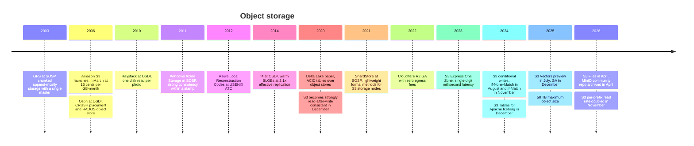
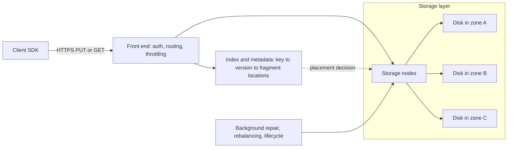
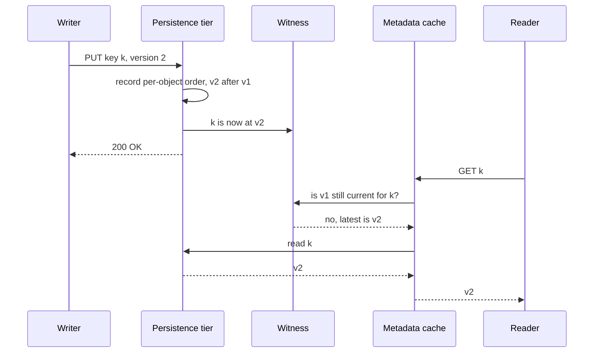
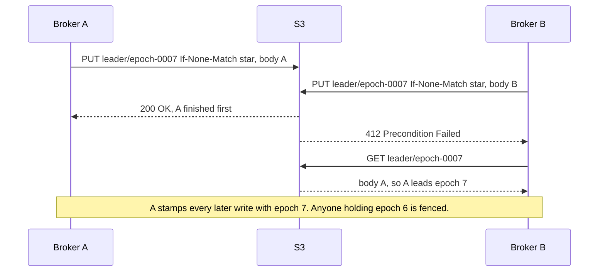
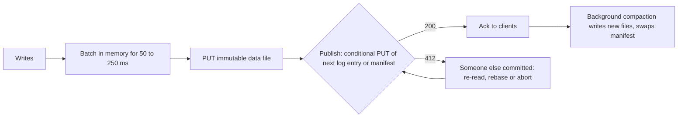

---
tags:
  - distributed-systems
  - storage
  - object-storage
  - erasure-coding
  - s3
status: draft
sources:
  - https://static.googleusercontent.com/media/research.google.com/en//archive/gfs-sosp2003.pdf
  - https://builder.aws.com/content/3H31NvacGGrki9yimEKyS7ubuuN/amazon-s3s-20-year-story-every-feature-old-and-new
  - https://www2.cs.uh.edu/~paris/7360/PAPERS07/weil-osdi06.pdf
  - https://web.stanford.edu/class/cs240/old/sp2014/readings/haystack.pdf
  - https://www.cs.purdue.edu/homes/csjgwang/CloudNativeDB/AzureStorageSOSP11.pdf
  - https://www.usenix.org/system/files/conference/atc12/atc12-final181_0.pdf
  - https://files.usenix.org/s3fs-public/cdn/osdi14-paper-muralidhar.pdf
  - https://www.vldb.org/pvldb/vol13/p3411-armbrust.pdf
  - https://aws.amazon.com/about-aws/whats-new/2020/12/amazon-s3-now-delivers-strong-read-after-write-consistency-automatically-for-all-applications
  - https://allthingsdistributed.com/2021/04/s3-strong-consistency.html
  - https://jamesbornholt.com/papers/shardstore-sosp21.pdf
  - https://allthingsdistributed.com/2023/07/building-and-operating-a-pretty-big-storage-system.html
  - https://aws.amazon.com/blogs/aws/new-amazon-s3-express-one-zone-high-performance-storage-class
  - https://aws.amazon.com/blogs/aws/up-to-85-price-reductions-for-amazon-s3-express-one-zone
  - https://aws.amazon.com/about-aws/whats-new/2024/08/amazon-s3-conditional-writes
  - https://amazonaws.cn/en/new/2024/amazon-s3-adds-new-functionality-for-conditional-writes
  - https://docs.aws.amazon.com/AmazonS3/latest/userguide/conditional-writes.html
  - https://docs.aws.amazon.com/AmazonS3/latest/userguide/optimizing-performance.html
  - https://aws.amazon.com/s3/storage-classes/
  - https://aws.amazon.com/s3/pricing/
  - https://aws.amazon.com/about-aws/whats-new/2024/12/amazon-s3-tables-apache-iceberg-tables-analytics-workloads
  - https://aws.amazon.com/about-aws/whats-new/2025/07/amazon-s3-vectors-preview-native-support-storing-querying-vectors
  - https://aws.amazon.com/about-aws/whats-new/2025/12/amazon-s3-vectors-generally-available
  - https://aws.amazon.com/about-aws/whats-new/2025/12/amazon-s3-maximum-object-size-50-tb
  - https://www.blocksandfiles.com/ai-ml/2025/12/03/aws-piles-on-s3-upgrades-from-vector-search-to-50-tb-objects/1704690
  - https://aws.amazon.com/about-aws/whats-new/2026/03/amazon-s3-account-regional-namespaces/
  - https://aws.amazon.com/blogs/aws/launching-s3-files-making-s3-buckets-accessible-as-file-systems
  - https://aws.amazon.com/about-aws/whats-new/2026/04/s3-five-additional-checksum-algorithms/
  - https://aws.amazon.com/about-aws/whats-new/2026/06/amazon-s3-annotations-business-context/
  - https://aws.amazon.com/about-aws/whats-new/2026/11/s3-vectors-hybrid-search/
  - https://aws.amazon.com/about-aws/whats-new/2026/11/amazon-s3-increases-read-request-rate/
  - https://iceberg.apache.org/spec/
  - https://warpstream.com/blog/zero-disks-is-better-for-kafka
  - https://docs.warpstream.com/warpstream/overview/architecture
  - https://aws.amazon.com/blogs/storage/how-warpstream-enables-cost-effective-low-latency-streaming-with-amazon-s3-express-one-zone
  - https://turbopuffer.com/blog/turbopuffer
  - https://docs.rs/crate/slatedb/0.15.0/source/README.md
  - https://cljdoc.org/d/io.github.maxweber/slatedb/0.1.0/doc/manifest-design
  - https://neon.com/blog/architecture-decisions-in-neon
  - https://neon.com/blog/wal-s3-lakebase-storage-for-the-era-of-agents
  - https://jack-vanlightly.com/blog/2025/10/22/a-fork-in-the-road-deciding-kafkas-diskless-future
  - https://github.com/minio/minio
  - https://en.wikipedia.org/wiki/MinIO
  - https://www.infoq.com/news/2025/12/minio-s3-api-alternatives
  - https://ozone.apache.org/blog/2026/07/08/ozone-s3-conditional-request
  - https://blog.cloudflare.com/r2-ga/
  - https://developers.cloudflare.com/r2/pricing/
  - https://developers.cloudflare.com/r2/api/s3/conditional-operations/
  - https://www.tigrisdata.com/docs/concepts/architecture/
created: 2026-11-26
updated: 2026-11-26
---

## Table Of Contents

---

- [[#TL;DR|TL;DR]]
- [[#The Problem|The Problem]]
- [[#Foundations|Foundations]]
    - [[#Object vs File vs Block|Object vs File vs Block]]
    - [[#Immutable Objects and Whole-Object Writes|Immutable Objects and Whole-Object Writes]]
    - [[#Replication vs Erasure Coding|Replication vs Erasure Coding]]
- [[#How We Got Here|How We Got Here]]
- [[#How It Works|How It Works]]
    - [[#Anatomy of an Object Store|Anatomy of an Object Store]]
    - [[#Placement, Heat and Request Rates|Placement, Heat and Request Rates]]
    - [[#Erasure Coding in Production|Erasure Coding in Production]]
    - [[#How S3 Became Strongly Consistent|How S3 Became Strongly Consistent]]
    - [[#Conditional Writes Turn S3 into a Coordination Primitive|Conditional Writes Turn S3 into a Coordination Primitive]]
    - [[#Building Databases and Logs on Object Storage|Building Databases and Logs on Object Storage]]
    - [[#Latency and Cost Profile|Latency and Cost Profile]]
- [[#Where It Is Now|Where It Is Now]]
    - [[#S3 in 2025 and 2026|S3 in 2025 and 2026]]
    - [[#Other Stores and the S3 API as a Standard|Other Stores and the S3 API as a Standard]]
    - [[#Object Storage as the Database Substrate|Object Storage as the Database Substrate]]
- [[#Trade-offs & Open Problems|Trade-offs & Open Problems]]
- [[#Resources|Resources]]
- [[#Related Notes|Related Notes]]

## ***TL;DR***
---
*Object storage keeps immutable blobs under flat keys behind an HTTP API, and in return for giving up in-place edits and directories it offers near-unlimited scale, eleven nines of designed durability and the lowest price per gigabyte in the cloud. Since 2020 it has also become strongly consistent and, since 2024, able to do compare-and-swap, which is why databases, logs and search engines are now being rebuilt on top of it.*

- **The model:** a bucket holds objects; each object is a key, a blob of bytes and some metadata. You `PUT` a whole object, `GET` all or a byte range of it, `LIST` by key prefix and `DELETE` it. There is no rename, no append and no partial overwrite in the classic API.
- **Durability comes from redundancy across failure domains.** S3 Standard stores data across at least three availability zones and is "designed to exceed 99.999999999% (11 nines) data durability" ([AWS, storage classes](https://aws.amazon.com/s3/storage-classes/)). Large stores use erasure coding instead of plain copies: Azure's LRC (12,2,2) costs 1.33x raw storage and survives any 3 lost fragments ([Huang et al., 2012](https://www.usenix.org/system/files/conference/atc12/atc12-final181_0.pdf)), against 3x for triple [[Replication|replication]].
- **Lineage:** GFS (2003) showed big, append-mostly, chunked storage on commodity machines ([[2. Design Overview]]); Amazon S3 (March 2006) turned it into a pay-per-use web API; Ceph (2006), Facebook's Haystack (2010) and f4 (2014), and Windows Azure Storage (2011) worked out placement, small-object efficiency, erasure coding and strong consistency.
- **Two turning points:** S3 became strongly read-after-write consistent in December 2020 at no cost ([AWS, Dec 2020](https://aws.amazon.com/about-aws/whats-new/2020/12/amazon-s3-now-delivers-strong-read-after-write-consistency-automatically-for-all-applications)), and gained conditional writes (`If-None-Match` in August 2024, `If-Match` in November 2024). Together they make a single S3 key a linearizable compare-and-swap register.
- **Now (Nov 2026):** S3 has grown sideways into tables (Iceberg, Dec 2024), vectors (GA Dec 2025), 50 TB objects (Dec 2025), a file-system front end (S3 Files, Apr 2026) and, on Nov 20, 2026, double the per-prefix read rate (11,000 GET/s). MinIO's community edition was archived in April 2026. Kafka, Postgres (Neon), search (turbopuffer) and embedded LSMs (SlateDB) increasingly treat object storage as the durable layer and local disk as a cache.

## ***The Problem***
---
*Storing a few petabytes of photos, logs, backups or training data on file systems or block devices hits limits on metadata, cost and operations long before it hits limits on disk space. Object storage removes the features that make those systems hard to scale and keeps only what most large-data workloads need.*

A conventional file system gives you a tree of directories, mutable files, rename, append, locks and POSIX semantics. Each of those features is metadata that must be kept consistent, and at scale the metadata becomes the bottleneck. Facebook's photo store is the classic case: on NFS, reading one photo took several disk operations just to translate the file name, read the inode and then read the data; "it was common to incur more than 10 disk operations to retrieve a single image" ([Beaver et al., OSDI 2010, §2.2](https://web.stanford.edu/class/cs240/old/sp2014/readings/haystack.pdf)).

The workloads that dominate bulk storage don't need most of that:

| Workload | What it actually does | What it doesn't need |
|---|---|---|
| Media (photos, video) | Write once, read many, never modify; Facebook stored over 260 billion images (20+ PB) in 2010 ([Beaver et al., §1](https://web.stanford.edu/class/cs240/old/sp2014/readings/haystack.pdf)) | Rename, append, directories |
| Analytics data lakes | Write large immutable files (Parquet), scan them | In-place updates |
| Logs and backups | Append new files, read them sequentially, expire old ones | Random writes |
| ML training data and checkpoints | Write big blobs, read in parallel from thousands of machines | Locking |

So the problem object storage solves is: *store an effectively unbounded number of immutable blobs, durably and cheaply, and serve them to many clients at high aggregate throughput, without a metadata system that has to keep a global tree consistent.* The cost is the API: no in-place edits, higher per-request latency, and, until 2020 at S3, weak consistency (see [[Consistency Models]]).

## ***Foundations***
---
*Three ideas explain object storage: what its interface leaves out compared with files and blocks, why immutability makes everything else easier, and how replication and erasure coding trade storage overhead against failure tolerance and repair cost.*

### Object vs File vs Block

*Block storage exposes numbered fixed-size blocks, file storage exposes a mutable directory tree, and object storage exposes a flat map from keys to immutable blobs over HTTP. Each step up removes features and adds scale.*

| | Block | File | Object |
|---|---|---|---|
| Unit | Fixed-size block (e.g. 4 KB) at an address | Byte-addressable file in a directory tree | Whole object: key, bytes, metadata |
| Namespace | Volume offsets | Hierarchical paths, rename is atomic | Flat keys; `/` is just a character, "folders" are a `LIST` prefix |
| Writes | Overwrite any block | Overwrite, append, truncate | Replace the whole object (multipart upload assembles big ones) |
| Access | Kernel driver, iSCSI, NVMe-oF | POSIX or NFS/SMB | HTTP `PUT`/`GET`/`LIST`/`DELETE` |
| Sharing | One host at a time, typically | Many hosts with locking | Any number of clients, no locks |
| Typical latency | Sub-millisecond | Milliseconds | Tens to hundreds of milliseconds to first byte |
| Example | EBS, a local SSD | NFS, EFS, Lustre | S3, Azure Blob, GCS, R2 |

The flat namespace is the key simplification. A key like `logs/2026/11/26/part-0001.parquet` looks like a path, but there is no directory object to update when you add it, so creating a billion keys never contends on a parent directory. Listing by prefix is a range scan over a sorted key index, which is why prefixes also became the unit of request-rate scaling (see [[#Placement, Heat and Request Rates|below]]).

### Immutable Objects and Whole-Object Writes

*If an object never changes after it's written, caching, replication and erasure coding all get simpler, because a copy is either complete and correct or absent. Object stores build everything on that property.*

- **Caching is safe.** A cached immutable blob can't go stale; only the key-to-version mapping can. That's exactly where S3's pre-2020 inconsistency lived (see [[#How S3 Became Strongly Consistent|How S3 Became Strongly Consistent]]).
- **Coding is done once.** Azure seals an append-only extent at about 1 GB and then "erasure codes a sealed extent lazily in the background", deleting the three full copies afterwards ([Huang et al., §1](https://www.usenix.org/system/files/conference/atc12/atc12-final181_0.pdf)). Mutable data would need re-encoding on every write.
- **GFS already leaned this way.** "Practically all our applications mutate files by appending rather than overwriting" ([Ghemawat et al., SOSP 2003, §2.7.2](https://static.googleusercontent.com/media/research.google.com/en//archive/gfs-sosp2003.pdf)); see [[2. Design Overview]] and [[3. System Interactions]].
- **Updates become new objects.** A "modified" table or index is a new set of files plus a small pointer saying which set is current. Swapping that pointer safely is the hard part, and it's what conditional writes are for.

### Replication vs Erasure Coding

*Replication stores whole copies; erasure coding splits data into $k$ fragments and adds $m$ parity fragments so that any $k$ of the $k + m$ rebuild the data. Coding gives the same or better fault tolerance at a fraction of the storage, but makes reads, repairs and small writes more expensive.*

A $(k, m)$ Reed-Solomon code stores $n = k + m$ fragments, each $1/k$ of the original size:

$$
\text{overhead} = \frac{k + m}{k}, \qquad \text{fragments that can be lost} = m
$$

*In words:* you pay for $m$ extra fragments and can lose any $m$ of them. Replication is the special case $k = 1$: three copies is $(1, 2)$, overhead 3x, survives 2 losses. S3's description is the same: data split into $k$ shards plus $m$ parity shards, readable if any $k$ survive ([Warfield, 2023](https://allthingsdistributed.com/2023/07/building-and-operating-a-pretty-big-storage-system.html)).

*Worked example, storage:* 1 PB of logical data.

| Scheme | Raw storage | Survives any | Fragments read to rebuild one lost fragment |
|---|---|---|---|
| 3 replicas | 3.0 PB | 2 losses | 1 (copy it) |
| RS (6, 3) | 1.5 PB | 3 losses | 6 |
| RS (10, 4), f4's cells | 1.4 PB | 4 losses | 10 |
| RS (12, 4) | 1.33 PB | 4 losses | 12 |
| LRC (12, 2, 2), Azure | 1.33 PB | 3 losses (and many 4-loss patterns) | 6 |

Durability depends on losing more than $m$ fragments before repair finishes. If each fragment is lost independently with probability $p$ during one repair window:

$$
P(\text{data loss}) = \sum_{i = m+1}^{n} \binom{n}{i} p^{i} (1 - p)^{n - i}
$$

*In words:* data is lost only when more fragments fail than the code can absorb. *Worked example* with $p = 0.01$ (a deliberately pessimistic toy number): three replicas lose data with probability $p^3 = 1.0 \times 10^{-6}$; RS (6, 3) with $n = 9$ gives about $1.2 \times 10^{-6}$ at half the storage; RS (10, 4) with $n = 14$ gives about $1.9 \times 10^{-7}$, five times safer than three replicas at under half the storage. Real systems also have to worry about correlated failures (a rack, a zone, a bad firmware batch), which is why fragments are spread across failure domains and why repair speed matters as much as the code ([[Failure Models]]).

The catch is the last column of the table. Rebuilding one lost fragment of an RS (12, 4) stripe reads 12 fragments over the network, which is the cost Azure's Local Reconstruction Codes were designed to cut (see [[#Erasure Coding in Production|Erasure Coding in Production]], and [[Erasure Coding]] for the other repair-efficient codes).

## ***How We Got Here***
---
*Object storage came from two directions: Google-style cluster file systems that dropped POSIX for scale, and Amazon's decision to sell storage as a web API. The 2010s worked out efficient placement, small objects and erasure coding; the 2020s added consistency and coordination, which is what lets databases live on it.*

**GFS (2003).** Google's file system kept a POSIX-like interface but dropped POSIX semantics: 64 MB chunks, three replicas by default, a single master holding all metadata in memory, and a "relaxed consistency model" in which concurrent record appends happen "atomically at least once", so readers can see duplicates and padding ([Ghemawat et al., §2.3–2.7](https://static.googleusercontent.com/media/research.google.com/en//archive/gfs-sosp2003.pdf); see [[2. Design Overview]], [[3. System Interactions]] and [[4. Master Operation]]). It's a file system, not an object store, but it set the template: large immutable-ish units, metadata separated from data, replication handled by the system, and a [[Leases and Fencing|lease]] per chunk to order mutations.

**Amazon S3 (2006).** S3 launched on March 14, 2006, with storage at "15 cents per gigabyte per month" ([Yamashita, 2026](https://builder.aws.com/content/3H31NvacGGrki9yimEKyS7ubuuN/amazon-s3s-20-year-story-every-feature-old-and-new)). The innovation was the interface and the business model: no file system, no capacity planning, just `PUT` and `GET` over HTTP, paid per gigabyte and per request. Versioning came in February 2010 and multipart upload in 2010 (same source). For its first 14 years S3 was eventually consistent for overwrites and listings, which shaped a decade of data-lake tooling.

**Ceph and RADOS (2006).** Ceph "maximizes the separation between data and metadata management" and replaces allocation tables with "a pseudo-random data distribution function (CRUSH)" ([Weil et al., OSDI 2006](https://www2.cs.uh.edu/~paris/7360/PAPERS07/weil-osdi06.pdf)). Its object layer, RADOS, delegates replication, failure detection and recovery to the storage daemons themselves (§5). Ceph's RADOS Gateway (RGW) puts an S3-compatible API on top, which is how most people meet it as an object store.

**Haystack (2010) and f4 (2014).** Facebook built Haystack to serve photos with "at most one disk operation per read" by packing millions of photos into 100 GB volume files and keeping each photo's offset in an in-memory index, about 10 bytes per photo ([Beaver et al., §1, §3.4](https://web.stanford.edu/class/cs240/old/sp2014/readings/haystack.pdf)). Each photo lived in three places on RAID-6, an effective replication factor of $3 \times 1.2 = 3.6$. f4 moved "warm" BLOBs (roughly older than a month) to Reed-Solomon (10, 4) cells plus cross-region XOR, cutting the factor "from 3.6 to either 2.8 or 2.1" while storing over 65 PB ([Muralidhar et al., OSDI 2014](https://files.usenix.org/s3fs-public/cdn/osdi14-paper-muralidhar.pdf)).

**Windows Azure Storage (2011–2012).** Microsoft's SOSP paper described a strongly consistent cloud store built in three layers: stateless front ends, a partition layer that provides "transaction ordering and strong consistency for objects", and an append-only stream layer that replicates 1 GB extents synchronously three ways inside a storage stamp, with asynchronous geo-replication between stamps ([Calder et al., SOSP 2011, §3–4](https://www.cs.purdue.edu/homes/csjgwang/CloudNativeDB/AzureStorageSOSP11.pdf)). The 2012 follow-up introduced Local Reconstruction Codes ([Huang et al.](https://www.usenix.org/system/files/conference/atc12/atc12-final181_0.pdf)). Azure was strongly consistent nine years before S3.

**The lakehouse era (2020 on).** The Delta Lake paper ([[Lakehouse Table Formats]]) (VLDB 2020) showed how to get ACID tables on object stores with an ordered log of JSON files, and also why S3 made it hard: S3 "does not have atomic 'put if absent' or rename operations", so Databricks ran "a separate lightweight coordination service" to stop two writers creating the same log entry ([Armbrust et al., §3.2.2](https://www.vldb.org/pvldb/vol13/p3411-armbrust.pdf)). The paper also notes that S3 `LIST` was "always eventually consistent" (§2.2). S3's strong consistency (December 2020) and conditional writes (2024) removed both obstacles.

## ***How It Works***
---
*Every large object store has the same skeleton: a front end that authenticates and routes, an index that maps keys to where the bytes are, and a storage layer that places, codes and repairs the bytes. The interesting parts are how placement avoids hotspots, how coding is made cheap to repair, how the index stays consistent with caches, and how a single-key compare-and-swap is exposed.*

### Anatomy of an Object Store

*Requests hit a stateless front end, consult a strongly ordered index for the key, then read or write fragments spread over many storage nodes. Keeping the index small and the data immutable is what lets each tier scale on its own.*

How the real systems map onto it:

| Tier | S3 | Windows Azure Storage | Ceph |
|---|---|---|---|
| Front end | Request routing and auth, part of "hundreds of microservices" ([Warfield, 2023](https://allthingsdistributed.com/2023/07/building-and-operating-a-pretty-big-storage-system.html)) | Stateless front-end servers ([Calder et al., §3.3](https://www.cs.purdue.edu/homes/csjgwang/CloudNativeDB/AzureStorageSOSP11.pdf)) | RGW gateway for the S3 API |
| Index | Metadata subsystem with a caching layer ([Vogels, 2021](https://allthingsdistributed.com/2021/04/s3-strong-consistency.html)) | Partition layer: range-partitioned object tables, ordering and consistency | No central index: CRUSH computes locations from the object name ([Weil et al., §5.1](https://www2.cs.uh.edu/~paris/7360/PAPERS07/weil-osdi06.pdf)) |
| Storage | ShardStore nodes: an [[LSM Trees|LSM tree]] index over append-only extents on disk ([Bornholt et al., §2](https://jamesbornholt.com/papers/shardstore-sosp21.pdf)) | Stream layer: append-only 1 GB extents, 3 synchronous replicas, then erasure coded | OSDs with primary-copy replication per placement group |

Ceph is the useful contrast. Instead of looking up where an object lives, a client hashes the object name into a *placement group* (PG), and CRUSH "maps each PG to an ordered list of OSDs" using a cluster map that is versioned and shared with every client ([Weil et al., §5.1](https://www2.cs.uh.edu/~paris/7360/PAPERS07/weil-osdi06.pdf)). Writes go to the PG's primary, which forwards to the replicas and acknowledges "only after the update is replicated" (§5.2–5.3), primary-backup in the sense of [[Replication]]. The price of no central index is that rebalancing and failure handling ride on keeping every client's copy of the map current.

### Placement, Heat and Request Rates

*A hard disk does about 120 random operations a second no matter how big it is, so an object store's real job is spreading load ("heat") across millions of disks. Users see the result as a request-rate budget per key prefix that S3 splits automatically as traffic grows.*

**Heat, not capacity, is the constraint.** Since the first disk drive, capacity has grown 7.2 million times but seek time only about 150 times, and a drive does "about 120 operations per second" ([Warfield, 2023](https://allthingsdistributed.com/2023/07/building-and-operating-a-pretty-big-storage-system.html)). S3 therefore spreads each customer's data widely: tens of thousands of customers have buckets "spread across millions of drives", and one bursty genomics job was served by "over a million individual disks". Spreading every object's fragments across many drives means no single customer's burst lands on a few disks, and aggregate load across millions of independent workloads is smooth.

**Prefix partitioning.** The index is range-partitioned by key, so throughput scales with the number of partitions your keys fall into. S3 supports "at least 3,500 PUT/COPY/POST/DELETE or 11,000 GET/HEAD requests per second per partitioned prefix" and splits partitions as traffic grows; while it does, you may see `503 Slow Down` errors ([AWS docs](https://docs.aws.amazon.com/AmazonS3/latest/userguide/optimizing-performance.html)). The read figure was 5,500 until November 20, 2026 ([AWS, Nov 2026](https://aws.amazon.com/about-aws/whats-new/2026/11/amazon-s3-increases-read-request-rate/)). See [[Partitioning]].

$$
\text{partitioned prefixes needed} \ge \left\lceil \frac{\text{request rate}}{\text{per-prefix limit}} \right\rceil
$$

*In words:* to sustain a rate, your keys must spread over at least that many independently scaled partitions. *Worked example:* a training job reading 20,000 objects per second needs $\lceil 20{,}000 / 11{,}000 \rceil = 2$ partitioned prefixes today, and needed $\lceil 20{,}000 / 5{,}500 \rceil = 4$ before November 2026. A log writer doing 10,000 `PUT`s per second needs $\lceil 10{,}000 / 3{,}500 \rceil = 3$. Keys that all start with today's date (`2026-11-26/...`) put the whole day's traffic on one hot range until S3 splits it, which is why high-rate systems put a hash or shard number early in the key.

### Erasure Coding in Production

*Production stores write new data as replicas (fast to write, fast to read), then erasure code it once it's sealed and cold. Azure's LRC adds local parities so the common case, one lost fragment, reads half as much data to repair.*

**Lazy coding of sealed extents.** In Azure, data is appended to an extent with three full replicas; once the extent is sealed, the stream manager schedules it for coding, a process "completely asynchronous and off the critical path of client writes" ([Huang et al., §4.2](https://www.usenix.org/system/files/conference/atc12/atc12-final181_0.pdf)). The SOSP paper puts the resulting overhead at "1.3x – 1.5x the original data" ([Calder et al., §4.4](https://www.cs.purdue.edu/homes/csjgwang/CloudNativeDB/AzureStorageSOSP11.pdf)).

**Local Reconstruction Codes.** An LRC $(k, l, r)$ has $k$ data fragments split into $l$ local groups, one local parity per group, plus $r$ global parities ([Huang et al., §2](https://www.usenix.org/system/files/conference/atc12/atc12-final181_0.pdf)):

$$
\text{overhead} = 1 + \frac{l + r}{k}, \qquad \text{single-fragment repair reads } \frac{k}{l} \text{ fragments}
$$

*In words:* local parities let you rebuild a lost fragment from its own small group instead of the whole stripe. *Worked example:* LRC (12, 2, 2) has two groups of six data fragments, each with one local parity, plus two global parities: 16 fragments, overhead $1 + 4/12 = 1.33$x, and it "tolerates up to $r + 1$ arbitrary fragment failures", so any 3 (§2.4). Lose data fragment $x_3$ and you read the other five data fragments of its group plus the group's local parity: 6 reads. RS (12, 4) has the same 1.33x overhead but needs 12 reads. For a 1 GB extent cut into 12 fragments of about 83 MB, that's about 0.5 GB of repair traffic instead of 1 GB. Put the other way, LRC (12, 2, 2) has the repair cost of RS (6, 3) (6 reads) at 1.33x instead of 1.5x storage (§3.3).

**f4's two-level scheme.** Facebook's f4 coded each 1 GB block with RS (10, 4) inside a cell (1.4x, surviving disk, host and rack failures), then, instead of a full second copy in another region (2 × 1.4 = 2.8x), paired blocks held in two regions and stored their XOR in a third, which brings the average to $(1.4 \times 2 + 1.4) / 2 = 2.1$x while surviving a datacenter loss ([Muralidhar et al., §5.3–5.4](https://files.usenix.org/s3fs-public/cdn/osdi14-paper-muralidhar.pdf)). The rule of thumb: code within a failure domain for cheap durability, add a thin cross-domain layer for disasters.

### How S3 Became Strongly Consistent

*S3's eventual consistency came from a metadata cache, not from the storage itself. AWS kept the cache and added a cache coherence protocol: per-object operation ordering in the persistence tier plus a "witness" that every cached read checks before trusting its copy.*

**Where the anomaly lived.** S3's metadata subsystem used a resilient caching layer, and a write could update one part of the cache while a read hit another, which was "the primary source of S3's eventual consistency" ([Vogels, Apr 2021](https://allthingsdistributed.com/2021/04/s3-strong-consistency.html)). The goal was strong consistency "with no additional cost, applied to every new and existing object", without giving up performance or availability, so bypassing the cache was ruled out.

**The fix (December 1, 2020).** After a successful write, "any subsequent read request immediately receives the latest version of the object", and listings reflect it too, at no extra cost and "without changes to performance or availability" ([AWS, Dec 2020](https://aws.amazon.com/about-aws/whats-new/2020/12/amazon-s3-now-delivers-strong-read-after-write-consistency-automatically-for-all-applications)). Per Vogels:

1. **Ordering in the persistence tier.** Replication logic already used for event notifications and Replication Time Control was extended to track the order of operations on each object, "the core piece of our cache coherency protocol".
2. **A witness.** A new component is notified on every object change and acts as a read barrier: the cache asks it whether its version is current, serves the cached value if so, and otherwise invalidates and reads from the persistence tier.
3. **Cheap to keep available.** The witness keeps only minimal in-memory state, so it can be scaled out and replaced quickly.

This "witness" is a freshness oracle for a cache, not a voting replica; don't confuse it with the vote-only members in [[Witness Replicas]]. Vogels says verifying the design took more effort than building it: "deductive proofs of our proposed cache coherence algorithm, model checking to formalize our consistency design", extended to runnable code. AWS later described using the P modeling language for this change ([[Formal Methods in Practice]]). At S3's scale ("well over 100 trillion objects" and "tens of millions of requests every second" in 2021), a one-in-a-billion anomaly happens "multiple times per day", which is why they insisted on proof rather than testing alone.

**ShardStore (SOSP 2021).** The same culture went into the storage node. ShardStore is "a new key-value storage node implementation for the Amazon S3 cloud object storage service", over 40,000 lines of Rust, with an LSM tree mapping shard IDs to chunks stored in append-only extents and a crash-consistency protocol "inspired by soft updates" ([Bornholt et al., §1–2](https://jamesbornholt.com/papers/shardstore-sosp21.pdf)). Instead of full verification, the team wrote executable reference models (about 1% of the code size; the model of the LSM tree is a hash map), checked conformance with property-based testing including injected crashes, and used stateless model checking (Loom, Shuttle) for concurrency. That prevented 16 issues from reaching production. See [[Formal Methods in Practice]] and [[Deterministic Simulation Testing]].

### Conditional Writes Turn S3 into a Coordination Primitive

*A strongly consistent store plus "write only if the current state is what I expect" is a compare-and-swap register per key. That single primitive is enough for leader election, fencing and atomic commits, so systems that used to need ZooKeeper or DynamoDB beside S3 can now use S3 alone.*

**What shipped.** On August 20, 2024, S3 added `If-None-Match: *` to `PutObject` and `CompleteMultipartUpload`, so a write succeeds only if the key doesn't exist ([AWS, Aug 2024](https://aws.amazon.com/about-aws/whats-new/2024/08/amazon-s3-conditional-writes)). On November 25, 2024, it added `If-Match: <ETag>`, which writes only "if an object is unmodified", explicitly to "offload compare-and-swap operations to S3" ([AWS, Nov 2024](https://amazonaws.cn/en/new/2024/amazon-s3-adds-new-functionality-for-conditional-writes)). Both work on general purpose and directory (Express One Zone) buckets at no extra charge, and `CopyObject` is supported too ([AWS docs](https://docs.aws.amazon.com/AmazonS3/latest/userguide/conditional-writes.html)).

| Request | Object state | Result |
|---|---|---|
| `If-None-Match: *` | Key absent (or current version is a delete marker) | `200 OK`, created |
| `If-None-Match: *` | Key present | `412 Precondition Failed` |
| `If-Match: e1` | Current ETag is `e1` | `200 OK`, replaced |
| `If-Match: e1` | Current ETag differs | `412 Precondition Failed` |
| `If-Match: e1` | Key absent | `404 Not Found` |
| Either | A concurrent delete wins first | `409 Conflict` (or `404` for `If-Match`); retry |

The rule that matters for coordination: "If multiple conditional writes or copies occur for the same object name, the first write operation to finish succeeds. Amazon S3 then fails subsequent writes with a `412 Precondition Failed` response" ([AWS docs](https://docs.aws.amazon.com/AmazonS3/latest/userguide/conditional-writes.html)). Combined with read-after-write consistency, that makes each key a linearizable compare-and-swap cell ([[Consistency Models]]).

**Why that's a big deal.** Compare-and-swap on a shared cell is enough for clients to agree on a single winner, which is the service a lock server or a consensus log provides ([[Coordination Services]], [[Paxos]]). Before 2024, an S3-based table format or log needed an external arbiter; Delta Lake ran its own coordination service for exactly this ([Armbrust et al., §3.2.2](https://www.vldb.org/pvldb/vol13/p3411-armbrust.pdf)).

*Worked example, leader election with epochs.* Two brokers, A and B, try to take over leadership after epoch 6. Each tries to create `leader/epoch-0007` with `If-None-Match: *`.

The epoch number is the fencing token from [[Leases and Fencing]]: storage that checks "my epoch ≥ current epoch" rejects a paused old leader. A lease timeout still needs bounded clock drift ([[Time and Clocks]]); the conditional write only guarantees that exactly one claimant wins each epoch. The vault's [[Leases and Fencing]] note covers Gunnar Morling's 2024 version of this scheme.

**It is spreading beyond AWS.** Cloudflare R2 supports `If-Match` and `If-None-Match` on `PutObject`, including `If-None-Match: *` to "create an object only if its key does not exist yet" ([Cloudflare docs](https://developers.cloudflare.com/r2/api/s3/conditional-operations/)). Apache Ozone 2.2 (release candidate under vote in July 2026) adds conditional `PutObject`, `CopyObject` and `CompleteMultipartUpload`, with conditional deletes planned for 2.3, arguing that "Without a storage-level compare-and-set primitive" applications need outside coordination ([Apache Ozone, Jul 2026](https://ozone.apache.org/blog/2026/07/08/ozone-s3-conditional-request)).

### Building Databases and Logs on Object Storage

*The common recipe: batch writes into immutable files, upload them, then publish them by atomically swapping a small manifest or appending a numbered log entry. Local SSD and memory become caches, and the object store becomes the only thing that must not lose data.*

| System | What it stores on object storage | How commits are ordered | Notes |
|---|---|---|---|
| **Delta Lake** | Parquet data plus `_delta_log/000…n.json` | Atomic create of the next numbered log file; optimistic concurrency ([Armbrust et al., §3](https://www.vldb.org/pvldb/vol13/p3411-armbrust.pdf)) | On S3 originally via a coordination service; `If-None-Match` is exactly the missing put-if-absent |
| **Apache Iceberg** | Data files, manifests, metadata files | "an atomic swap of one table metadata file for another"; on conflict "the writer must retry the update based on the new current version" ([Iceberg spec](https://iceberg.apache.org/spec/)) | The swap lives in a catalog; S3 Tables is a managed one |
| **WarpStream** (Kafka API) | Files holding records from many partitions | Agents upload files, then journal metadata to a strongly consistent control plane that maps files to offsets ([WarpStream docs](https://docs.warpstream.com/warpstream/overview/architecture)) | "Zero local disks"; agents are stateless ([Artoul, May 2024](https://warpstream.com/blog/zero-disks-is-better-for-kafka)) |
| **turbopuffer** (search) | Each namespace is a prefix; "object storage is the source of truth (LSM)" | Writes committed to object storage | SSD and memory cache in front; any node serves any namespace ([Eskildsen, updated Mar 2026](https://turbopuffer.com/blog/turbopuffer)) |
| **SlateDB** (embedded LSM) | WAL SSTs, compacted SSTs, manifest | Manifest updated by compare-and-swap; a monotonically increasing `writer_epoch` fences zombie writers ([SlateDB manifest design](https://cljdoc.org/d/io.github.maxweber/slatedb/0.1.0/doc/manifest-design)) | Apache 2.0, Commonhaus Foundation ([README](https://docs.rs/crate/slatedb/0.15.0/source/README.md)) |
| **Neon** (Postgres) | Page layers and WAL history | Safekeepers run consensus over the WAL; pageservers write immutable layer files to object storage ([Linnakangas, 2022](https://neon.com/blog/architecture-decisions-in-neon)) | Object storage for durability and cheap history; not on the commit path |

Two patterns stand out:

- **Object store as commit point** (Delta, Iceberg, SlateDB): the conditional write is the commit. Latency per commit is one or two object-store round trips, and throughput on a single table or database is limited by how fast one key can be swapped; Delta's paper notes that high write rates cause commit failures (§3.4). See [[Distributed Transactions]] for optimistic concurrency in general.
- **Separate sequencer, object store for bytes** (WarpStream, Neon): a small consensus-replicated service orders writes, and the object store only holds data. That keeps commit latency low and lets the data path scale, at the cost of running a [[Raft]]- or [[Paxos]]-style log beside it. This is the [[Disaggregated Systems]] split applied to object storage.

*Worked example, SlateDB fencing.* Writer 1 runs with `writer_epoch = 4`. It pauses for a GC. Writer 2 starts, reads the manifest, CAS-writes a new manifest with epoch 5, then writes an empty WAL SST at the next WAL ID carrying epoch 5. Writer 1 wakes and tries to write that same WAL ID; the conditional write fails, it reads the slot, sees epoch 5 > 4, and halts. As the design doc says, "Writers will only detect that they've been fenced when they go to write" ([SlateDB manifest design](https://cljdoc.org/d/io.github.maxweber/slatedb/0.1.0/doc/manifest-design)).

The full design space for engines built this way (commit points, batching and request costs, caches, garbage collection and logging to S3 Express One Zone) is in [[Databases on Object Storage]].

### Latency and Cost Profile

*Object storage is cheap per gigabyte, expensive per request and slow per round trip. Systems built on it win by batching writes, caching reads and paying for requests deliberately; S3 Express One Zone trades zone redundancy for ten times lower latency.*

**Latency.**

| Tier | First-byte latency | Source |
|---|---|---|
| S3 Standard, small objects | "roughly 100–200 milliseconds" | [AWS docs](https://docs.aws.amazon.com/AmazonS3/latest/userguide/optimizing-performance.html) |
| Object storage round trip, under 1 MB, as seen by turbopuffer | about 250 ms (their cold query ~500 ms) | [Eskildsen](https://turbopuffer.com/blog/turbopuffer) |
| S3 Express One Zone | "consistent single-digit millisecond latency", "up to 10x better performance than the S3 Standard" | [AWS, Nov 2023](https://aws.amazon.com/blogs/aws/new-amazon-s3-express-one-zone-high-performance-storage-class) |
| S3 Files (NFS front end, active data) | ~1 ms | [AWS, Apr 2026](https://aws.amazon.com/blogs/aws/launching-s3-files-making-s3-buckets-accessible-as-file-systems) |

WarpStream measured "~400-600ms p99 write latency, and < 1.5s p99 end to end latency" on S3 Standard with a 250 ms batching interval ([Artoul and Grillo, AWS Storage Blog, Jun 2024](https://aws.amazon.com/blogs/storage/how-warpstream-enables-cost-effective-low-latency-streaming-with-amazon-s3-express-one-zone)). On Express One Zone it writes to a quorum of three directory buckets in different zones and acknowledges once a quorum succeeds, because a One Zone bucket alone doesn't survive losing its zone; that's [[Replication|quorum replication]] built by the client out of three non-replicated stores.

**Express One Zone** uses *directory buckets* with a hierarchical namespace and a `CreateSession` token valid for five minutes, supports "hundreds of thousands of requests per second", and stores data in one zone ([AWS, Nov 2023](https://aws.amazon.com/blogs/aws/new-amazon-s3-express-one-zone-high-performance-storage-class); [storage classes](https://aws.amazon.com/s3/storage-classes/)). On April 10, 2025, its prices fell to $0.11 per GB-month, $0.00113 per 1,000 `PUT`s and $0.00003 per 1,000 `GET`s ([AWS, Apr 2025](https://aws.amazon.com/blogs/aws/up-to-85-price-reductions-for-amazon-s3-express-one-zone)).

**Cost.** Per terabyte-month, turbopuffer's comparison puts plain S3 at about $20, S3 plus an SSD cache at $70, triple-replicated SSD at $600, and RAM plus SSD at $1,600–3,600 ([Eskildsen](https://turbopuffer.com/blog/turbopuffer)). A standard `GET` costs $0.0004 per 1,000 ([AWS pricing](https://aws.amazon.com/s3/pricing/)). Cloudflare R2 charges $0.015 per GB-month, $4.50 per million Class A (write-type) and $0.36 per million Class B (read-type) operations, and nothing for egress ([Cloudflare](https://developers.cloudflare.com/r2/pricing/)).

$$
\text{monthly PUT cost} = \frac{\text{seconds per month}}{\text{flush interval}} \times \text{writers} \times \text{price per PUT}
$$

*In words:* with batching, request cost depends on how often you flush, not how many records you write. *Worked example:* one writer flushing every 250 ms makes $4 \times 86{,}400 \times 30 = 10{,}368{,}000$ `PUT`s a month. On Express One Zone that's $10{,}368 \times \$0.00113 \approx \$11.72$; writing to a three-bucket quorum triples it to about $35 (plus Express's per-GB charge on any request over 512 KB). On R2 the same flushes cost $10.368 \times \$4.50 \approx \$46.66$. Flushing every 25 ms instead multiplies all of these by 10, which is why every system above batches.

## ***Where It Is Now***
---
*As of November 2026, S3 is turning into a family of storage primitives (objects, tables, vectors, files) behind one namespace, its request ceilings keep rising, and the S3 API with conditional writes has become the de facto standard that other stores copy. The open-source side changed most: MinIO's community edition was archived in April 2026.*

### S3 in 2025 and 2026

*Dated from AWS announcements; status is as stated on each page.*

| Date | Change | Status / numbers |
|---|---|---|
| Dec 3, 2024 | S3 Tables: managed Iceberg in "table buckets", automatic compaction | "up to 3x faster query throughput and up to 10x higher transactions per second compared to self-managed tables" ([AWS](https://aws.amazon.com/about-aws/whats-new/2024/12/amazon-s3-tables-apache-iceberg-tables-analytics-workloads)) |
| Jul 15, 2025 | S3 Vectors preview: vector buckets and indexes | Up to 90% lower cost, sub-second queries ([AWS](https://aws.amazon.com/about-aws/whats-new/2025/07/amazon-s3-vectors-preview-native-support-storing-querying-vectors)) |
| Oct 31, 2025 | SOAP API retired | ([Yamashita, 2026](https://builder.aws.com/content/3H31NvacGGrki9yimEKyS7ubuuN/amazon-s3s-20-year-story-every-feature-old-and-new)) |
| Dec 2, 2025 | S3 Vectors GA | Two billion vectors per index, 10,000 indexes per vector bucket, ~100 ms for frequent queries, 14 regions ([AWS](https://aws.amazon.com/about-aws/whats-new/2025/12/amazon-s3-vectors-generally-available)) |
| Dec 2, 2025 | Maximum object size 5 TB → 50 TB | All storage classes and regions ([AWS](https://aws.amazon.com/about-aws/whats-new/2025/12/amazon-s3-maximum-object-size-50-tb)) |
| Dec 2025 (re:Invent) | Batch Operations up to 10x faster; Intelligent-Tiering and cross-region replication for S3 Tables | AWS cited "more than 500 trillion objects" in S3 and over 400,000 Iceberg tables ([Blocks and Files, Dec 2025](https://www.blocksandfiles.com/ai-ml/2025/12/03/aws-piles-on-s3-upgrades-from-vector-search-to-50-tb-objects/1704690)) |
| Mar 12, 2026 | Account regional namespaces: bucket names only need to be unique in your account and region | 37 regions ([AWS](https://aws.amazon.com/about-aws/whats-new/2026/03/amazon-s3-account-regional-namespaces/)) |
| Apr 7, 2026 | S3 Files: buckets mounted over NFS v4.1+, built on EFS | Close-to-open consistency; file changes reach the bucket "within minutes", bucket changes reach the file system "within a few seconds" ([AWS](https://aws.amazon.com/blogs/aws/launching-s3-files-making-s3-buckets-accessible-as-file-systems)) |
| Apr 2026 | SSE-C disabled by default on new and many existing buckets | ([Yamashita](https://builder.aws.com/content/3H31NvacGGrki9yimEKyS7ubuuN/amazon-s3s-20-year-story-every-feature-old-and-new)) |
| Apr 23, 2026 | Five more checksum algorithms (MD5, XXHash3/64/128, SHA-512), ten in total | ([AWS](https://aws.amazon.com/about-aws/whats-new/2026/04/s3-five-additional-checksum-algorithms/)); see [[Silent Data Corruption]] |
| Jun 16, 2026 | Annotations: up to 1 GB of JSON/XML/YAML context per object, queryable through S3 Metadata Iceberg tables | ([AWS](https://aws.amazon.com/about-aws/whats-new/2026/06/amazon-s3-annotations-business-context/)) |
| Nov 16, 2026 | S3 Vectors hybrid search (vector plus full text in one query) | ([AWS](https://aws.amazon.com/about-aws/whats-new/2026/11/s3-vectors-hybrid-search/)) |
| Nov 20, 2026 | Per-prefix reads 5,500 → 11,000 GET/HEAD per second | Writes unchanged at 3,500 ([AWS](https://aws.amazon.com/about-aws/whats-new/2026/11/amazon-s3-increases-read-request-rate/); [docs](https://docs.aws.amazon.com/AmazonS3/latest/userguide/optimizing-performance.html)) |

The trend: S3 is absorbing the layers people used to build above it (table catalogs, vector indexes, a file system, a metadata store), each with its own consistency story. S3 Files is the clearest case of two models meeting: NFS close-to-open semantics on one side, whole-object versions on the other, synchronized asynchronously in minutes. AWS's launch post doesn't explain how conflicting edits through both views are resolved, so treat concurrent writers on both paths with care until it does. Anything announced at re:Invent 2026 isn't covered here.

### Other Stores and the S3 API as a Standard

- **MinIO.** Relicensed from Apache 2.0 to AGPLv3 in May 2021; removed admin features from the community edition's console (reported June 19, 2025); moved the community edition to source-only distribution (reported October 21, 2025) ([Wikipedia, citing Blocks and Files and Linuxiac](https://en.wikipedia.org/wiki/MinIO)); announced maintenance mode for the community repository in December 2025, with "no new features, enhancements, or pull requests" accepted ([InfoQ, Dec 2025](https://www.infoq.com/news/2025/12/minio-s3-api-alternatives)). The GitHub repository was archived on April 25, 2026, and its README now says "THIS REPOSITORY IS NO LONGER MAINTAINED", pointing to the commercial AIStor products ([GitHub](https://github.com/minio/minio)). Alternatives named in the coverage include Garage (AGPLv3), SeaweedFS and RustFS (Apache 2.0), plus Ceph RGW.
- **Apache Ozone.** Adding S3 conditional requests in 2.2, which was at release-candidate vote in July 2026 ([Apache Ozone](https://ozone.apache.org/blog/2026/07/08/ozone-s3-conditional-request)). InfoQ's coverage quotes the view that foundation-hosted projects are "immune to these rug-pulls" ([InfoQ](https://www.infoq.com/news/2025/12/minio-s3-api-alternatives)).
- **Cloudflare R2.** GA since September 21, 2022, S3-compatible, and "R2 will never charge for egress" ([Cloudflare, 2022](https://blog.cloudflare.com/r2-ga/)). Zero egress changes the economics of serving data across clouds; it supports conditional `PutObject` (above).
- **Tigris.** A globally distributed, S3-compatible store that keeps all metadata in FoundationDB, which "provides the same consistency guarantees as Spanner (strict serializability)", places object data in the block store closest to the writer, caches it in every region, and charges no egress ([Tigris docs](https://www.tigrisdata.com/docs/concepts/architecture/), fetched November 2026). Its metadata layer offers compare-and-set and multi-object transactions, which S3 doesn't.

The common thread: "S3-compatible" now has to include strong consistency and `If-Match`/`If-None-Match`, because the databases and table formats built on object storage depend on them.

### Object Storage as the Database Substrate

- **Kafka.** Three competing proposals for "diskless" (direct-to-object-storage) topics were under discussion in October 2025: KIP-1150 (leaderless, with batch coordinators), KIP-1176 by Henry Cai and Thomas Thornton (leader-based partitions with a per-broker S3 write-ahead log) and KIP-1183 ("Unified Shared Storage"); the main motivation is cross-zone replication cost ([Vanlightly, Oct 2025](https://jack-vanlightly.com/blog/2025/10/22/a-fork-in-the-road-deciding-kafkas-diskless-future); [KIP-1176](https://cwiki.apache.org/confluence/spaces/KAFKA/pages/354454090/KIP-1176+Tiered+Storage+for+Active+Log+Segment)). Sources differ on who wrote KIP-1183: Vanlightly describes it as proposing AutoMQ's storage abstractions without an implementation, while Aiven attributes it to authors at Slack, who withdrew it in favor of KIP-1150 ([Aiven, Mar 2026](https://aiven.io/blog/kip-1150-accepted-and-the-road-ahead)). KIP-1150 was accepted on March 2, 2026, and KIP-1176 is marked withdrawn; KIP-1150's implementation KIPs were still under discussion in November 2026 ([Aiven, Mar 2026](https://aiven.io/blog/kip-1150-accepted-and-the-road-ahead)). See [[Logs and Streaming]] and [[Diskless Streaming]].
- **Postgres.** Neon describes its Lakebase storage in August 2026 as "Make the log the database, and the data files a derived, cached representation of it": safekeepers commit WAL on quorum, pageservers persist pages to object storage asynchronously, and S3 stays off the query path because its reads take "hundreds of milliseconds" ([Soto, Aug 2026](https://neon.com/blog/wal-s3-lakebase-storage-for-the-era-of-agents)).
- **Search and vectors.** turbopuffer (post updated March 2026) runs every namespace as an object-storage prefix with SSD and memory caches ([Eskildsen](https://turbopuffer.com/blog/turbopuffer)), and S3 Vectors now offers the same idea as a managed service.
- **Embedded engines.** SlateDB is an LSM tree whose durable state is entirely on object storage, released roughly every two months under the Commonhaus Foundation ([README](https://docs.rs/crate/slatedb/0.15.0/source/README.md)). See [[LSM Trees]].

## ***Trade-offs & Open Problems***
---
*Object storage buys durability, scale and price by giving up mutability, latency and rich coordination. The open problems are where those gaps bite: commit throughput on a single key, tail latency, request costs, and keeping S3-compatible stores semantically compatible.*

| Choice | You get | You pay |
|---|---|---|
| Flat, immutable objects | Simple caching, coding and replication | Every update is a new object plus a pointer swap |
| Erasure coding | 1.3–1.5x storage for better durability than 3x replication | Repair reads $k$ (or $k/l$) fragments; degraded reads are slow; small objects pack poorly |
| Multi-zone S3 Standard | Survives a zone loss, 11 nines designed durability | 100–200 ms first byte |
| Express One Zone | Single-digit ms, cheap requests | One zone; clients must replicate across buckets themselves |
| Object store as commit point | No separate consensus service to run | Commit latency of a conditional `PUT`; one key's swap rate caps throughput |
| Separate sequencer | Low-latency commits, object store for bytes only | You run a consensus log again |
| Caching tier on SSD | Warm latency in milliseconds | Cold reads, cache misses after failover, cache sizing |
| Zero-egress providers | Cheap cross-cloud serving | Different feature sets and limits; check conditional-write support |

Open problems worth tracking:
- **Single-key contention.** Conditional writes serialize everything through one key. Table formats and SlateDB-style engines hit a ceiling on commits per second per table; the usual answers are batching commits, sharding manifests, or a sequencer service ([[Partitioning]], [[Distributed Transactions]]).
- **Semantic drift between "S3-compatible" stores.** Status codes for conditional conflicts (`409` vs `412` vs `404`), listing consistency, and support for conditional deletes still differ. Ozone only plans conditional deletes for 2.3, and R2 marks destination conditions on `CopyObject` as beta. Code that's correct on S3 can be unsafe elsewhere; this is a natural target for [[Deterministic Simulation Testing]] and Jepsen-style checking.
- **Tail latency and slow disks.** Spreading data over millions of drives evens out heat but means every large read touches many devices, and the slowest one sets the latency ([[Gray and Fail-Slow Failures]], [[Reliability Patterns]] for hedging and retries).
- **Correlated failures and repair.** Coding math assumes independent losses; firmware bugs, bad batches and zone events aren't independent. Fast, prioritized repair is the real defense ([[Anti-Entropy and Repair]], [[Failure Models]]).
- **Corruption.** Immutable data is still subject to bit flips; the bit error rate of about one in $10^{15}$ "occurs in practice" at S3 scale ([Warfield, 2023](https://allthingsdistributed.com/2023/07/building-and-operating-a-pretty-big-storage-system.html)). End-to-end checksums, now ten algorithms in S3, push verification to the client ([[Silent Data Corruption]]).
- **Two views of one namespace.** S3 Files and S3 Tables put file and table semantics over object storage with asynchronous synchronization. What a reader sees when the views disagree is a [[Consistency Models|consistency]] question the launch material doesn't fully answer.
- **Open-source supply.** After MinIO's archive, self-hosters face a choice between forks, newer projects and Ceph; none yet matches MinIO's former simplicity with S3's full conditional semantics, as far as the sources above show.

## ***Resources***
---
*Read the S3 strong consistency post and Warfield's S3 essay first for how a real object store is built and run, then the Azure SOSP and LRC papers for consistency and coding, f4 for two-level coding economics, and the Delta Lake paper for why conditional writes mattered. The S3 conditional-writes docs are short and worth reading exactly.*

**Primary papers**
- [The Google File System](https://static.googleusercontent.com/media/research.google.com/en//archive/gfs-sosp2003.pdf): Ghemawat, Gobioff and Leung, SOSP 2003. The vault's own chapter notes start at [[2. Design Overview]].
- [Ceph: A Scalable, High-Performance Distributed File System](https://www2.cs.uh.edu/~paris/7360/PAPERS07/weil-osdi06.pdf): Weil et al., OSDI 2006. CRUSH placement and the RADOS object layer.
- [Finding a Needle in Haystack: Facebook's Photo Storage](https://web.stanford.edu/class/cs240/old/sp2014/readings/haystack.pdf): Beaver et al., OSDI 2010. Why file-system metadata fails for billions of small blobs.
- [Windows Azure Storage: A Highly Available Cloud Storage Service with Strong Consistency](https://www.cs.purdue.edu/homes/csjgwang/CloudNativeDB/AzureStorageSOSP11.pdf): Calder et al., SOSP 2011. Three-layer design, append-only streams, strong consistency in a stamp.
- [Erasure Coding in Windows Azure Storage](https://www.usenix.org/system/files/conference/atc12/atc12-final181_0.pdf): Huang et al., USENIX ATC 2012. Local Reconstruction Codes.
- [f4: Facebook's Warm BLOB Storage System](https://files.usenix.org/s3fs-public/cdn/osdi14-paper-muralidhar.pdf): Muralidhar et al., OSDI 2014. RS (10, 4) plus cross-region XOR, 3.6x to 2.1x.
- [Delta Lake: High-Performance ACID Table Storage over Cloud Object Stores](https://www.vldb.org/pvldb/vol13/p3411-armbrust.pdf): Armbrust et al., VLDB 2020. Log-on-object-store commits and the put-if-absent gap.
- [Using Lightweight Formal Methods to Validate a Key-Value Storage Node in Amazon S3](https://jamesbornholt.com/papers/shardstore-sosp21.pdf): Bornholt et al., SOSP 2021. ShardStore, reference models and property-based testing.

**Engineering posts by the builders**
- [Diving Deep on S3 Consistency](https://allthingsdistributed.com/2021/04/s3-strong-consistency.html): Werner Vogels, Apr 2021. The witness and cache coherence design.
- [Building and operating a pretty big storage system called S3](https://allthingsdistributed.com/2023/07/building-and-operating-a-pretty-big-storage-system.html): Andy Warfield, Jul 2023. Heat, disks, erasure coding, culture.
- [Zero Disks is Better (for Kafka)](https://warpstream.com/blog/zero-disks-is-better-for-kafka): Richard Artoul, May 2024.
- [How WarpStream enables cost-effective low-latency streaming with S3 Express One Zone](https://aws.amazon.com/blogs/storage/how-warpstream-enables-cost-effective-low-latency-streaming-with-amazon-s3-express-one-zone): Artoul and Grillo, AWS Storage Blog, Jun 2024. Quorum writes over One Zone buckets.
- [turbopuffer: fast search on object storage](https://turbopuffer.com/blog/turbopuffer): Simon Hørup Eskildsen, updated Mar 2026. Latency and cost numbers.
- [Architecture decisions in Neon](https://neon.com/blog/architecture-decisions-in-neon): Heikki Linnakangas, 2022 (updated Mar 2026).
- [WAL + S3: Lakebase storage for the era of agents](https://neon.com/blog/wal-s3-lakebase-storage-for-the-era-of-agents): Carlota Soto, Aug 2026.
- [SlateDB manifest design](https://cljdoc.org/d/io.github.maxweber/slatedb/0.1.0/doc/manifest-design): writer epochs and CAS fencing.

**Analysis**
- [A Fork in the Road: Deciding Kafka's Diskless Future](https://jack-vanlightly.com/blog/2025/10/22/a-fork-in-the-road-deciding-kafkas-diskless-future): Jack Vanlightly, Oct 2025.
- [MinIO GitHub Repository in Maintenance Mode](https://www.infoq.com/news/2025/12/minio-s3-api-alternatives): Renato Losio, InfoQ, Dec 2025.
- [Amazon S3's 20-Year Story](https://builder.aws.com/content/3H31NvacGGrki9yimEKyS7ubuuN/amazon-s3s-20-year-story-every-feature-old-and-new): Yuuki Yamashita, AWS Builder Center, Jul 2026. Dated feature history.
- [AWS piles on S3 upgrades](https://www.blocksandfiles.com/ai-ml/2025/12/03/aws-piles-on-s3-upgrades-from-vector-search-to-50-tb-objects/1704690): Blocks and Files, Dec 2025. re:Invent 2025 roundup.

**Docs and project pages**
- [S3 conditional writes](https://docs.aws.amazon.com/AmazonS3/latest/userguide/conditional-writes.html): exact semantics and status codes.
- [S3 performance guidelines](https://docs.aws.amazon.com/AmazonS3/latest/userguide/optimizing-performance.html): per-prefix rates, 503s, latency.
- [S3 storage classes](https://aws.amazon.com/s3/storage-classes/): durability and zone placement.
- [Apache Iceberg table spec](https://iceberg.apache.org/spec/): optimistic concurrency and metadata swaps.
- [WarpStream architecture](https://docs.warpstream.com/warpstream/overview/architecture).
- [SlateDB README](https://docs.rs/crate/slatedb/0.15.0/source/README.md).
- [Cloudflare R2 conditional operations](https://developers.cloudflare.com/r2/api/s3/conditional-operations/) and [R2 pricing](https://developers.cloudflare.com/r2/pricing/).
- [Tigris architecture](https://www.tigrisdata.com/docs/concepts/architecture/).
- [Apache Ozone S3 conditional requests](https://ozone.apache.org/blog/2026/07/08/ozone-s3-conditional-request): Jul 2026.
- [MinIO repository](https://github.com/minio/minio): archived Apr 25, 2026.

## Related Notes

- [[2. Design Overview]] — GFS's chunks, single master and replication, the ancestor of large-scale blob storage.
- [[3. System Interactions]] — GFS leases and record append, the first relaxed-consistency storage contract.
- [[4. Master Operation]] — GFS's namespace, placement and re-replication, the jobs an object store's index and repair loop do.
- [[Replication]] — Copies, quorums and primary-backup, the alternatives erasure coding is measured against.
- [[Consistency Models]] — What S3's read-after-write and conditional writes guarantee.
- [[CAP and PACELC]] — Azure's and S3's claims of strong consistency with high availability.
- [[Failure Models]] — Independent vs correlated failures behind durability math.
- [[Leases and Fencing]] — Epochs and fencing tokens built on conditional writes.
- [[Coordination Services]] — What compare-and-swap on S3 can replace, and what it can't.
- [[Paxos]] — Consensus behind sequencers like Neon's safekeepers.
- [[Raft]] — The log replication used by control planes beside object stores.
- [[Formal Methods in Practice]] — P, ShardStore and S3's consistency proof work.
- [[Deterministic Simulation Testing]] — Testing systems whose correctness depends on store semantics.
- [[Distributed Transactions]] — Optimistic concurrency behind Delta and Iceberg commits.
- [[Lakehouse Table Formats]] — Delta, Iceberg and Hudi: ACID tables built on conditional writes and catalogs.
- [[Partitioning]] — Prefix partitioning and request-rate scaling.
- [[LSM Trees]] — The structure behind ShardStore, SlateDB and turbopuffer.
- [[Logs and Streaming]] — Diskless Kafka and WarpStream.
- [[Diskless Streaming]] — Logs written straight to object storage, with a coordinator assigning offsets.
- [[Disaggregated Systems]] — Compute over shared object storage.
- [[Silent Data Corruption]] — Checksums and bit errors at object-store scale.
- [[Gray and Fail-Slow Failures]] — Slow disks in wide-striped reads.
- [[Anti-Entropy and Repair]] — Background repair of lost fragments and replicas.
- [[Reliability Patterns]] — Handling 503 Slow Down with backoff and jitter.
- [[Witness Replicas]] — Vote-only replicas, not to be confused with S3's cache witness.
- [[Time and Clocks]] — Why lease timeouts still need bounded clock drift.
- [[Stream Processing]] — Checkpoints and, since Flink 2.0, primary operator state kept in object storage.
- [[Databases on Object Storage]] — Engines whose only durable state is in an object store: commit protocols, batching, caching and GC.
- [[Erasure Coding]] — Reed-Solomon, LRCs, regenerating codes, wide stripes and repair in depth.
