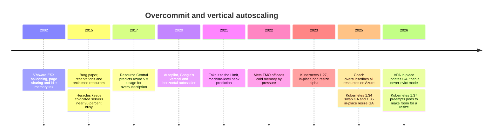
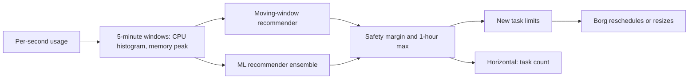
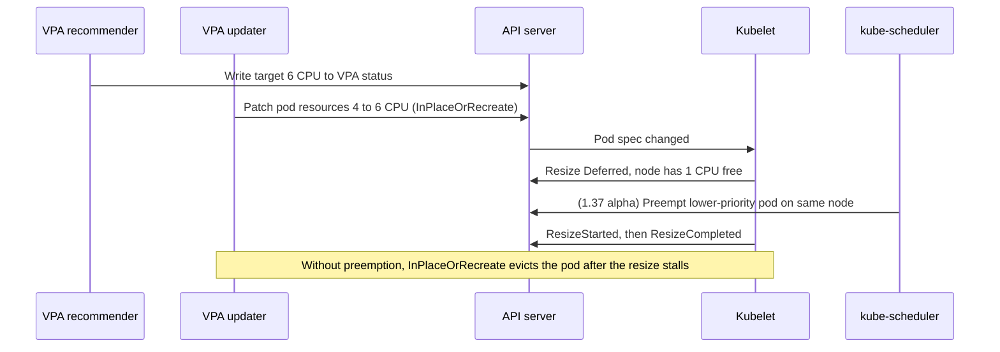

---
tags:
  - distributed-systems
  - overcommit
  - vertical-autoscaling
  - resource-management
  - kubernetes
  - cluster-scheduling
status: complete
sources:
  - https://research.google.com/pubs/archive/43438.pdf
  - https://homepages.dcc.ufmg.br/~cunha/teaching/20221/cloudcomp/readings/10-readings/rzadca20autopilot.pdf
  - https://research.google/pubs/autopilot-workload-autoscaling-at-google-scale/
  - https://noman-bashir.github.io/assets/pdf/EuroSys-2021-Overcommit.pdf
  - https://research.google/pubs/take-it-to-the-limit-peak-prediction-driven-resource-overcommitment-in-datacenters/
  - https://core.ac.uk/download/148016014.pdf
  - https://www.cs.princeton.edu/courses/archive/fall04/cos518/papers/esx.pdf
  - https://www.microsoft.com/en-us/research/publication/resource-central-understanding-predicting-workloads-improved-resource-management-large-cloud-platforms/
  - https://www.pdl.cmu.edu/PDL-FTP/NVM/tmo_asplos22.pdf
  - https://arxiv.org/pdf/2501.11179
  - https://files.usenix.org/s3fs-public/cdn/osdi20-tang.pdf
  - https://arxiv.org/html/2510.10747v1
  - https://kubernetes.io/docs/concepts/workloads/pods/pod-qos/
  - https://kubernetes.io/docs/concepts/workloads/autoscaling/vertical-pod-autoscale/
  - https://kubernetes.io/blog/2025/12/19/kubernetes-v1-35-in-place-pod-resize-ga/
  - https://kubernetes.io/blog/2026/04/30/kubernetes-v1-36-inplace-pod-level-resources-beta/
  - https://kubernetes.io/uk/blog/2026/09/10/kubernetes-v1-37-scheduler-preemption-for-in-place-pod-resize-alpha/
  - https://kubernetes.io/blog/2026/10/05/scaling-kubernetes-workloads-with-node-swap/
  - https://www.kubernetes.dev/resources/keps/2400/
  - https://kubernetes.io/docs/concepts/cluster-administration/swap-memory-management/
  - https://newreleases.io/project/github/kubernetes/autoscaler/release/vertical-pod-autoscaler-1.6.0
  - https://newreleases.io/project/github/kubernetes/autoscaler/release/vertical-pod-autoscaler-1.7.0
  - https://docs.cloud.google.com/kubernetes-engine/docs/concepts/verticalpodautoscaler
  - https://gardener.cloud/blog/2026/05/05-19-in-place-pod-resource-updates/
  - https://thenewstack.io/kubernetes-vpa-inplace-resize/
  - https://www.fairwinds.com/blog/kubernetes-1.37-is-here-pod-rightsizing-dra-and-gang-scheduling
created: 2026-11-27
updated: 2026-11-28
---

## Table Of Contents

---

- [[#TL;DR|TL;DR]]
- [[#The Problem|The Problem]]
- [[#Foundations|Foundations]]
    - [[#Four Numbers Per Task|Four Numbers Per Task]]
    - [[#Compressible vs Non-Compressible|Compressible vs Non-Compressible]]
    - [[#Statistical Multiplexing|Statistical Multiplexing]]
    - [[#Vertical vs Horizontal Scaling|Vertical vs Horizontal Scaling]]
- [[#How We Got Here|How We Got Here]]
- [[#How It Works|How It Works]]
    - [[#Borg Reclamation, Overcommit by Priority|Borg Reclamation, Overcommit by Priority]]
    - [[#Predicting the Machine's Peak|Predicting the Machine's Peak]]
    - [[#Autopilot, Rightsizing the Request|Autopilot, Rightsizing the Request]]
    - [[#When the Bet Loses, Isolation and Kill Order|When the Bet Loses, Isolation and Kill Order]]
    - [[#Overcommitting Memory Below the Scheduler|Overcommitting Memory Below the Scheduler]]
    - [[#Kubernetes, QoS Classes and the VPA|Kubernetes, QoS Classes and the VPA]]
    - [[#Cloud VMs, Resource Central and Coach|Cloud VMs, Resource Central and Coach]]
- [[#Where It Is Now|Where It Is Now]]
- [[#Trade-offs & Open Problems|Trade-offs & Open Problems]]
- [[#Resources|Resources]]
- [[#Related Notes|Related Notes]]

## ***TL;DR***
---
*People ask for far more CPU and memory than their jobs use. Overcommit sells the unused part a second time; vertical autoscaling shrinks the ask itself. Both are bets on the future, and the whole design is about how cheaply you lose when the bet goes wrong.*

- **The gap is big.** Google's manually sized jobs left 46–60% of their limits unused; Autopilot cut that to 23–31% ([Rzadca et al., EuroSys 2020](https://homepages.dcc.ufmg.br/~cunha/teaching/20221/cloudcomp/readings/10-readings/rzadca20autopilot.pdf)).
- **Two levers.** *Overcommit* lets the sum of allocations on a machine exceed its capacity, betting that tasks don't all peak at once ([[Cluster Scheduling]] covers Borg's version). *Vertical autoscaling* (rightsizing) changes each task's CPU and memory request to track what it actually uses.
- **CPU and memory fail differently.** Too little CPU means throttling; too little memory means a kill. So every system overcommits CPU more boldly than memory, and keeps memory safety margins wider.
- **Who pays when it's wrong.** Borg schedules production against limits and lets only lower-priority work use reclaimed resources, so the low-priority work is what gets throttled or killed ([Verma et al., §5.5](https://research.google.com/pubs/archive/43438.pdf)).
- **Prediction is the core.** Predicting the *machine's* peak beats summing each task's peak; Google's production max predictor freed 10–16% more usable CPU ([Bashir et al., EuroSys 2021](https://noman-bashir.github.io/assets/pdf/EuroSys-2021-Overcommit.pdf)).
- **Below the scheduler**, kernels and hypervisors stretch memory further: ESX ballooning and page sharing, and Meta's TMO, which offloads cold memory under a pressure target and saves 20–32% of memory per server ([Weiner et al., ASPLOS 2022](https://www.pdl.cmu.edu/PDL-FTP/NVM/tmo_asplos22.pdf)).
- **Now (Nov 2026):** Kubernetes can resize a running pod (GA in 1.35, Dec 2025); the VPA's `InPlaceOrRecreate` mode went GA in VPA 1.6.0 (Feb 2026) and a never-evict `InPlace` mode arrived in 1.7.0; Kubernetes 1.37 (Aug 2026) lets the scheduler preempt lower-priority pods to make room for a resize. Swap on nodes is GA since 1.34, and is being pitched for packing idle AI agent sandboxes up to 3× denser.

## ***The Problem***
---
*A request is a guess made once, by a person, under fear of an outage. Usage is what actually happens, minute to minute. The difference is capacity you paid for and nobody uses.*

Every scheduler places work by its *request* (Kubernetes) or *limit* (Borg), because that's the only number known before the task runs. Users pad that number, because under-asking costs them an outage and over-asking costs someone else money. Load also varies by hour and day, so a request sized for the peak is mostly idle.

| Evidence | What it shows |
|---|---|
| Google, manually sized jobs | Relative slack (limit minus usage, over limit) of 46% with soft memory limits and 60% with hard ones ([Autopilot §4.2](https://homepages.dcc.ufmg.br/~cunha/teaching/20221/cloudcomp/readings/10-readings/rzadca20autopilot.pdf)) |
| Google, jobs moved onto Autopilot | Average slack fell from 75% to 20%; their total slack fell from 1,870 machines to 162 (§4.2) |
| Google, per machine | At the median, the sum of each task's own peak is almost 50% higher than the machine's actual peak ([Bashir et al., §2.2](https://noman-bashir.github.io/assets/pdf/EuroSys-2021-Overcommit.pdf)) |
| Facebook shared fleet | About 30% average CPU and 40% memory utilization even after pooling teams' machines ([Tang et al., OSDI 2020](https://files.usenix.org/s3fs-public/cdn/osdi20-tang.pdf)) |
| Kubernetes in the wild | Datadog data, as cited by Shetty et al., says over 65% of Kubernetes workloads use only half of their requested CPU ([Shetty et al., 2025](https://arxiv.org/html/2510.10747v1)) |
| Azure VMs | Three kinds of waste: unallocated, *stranded* (free but unusable because another resource on the box is full) and allocated-but-idle ([Reidys et al., ASPLOS 2025](https://arxiv.org/pdf/2501.11179)) |

**Why it's a distributed systems problem.** The decision is split across layers that see different things: the cluster scheduler sees requests across thousands of machines, the node agent sees real usage on one, and the kernel sees page faults and stalls. Each layer acts on a slightly stale view, and two controllers acting on the same pods (an autoscaler and a scheduler, or a vertical and a horizontal autoscaler) can fight. Getting it wrong shows up as tail latency ([[Gray and Fail-Slow Failures]] looks similar from outside) or as a wave of out-of-memory kills.

## ***Foundations***
---
*Four ideas explain every system below: a task has four different resource numbers, CPU and memory punish mistakes differently, a machine's peak is smaller than the sum of its tasks' peaks, and you can fix a mis-sized service by changing its size or its count.*

### Four Numbers Per Task

*Most confusion about overcommit comes from mixing up these four numbers. A scheduler packs by one, the kernel enforces another, and the autoscaler watches a third.*

| Number | Borg term | Kubernetes term | Who uses it |
|---|---|---|---|
| What the task may never exceed | Limit | Limit (`resources.limits`) | Kernel (cgroups) enforces it |
| What placement assumes it needs | Limit (prod) or reservation (non-prod) | Request (`resources.requests`) | Scheduler packs by it |
| A moving estimate of real need | Reservation | Not exposed; VPA keeps its own target | Overcommit logic |
| What it actually uses | Usage | Usage (metrics API) | Autoscaler learns from it |

*Slack* is the gap between limit (or request) and usage. Overcommit sells slack to other tasks without changing the first task's limit. Vertical autoscaling shrinks the limit or request itself, so the slack goes back to the scheduler's free pool.

### Compressible vs Non-Compressible

*Some resources can be taken back gently, others only by killing. This one distinction sets every safety margin in the field.*

Borg's paper names it ([Verma et al., §6.2](https://research.google.com/pubs/archive/43438.pdf)):

- **Compressible** resources are rate-based, like CPU cycles and disk I/O bandwidth. You can take some away by lowering a task's quality of service; it slows down but keeps running.
- **Non-compressible** resources, like memory and disk space, "generally cannot be reclaimed without killing the task."

Autopilot's designers draw the same line: under-provisioned memory means termination, under-provisioned CPU means throttling ([Autopilot §3.2.2](https://homepages.dcc.ufmg.br/~cunha/teaching/20221/cloudcomp/readings/10-readings/rzadca20autopilot.pdf)). That is why its memory recommenders use high percentiles or the outright maximum, while CPU for batch jobs uses the average. Kernel tricks like swap and compressed memory (below) partly turn memory into a compressible resource, at a latency cost.

### Statistical Multiplexing

*Tasks rarely peak at the same moment, so a machine's peak is smaller than the sum of its tasks' peaks. Overcommit is the business of predicting how much smaller, safely.*

If tasks were independent, the variance of their total would be the sum of their variances, and the total's standard deviation grows only with the square root of the task count. The N-sigma predictor that Google evaluated uses exactly this ([Bashir et al., §4](https://noman-bashir.github.io/assets/pdf/EuroSys-2021-Overcommit.pdf)):

$$\hat{P}_{\text{machine}} = \mu_{\text{total}} + n\,\sigma_{\text{total}}, \qquad \sigma_{\text{total}} = \sqrt{\textstyle\sum_i \sigma_i^2}\ \ \text{(if tasks are independent)}$$

*In plain English:* predict the machine's peak as its average total usage plus *n* standard deviations of that total. Because spreads add in squares, ten jittery tasks together are much less jittery than ten times one of them.

*Worked example:* 10 tasks on one machine, each averaging 1 core with a standard deviation of 0.5 cores, and *n* = 5.

| Approach | Calculation | Cores to set aside |
|---|---|---|
| Sum each task's own 5-sigma peak | 10 × (1 + 5 × 0.5) | 35 |
| Machine-level 5-sigma, independent tasks | 10 + 5 × √(10 × 0.25) ≈ 10 + 5 × 1.58 | about 17.9 |
| Machine-level, tasks perfectly correlated | σ adds linearly: 10 + 5 × 5 | 35 |

The middle row is the overcommit dividend: about half the cores. The last row is the risk: if every task spikes together (a traffic surge, a daily batch start, a shared dependency failing), there is no dividend, and an overcommitted machine runs out. Google's paper found the plain N-sigma model too optimistic on its own and combined it with other predictors ([[#Predicting the Machine's Peak|below]]).

### Vertical vs Horizontal Scaling

*A service that's too small can get bigger tasks or more tasks. Vertical scaling fixes the size, horizontal scaling fixes the count, and doing both at once needs care.*

- **Vertical** (rightsizing): change each task's CPU and memory. Good for memory-bound or single-instance work (a database primary, a cache, a JVM) that can't simply be split, and for removing padding.
- **Horizontal**: change the number of replicas. Good for stateless services with load that varies a lot.
- **Together:** Autopilot does both ([§3](https://homepages.dcc.ufmg.br/~cunha/teaching/20221/cloudcomp/readings/10-readings/rzadca20autopilot.pdf)). In Kubernetes, running the VPA and a CPU-based Horizontal Pod Autoscaler on the same pods makes two loops react to the same signal; GKE's documentation points users to its "multidimensional Pod autoscaling" or HPA rightsizing instead ([GKE docs](https://docs.cloud.google.com/kubernetes-engine/docs/concepts/verticalpodautoscaler)). This is a small case of the controller-interaction problem in [[Reconciliation and Control Loops]].

## ***How We Got Here***
---
*Overcommit started in hypervisors in the early 2000s, moved into cluster schedulers with Borg, became prediction-driven at Google and Microsoft, and reached Kubernetes in pieces between 2023 and 2026 as pods learned to change size without restarting.*

- **Hypervisors first (2002).** VMware's ESX Server ran virtual machines whose configured memory added up to more than the host had, using a balloon driver inside each guest, content-based page sharing and an "idle memory tax" ([Waldspurger, OSDI 2002](https://www.cs.princeton.edu/courses/archive/fall04/cos518/papers/esx.pdf)).
- **Cluster managers (2015).** The Borg paper described reservations that decay toward real usage, and production and batch work sharing machines ([Verma et al.](https://research.google.com/pubs/archive/43438.pdf)). The same year, Heracles showed a per-server controller could colocate best-effort work with latency-critical services and keep servers near 90% busy without breaking latency targets ([Lo et al., ISCA 2015](https://core.ac.uk/download/148016014.pdf)).
- **Prediction (2017 to 2021).** Microsoft's Resource Central learned VM behavior from telemetry and fed predictions to Azure's scheduler for oversubscription ([Cortez et al., SOSP 2017](https://www.microsoft.com/en-us/research/publication/resource-central-understanding-predicting-workloads-improved-resource-management-large-cloud-platforms/)). Google published Autopilot in 2020 and its machine-level peak predictors in 2021.
- **The kernel joins (2022).** Meta's TMO used the kernel's pressure-stall metrics to decide how much memory each container could lose to swap or compression without hurting it ([Weiner et al.](https://www.pdl.cmu.edu/PDL-FTP/NVM/tmo_asplos22.pdf)).
- **Kubernetes catches up (2023 to 2026).** Pod resources were immutable, so the VPA had to evict a pod to resize it. In-place resize arrived as alpha in 1.27, beta in 1.33 and GA in 1.35, "more than 6 years after its initial conception" ([Kubernetes blog, Dec 2025](https://kubernetes.io/blog/2025/12/19/kubernetes-v1-35-in-place-pod-resize-ga/)).

## ***How It Works***
---
*Seven pieces: Borg's priority-split reclamation, machine-level peak prediction, Autopilot's recommenders, the isolation and kill order that make losses cheap, memory tricks below the scheduler, Kubernetes' QoS classes and VPA, and VM oversubscription in public clouds.*

### Borg Reclamation, Overcommit by Priority

*Borg overcommits only for work that can afford to lose. Production is placed against its full limit; everything else is placed against an estimate.*

The mechanism ([Verma et al., §5.5](https://research.google.com/pubs/archive/43438.pdf)):

1. **Reservation.** Every few seconds the Borgmaster computes each task's *reservation* from fine-grained usage the node agent (Borglet) reports.
2. **Decay.** A new task's reservation starts equal to its limit. After 300 seconds, to ride out start-up spikes, it "decays slowly towards the actual usage plus a safety margin," and it is "rapidly increased if the usage exceeds it."
3. **Placement.** For prod tasks, feasibility is checked against limits, so they "never rely on reclaimed resources." For non-prod tasks, Borg uses the reservations of existing tasks, so new non-prod work fits into reclaimed space.
4. **Losing the bet.** If reservations were wrong, Borg will "kill or throttle non-prod tasks, never prod ones."

About 20% of the workload in a median cell ran in reclaimed resources. Google tried baseline, aggressive and medium safety margins on a live cell for three weeks; reservations tracked usage more closely with smaller margins and OOM events "increased slightly," and Google rolled out the medium setting.

*Worked example:* a machine with 16 cores. A prod task has a 12-core limit and uses about 5. After five minutes its reservation decays to, say, 6 cores. The scheduler now sees 10 cores free for batch work, though only 4 are free by limits. At 9 a.m. the prod task's traffic doubles and it uses 10 cores: its reservation jumps, the Borglet throttles the batch tasks (CPU is compressible), and if memory were the resource running out, it would kill batch tasks instead, lowest priority first.

### Predicting the Machine's Peak

*Borg's default reclaimed resources task by task. Google's 2021 paper asks a better question: what will this machine's total usage peak at, over the time the new task will be there?*

Bashir et al. frame overcommit as predicting a *peak oracle*: the maximum total usage a machine will see in the future, which a clairvoyant scheduler could pack right up to ([§3](https://noman-bashir.github.io/assets/pdf/EuroSys-2021-Overcommit.pdf)). A *violation* is any time the prediction falls below that true peak. Predictors they simulated on the public Google cluster trace:

| Predictor | How it predicts the machine's peak | Result in simulation |
|---|---|---|
| borg-default | Sum of task limits × a fixed fraction (0.9 in the study) | Among the worst violation rates |
| RC-like | Sum of each task's 99th-percentile usage (in the style of Resource Central) | Highest savings, worst violations |
| N-sigma | Mean total usage + 5 standard deviations | Fewer violations, lower savings |
| Max | Maximum of the others | Best violation rate, slightly more savings than N-sigma |

In production, the max predictor gave "higher than 16%" more usable capacity, and both experimental groups beat 10% (§6.2). Violations matter because they show up as latency: each extra percentage point of violation rate went with a 14.1% rise in tail CPU scheduling latency (§3.3). The simulator is open source ([googleinterns/cluster-resource-forecast](https://github.com/googleinterns/cluster-resource-forecast)).

### Autopilot, Rightsizing the Request

*Autopilot learns each job's real usage and rewrites its limits, so slack never reaches the scheduler in the first place. It has two recommenders: a simple decaying histogram and a machine-learned one that weighs the cost of being wrong.*

Inputs ([Rzadca et al., §3.2](https://homepages.dcc.ufmg.br/~cunha/teaching/20221/cloudcomp/readings/10-readings/rzadca20autopilot.pdf)): usage is sampled about every second and rolled into 5-minute windows. For CPU each window keeps a histogram of about 400 buckets; for memory it keeps only the peak, because a single spike can kill.

**Moving-window recommender.** Older samples count less, by an exponential decay with half-life $t_{1/2}$:

$$w[\tau] = 2^{-\tau / t_{1/2}}$$

*In plain English:* a sample loses half its weight every half-life. Autopilot uses 12 hours for CPU and 48 hours for memory, so memory remembers rare spikes four times longer. *Example:* a sample from 24 hours ago counts $2^{-2} = 0.25$ for CPU but $2^{-0.5} \approx 0.71$ for memory.

From the weighted history it picks a statistic that matches the job's tolerance for error:

| Resource and job type | Limit set to |
|---|---|
| CPU, batch | Weighted average |
| CPU, serving | 95th or 90th load-adjusted percentile, by latency sensitivity |
| Memory, low OOM tolerance | 98th percentile |
| Memory, minimal OOM tolerance | Maximum |
| Memory, intermediate tolerance | max(60th percentile, 0.5 × maximum) |

Then it adds a 10–15% safety margin and takes the highest recommendation over the last hour, so limits don't flap downward.

**ML recommender.** Instead of fixed rules, an ensemble of simple models each picks a limit $L$ that minimizes a weighted cost, and Autopilot follows whichever model has done best recently. In simplified form (the paper's Eq. 4–9):

$$L^{*} = \arg\min_{L}\ \big(w_o\, o(L) + w_u\, u(L) + w_{\Delta L}\,[L \neq L_{\text{prev}}]\big)$$

*In plain English:* $o(L)$ counts how much usage would have gone over the limit (risk), $u(L)$ counts how much limit would have sat unused (waste), and the last term charges for changing the limit at all (churn). Raising $w_o$ makes a job safer and fatter; raising $w_{\Delta L}$ makes its limit steadier. The five hyperparameters were tuned offline by sweeping saved traces.

**Results.** Autopiloted jobs ran at 23% slack (ML) or 31% (moving window), against 46–60% for manual jobs; jobs "severely impacted by OOMs" fell by a factor of 10; over 99.5% of Autopilot job-days had no OOMs. Limits changed on about 30% of job-days, against about 0.001 changes per job-day for manual limits. Autopiloted jobs covered over 48% of Google's fleet-wide resource usage, and 88% of batch CPU (§4, §6).

### When the Bet Loses, Isolation and Kill Order

*Overcommit is only safe if a wrong prediction hurts the right task, quickly and boundedly. That needs isolation inside the machine and a clear order of who loses first.*

**Kill order.** When a non-compressible resource runs out, the Borglet "immediately terminates tasks, from lowest to highest priority, until the remaining reservations can be met." For compressible resources it throttles, favoring latency-sensitive tasks, which can "temporarily starve batch tasks for several seconds at a time" ([Verma et al., §6.2](https://research.google.com/pubs/archive/43438.pdf)). Batch tasks get "tiny scheduler shares" relative to latency-sensitive ones. Kubernetes evicts BestEffort pods first, then Burstable, then Guaranteed, and only pods using more than their requests are candidates under resource pressure ([Kubernetes docs](https://kubernetes.io/docs/concepts/workloads/pods/pod-qos/)).

**Heracles** adds a feedback loop on each server ([Lo et al., ISCA 2015](https://core.ac.uk/download/148016014.pdf)). Every 15 seconds it measures the latency-critical service's tail latency and computes its *slack*:

$$\text{slack} = \frac{\text{target} - \text{latency}}{\text{target}}$$

*In plain English:* how far under its latency target the service is, as a fraction of the target. Below 10%, best-effort work may not grow; below 5%, the core controller takes cores away from it; negative slack disables best-effort work for about 5 minutes. Above 85% of peak load, best-effort work is turned off, and it resumes below 80%. Sub-controllers split cores (cpusets), last-level cache (Intel CAT), power (per-core DVFS) and network egress (HTB queueing). *Example:* target 10 ms, measured 9.5 ms gives 5% slack, so best-effort tasks start losing cores. On a websearch cluster Heracles averaged 90% effective utilization with no SLO violations over 12 hours.

### Overcommitting Memory Below the Scheduler

*Hypervisors and kernels can take memory back without killing anyone, by pushing cold pages somewhere cheaper. This turns memory partly compressible, which lets the layers above overcommit it more boldly.*

**ESX (2002)** ([Waldspurger](https://www.cs.princeton.edu/courses/archive/fall04/cos518/papers/esx.pdf)):

- **Ballooning.** A driver inside the guest "inflates" by allocating pinned pages; the guest's own memory manager decides what to give up, possibly paging to its own disk, and the hypervisor reclaims the machine pages behind the balloon. The guest picks its least valuable pages because it knows its workload.
- **Content-based page sharing.** Pages are hashed and identical ones mapped copy-on-write to one machine page; ten Windows NT VMs shared 42.9% of their memory in production.
- **Idle memory tax.** Shares-based allocation charges idle memory more (75% by default), so a VM that hoards memory it doesn't touch loses it first.

**TMO at Meta (2022)** ([Weiner et al.](https://www.pdl.cmu.edu/PDL-FTP/NVM/tmo_asplos22.pdf)). The kernel's Pressure Stall Information (PSI) reports "the proportion of compute potential that is unproductive due to resource stalls." A user-space agent, Senpai, runs about every six seconds and asks the kernel to reclaim from each container:

$$\text{reclaim} = \text{mem} \times r \times \max\!\Big(0,\ 1 - \frac{\text{PSI}_{\text{some}}}{\text{PSI}_{\text{threshold}}}\Big)$$

*In plain English:* the less a container is stalling on memory, the more Senpai squeezes it; at the stall threshold it stops. Production uses $r = 0.0005$ and a 0.1% threshold, capped at 1% of the workload's size per step. *Example:* a 10 GiB container stalling 0.05% of the time gets $10\,\text{GiB} \times 0.0005 \times 0.5 \approx 2.6\,\text{MiB}$ reclaimed per step, about 25 MiB a minute, and nothing once stalls reach 0.1%. Cold pages go to compressed memory (zswap, about 40 µs p90 reads) or SSD swap; TMO saved 20–32% of total memory across millions of servers. Early Senpai lowered the cgroup limit, which hurt workloads that needed to grow, so Meta added a stateless `memory.reclaim` control instead. Kernel details are in [[Page Cache and Memory Reclaim]] and [[Containers, Namespaces and cgroups]].

### Kubernetes, QoS Classes and the VPA

*Kubernetes overcommits by default whenever limits exceed requests, sorts pods into three QoS classes for who loses first, and resizes pods with the Vertical Pod Autoscaler, which since 2025 can do it without a restart.*

**QoS classes** ([docs](https://kubernetes.io/docs/concepts/workloads/pods/pod-qos/)):

| Class | Rule | Overcommit behavior |
|---|---|---|
| Guaranteed | Every container has CPU and memory requests equal to limits | Never bursts past its request; evicted last |
| Burstable | Some request or limit set, not Guaranteed | Placed by request, may burst to limit (or node capacity if no limit) |
| BestEffort | No requests or limits | Uses leftovers; evicted first |

The scheduler packs by requests, so a node full of Burstable pods with limits above requests is overcommitted, exactly like Borg's non-prod tier. Optional Memory QoS on cgroup v2 can throttle a Burstable container before its hard limit by setting `memory.high = request + f × (limit − request)`; with $f = 0.9$, a 256 MiB request and 1 GiB limit give about 947 MiB. It is off in the default kubelet configuration.

**Swap.** Node swap reached GA in 1.34 ([KEP-2400](https://www.kubernetes.dev/resources/keps/2400/)). Under `LimitedSwap`, only Burstable pods may swap, each in proportion to its memory request; Guaranteed, BestEffort and high-priority pods may not ([swap docs](https://kubernetes.io/docs/concepts/cluster-administration/swap-memory-management/)).

**The VPA** has three parts ([Kubernetes docs](https://kubernetes.io/docs/concepts/workloads/autoscaling/vertical-pod-autoscale/)): a *recommender* that turns usage history and OOM events into target, lower-bound and upper-bound recommendations; an *updater* that applies them by eviction or in place; and an *admission webhook* that writes the target into new pods. After an OOM kill, GKE's recommender bumps memory by about 20% or 100 MB, whichever is larger ([GKE docs](https://docs.cloud.google.com/kubernetes-engine/docs/concepts/verticalpodautoscaler)).

| Update mode | What happens |
|---|---|
| `Off` | Recommendations only |
| `Initial` | Applied at pod creation, never after |
| `Recreate` | Evict the pod; the controller recreates it with new requests |
| `Auto` | Deprecated alias for `Recreate` |
| `InPlaceOrRecreate` | Resize in place; evict if that's impossible (GA in VPA 1.6.0) |
| `InPlace` | Resize in place; never evict, retry later (alpha, VPA 1.7.0) |

**In-place resize** lets a running pod's CPU and memory change. A resize the node can't fit right now is marked `Deferred`; one that can never fit (beyond node capacity, a LimitRange or quota) is `Infeasible`. Since 1.37, with the alpha `InPlacePodVerticalScalingSchedulerPreemption` gate, the scheduler watches deferred resizes and may evict lower-priority pods *on that node only* to make room, treating the requested size as already used so nothing else grabs it ([Kubernetes blog, Sep 2026](https://kubernetes.io/uk/blog/2026/09/10/kubernetes-v1-37-scheduler-preemption-for-in-place-pod-resize-alpha/)).

The diagram follows the 1.37 tutorial: an 8-CPU node with a 3-CPU low-priority pod and a 4-CPU high-priority pod; resizing the latter to 6 CPU is deferred, the scheduler preempts the low-priority pod, and the resize completes.

### Cloud VMs, Resource Central and Coach

*A public cloud can't see inside customer VMs, so it oversubscribes by predicting each VM's usage pattern from who created it and how its predecessors behaved.*

**Resource Central** (Microsoft, SOSP 2017) found that many VM behaviors are consistent across lifetimes, built a service that learns from telemetry offline and serves predictions online, and changed Azure's scheduler to oversubscribe servers with them, raising utilization while avoiding physical exhaustion ([Cortez et al.](https://www.microsoft.com/en-us/research/publication/resource-central-understanding-predicting-workloads-improved-resource-management-large-cloud-platforms/)).

**Coach** (Microsoft, ASPLOS 2025) extends this in two ways ([Reidys et al.](https://arxiv.org/pdf/2501.11179)):

- **All resources.** Oversubscribing CPU alone just moves the bottleneck to memory and network, so Coach oversubscribes CPU, memory, network and storage together.
- **Time windows.** VMs peak at different times of day, consistently. A random forest predicts each VM's 95th-percentile use in six 4-hour windows, so a noon-peaking VM can share with a night-peaking one. In one cluster, savings grew from about 8% CPU and memory with one 24-hour window to about 20% CPU and 15% memory with four 6-hour windows.

Each *CoachVM* splits each resource into a *guaranteed* part, physically backed, and an *oversubscribed* part drawn on demand from a shared pool. For memory, the oversubscribed part appears to the guest as a NUMA node with no cores, so the guest naturally prefers its guaranteed memory. When contention looms, Coach trims cold pages, grows the pool from unallocated memory, and as a last resort evicts low-priority (Spot) VMs or live-migrates. Hosting "up to ~26% more VMs," the most sensitive workloads slowed by at most 10%; the authors say full deployment "takes multiple years," starting with CPU.

## ***Where It Is Now***
---
*As of November 2026, Kubernetes has finally closed the gap with Borg-style rightsizing: pods resize in place, the VPA uses that by default, and the scheduler is learning to make room for resizes. Memory overcommit is being pushed further by swap for idle AI agents, while a live debate asks whether CPU limits should exist at all.*

- **In-place resize is standard.** GA in Kubernetes 1.35 (Dec 2025) ([blog](https://kubernetes.io/blog/2025/12/19/kubernetes-v1-35-in-place-pod-resize-ga/)). In 1.36 (April 2026), resizing *pod-level* resource budgets went beta and on by default ([blog](https://kubernetes.io/blog/2026/04/30/kubernetes-v1-36-inplace-pod-level-resources-beta/)). Kubernetes 1.37 (Aug 2026) made in-place resizing of init containers GA, added alpha resizing of memory-backed volumes, and added scheduler preemption for resizes; restart-free resizing needs cgroup v2 ([Fairwinds](https://www.fairwinds.com/blog/kubernetes-1.37-is-here-pod-rightsizing-dra-and-gang-scheduling)).
- **The VPA moved to in-place.** VPA 1.6.0 (Feb 12, 2026) made `InPlaceOrRecreate` GA and on by default ([release](https://newreleases.io/project/github/kubernetes/autoscaler/release/vertical-pod-autoscaler-1.6.0)); 1.7.0 added a never-evict `InPlace` mode and a `startupBoost` policy for extra resources while a pod starts ([release](https://newreleases.io/project/github/kubernetes/autoscaler/release/vertical-pod-autoscaler-1.7.0), [docs](https://kubernetes.io/docs/concepts/workloads/autoscaling/vertical-pod-autoscale/)). Managed offerings lag: GKE still lists `InPlaceOrRecreate` as Preview and says the VPA "is not ready for use with JVM-based workloads" because it can't see their real memory use ([GKE docs](https://docs.cloud.google.com/kubernetes-engine/docs/concepts/verticalpodautoscaler)).
- **Field result.** The Gardener project moved its own VPAs on seed and runtime clusters to `InPlaceOrRecreate` and saw "roughly 98%" of pod resource updates applied in place, avoiding the brief control-plane outages that evict-and-recreate caused for clusters with a single etcd replica ([Gardener, May 2026](https://gardener.cloud/blog/2026/05/05-19-in-place-pod-resource-updates/)).
- **Swap for AI agents.** A Kubernetes blog post (Oct 2026) argues that agentic AI sandboxes hold large memory while idle between prompts, and that NVMe-backed swap let nodes pack such workloads "up to 3×" denser, "often with little or no latency cost," on its benchmarks ([Kubernetes blog](https://kubernetes.io/blog/2026/10/05/scaling-kubernetes-workloads-with-node-swap/)).
- **The CPU-limit debate.** Shetty et al. (UIUC and IBM, Oct 2025 preprint) argue CPU limits enforced by CFS bandwidth control hurt latency-sensitive services: one limited pod out of 19 made end-to-end tail latency 5× worse without lowering its CPU use, and removing limits in their prototype autoscaler saved 38% CPU on average ([arXiv](https://arxiv.org/html/2510.10747v1)). Their alternative is requests only, with the autoscaler and scheduler watching for congested nodes.
- **VM clouds.** Coach (ASPLOS 2025) is Microsoft's published plan for all-resource oversubscription on Azure; as of the paper, CPU and power were oversubscribed first, and memory was to follow as mitigations proved out ([Reidys et al.](https://arxiv.org/pdf/2501.11179)).

## ***Trade-offs & Open Problems***
---
*Every knob trades waste against risk, and the risk lands on someone: low-priority work, the tail of the latency distribution, or the on-call engineer chasing OOM kills.*

| Choice | You get | You pay |
|---|---|---|
| Overcommit by reservation (Borg) | About 20% of work in reclaimed resources | Batch work throttled or killed when prod spikes |
| Machine-level peak prediction | 10–16% more usable CPU at Google | Correlated spikes break the independence assumption |
| Aggressive vertical autoscaling | Slack down from ~46% to ~23% | Limit churn; OOMs if memory history misses rare spikes |
| Long memory half-life | Remembers weekly spikes | Slow to give back memory after a one-off |
| Evict-to-resize | Works everywhere | Restarts, lost caches, brief outages for single replicas |
| In-place resize | No restart in the common case | Deferred when the node is full; needs cgroup v2 |
| Swap or compressed memory | Memory partly compressible; denser packing | Latency on faults; SSD wear (TMO caps swap writes at 1 MB/s) |
| CPU limits | Hard isolation and predictable billing | Throttling inflates tail latency even with idle cores |

Open problems worth tracking:

- **Correlated peaks.** Statistical multiplexing assumes tasks don't spike together. Diurnal traffic, synchronized batch starts and retry storms ([[Reliability Patterns]]) all correlate them; Coach's time windows exploit the pattern rather than fighting it.
- **Who sees what.** The VPA can't see a JVM's heap needs, Azure can't see inside a VM, and the scheduler can't see stalls. Pressure metrics like PSI are the best shared signal so far, but no scheduler in this note places work by them.
- **Interacting controllers.** VPA, HPA, the cluster autoscaler and the scheduler's preemption all react to the same overload. Without coordination they can oscillate or evict each other's work, a general hazard covered in [[Reconciliation and Control Loops]] and [[Queueing Theory for Systems]].
- **Resize when the node is full.** 1.37's preemption only looks at the pod's current node; moving the pod to a bigger node, or packing to leave headroom for future resizes, is still up to the user or a custom controller.
- **Memory tiers.** CXL-attached memory gives a third option between "in RAM" and "swapped" ([[Disaggregated Systems]], [[CXL and Memory Tiering]], [[CXL Memory Pooling and Sharing]]); how a scheduler should account for slower memory in a request is unsettled.
- **Accelerators.** Everything here is about CPU and memory. GPU sharing and its isolation are a different set of mechanisms; see [[GPU Cluster Infrastructure]] and [[Gang and Topology-Aware Scheduling]].
- **Tail latency from interference.** Even with enough resources on paper, colocated work fights over caches, memory bandwidth and the network; Heracles handles this per server, but most clusters don't, and the symptoms look like [[Tail Latency and Hedging]] problems.

## ***Resources***
---
*Read Borg §5.5 and §6.2 first for the mechanism, then Autopilot for rightsizing and "Take it to the Limit" for prediction. Heracles and TMO show isolation and memory offloading, Coach shows the VM cloud. For today, read the Kubernetes VPA docs and the 1.35 and 1.37 resize posts.*

**Primary papers**
- [Large-scale cluster management at Google with Borg](https://research.google.com/pubs/archive/43438.pdf): Verma et al., EuroSys 2015. §5.5 reclamation, §6.2 isolation.
- [Autopilot: Workload Autoscaling at Google Scale](https://research.google/pubs/autopilot-workload-autoscaling-at-google-scale/): Rzadca et al., EuroSys 2020 ([PDF copy](https://homepages.dcc.ufmg.br/~cunha/teaching/20221/cloudcomp/readings/10-readings/rzadca20autopilot.pdf)).
- [Take it to the Limit: Peak Prediction-driven Resource Overcommitment in Datacenters](https://research.google/pubs/take-it-to-the-limit-peak-prediction-driven-resource-overcommitment-in-datacenters/): Bashir et al., EuroSys 2021 ([PDF](https://noman-bashir.github.io/assets/pdf/EuroSys-2021-Overcommit.pdf)).
- [Heracles: Improving Resource Efficiency at Scale](https://core.ac.uk/download/148016014.pdf): Lo, Cheng, Govindaraju, Ranganathan and Kozyrakis, ISCA 2015.
- [Memory Resource Management in VMware ESX Server](https://www.cs.princeton.edu/courses/archive/fall04/cos518/papers/esx.pdf): Waldspurger, OSDI 2002.
- [Resource Central](https://www.microsoft.com/en-us/research/publication/resource-central-understanding-predicting-workloads-improved-resource-management-large-cloud-platforms/): Cortez et al., SOSP 2017.
- [TMO: Transparent Memory Offloading in Datacenters](https://www.pdl.cmu.edu/PDL-FTP/NVM/tmo_asplos22.pdf): Weiner et al. (Meta), ASPLOS 2022.
- [Coach: Exploiting Temporal Patterns for All-Resource Oversubscription in Cloud Platforms](https://arxiv.org/pdf/2501.11179): Reidys et al. (Microsoft), ASPLOS 2025.
- [Twine: A Unified Cluster Management System for Shared Infrastructure](https://files.usenix.org/s3fs-public/cdn/osdi20-tang.pdf): Tang et al. (Facebook), OSDI 2020.
- [CPU-Limits kill Performance: Time to rethink Resource Control](https://arxiv.org/html/2510.10747v1): Shetty et al., arXiv preprint, Oct 2025.

**Docs and release notes**
- Kubernetes: [Pod QoS classes](https://kubernetes.io/docs/concepts/workloads/pods/pod-qos/), [Vertical Pod Autoscaling](https://kubernetes.io/docs/concepts/workloads/autoscaling/vertical-pod-autoscale/), [KEP-2400 node swap](https://www.kubernetes.dev/resources/keps/2400/), [swap memory management](https://kubernetes.io/docs/concepts/cluster-administration/swap-memory-management/).
- Kubernetes blog: [1.35 in-place resize GA](https://kubernetes.io/blog/2025/12/19/kubernetes-v1-35-in-place-pod-resize-ga/), [1.36 pod-level in-place beta](https://kubernetes.io/blog/2026/04/30/kubernetes-v1-36-inplace-pod-level-resources-beta/), [1.37 resize preemption](https://kubernetes.io/uk/blog/2026/09/10/kubernetes-v1-37-scheduler-preemption-for-in-place-pod-resize-alpha/), [node swap for agent workloads](https://kubernetes.io/blog/2026/10/05/scaling-kubernetes-workloads-with-node-swap/).
- VPA releases: [1.6.0](https://newreleases.io/project/github/kubernetes/autoscaler/release/vertical-pod-autoscaler-1.6.0), [1.7.0](https://newreleases.io/project/github/kubernetes/autoscaler/release/vertical-pod-autoscaler-1.7.0).
- [GKE vertical Pod autoscaling](https://docs.cloud.google.com/kubernetes-engine/docs/concepts/verticalpodautoscaler): modes, limits, OOM bump.
- [googleinterns/cluster-resource-forecast](https://github.com/googleinterns/cluster-resource-forecast): the overcommit simulator from "Take it to the Limit."

**Analysis**
- [Adoption of In-Place Pod Resource Updates in Gardener](https://gardener.cloud/blog/2026/05/05-19-in-place-pod-resource-updates/): Vitanov, May 2026.
- [Kubernetes 1.37 is here: pod rightsizing, DRA and gang scheduling](https://www.fairwinds.com/blog/kubernetes-1.37-is-here-pod-rightsizing-dra-and-gang-scheduling): Fairwinds, 2026.
- [Kubernetes VPA in-place resize](https://thenewstack.io/kubernetes-vpa-inplace-resize/): The New Stack, Feb 2026. A hands-on walk-through.

## ***Related Notes***
---
*Overcommit sits between the cluster scheduler above and the kernel below, so the links run both ways.*

- [[Cluster Scheduling]] — Borg, Kubernetes and the placement that overcommit feeds; priorities and preemption.
- [[Resource Fairness]] — Who gets the reclaimed capacity, and DRF across CPU and memory.
- [[Gang and Topology-Aware Scheduling]] — The opposite philosophy for GPU jobs: hold whole domains rather than pack tighter.
- [[GPU Cluster Infrastructure]] — The accelerators these CPU-and-memory techniques don't yet cover.
- [[Disaggregated Systems]] — Stranded memory and CXL pools, Azure's other answer to the same waste.
- [[Reliability Patterns]] — Load shedding and retry storms, which correlate the peaks overcommit bets against.
- [[Gray and Fail-Slow Failures]] — Interference from noisy neighbors looks like a slow node from outside.
- [[Auto-Sharding]] — Another controller that moves work and must coordinate with the scheduler and autoscalers.
- [[Coordination Services]] — etcd, whose single-node outages Gardener avoided with in-place resize.
- [[Reconciliation and Control Loops]] — The VPA, HPA and scheduler as interacting control loops; HPA's formula and stabilizers.
- [[Queueing Theory for Systems]] — Why utilization near 100% makes latency explode.
- [[Tail Latency and Hedging]] — The latency cost of colocation and throttling.
- [[Performance Isolation and Colocation]] — Planned: Heracles and its successors in depth.
- [[Horizontal Autoscaling]] — Planned: HPA, KEDA, predictive scaling and node autoscalers.
- [[Containers, Namespaces and cgroups]] — The cgroup controls (`cpu.max`, `memory.high`, `memory.reclaim`) that enforce all of this.
- [[Page Cache and Memory Reclaim]] — How the kernel picks pages to reclaim, swap and refaults.
- [[Virtual Memory and Paging]] — Linux's own memory overcommit modes.
- [[Virtualization and Hypervisors]] — Ballooning and page sharing in context.
- [[CXL and Memory Tiering]] — Slower, cheaper memory tiers below RAM.
- [[CXL Memory Pooling and Sharing]] — Pooling memory across hosts, Pond's 1 GB slices and Octopus pods.
