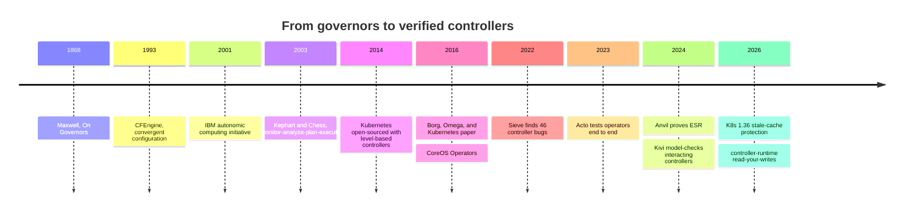
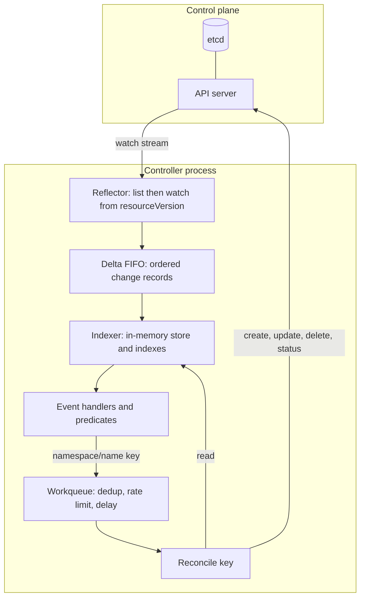
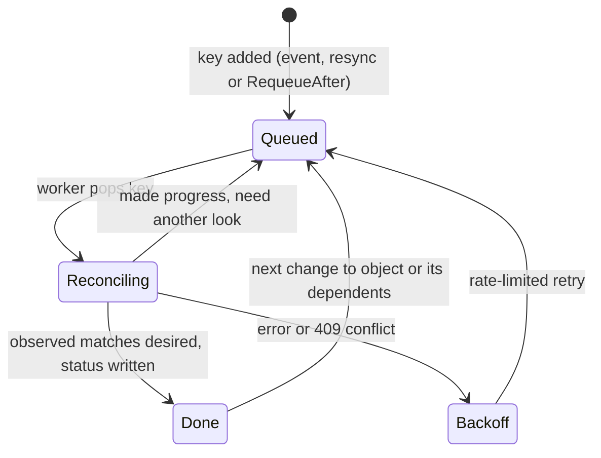

---
tags:
  - distributed-systems
  - reconciliation
  - control-loops
  - kubernetes
  - controllers
  - control-plane
  - infrastructure
status: complete
sources:
  - https://kubernetes.io/docs/concepts/architecture/controller/
  - https://github.com/kubernetes/design-proposals-archive/blob/main/architecture/principles.md
  - https://github.com/kubernetes/community/blob/master/contributors/devel/sig-architecture/api-conventions.md
  - https://research.google/pubs/pub44843/
  - https://sites.cs.ucsb.edu/~rich/class/cs293-cloud/papers/k8.pdf
  - https://kubernetes.io/docs/concepts/workloads/autoscaling/horizontal-pod-autoscale/
  - https://kubernetes.io/blog/2026/07/29/controller-runtime-cache-explained/
  - https://kubernetes.io/blog/2026/04/28/kubernetes-v1-36-staleness-mitigation-for-controllers/
  - https://www.kubernetes.dev/resources/keps/5647/
  - https://kubernetes.io/blog/2026/05/06/kubernetes-v1-36-server-side-sharded-list-and-watch/
  - https://kubernetes.io/blog/2025/12/30/kubernetes-v1-35-watch-based-route-reconciliation-in-ccm/
  - https://kubernetes.io/docs/reference/command-line-tools-reference/feature-gates/
  - https://kubernetes.io/docs/concepts/architecture/leases/
  - https://github.com/kubernetes/kubernetes/blob/master/pkg/controller/controller_utils.go
  - https://github.com/kubernetes-sigs/controller-runtime/releases/tag/v0.25.0
  - https://www.usenix.org/conference/osdi22/presentation/sun
  - https://par.nsf.gov//servlets/purl/10357315
  - https://cs.cornell.edu/~legunsen/pubs/GuETAlActoSOSP23.pdf
  - https://www.usenix.org/conference/osdi24/presentation/sun-xudong
  - https://par.nsf.gov//servlets/purl/10599460
  - https://www.usenix.org/conference/atc24/presentation/liu-bingzhe
  - https://arxiv.org/pdf/2311.02800
  - https://aws.amazon.com/builders-library/reliability-and-constant-work
  - https://brooker.co.za/blog/2019/05/01/emergent.html
  - https://www.redhat.com/en/blog/introducing-operators-putting-operational-knowledge-into-software
  - https://opengitops.dev/
  - https://en.wikipedia.org/wiki/CFEngine
  - https://en.wikipedia.org/wiki/Autonomic_computing
  - https://www.control.lth.se/fileadmin/control/Education/DoctorateProgram/HistoryOfControl/2016/Bissell_history_of_automatic_control.pdf
created: 2026-11-28
updated: 2026-11-28
---

## Table Of Contents

---

- [[#TL;DR|TL;DR]]
- [[#The Problem|The Problem]]
- [[#Foundations|Foundations]]
    - [[#Desired State, Observed State, Action|Desired State, Observed State, Action]]
    - [[#Level-Triggered vs Edge-Triggered|Level-Triggered vs Edge-Triggered]]
    - [[#Feedback Control in One Page|Feedback Control in One Page]]
    - [[#Convergence as a Liveness Property|Convergence as a Liveness Property]]
- [[#How We Got Here|How We Got Here]]
- [[#How It Works|How It Works]]
    - [[#The Kubernetes Controller Machinery|The Kubernetes Controller Machinery]]
    - [[#Spec, Status, Generation and Conditions|Spec, Status, Generation and Conditions]]
    - [[#Writing a Reconciler|Writing a Reconciler]]
    - [[#Stale Caches and Reading Your Own Writes|Stale Caches and Reading Your Own Writes]]
    - [[#A Numeric Loop, the Horizontal Pod Autoscaler|A Numeric Loop, the Horizontal Pod Autoscaler]]
    - [[#Constant Work, Reconciliation Without Events|Constant Work, Reconciliation Without Events]]
    - [[#Controllers That Fight|Controllers That Fight]]
    - [[#Testing and Verifying Controllers|Testing and Verifying Controllers]]
- [[#Where It Is Now|Where It Is Now]]
- [[#Trade-offs & Open Problems|Trade-offs & Open Problems]]
- [[#Resources|Resources]]
- [[#Related Notes|Related Notes]]

## ***TL;DR***
---
*A reconciliation loop keeps a system matching a written-down goal by looking at what is, comparing it with what should be, and fixing the difference, over and over. It is how Kubernetes, GitOps tools and most modern control planes work, and its hard parts are stale views, controllers that fight, and proving the loop ever finishes.*

- **The pattern.** A controller reads the *desired state* (a Kubernetes object's `spec`), observes the *current state*, and acts to close the gap; the docs compare it to a thermostat ([Kubernetes, Controllers](https://kubernetes.io/docs/concepts/architecture/controller/)).
- **Level, not edge.** Kubernetes' design rule: the system "must operate correctly given the desired state and the current/observed state, regardless of how many intermediate state updates may have been missed. Edge-triggered behavior must be just an optimization" ([design principles](https://github.com/kubernetes/design-proposals-archive/blob/main/architecture/principles.md)).
- **Choreography, not orchestration.** Many small controllers, each owning one slice of state and talking only through shared objects, replace one central workflow engine; Google's Borg/Omega/Kubernetes paper calls this "control through choreography" and says reconciliation loops "are robust to failures and perturbations" ([Burns et al., 2016](https://sites.cs.ucsb.edu/~rich/class/cs293-cloud/papers/k8.pdf)).
- **Reads come from a cache.** Controllers read from a local copy kept fresh by list and watch, so reads are cheap but can lag the controller's own writes ([Kubernetes blog, Jul 2026](https://kubernetes.io/blog/2026/07/29/controller-runtime-cache-explained/)).
- **Bugs are common and subtle.** Sieve found 46 bugs in ten popular controllers by crashing them mid-reconcile, feeding them stale views, or hiding transient states ([OSDI 2022](https://www.usenix.org/conference/osdi22/presentation/sun)); Anvil (OSDI 2024 best paper) proved three controllers reach and hold their goal ([Sun et al.](https://www.usenix.org/conference/osdi24/presentation/sun-xudong)).
- **Now (Nov 2026):** Kubernetes 1.36 (Apr 2026) turned on stale-cache protection by default in the DaemonSet, StatefulSet, ReplicaSet and Job controllers, and added server-side sharded watches (alpha); controller-runtime v0.25.0 (Sep 2026) added an experimental read-your-writes client; HPA's configurable tolerance went GA in 1.37 ([feature gates](https://kubernetes.io/docs/reference/command-line-tools-reference/feature-gates/)).

## ***The Problem***
---
*A cluster changes constantly: machines die, people edit configs, and other automation moves things. Any plan written as a fixed sequence of steps is out of date by the time it runs, so you need something that keeps steering toward the goal from wherever things actually are.*

Imagine you want 3 replicas of a web server. A script that "creates 3 pods" works once. Then a node dies and takes one pod with it, someone scales to 5 and back to 3 while the script is halfway through, the script itself crashes after creating 2, and a different tool deletes a pod it thinks is a duplicate. Each case needs its own recovery code in an imperative design.

A reconciler replaces all of that with one question asked repeatedly: *how many matching pods exist right now, and how many should there be?* If 2 exist and 3 are wanted, create 1. If 4 exist, delete 1. It does not matter how the system got there. The design principles put it as "Assume an open world: continually verify assumptions and gracefully adapt to external events and/or actors. Example: we allow users to kill pods under control of a replication controller; it just replaces them" ([principles](https://github.com/kubernetes/design-proposals-archive/blob/main/architecture/principles.md)).

**Why it is a distributed systems problem.** The controller sees the world through a cache fed by an asynchronous stream, so its view can be old. It may crash between two writes. Other controllers write the same objects. Actions take effect later than they are issued (a pod takes seconds to start), so a loop that reacts too eagerly overshoots. The theory needed spans [[Consistency Models]] (whose writes can a reader see), [[Failure Models]] (crash at any point), and classical feedback control (delay causes oscillation).

| Imperative workflow | Reconciliation loop |
|---|---|
| "Do steps 1, 2, 3" | "Make it look like this" |
| Crash mid-way needs a saved cursor and a rollback plan | Crash mid-way: look again and continue from what exists |
| Missed event means missed work | Missed event is harmless; the next look sees the result |
| Concurrent edits conflict with the plan | The latest desired state simply wins |
| Easy to read, central owner | Emergent behavior from many small loops; harder to predict globally |

## ***Foundations***
---
*Four ideas carry the whole topic: the split between desired and observed state, why acting on levels beats acting on events, what control theory says about delay and oscillation, and how to state "it eventually works" precisely.*

### Desired State, Observed State, Action

*Every controller is a thermostat: a set point, a sensor and a switch. The design question is where each of the three lives and who is allowed to change it.*

The Kubernetes docs define a control loop as "a non-terminating loop that regulates the state of a system" and use a thermostat: the setting is the *desired state*, the room temperature is the *current state*, and the thermostat switches equipment to close the gap ([Controllers](https://kubernetes.io/docs/concepts/architecture/controller/)).

| Part | Thermostat | Kubernetes ReplicaSet controller |
|---|---|---|
| Desired state | The dial | `spec.replicas` on the ReplicaSet |
| Observed state | The sensor | Pods matching the label selector, read from the cache |
| Actuator | The furnace switch | Create or delete Pod objects through the API server |
| Report | A light on the panel | `status.replicas`, `status.readyReplicas`, conditions |

Two things are worth noticing. First, most Kubernetes controllers never touch a machine; the Job controller "does not run any Pods or containers itself. Instead, the Job controller tells the API server to create or remove Pods," and the kubelet's own loop then makes containers match ([Controllers](https://kubernetes.io/docs/concepts/architecture/controller/)). One controller's action is another's desired state, which is what makes the system composable. Second, the docs accept that a busy cluster may "never reach a stable state"; what matters is that each loop keeps making useful changes.

### Level-Triggered vs Edge-Triggered

*An edge-triggered controller reacts to "something changed"; a level-triggered one reacts to "this is how things are." Edges are cheaper, but only levels survive missed, duplicated or reordered events, so Kubernetes uses edges only to decide when to look.*

The terms come from electronics: an edge-triggered circuit fires on a transition, a level-triggered one on the signal's value. In a distributed system, events (edges) can be lost on a disconnect, delivered twice after a retry, or arrive after the state they describe has already moved on. A controller that computes its action from the *current level* gives the same answer whatever the history.

The API conventions give the canonical example: if `spec` changes from 2 to 5 and then to 3, "the system is not required to 'touch base' at 5 before changing the `status` to 3. In other words, the system's behavior is *level-based* rather than *edge-based*. This enables robust behavior in the presence of missed intermediate state changes" ([API conventions](https://github.com/kubernetes/community/blob/master/contributors/devel/sig-architecture/api-conventions.md)).

**Worked example (5 events, 2 controllers).** A ReplicaSet currently has 2 pods. The user writes `replicas: 5`, then `replicas: 3` a moment later. The controller was briefly disconnected and saw neither update event.

| Controller style | What it does on reconnect | Result |
|---|---|---|
| Edge: "on each spec change of +k, create k pods" | It missed both events; does nothing | 2 pods, wrong forever |
| Edge, events replayed twice by a retry | Applies +3, then −2, then +3, −2 again | 4 pods, wrong |
| Level: "count pods, compare with spec" | Reads spec = 3, counts 2, creates 1 | 3 pods, correct |

Edges still matter for speed. In practice controllers use watch events only to *enqueue a key* ("look at ReplicaSet `default/web`") and then recompute from the level. A periodic full re-check catches anything the events missed. Kubernetes' Cloud Controller Manager is a clean recent example: since 1.35 its route controller can reconcile on node add, delete or address change instead of a fixed timer, but it still runs "an additional reconcile ... in a random interval between 12h and 24h" as a safety net ([Kubernetes blog, Dec 2025](https://kubernetes.io/blog/2025/12/30/kubernetes-v1-35-watch-based-route-reconciliation-in-ccm/)).

The principles document even proposes "a CAP-like theorem regarding the tradeoffs between driving control loops via polling or events about simultaneously achieving high performance, reliability, and simplicity -- pick any 2" ([principles](https://github.com/kubernetes/design-proposals-archive/blob/main/architecture/principles.md)).

### Feedback Control in One Page

*Control theory has studied loops like these since the steam governor. Three of its lessons explain most controller incidents: delay plus high gain causes oscillation, a dead band stops chatter, and asymmetric speeds (fast up, slow down) buy stability.*

A feedback loop measures an output, compares it with a set point, and adjusts an input. Maxwell's 1868 paper "On Governors" analyzed the centrifugal governors on steam engines and derived conditions under which such a loop is stable ([Bissell, history of automatic control](https://www.control.lth.se/fileadmin/control/Education/DoctorateProgram/HistoryOfControl/2016/Bissell_history_of_automatic_control.pdf)). The vocabulary carries straight over to controllers:

| Control term | Meaning | Controller example |
|---|---|---|
| Set point | The goal | HPA target CPU utilization of 60% |
| Error | Goal minus measurement | Wanted 3 pods, have 2 |
| Gain | How hard you push per unit of error | HPA scales replicas in proportion to load ratio |
| Dead time (delay) | Time before an action shows up in the measurement | Pod startup, metrics scrape interval, watch lag |
| Overshoot | Going past the goal because of delay | Scaling to 20 pods for a spike that 10 could absorb |
| Oscillation (flapping) | Repeated overshoot in both directions | Scale up, scale down, scale up every minute |
| Dead band / hysteresis | A range of error where you do nothing | HPA's 10% tolerance |
| Damping | Deliberately slowing a response | HPA's 5-minute scale-down window |

**Why delay matters.** Suppose a controller checks every 15 s but a new pod takes 60 s to start serving. If it bases each decision only on current load, it sees the same overload four times in a row and adds pods each time, ending with about four times what it needed. The fixes are all forms of "remember what you already asked for": count in-flight actions (Kubernetes' *expectations*, below), or slow the loop down relative to the plant's delay.

**Discrete-state controllers have the same problem.** Most Kubernetes controllers are not numeric; they create, delete or patch objects. But the same physics applies. If two controllers have different set points for the same object (one wants pods spread across zones, another wants them packed on one node), the result is a sustained oscillation, which is exactly the failure [[#Controllers That Fight|Kivi]] finds.

### Convergence as a Liveness Property

*"The controller eventually makes things right" is a liveness property, not a safety property. Anvil gave it a precise name, Eventually Stable Reconciliation, which is the right mental model even if you never write a proof.*

[[Formal Methods in Practice]] separates *safety* (nothing bad happens) from *liveness* (something good eventually happens). Reconciliation is mainly liveness. Anvil states it in temporal logic as *Eventually Stable Reconciliation* (ESR) ([Sun et al., OSDI 2024, §3](https://par.nsf.gov//servlets/purl/10599460)):

$$
\forall d.\;\; \Box\big(\,\Box\,\mathit{desire}(d)\;\rightarrow\;\Diamond\,\Box\,\mathit{match}(d)\,\big)
$$

*In words:* for any desired state $d$, at every point in time, if from then on the desired state stays $d$ forever, then eventually the cluster matches $d$ and keeps matching it. ($\Box$ is "always from now on", $\Diamond$ is "eventually".) The two halves are *progress* (it gets there) and *stability* (it stays there). If the user keeps changing the desired state, ESR promises nothing, which is honest: you cannot converge on a moving target.

**Worked example.** A ZooKeeper operator manages a cluster with desired size 3. The user edits it to 5 at t = 0 s and to 3 at t = 4 s, then stops. Between 0 s and 4 s, ESR says nothing; the operator may have started 2 new members. After 4 s the desire is stable at 3, so ESR requires that at some later time, say t = 40 s, the cluster has exactly 3 healthy members and stays that way. An operator that crashed at t = 5 s halfway through removing the extra members, and on restart could not tell which removal was in progress, would violate ESR. That is precisely the bug class Anvil's verification exposed in reference controllers ([§6.1](https://par.nsf.gov//servlets/purl/10599460)).

ESR only holds under assumptions about the environment: "an arbitrary number of faults can happen, but eventually faults stop happening," the controller may crash and restart and lose in-memory state, any request may fail, and scheduling is weakly fair ([Anvil §1, §4.3](https://par.nsf.gov//servlets/purl/10599460)). This is the same move as partial synchrony in consensus ([[Paxos]], [[Raft]]): you can't guarantee progress while the world is on fire, only once it calms down.

## ***How We Got Here***
---
*The idea is old: control engineering supplied the loop, configuration management supplied "describe the end state", and Google's cluster managers turned it into an architecture. The last few years were about making controllers scale, see fresh data, and be provably correct.*

- **Control theory (1868 on).** Maxwell's analysis of governors started the mathematical study of feedback stability ([Bissell](https://www.control.lth.se/fileadmin/control/Education/DoctorateProgram/HistoryOfControl/2016/Bissell_history_of_automatic_control.pdf)).
- **Convergent configuration management (1993).** Mark Burgess wrote CFEngine at the University of Oslo. Its language "describes the final state in which one wants to end up," so it "can be run again and again, whatever the initial state of a system" ([CFEngine](https://en.wikipedia.org/wiki/CFEngine)). That is reconciliation applied to one machine's files and packages, and the idea passed to Puppet, Chef and Ansible.
- **Autonomic computing (2001 to 2003).** IBM's initiative aimed at self-configuring, self-healing, self-optimizing and self-protecting systems, built around a Monitor-Analyze-Plan-Execute loop over shared knowledge; Kephart and Chess's 2003 *Computer* article warned that the interactions of many such systems could grow too complex for designers to anticipate or maintain ([Autonomic computing](https://en.wikipedia.org/wiki/Autonomic_computing)).
- **Borg, Omega, Kubernetes.** Borg put the state of the cluster in one master; Omega stored it in a shared transactional store that independent schedulers read and write ([[Cluster Scheduling]] covers both). Kubernetes kept Omega's shared state but put it behind an API server and drove everything with small reconcilers. The 2016 retrospective describes the loop: it "compares a desired state (e.g., how many pods should match a label-selector query) against the observed state," and calls the overall design "control through choreography," contrasted with "a centralized orchestration system, which may be easier to construct at first" but grows brittle ([Burns et al.](https://sites.cs.ucsb.edu/~rich/class/cs293-cloud/papers/k8.pdf)).
- **Operators (Nov 2016).** CoreOS defined an Operator as "an application-specific controller that extends the Kubernetes API," starting with operators for etcd and Prometheus that encode an expert's runbook, like adding an etcd member when the user raises the size ([Philips, CoreOS](https://www.redhat.com/en/blog/introducing-operators-putting-operational-knowledge-into-software)).
- **GitOps.** The OpenGitOps principles made a Git repository the desired state and required that "Software agents continuously observe actual system state and attempt to apply the desired state" ([OpenGitOps](https://opengitops.dev/)). Argo CD and Flux are reconcilers whose spec lives in Git.
- **Correctness research (2022 to 2024).** Tianyin Xu's group at UIUC, with VMware Research collaborators, turned controllers into a research topic: Sieve for testing, Acto for end-to-end operator testing, Anvil for verification; Kivi at UIUC and Microsoft model-checked how controllers interact ([[#Testing and Verifying Controllers|below]]).

## ***How It Works***
---
*This section follows a Kubernetes controller from the API server to its `Reconcile` function, then covers the conventions that make status trustworthy, the rules for writing a reconciler, the 2026 staleness fixes, a numeric loop (the HPA), constant-work loops outside Kubernetes, controllers that fight, and how people test and prove them.*

### The Kubernetes Controller Machinery

*A controller never polls the API server for each decision. It keeps a local copy of the objects it cares about, fed by one watch, and turns every change into a key in a deduplicating queue. Reconcile runs on keys, not events, which is what makes the design level-based.*

The pieces, as described in the Kubernetes blog's walk-through of controller-runtime ([Kvapil and Larkin, Jul 2026](https://kubernetes.io/blog/2026/07/29/controller-runtime-cache-explained/)):

- **Reflector.** The only part of the cache that talks to the API server. It takes a snapshot and then watches from that snapshot's `resourceVersion`, "so there is no gap between the snapshot and the stream." Current versions get the snapshot as a *streaming list*: the watch opens with `sendInitialEvents=true` and the server sends synthetic `ADDED` events for the current state first. A real relist only happens when the watch fails with `410 Gone` (the server compacted history past the client's position; see [[MVCC and Version Garbage Collection]]) or the informer is recreated.
- **Delta queue and Indexer.** Changes are applied in order to an in-memory map keyed by `namespace/name`, with optional indexes. The store is updated before handlers run.
- **Workqueue.** Handlers enqueue only the object's key. Re-adding a key that is already queued coalesces with it. The blog's example: creating a pod produces about five updates in a second or two (scheduled, `Pending`, `ContainerCreating`, `Running`, `Ready`), but "the workqueue holds a single entry with the key `default/my-pod`" and `Reconcile` runs once against the final state. This is the mechanical reason controllers are level-based: by the time a key is processed, the event that caused it no longer matters.
- **Reads vs writes.** `Get` and `List` inside a reconciler read the local cache; writes go straight to the API server. Reads are cheap; the price is that they are eventually consistent.
- **Resync is not relist.** The resync period (10 hours by default in controller-runtime) re-emits cached objects to handlers without contacting the server; it exists for controllers whose real state lives outside Kubernetes. Predicates that compare old and new versions, like `GenerationChangedPredicate`, drop these synthetic updates.
- **`RequeueAfter`.** "Check again in 30 s" is a delayed re-add of the key, not a sleeping goroutine; a real event in the meantime triggers the reconcile immediately because the key is deduplicated.
- **One active copy.** `kube-controller-manager` and `kube-scheduler` run several replicas but use Lease objects for leader election so only one acts ([Leases](https://kubernetes.io/docs/concepts/architecture/leases/)); the general hazards are in [[Leases and Fencing]].

The underlying store is [[Coordination Services|etcd]], and the watch is a form of [[Change Data Capture]]: an ordered log of changes with a resumable position.

### Spec, Status, Generation and Conditions

*The object is the interface between controllers. `spec` is the order, `status` is the report, and `observedGeneration` tells a reader whether the report is about the current order or an old one.*

- **Separate stanzas, separate permissions.** "Users [can be] granted full write access to `spec` and read-only access to status, while relevant controllers are granted read-only access to `spec` but full write access to status." The `spec` updates immediately on write; "over time the system will work to bring the `status` into line with the `spec`" ([API conventions](https://github.com/kubernetes/community/blob/master/contributors/devel/sig-architecture/api-conventions.md)).
- **Declarative names.** Fields "represent the desired state, not actions intended to yield the desired state." `replicas: 3`, not `addReplicas: 1`. An action-shaped field is an edge in disguise.
- **Generation.** `metadata.generation` increases when `spec` changes. A controller copies the generation it acted on into `status.observedGeneration`, so "the reported status reflects the most recent desired status." A condition carries its own `observedGeneration`: "if .metadata.generation is currently 12, but the .status.conditions[x].observedGeneration is 9, the condition is out of date."
- **Conditions are observations, not a state machine.** "Conditions are observations and not, themselves, state machines ... The system is level-based rather than edge-triggered, and should assume an Open World." The principles add: "Do not define comprehensive state machines for objects with behaviors associated with state transitions and/or 'assumed' states that cannot be ascertained by observation" ([principles](https://github.com/kubernetes/design-proposals-archive/blob/main/architecture/principles.md)).
- **Optimistic concurrency.** Every write carries the `resourceVersion` the writer read; if the object changed since, the API server returns `409 Conflict` and the controller re-reads and retries ([Kvapil and Larkin](https://kubernetes.io/blog/2026/07/29/controller-runtime-cache-explained/)). This is compare-and-swap on etcd's revision, so two controllers can't silently overwrite each other's change.
- **Ownership by label, not by list.** Controllers find what they manage with label selectors. This lets an operator "orphan" a misbehaving pod by changing its labels: the controller stops counting it, creates a replacement, and the old pod stays up for debugging ([Burns et al.](https://sites.cs.ucsb.edu/~rich/class/cs293-cloud/papers/k8.pdf); [Controllers](https://kubernetes.io/docs/concepts/architecture/controller/)).

### Writing a Reconciler

*A good reconcile function is a pure function of what it can observe: run it once or five times, from any starting point, and it moves the world toward the same place. Everything else is detail.*

Rules that fall out of the design, each tied to a failure the research found:

| Rule | Why | Failure it prevents |
|---|---|---|
| Compute actions from current observed state only | Events can be missed or replayed | Sieve's *unobserved state* bugs: a Cassandra operator missed a short-lived "pod being deleted" state and never cleaned up its volume ([Sieve §3.1](https://par.nsf.gov//servlets/purl/10357315)) |
| Make every step idempotent and safe to resume | The controller can crash between any two writes | Sieve's *intermediate state* bugs: a Cassandra operator crashed between deleting a pod and updating a phase, then could neither scale nor free storage |
| Record progress in the API objects, not in memory | Memory is lost on restart | Anvil's ZooKeeper finding: a crash between scaling steps left the controller unable to continue ([Anvil §6.1](https://par.nsf.gov//servlets/purl/10599460)) |
| Tell old views from new ones (UIDs, generations, resource versions) | The cache can be behind | Sieve's *stale state* bug: a MongoDB operator saw a deletion timestamp on an old cluster and deleted the pods and volumes of a new cluster with the same name, causing data loss |
| Count actions you have issued but not yet seen | Your own writes reach your cache later | Creating duplicate pods while the first ones are still in flight (next section) |
| Give each controller a disjoint slice of state | Two writers with different goals oscillate | Anvil's RabbitMQ finding: two clusters shared service names, so their specs made the controller flip between them ([§6.2](https://par.nsf.gov//servlets/purl/10599460)) |
| Back off on errors; never assume your write will be accepted | "etcd may reject writes. Kubelet may reject pods" ([principles](https://github.com/kubernetes/design-proposals-archive/blob/main/architecture/principles.md)) | Retry storms against an overloaded API server ([[Reliability Patterns]]) |

### Stale Caches and Reading Your Own Writes

*The most common subtle controller bug is acting on a cache that hasn't yet seen the controller's own last write. Kubernetes has patched around it for a decade with "expectations"; in 2026 it got a general fix based on resource versions.*

**The race, worked through (3 pods wanted).** A ReplicaSet wants 3 pods; the cache shows 2, last synced at `resourceVersion` 100.

1. Reconcile #1 reads 2 pods from cache and creates pod C. The API server commits it at RV 101.
2. An unrelated change to the ReplicaSet re-queues it immediately. The watch event for pod C is still in flight; the cache is at RV 100.
3. Reconcile #2 reads 2 pods from cache, concludes one is missing, and creates pod D at RV 102.
4. Both events arrive. The cache now shows 4 pods; reconcile #3 deletes one. The system converged, but it churned a pod and, for a stateful workload, could have done real damage.

The blog shows the same thing for a single object: after `r.Update()` sets replicas to 5, an immediate `r.Get()` from the cache can still return 3 — "a property of an eventually consistent system" ([Kvapil and Larkin](https://kubernetes.io/blog/2026/07/29/controller-runtime-cache-explained/)).

**Fix 1, expectations (long-standing).** Built-in controllers record how many creates and deletes they have issued per owner. "A controller isn't synced till its expectations are either fulfilled, or expire," with a 5-minute timeout so a lost event can't wedge it forever ([controller_utils.go](https://github.com/kubernetes/kubernetes/blob/master/pkg/controller/controller_utils.go)). This is the control-theory fix of counting in-flight actions, but it only knows counts, not which version of the world it is looking at.

**Fix 2, resource-version consistency (Kubernetes 1.36, Apr 2026).** client-go's informer store gained `LastStoreSyncResourceVersion()`, and a new atomic FIFO (`AtomicFIFO`, beta, on by default) applies batches like an initial list as one unit so the store is never half-updated. Controllers use a `ConsistencyStore` with three calls ([Aspinwall, Kubernetes blog](https://kubernetes.io/blog/2026/04/28/kubernetes-v1-36-staleness-mitigation-for-controllers/)):

- `WroteAt(owner, uid, groupResource, resourceVersion)` after each write;
- `EnsureReady(name)` before reconciling, which is false while the cache's latest resource version is below what the controller last wrote for that owner;
- `Clear(name, uid)` on deletion.

In the walk-through above, step 1 records `WroteAt(rs, …, 101)`. In step 2, `EnsureReady` sees the cache at 100 < 101 and requeues with backoff instead of reconciling. Only after the cache passes 101 does reconcile run and see 3 pods. The check is per object, not a global lock ([KEP-5647](https://www.kubernetes.dev/resources/keps/5647/)). The DaemonSet, StatefulSet, ReplicaSet and Job controllers use it, on by default as beta from 1.36 behind `StaleControllerConsistency<Type>` gates ([feature gates](https://kubernetes.io/docs/reference/command-line-tools-reference/feature-gates/)), chosen because pods are "under the highest amount of contention in a cluster." A new metric, `stale_sync_skips_total`, counts skipped syncs, and `store_resource_version` exposes each informer's position so operators can compare it with the API server's.

The main risk, per the KEP, is that a controller "could wrongly skip reconciles and stop processing an object"; restart and resync cases need more work, and a circuit breaker for the node-lifecycle controller (which does live reads of node leases so a stale cache never declares a healthy node dead) is planned for GA ([KEP-5647](https://www.kubernetes.dev/resources/keps/5647/)).

**Note on what this does and doesn't buy.** It gives *read-your-writes* per object, one of the session guarantees in [[Consistency Models]]. It does not make the cache linearizable: another controller's write can still be invisible. The controller-runtime authors' advice stands: a live read doesn't fix staleness either, because "a concurrent write can be mid-commit anyway," so reconcilers must stay idempotent ([Kvapil and Larkin](https://kubernetes.io/blog/2026/07/29/controller-runtime-cache-explained/)).

### A Numeric Loop, the Horizontal Pod Autoscaler

*The HPA is the one built-in controller that looks like a textbook feedback loop: it measures a number, compares it with a target, and adjusts replicas in proportion. Its defaults show the standard stabilizers: a dead band, fast-up and slow-down, and conservative guesses for missing data.*

It runs "as a control loop that runs intermittently (it is not a continuous process)," every 15 s by default, and computes ([HPA docs](https://kubernetes.io/docs/concepts/workloads/autoscaling/horizontal-pod-autoscale/)):

$$
\text{desiredReplicas} = \left\lceil \text{currentReplicas} \times \frac{\text{currentMetricValue}}{\text{desiredMetricValue}} \right\rceil
$$

*In words:* if pods are twice as busy as the target, double them; if half as busy, halve them. It is a proportional controller acting on the ratio.

Stabilizers, all from the same page:

- **Dead band.** No action if the ratio is within the tolerance of 1.0, 10% by default. Per-HPA tolerance (`behavior.scaleUp.tolerance`) is GA in Kubernetes 1.37 ([feature gates](https://kubernetes.io/docs/reference/command-line-tools-reference/feature-gates/)).
- **Asymmetric speed.** Scale-up has no stabilization window and may add the larger of 4 pods or 100% of current replicas every 15 s. Scale-down uses a 300-second window and picks the *highest* recommendation in it, so "scaledowns will occur gradually, smoothing out the impact of rapidly fluctuating metric values." The docs call the failure mode *thrashing* or *flapping*, "similar to the concept of *hysteresis* in cybernetics."
- **Conservative guesses.** Pods with missing metrics are assumed to use "100% of the desired value in case of a scale down, and 0% in case of a scale up"; not-yet-ready pods are assumed to use 0% when scaling up. Both shrink the step so a few unknowns can't swing the decision.

**Worked example (target 60% CPU).**

| Time | Replicas | Avg CPU | Ratio | Raw desired | Decision |
|---|---|---|---|---|---|
| 0:00 | 4 | 63% | 1.05 | 4.2 → 5 | Within 10% tolerance, stay at 4 |
| 0:15 | 4 | 105% | 1.75 | 7 | Scale up to 7 (limit is max(4, 100%) = +4) |
| 1:30 | 7 | 30% | 0.50 | 3.5 → 4 | Load fell at 1:30, but the window still holds the 7s recommended up to 1:15, stay at 7 |
| 6:30 | 7 | 30% | 0.50 | 4 | Every recommendation in the last 300 s is 4, scale down to 4 |

The 5-minute damping costs some idle pods but prevents the classic sawtooth where a brief dip removes pods that the next spike needs back. The HPA interacting with the vertical autoscaler and scheduler is covered in [[Overcommit and Vertical Autoscaling]].

### Constant Work, Reconciliation Without Events

*The purest level-triggered loop has no events at all: push the entire desired state every few seconds whether or not it changed. AWS uses it for its most critical control planes because its cost is the same on a quiet day and during a disaster.*

Colm MacCárthaigh's Builders' Library article describes two AWS systems built this way ([AWS](https://aws.amazon.com/builders-library/reliability-and-constant-work)):

- **Route 53 health checks.** Health checkers send aggregators results on a fixed schedule, and "every few seconds, the health check aggregators send a fixed-size table of health check statuses" to DNS servers. A checker with only 10 checks configured may still send a set sized for 10,000 with dummy entries, so adding customers adds no variance.
- **Hyperplane (behind Network Load Balancer and others).** Customer configuration is written into one file in S3, pre-sized to its maximum. Nodes fetch and reprocess it every few seconds even when nothing changed, so a change to one load balancer and to hundreds cost the same.

The payoffs are exactly level-triggered ones: no event can be lost, a corrupted update is fixed on the next pass with no backlog to drain, and an Availability Zone outage removes work instead of adding it. The cost is waste when nothing changes, which the article argues is small for configuration and health data, though not for compute capacity, where elastic scaling wins.

Marc Brooker frames the alternative's danger: systems that coordinate only sometimes can be bistable, and "overloaded controllers, suddenly called upon to operate at thousands of times their usual traffic, are a common cause of long time-to-recovery outages" ([Brooker, 2019](https://brooker.co.za/blog/2019/05/01/emergent.html)). An event-driven controller has a quiet mode and a storm mode; a constant-work one has only one mode. [[Cluster Metadata and Routing]] has a worked example of constant work for routing tables, and [[Reliability Patterns]] covers metastable failures.

### Controllers That Fight

*Choreography's weakness is that nobody owns the whole dance. Two controllers with different goals for the same objects can each be correct alone and together loop forever.*

Kivi model-checked interleavings of real Kubernetes controllers on small clusters and found ([Liu et al., ATC 2024](https://arxiv.org/pdf/2311.02800)):

- **Descheduler vs scheduler.** A 10-pod deployment's soft topology-spread rule conflicted with a node-affinity preference. The descheduler evicted pods to fix the spread, the ReplicaSet controller recreated them, and the scheduler put them back where affinity preferred: "the non-trivial interactions between three controllers led to an unending eviction and scheduling cycle." The root cause was a descheduler plugin that handled each spread constraint separately; the maintainers confirmed it as a new bug.
- **HPA during bootstrap.** High CPU while pods start pushed the HPA to its maximum, after which it scaled down slowly, wasting capacity.
- **Small scale suffices.** Every violation they studied appeared with at most 3 nodes and 6 pods, which is why exhaustive checking of a small model works ([§ evaluation](https://arxiv.org/pdf/2311.02800)).

Other fights covered elsewhere in the vault: the VPA and HPA both reacting to CPU ([[Overcommit and Vertical Autoscaling]]), a shard balancer moving data while the scheduler moves pods ([[Auto-Sharding]]), placement services as reconcilers over a routing map ([[Cluster Metadata and Routing]]), and repair loops that must not fight live writes ([[Anti-Entropy and Repair]]).

**Ways to keep the peace:**

| Technique | How | Example |
|---|---|---|
| Single writer per field | Only one controller may set a given field | `spec` by users, `status` by its controller |
| Ownership references and labels | Controllers act only on objects they own | Job and Deployment both create pods but don't touch each other's ([Controllers](https://kubernetes.io/docs/concepts/architecture/controller/)) |
| Layering by time constant | Inner loops fast, outer loops slow, so the outer one sees settled values | HPA decides every 15 s but scales down only on a 5-minute view |
| Dead bands and cooldowns | Do nothing for small errors or right after acting | HPA tolerance and stabilization window |
| Leader election | Only one replica of a controller acts | Leases for `kube-controller-manager` |

### Testing and Verifying Controllers

*Because controllers talk only through a store of objects, a test harness can sit in the middle and lie to them in controlled ways. That one observation produced a run of tools that found over a hundred bugs in widely used controllers.*

| Tool | Venue | Method | Results |
|---|---|---|---|
| **Sieve** | OSDI 2022 | Perturbs a controller's view: crash mid-reconcile (*intermediate states*), roll its view back in time (*stale states*), hide transient states (*unobserved states*); compares the outcome with a clean run | 46 bugs in 10 controllers, 35 confirmed, 22 fixed, 3.5% false positives ([USENIX](https://www.usenix.org/conference/osdi22/presentation/sun)) |
| **Acto** | SOSP 2023 | Generates sequences of desired-state changes; checks the operator reaches each one, recovers from errors and rejects bad specs, with consistency and differential oracles | 56 new bugs in 11 operators (42 confirmed, 30 fixed), plus 6 in Kubernetes and Go; 32 were "operator does not reach the desired state" ([Gu et al.](https://cs.cornell.edu/~legunsen/pubs/GuETAlActoSOSP23.pdf)) |
| **Anvil** | OSDI 2024, best paper | Write the controller in Rust as a state machine of reconcile steps, on the Verus verifier; prove ESR against a model of the API server, crashes, failed requests and other controllers | ZooKeeper, RabbitMQ and FluentBit controllers verified; 4.5 to 7.4 lines of proof per line of code, about 2.5 person-months each ([Sun et al.](https://par.nsf.gov//servlets/purl/10599460)) |
| **Kivi** | USENIX ATC 2024 | Model each controller and event as a process; model-check all interleavings on a small topology | Found oscillations between controllers and 2 new descheduler bugs ([Liu et al.](https://arxiv.org/pdf/2311.02800)) |

Sieve's key enabler, in its authors' words: these systems have "a simple and highly introspectable state-centric interface," so the harness needs no specification and no changes to controller code ([Sieve §1](https://par.nsf.gov//servlets/purl/10357315)). It is the same insight as [[Deterministic Simulation Testing]]: control the environment's nondeterminism and the bugs become reproducible.

Anvil's verified controllers cost something at runtime but not much: FluentBit's reconcile averaged 195 ms vs 221 ms for the unverified reference, RabbitMQ 439 ms vs 690 ms, ZooKeeper 439 ms vs 212 ms, the last attributed to optimizations in the reference ([Anvil Table 3](https://par.nsf.gov//servlets/purl/10599460)).

## ***Where It Is Now***
---
*As of late November 2026, the reconciliation model is settled; the work is on scaling controllers to very large clusters, giving them fresher reads, and moving verification from papers into everyday tools.*

- **Stale-cache protection is on by default (Kubernetes 1.36, Apr 22 2026).** Four pod-heavy controllers wait for their own writes before reconciling; `AtomicFIFO` is beta and on by default ([Kubernetes blog](https://kubernetes.io/blog/2026/04/28/kubernetes-v1-36-staleness-mitigation-for-controllers/); [feature gates](https://kubernetes.io/docs/reference/command-line-tools-reference/feature-gates/)). KEP-5647 lists GA work as onboarding more controllers, stress tests and circuit breaking ([KEP](https://www.kubernetes.dev/resources/keps/5647/)).
- **Read-your-writes reaches third-party controllers.** controller-runtime v0.25.0 (Sep 3 2026) added an experimental `ReadYourWritesConsistency` option for the cache-backed client, enabled per manager ([release notes](https://github.com/kubernetes-sigs/controller-runtime/releases/tag/v0.25.0)). Kubebuilder-based operators can opt in without writing their own expectations.
- **Sharded watches (alpha in 1.36).** Scaling a controller horizontally used to multiply cost, since every replica received the full event stream. A new `shardSelector` lets each replica ask the API server for only objects whose FNV-1a hash of UID or namespace falls in its range ([Kubernetes blog, May 2026](https://kubernetes.io/blog/2026/05/06/kubernetes-v1-36-server-side-sharded-list-and-watch/)). This is [[Partitioning]] applied to the control plane's own work.
- **Cache fill by streaming.** Informers now fill their caches with a streaming list instead of one large list call (`WatchList`, beta and on by default since 1.34), and the API server serves consistent lists from its watch cache (`ConsistentListFromCache`, GA in 1.34) ([feature gates](https://kubernetes.io/docs/reference/command-line-tools-reference/feature-gates/); [Kvapil and Larkin](https://kubernetes.io/blog/2026/07/29/controller-runtime-cache-explained/)).
- **Edge-triggered optimizations with level safety nets.** The Cloud Controller Manager's watch-based route reconciliation (alpha since 1.35) is a template: react to events, but keep a 12 to 24 hour full reconcile ([Kubernetes blog](https://kubernetes.io/blog/2025/12/30/kubernetes-v1-35-watch-based-route-reconciliation-in-ccm/)).
- **HPA stabilizers mature.** Per-HPA tolerance went GA in Kubernetes 1.37 (Aug 26 2026) ([feature gates](https://kubernetes.io/docs/reference/command-line-tools-reference/feature-gates/)).
- **Verification still mostly research.** Anvil's code is public ([anvil-verifier/anvil](https://github.com/anvil-verifier/anvil)), but the operators people run in production are tested, not proved. Sieve-style perturbation is the practical step most teams can take.

## ***Trade-offs & Open Problems***
---
*Reconciliation trades predictability of the whole for robustness of each part. Its open problems are global behavior of many loops, how fresh a controller's view must be, and how to prove that loops which share state also converge together.*

- **Robust parts, unpredictable whole.** Choreography avoids a brittle central planner but makes global behavior emergent; Kephart and Chess warned about this in 2003, and Kivi's oscillations show it ([Autonomic computing](https://en.wikipedia.org/wiki/Autonomic_computing); [Kivi](https://arxiv.org/pdf/2311.02800)). There is no standard way to declare or check which controllers may write which fields across a whole cluster.
- **Latency vs efficiency.** Level-based loops re-read and recompute; event-driven fast paths make them responsive but add a second code path to get right. "Pick any 2" of performance, reliability and simplicity ([principles](https://github.com/kubernetes/design-proposals-archive/blob/main/architecture/principles.md)).
- **How stale is too stale?** Read-your-writes covers a controller's own writes only; decisions that depend on other controllers' writes (like the node-lifecycle controller judging a lease) still need live reads or circuit breakers, which KEP-5647 leaves for GA. Waiting for the cache can also stall reconciles indefinitely if a watch never catches up ([KEP-5647](https://www.kubernetes.dev/resources/keps/5647/)).
- **Ordering and dependencies.** Reconcilers are good at "make X exist" and weak at "make X, then Y, then Z only if X is healthy." Burns et al. listed dependency management as an open hard problem: "Almost no system, however, captures, maintains, or exposes this kind of dependency information" ([Burns et al.](https://sites.cs.ucsb.edu/~rich/class/cs293-cloud/papers/k8.pdf)). Operators end up encoding hidden state machines, which the conventions explicitly discourage.
- **Tuning numeric loops.** Every autoscaler has gains, windows and tolerances picked by hand; wrong choices oscillate or lag. Control-theoretic tuning is rarely done in practice.
- **Event storms in failures.** A large outage turns quiet controllers into busy ones exactly when the API server is weakest; constant-work designs avoid this at the cost of steady waste ([AWS](https://aws.amazon.com/builders-library/reliability-and-constant-work); [Brooker](https://brooker.co.za/blog/2019/05/01/emergent.html)).
- **Proof cost.** Anvil-level proofs take person-months per controller and assume other controllers eventually stop racing; scaling verification to arbitrary compositions of third-party operators is open ([Anvil §4.3, §7.1](https://par.nsf.gov//servlets/purl/10599460)).

## ***Resources***
---
*Read the Kubernetes design principles and API conventions first; they are short and state the rules. Then the Borg/Omega/Kubernetes paper for the why, the Jul 2026 controller-runtime post for the machinery, and Sieve and Anvil for what goes wrong and how to prove it doesn't.*

**Design documents and docs**
- [Kubernetes design principles](https://github.com/kubernetes/design-proposals-archive/blob/main/architecture/principles.md): the "level-based" rule and the open-world assumption.
- [Kubernetes API conventions](https://github.com/kubernetes/community/blob/master/contributors/devel/sig-architecture/api-conventions.md): spec and status, observedGeneration, conditions.
- [Kubernetes docs: Controllers](https://kubernetes.io/docs/concepts/architecture/controller/): the thermostat model, direct vs API-mediated control.
- [Kubernetes docs: Horizontal Pod Autoscaling](https://kubernetes.io/docs/concepts/workloads/autoscaling/horizontal-pod-autoscale/): the formula, tolerance and stabilization.
- [Kubernetes docs: Leases](https://kubernetes.io/docs/concepts/architecture/leases/): leader election for controllers.
- [controller_utils.go](https://github.com/kubernetes/kubernetes/blob/master/pkg/controller/controller_utils.go): the expectations mechanism.
- [KEP-5647: Stale Controller Handling](https://www.kubernetes.dev/resources/keps/5647/).

**Papers**
- [Borg, Omega, and Kubernetes](https://research.google/pubs/pub44843/): Burns, Grant, Oppenheimer, Brewer and Wilkes, ACM Queue 2016 ([PDF copy](https://sites.cs.ucsb.edu/~rich/class/cs293-cloud/papers/k8.pdf)).
- [Automatic Reliability Testing for Cluster Management Controllers (Sieve)](https://www.usenix.org/conference/osdi22/presentation/sun): Sun et al., OSDI 2022 ([PDF](https://par.nsf.gov//servlets/purl/10357315)).
- [Acto: Automatic End-to-End Testing for Operation Correctness of Cloud System Management](https://cs.cornell.edu/~legunsen/pubs/GuETAlActoSOSP23.pdf): Gu et al., SOSP 2023.
- [Anvil: Verifying Liveness of Cluster Management Controllers](https://www.usenix.org/conference/osdi24/presentation/sun-xudong): Sun et al., OSDI 2024 best paper ([PDF](https://par.nsf.gov//servlets/purl/10599460)).
- [Kivi: Verification for Cluster Management](https://www.usenix.org/conference/atc24/presentation/liu-bingzhe): Liu, Lim, Beckett and Godfrey, USENIX ATC 2024 ([arXiv](https://arxiv.org/pdf/2311.02800)).

**Engineering posts**
- [How the controller-runtime Cache Actually Works](https://kubernetes.io/blog/2026/07/29/controller-runtime-cache-explained/): Kvapil and Larkin, Kubernetes blog, Jul 2026.
- [Kubernetes v1.36: Staleness Mitigation and Observability for Controllers](https://kubernetes.io/blog/2026/04/28/kubernetes-v1-36-staleness-mitigation-for-controllers/): Aspinwall, Apr 2026.
- [Kubernetes v1.36: Server-Side Sharded List and Watch](https://kubernetes.io/blog/2026/05/06/kubernetes-v1-36-server-side-sharded-list-and-watch/): Ying, May 2026.
- [Kubernetes v1.35: Watch Based Route Reconciliation in the CCM](https://kubernetes.io/blog/2025/12/30/kubernetes-v1-35-watch-based-route-reconciliation-in-ccm/): Metzner, Dec 2025.
- [controller-runtime v0.25.0 release](https://github.com/kubernetes-sigs/controller-runtime/releases/tag/v0.25.0): read-your-writes client.
- [Reliability, constant work, and a good cup of coffee](https://aws.amazon.com/builders-library/reliability-and-constant-work): MacCárthaigh, AWS Builders' Library.
- [Some risks of coordinating only sometimes](https://brooker.co.za/blog/2019/05/01/emergent.html): Brooker, 2019.
- [Introducing Operators](https://www.redhat.com/en/blog/introducing-operators-putting-operational-knowledge-into-software): Philips, CoreOS, Nov 2016.
- [OpenGitOps principles](https://opengitops.dev/).

**Background**
- [A history of automatic control](https://www.control.lth.se/fileadmin/control/Education/DoctorateProgram/HistoryOfControl/2016/Bissell_history_of_automatic_control.pdf): Bissell, on Maxwell's governors.
- [CFEngine](https://en.wikipedia.org/wiki/CFEngine) and [Autonomic computing](https://en.wikipedia.org/wiki/Autonomic_computing) (Wikipedia overviews).

## ***Related Notes***
---
*Reconciliation is the control plane's core loop, so it touches scheduling, coordination, consistency and testing.*

- [[Cluster Scheduling]] — Borg, Omega and Kubernetes; the scheduler is itself a controller.
- [[Overcommit and Vertical Autoscaling]] — The VPA, HPA and scheduler as interacting loops.
- [[Auto-Sharding]] — Helix and Slicer's desired-vs-actual shard assignment loops.
- [[Cluster Metadata and Routing]] — Placement services as reconcilers; constant-work routing tables.
- [[Coordination Services]] — etcd, the store behind every controller, and its watches.
- [[Leases and Fencing]] — Leader election for controller replicas and why leases need fencing.
- [[Consistency Models]] — Read-your-writes and why a cache-backed controller doesn't get it for free.
- [[MVCC and Version Garbage Collection]] — Resource versions and why old watches get `410 Gone`.
- [[Change Data Capture]] — The watch stream is CDC on the cluster's state.
- [[Anti-Entropy and Repair]] — The same "compare and fix" idea applied to replicas' data.
- [[Reliability Patterns]] — Backoff, constant work and metastable failures.
- [[Failure Models]] — Crash-recovery and the partial-synchrony assumption behind ESR.
- [[Formal Methods in Practice]] — Safety vs liveness, TLA+-style specs like ESR.
- [[Deterministic Simulation Testing]] — Controlling nondeterminism to find bugs, as Sieve does.
- [[Partitioning]] — Sharded list and watch split controller work by hash range.
- [[Gang and Topology-Aware Scheduling]] — Kueue and other batch controllers built on this pattern.
- [[Resource Fairness]] — Kueue and APF, more controllers that must not fight.
- [[Gray and Fail-Slow Failures]] — Recovery loops that detect and replace bad machines.
- [[Horizontal Autoscaling]] — Planned: HPA, KEDA, predictive and node autoscalers in depth.
- [[Queueing Theory for Systems]] — Planned: why loops that run near full utilization respond badly.
- [[Fault Injection and Chaos Engineering]] — Planned: production perturbation, the field cousin of Sieve.
- [[Zonal Isolation and Cell-Based Architecture]] — Planned: static stability and keeping control planes out of the data path.
