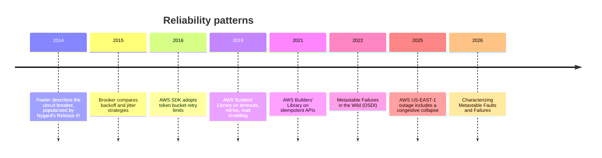
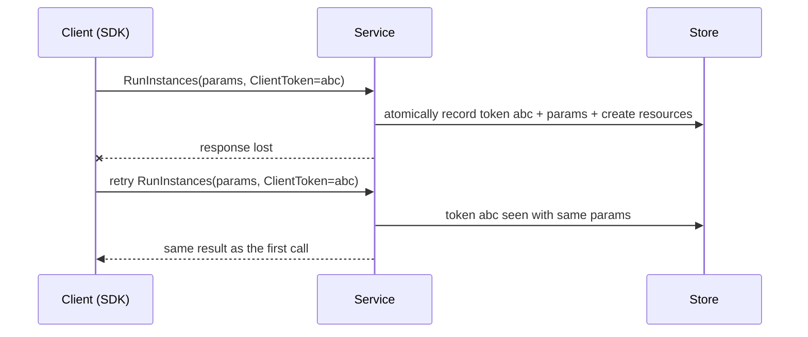
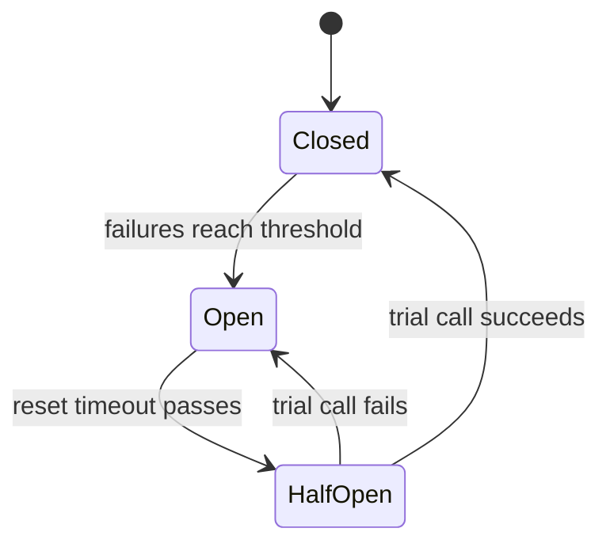
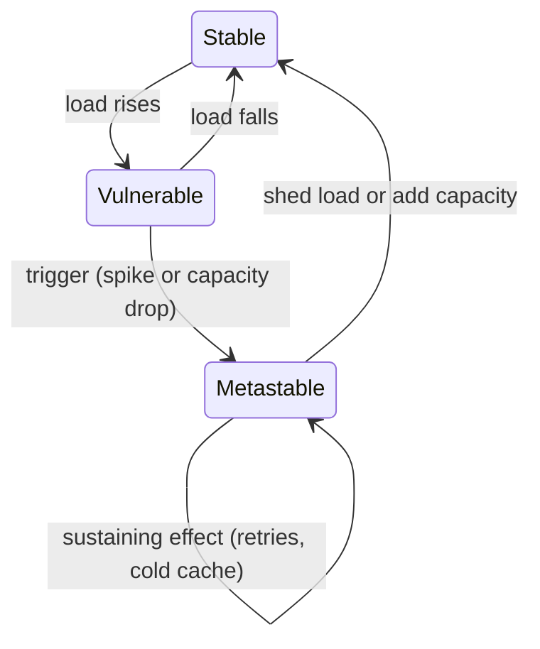

---
tags:
  - distributed-systems
  - reliability
  - overload
  - retries
status: draft
sources:
  - https://builder.aws.com/content/3EumjoZascWd1oZiEgL8ORlv3qE/timeouts-retries-and-backoff-with-jitter
  - https://aws.amazon.com/blogs/architecture/exponential-backoff-and-jitter/
  - https://builder.aws.com/content/3Ev0BENTyBr0XxzRk5FDZzgNYos/making-retries-safe-with-idempotent-apis
  - https://builder.aws.com/content/3Eun1EEyX6p2e3VYNyRLSJzLuMV/using-load-shedding-to-avoid-overload
  - https://sre.google/sre-book/handling-overload/
  - https://www.martinfowler.com/bliki/CircuitBreaker.html
  - https://brooker.co.za/blog/2022/02/16/circuit-breakers.html
  - https://www.usenix.org/system/files/osdi22-huang-lexiang.pdf
  - https://arxiv.org/pdf/2606.00942
  - https://aws.amazon.com/message/101925
created: 2026-11-26
updated: 2026-11-26
---

## Table Of Contents

---

- [[#TL;DR|TL;DR]]
- [[#The Problem|The Problem]]
- [[#Foundations|Foundations]]
    - [[#Goodput, Not Throughput|Goodput, Not Throughput]]
    - [[#Retries Multiply|Retries Multiply]]
- [[#How We Got Here|How We Got Here]]
- [[#How It Works|How It Works]]
    - [[#Timeouts|Timeouts]]
    - [[#Retries with Backoff, Jitter and Budgets|Retries with Backoff, Jitter and Budgets]]
    - [[#Idempotency Tokens|Idempotency Tokens]]
    - [[#Load Shedding and Priorities|Load Shedding and Priorities]]
    - [[#Circuit Breakers and Their Limits|Circuit Breakers and Their Limits]]
    - [[#Metastable Failures|Metastable Failures]]
- [[#Where It Is Now|Where It Is Now]]
- [[#Trade-offs & Open Problems|Trade-offs & Open Problems]]
- [[#Resources|Resources]]
- [[#Related Notes|Related Notes]]

## ***TL;DR***

---

*Reliability patterns are the small, unglamorous habits that keep one slow dependency from taking down everything above it: timeouts on every call, careful retries with backoff and jitter, idempotent APIs so retries are safe, and shedding load before a server drowns. The deeper lesson of the last few years is that these same mechanisms, used carelessly, cause the worst outages.*

- **Timeouts:** pick them from a latency percentile that matches the false-timeout rate you can accept ([Brooker, AWS Builders' Library](https://builder.aws.com/content/3EumjoZascWd1oZiEgL8ORlv3qE/timeouts-retries-and-backoff-with-jitter)).
- **Retries are "selfish":** three retries at each of five layers can multiply load on a failing database 243 times ([Brooker](https://builder.aws.com/content/3EumjoZascWd1oZiEgL8ORlv3qE/timeouts-retries-and-backoff-with-jitter)). Retry at one layer, with a budget.
- **Idempotency:** a client-supplied token makes a repeated request return the same result instead of doing the work twice ([AWS Builders' Library](https://builder.aws.com/content/3Ev0BENTyBr0XxzRk5FDZzgNYos/making-retries-safe-with-idempotent-apis)).
- **Load shedding:** reject excess work cheaply so accepted work finishes in time ([AWS Builders' Library](https://builder.aws.com/content/3Eun1EEyX6p2e3VYNyRLSJzLuMV/using-load-shedding-to-avoid-overload)).
- **Metastable failures:** overload that keeps itself going after the trigger is gone, usually through retries; at least 4 of 15 major AWS outages in a decade were this kind ([Huang et al., OSDI 2022](https://www.usenix.org/system/files/osdi22-huang-lexiang.pdf)).

## ***The Problem***

---

*In a distributed system every call can be slow, fail or hang, and the natural reactions, waiting longer and trying again, turn a small problem in one place into a big one everywhere.*

When a dependency slows down, callers that wait forever pile up and exhaust their own threads and connections, which makes *them* slow for their callers. Fowler describes how many callers waiting on an unresponsive supplier can exhaust critical resources and cascade failures across systems ([Fowler](https://www.martinfowler.com/bliki/CircuitBreaker.html)).

Retrying seems like the cure, but every retry is more load on the thing that is already struggling. And if a request had side effects, retrying it might do them twice: charge a card twice, launch two servers. The patterns in this note are the field's answers, along with the hard-won knowledge of when each one backfires. They sit on top of [[Failure Models]]: a timeout cannot tell a dead server from a slow one.

## ***Foundations***

---

*Two ideas explain most of this note: what matters under load is goodput, useful work done in time, and retries compound multiplicatively through a call stack.*

### Goodput, Not Throughput

**Throughput** is how many requests arrive. **Goodput** is how many are answered correctly *and* fast enough for the client to use the answer ([AWS Builders' Library](https://builder.aws.com/content/3Eun1EEyX6p2e3VYNyRLSJzLuMV/using-load-shedding-to-avoid-overload)).

When a server is overloaded, latency climbs past client timeouts. The server keeps working on requests whose clients have already given up, so every unit of that work is wasted. Clients then retry, adding more work. Throughput stays high while goodput collapses. As David Yanacek puts it, "the last thing a system should do in an overload situation, where capacity is constrained, is waste work" ([AWS Builders' Library](https://builder.aws.com/content/3Eun1EEyX6p2e3VYNyRLSJzLuMV/using-load-shedding-to-avoid-overload)).

### Retries Multiply

If each of $L$ layers in a call stack makes up to $a$ attempts per request it receives, the bottom layer can see

$$\text{amplification} = a^{L}$$

*In words:* every layer multiplies the load of the layer below it, so a modest retry policy repeated at each hop becomes enormous at the bottom.

**Worked example.** Five layers, three attempts each: $3^5 = 243$ requests reach the database for every one the user made, which is exactly the case Brooker warns about ([Brooker](https://builder.aws.com/content/3EumjoZascWd1oZiEgL8ORlv3qE/timeouts-retries-and-backoff-with-jitter)). Now cap retries with Google's per-client budget, where retries may be at most 10% of requests ([Google SRE book](https://sre.google/sre-book/handling-overload/)). Each layer then adds at most 10%, so $1.1^5 \approx 1.61$: the database sees at most 61% extra load instead of 24,200%.

## ***How We Got Here***

---

*These patterns came out of large internet companies running service-oriented systems in the 2000s and 2010s, were written down as practitioner guides, and then got a theory when researchers named and measured metastable failures.*

- **2014:** Fowler writes up the circuit breaker, which Michael Nygard popularized in *Release It!* ([Fowler](https://www.martinfowler.com/bliki/CircuitBreaker.html)).
- **2015:** Brooker's simulation shows jittered backoff cutting work sharply compared with plain exponential backoff ([AWS Architecture Blog](https://aws.amazon.com/blogs/architecture/exponential-backoff-and-jitter/)).
- **2016:** the AWS SDK adopts token bucket limits on retries ([Brooker](https://builder.aws.com/content/3EumjoZascWd1oZiEgL8ORlv3qE/timeouts-retries-and-backoff-with-jitter)).
- **2022:** Huang et al. study 22 metastable failures from 11 organizations ([OSDI 2022](https://www.usenix.org/system/files/osdi22-huang-lexiang.pdf)).

## ***How It Works***

---

*Each pattern handles one part of the problem: timeouts bound waiting, retries recover from blips, idempotency makes retries safe, load shedding protects goodput, and circuit breakers stop calling something that is clearly down.*

### Timeouts

Put a timeout on every remote call, both for connecting and for the request itself. To choose the value, decide what fraction of calls you can afford to time out falsely, say 0.1%, and use the downstream's matching latency percentile, here p99.9, plus padding for slow networks ([Brooker](https://builder.aws.com/content/3EumjoZascWd1oZiEgL8ORlv3qE/timeouts-retries-and-backoff-with-jitter)). Propagating the *remaining* time as a deadline across hops lets downstream services drop requests whose clients have already given up ([AWS Builders' Library](https://builder.aws.com/content/3Eun1EEyX6p2e3VYNyRLSJzLuMV/using-load-shedding-to-avoid-overload)).

### Retries with Backoff, Jitter and Budgets

| Practice | Why | Source |
|---|---|---|
| Retry only idempotent calls and server errors | Client errors will fail again; non-idempotent calls may do work twice | [Brooker](https://builder.aws.com/content/3EumjoZascWd1oZiEgL8ORlv3qE/timeouts-retries-and-backoff-with-jitter) |
| Retry at one layer of the stack | Avoids $a^L$ amplification | [Brooker](https://builder.aws.com/content/3EumjoZascWd1oZiEgL8ORlv3qE/timeouts-retries-and-backoff-with-jitter) |
| Exponential backoff with a cap | Gives the dependency time to recover | [Brooker](https://builder.aws.com/content/3EumjoZascWd1oZiEgL8ORlv3qE/timeouts-retries-and-backoff-with-jitter) |
| Jitter | Stops clients retrying in synchronized waves | [AWS Architecture Blog](https://aws.amazon.com/blogs/architecture/exponential-backoff-and-jitter/) |
| Token bucket on retries | Retries stop when most calls are failing | [Brooker](https://builder.aws.com/content/3EumjoZascWd1oZiEgL8ORlv3qE/timeouts-retries-and-backoff-with-jitter) |
| Per-request cap (3 attempts) and per-client budget (retries under 10% of requests) | Bounds total retry load | [Google SRE book](https://sre.google/sre-book/handling-overload/) |

In Brooker's 2015 simulation of 100 contending clients, plain exponential backoff was worst on both total work and completion time; Full Jitter and Decorrelated Jitter both did much better, trading slightly between work and time ([AWS Architecture Blog](https://aws.amazon.com/blogs/architecture/exponential-backoff-and-jitter/)). For periodic jobs, Brooker recommends a consistent per-host offset instead of fresh randomness, because a repeatable pattern makes problems easier to trace ([Brooker](https://builder.aws.com/content/3EumjoZascWd1oZiEgL8ORlv3qE/timeouts-retries-and-backoff-with-jitter)).

### Idempotency Tokens

AWS's approach, from the [Builders' Library](https://builder.aws.com/content/3Ev0BENTyBr0XxzRk5FDZzgNYos/making-retries-safe-with-idempotent-apis):

- The caller supplies a unique token (EC2's `ClientToken`); the SDK generates one if the caller does not, and reuses it on retries.
- A retry gets a response that *means the same* as the first success, not an error like "already exists" that would change the caller's logic.
- Reusing a token with *different* parameters returns a validation error, because the caller probably meant something else.
- Recording the token and making the change must be one atomic operation, or a crash can leave a token with no resources or resources with no token.

Compare how [[Distributed Transactions]] keep a commit decision from being applied twice.

### Load Shedding and Priorities

Ways to protect goodput, from the [Builders' Library](https://builder.aws.com/content/3Eun1EEyX6p2e3VYNyRLSJzLuMV/using-load-shedding-to-avoid-overload) and the [Google SRE book](https://sre.google/sre-book/handling-overload/):

- **Reject early and cheaply** so the requests you accept stay fast. Google notes that for very cheap requests, rejecting costs almost as much as serving, so shedding has limits.
- **Prioritize.** Amazon serves load balancer health pings first and favors finishing started work; Google tags requests with one of four criticality levels (CRITICAL_PLUS down to SHEDDABLE) that propagate to downstream calls.
- **Bound queues and drop stale work**, including requests whose deadlines have passed. [[Message Queues]] works through backlog drain times and dead-letter limits.
- **Throttle at the client.** Google's adaptive throttling lets a client keep sending until its requests reach about twice its accepted requests, then rejects new requests locally with rising probability, so an overloaded backend does not even see them.
- **Measure capacity in resources, not requests.** Request costs vary too much; Google recommends provisioning on CPU.
- **Watch your metrics.** Fast rejections can make latency look *better* during an overload ([AWS Builders' Library](https://builder.aws.com/content/3Eun1EEyX6p2e3VYNyRLSJzLuMV/using-load-shedding-to-avoid-overload)).

### Circuit Breakers and Their Limits

A breaker counts failures; past a threshold it **opens** and fails calls immediately without touching the struggling supplier, then after a timeout lets one trial call through ([Fowler](https://www.martinfowler.com/bliki/CircuitBreaker.html)).

Brooker's warning: breakers assume the whole dependency is either up or down. In a [[Partitioning|sharded]] or cell-based service, one shard may be overloaded while the rest are fine. A breaker that trips for everything hurts users of healthy shards; one that does not trip adds nothing. Breakers can turn partial failures into total ones. Fixes like per-shard breakers or server-provided overload signals work but add coupling or complexity ([Brooker](https://brooker.co.za/blog/2022/02/16/circuit-breakers.html)).

### Metastable Failures

Bronson and colleagues' framework, extended by Huang et al. ([OSDI 2022](https://www.usenix.org/system/files/osdi22-huang-lexiang.pdf)):

- **Stable:** the system recovers from temporary overloads by itself.
- **Vulnerable:** fine until something pushes it.
- **Metastable failure:** a **trigger** pushes it into overload, and a **sustaining effect**, usually a feedback loop created by a common-case optimization, keeps it there even after the trigger is gone.

What the 22 incidents showed:

| Finding | Value |
|---|---|
| Sustaining effect was retries | More than 50% of incidents |
| Triggered by engineer error (bad config, deploys, latent bugs) | About 45% |
| Triggered by load spikes | About 35% |
| Most common outage duration | 4 to 10 hours (35%) |
| Most popular fix | Load shedding, in over half |

A **look-aside cache** can sustain one too: if timeouts stop the cache from refilling, the hit rate stays low and the database stays overloaded. In a MongoDB experiment with a 3-second timeout and up to 4 retries, a 10-second, 80% drop in CPU capacity cut goodput about 90% and the system did not recover on its own ([OSDI 2022](https://www.usenix.org/system/files/osdi22-huang-lexiang.pdf)). The cache-side defenses (leases, coalescing, serving stale, Gutter pools) are in [[Hot Keys and Cache Stampedes]].

## ***Where It Is Now***

---

*As of November 2026, the patterns themselves are settled practice; the frontier is understanding why compositions of individually sensible components fall into self-sustaining failure, and real outages keep supplying examples.*

- **AWS US-EAST-1, October 19 to 20, 2025:** a race condition in DynamoDB's DNS automation emptied the regional endpoint's DNS record. When DynamoDB came back, EC2's DropletWorkflow Manager tried to re-establish leases across the whole fleet; the work took so long that attempts timed out and queued more retries, and AWS says it "had entered a state of congestive collapse." Recovery came from throttling incoming work and restarting hosts. Separately, flapping load balancer health checks triggered failovers that removed healthy capacity. Fixes include a velocity control on how much capacity health-check failover can remove and queue-size-based throttling ([AWS post-event summary](https://aws.amazon.com/message/101925)).
- **Theory catching up (June 2026):** Farahbakhsh, Lu, Alvisi, Haeberlen and Van Renesse trace metastable failures to **metastable faults**, cycles in which components that are each stable on their own push one another away from stability. They prove a metastable failure requires such a fault, give a way to look for these cycles, introduce the Nyx language for reproducing them, and redesign a gaming platform's cluster manager to avoid oscillation ([arXiv 2606.00942](https://arxiv.org/pdf/2606.00942)).

## ***Trade-offs & Open Problems***

---

*Every pattern here helps in the common case and can hurt in the rare one, which is exactly the shape of a metastable failure.*

| Pattern | Helps | Can hurt |
|---|---|---|
| Short timeouts | Bounded waiting | False timeouts and retries under load |
| Retries | Recover from blips | Amplify overload; the top sustaining effect ([OSDI 2022](https://www.usenix.org/system/files/osdi22-huang-lexiang.pdf)) |
| Caches | Cheap common case | Cold cache can sustain overload ([OSDI 2022](https://www.usenix.org/system/files/osdi22-huang-lexiang.pdf)) |
| Health-check failover | Routes around bad nodes | Can remove healthy capacity when checks flap ([AWS](https://aws.amazon.com/message/101925)) |
| Circuit breakers | Stop hammering a dead dependency | Turn partial failures into total ones ([Brooker](https://brooker.co.za/blog/2022/02/16/circuit-breakers.html)) |
| Load shedding | Protects goodput | Rejections cost something; metrics can mislead ([Google SRE](https://sre.google/sre-book/handling-overload/)) |

Open problems:

- **Finding vulnerabilities before they bite.** Huang et al. argue vulnerability is a matter of degree, not on or off ([OSDI 2022](https://www.usenix.org/system/files/osdi22-huang-lexiang.pdf)); the 2026 work offers a method to find destabilizing cycles in a design ([arXiv 2606.00942](https://arxiv.org/pdf/2606.00942)).
- **Recovery paths are rarely tested.** AWS's remediation list includes a new test suite for exactly the lease recovery workflow that collapsed ([AWS](https://aws.amazon.com/message/101925)). [[Deterministic Simulation Testing]] is one way to exercise these paths.
- **Partial failure.** Patterns that assume all-or-nothing dependencies fit poorly with sharded systems ([Brooker](https://brooker.co.za/blog/2022/02/16/circuit-breakers.html)); see [[Gray and Fail-Slow Failures]].

## ***Resources***

---

*The AWS Builders' Library articles are the practical core; read the OSDI 2022 paper for why these patterns fail together.*

- [Brooker, Timeouts, retries, and backoff with jitter](https://builder.aws.com/content/3EumjoZascWd1oZiEgL8ORlv3qE/timeouts-retries-and-backoff-with-jitter).
- [Brooker, Exponential Backoff And Jitter (2015)](https://aws.amazon.com/blogs/architecture/exponential-backoff-and-jitter/).
- [Making retries safe with idempotent APIs](https://builder.aws.com/content/3Ev0BENTyBr0XxzRk5FDZzgNYos/making-retries-safe-with-idempotent-apis).
- [Using load shedding to avoid overload](https://builder.aws.com/content/3Eun1EEyX6p2e3VYNyRLSJzLuMV/using-load-shedding-to-avoid-overload).
- [Google SRE book, Handling Overload](https://sre.google/sre-book/handling-overload/).
- [Fowler, Circuit Breaker](https://www.martinfowler.com/bliki/CircuitBreaker.html) and [Brooker, Will circuit breakers solve my problems?](https://brooker.co.za/blog/2022/02/16/circuit-breakers.html).
- [Huang et al., Metastable Failures in the Wild (OSDI 2022)](https://www.usenix.org/system/files/osdi22-huang-lexiang.pdf).
- [Farahbakhsh et al., Characterizing Metastable Faults and Failures (2026)](https://arxiv.org/pdf/2606.00942).
- [AWS post-event summary, US-EAST-1, October 2025](https://aws.amazon.com/message/101925).

## Related Notes

- [[Failure Models]] — a timeout cannot tell a dead server from a slow one
- [[Gray and Fail-Slow Failures]] — the partial failures that confuse timeouts and breakers
- [[Gossip and Membership]] — flapping health checks are a membership problem too
- [[Coordination Services]] — Chubby's authors saw client retry loops hammer the service
- [[Leases and Fencing]] — the AWS 2025 collapse involved re-establishing leases fleet-wide
- [[Distributed Transactions]] — another place where repeating a step must not repeat its effect
- [[Change Data Capture]] — at-least-once change streams that need idempotent consumers
- [[Deterministic Simulation Testing]] — a way to test recovery paths before production does
- [[Time and Clocks]] — timeouts and deadlines depend on clocks
- [[Consistency Models]] — retries and caches can serve stale results
- [[Hot Keys and Cache Stampedes]] — keeping a cache miss from becoming a herd that overloads the database
- [[Cluster Metadata and Routing]] — constant-work metadata refresh (DynamoDB MemDS) and the 2025 outages caused by bad routing and policy metadata
- [[Message Queues]] — at-least-once delivery, idempotent consumers, dead-letter queues and backlog recovery
- [[Resource Fairness]] — fair queuing and shuffle sharding decide whose requests wait or get shed under overload
