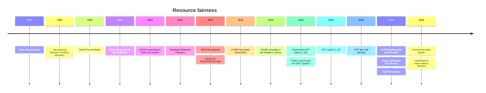
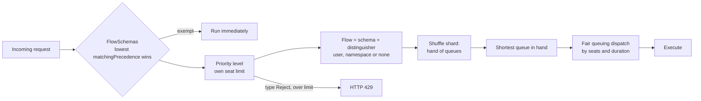

---
tags:
  - distributed-systems
  - resource-fairness
  - scheduling
  - multi-tenancy
  - kubernetes
  - fair-queuing
status: complete
sources:
  - https://arxiv.org/abs/cs/9809099
  - https://web.stanford.edu/class/cs244/papers/demers-queueing.pdf
  - https://www.cs.bu.edu/faculty/matta/Teaching/cs655-papers/DRR.pdf
  - https://sites.ecse.rpi.edu/~koushik/shivkuma-teaching/sp2001/readings/mo-walrand.pdf
  - https://people.eecs.berkeley.edu/~alig/papers/drf.pdf
  - https://people.csail.mit.edu/matei/papers/2012/sigcomm_drfq.pdf
  - https://people.eecs.berkeley.edu/~alig/papers/h-drf.pdf
  - https://static.usenix.org/events/osdi10/tech/full_papers/Gulati.pdf
  - https://www.cs.princeton.edu/~mfreed/docs/pisces-osdi12.pdf
  - https://docs.ceph.com/en/reef/rados/configuration/mclock-config-ref/
  - https://docs.redhat.com/en/documentation/red_hat_ceph_storage/6/html/administration_guide/the-mclock-osd-scheduler
  - https://builder.aws.com/content/3F06NpJ8YeoIGP8VHTw4n81pFn8/workload-isolation-using-shuffle-sharding
  - https://www.kubernetes.io/docs/concepts/cluster-administration/flow-control/
  - https://kubernetes.io/blog/2020/04/06/kubernetes-1-18-feature-api-priority-and-fairness-alpha/
  - https://kueue.sigs.k8s.io/docs/concepts/fair_sharing/
  - https://kueue.sigs.k8s.io/docs/concepts/preemption
  - https://github.com/kubernetes-sigs/kueue/blob/main/site/content/en/docs/concepts/admission_fair_sharing.md
  - https://github.com/kubernetes-sigs/kueue/blob/main/site/content/en/docs/concepts/cohort.md
  - https://github.com/kubernetes-sigs/kueue/blob/main/pkg/cache/scheduler/fair_sharing.go
  - https://newreleases.io/project/github/kubernetes-sigs/kueue/release/v0.20.0
  - https://developers.redhat.com/articles/2026/09/04/configure-admission-fair-sharing-red-hat-build-kueue-1-4
  - https://www.cncf.io/blog/2026/10/28/volcano-v1-16-released-namespacequeue-fairshare-and-a-broader-hypernode-ecosystem/
  - https://slurm.schedmd.com/fair_tree.html
  - https://arxiv.org/pdf/1907.01484
  - https://people.eecs.berkeley.edu/~matei/papers/2020/osdi_gavel.pdf
  - https://arxiv.org/pdf/2401.00588
  - https://arxiv.org/pdf/2501.14312
  - https://arxiv.org/pdf/2508.16646
  - https://arxiv.org/html/2609.18112
  - https://docs.aws.amazon.com/en_gb/AWSSimpleQueueService/latest/SQSDeveloperGuide/sqs-fair-queues.html
created: 2026-11-27
updated: 2026-11-27
---

## Table Of Contents

---

- [[#TL;DR|TL;DR]]
- [[#The Problem|The Problem]]
- [[#Foundations|Foundations]]
    - [[#Max-Min Fairness and Water-Filling|Max-Min Fairness and Water-Filling]]
    - [[#A Family of Fairness Goals|A Family of Fairness Goals]]
    - [[#Measuring Fairness, Jain's Index|Measuring Fairness, Jain's Index]]
    - [[#Fair Queuing and Virtual Time|Fair Queuing and Virtual Time]]
    - [[#Several Resources at Once|Several Resources at Once]]
    - [[#Three Clocks for Fairness|Three Clocks for Fairness]]
- [[#How We Got Here|How We Got Here]]
- [[#How It Works|How It Works]]
    - [[#Deficit Round Robin|Deficit Round Robin]]
    - [[#Multi-Resource Fair Queuing|Multi-Resource Fair Queuing]]
    - [[#Hierarchies of Tenants|Hierarchies of Tenants]]
    - [[#Kueue, Fair Sharing of Quota|Kueue, Fair Sharing of Quota]]
    - [[#Kubernetes API Priority and Fairness|Kubernetes API Priority and Fairness]]
    - [[#Storage IO, mClock and Pisces|Storage IO, mClock and Pisces]]
    - [[#Shuffle Sharding|Shuffle Sharding]]
    - [[#GPU Clusters, Fairness Over Outcomes|GPU Clusters, Fairness Over Outcomes]]
    - [[#LLM Serving, Fairness Over Tokens|LLM Serving, Fairness Over Tokens]]
- [[#Where It Is Now|Where It Is Now]]
- [[#Trade-offs & Open Problems|Trade-offs & Open Problems]]
- [[#Resources|Resources]]
- [[#Related Notes|Related Notes]]

## ***TL;DR***
---
*Resource fairness is how a shared system decides who gets what when demand exceeds capacity. The same handful of ideas (max-min shares, weights, virtual time and a floor on idle credit) reappear in network routers, API servers, disks, batch schedulers and LLM servers.*

- **The default goal is max-min fairness:** keep raising the smallest allocation until it can't grow, so nobody can gain without taking from someone who has less. Weights turn "equal" into "proportional to entitlement" ([Demers, Keshav and Shenker, 1989](https://web.stanford.edu/class/cs244/papers/demers-queueing.pdf)).
- **Fair queuing enforces it request by request.** Each flow gets a virtual clock; the scheduler serves whichever flow is furthest behind. Deficit Round Robin does the same in O(1) work per packet ([Shreedhar and Varghese, 1995](https://www.cs.bu.edu/faculty/matta/Teaching/cs655-papers/DRR.pdf)).
- **Several resources need a new definition.** [[Cluster Scheduling#Fairness Across Several Resources|Dominant Resource Fairness]] (DRF) equalizes each tenant's largest share of any one resource and can't be gamed by lying about demand ([Ghodsi et al., NSDI 2011](https://people.eecs.berkeley.edu/~alig/papers/drf.pdf)). DRFQ carries it to packets, H-DRF to tenant trees.
- **The key design choice is the clock.** *Instantaneous* fairness (DRF, fair queuing) looks at what you hold now; *historical* fairness (Slurm fair share, Kueue Admission Fair Sharing, Volcano's 2026 fairshare plugin) decays past usage with a half-life; *outcome* fairness (Themis) compares your finish time with what a private slice would give you.
- **Everywhere, idle time must not become credit.** Fair queuing, mClock and LLM schedulers all lift a returning tenant's clock to the current level, or a quiet tenant could come back and monopolize the system.
- **In production, Nov 2026:** Kubernetes' API server isolates clients with *API Priority and Fairness* (priority levels, seats, shuffle-sharded fair queues; stable since 1.29); Kueue v0.20 shares quota between ClusterQueues by weighted dominant resource share; Ceph's OSDs schedule I/O with mClock; LLM serving moved from fair *token counts* (VTC, OSDI 2024) to bounded *token latency* (FairInference, September 2026).

## ***The Problem***
---
*Shared infrastructure is cheaper than dedicated infrastructure only if one tenant's burst doesn't ruin everyone else's day. Without an explicit fairness policy, the system hands capacity to whoever asks fastest, and a single buggy client becomes everyone's outage.*

The failure looks the same at every layer:

| Layer | Shared thing | What goes wrong without fairness |
|---|---|---|
| Network router | Link bandwidth | A flow that ignores congestion signals takes the link from flows that back off ([Demers et al.](https://web.stanford.edu/class/cs244/papers/demers-queueing.pdf)) |
| Control plane | API server concurrency | One controller in a retry loop starves leader election and every other client ([Kubernetes APF docs](https://www.kubernetes.io/docs/concepts/cluster-administration/flow-control/)) |
| Storage | Disk or SSD IOPS | An uncapped data-migration VM holds an OLTP VM's latency at 36 ms instead of 16 ms ([mClock](https://static.usenix.org/events/osdi10/tech/full_papers/Gulati.pdf)) |
| Message queue | Consumer capacity | A tenant with a huge backlog raises every tenant's dwell time ([[Message Queues#Amazon SQS|SQS fair queues]]) |
| Batch cluster | CPUs, memory, GPUs | Whoever submits first keeps the cluster for days |
| LLM server | GPU batch slots and KV cache | One heavy client multiplies everyone's time to first token |

Three questions decide what "fair" means for a given system:

1. **What is divided?** One resource (link bytes, IOPS), several at once (CPU, memory, GPUs), or a derived cost (weighted tokens, GPU-hours).
2. **Over what time?** Right now, over a decayed window of recent history, or over the whole life of a job.
3. **Among whom?** Flows, users, namespaces, teams, or a tree of organizations with weights at each level.

And fairness always competes with two other goals: **efficiency** (don't leave capacity idle while someone waits, called *work conservation*) and **isolation** (a guaranteed floor that holds whatever others do). Static partitions give isolation but waste capacity; pure first-come-first-served is efficient but gives no isolation. Every mechanism below is a point between them.

## ***Foundations***
---
*Max-min fairness says what a fair allocation is; fair queuing says how to approach it one request at a time; DRF says what to do when there is more than one resource. The rest of the note is these three ideas wearing different clothes.*

### Max-Min Fairness and Water-Filling

*Max-min fairness gives every user an equal share, hands any part of a share a user can't use to the others, and repeats. It is the definition almost every scheduler in this note targets.*

Demers, Keshav and Shenker's definition: an allocation is fair if (1) no user receives more than it requests, (2) no other allocation satisfying (1) gives a higher minimum, and (3) condition (2) holds recursively after removing the minimal user and its allocation ([1989](https://web.stanford.edu/class/cs244/papers/demers-queueing.pdf)). The algorithm is called *water-filling*: raise everyone's level together, and freeze each user as it hits its demand.

$$
x_i = \min(d_i,\ \lambda) \quad \text{with } \lambda \text{ chosen so that } \sum_i x_i = C \ (\text{or } \lambda = \infty \text{ if } \textstyle\sum_i d_i \le C)
$$

*In words:* every user gets its demand $d_i$ or the common water level $\lambda$, whichever is smaller, and the level rises until capacity $C$ is used up. With weights $w_i$, the level is per unit of weight: $x_i = \min(d_i, w_i\lambda)$.

*Worked example:* $C = 10$ and three users demand $d = (2, 3, 8)$.

| Round | Users still rising | Level $\lambda$ | Who freezes | Allocation |
|---|---|---|---|---|
| 1 | A, B, C | $10/3 \approx 3.33$ | A (wants only 2) | A = 2 |
| 2 | B, C | $(10-2)/2 = 4$ | B (wants only 3) | B = 3 |
| 3 | C | $10-2-3 = 5$ | C hits capacity | C = 5 |

Result: $(2, 3, 5)$. Nobody can get more without taking from someone who has less. With weights $(1, 1, 2)$ and every demand at 10, the same 10 units split $2.5 : 2.5 : 5$.

### A Family of Fairness Goals

*Max-min is the most egalitarian member of a family; proportional fairness trades a little equality for more total throughput. Which one a system targets decides how it treats a user who crosses several bottlenecks.*

Mo and Walrand's $(p, \alpha)$-proportional fairness maximizes $\sum_i p_i f_\alpha(x_i)$ with

$$
f_\alpha(x) = \begin{cases} \log x & \alpha = 1 \\[2pt] \dfrac{x^{1-\alpha}}{1-\alpha} & \alpha \ne 1 \end{cases}
$$

*In words:* each user's rate earns diminishing returns, and $\alpha$ sets how sharply. $\alpha = 1$ is *proportional fairness*; as $\alpha \to \infty$ the optimum approaches the max-min allocation; $\alpha = 0$ just maximizes total throughput ([Mo and Walrand, IEEE/ACM ToN 2000](https://sites.ecse.rpi.edu/~koushik/shivkuma-teaching/sp2001/readings/mo-walrand.pdf)).

*Worked example:* two links of capacity 1. Flow A crosses both; flow B uses only link 1; flow C only link 2.

| Goal | A | B | C | Total |
|---|---|---|---|---|
| Max-min ($\alpha \to \infty$) | 0.5 | 0.5 | 0.5 | 1.5 |
| Proportional ($\alpha = 1$): maximize $\log x_A + \log x_B + \log x_C$ s.t. $x_A + x_B \le 1$, $x_A + x_C \le 1$ | 1/3 | 2/3 | 2/3 | 5/3 |
| Max throughput ($\alpha = 0$) | 0 | 1 | 1 | 2 |

Proportional fairness charges A for using two bottlenecks. Cluster schedulers almost always pick max-min (often on a derived share, as DRF does), because "my job crosses more machines" is not a reason tenants accept for getting less.

### Measuring Fairness, Jain's Index

*Jain's index turns a list of allocations into one number between $1/n$ and 1, which is why papers from 1984 to 2025 report it.*

$$
J(x_1, \dots, x_n) = \frac{\left(\sum_i x_i\right)^2}{n \sum_i x_i^2}
$$

*In words:* 1 when everyone gets the same; $1/n$ when one user gets everything; $k/n$ when $k$ users share equally and the rest get nothing. The authors' gloss: a fairness of 0.10 "means that it is unfair to 90% of the users" ([Jain, Chiu and Hawe, DEC TR-301, 1984](https://arxiv.org/abs/cs/9809099)).

*Worked example:* $(1,1,1,1) \to 1$; $(2,2,0,0) \to 16/(4 \cdot 8) = 0.5$; $(4,0,0,0) \to 16/64 = 0.25$. Apply it to *normalized* allocations, $x_i / \text{fair}_i$. The max-min result $(2, 3, 5)$ above scores $100/(3 \cdot 38) \approx 0.88$ on raw numbers, but 1.0 when each user is divided by its max-min fair share, because A and B got everything they asked for.

### Fair Queuing and Virtual Time

*Fair queuing approximates max-min fairness for a stream of requests by simulating an ideal "one bit from each flow in turn" server and sending packets in the order that ideal server would finish them.*

Demers, Keshav and Shenker built on John Nagle's per-flow round robin and fixed its two flaws: big packets got more bandwidth, and a flow's position didn't reflect how long it had waited ([1989](https://web.stanford.edu/class/cs244/papers/demers-queueing.pdf)). Let $R(t)$ be the number of rounds the ideal bit-by-bit server has completed. A packet of size $P$ from a flow whose previous packet had finish number $F_{\text{prev}}$ gets

$$
S = \max\big(F_{\text{prev}},\ R(t_{\text{arrival}})\big), \qquad F = S + P/w
$$

*In words:* a packet starts either when its flow's previous packet finishes or "now" in virtual time, whichever is later, and finishes $P/w$ rounds later for a flow of weight $w$. The scheduler always sends the packet with the smallest $F$.

The $\max$ with $R(t)$ is the most important detail in this note. It means **a flow that was idle does not bank credit**: when it returns, its clock jumps forward to the present instead of starting far behind everyone else. Every system below has its own version of this floor: Start-time Fair Queuing's virtual start tag ([DRFQ paper](https://people.csail.mit.edu/matei/papers/2012/sigcomm_drfq.pdf)), mClock's offset for a newly active VM ([Gulati et al.](https://static.usenix.org/events/osdi10/tech/full_papers/Gulati.pdf)), VTC's "counter lift" for an LLM client ([Sheng et al.](https://arxiv.org/pdf/2401.00588)), and Linux's EEVDF CPU scheduler, which places a waking task by its *lag* ([[CPU Scheduling]]).

*Worked example:* two flows, weight 1, $R = 100$ now. Flow A has been busy and its last packet's $F_{\text{prev}} = 130$; flow B was idle. A 10-unit packet arrives on each. A gets $S = 130, F = 140$; B gets $S = \max(\text{old}, 100) = 100, F = 110$, so B's packet goes first. Without the floor, if B's last packet had $F = 20$ an hour ago, B would get $F = 30$ and its next many packets would all jump ahead of A.

### Several Resources at Once

*With one resource, equal shares are obvious. With CPU and memory, or CPU and link time, a user who needs a lot of one and little of the other makes "equal" ambiguous, and the obvious answers can be gamed.*

DRF's answer is to compare each user's *dominant share*, its largest fraction of any single resource, and apply max-min to those. The NSDI 2011 paper's 9-CPU, 18-GB worked example is in [[Cluster Scheduling#Fairness Across Several Resources|Cluster Scheduling]]. What matters here is *why* that answer won ([Ghodsi et al.](https://people.eecs.berkeley.edu/~alig/papers/drf.pdf)):

| Property | Meaning | DRF |
|---|---|---|
| Sharing incentive | No user does better with a private $1/n$ slice of every resource | Yes |
| Strategy-proofness | Lying about demand can't increase your allocation | Yes |
| Envy-freeness | No user prefers another's allocation | Yes |
| Pareto efficiency | Can't help one user without hurting another | Yes |
| Resource monotonicity | Adding resources never shrinks anyone's share | No; the authors argue no policy has it together with sharing incentive and Pareto efficiency |

The alternatives fail exactly on strategy-proofness. The DRFQ paper shows that *bottleneck fairness* (divide whichever resource is currently the bottleneck) lets a flow nearly double its share by inflating its use of the other resource, and per-resource fair queuing can be gamed by about 2× ([Ghodsi et al., SIGCOMM 2012](https://people.csail.mit.edu/matei/papers/2012/sigcomm_drfq.pdf)).

### Three Clocks for Fairness

*The biggest difference between real fairness mechanisms is not the formula but the time horizon: what you hold now, what you used recently, or how your job turned out.*

| Clock | Question it answers | Examples | Weakness |
|---|---|---|---|
| **Instantaneous** | Who holds the least right now? | Fair queuing, DRF, Kueue preemption-based fair sharing, Volcano `drf` | Long tasks: an hours-long GPU job frees nothing for hours, so late arrivals wait ([Themis](https://arxiv.org/pdf/1907.01484)) |
| **Decayed history** | Who used the least over the last few hours or days? | Slurm classic and Fair Tree, Kueue Admission Fair Sharing, Volcano `fairshare` (2026) | Not strategy-proof in the DRF sense; burst-then-wait patterns can still win; needs a tuned half-life |
| **Outcome** | Whose job is furthest behind what a private slice would give? | Themis finish-time fairness, Gavel's normalized max-min | Needs estimates of job runtime and placement sensitivity |

A decayed-usage counter with half-life $H$ behaves like

$$
U(t + \Delta) = U(t) \cdot 2^{-\Delta / H} + \text{usage in } [t, t+\Delta]
$$

*In words:* every half-life, old usage counts half as much. Kueue describes its reported usage the same way: it "closes half of the remaining gap every `usageHalfLifeTime`" ([Kueue AFS docs](https://github.com/kubernetes-sigs/kueue/blob/main/site/content/en/docs/concepts/admission_fair_sharing.md)). *Example:* with a one-week half-life, a team that used 1,000 GPU-hours last week and nothing since carries 500 into this week and 250 into the next; with Volcano's default four-hour half-life, the same usage is down to under 1 GPU-hour after two days (12 half-lives: $1000 / 4096 \approx 0.24$).

## ***How We Got Here***
---
*Fairness began in networking (fair queuing for routers), moved to operating systems and storage (proportional-share CPU and I/O schedulers), then to datacenter schedulers with DRF in 2011. The GPU and LLM era forced two new ideas: fairness over job outcomes, and fairness over token latency.*

- **1980s, networking.** Jain, Chiu and Hawe's index (1984) gave the field a number. Nagle proposed per-flow round robin; Demers, Keshav and Shenker (1989) made it byte-accurate with finish numbers.
- **1990s, cheaper fair queuing.** Deficit Round Robin (1995) got fairness with O(1) work per packet; Start-time Fair Queuing and the virtual-time ideas behind EEVDF ([[CPU Scheduling]]) followed.
- **2000, the theory.** Mo and Walrand showed max-min and proportional fairness are two points on one $\alpha$-parameterized family.
- **2010–2013, the datacenter.** mClock (OSDI 2010) gave VMs reservations, limits and shares on a disk whose capacity fluctuates. DRF (2011) defined multi-resource fairness for Mesos and Hadoop; DRFQ (2012) applied it to middlebox packet processing; Pisces (2012) to a multi-tenant key-value store; H-DRF (2013) to organization trees.
- **2020, the API server and the GPU.** Kubernetes added API Priority and Fairness as alpha in 1.18 ([blog, April 2020](https://kubernetes.io/blog/2020/04/06/kubernetes-1-18-feature-api-priority-and-fairness-alpha/)). Themis (NSDI 2020) and Gavel (OSDI 2020) argued that GPU fairness must account for placement and hardware type.
- **2024–2026, LLMs and Kubernetes batch.** VTC (OSDI 2024) defined fairness for continuous-batching LLM servers; DLPM (2025) and FairInference (2026) refined it for prefix caches and latency. Kueue and Volcano brought fair share to Kubernetes batch.

## ***How It Works***
---
*Each subsection is one mechanism in production or in a widely cited system, with its formula and a small example. Read the first two for the core algorithms, then the ones for the layer you care about.*

### Deficit Round Robin

*DRR gets byte-fair service in constant time per packet by giving each queue a quantum of credit per round and carrying unused credit forward.*

Flows hash into queues. Each round, an active queue adds its *quantum* to its *deficit counter*, sends packets while the head packet fits within the counter, and keeps the remainder. A queue that empties is removed from the active list and its counter resets to zero, which is DRR's version of "no banked credit" ([Shreedhar and Varghese, SIGCOMM 1995](https://www.cs.bu.edu/faculty/matta/Teaching/cs655-papers/DRR.pdf)).

*Worked example:* quantum 500 bytes. A holds packets of 200, 750 and 300 bytes; B holds 500 and 500.

| Round | A's counter → sends → left | B's counter → sends → left |
|---|---|---|
| 1 | 500 → 200 (750 doesn't fit) → 300 | 500 → 500 → 0 |
| 2 | 800 → 750 (300 doesn't fit) → 50 | 500 → 500 → queue empty, reset to 0 |
| 3 | 550 → 300 → queue empty, reset to 0 | inactive |

Both flows received 1,250 bytes, though their packets differed in size. The paper proves that a backlogged flow's service is within one maximum packet size of its ideal share, with O(1) work when each quantum is at least the largest packet. Pisces later used *deficit weighted* round robin to enforce per-tenant shares inside each storage node ([Shue, Freedman and Shaikh, OSDI 2012](https://www.cs.princeton.edu/~mfreed/docs/pisces-osdi12.pdf)).

### Multi-Resource Fair Queuing

*DRFQ is fair queuing where a packet's cost is its time on its dominant resource. It matters wherever one request uses CPU, memory bandwidth and network in different proportions, which is most request-serving systems.*

Middleboxes such as intrusion detection, VPN gateways and WAN optimizers spend very different amounts of CPU per byte depending on the packet ([Ghodsi, Sekar, Zaharia and Stoica, SIGCOMM 2012](https://people.csail.mit.edu/matei/papers/2012/sigcomm_drfq.pdf)). DRFQ extends Start-time Fair Queuing:

- Virtual time is measured in microseconds of processing for a weight-1 flow, so it doesn't depend on which resource is busy.
- A packet's start tag is the later of virtual time and the previous packet's finish tag; its finish tag adds the processing time on its *dominant* resource divided by the flow's weight. Tags are tracked per resource and the scheduler uses the maximum.
- Costs are estimated from packet size with linear models (R² above 0.97 for many modules).
- An $\alpha$-bounded variant lets a flow that alternates CPU-heavy and link-heavy packets "dovetail" its demands, trading memorylessness for utilization.

In the Click prototype a bandwidth-bound TCP flow got 160 Mbps under DRFQ versus 75 Mbps under bottleneck fairness (191 Mbps alone), with about 2–4% overhead.

### Hierarchies of Tenants

*Real organizations are trees (company, division, team, user), and fairness should hold at every level. With several resources, the obvious ways to do that starve someone.*

Bhattacharya, Culler, Friedman, Ghodsi, Shenker and Stoica showed two failure modes ([H-DRF, SoCC 2013](https://people.eecs.berkeley.edu/~alig/papers/h-drf.pdf)):

- **Naive hierarchical DRF** walks root to leaf, always picking the child with the lowest dominant share. A parent's dominant share is set by its hungriest child, so once one child saturates a resource, the parent looks full and its other child is "completely starved."
- **Collapsing the tree** into per-leaf weights (product of shares along the path) and running flat weighted DRF works for one resource but not several: in their example a node entitled to 50% gets about 33%.

H-DRF fixes this by computing a parent's consumption as its non-blocked children's usage *rescaled to the smallest dominant share among them*, and ignoring saturated resources. It satisfies a hierarchical share guarantee and group strategy-proofness. In Hadoop YARN on 50 servers it improved one subtree's response times by about 250% over the Capacity Scheduler, and in a 1,200-node simulation of a Facebook trace it beat slot-based scheduling by 44–83%.

Production systems mostly sidestep multi-resource hierarchy by doing single-resource or historical fairness per level: [Slurm's Fair Tree](https://slurm.schedmd.com/fair_tree.html) ranks siblings by share over usage at each level ([[Cluster Scheduling#Slurm and HPC Batch|details]]); Kueue's hierarchical Cohorts take a `fairSharing.weight` per Cohort, so an org with weight 0.75 "will trend towards using 75% of common resources" against a sibling at 0.25 ([Kueue Cohort docs](https://github.com/kubernetes-sigs/kueue/blob/main/site/content/en/docs/concepts/cohort.md)).

### Kueue, Fair Sharing of Quota

*Kueue is the Kubernetes job queue that decides when a batch or training job may start. It turns DRF into a quota-borrowing rule: teams own nominal quota, lend what they don't use, and the team borrowing the most, relative to its weight, is first to be preempted.*

**Structure.** A *ClusterQueue* holds nominal quota per resource and flavor (say, 10 H100s). ClusterQueues join a *Cohort*, inside which unused nominal quota can be borrowed, subject to borrowing and lending limits. Cohorts can nest into a tree, and a Cohort can hold its own extra `nominalQuota` as a shared pool ([Cohort docs](https://github.com/kubernetes-sigs/kueue/blob/main/site/content/en/docs/concepts/cohort.md)). Kueue admits whole jobs; kube-scheduler then places their pods ([[Cluster Scheduling#Gang Scheduling for ML on Kubernetes|Cluster Scheduling]]).

**The share value.** Kueue computes a dominant resource share for each ClusterQueue or Cohort from what it borrows. From the source ([fair_sharing.go](https://github.com/kubernetes-sigs/kueue/blob/main/pkg/cache/scheduler/fair_sharing.go)):

$$
\text{DRS}_q = \frac{1}{w_q} \cdot \max_{r} \frac{\big(\text{usage}_{q,r} - \text{quota}_{q,r}\big)^+}{\text{lendable}_{\text{parent},r}} \times 1000
$$

*In words:* for each resource, take how much the queue uses *above* its own quota (zero if it's within quota), divide by what its parent Cohort can lend, take the largest of those ratios, and divide by the queue's fair-sharing weight. A queue inside its quota has share 0; a queue with weight 0 that borrows has share $+\infty$. Lower share is preferred for admission; higher share is the preferred preemption target.

*Worked example:* a Cohort of three ClusterQueues, each with nominal quota 10 GPUs and no lending limits, so 30 GPUs are lendable. Team A runs 18 GPUs, team B 6, team C 4.

| Queue | Weight | Borrowed | Ratio ×1000 | DRS |
|---|---|---|---|---|
| A | 1 | 8 | 267 | 267 |
| B | 1 | 0 | 0 | 0 |
| C | 1 | 0 | 0 | 0 |

Team B submits a 6-GPU job; only 2 GPUs are free. B is within quota (it would use 12 against 10, borrowing 2, DRS 67), and A has the highest share, so Kueue looks for A's workloads to preempt. If A's weight were 4, its DRS would be 67, equal to B's after admission, and the strategy decides.

**Preemption strategies.** Kueue's two fair-sharing strategies compare the Cohort-level shares of the preemptor's and target's branches ([preemption docs](https://kueue.sigs.k8s.io/docs/concepts/preemption)):

- `LessThanOrEqualToFinalShare`: preempt only if the preemptor's share *with* its new workload is at most the target's share *without* the preempted workload. This tends to pick smaller workloads.
- `LessThanInitialShare`: preempt only if the preemptor's share with its workload is strictly less than the target's share *with* the workload. This tends to pick the lowest-priority, newest workloads.

The project documents a proof that two workloads can't preempt each other back and forth: preemption of B by A requires $\text{DRS}_{A,\text{admitted}} < \text{DRS}_{B,\text{admitted}}$, and the reverse requires the opposite inequality, a contradiction; chains $A \to B \to C$ give strictly increasing shares, so C can't preempt A. The docs flag that the proof for *hierarchical* Cohorts is still missing ([Fair Sharing docs](https://kueue.sigs.k8s.io/docs/concepts/fair_sharing/)).

**Admission Fair Sharing (AFS).** Preemption-based fair sharing works *between* ClusterQueues. AFS orders jobs *within* one ClusterQueue by each LocalQueue's (usually one per namespace) decayed historical usage, divided by the LocalQueue's weight; it never evicts running jobs ([AFS docs](https://github.com/kubernetes-sigs/kueue/blob/main/site/content/en/docs/concepts/admission_fair_sharing.md)). Three details make it hard to game:

- **Entry penalty** (since v0.13): each admitted workload immediately adds a penalty to its LocalQueue's usage, so a tenant that submits 100 jobs at once doesn't get all 100 in before usage statistics catch up.
- **Accounting anchor** (beta in v0.20): usage counts from quota reservation, not from admission, so a job holding quota while waiting on admission checks is charged.
- **Usage beats priority.** Red Hat's write-up notes that priority classes only break ties between LocalQueues with equal usage ([Red Hat, Sep 2026](https://developers.redhat.com/articles/2026/09/04/configure-admission-fair-sharing-red-hat-build-kueue-1-4)).

Configuration is a half-life, a sampling interval and per-resource weights; the upstream example uses `usageHalfLifeTime: "168h"`, `usageSamplingInterval: "5m"` and CPU weighted 2× memory.

### Kubernetes API Priority and Fairness

*Every Kubernetes component talks to one API server. APF keeps a misbehaving client from starving leader election and the built-in controllers, using priority levels for isolation and shuffle-sharded fair queuing within each level.*

Mechanics ([Kubernetes docs](https://www.kubernetes.io/docs/concepts/cluster-administration/flow-control/), stable since 1.29):

- **One budget, divided.** The server's concurrency limit is the sum of `--max-requests-inflight` and `--max-mutating-requests-inflight`, split among *PriorityLevelConfigurations* in proportion to their *nominal concurrency shares*. The defaults include separate levels for leader election, built-in controllers and Pods, "so that an ill-behaved Pod ... cannot prevent leader election or actions by the built-in controllers from succeeding."
- **Borrowing.** Since 1.26, each level's limit is periodically adjusted between its nominal limit minus lendable seats and its nominal limit plus borrowable seats (both set as percentages), reclaiming lent seats when demand reappears.
- **Seats.** A request normally occupies one *seat*. A LIST that the server estimates will return many objects occupies seats in proportion to that estimate; a write is charged extra seat-time for the watch notifications it will trigger; a WATCH holds its seat only for its initial burst of events.
- **Flows and shuffle sharding.** A request's *flow* is its FlowSchema plus a distinguisher (requesting user, target namespace, or nothing). Within a level, each flow is hashed to a *hand* of `handSize` queues out of `queues`, and the request joins the shortest queue in its hand. At most `handSize × queueLengthLimit` requests from one flow can be queued.

*Worked example (the docs' own table):* the probability that a low-rate "mouse" flow has every queue in its hand also holding a high-rate "elephant":

| handSize | queues | 1 elephant | 4 elephants | 16 elephants |
|---|---|---|---|---|
| 8 | 64 | $2.3 \times 10^{-10}$ | $4.9 \times 10^{-4}$ | 0.36 |
| 8 | 128 | $7.0 \times 10^{-13}$ | $3.4 \times 10^{-6}$ | 0.027 |
| 6 | 1024 | $6.3 \times 10^{-16}$ | $8.1 \times 10^{-11}$ | $4.5 \times 10^{-7}$ |

*Reading it:* with 64 queues and hands of 8, one runaway controller essentially never blocks a quiet client, but sixteen of them squeeze about a third of quiet clients. More queues cost memory; larger hands make collisions rarer but let a few flows spread across more queues. The docs advise controllers with many instances to authenticate with distinct usernames, so the distinguisher can tell them apart.

### Storage IO, mClock and Pisces

*Storage needs more than proportional shares: a database wants a guaranteed floor of IOPS, a backup job wants a ceiling, and the device's total capacity changes with the workload. mClock adds reservations and limits to fair queuing; Pisces makes fairness hold across a whole partitioned cluster.*

**mClock** gives each client three numbers: a *reservation* $r$ (minimum IOPS), a *limit* $l$ (maximum) and a *share* $w$ (weight for the rest). Each request carries three tags that advance by $1/r$, $1/l$ and $1/w$ ([Gulati, Merchant and Varman, OSDI 2010](https://static.usenix.org/events/osdi10/tech/full_papers/Gulati.pdf)):

- **Constraint phase:** if any request's reservation tag is due, serve the smallest; reservations come first.
- **Weight phase:** otherwise, among clients under their limit, serve the smallest share tag, then adjust that client's reservation tags so the extra service doesn't count against its floor.
- **Idle clients** have their share tags offset on return, so they don't come back with unlimited credit.

*Worked example (the paper's):* a 1,200-IOPS array shared by RD, OLTP and DM. With reservations of 250 for RD and OLTP and a 1,000-IOPS limit on DM, mClock delivers RD 250, OLTP 380, DM 570; proportional sharing alone would have given RD only 200. Capping DM at 300 IOPS roughly doubled OLTP's throughput and cut its latency from 36 ms to 16 ms.

**dmClock**, the distributed variant, runs mClock on every storage server with no coordination: clients piggyback two counters on each request ($\rho$, requests served in the constraint phase elsewhere, and $\delta$, all requests completed elsewhere since the client last hit this server), and each server advances its tags by those amounts so reservations and shares hold cluster-wide. **Ceph** uses mClock as its OSD scheduler to divide each OSD's measured IOPS among client I/O, background recovery and best-effort work (scrub, backfill, snap trim); the default `balanced` profile reserves 50% each for client and recovery and caps best-effort at 90% ([Ceph mClock reference](https://docs.ceph.com/en/reef/rados/configuration/mclock-config-ref/); Red Hat Ceph Storage made it the default from 6.1, [Red Hat docs](https://docs.redhat.com/en/documentation/red_hat_ceph_storage/6/html/administration_guide/the-mclock-osd-scheduler)).

**Pisces** targets a multi-tenant key-value store where each tenant's data is spread over many partitions and its demand on each node shifts ([OSDI 2012](https://www.cs.princeton.edu/~mfreed/docs/pisces-osdi12.pdf)). It splits the problem across four timescales: partition placement (long timescale), per-node weight allocation by a central controller with reciprocal weight swaps (seconds), latency-driven replica selection by request routers (real time), and DWRR with DRF across bytes in, bytes out and request rate on each node (real time). On Membase it reached a 0.99 min-max ratio of per-tenant throughput to entitlement with under 3% overhead. This is the template for any fairness that must hold for a *tenant*, not a *server*: global shares, local enforcement, and a controller that moves weight to where each tenant's demand is.

### Shuffle Sharding

*Fair queuing protects a quiet tenant from a loud one inside one server. Shuffle sharding protects it across servers: give every tenant a small, nearly unique subset of workers, so a poison request or flood only reaches the tenants that share its exact subset.*

Colm MacCárthaigh's example: 8 workers, each customer assigned a shard of 2. There are $\binom{8}{2} = 28$ distinct shards, so a customer whose requests crash workers takes out only the customers on the same pair, about $1/28$ of the service, "7 times better than regular sharding" with 4 shards of 2. Route 53 assigns each hosted domain 4 of 2,048 virtual name servers, about 730 billion combinations, enough to give every domain its own shard ([Builders' Library, 2019](https://builder.aws.com/content/3F06NpJ8YeoIGP8VHTw4n81pFn8/workload-isolation-using-shuffle-sharding)).

$$
\binom{n}{k} = \frac{n!}{k!(n-k)!}
$$

*In words:* the number of distinct shards of size $k$ from $n$ workers; the fraction of tenants that share *every* worker with a given one is about $1/\binom{n}{k}$. *Example:* $n = 8, k = 2$ gives 28; $n = 2048, k = 4$ gives $\approx 7.3 \times 10^{11}$.

Kubernetes APF uses the same trick for queues inside one process, and SQS fair queues apply tenant-aware delivery to a shared queue ([[Message Queues#Amazon SQS|Message Queues]]). The planned [[Zonal Isolation and Cell-Based Architecture]] note covers cells, the coarse-grained version.

### GPU Clusters, Fairness Over Outcomes

*A GPU job that runs for days on a specific set of well-connected GPUs breaks DRF's assumptions: resources free up rarely, and two jobs with the same GPU count can run at very different speeds. The GPU-era answer is to be fair about finish times or normalized throughput, not about current holdings.*

**Themis** (NSDI 2020) defines *finish-time fairness* ([Mahajan et al.](https://arxiv.org/pdf/1907.01484)):

$$
\rho = \frac{T_{\text{shared}}}{T_{\text{independent}}}
$$

*In words:* a job's finish time in the shared cluster (including queueing and slowdown from poor placement) divided by its finish time on a private $1/N$ slice. $\rho \le 1$ means sharing helped; the scheduler tries to minimize the worst $\rho$. *Example:* a training job that would take 10 hours on its private slice but takes 15 in the shared cluster has $\rho = 1.5$ and goes to the front of the next round.

Themis runs a partial-allocation auction every lease (about 10 minutes): apps bid tables mapping GPU subsets to their estimated $\rho$, the fraction $f$ (0.8 in the paper) with the worst $\rho$ participates, and leftovers go to the rest. On 64 GPUs on Azure and in a 256-GPU simulation, it improved the worst $\rho$ by 1.75× to 3.25× over Optimus, Gandiva, Tiresias and SLAQ while also improving cluster efficiency by 5% to 250%.

**Gavel** (OSDI 2020) handles *heterogeneous* GPUs. It writes policies as optimizations over an allocation matrix $X$, where $X_{mj}$ is the fraction of time job $m$ spends on accelerator type $j$ ([Narayanan et al.](https://people.eecs.berkeley.edu/~matei/papers/2020/osdi_gavel.pdf)):

$$
\text{throughput}(m, X) = \sum_j T_{mj} X_{mj}
$$

*In words:* a job's effective throughput is its measured speed on each GPU type, weighted by time on that type. Max-min fairness then maximizes the minimum of each job's effective throughput *divided by what it would get from an equal split of the cluster*, so a job that barely benefits from a newer GPU isn't handed one just to equalize counts. *Example:* a job that runs 2 iterations/s on an older GPU and 3 on a newer one, given 50% of each, has effective throughput $0.5 \cdot 2 + 0.5 \cdot 3 = 2.5$. With preemptive rounds of about 6 minutes, heterogeneity-aware policies improved average job completion time by up to 3.5× in simulation.

**In production**, Kubernetes batch has mostly taken the historical route. Volcano 1.16 (October 2026) added a `fairshare` plugin that tracks per-namespace resource-seconds within a queue with exponential decay (default half-life four hours), orders pending jobs by it before the `drf` plugin compares current allocation, and optionally persists usage across scheduler restarts; it is "inspired by Slurm fair-share scheduling" and does not preempt ([CNCF, Oct 2026](https://www.cncf.io/blog/2026/10/28/volcano-v1-16-released-namespacequeue-fairshare-and-a-broader-hypernode-ecosystem/)).

### LLM Serving, Fairness Over Tokens

*An LLM server batches many clients' requests on one GPU, and a request's cost (input tokens, output tokens, KV-cache space) isn't known when it arrives. Request-per-minute limits waste capacity; fair schedulers now charge by tokens as they are generated, and the 2026 work bounds latency instead.*

**VTC, the Virtual Token Counter** (Sheng et al., OSDI 2024) defines service as weighted tokens, $W = w_p n_p + w_q n_q$ for $n_p$ input and $n_q$ output tokens, and applies fair queuing to continuous batching ([paper](https://arxiv.org/pdf/2401.00588)):

- Keep a counter $c_i$ per client; when there's room in the batch, admit the queued client with the smallest counter.
- Charge input tokens on admission and output tokens after each decode step, so the scheduler never needs output lengths in advance.
- **Counter lift:** a client returning to an idle queue gets $c_u \leftarrow \max\{c_u, \min\{c_i : i \text{ queued}\}\}$. This is the fair-queuing floor again.

The paper proves that for any two continuously backlogged clients,

$$
|W_f(t_1, t_2) - W_g(t_1, t_2)| \le 2 \max(w_p L_{\text{input}},\ w_q M)
$$

*In words:* over any interval, two busy clients' weighted service differs by at most twice the larger of one maximum-length prompt and one full batch of output tokens, where $L_{\text{input}}$ is the longest allowed input and $M$ is the most tokens that fit in a running batch; the bound is tight within 2×. *Example:* with the paper's weights $w_p = 1, w_q = 2$, a 4,000-token input cap and a 10,000-token batch (the paper's memory pool for Llama-2-7B on an A10G), $U = \max(4000, 20000) = 20{,}000$, so the gap stays under 40,000 weighted tokens however long the clients run. On a real LMSYS trace, VTC halved the maximum service gap relative to FCFS (368 vs 760) at the same throughput (779 vs 777 tokens/s), while a 5-requests-per-minute limit got a smaller gap only by dropping throughput to about 340 tokens/s. The scheduler is about 100 lines in S-LoRA.

**Follow-ups** fix what VTC trades away:

| System | Problem with plain VTC | Fix | Reported result |
|---|---|---|---|
| **DLPM / D²LPM** (Cao, Wang et al., 2025) | Fair order breaks up requests that share a prefix, wasting the [[KV Cache]] | Longest-prefix-match order with a per-client deficit quantum $Q^u$; a global radix tree routes across workers | Service gap bounded by $2(U + Q^u)$ per worker; up to 2.87× VTC's throughput ([arXiv 2501.14312](https://arxiv.org/pdf/2501.14312)) |
| **Equinox** (SJTU, 2025) | Token counts ignore latency and GPU efficiency | Score $0.7 \cdot$ user-facing counter $+ 0.3 \cdot$ resource counter, with predicted output length | Up to 60% lower time to first token than VTC, 13% higher Jain's index ([arXiv 2508.16646](https://arxiv.org/pdf/2508.16646)) |
| **FairInference** (Berkeley, Sep 2026) | Long-run token fairness can still delay any single request arbitrarily | *δ-token fairness*: each token of a well-behaved client finishes within $\delta$ of when it would in isolation, via per-token deadlines, EDF admission and a δ-fair KV-cache eviction policy | Well-behaved client's time to first token 3.2 s vs 28× that under VTC and 66× under plain SGLang ([arXiv 2609.18112](https://arxiv.org/html/2609.18112)) |

FairInference's framing is the cleanest statement of the trade-off in this whole note: $\delta \to \infty$ is today's shared serving, $\delta = 0$ is static partitioning, and the administrator picks a point in between. See [[LLM Serving]] for the batching and scheduling these build on.

## ***Where It Is Now***
---
*As of November 27, 2026: fairness mechanisms are converging on decayed-usage ordering plus weighted borrowing in Kubernetes batch, while LLM serving research has moved from fair throughput to bounded per-token latency.*

- **Kueue v0.20 (current release line in November 2026).** Admission Fair Sharing is beta and on by default; v0.20 made usage count from quota reservation rather than admission (`AdmissionFairSharingAnchorAtQuotaReservation`, beta, a breaking change), fixed cases where AFS admitted in priority order instead of fair-sharing order and where weight-0 LocalQueues were preferred, added an alpha `FairSharingRefill` gate so a queue that admits one workload can admit its next in the same cycle, and fixed missed preemption targets behind an alpha gate ([v0.20.0 notes](https://newreleases.io/project/github/kubernetes-sigs/kueue/release/v0.20.0)). Red Hat shipped AFS in its build of Kueue 1.4 for OpenShift (September 2026).
- **Volcano 1.16 (October 2026)** added decayed per-namespace fair share and *NamespaceQueues*, which let a cluster admin authorize a namespace to build its own queue hierarchy under a cluster queue ([CNCF](https://www.cncf.io/blog/2026/10/28/volcano-v1-16-released-namespacequeue-fairshare-and-a-broader-hypernode-ecosystem/)). Both Kubernetes batch projects now order work by decayed historical usage, the approach Slurm's fair share has long used, rather than by current allocation alone.
- **API servers.** APF has been stable since Kubernetes 1.29 and is enabled by default, so a cluster's control plane gets this protection from noisy clients unless an operator turns it off ([docs](https://www.kubernetes.io/docs/concepts/cluster-administration/flow-control/)).
- **Managed queues.** SQS fair queues (July 2025) treat `MessageGroupId` as a tenant and favor quiet tenants when one has disproportionate in-flight messages ([SQS docs](https://docs.aws.amazon.com/en_gb/AWSSimpleQueueService/latest/SQSDeveloperGuide/sqs-fair-queues.html); [[Message Queues]]).
- **Storage.** mClock is Ceph's OSD scheduler, with operator-facing profiles rather than raw tags ([Ceph docs](https://docs.ceph.com/en/reef/rados/configuration/mclock-config-ref/)).
- **LLM serving.** Fair scheduling went from VTC's token counts (2024) to prefix-aware deficits (DLPM, 2025) to latency bounds (FairInference, v1 dated September 16, 2026). FairInference reports that VTC and DLPM can raise a well-behaved client's time to first token by up to an order of magnitude, which is the gap the next generation of serving schedulers will be judged on.

## ***Trade-offs & Open Problems***
---
*Every fairness mechanism gives up some utilization, some locality, or some resistance to gaming. The open problems are about cost models (what is one unit of GPU or token worth), hierarchy, and proving the mechanisms behave.*

| Choice | You get | You pay |
|---|---|---|
| Static partitions | Perfect isolation, simple accounting | Idle capacity whenever a tenant is quiet |
| Work-conserving fair sharing | High utilization | A quiet tenant's return may wait for preemption or task completion |
| Hard rate limits (RPM, IOPS caps) | Predictable ceilings | Not work-conserving at low load (VTC's RPM baseline lost over half its throughput) |
| Instantaneous fairness (DRF) | Strategy-proof, memoryless | Unfair to late arrivals when tasks run for hours |
| Decayed history (fair share) | Fair over days, matches how teams think about budgets | Depends on the half-life; less strategy-proof |
| Outcome fairness (Themis) | Fair finish times, placement-aware | Needs runtime and slowdown estimates; auctions are complex |
| Preemption to restore fairness | Quick return of borrowed quota | Lost work, checkpoint overhead, gang re-placement ([[Gang and Topology-Aware Scheduling]]) |
| Locality-aware ordering (DLPM) | Cache hits and throughput | Looser fairness bound (adds the quantum) |

Open problems worth tracking:
- **What is a unit of work?** DRF assumes interchangeable units; Gavel showed one hour on one GPU type isn't one hour on another; VTC's weights follow API pricing; Equinox and FairInference argue token counts miss latency. There is no agreed cost model for heterogeneous accelerators. See [[GPU Cluster Infrastructure]].
- **Hierarchical guarantees in practice.** H-DRF solved multi-resource hierarchy in 2013, but production systems still do per-level single-resource or historical fairness, and Kueue's no-preemption-loop proof does not yet cover hierarchical Cohorts.
- **Gaming historical fairness.** Kueue's entry penalty exists because tenants could submit bursts before usage updated; any decayed counter invites burst-and-idle strategies that DRF's strategy-proofness rules out.
- **Fairness across clusters and regions.** Queueing jobs across several clusters adds another level of the tenant tree, and none of the sources above defines fairness for it; [[Cluster Scheduling]] notes the same gap for heterogeneous hardware.
- **Fairness vs locality.** Prefix caches, data locality ([[Cluster Scheduling#Quincy and Firmament, Flow-Based|Quincy]]) and GPU topology all reward keeping a tenant's work together; fairness rewards spreading it. DLPM's quantum is one explicit knob; most systems tune implicitly.
- **Unknown costs.** Fair queuing assumes you can estimate a request's cost (DRFQ's linear models, APF's LIST estimates, VTC's per-token charging). Expensive outliers whose cost is only known after the fact, like a pathological query, still slip through; see [[Hot Keys and Cache Stampedes]] and [[Reliability Patterns]].

## ***Resources***
---
*Start with Demers, Keshav and Shenker for max-min and fair queuing, then DRF and DRFQ for several resources. For practice, read the Kubernetes APF docs and Kueue's fair-sharing pages; for the frontier, read VTC and then FairInference.*

**Foundations**
- [A Quantitative Measure of Fairness and Discrimination for Resource Allocation in Shared Computer Systems](https://arxiv.org/abs/cs/9809099): Jain, Chiu and Hawe, DEC TR-301, 1984.
- [Analysis and Simulation of a Fair Queueing Algorithm](https://web.stanford.edu/class/cs244/papers/demers-queueing.pdf): Demers, Keshav and Shenker, SIGCOMM 1989.
- [Efficient Fair Queuing using Deficit Round Robin](https://www.cs.bu.edu/faculty/matta/Teaching/cs655-papers/DRR.pdf): Shreedhar and Varghese, SIGCOMM 1995.
- [Fair End-to-End Window-Based Congestion Control](https://sites.ecse.rpi.edu/~koushik/shivkuma-teaching/sp2001/readings/mo-walrand.pdf): Mo and Walrand, IEEE/ACM ToN 2000. The $\alpha$-fair family.

**Multi-resource and hierarchical fairness**
- [Dominant Resource Fairness](https://people.eecs.berkeley.edu/~alig/papers/drf.pdf): Ghodsi, Zaharia, Hindman, Konwinski, Shenker and Stoica, NSDI 2011.
- [Multi-Resource Fair Queueing for Packet Processing](https://people.csail.mit.edu/matei/papers/2012/sigcomm_drfq.pdf): Ghodsi, Sekar, Zaharia and Stoica, SIGCOMM 2012.
- [Hierarchical Scheduling for Diverse Datacenter Workloads](https://people.eecs.berkeley.edu/~alig/papers/h-drf.pdf): Bhattacharya et al., SoCC 2013. H-DRF.

**Storage and services**
- [mClock: Handling Throughput Variability for Hypervisor IO Scheduling](https://static.usenix.org/events/osdi10/tech/full_papers/Gulati.pdf): Gulati, Merchant and Varman, OSDI 2010. Also dmClock.
- [Performance Isolation and Fairness for Multi-Tenant Cloud Storage](https://www.cs.princeton.edu/~mfreed/docs/pisces-osdi12.pdf): Shue, Freedman and Shaikh, OSDI 2012. Pisces.
- [Workload isolation using shuffle-sharding](https://builder.aws.com/content/3F06NpJ8YeoIGP8VHTw4n81pFn8/workload-isolation-using-shuffle-sharding): Colm MacCárthaigh, AWS Builders' Library, 2019.
- [Ceph mClock config reference](https://docs.ceph.com/en/reef/rados/configuration/mclock-config-ref/) and [Red Hat Ceph mClock scheduler](https://docs.redhat.com/en/documentation/red_hat_ceph_storage/6/html/administration_guide/the-mclock-osd-scheduler).

**GPU clusters**
- [Themis: Fair and Efficient GPU Cluster Scheduling](https://arxiv.org/pdf/1907.01484): Mahajan et al., NSDI 2020.
- [Heterogeneity-Aware Cluster Scheduling Policies for Deep Learning Workloads](https://people.eecs.berkeley.edu/~matei/papers/2020/osdi_gavel.pdf): Narayanan et al., OSDI 2020. Gavel.

**LLM serving**
- [Fairness in Serving Large Language Models](https://arxiv.org/pdf/2401.00588): Sheng et al., OSDI 2024. VTC.
- [Locality-aware Fair Scheduling in LLM Serving](https://arxiv.org/pdf/2501.14312): Cao, Wang et al., 2025. DLPM and D²LPM.
- [Equinox: Holistic Fair Scheduling in Serving Large Language Models](https://arxiv.org/pdf/2508.16646): Wei et al., 2025.
- [Token Latency Fairness: Performance Isolation for Multi-Tenant LLM Serving](https://arxiv.org/html/2609.18112): Bali, Ponnapalli, Wang, Crooks, Shenker and Zaharia, arXiv, September 2026. FairInference.

**Docs and releases**
- [Kubernetes API Priority and Fairness](https://www.kubernetes.io/docs/concepts/cluster-administration/flow-control/) and the [1.18 alpha announcement](https://kubernetes.io/blog/2020/04/06/kubernetes-1-18-feature-api-priority-and-fairness-alpha/).
- Kueue: [Fair Sharing](https://kueue.sigs.k8s.io/docs/concepts/fair_sharing/), [Preemption](https://kueue.sigs.k8s.io/docs/concepts/preemption), [Admission Fair Sharing](https://github.com/kubernetes-sigs/kueue/blob/main/site/content/en/docs/concepts/admission_fair_sharing.md), [Cohorts](https://github.com/kubernetes-sigs/kueue/blob/main/site/content/en/docs/concepts/cohort.md), [`fair_sharing.go`](https://github.com/kubernetes-sigs/kueue/blob/main/pkg/cache/scheduler/fair_sharing.go), [v0.20.0 release notes](https://newreleases.io/project/github/kubernetes-sigs/kueue/release/v0.20.0).
- [Configure admission fair sharing in Red Hat build of Kueue 1.4](https://developers.redhat.com/articles/2026/09/04/configure-admission-fair-sharing-red-hat-build-kueue-1-4): Red Hat Developer, September 2026.
- [Volcano v1.16: NamespaceQueue, fairshare](https://www.cncf.io/blog/2026/10/28/volcano-v1-16-released-namespacequeue-fairshare-and-a-broader-hypernode-ecosystem/): CNCF, October 2026.
- [Slurm Fair Tree](https://slurm.schedmd.com/fair_tree.html).
- [Amazon SQS fair queues](https://docs.aws.amazon.com/en_gb/AWSSimpleQueueService/latest/SQSDeveloperGuide/sqs-fair-queues.html).

## ***Related Notes***
---
*Fairness is one of the three goals every scheduler balances, so most links here are to the systems that need it.*

- [[Cluster Scheduling]] — DRF's worked example, Slurm fair share and Fair Tree, Kueue and Volcano in the Kubernetes batch stack.
- [[Gang and Topology-Aware Scheduling]] — All-or-nothing jobs, which make fair shares lumpy.
- [[Overcommit and Vertical Autoscaling]] — Who loses first when reclaimed capacity runs out: priority kill order and QoS classes.
- [[GPU Cluster Infrastructure]] — The heterogeneous, topology-sensitive accelerators that break DRF's assumptions.
- [[Message Queues]] — SQS fair queues and noisy tenants in shared queues.
- [[Reliability Patterns]] — Load shedding, quotas and retry storms; fairness decides who is shed.
- [[Hot Keys and Cache Stampedes]] — Skewed load from one key or tenant, the other face of noisy neighbors.
- [[Coordination Services]] — etcd behind the Kubernetes API server that APF protects.
- [[Disaggregated LSMs and Compaction Offload]] — Shared compaction pools that must rank many tenants' jobs.
- [[Partitioning]] — Pisces and shuffle sharding both start from how data and tenants map to nodes.
- [[Zonal Isolation and Cell-Based Architecture]] — Planned: cells, the coarse version of shuffle sharding.
- [[Queueing Theory for Systems]] — Planned: why fair queuing still lets latency grow with load.
- [[CPU Scheduling]] — EEVDF and CFS, the same virtual-time fairness inside one kernel.
- [[Containers, Namespaces and cgroups]] — `cpu.weight` and `io.weight`, proportional shares on one machine.
- [[Block Layer and IO Schedulers]] — Per-device I/O scheduling under mClock-style policies.
- [[LLM Serving]] — Continuous batching, the setting VTC and FairInference schedule.
- [[KV Cache]] — The memory whose eviction and prefix sharing fair LLM schedulers must account for.
