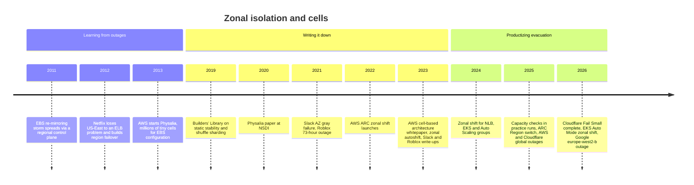
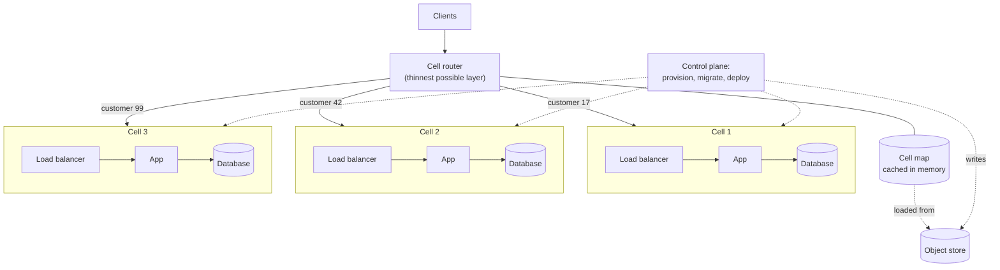
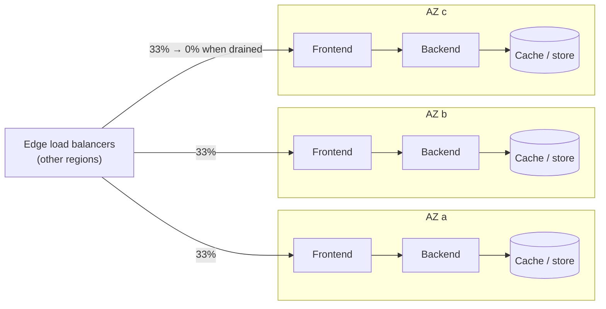
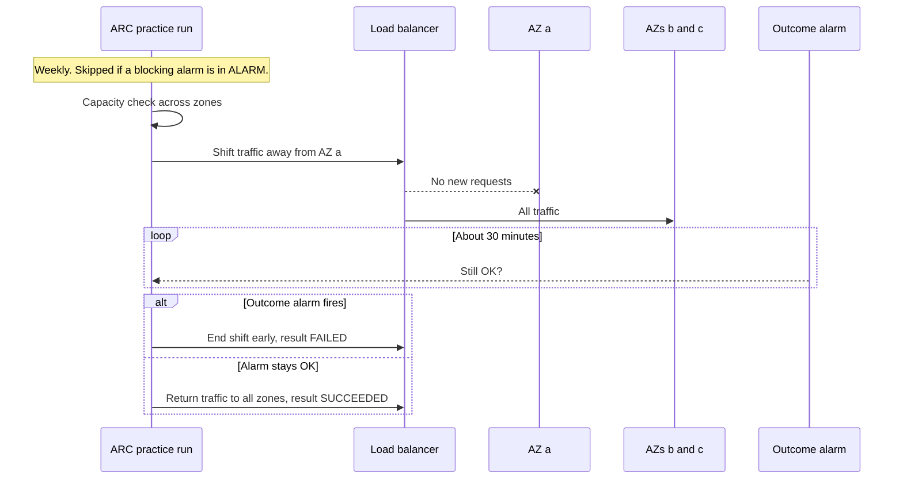

---
tags:
  - distributed-systems
  - infrastructure
  - cell-based-architecture
  - zonal-isolation
  - static-stability
  - blast-radius
  - resilience
status: complete
sources:
  - https://docs.aws.amazon.com/wellarchitected/latest/reducing-scope-of-impact-with-cell-based-architecture/reducing-scope-of-impact-with-cell-based-architecture.html
  - https://docs.aws.amazon.com/pdfs/wellarchitected/latest/reducing-scope-of-impact-with-cell-based-architecture/reducing-scope-of-impact-with-cell-based-architecture.pdf
  - https://docs.aws.amazon.com/wellarchitected/latest/reducing-scope-of-impact-with-cell-based-architecture/what-is-a-cell-based-architecture.html
  - https://docs.aws.amazon.com/wellarchitected/latest/reducing-scope-of-impact-with-cell-based-architecture/cell-design.html
  - https://builder.aws.com/content/3K9SiqiJ369TGkkGzqPM95BuYWI/static-stability-using-availability-zones
  - https://builder.aws.com/content/3F06NpJ8YeoIGP8VHTw4n81pFn8/workload-isolation-using-shuffle-sharding
  - https://builder.aws.com/content/3Ev2H7t3l2eZa9xBXiZcAjz12JK/minimizing-correlated-failures-in-distributed-systems
  - https://www.usenix.org/conference/nsdi20/presentation/brooker
  - https://www.the-paper-trail.org/post/2020-04-06-physalia/
  - https://aws.amazon.com/message/65648/
  - https://aws.amazon.com/message/101925
  - https://slack.engineering/slacks-migration-to-a-cellular-architecture/
  - https://www.infoq.com/presentations/slack-cellular-architecture/
  - https://about.roblox.com/newsroom/2023/12/making-robloxs-infrastructure-efficient-resilient
  - https://about.roblox.com/newsroom/2025/06/roblox-infrastructure-supporting-record-breaking-games
  - https://careersatdoordash.com/blog/staying-in-the-zone-how-doordash-used-a-service-mesh-to-manage-data-transfer-reducing-hops-and-cloud-spend/
  - https://opensource.com/article/18/4/how-netflix-does-failovers-7-minutes-flat
  - https://learn.microsoft.com/azure/architecture/patterns/deployment-stamp
  - https://docs.aws.amazon.com/whitepapers/latest/aws-fault-isolation-boundaries/aws-service-types.html
  - https://docs.aws.amazon.com/arc-zonal-shift/latest/api/API_StartZonalShift.html
  - https://docs.amazonaws.cn/r53recovery/latest/dg/arc-zonal-autoshift.html
  - https://docs.aws.amazon.com/r53recovery/latest/dg/arc-zonal-autoshift.considerations.html
  - https://docs.aws.amazon.com/r53recovery/latest/dg/doc-history.md
  - https://aws.amazon.com/about-aws/whats-new/2026/07/eks-auto-mode-arc-zonal-shift
  - https://status.cloud.google.com/incidents/Xs2XTHzAVC9YnafnPyzj
  - https://www.theregister.com/paas-and-iaas/2026/10/20/google-cloud-says-a-power-event-caused-todays-outage/5304160
  - https://blog.cloudflare.com/18-november-2025-outage/
  - https://blog.cloudflare.com/code-orange-fail-small-complete/
created: 2026-11-28
updated: 2026-11-28
---

## Table Of Contents

---

- [[#TL;DR|TL;DR]]
- [[#The Problem|The Problem]]
- [[#Foundations|Foundations]]
    - [[#Fault Domains and Blast Radius|Fault Domains and Blast Radius]]
    - [[#Control Plane, Data Plane and Static Stability|Control Plane, Data Plane and Static Stability]]
    - [[#Zones, Regions and Service Scope|Zones, Regions and Service Scope]]
    - [[#The Arithmetic of Headroom|The Arithmetic of Headroom]]
- [[#How We Got Here|How We Got Here]]
- [[#How It Works|How It Works]]
    - [[#Anatomy of a Cell|Anatomy of a Cell]]
    - [[#Mapping Keys to Cells|Mapping Keys to Cells]]
    - [[#Sizing Cells|Sizing Cells]]
    - [[#Moving a Tenant Between Cells|Moving a Tenant Between Cells]]
    - [[#Deploying Cell by Cell|Deploying Cell by Cell]]
    - [[#Siloing Services by Zone|Siloing Services by Zone]]
    - [[#Evacuating a Zone|Evacuating a Zone]]
    - [[#Stateful Tiers|Stateful Tiers]]
    - [[#Multi-AZ Cells or Single-AZ Cells|Multi-AZ Cells or Single-AZ Cells]]
    - [[#Evacuating a Region|Evacuating a Region]]
- [[#Where It Is Now|Where It Is Now]]
- [[#Trade-offs & Open Problems|Trade-offs & Open Problems]]
- [[#Resources|Resources]]
- [[#Related Notes|Related Notes]]

## ***TL;DR***
---
*Zonal isolation and cells are two ways of drawing walls inside a system so that a failure, a bad deploy or a noisy customer stays on one side of the wall. The payoff comes when you can move traffic away from the broken side fast, without needing anything on the broken side to cooperate.*

- **A cell** is "an instance of your complete workload, with everything needed to operate independently": its own load balancers, compute and database, sharing no state with other cells ([AWS](https://docs.aws.amazon.com/wellarchitected/latest/reducing-scope-of-impact-with-cell-based-architecture/cell-design.html)). A thin **cell router** sends each request to its cell by a partition key such as customer ID. With 10 cells, a cell failure leaves 90% of requests untouched.
- **Zonal isolation** treats each availability zone (AZ) as a cell: services only call servers in their own zone, so a sick zone can be drained by setting its traffic weight to zero. Slack rebuilt its critical services this way after a June 2021 gray failure in one AZ, targeting "as much traffic as possible" out of a zone within 5 minutes ([Slack](https://slack.engineering/slacks-migration-to-a-cellular-architecture/)).
- **Static stability** is what makes evacuation safe: "the overall system keeps working even when a dependency becomes impaired" ([Furr, AWS](https://builder.aws.com/content/3K9SiqiJ369TGkkGzqPM95BuYWI/static-stability-using-availability-zones)). In practice that means pre-provisioned headroom: with 3 zones, each runs at about 66% so the other two can take the load with no new launches.
- **Zonal shift** (AWS ARC, Nov 2022) is the managed version of the drain: move a load balancer's, EKS cluster's or Auto Scaling group's traffic out of one AZ for up to 72 hours. **Zonal autoshift** (Nov 2023) lets AWS do it on its own telemetry and rehearses it with weekly 30-minute practice runs.
- **Now (Nov 2026):** the hard lessons come from systems that were zonal on paper. Google's europe-west2-b power loss (Oct 19 to 20, 2026) also broke regional services, through demand surges on the surviving zones and "control-plane dependencies across zonal boundaries" ([Google](https://status.cloud.google.com/incidents/Xs2XTHzAVC9YnafnPyzj)). Cloudflare's response to its global outages of Nov and Dec 2025 was to split services into cohorts and roll configuration out like code, finished April 2026 ([Cloudflare](https://blog.cloudflare.com/code-orange-fail-small-complete/)).

## ***The Problem***
---
*Redundancy only helps if the copies fail independently. Most large outages are a failure in one place that spreads, through a shared dependency, a shared control plane, a global configuration push or a retry storm. The question is not whether something will break but how much of the system breaks with it.*

Three failure shapes keep recurring, and each defeats plain redundancy:

| Shape | What happens | Example |
|---|---|---|
| **One zone, everyone's errors** | A fault confined to one zone shows up as errors in every zone, because services spread their calls across zones. | Slack, June 30, 2021: a flaky link to one AZ caused user-visible errors everywhere, even though the fault itself was confined to that AZ ([Slack](https://slack.engineering/slacks-migration-to-a-cellular-architecture/)). |
| **Shared control plane** | A regional component used by all zones fills up with work for the sick zone and fails the healthy ones too. | EBS, April 21, 2011: slow calls from one AZ exhausted a "regional pool of available threads", and the control plane "began to fail API requests for other Availability Zones" ([AWS](https://aws.amazon.com/message/65648/)). |
| **Global change** | A configuration or code change reaches every server at once. | Cloudflare, Nov 18, 2025: a feature file regenerated every five minutes and pushed network-wide doubled in size, crossed a 200-feature limit, and the proxy panicked for about 5.5 hours ([Cloudflare](https://blog.cloudflare.com/18-november-2025-outage/)). |

The fix for all three is the same idea at different grains: **partition the system into units that share as little as possible, and make it cheap to stop sending traffic to one unit**. The unit can be a zone, a region, or a cell of customers.

## ***Foundations***
---
*Four ideas carry the rest of the note: what a fault domain and blast radius are, why control planes and data planes must be separated, what "zonal" and "regional" mean for a service, and the arithmetic of how much spare capacity it takes to survive losing a unit.*

### Fault Domains and Blast Radius

A **fault domain** (or fault isolation boundary) is a set of components that can fail together; components outside it "are unaffected by the failure" ([AWS](https://docs.aws.amazon.com/wellarchitected/latest/reducing-scope-of-impact-with-cell-based-architecture/what-is-a-cell-based-architecture.html)). Racks, power feeds, data centers, zones and regions are physical fault domains. Software versions, configuration sets and customer cohorts are logical ones.

**Blast radius** is how wide an outage is: how many clients it touches. The Physalia paper adds a second measure, **failure correlation**: how closely the service's failures track its client's. Its goal is to maximize $P(A_s \mid A_c)$, the availability of the service *given that the client is up* ([Brooker et al., NSDI 2020](https://www.usenix.org/conference/nsdi20/presentation/brooker); [summary](https://www.the-paper-trail.org/post/2020-04-06-physalia/)). A service that is down only when its client's own rack is down costs that client almost nothing.

If a workload is split into $n$ equal cells and one cell fails, the fraction of requests affected is

$$
f = \frac{1}{n}.
$$

*In words:* more, smaller cells mean a smaller slice of customers per failure. *Example:* "If with 10 cells, each one has 10% with their customers, with 100 each one has 1%" ([AWS whitepaper](https://docs.aws.amazon.com/pdfs/wellarchitected/latest/reducing-scope-of-impact-with-cell-based-architecture/reducing-scope-of-impact-with-cell-based-architecture.pdf)). Cells shrink the *width* of an outage, not its probability; the whitepaper frames the choice as "Is it better for 100% of customers to experience a 5% failure rate, or 5% of customers to experience a 100% failure rate?" (ibid.).

The general version of this idea is the **bulkhead**, after a ship's watertight compartments; AWS's Well-Architected framework lists it as "Use bulkhead architectures to limit scope of impact" ([REL10-BP03](https://docs.aws.amazon.com/wellarchitected/latest/reliability-pillar/rel_fault_isolation_use_bulkhead.html)). Cells are coarse bulkheads. [[Resource Fairness#Shuffle Sharding|Shuffle sharding]] is a fine-grained cousin: each tenant gets a small, nearly unique subset of workers, so with 8 workers and hands of 2 there are 28 combinations and a poison tenant hits 1/28 of the service, against 1/4 for 4 plain shards ([MacCárthaigh, AWS](https://builder.aws.com/content/3F06NpJ8YeoIGP8VHTw4n81pFn8/workload-isolation-using-shuffle-sharding)). The cell whitepaper is careful that they are "not the same thing": cells share no state, so shuffle sharding can be used *within* a cell but not across cells.

### Control Plane, Data Plane and Static Stability

AWS splits every service into two parts ([Furr](https://builder.aws.com/content/3K9SiqiJ369TGkkGzqPM95BuYWI/static-stability-using-availability-zones)):

| | Control plane | Data plane |
|---|---|---|
| **Job** | Change resources: launch an instance, provision a cell, move a tenant. | Serve the running system: route packets, read and write volumes, answer requests. |
| **Complexity** | High; many steps and dependencies. | Low; "the Amazon EC2 data plane is far simpler than its control plane". |
| **Failure preference** | "designed to fail rather than corrupt or provide incorrect information (CP in the CAP theorem)" | "generally prefer AP" ([AWS whitepaper](https://docs.aws.amazon.com/pdfs/wellarchitected/latest/reducing-scope-of-impact-with-cell-based-architecture/reducing-scope-of-impact-with-cell-based-architecture.pdf)) |
| **Likelihood of failure** | "statistically more likely to fail" (ibid.) | Built for higher availability. |

The CP/AP vocabulary is from [[CAP and PACELC]]. **Static stability** follows from the split: the data plane should keep working with the last state it was given when the control plane is down. EC2 hosts route traffic from local information, so a control-plane outage means new instances can't launch, not that running ones lose their network. The design rule: "separate systems along the control and data plane boundary" (ibid.).

For failover this means one thing. **Recovery must not depend on the control plane.** If surviving a zone loss requires launching instances, it depends on the EC2 control plane, at the moment when every other customer is launching too. A statically stable design has the capacity already running and only changes where traffic goes. The same reasoning drives [[Reconciliation and Control Loops]]: a reconciler that is down should leave the world as it was, not tear it down.

### Zones, Regions and Service Scope

An **availability zone** is one or more discrete data centers with redundant power, network and connectivity, separated from the region's other zones by a meaningful distance; AZ stacks "share little to nothing" with each other ([Magerramov, AWS](https://builder.aws.com/content/3Ev2H7t3l2eZa9xBXiZcAjz12JK/minimizing-correlated-failures-in-distributed-systems)). After the 2011 EBS event AWS stated the goal as "to make Availability Zones indistinguishable from completely independent" ([AWS](https://aws.amazon.com/message/65648/)).

AWS sorts its services into three scopes by fault isolation boundary: "zonal, Regional, and global" ([AWS Fault Isolation Boundaries](https://docs.aws.amazon.com/whitepapers/latest/aws-fault-isolation-boundaries/aws-service-types.html)). A **zonal** service (an EC2 instance, a NAT gateway) fails with its zone. A **regional** service (S3, DynamoDB, SQS) spans zones and uses zonal independence internally to hide a zone loss. A **global** service has one control plane for all regions.

Why zonal is sometimes better than regional: suppose one of 3 zones is impaired and each regional service hop picks a zone at random. A request survives one hop with probability 2/3, so

$$
P(\text{avoid the bad zone}) =
\begin{cases}
(2/3)^N & \text{through } N \text{ regional services} \\
2/3 & \text{through } N \text{ zonal services that stay in the caller's zone}
\end{cases}
$$

*In words:* every regional hop is another chance to land in the sick zone; a request that stays inside one zone either is in the sick zone or isn't, once. *Example:* two regional hops give $4/9 \approx 44\%$, "worse than even odds"; that is why the EC2 NAT gateway is zonal ([Furr](https://builder.aws.com/content/3K9SiqiJ369TGkkGzqPM95BuYWI/static-stability-using-availability-zones)). With $N = 5$ regional hops it drops to 13%. The cost is that clients must pick the right zonal endpoint.

### The Arithmetic of Headroom

To survive losing one of $Z$ zones with no new launches, the other $Z - 1$ must carry the peak load $P$. If each zone has capacity $c$:

$$
(Z-1)\,c \ge P \quad\Longrightarrow\quad c \ge \frac{P}{Z-1}, \qquad \text{total} = Z\,c = \frac{Z}{Z-1}\,P, \qquad \text{normal utilization} = \frac{Z-1}{Z}.
$$

*In words:* the fewer the zones, the more you overprovision. *Example:* an app needs 30 instances at peak. With $Z = 3$, run 15 per zone (45 total, each zone at 67%); lose one zone and 30 remain, exactly enough ([AWS](https://docs.aws.amazon.com/r53recovery/latest/dg/arc-zonal-autoshift.considerations.html)). That is the 50 percent overprovisioning rule in Furr's article. With $Z = 2$ you need 60 (100% extra); with $Z = 4$, 40 (33% extra).

Cells have the same arithmetic one level down: a cell that takes over another cell's customers needs headroom, and the whitepaper warns to keep "a sufficient gap ... between the current quotas and the maximum usage to accommodate failover". Queueing makes the margin tighter than the formula suggests, because latency rises sharply as utilization nears 1 ([[Queueing Theory for Systems]]); a zone that runs at 67% and suddenly takes 100% of its share plus half of another zone's is at the knee of the curve.

## ***How We Got Here***
---
*Cells and zonal isolation grew out of specific outages: a regional control plane dragged down by one zone, a whole region lost to a load balancer, a gray failure nobody could route around. Each company's version arrived after its own bad day.*

**Zones are supposed to be independent (2011).** On April 21, 2011 a network change in one us-east-1 AZ was done incorrectly; EBS nodes lost their mirrors, searched for space all at once, and about 13% of volumes in that AZ got stuck in a "re-mirroring storm" ([AWS](https://aws.amazon.com/message/65648/)). The damage spread because the EBS control plane was regional: its shared thread pool filled with slow requests for the bad zone. AWS's fixes were to make the control plane AZ-aware, shed load, and move functions into per-cluster services in the same AZ as the cluster. Physalia, started in 2013, came out of an incident in which the EBS control plane browned out during a cascading failure: "we didn't want one database. We wanted millions." Each cell is a seven-way-replicated Paxos group, placed near its clients, and software is deployed one "color" of cells at a time so a bad deploy or poison transaction can't cross colors ([Brooker et al.](https://www.usenix.org/conference/nsdi20/presentation/brooker); [summary](https://www.the-paper-trail.org/post/2020-04-06-physalia/)). See [[Paxos]].

**Regions as the unit you evacuate (2012 to 2018).** In winter 2012 an ELB problem in US-East cut Netflix off for seven hours. Netflix moved to three regions with enough reserved capacity to lose one, and practiced evacuating. Failover first took about 45 minutes, 35 of them waiting for the surviving regions to scale; Project Nimble kept hot standby "shadow" instances and brought failover to 7 minutes by 2018 ([Ramanujam](https://opensource.com/article/18/4/how-netflix-does-failovers-7-minutes-flat)). That is static stability at region grain: the capacity was already paid for.

**Writing down the patterns (2019 to 2023).** The Amazon Builders' Library published Furr's static stability article and MacCárthaigh's shuffle sharding article in December 2019; Magerramov's correlated-failures article (Feb 2022) added the operational rule that tools must respect boundaries: patching "never operates on servers from multiple Availability Zones at the same time", and tooling should avoid "touching multiple cells at the same time" ([AWS](https://builder.aws.com/content/3Ev2H7t3l2eZa9xBXiZcAjz12JK/minimizing-correlated-failures-in-distributed-systems)). AWS's cell-based architecture whitepaper (Sep 20, 2023) says its service teams have used cells "for more than a decade" ([AWS](https://docs.aws.amazon.com/wellarchitected/latest/reducing-scope-of-impact-with-cell-based-architecture/reducing-scope-of-impact-with-cell-based-architecture.html)). Microsoft documents the same idea as **Deployment Stamps**: "Each copy is called a stamp, or sometimes a service unit, scale unit, or cell" ([Azure](https://learn.microsoft.com/azure/architecture/patterns/deployment-stamp)).

**Companies rebuild after their own outage (2021 to 2024).** Slack's June 2021 incident was a gray failure, where "different components have different views of the availability of the system"; Slack spent about 1.5 years siloing its critical services by AZ ([Slack](https://slack.engineering/slacks-migration-to-a-cellular-architecture/)). Roblox's 73-hour outage in October 2021 began in one component in one data center; by December 2023 about 30,000 machines ran in cells of about 1,400 machines each, acting as "blast walls", and over 70% of back-end traffic was served from cells at peak ([Roblox](https://about.roblox.com/newsroom/2023/12/making-robloxs-infrastructure-efficient-resilient)). DoorDash runs one Kubernetes deployment of each service per cell, forbids intercellular traffic, and keeps unmigrated singletons in a "global cell" ([DoorDash, Jan 2024](https://careersatdoordash.com/blog/staying-in-the-zone-how-doordash-used-a-service-mesh-to-manage-data-transfer-reducing-hops-and-cloud-spend/)).

**Evacuation becomes a product (2022 onward).** AWS added zonal shift to Route 53 Application Recovery Controller (ARC) on November 28, 2022 (GA January 2023), zonal autoshift on November 30, 2023, and support for NLB, EKS and Auto Scaling groups in October and November 2024 ([ARC doc history](https://docs.aws.amazon.com/r53recovery/latest/dg/doc-history.md)).

## ***How It Works***
---
*A cell-based system has three parts: cells, a router and a control plane. Zonal isolation adds the rule that calls stay inside a zone. The mechanics that matter are how keys map to cells, how big cells are, how tenants move, how changes roll out, and how traffic leaves a unit that is failing.*

### Anatomy of a Cell

The pieces, in the whitepaper's words ([AWS](https://docs.aws.amazon.com/wellarchitected/latest/reducing-scope-of-impact-with-cell-based-architecture/what-is-a-cell-based-architecture.html)):

- **Cell:** an independent instance of the workload that "does not share state with other cells, and handles a subset of the overall workload requests". Ideally there are "no cross-cell API calls, no shared resources like databases or S3 buckets", and separate cloud accounts are encouraged ([cell design](https://docs.aws.amazon.com/wellarchitected/latest/reducing-scope-of-impact-with-cell-based-architecture/cell-design.html)).
- **Partition key:** the field that decides a request's cell. It "needs to align with the *grain* of the service", the natural way to split the work with minimal cross-cell interaction: customer ID, resource ID, tenant.
- **Cell router:** "the thinnest possible layer, with the responsibility of routing requests to the right cell, and only that." It is the one shared component, so it is built with as little business logic as possible and is statically stable: in AWS's reference design, routes "are loaded into memory from an S3 bucket. Even if the control plane, Amazon S3 or a zone is unavailable, the router is still able to direct traffic to the cells" ([whitepaper](https://docs.aws.amazon.com/pdfs/wellarchitected/latest/reducing-scope-of-impact-with-cell-based-architecture/reducing-scope-of-impact-with-cell-based-architecture.pdf)). This is the same problem as [[Cluster Metadata and Routing]]: a cached map, a source of truth, and staleness to bound.
- **Control plane:** provisions and retires cells, migrates customers, deploys and monitors. The data plane (router plus cells) must keep serving when it is down.

Cells need not cost more hardware: "your application has 30 hosts, and in a cell-based architecture it has the same 30 hosts, but with a cell router and with tasks that are distributed or grouped between cells" (ibid.). The extra cost is in headroom, tooling and the router.

### Mapping Keys to Cells

The router's map is a [[Partitioning]] scheme. The whitepaper compares four ([AWS](https://docs.aws.amazon.com/pdfs/wellarchitected/latest/reducing-scope-of-impact-with-cell-based-architecture/reducing-scope-of-impact-with-cell-based-architecture.pdf)):

| Scheme | How | Good | Bad |
|---|---|---|---|
| **Full mapping** | A table row per key. | Full control over placement, hot cells and migration. | Large state at high cardinality; slow router bootstrap. |
| **Prefix or range** | Ranges of keys per cell. | Smaller table. | "More likely to have a hot cell", since you can't control which keys in a range are busy. |
| **Naive modulo** | `hash(key) mod n` | Even spread, almost no state. | Changing $n$ moves nearly every customer. |
| **Consistent hashing** | Hash ring. | Adding a cell moves only some keys. | Can have "significant high peak-to-average ratios". |

The common production pattern mixes them: hash keys into a fixed, large number of logical buckets ("tens of thousands"), then keep a small table from bucket to cell. Moving a bucket is a table update. On top sits an **override table** that pins specific keys to specific cells, "useful for testing, quarantining, and special-case routing for particularly heavy partition keys" (ibid.). The heavy-key case is the cell-level version of [[Hot Keys and Cache Stampedes]]; systems that move buckets automatically are doing [[Auto-Sharding]].

*Worked example.* 30,000 buckets over 6 cells, 5,000 buckets each. A seventh cell is added: the control plane moves about 4,286 buckets (5,000 − 30,000/7, about 714 from each old cell) to it, one bucket at a time, updating the table after each move. Under naive modulo, going from 6 to 7 cells would leave a key in place only if $h \bmod 6 = h \bmod 7$, which holds for 6 of every 42 hash values, so about 86% of customers would move at once.

### Sizing Cells

Three forces pull against each other: a cell must be "Big enough to fit the largest workloads", "Small enough to test at full scale", and "Big enough to gain economies of scale benefits" ([whitepaper](https://docs.aws.amazon.com/pdfs/wellarchitected/latest/reducing-scope-of-impact-with-cell-based-architecture/reducing-scope-of-impact-with-cell-based-architecture.pdf)).

| | Smaller cells | Larger cells |
|---|---|---|
| Blast radius | A cell outage or drain hits a small share. | Each failure hits more customers. |
| Scaling limits | "Less likely to hit scaling limitation" | "More likely to reach scaling limitation" |
| Testing | Easy to load-test a whole cell. | Harder to reproduce full size. |
| Operations | More cells to run, deploy and observe. | Fewer cells. |
| Utilization | More fragmentation. | "Better capacity utilization" |

The key rule is a **maximum cell size** that you load-test: "simulate the largest workload that can fit into a cell, which should match the largest workload that a single customer can send" (ibid.). Growth then means adding cells, not growing them, so every production cell stays inside the tested envelope. That is the main scaling argument for cells, apart from isolation: a system whose largest unit is tested never meets an untested size.

### Moving a Tenant Between Cells

Stateful systems "will almost certainly require online cell migration", and the advice is to "Start with a cell migration mechanism from day one". The steps (ibid.):

1. Clone the data to the new cell as a non-authoritative copy (and keep it in sync, for example by [[Change Data Capture]]).
2. Flip the new copy to authoritative.
3. Redirect traffic from the old cell to the new one.
4. Forget the data in the old cell.

The dangerous moment is step 2: two cells must never both believe they own the tenant. That is a fencing problem ([[Leases and Fencing]]) and the same staged ownership change that [[Cluster Metadata and Routing]] describes for shards. Azure's guidance is blunt that "moving tenants between stamps can be difficult" ([Azure](https://learn.microsoft.com/azure/architecture/patterns/deployment-stamp)).

### Deploying Cell by Cell

Cells are also deployment units. Changes go out "in waves, cell by cell or set of cells", the first cell can be a **canary cell** carrying synthetic and non-critical traffic, and a new version can be limited to "a small number of cells (up to just one)" until it proves itself ([whitepaper](https://docs.aws.amazon.com/pdfs/wellarchitected/latest/reducing-scope-of-impact-with-cell-based-architecture/reducing-scope-of-impact-with-cell-based-architecture.pdf)). Physalia's colors are the same idea, and AWS deploys to one AZ at a time ([Magerramov](https://builder.aws.com/content/3Ev2H7t3l2eZa9xBXiZcAjz12JK/minimizing-correlated-failures-in-distributed-systems)).

If a bad change is caught after the first wave of $k$ cells out of $n$, the share of customers it touched is $k/n$. *Example:* 20 cells, waves of 1, 2, 4, 13; a bug caught after wave 1 hit 5% of customers, after wave 2, 15%. Without waves, 100%.

The lesson of 2025 is that **configuration and metadata need waves too**. Cloudflare's November 2025 feature file and the AWS and Google 2025 metadata incidents all spread globally in seconds or minutes ([[Cluster Metadata and Routing#Metadata Is the Blast Radius|Cluster Metadata and Routing]]). Cloudflare's Snapstone now "bundles configuration change into a package" and rolls it out with health checks and automatic rollback, the way code already was ([Cloudflare](https://blog.cloudflare.com/code-orange-fail-small-complete/)).

### Siloing Services by Zone

Zonal isolation is cells where the cell is a zone. Slack calls a service **siloed** if it only receives traffic from, and sends traffic to, servers in its own AZ; each service becomes "N virtual services, one per AZ" ([Slack](https://slack.engineering/slacks-migration-to-a-cellular-architecture/)). Then removing user traffic from a zone makes everything behind it go quiet on its own.

Before siloing, Slack's backends were spread across zones, so one bad zone produced errors in frontends everywhere (ibid.). DoorDash reaches a softer version through its service mesh: Envoy gets each pod's zone and prefers callees in the caller's zone, still sending some traffic across to balance load; even so, about 10% of traffic crossed zones ([DoorDash](https://careersatdoordash.com/blog/staying-in-the-zone-how-doordash-used-a-service-mesh-to-manage-data-transfer-reducing-hops-and-cloud-spend/)). Both report that keeping traffic in-zone also cuts cross-AZ data-transfer charges, which are billed on both send and receive.

### Evacuating a Zone

A drain or zonal shift changes *where traffic goes*, never *what runs*. That is why it works when the zone is unreachable: it only needs the components outside the zone.

**Slack's drain.** Edge load balancers run Envoy, configured by Slack's own xDS control plane. Draining sets the weight of the target AZ's cluster to zero; in-flight requests finish and new ones go elsewhere, propagating "on the order of seconds" ([Slack](https://slack.engineering/slacks-migration-to-a-cellular-architecture/)). Requirements: drain most traffic within 5 minutes, cause no user-visible errors, move in steps as small as 1%, and work "even if the drained AZ is completely offline". The edge sits in other regions from the core. In practice siloed services drained in 60 seconds, and the team rehearsed weekly on Fridays, pulling a larger share each time (10%, then 20%) until they were no longer comfortable going further ([QCon talk](https://www.infoq.com/presentations/slack-cellular-architecture/)).

**AWS zonal shift.** A zonal shift "temporarily move[s] load balancer traffic away from an Availability Zone", initially "for up to three days (72 hours)", for ALBs, NLBs, EKS clusters and EC2 Auto Scaling groups ([API](https://docs.aws.amazon.com/arc-zonal-shift/latest/api/API_StartZonalShift.html)). For EKS it removes endpoints for pods in the shifted zone from east-west traffic ([doc history](https://docs.aws.amazon.com/r53recovery/latest/dg/doc-history.md)). **Zonal autoshift** lets AWS start the shift when "internal telemetry" shows an AZ impairment that may affect customers, and shift back when it recovers; ARC does not check your resources' health, so some healthy resources move too ([AWS](https://docs.amazonaws.cn/r53recovery/latest/dg/arc-zonal-autoshift.html)).

**Practice runs** are what make autoshift trustworthy. ARC shifts traffic away from a zone weekly for about 30 minutes; you must give at least one *outcome alarm*, which fails the run if it fires, and may give *blocking alarms*, which stop a run from starting; since June 2025 runs also check that the other zones have enough capacity, and you can start them on demand; outcomes are SUCCEEDED, FAILED, INTERRUPTED, CAPACITY_CHECK_FAILED and PENDING ([AWS](https://docs.aws.amazon.com/r53recovery/latest/dg/arc-zonal-autoshift.considerations.html); [doc history](https://docs.aws.amazon.com/r53recovery/latest/dg/doc-history.md)). A practice run is a small, scheduled [[Fault Injection and Chaos Engineering|chaos experiment]] whose only fault is "this zone is gone".

Three practical catches from AWS's guidance (ibid.):

- **Pre-scale.** Shifts "don't wait for auto scaling to finish". Size for $Z/(Z-1)$ as above, and set auto-scaling minimums so the app survives an AZ loss.
- **Long-lived connections.** Clients reusing connections keep hitting the shifted zone until they reconnect; lower ALB keep-alive (the example is 300 seconds) to fit the recovery goal.
- **Fail-open.** If a load balancer's targets are all unhealthy, it is already failing open, and autoshift won't change it; if *all* zones fail open, there is nowhere to shift.

**Who decides?** Detecting that a zone is sick is the hard part, because gray failures look different from different vantage points ([[Gray and Fail-Slow Failures]]). Slack chose to "let humans trigger a response" ([Slack](https://slack.engineering/slacks-migration-to-a-cellular-architecture/)); AWS's Advanced Multi-AZ guidance alarms per zone and tests for skewed errors before shifting (see the chi-squared example in [[Gray and Fail-Slow Failures#Industry Practice|Gray and Fail-Slow Failures]]). Automatic shifting needs a brake: in the October 2025 us-east-1 event, NLB health checks failed on healthy new instances, triggered automatic AZ DNS failover, and took capacity out of service; AWS is adding "a velocity control" on how much capacity a single NLB can remove ([AWS](https://aws.amazon.com/message/101925)).

### Stateful Tiers

Stateless tiers drain cleanly. Data tiers don't, because a strongly consistent store usually has one writer per shard, and it may be in the zone you're leaving.

- **Reparent the primaries.** Slack's Vitess "needs a single write point per shard"; on a drain its automation "reparents the nodes away from the [bad] AZ, as fast as the replication permits", shards in parallel ([QCon talk](https://www.infoq.com/presentations/slack-cellular-architecture/)). That is a leader election in [[Raft]] or [[Replication|primary-backup]] terms, and it must be fenced so the old primary can't keep writing ([[Leases and Fencing]]).
- **Place quorums across zones.** A majority quorum survives a zone loss only if no zone holds a majority of replicas. With 3 replicas in 3 zones, losing one zone leaves 2 of 3, still a quorum. With 2 of 3 in one zone, losing that zone leaves 1 of 3, no quorum. That is exactly what happened to Apigee X in europe-west2-b in October 2026, where two of its three datastore replicas sat in the failed zone; Google's fix is to enforce replicas across three zones ([Google](https://status.cloud.google.com/incidents/Xs2XTHzAVC9YnafnPyzj)). Five replicas over three zones (2, 2, 1) also survive any one zone. [[Witness Replicas]] cut the cost of the third zone.
- **Watch for caches used as stores.** Slack found Memcache being used as if it were strongly consistent; it built per-cell caches, kept a global layer and migrated call sites one by one ([QCon talk](https://www.infoq.com/presentations/slack-cellular-architecture/)).
- **Keep global services eventually consistent.** Slack moved Consul to per-AZ clusters with an eventually consistent global xDS layer on top (ibid.). A global service that must be strongly consistent is a shared fault domain.

### Multi-AZ Cells or Single-AZ Cells

Cells and zones can be combined two ways ([whitepaper](https://docs.aws.amazon.com/pdfs/wellarchitected/latest/reducing-scope-of-impact-with-cell-based-architecture/reducing-scope-of-impact-with-cell-based-architecture.pdf)):

| | Multi-AZ cells | Single-AZ cells |
|---|---|---|
| Shape | Each cell spans the region's zones; a zone loss degrades every cell a little. | Each cell lives in one zone. |
| Pros | Can use regional managed services as-is. | "It is possible to accurately detect in which AZ a problem is occurring and take mitigation actions for it." |
| Cons | "Less control over an AZ failure, particularly gray failures." | Three routers; clients must choose the right zonal endpoint; needs AZ-scoped services and extra recovery mechanisms. |

The whitepaper adds a warning: cells "were not designed as failover domains" and are not a fix for dependency failures or single points of failure. A cell's customers aren't meant to fail over to another cell; zones and regions are the failover domains. DoorDash's cells, for example, contain Kubernetes clusters that each span multiple zones ([DoorDash](https://careersatdoordash.com/blog/staying-in-the-zone-how-doordash-used-a-service-mesh-to-manage-data-transfer-reducing-hops-and-cloud-spend/)).

### Evacuating a Region

The same pattern one level up: pre-provisioned capacity in other regions and a traffic switch that doesn't depend on the failed region. Netflix's 7-minute failovers rest on reserved shadow capacity and a direct DNS switch ([Ramanujam](https://opensource.com/article/18/4/how-netflix-does-failovers-7-minutes-flat)). AWS's ARC **Region switch** (August 1, 2025) orchestrates the cross-account steps to run a multi-region app out of another region; a November 2026 update documents plan execution states, step timeouts, and controls such as pause, retry, skip and cancel ([doc history](https://docs.aws.amazon.com/r53recovery/latest/dg/doc-history.md)). Region failover is harder than zone failover because data replication between regions is asynchronous or slow ([[Replication]], [[CAP and PACELC]]), and because some control planes are global.

## ***Where It Is Now***
---
*As of November 2026, zonal evacuation is a managed, rehearsed cloud feature and cells are a documented pattern at AWS, Azure, Slack, Roblox and DoorDash. The newest lessons come from incidents where systems believed to be zonally isolated were not, and from treating global configuration as something that also needs cells.*

### Managed Evacuation

- **ARC keeps widening.** Zonal shift covers ALB, NLB, EKS and Auto Scaling groups; in July 2026 EKS Auto Mode began honoring zonal shift by itself: during a shift it stops provisioning capacity in the impaired zone and pauses consolidation and drift for nodes there ([AWS, Jul 10 2026](https://aws.amazon.com/about-aws/whats-new/2026/07/eks-auto-mode-arc-zonal-shift)). In September 2026 zonal shift was extended to more NLB configurations (cross-zone with connection termination, UDP target groups, ALBs as targets) ([doc history](https://docs.aws.amazon.com/r53recovery/latest/dg/doc-history.md)).
- **From readiness audits to rehearsal.** ARC's readiness check, which audited whether resources were scaled for failover, closed to new customers on April 30, 2026, while practice runs gained on-demand starts and capacity checks in 2025 (ibid.). My reading, not AWS's stated rationale: proving evacuation by doing it weekly has displaced checking configuration for it.
- **Testing the whole drill.** Since March 2025, AWS FIS can simulate an AZ power interruption and check that autoshift recovers the app (ibid.); see [[Fault Injection and Chaos Engineering#Managed Cloud Services|Fault Injection and Chaos Engineering]].

### What the 2025 to 2026 Outages Taught

- **Google europe-west2-b, Oct 19 to 20, 2026.** A utility cable fault hit a data center already running on one feed; generators didn't start because the PLC undervoltage inputs were wired on the wrong side of the isolated breakers; batteries lasted about five minutes, then the zone lost power. Customer impact lasted about 6 hours ([Google](https://status.cloud.google.com/incidents/Xs2XTHzAVC9YnafnPyzj)). Zonal resources failing was expected. Regional services failing was not: Google says it "designs regional services to be robust to zone failures", but two causes broke that: "instantaneous demand surges on neighboring zones (a and c)" and "control-plane dependencies across zonal boundaries". BigQuery couldn't scale up because of an autoscaling dependency; Apigee lost quorum; GKE autoscaling stalled. UK customers reported affected included Lloyds, HSBC and Revolut ([The Register](https://www.theregister.com/paas-and-iaas/2026/10/20/google-cloud-says-a-power-event-caused-todays-outage/5304160)). Each failure is a missing piece of static stability: headroom not pre-provisioned, recovery depending on a control plane, a quorum not spread across zones. Google also froze planned maintenance at similar sites, an admission that "independent" zones can share a configuration mistake.
- **AWS us-east-1, Oct 19 to 20, 2025.** A race between DNS Enactors in three AZs left DynamoDB's regional endpoint with no addresses; recovery then stalled in EC2's lease manager ("congestive collapse") and in NLB health checks, and the event ran about 14.5 hours ([AWS](https://aws.amazon.com/message/101925)). The redundancy across zones was real, but the failing component was the regional plan it was enacting. Details are in [[Cluster Metadata and Routing#Metadata Is the Blast Radius|Cluster Metadata and Routing]].
- **Cloudflare, Nov 18 and Dec 5, 2025.** Both were global outages from changes that reached the whole network. Cloudflare's "Code Orange: Fail Small" plan finished in April 2026 (post May 1): services now run as independent copies for different traffic cohorts, with free customers getting changes first; configuration rolls out through Snapstone with health checks and rollback; systems fall back to the "last known good configuration where possible"; and break-glass access paths now cover 18 key services, drilled with over 200 engineers on April 7, 2026 ([Cloudflare](https://blog.cloudflare.com/code-orange-fail-small-complete/)). Cloudflare doesn't use the word "cells", but cohort-separated copies with staged rollout are cells by another name.

### Adoption

- **Slack** describes drains as a generic first response: drain the AZ, find the root cause later; AZ-by-AZ deploys let it roll back by draining ([QCon SF 2024, published May 2025](https://www.infoq.com/presentations/slack-cellular-architecture/)).
- **Roblox** (June 2025) is "experimenting with cloud bursting as part of our transition to a cellular infrastructure", matching users to on-premises and cloud edge cells across 24 edge and two core data centers ([Roblox](https://about.roblox.com/newsroom/2025/06/roblox-infrastructure-supporting-record-breaking-games)). It published no uptime figures.
- **Azure** recommends deploying "at least two stamps" from day one, so nobody hard-codes the assumption of one, and warns that stamps "aren't inherently redundant across regions" ([Azure](https://learn.microsoft.com/azure/architecture/patterns/deployment-stamp)).

## ***Trade-offs & Open Problems***
---
*Cells and zonal isolation buy smaller, rarer outages with money, complexity and the loss of anything global. The open problems are about state that won't partition, dependencies nobody mapped, and deciding automatically when a unit is sick.*

| Choice | Buys | Costs |
|---|---|---|
| More, smaller cells | Smaller blast radius, tested maximum size | More units to deploy, observe, and pay headroom for; harder cross-cell features |
| Zonal siloing | One-step drain, fewer cross-AZ bytes | Each service becomes N copies; clients and tools must be zone-aware |
| Static stability | Recovery without the control plane | $Z/(Z-1)$ capacity always running (50% extra for 3 zones) |
| Automatic shift | Minutes to mitigate, no human needed | False shifts drop capacity; automatic failover can amplify an incident (NLB, Oct 2025) |
| Override table and full mapping | Placement control, quarantine of heavy tenants | Router state that must be cached and kept consistent |

**Open problems.**

- **State that won't silo.** Strongly consistent stores have a primary somewhere; draining a zone means moving leadership, which is a control-plane action at the worst moment. Spreading quorums across zones fixes availability but adds cross-zone latency to every write. [[Clock-Assisted Consensus]] and [[Leaderless Consensus]] reduce, but don't remove, this tension.
- **Finding hidden cross-zone dependencies.** The Google 2026 event shows that a regional service can depend synchronously on a component in one zone without anyone knowing. Today the main tools are practice runs and drills ([[Fault Injection and Chaos Engineering]]); systematically finding such paths is open.
- **Global features over cells.** Search, analytics, billing and admin views need all customers. Azure suggests querying every stamp or publishing to a central warehouse ([Azure](https://learn.microsoft.com/azure/architecture/patterns/deployment-stamp)); either reintroduces a shared component.
- **Global configuration.** Routing maps and policy need one current answer, which pushes toward global rollout, while blast radius pushes toward waves. Reconciling the two is still open ([[Cluster Metadata and Routing]]).
- **Whales.** The largest customer sets the minimum cell size. A tenant that outgrows a cell needs either a special-case cell or splitting the tenant, which breaks the partition key.
- **Correlation below the abstraction.** Zones share designs, vendors, firmware and procedures. A wiring mistake repeated at similar sites, or a fleet-wide software bug, makes "independent" zones fail together ([[Silent Data Corruption]] and [[Gray and Fail-Slow Failures]] show the same at hardware level).
- **Cold start.** Cells limit the width of an outage but don't help bring a whole region back from zero, where control planes depend on the services they start. That is the planned [[Region Recovery and Dependency Cycles]] note.

## ***Resources***
---
*Start with Furr's static stability article and the AWS cell-based architecture whitepaper for the patterns, Slack's write-up and talk for a real migration, and the Google europe-west2-b report for what happens when zonal isolation is incomplete.*

**Patterns**
- AWS, [Reducing the Scope of Impact with Cell-Based Architecture](https://docs.aws.amazon.com/wellarchitected/latest/reducing-scope-of-impact-with-cell-based-architecture/reducing-scope-of-impact-with-cell-based-architecture.html), Sep 2023 ([PDF](https://docs.aws.amazon.com/pdfs/wellarchitected/latest/reducing-scope-of-impact-with-cell-based-architecture/reducing-scope-of-impact-with-cell-based-architecture.pdf)).
- Mike Furr, [Static stability using Availability Zones](https://builder.aws.com/content/3K9SiqiJ369TGkkGzqPM95BuYWI/static-stability-using-availability-zones), Amazon Builders' Library, 2019.
- Colm MacCárthaigh, [Workload isolation using shuffle-sharding](https://builder.aws.com/content/3F06NpJ8YeoIGP8VHTw4n81pFn8/workload-isolation-using-shuffle-sharding), Amazon Builders' Library, 2019.
- Joe Magerramov, [Minimizing correlated failures in distributed systems](https://builder.aws.com/content/3Ev2H7t3l2eZa9xBXiZcAjz12JK/minimizing-correlated-failures-in-distributed-systems), Amazon Builders' Library, Feb 2022.
- AWS, [AWS Fault Isolation Boundaries](https://docs.aws.amazon.com/whitepapers/latest/aws-fault-isolation-boundaries/aws-service-types.html) (zonal, regional and global services).
- AWS Well-Architected, [REL10-BP03 Use bulkhead architectures to limit scope of impact](https://docs.aws.amazon.com/wellarchitected/latest/reliability-pillar/rel_fault_isolation_use_bulkhead.html).
- Microsoft, [Deployment Stamps pattern](https://learn.microsoft.com/azure/architecture/patterns/deployment-stamp), Azure Architecture Center.

**Papers**
- Marc Brooker, Tao Chen, Fan Ping, [Millions of Tiny Databases](https://www.usenix.org/conference/nsdi20/presentation/brooker), NSDI 2020 (Physalia); Henry Robinson's [summary of its availability model](https://www.the-paper-trail.org/post/2020-04-06-physalia/).

**Evacuation tooling**
- AWS ARC, [StartZonalShift API](https://docs.aws.amazon.com/arc-zonal-shift/latest/api/API_StartZonalShift.html); [zonal autoshift](https://docs.amazonaws.cn/r53recovery/latest/dg/arc-zonal-autoshift.html); [autoshift best practices](https://docs.aws.amazon.com/r53recovery/latest/dg/arc-zonal-autoshift.considerations.html); [developer guide history](https://docs.aws.amazon.com/r53recovery/latest/dg/doc-history.md).
- AWS, [EKS Auto Mode supports ARC zonal shift](https://aws.amazon.com/about-aws/whats-new/2026/07/eks-auto-mode-arc-zonal-shift), Jul 2026.

**Case studies**
- Cooper Bethea, [Slack's Migration to a Cellular Architecture](https://slack.engineering/slacks-migration-to-a-cellular-architecture/), Aug 2023; [QCon SF 2024 talk](https://www.infoq.com/presentations/slack-cellular-architecture/).
- Daniel Sturman, Max Ross, Michael Wolf, [How We're Making Roblox's Infrastructure More Efficient and Resilient](https://about.roblox.com/newsroom/2023/12/making-robloxs-infrastructure-efficient-resilient), Dec 2023; Anupam Singh, [The Infrastructure Supporting Record-Breaking Experiences](https://about.roblox.com/newsroom/2025/06/roblox-infrastructure-supporting-record-breaking-games), Jun 2025.
- Hochuen Wong, Levon Stepanian, [Staying in the Zone](https://careersatdoordash.com/blog/staying-in-the-zone-how-doordash-used-a-service-mesh-to-manage-data-transfer-reducing-hops-and-cloud-spend/), DoorDash, Jan 2024.
- Amjith Ramanujam, [How Netflix does failovers in 7 minutes flat](https://opensource.com/article/18/4/how-netflix-does-failovers-7-minutes-flat), Apr 2018.

**Incident reports**
- AWS, [Summary of the Amazon EC2 and Amazon RDS Service Disruption in the US East Region](https://aws.amazon.com/message/65648/), Apr 2011.
- AWS, [Summary of the Amazon DynamoDB Service Disruption in us-east-1](https://aws.amazon.com/message/101925), Oct 2025.
- Cloudflare, [Cloudflare outage on November 18, 2025](https://blog.cloudflare.com/18-november-2025-outage/); [Code Orange: Fail Small is complete](https://blog.cloudflare.com/code-orange-fail-small-complete/), May 2026.
- Google Cloud, [europe-west2-b incident report](https://status.cloud.google.com/incidents/Xs2XTHzAVC9YnafnPyzj), Oct 2026; The Register, [Google Cloud says a 'power event' caused today's outage](https://www.theregister.com/paas-and-iaas/2026/10/20/google-cloud-says-a-power-event-caused-todays-outage/5304160), Oct 2026.

## ***Related Notes***
---
*The failure modes cells contain, the routing and partitioning they are built from, and the testing that proves evacuation works.*

- [[Gray and Fail-Slow Failures]] — Why a sick zone is hard to detect; per-AZ alarms and the chi-squared skew test.
- [[Reliability Patterns]] — Timeouts, retries, breakers and metastable failures that spread across unit boundaries.
- [[Resource Fairness]] — Shuffle sharding and fair queuing, the fine-grained relatives of cells.
- [[Cluster Metadata and Routing]] — The cell router's map; the 2025 metadata outages.
- [[Partitioning]] — Key-to-cell mapping schemes; [[Auto-Sharding]] for moving buckets automatically.
- [[Hot Keys and Cache Stampedes]] — Hot cells and heavy tenants.
- [[Reconciliation and Control Loops]] — Control planes that must leave the data plane alone when they fail.
- [[Fault Injection and Chaos Engineering]] — Practice runs, AZ power-interruption drills and DiRT.
- [[Replication]], [[Raft]], [[Witness Replicas]] — Placing quorums so a zone loss leaves a majority.
- [[Leases and Fencing]] — Safe primary moves and tenant migration.
- [[Queueing Theory for Systems]] — Why surviving zones overload when headroom is thin; cells as bounded queues.
- [[Message Queues]] — Per-cell queues as an isolation boundary.
- [[Databases on Object Storage]] — Single-zone storage tiers and the cross-zone replication they reintroduce.
- [[Region Recovery and Dependency Cycles]] — Planned: bringing a whole region back from zero.
