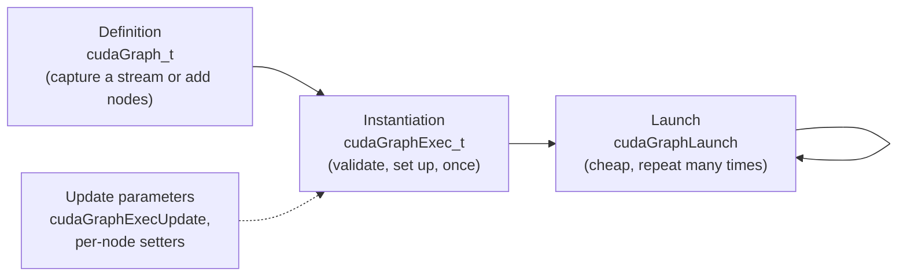
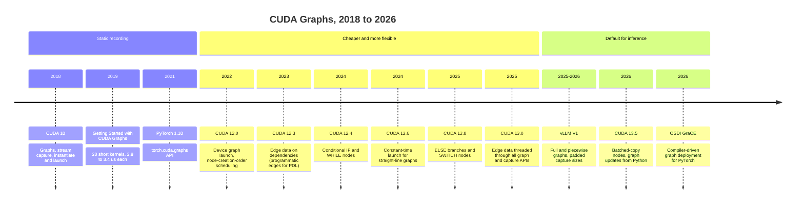
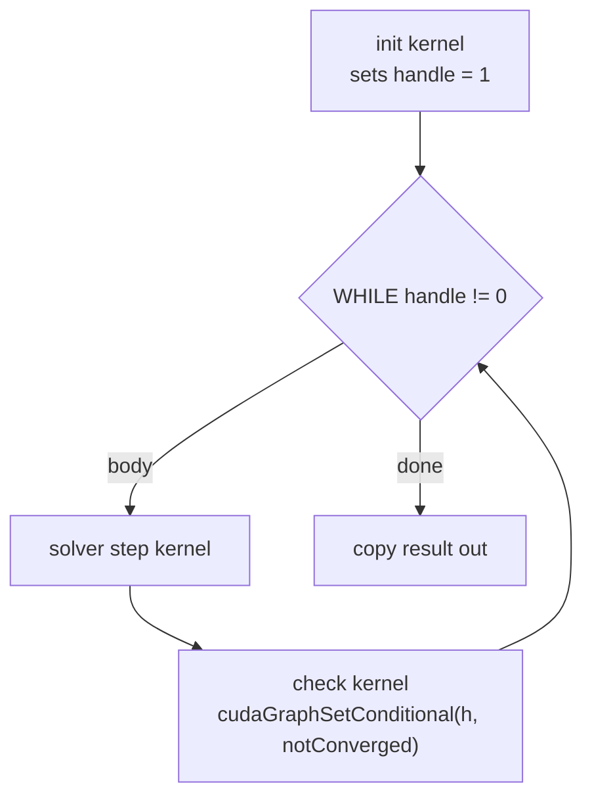

---
tags:
  - gpu-programming
  - cuda
  - cuda-graphs
  - launch-overhead
  - inference
status: draft
sources:
  - https://docs.nvidia.com/cuda/cuda-programming-guide/04-special-topics/cuda-graphs.html
  - https://developer.nvidia.com/blog/cuda-graphs
  - https://developer.nvidia.com/blog/constant-time-launch-for-straight-line-cuda-graphs-and-other-performance-enhancements
  - https://developer.nvidia.com/blog/enabling-dynamic-control-flow-in-cuda-graphs-with-device-graph-launch
  - https://developer.nvidia.com/blog/dynamic-control-flow-in-cuda-graphs-with-conditional-nodes
  - https://docs.nvidia.com/dl-cuda-graph/cuda-graph-basics/quantitative-benefits.html
  - https://docs.pytorch.org/docs/stable/user_guide/torch_compiler/torch.compiler_cudagraph_trees.md
  - https://docs.vllm.ai/en/stable/design/cuda_graphs/
  - https://www.usenix.org/system/files/osdi26-ghosh.pdf
  - https://developer.nvidia.com/docs/drive/drive-os/7.2.5/public/drive-os-migration-guide/cudart_changes.html
  - https://developer.nvidia.com/blog/nvidia-cuda-13-5-brings-nvidia-vera-rubin-ga-support/
created: 2026-11-26
updated: 2026-11-26
---

## Table Of Contents

---

- [[#TL;DR|TL;DR]]
- [[#The Problem|The Problem]]
- [[#Foundations|Foundations]]
    - [[#Launch Overhead|Launch Overhead]]
    - [[#Define Once, Run Many Times|Define Once, Run Many Times]]
    - [[#Nodes and Edges|Nodes and Edges]]
- [[#How We Got Here|How We Got Here]]
- [[#How It Works|How It Works]]
    - [[#Stream Capture|Stream Capture]]
    - [[#A Worked Example: Where the Time Goes|A Worked Example: Where the Time Goes]]
    - [[#Updating a Graph Without Rebuilding It|Updating a Graph Without Rebuilding It]]
    - [[#Memory Inside Graphs|Memory Inside Graphs]]
    - [[#Control Flow: Conditional Nodes and Device Launch|Control Flow: Conditional Nodes and Device Launch]]
    - [[#Graphs in PyTorch and LLM Serving|Graphs in PyTorch and LLM Serving]]
- [[#Where It Is Now|Where It Is Now]]
- [[#Trade-offs & Open Problems|Trade-offs & Open Problems]]
- [[#Resources|Resources]]
- [[#Related Notes|Related Notes]]

## ***TL;DR***
---
*A CUDA Graph records a whole sequence of GPU work (kernels, copies, their dependencies) once, then replays it with a single launch. It removes most of the CPU's per-kernel launch cost, which dominates when kernels are short, as in LLM decoding.*

- **What it is:** a description of GPU work as a dependency graph, separated from its execution. You build it (usually by *capturing* what you issue to a stream), *instantiate* it into an executable graph once, and *launch* that many times ([CUDA Programming Guide 4.2](https://docs.nvidia.com/cuda/cuda-programming-guide/04-special-topics/cuda-graphs.html)).
- **Why it helps:** every kernel launch costs the CPU a few microseconds. When kernels are short, the GPU waits on the CPU. In NVIDIA's original example, 20 kernels of 2.9 µs each cost 9.6 µs apiece when launched and synchronized one by one, 3.8 µs with launches queued ahead, and 3.4 µs as a graph ([Gray, 2019](https://developer.nvidia.com/blog/cuda-graphs)).
- **What it costs:** a graph freezes kernel arguments, pointers and shapes at capture time. Anything dynamic (a new batch size, a CPU-side branch, a new buffer address) needs a different graph, a graph update, or conditional nodes.
- **Since 2019:** constant-time launch for straight-line graphs on Ampere and newer (about 2.5 µs plus about 1 ns per node in CUDA 12.6, against about 2 µs plus 200 ns per node in 11.8), device-side graph launch (12.0), conditional IF and WHILE nodes (12.4), ELSE and SWITCH (12.8), memory nodes and Programmatic Dependent Launch edges ([Hoffman & Oh, 2024](https://developer.nvidia.com/blog/constant-time-launch-for-straight-line-cuda-graphs-and-other-performance-enhancements)).
- **Where it is now (Nov 2026):** graphs are the default for LLM decode. vLLM defaults to full graphs for uniform decode batches plus piecewise graphs (attention run eagerly) for everything else, padding each batch to the nearest captured size ([vLLM docs](https://docs.vllm.ai/en/stable/design/cuda_graphs/)). PyTorch's `torch.compile(mode="reduce-overhead")` uses CUDAGraph Trees. Research at OSDI '26 (GraCE) found about a quarter of PyTorch's CUDA graphs in TorchBench actually slow things down, and compiler support can recover a 29% geomean speedup over PyTorch 2's graph mode ([Ghosh et al., 2026](https://www.usenix.org/system/files/osdi26-ghosh.pdf)).

## ***The Problem***
---
*A GPU can finish a small kernel faster than the CPU can launch the next one. When a workload is a long chain of small kernels, the CPU's launch path becomes the bottleneck and the GPU sits idle between kernels.*

Each kernel launch goes through the CUDA runtime and driver on the CPU: validate arguments, build a launch descriptor, write it into a command queue the GPU reads, and possibly synchronize. That costs a few microseconds per launch. NVIDIA's deep-learning CUDA Graph guide assumes 1 to 5 µs saved per kernel ([NVIDIA DL CUDA Graph guide](https://docs.nvidia.com/dl-cuda-graph/cuda-graph-basics/quantitative-benefits.html)).

That is negligible for a 10 ms GEMM. It is not negligible when:

- **LLM decoding.** Each generated token runs every layer of the model for a batch of a few tokens. The kernels are small (skinny GEMMs, norms, activations, attention over the KV cache), and a model has dozens of layers with several kernels each, so one decode step is hundreds of kernels, each a few microseconds long.
- **Python frameworks.** PyTorch eager mode adds Python and dispatcher overhead on top of the CUDA launch, so the CPU falls further behind.
- **Multi-GPU jobs.** If one rank's CPU is delayed (a stray interrupt, garbage collection), every other rank waits at the next collective. CPU jitter turns into cluster-wide stragglers.
- **Iterative solvers.** Thousands of iterations of the same few kernels, each tiny.

Queuing launches asynchronously (see [[Streams, Events and Async Execution]]) helps only as long as the CPU can issue launches faster than the GPU drains them. For short kernels, it can't. The fix is to stop launching kernels one at a time.

## ***Foundations***
---
*Three ideas: launch overhead is a fixed CPU cost per operation, a graph separates defining work from running it so the setup is paid once, and a graph is just nodes (operations) and edges (dependencies), which also tells the driver what may run in parallel.*

#### **Launch Overhead**
Think of a stream of $N$ kernels, each taking $t_k$ on the GPU, launched by a CPU that needs $t_l$ per launch. If launches are queued ahead (no synchronization in between), the GPU is busy only if the CPU keeps up:

$$
T_{stream} \approx N \cdot \max(t_k, t_l)
$$

*In plain English: when kernels are shorter than the launch cost, the CPU sets the pace and the GPU idles between kernels.*

A graph replaces $N$ launches with one:

$$
T_{graph} \approx t_{graph\_launch} + N \cdot (t_k + t_{gap})
$$

where $t_{gap}$ is the small device-side gap between consecutive kernels in the graph. Graphs win whenever $t_l > t_k + t_{gap}$, which is exactly the many-small-kernels regime.

#### **Define Once, Run Many Times**
A CUDA Graph has three stages ([CUDA Programming Guide 4.2](https://docs.nvidia.com/cuda/cuda-programming-guide/04-special-topics/cuda-graphs.html)):



- **Definition** builds a `cudaGraph_t`: a template of operations and dependencies. Nothing runs.
- **Instantiation** turns it into a `cudaGraphExec_t`. The driver does the expensive validation and setup here, once.
- **Launch** submits the whole executable graph into a stream with one call. It can be repeated without re-instantiating.

This is the same split as "compile once, run many times." The cost of capture and instantiation (tens of microseconds to milliseconds) is only worth paying for work that repeats.

#### **Nodes and Edges**
Nodes are operations; edges are dependencies. Supported node types ([CUDA Programming Guide 4.2](https://docs.nvidia.com/cuda/cuda-programming-guide/04-special-topics/cuda-graphs.html)):

| Node type | What it does |
|---|---|
| Kernel | Launch a kernel with fixed grid, block and arguments |
| Memcpy, memset | Copy or fill memory |
| Host | Call a CPU function in graph order |
| Event record, event wait | Synchronize with work outside the graph |
| External semaphore signal, wait | Synchronize with graphics APIs or other processes |
| Memory alloc, free | Graph-owned memory with GPU-ordered lifetime |
| Child graph | Embed another graph |
| Conditional | Run a body graph IF, WHILE or SWITCH on a GPU-set value |
| Empty | A join point with no work |

Because the whole graph is known in advance, the driver can see that two branches are independent and run them concurrently, without the programmer creating multiple streams. Edges can also carry *edge data* (since CUDA 12.3), whose main use is marking a programmatic edge so the second kernel may start early under [[Programmatic Dependent Launch]].

## ***How We Got Here***
---
*Graphs arrived in CUDA 10 in 2018 as a static recording mechanism. Since then NVIDIA has steadily made them cheaper to launch, easier to update and less static, adding device-side launch and GPU-evaluated control flow, while frameworks built the machinery to use them automatically.*



| Year | Step | Problem it answered | Source |
|---|---|---|---|
| 2018-2019 | CUDA 10 graphs with stream capture. On a V100, 20 kernels of 2.9 µs went from 3.8 µs per kernel (async launches) to 3.4 µs (graph). | Per-kernel CPU launch cost | [Gray](https://developer.nvidia.com/blog/cuda-graphs) |
| 2022 | Device graph launch (CUDA 12.0): a running kernel launches a pre-uploaded graph, with fire-and-forget and tail-launch modes. Device-side launch latency more than 2x lower than host launch and flat as graph parallelism grows. | Returning to the CPU for every decision | [NVIDIA, Dec 2022](https://developer.nvidia.com/blog/enabling-dynamic-control-flow-in-cuda-graphs-with-device-graph-launch) |
| 2024 | Conditional nodes (CUDA 12.4): IF and WHILE bodies chosen by a value a kernel writes on the GPU. CUDA 12.8 added ELSE and SWITCH. | Loops and branches forcing graph splits | [NVIDIA, May 2024](https://developer.nvidia.com/blog/dynamic-control-flow-in-cuda-graphs-with-conditional-nodes) |
| 2024 | CUDA 12.6: straight-line graph repeat launch near constant time on Ampere and newer (about 2 µs vs about 25 µs at 250 nodes in 11.8); instantiating a 1,025-node straight line fell from 2,143 to 1,526 µs. | Launch cost growing with graph size | [Hoffman & Oh](https://developer.nvidia.com/blog/constant-time-launch-for-straight-line-cuda-graphs-and-other-performance-enhancements) |
| 2025 | CUDA 13.0 threads `cudaGraphEdgeData` through `cudaGraphAddNode`, `cudaStreamGetCaptureInfo` and the other dependency APIs (pass NULL if unused). | Programmatic edges everywhere | [Migration guide](https://developer.nvidia.com/docs/drive/drive-os/7.2.5/public/drive-os-migration-guide/cudart_changes.html) |
| 2026 | vLLM full plus piecewise graphs by default; PyTorch CUDAGraph Trees; GraCE at OSDI. | Using graphs safely in dynamic frameworks | [vLLM](https://docs.vllm.ai/en/stable/design/cuda_graphs/), [Ghosh et al.](https://www.usenix.org/system/files/osdi26-ghosh.pdf) |

## ***How It Works***
---
*In practice you capture a stream, instantiate once, and replay. Graph updates change arguments without rebuilding; memory nodes give the graph fixed addresses; conditional nodes and device launch move control flow onto the GPU; and frameworks wrap all of it so model code does not have to.*

#### **Stream Capture**
The usual way to build a graph is to record work you would have issued to a stream anyway ([Gray, 2019](https://developer.nvidia.com/blog/cuda-graphs)):

```cpp
cudaGraph_t graph;
cudaGraphExec_t exec;
bool built = false;
for (int step = 0; step < NSTEP; ++step) {
    if (!built) {
        cudaStreamBeginCapture(stream, cudaStreamCaptureModeGlobal);
        for (int k = 0; k < NKERNEL; ++k)
            shortKernel<<<blocks, threads, 0, stream>>>(out_d, in_d);
        cudaStreamEndCapture(stream, &graph);
        cudaGraphInstantiate(&exec, graph, 0);
        built = true;
    }
    cudaGraphLaunch(exec, stream);
    cudaStreamSynchronize(stream);
}
```

- `cudaStreamBeginCapture` switches `stream` into recording mode. Kernels launched into it are added to a graph instead of running. `cudaStreamCaptureModeGlobal` makes other threads' unsafe CUDA calls (like a synchronous `cudaMalloc`) an error during capture.
- The inner loop issues 20 kernels exactly as normal code would.
- `cudaStreamEndCapture` stops recording and returns the `cudaGraph_t`.
- `cudaGraphInstantiate` builds the executable graph once (the current signature takes flags as the last argument).
- Every step then calls `cudaGraphLaunch`, one CPU call for all 20 kernels.

Capture follows events across streams: if the captured stream records an event that another stream waits on, that stream joins the capture, and it must rejoin the origin stream before capture ends. During capture you may not synchronize or query a capturing stream, and an invalid operation invalidates the whole capture ([CUDA Programming Guide 4.2](https://docs.nvidia.com/cuda/cuda-programming-guide/04-special-topics/cuda-graphs.html)).

The alternative is building the graph node by node with `cudaGraphCreate` and `cudaGraphAddNode`. That is more code, but it gives exact control over dependencies and is what libraries use for dynamic topologies.

#### **A Worked Example: Where the Time Goes**
Gray's V100 numbers for one step of 20 kernels, each doing 2.9 µs of work ([Gray, 2019](https://developer.nvidia.com/blog/cuda-graphs)):

| Launch style | Per kernel | Per step (x20) | GPU busy fraction |
|---|---|---|---|
| Launch, then `cudaStreamSynchronize` each kernel | 9.6 µs | 192 µs | $58/192 \approx 30\%$ |
| Launch all 20, synchronize once per step | 3.8 µs | 76 µs | $58/76 \approx 76\%$ |
| One CUDA Graph per step | 3.4 µs | 68 µs | $58/68 \approx 85\%$ |

*In plain English: synchronizing after every kernel wastes 70% of the GPU; just queuing launches recovers most of it; the graph removes another 8 µs per step.* The remaining gap is the device-side spacing between kernels and the graph launch itself.

The CPU side scales differently. Using the CUDA 12.6 fit for repeat launch of a straight-line graph on Ampere ([Hoffman & Oh, 2024](https://developer.nvidia.com/blog/constant-time-launch-for-straight-line-cuda-graphs-and-other-performance-enhancements)):

$$
t_{launch}^{11.8} \approx 2\ \mu s + 200\ \text{ns} \times n, \qquad t_{launch}^{12.6} \approx 2.5\ \mu s + 1\ \text{ns} \times n
$$

For a 1,000-kernel decode step:
- CUDA 11.8: $2 + 0.2 \times 1000 = 202$ µs of CPU time per launch.
- CUDA 12.6: $2.5 + 0.001 \times 1000 \approx 3.5$ µs.

Compare 1,000 separate launches at 1 to 5 µs each: 1 to 5 ms of CPU time per step. Graphs with parallel branches cost more (four parallel chains of 250 nodes fell from over 60 µs to about 6 µs), and constant-time launch applies to Ampere and newer; older GPUs still pay $O(n)$.

#### **Updating a Graph Without Rebuilding It**
Instantiation is the expensive step, so CUDA offers ways to change an executable graph in place ([CUDA Programming Guide 4.2](https://docs.nvidia.com/cuda/cuda-programming-guide/04-special-topics/cuda-graphs.html)):

| Mechanism | Use when | Limits |
|---|---|---|
| `cudaGraphExecUpdate(exec, newGraph, ...)` | Re-captured a graph with the same topology but new arguments | Topology must match exactly, with deterministic node pairing |
| Per-node setters, e.g. `cudaGraphExecKernelNodeSetParams` | Only a few nodes change | Some node types and fields cannot be changed; check the guide's per-type rules |
| `cudaGraphNodeSetEnabled` | Skip a kernel, memcpy or memset node on some launches | Node stays in the graph |

Updates take effect on the next launch; launches already in flight are unaffected. CUDA 13.5 exposes graph updates from Python through `cuda.core` and adds batched-copy nodes to graphs ([NVIDIA, Nov 2026](https://developer.nvidia.com/blog/nvidia-cuda-13-5-brings-nvidia-vera-rubin-ga-support/)).

#### **Memory Inside Graphs**
Kernel arguments in a graph are frozen, including pointers, so the buffers a graph uses must stay at the same addresses for every replay. Two consequences:

- **Inputs are copied into static buffers.** Frameworks keep a fixed input tensor per graph and copy new data into it before each replay. OSDI '26 measured that this parameter copying can take up to 24% of graph execution time in PyTorch workloads ([Ghosh et al., 2026](https://www.usenix.org/system/files/osdi26-ghosh.pdf)).
- **Graph memory nodes.** Allocation and free nodes (or captured `cudaMallocAsync` and `cudaFreeAsync`) give memory a GPU-ordered lifetime with fixed addresses across launches. CUDA reuses virtual addresses within a graph and shares physical memory between graphs that never run at the same time. Destroying a graph does not return memory to the OS; `cudaDeviceGraphMemTrim` does ([CUDA Programming Guide 4.2](https://docs.nvidia.com/cuda/cuda-programming-guide/04-special-topics/cuda-graphs.html)).

#### **Control Flow: Conditional Nodes and Device Launch**
A plain graph has no branches. Two features add them without going back to the CPU:

- **Conditional nodes (CUDA 12.4+).** Create a handle with `cudaGraphConditionalHandleCreate`; a kernel in the graph sets it with `cudaGraphSetConditional`; a conditional node then runs its body graph IF the value is non-zero, WHILE it is non-zero, or (since 12.8) the $n$-th body of a SWITCH; IF can also take an ELSE body. Body graphs are restricted in which node types they may hold. A convergence loop can therefore run entirely on the GPU: the body computes, a check kernel writes "not converged" into the handle, and the WHILE node repeats ([NVIDIA, May 2024](https://developer.nvidia.com/blog/dynamic-control-flow-in-cuda-graphs-with-conditional-nodes)).
- **Device graph launch (CUDA 12.0+).** Instantiate with `cudaGraphInstantiateFlagDeviceLaunch`, upload it, and a kernel can launch it. *Fire-and-forget* launches run independently (up to 120 pending per parent); a *tail launch* runs after the launching graph finishes, which lets a scheduler kernel relaunch itself in a loop; *sibling* launch runs the new graph as a peer of the launching one. Device-launchable graphs support a restricted set of node types ([CUDA Programming Guide 4.2](https://docs.nvidia.com/cuda/cuda-programming-guide/04-special-topics/cuda-graphs.html)).



#### **Graphs in PyTorch and LLM Serving**
Most people use CUDA Graphs through a framework:

- **PyTorch CUDAGraph Trees.** `torch.compile(model, mode="reduce-overhead")` warms up, records, then replays. All recordings share one memory pool. Inputs from eager code are copied into static tensors; parameters, buffers and previous graph outputs keep fixed addresses. Each new input shape triggers a re-recording (pad to a few fixed shapes), functions with CPU ops or input mutation are skipped unless partitioned, and an output can be overwritten by the next replay unless you clone it or call `torch.compiler.cudagraph_mark_step_begin()` ([PyTorch docs](https://docs.pytorch.org/docs/stable/user_guide/torch_compiler/torch.compiler_cudagraph_trees.md)).
- **vLLM.** Decode batches change size every step, so vLLM captures graphs for a set of batch sizes and pads each real batch up to the smallest captured size that fits; larger batches run eagerly. Its modes ([vLLM docs](https://docs.vllm.ai/en/stable/design/cuda_graphs/)):

| Mode | Captures | Best for |
|---|---|---|
| PIECEWISE | Everything except attention and other uncapturable ops | Any attention backend |
| FULL | Whole forward pass, including attention | Backends whose attention is fully capturable |
| FULL_DECODE_ONLY | Whole pass for uniform decode batches only | Decode servers in prefill/decode disaggregation |
| FULL_AND_PIECEWISE (default) | Full for decode, piecewise for mixed batches | Usually fastest; most memory, slowest capture |

Piecewise mode leaves attention out because not every attention backend can be captured with the varying per-request metadata a mixed batch carries.

## ***Where It Is Now***
---
*As of November 2026, CUDA Graphs are standard for LLM inference and common in training loops. The work has moved from "can we capture this" to deploying graphs automatically and safely in dynamic frameworks, and to shaving the remaining per-node and per-replay costs.*

- **LLM serving runs on graphs.** vLLM's default (Nov 2026 docs) is FULL_AND_PIECEWISE, with capture sizes keyed by request count for uniform decode and by token count otherwise ([vLLM docs](https://docs.vllm.ai/en/stable/design/cuda_graphs/)). Graph memory and capture time are now first-order tuning knobs for serving.
- **Automatic deployment is still hard.** GraCE (OSDI '26) analyzed 116 CUDA graphs in TorchBench and found about 25% slowed workloads down, some by up to 397%, mostly from parameter copying and kernels left out of capture by CPU-side scalars. Its compiler fixes (rewriting code so more kernels are capturable, passing pointers instead of copying parameters, and deploying graphs only where profiling shows a gain) gave a 29% geomean speedup over PyTorch 2's CUDA graph mode on an H100 NVL, up to 3.36x, and up to 3.56x in 4-GPU tensor-parallel runs ([Ghosh et al., 2026](https://www.usenix.org/system/files/osdi26-ghosh.pdf)).
- **NVIDIA's guidance by workload.** NVIDIA's deep-learning CUDA Graph guide expects 1.5 to 3x for many-small-kernel workloads, 1.3 to 2x for medium ones, 1.1 to 1.4x for large kernels, and 1.05 to 1.15x for code already above 90% GPU utilization. It also highlights a less obvious win: run-to-run jitter falls from about 3 to 10% to under 1 to 2%, and rank-to-rank variation in multi-GPU jobs from 5 to 20% to under 2% ([NVIDIA DL CUDA Graph guide](https://docs.nvidia.com/dl-cuda-graph/cuda-graph-basics/quantitative-benefits.html)).
- **CUDA 13.5 (Nov 2026)** adds batched 1D copies inside captured graphs, executable-node updates from Python, and device-side element counts for CUB reductions so a captured reduction can process a different length on each replay without a host transfer ([NVIDIA, Nov 2026](https://developer.nvidia.com/blog/nvidia-cuda-13-5-brings-nvidia-vera-rubin-ga-support/)).
- **Graphs plus PDL.** Programmatic edges let consecutive kernels inside a graph overlap their prologue and epilogue on Hopper and newer, attacking the remaining device-side gap between nodes.

## ***Trade-offs & Open Problems***
---
*Graphs trade flexibility for speed: everything that was decided at launch time is decided at capture time instead. Most of the open problems are about recovering flexibility (shapes, control flow, memory) without losing the launch savings.*

| Aspect | Gain | Cost |
|---|---|---|
| One launch for many kernels | CPU launch cost nearly gone; less jitter | Capture and instantiation cost; must be amortized over many replays |
| Frozen arguments and addresses | Replay is cheap and deterministic | Static input buffers and copies; new shapes need new graphs |
| Padding to captured sizes | Reuses a few graphs for many batch sizes | Wasted compute on padding; memory per captured size |
| Whole-graph view | Driver finds parallelism automatically | Harder to debug; errors surface at replay |
| Conditional nodes and device launch | Loops and branches stay on the GPU | Restricted node types in bodies and device graphs |
| Graph memory pools | Fixed addresses, shared physical memory | Memory not returned to the OS without an explicit trim |

Open problems:
- **Dynamic shapes.** Real workloads (variable sequence lengths, mixture-of-experts routing, speculative decoding) change shapes constantly. Bucketing and padding work but waste compute and memory; shape-polymorphic graphs do not exist.
- **Selective use.** As GraCE shows, a graph can be slower than eager execution. Deciding automatically where to graph, and where not to, needs profiling the frameworks mostly don't do yet.
- **Capture safety.** A synchronous call, a CPU scalar, or a library that allocates during capture breaks or invalidates it. Errors are often found only at run time.
- **The remaining gaps.** With CPU launch cost largely solved, what is left is device-side spacing between kernels. [[Kernel Fusion]] and PDL attack the same gap from different directions.

## ***Resources***
---
*Read Gray's post for the core idea in ten minutes, then the Programming Guide chapter for the full feature set. For deployment, the vLLM design doc and the PyTorch CUDAGraph Trees page show how real systems handle dynamic shapes; GraCE explains why it still goes wrong.*

**Primary sources**
- [CUDA Programming Guide 4.2: CUDA Graphs](https://docs.nvidia.com/cuda/cuda-programming-guide/04-special-topics/cuda-graphs.html): NVIDIA, CUDA 13.4.2 docs . Node types, capture, update, memory nodes, conditionals, device launch.
- [CUDA 12.x to 13.x API changes](https://developer.nvidia.com/docs/drive/drive-os/7.2.5/public/drive-os-migration-guide/cudart_changes.html): edge-data parameters in the graph APIs.
- [NVIDIA CUDA 13.5 release blog](https://developer.nvidia.com/blog/nvidia-cuda-13-5-brings-nvidia-vera-rubin-ga-support/): Nov 4, 2026.
- [NVIDIA deep-learning CUDA Graph guide: Quantitative Benefits](https://docs.nvidia.com/dl-cuda-graph/cuda-graph-basics/quantitative-benefits.html).

**Engineering posts**
- [Getting Started with CUDA Graphs](https://developer.nvidia.com/blog/cuda-graphs): Alan Gray, Sep 2019.
- [Enabling Dynamic Control Flow in CUDA Graphs with Device Graph Launch](https://developer.nvidia.com/blog/enabling-dynamic-control-flow-in-cuda-graphs-with-device-graph-launch): NVIDIA, Dec 2022.
- [Dynamic Control Flow in CUDA Graphs with Conditional Nodes](https://developer.nvidia.com/blog/dynamic-control-flow-in-cuda-graphs-with-conditional-nodes): NVIDIA, May 2024 (updated Feb 2025 for CUDA 12.8).
- [Constant Time Launch for Straight-Line CUDA Graphs and Other Performance Enhancements](https://developer.nvidia.com/blog/constant-time-launch-for-straight-line-cuda-graphs-and-other-performance-enhancements): Hoffman & Oh, Sep 2024.

**Frameworks and research**
- [PyTorch CUDAGraph Trees](https://docs.pytorch.org/docs/stable/user_guide/torch_compiler/torch.compiler_cudagraph_trees.md): how `torch.compile` uses graphs.
- [vLLM CUDA Graphs design](https://docs.vllm.ai/en/stable/design/cuda_graphs/): modes, capture sizes, padding.
- [GraCE: Unlocking CUDA Graphs with Compiler Support for ML Workloads](https://www.usenix.org/system/files/osdi26-ghosh.pdf): Ghosh, Nayak, Panwar & Basu, OSDI '26.

## Related Notes

- [[Streams, Events and Async Execution]] — Graphs are captured from streams; PDL and events carry over.
- [[CUDA Programming Model]] — Kernel launches, grids and blocks that graph nodes freeze.
- [[Kernel Fusion]] — Fewer, bigger kernels: the other way to cut launch and gap overhead.
- [[Programmatic Dependent Launch]] — Programmatic edges that let consecutive graph nodes overlap.
- [[Unified Memory]] — Memory operations and prefetches that can sit in graphs.
- [[Profiling with Nsight Compute and Nsight Systems]] — Nsight Systems shows launch gaps and graph replays on the timeline.
- [[Triton]] — Compiled kernels that `torch.compile` then wraps in CUDA graphs.
- [[LLM Serving]] — Decode loops where graphs are standard.
- [[KV Cache]] — The per-request state that makes attention hard to capture.
- [[Speculative Decoding]] — Variable-length steps that complicate graph capture.
- [[Distributed Training]] — Graphs reduce CPU jitter that turns into stragglers across ranks.
