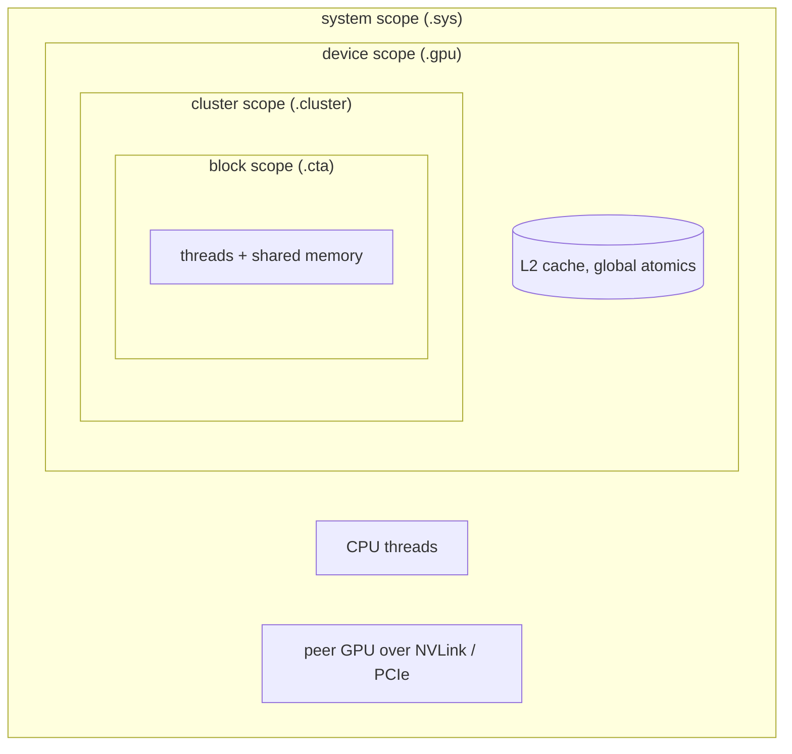
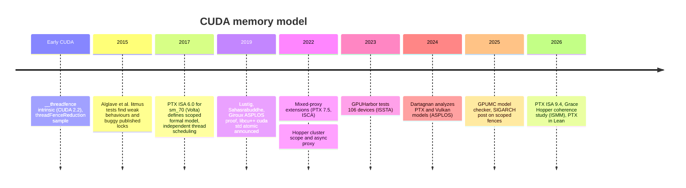
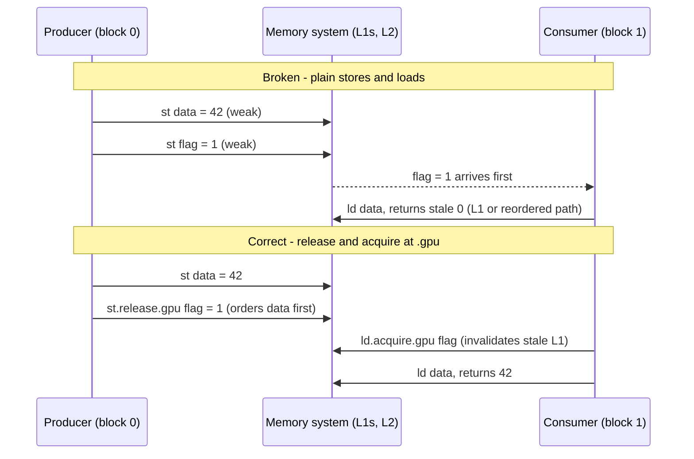

---
tags:
  - gpu-programming
  - cuda
  - memory-model
  - atomics
  - synchronization
  - ptx
status: complete
sources:
  - https://docs.nvidia.com/cuda/parallel-thread-execution/
  - https://research.nvidia.com/publication/2019-04_formal-analysis-nvidia-ptx-memory-consistency-model
  - https://pages.cs.wisc.edu/~markhill/restricted/asplos19_nvidia_consistency_talk.pdf
  - https://kar.kent.ac.uk/id/document/3276638
  - https://docs.nvidia.com/cuda/hopper-tuning-guide/ptx-writers-guide-to-interoperability/atomic-abi.html
  - https://docs.nvidia.com/cuda/cuda-programming-guide/05-appendices/cuda-cpp-memory-model.html
  - https://docs.nvidia.com/cuda/cuda-programming-guide/05-appendices/cpp-language-extensions.html
  - https://docs.nvidia.com/cuda/cuda-programming-guide/04-special-topics/memory-sync-domains.html
  - https://docs.nvidia.com/cuda/cuda-programming-guide/04-special-topics/async-copies.html
  - https://docs.nvidia.com/cuda/archive/13.4.1/cuda-programming-guide/03-advanced/advanced-kernel-programming.html
  - https://nvidia.github.io/cccl/libcudacxx/extended_api/memory_model.html
  - https://nvidia.github.io/cccl/libcudacxx/extended_api/synchronization_primitives/atomic_ref.html
  - https://nvidia.github.io/cccl/libcudacxx/extended_api/synchronization_primitives/atomic/atomic_thread_fence.html
  - https://nvidia.github.io/cccl/unstable/libcudacxx/ptx/instructions/fence.html
  - https://docs.nvidia.com/cuda/tile-ir/sections/memory_model.html
  - https://forums.developer.nvidia.com/t/can-threadfence-system-in-function-nvshmemi-barrier-threadgroup-changed-to-fence-acq-rel-sys/337127
  - https://forums.developer.nvidia.com/t/where-do-atomic-operations-go-and-why-are-atomics-to-shared-faster-than-those-to-gmem/220300
  - https://forums.developer.nvidia.com/t/difference-between-red-and-atomg-sass-instruction/203469
  - https://reviews.llvm.org/D50391?id=159776
  - https://lists.llvm.org/pipermail/llvm-commits/Week-of-Mon-20240708/1402997.html
  - https://turing.une.edu.au/~cosc330/lectures/cuda_samples_old/samples/6_Advanced/threadFenceReduction/threadFenceReduction.cu
  - https://www.doc.ic.ac.uk/~afd/papers/2015/ASPLOS.pdf
  - https://developer.nvidia.com/blog/?p=7832
  - https://developer.download.nvidia.com/video/gputechconf/gtc/2019/presentation/s9329-synchronization-is-bad-but-if-you-must.pdf
  - https://old.chipsandcheese.com/?p=37649
  - https://users.cs.utah.edu/~vijay/papers/ismm26.pdf
  - https://hgpu.org/?p=29276
  - https://arxiv.org/abs/2505.20207
  - https://www.sigarch.org/gpu-memory-consistency-specifications-testing-and-opportunities-for-performance-tooling/
  - https://tyler-utah.github.io/files/markdown/gpuharbor2023.md
  - https://arxiv.org/pdf/2611.04447
  - https://os.itec.kit.edu/65_4068.php
  - https://docs.pytorch.org/docs/main/notes/randomness.html
created: 2026-11-26
updated: 2026-11-26
---

## Table Of Contents

---

- [[#TL;DR|TL;DR]]
- [[#The Problem|The Problem]]
- [[#Foundations|Foundations]]
    - [[#Weak and Strong Operations|Weak and Strong Operations]]
    - [[#Scopes|Scopes]]
    - [[#Morally Strong and Causality Order|Morally Strong and Causality Order]]
    - [[#Fences|Fences]]
    - [[#Mapping C++ to PTX|Mapping C++ to PTX]]
- [[#How We Got Here|How We Got Here]]
- [[#How It Works|How It Works]]
    - [[#Message Passing with libcu++|Message Passing with libcu++]]
    - [[#What Goes Wrong Without Synchronization|What Goes Wrong Without Synchronization]]
    - [[#The Last-Block Reduction|The Last-Block Reduction]]
    - [[#Where Atomics Execute|Where Atomics Execute]]
    - [[#Which Atomic API|Which Atomic API]]
    - [[#Worked Example - Atomic Throughput on B200|Worked Example: Atomic Throughput on B200]]
    - [[#Floating-Point Atomics|Floating-Point Atomics]]
    - [[#System-Scope Atomics|System-Scope Atomics]]
    - [[#Spin-Locks and Independent Thread Scheduling|Spin-Locks and Independent Thread Scheduling]]
    - [[#Proxies, mbarriers and Clusters|Proxies, mbarriers and Clusters]]
- [[#Where It Is Now|Where It Is Now]]
- [[#Trade-offs & Open Problems|Trade-offs & Open Problems]]
- [[#Resources|Resources]]
- [[#Related Notes|Related Notes]]

## ***TL;DR***
---
*The CUDA memory model says when a write by one thread is guaranteed to be seen by another, and in what order. It is weak by default: plain loads and stores can be reordered and cached, so threads that communicate must use scoped atomics, acquire/release operations or fences.*

- **The rule in one line:** to pass data from thread A to thread B, A writes the data and then does a **release** (a release store, or a fence followed by an atomic); B observes that atomic with an **acquire** (an acquire load, or an atomic followed by a fence); and both operations must name a **scope** that contains the other thread.
- **Scopes:** `.cta` (one thread block), `.cluster` (one thread block cluster, Hopper and later), `.gpu` (the whole device) and `.sys` (the whole system: CPU and other GPUs too). A narrower scope is cheaper; a scope that is too narrow is a data race.
- **Atomics:** `atomicAdd` and friends are atomic but **relaxed**: they order nothing else. Global atomics are resolved in the L2 cache, shared-memory atomics inside the SM. `cuda::atomic_ref<T, thread_scope>` from libcu++ gives the full C++ memory orders with an explicit scope.
- **History:** PTX ISA 6.0 (Volta, 2017) introduced the formal, scoped model; Lustig, Sahasrabuddhe and Giroux analyzed it and proved the C++ mapping sound (ASPLOS 2019). Proxies (PTX 7.5, ISCA 2022) extended it to texture paths and later to TMA's async proxy.
- **Where it is now (Nov 2026):** PTX ISA 9.4 has a full memory-model chapter with proxies, cluster scope and multimem addresses; the CUDA 13.5 Programming Guide recommends `cuda::atomic_thread_fence` and `cuda::atomic_ref`; research tools (Dartagnan, GPUMC, Lean proofs of PTX kernels) now check real GPU code against the model.

## ***The Problem***
---
*A GPU has thousands of threads, per-SM caches and a deep memory pipeline. Keeping every write instantly visible everywhere would cost speed, power and area, so NVIDIA exposes a weak model and asks the programmer to say where ordering matters.*

Three things can make another thread see your writes late or out of order:
1. **Caches.** Each SM has an L1 cache; the L2 is shared. Grace Hopper measurements show that writes go through to L2 and that "an acquire operation on the Hopper GPU with a scope of gpu or higher triggers a self-invalidation of the local L1 cache" ([Bagchi et al., ISMM 2026](https://users.cs.utah.edu/~vijay/papers/ismm26.pdf)). Without that acquire, a reader can keep hitting a stale L1 line (they saw stale reads at L1 latency, about 6 ns, against about 145 ns for L2 hits).
2. **The memory system.** Loads and stores from one thread travel different paths and can complete in a different order than issued. NVIDIA chose to "expose an extremely relaxed memory model in PTX" because parts of the GPU "may use non-standard non-coherent paths to the memory system" and full coherence would cost performance, power and area ([Lustig, Cooksey, Giroux, ISCA 2022](https://kar.kent.ac.uk/id/document/3276638)).
3. **The compiler.** A race on plain variables is undefined behavior in CUDA C++ ([libcu++ memory model](https://nvidia.github.io/cccl/libcudacxx/extended_api/memory_model.html)), so the compiler may assume no other thread changes them: it can keep a value in a register or move a store past another.

This is not hypothetical. In 2015, Alglave et al. ran litmus tests on Fermi and Kepler GPUs and saw message-passing failures even with fences on a Tesla C2075 (187 per 100k runs with a device fence), and found that the spin-lock in *CUDA by Example* let a critical section read stale data (512 violations per 100k runs on a GTX Titan); NVIDIA's erratum said the code "requires the addition of __threadfence() instructions" ([GPU Concurrency, ASPLOS 2015](https://www.doc.ic.ac.uk/~afd/papers/2015/ASPLOS.pdf)). Bugs like these appear rarely, so testing alone does not catch them; a spec says which programs are correct.

## ***Foundations***
---
*Five ideas carry the model: operations are weak or strong, strong operations carry a scope, two operations synchronize only if they are morally strong, fences turn relaxed operations into release or acquire patterns, and C++ atomics map onto all of this by a fixed table.*

### Weak and Strong Operations

| Kind | PTX examples | Meaning |
|---|---|---|
| Weak | `ld`, `st`, `ld.weak` (plain C++ variables) | No guarantees under concurrency; cannot be used to communicate |
| Relaxed | `ld.relaxed.gpu`, `st.relaxed.sys`, `atom.relaxed.gpu` | Atomic at its scope, but orders nothing else |
| Acquire | `ld.acquire.gpu`, `atom.acquire.gpu` | Later accesses cannot move before it |
| Release | `st.release.gpu`, `atom.release.gpu` | Earlier accesses cannot move after it |
| Acq_rel | `atom.acq_rel.gpu` | Both, for read-modify-writes |
| Volatile | `ld.volatile`, `st.volatile` | Legacy; ".volatile has the same memory synchronization semantics as .relaxed.sys" ([LLVM D50391, 2018](https://reviews.llvm.org/D50391?id=159776), paraphrasing the PTX ISA) |

NVIDIA's Tile IR model, which is "derived from the PTX memory model", puts the weak case plainly: "Operations without a scope are called weak", and weak operations "cannot be used to communicate through memory between threads" ([Tile IR memory model](https://docs.nvidia.com/cuda/tile-ir/sections/memory_model.html)). A 2024 LLVM change lowers volatile global accesses to `.mmio.relaxed.sys` on PTX 8.2+ and `.volatile` before ([LLVM PR 98022, 2024](https://lists.llvm.org/pipermail/llvm-commits/Week-of-Mon-20240708/1402997.html)).

### Scopes

A scope is a set of threads. Each strong operation names one, and it only synchronizes with threads inside it ([ASPLOS 2019 talk](https://pages.cs.wisc.edu/~markhill/restricted/asplos19_nvidia_consistency_talk.pdf)).

| PTX scope | libcu++ `thread_scope` | Threads included | Typical home of the data |
|---|---|---|---|
| `.cta` | `thread_scope_block` | One thread block | Shared memory, or global data used by one block |
| `.cluster` | (PTX only; C++ guide lists four scopes) | One thread block cluster (CC 9.0+) | Distributed shared memory |
| `.gpu` | `thread_scope_device` | All threads on one device, in the same memory synchronization domain | Global memory |
| `.sys` | `thread_scope_system` | Every thread in the system: CPU threads and peer GPUs | Pinned, managed or peer memory |

The CUDA Programming Guide (v13.5) defines exactly four C++ scopes: system, device, block and thread ([CUDA C++ Memory Model](https://docs.nvidia.com/cuda/cuda-programming-guide/05-appendices/cuda-cpp-memory-model.html)). Cluster scope exists in PTX: `fence.sc.cluster` and `fence.acq_rel.cluster` need PTX 7.8 and `sm_90` ([CCCL PTX fence](https://nvidia.github.io/cccl/unstable/libcudacxx/ptx/instructions/fence.html)).



### Morally Strong and Causality Order

Two operations can only synchronize, or be "not a race", if they are **morally strong** relative to each other. The ISCA 2022 paper gives the current definition: all of these must hold ([Lustig, Cooksey, Giroux](https://kar.kent.ac.uk/id/document/3276638)):

1. "The operations are related in program order", or "each operation is strong and specifies a scope that includes the thread executing the other operation."
2. "Both operations are performed via the same proxy."
3. "If both are memory operations, then they overlap completely."

So `st.release.gpu` paired with `ld.acquire.gpu` is morally strong, but a `.cta` pair used by threads in different blocks is not ([ASPLOS 2019 talk](https://pages.cs.wisc.edu/~markhill/restricted/asplos19_nvidia_consistency_talk.pdf)). **Causality order** is "built out of morally strong pairs of memory accesses": release/acquire patterns, CTA barriers and fences, applied transitively. If a write is in causality order before a read of the same location, the read cannot see an older value. Conflicting accesses that are neither morally strong nor ordered by causality are a **data race**; in CUDA C++, "any such race is undefined behavior" ([libcu++ memory model](https://nvidia.github.io/cccl/libcudacxx/extended_api/memory_model.html)). PTX ISA 9.4 (chapter 8, "Memory Consistency Model") states the model as six axioms over these orders: Coherence, Fence-SC, Atomicity, No Thin Air, Sequential Consistency Per Location, and Causality ([PTX ISA](https://docs.nvidia.com/cuda/parallel-thread-execution/)).

### Fences

A fence by itself synchronizes with nothing. It upgrades the relaxed operations around it: "fence then relaxed write" acts as a release, "relaxed read then fence" acts as an acquire. "An atomic operation is required to set up the synchronization" ([CCCL atomic_thread_fence](https://nvidia.github.io/cccl/libcudacxx/extended_api/synchronization_primitives/atomic/atomic_thread_fence.html)). The Guide adds that a fence "does not guarantee visibility of these operations to other threads" by itself: visibility comes from the reader doing a strong (or acquire) read.

| CUDA intrinsic | Equivalent libcu++ call | PTX |
|---|---|---|
| `__threadfence_block()` | `cuda::atomic_thread_fence(memory_order_seq_cst, thread_scope_block)` | `fence.sc.cta` |
| `__threadfence()` | `cuda::atomic_thread_fence(memory_order_seq_cst, thread_scope_device)` | `fence.sc.gpu` |
| `__threadfence_system()` | `cuda::atomic_thread_fence(memory_order_seq_cst, thread_scope_system)` | `fence.sc.sys` |

The equivalences are from the Programming Guide ([C++ language extensions](https://docs.nvidia.com/cuda/cuda-programming-guide/05-appendices/cpp-language-extensions.html)); the PTX column follows the ABI's seq_cst fence mapping below. The PTX fence family ([CCCL PTX fence](https://nvidia.github.io/cccl/unstable/libcudacxx/ptx/instructions/fence.html)):

- `fence.sc` and `fence.acq_rel` at `.cta`, `.gpu`, `.sys`: PTX 6.0, `sm_70`. `fence.sc` additionally takes part in a global "Fence-SC" order that restores sequential consistency between fences.
- Lighter `fence.acquire` and `fence.release` (all four scopes): PTX 8.6, `sm_90`.
- `membar` is the older spelling, documented alongside `fence` in the PTX ISA's "membar / fence" section. On `sm_80`, `__threadfence_system()` compiles to `MEMBAR.SC.SYS` and `fence.acq_rel.sys` to `MEMBAR.ALL.SYS`. NVIDIA's Jim Dinan: "They're equivalent in the current implementation and should have the same overhead" ([NVIDIA forums, Jun 2025](https://forums.developer.nvidia.com/t/can-threadfence-system-in-function-nvshmemi-barrier-threadgroup-changed-to-fence-acq-rel-sys/337127)).

### Mapping C++ to PTX

NVIDIA's Atomics ABI fixes how each C++ memory order compiles, with `<scope>` taken from `thread_scope` ([Atomics ABI](https://docs.nvidia.com/cuda/hopper-tuning-guide/ptx-writers-guide-to-interoperability/atomic-abi.html)):

| `memory_order` | Load | Store | Read-modify-write |
|---|---|---|---|
| relaxed | `ld.relaxed` | `st.relaxed` | `atom.relaxed` |
| acquire | `ld.acquire` (or `ld.relaxed; fence.acquire`) | n/a | `atom.acquire` |
| release | n/a | `st.release` (or `fence.release; st.relaxed`) | `atom.release` |
| acq_rel | n/a | n/a | `atom.acq_rel` (or `fence.release; atom.acquire`) |
| seq_cst | `fence.sc; ld.relaxed` | `fence.sc; st.relaxed` | `fence.sc; atom.acquire` |

Read it as: seq_cst costs one full fence per operation, acquire/release are folded into the instruction. The mapping is the one Lustig et al. tested with Alloy and proved sound in Coq for programs of any size ([ASPLOS 2019](https://research.nvidia.com/publication/2019-04_formal-analysis-nvidia-ptx-memory-consistency-model)). Since the ABI notes that memory order is monotonic, a compiler may always emit a stronger form.

## ***How We Got Here***
---
*CUDA started with `__threadfence` and `volatile` and an informal promise. Testing showed real weak behaviors and broken published code, so Volta shipped a formal, scoped model, proven against C++, and later generations extended it to new hardware paths.*



- **Before 2017.** The CUDA sample `threadFenceReduction` notes it needs "the __threadfence() intrinsic (CUDA 2.2 or later)" ([sample source](https://turing.une.edu.au/~cosc330/lectures/cuda_samples_old/samples/6_Advanced/threadFenceReduction/threadFenceReduction.cu)). Programmers combined fences, `volatile` and relaxed atomics by folklore.
- **2015.** Alglave, Batty, Donaldson, Gopalakrishnan, Ketema, Poetzl, Sorensen and Wickerson generated 10,930 litmus tests, observed read-read coherence violations on Fermi and Kepler (for example 11,642 per 100k runs on a GTX 540m, none on Maxwell's GTX 750), and proposed an RMO-based model of PTX ([ASPLOS 2015](https://www.doc.ic.ac.uk/~afd/papers/2015/ASPLOS.pdf)).
- **2017, PTX ISA 6.0.** The model "for programs running on sm_70 and later" arrived with Volta, which also gave each thread its own program counter ([[Warp Divergence and Warp-Level Primitives]]).
- **2019.** Lustig, Sahasrabuddhe and Giroux formalized the English spec in Alloy, derived a scoped C++ model and proved the mapping in Coq. They note that PTX, "unlike some GPU memory models, it does not require data race freedom", which makes its rules more complicated ([NVIDIA Research](https://research.nvidia.com/publication/2019-04_formal-analysis-nvidia-ptx-memory-consistency-model)). At GTC that year, Giroux announced "CUDA::STD::ATOMIC<T> IS COMING SOON" ([S9329](https://developer.download.nvidia.com/video/gputechconf/gtc/2019/presentation/s9329-synchronization-is-bad-but-if-you-must.pdf)).
- **2022, proxies.** PTX 7.5 added proxies: "an extra tag abstractly applied to every memory or fence operation", for texture, surface, constant and virtual-alias paths, checked with an Alloy front end called NVLitmus ([ISCA 2022](https://kar.kent.ac.uk/id/document/3276638)). Hopper then added cluster scope and the async proxy used by [[TMA and Asynchronous Copies|TMA]].

## ***How It Works***
---
*In practice the model is three patterns: message passing with release/acquire, counters and reductions with relaxed atomics plus a fence, and locks. Everything else (where atomics run, how fast, what is atomic across devices) decides which pattern is affordable.*

### Message Passing with libcu++

The canonical correct program, adapted from the Programming Guide's message-passing example ([CUDA C++ Memory Model](https://docs.nvidia.com/cuda/cuda-programming-guide/05-appendices/cuda-cpp-memory-model.html)):

```cpp
#include <cuda/atomic>

__device__ int data;
__device__ int flag;                       // zeroed before launch

__global__ void message_passing() {
  cuda::atomic_ref<int, cuda::thread_scope_device> f(flag);
  if (blockIdx.x == 0 && threadIdx.x == 0) {            // producer
    data = 42;                                           // plain store
    f.store(1, cuda::memory_order_release);              // st.release.gpu
  }
  if (blockIdx.x == 1 && threadIdx.x == 0) {            // consumer
    while (f.load(cuda::memory_order_acquire) == 0) {}   // ld.acquire.gpu
    assert(data == 42);                                  // guaranteed
  }
}
```

Line by line:

- `atomic_ref<int, thread_scope_device>` views the ordinary `flag` variable as an atomic at **device** scope, because producer and consumer are in different blocks. `atomic_ref` needs the object aligned to its size and `sizeof(T) <= 16`, and the same object should not be accessed through an `atomic_ref` of a different scope at the same time ([CCCL atomic_ref](https://nvidia.github.io/cccl/libcudacxx/extended_api/synchronization_primitives/atomic_ref.html)).
- `data = 42` is a plain weak store; the release that follows orders it. `f.store(1, release)` compiles to `st.release.gpu` ([Atomics ABI](https://docs.nvidia.com/cuda/hopper-tuning-guide/ptx-writers-guide-to-interoperability/atomic-abi.html)): every earlier write of this thread becomes visible, at device scope, no later than the flag.
- `f.load(acquire)` spins on `ld.acquire.gpu`. Each acquire also invalidates the SM's L1 on Hopper, so the loop cannot keep reading a stale cached copy ([ISMM 2026](https://users.cs.utah.edu/~vijay/papers/ismm26.pdf)).
- Once the acquire reads 1, it is morally strong with the release and forms a release/acquire pattern, so `data == 42` must hold.
- Change either scope to `thread_scope_block` and the program has a data race: "Block 1 is outside that scope", so the behavior is undefined even though the flag accesses are atomic ([libcu++ memory model](https://nvidia.github.io/cccl/libcudacxx/extended_api/memory_model.html)).
- One caveat outside the memory model: the consumer spins on a block that may not be running. CUDA does not promise that all blocks are resident; launch with a grid that fits, or use [[Cooperative Groups]] grid sync.

### What Goes Wrong Without Synchronization



The same fix written with fences, the pre-libcu++ style: `data = 42; __threadfence(); atomicExch(&flag, 1);` on the producer, and `while (atomicAdd(&flag, 0) == 0) {} __threadfence(); r = data;` on the consumer. The fences turn the relaxed atomics into release and acquire patterns. Dropping the consumer's fence is the classic bug: the producer is correct, but the reader may still use stale data.

### The Last-Block Reduction

The "threadFenceReduction" pattern finishes a reduction in one kernel: every block writes its partial sum, and the last block to finish adds them up ([[Parallel Reduction and Scan]]). The Programming Guide's version, condensed ([C++ language extensions](https://docs.nvidia.com/cuda/cuda-programming-guide/05-appendices/cpp-language-extensions.html)):

```cpp
__device__ unsigned int count = 0;

__global__ void sum(const float* array, unsigned int N, volatile float* result) {
  __shared__ bool isLastBlockDone;
  float partialSum = calculatePartialSum(array, N);       // block-wide reduction

  if (threadIdx.x == 0) {
    result[blockIdx.x] = partialSum;                      // 1. publish partial
    __threadfence();                                      // 2. order it before 3
    unsigned int value = atomicInc(&count, gridDim.x);    // 3. take a ticket
    isLastBlockDone = (value == (gridDim.x - 1));         // 4. am I last?
  }
  __syncthreads();                                        // 5. share the answer

  if (isLastBlockDone) {
    float totalSum = calculateTotalSum(result);           // 6. read all partials
    if (threadIdx.x == 0) {
      result[0] = totalSum;
      count = 0;                                          // 7. reset for next launch
    }
  }
}
```

- **1.** Thread 0 stores the block's partial. `result` is `volatile`, so, in the Guide's words, the compiler emits stores that bypass L1 and the last block reads correct values.
- **2.** `__threadfence()` is a device-scope seq_cst fence. Without it, the counter increment in step 3 could become visible before the partial sum, and the last block would add a missing value.
- **3.** `atomicInc` is relaxed and device-scope; the fence before it makes the pair a release pattern. It wraps at `gridDim.x`, so each block gets a distinct ticket 0 to `gridDim.x - 1`.
- **4-5.** The block holding the highest ticket knows every other block has already published; `__syncthreads()` passes the flag to the rest of the block (a CTA barrier is part of causality order).
- **6.** The last block reads all partials. The classic code relies on `volatile` reads here. Under the formal model the reading side should also be an acquire: the ABI maps an acquire RMW to `atom` followed by `fence.acquire`, so a modern version takes the ticket with `cuda::atomic_ref<unsigned, cuda::thread_scope_device>(count).fetch_add(1, cuda::memory_order_acq_rel)`.
- **7.** Resetting `count` lets the next launch reuse it; kernel boundaries order this store before the next launch.

The result is deterministic, because the last block can add the partials in a fixed order, unlike a float `atomicAdd` per block.

### Where Atomics Execute

- **Global memory atomics** are resolved in the L2 cache, which is shared by all SMs. A colleague's claim relayed on NVIDIA's forums is that "all atomic operations are performed in L2 cache"; Robert Crovella describes L2 as the device-wide point for global accesses ([NVIDIA forums, 2022](https://forums.developer.nvidia.com/t/where-do-atomic-operations-go-and-why-are-atomics-to-shared-faster-than-those-to-gmem/220300)). On B200, a value bounced between threads with compare-and-swap takes "90-100 ns in good cases, likely when threads are on the same L2 partition", and 190-220 ns when it crosses partitions ([Chips and Cheese, Dec 2025](https://old.chipsandcheese.com/?p=37649)).
- **Shared memory atomics** run in the SM and never touch L2 or L1: "A shared atomic by definition affects shared memory and by definition does not affect global memory." Since Maxwell they take a different hardware path from global atomics; before that they were built from locks and were "noticeably slower" ([NVIDIA forums](https://forums.developer.nvidia.com/t/where-do-atomic-operations-go-and-why-are-atomics-to-shared-faster-than-those-to-gmem/220300)).
- **`atom` vs `red`.** If the code uses `atomicAdd`'s return value, `nvcc` emits `ATOMG`; if it ignores it, it emits `RED` ("reduction"), which updates memory the same way but returns nothing ([NVIDIA forums, 2022](https://forums.developer.nvidia.com/t/difference-between-red-and-atomg-sass-instruction/203469)). Because a `red` returns no value, it cannot be the read half of an acquire; PTX ISA 9.4 has a section titled "Reductions do not form Acquire Patterns" ([PTX ISA](https://docs.nvidia.com/cuda/parallel-thread-execution/)).

### Which Atomic API

From the Programming Guide's atomic functions section ([C++ language extensions](https://docs.nvidia.com/cuda/cuda-programming-guide/05-appendices/cpp-language-extensions.html)):

| API | Scope | Memory order | Notes |
|---|---|---|---|
| `atomicAdd`, `atomicCAS`, `atomicExch`, `atomicMin/Max`, `atomicInc/Dec`, `atomicAnd/Or/Xor`, `atomicSub` | device; `_block` and `_system` suffixes | Relaxed only: "only ensure atomicity and do not introduce synchronization points (fences)" | Legacy, device code only |
| `cuda::atomic<T, Scope>`, `cuda::atomic_ref<T, Scope>` | Chosen per object | All C++ orders | Adds `fetch_min` / `fetch_max`; default scope is system |
| `cuda::std::atomic`, `cuda::std::atomic_ref` | System | All C++ orders | Portable ISO C++ interface |
| `__nv_atomic_<op>()` builtins | Integer literal argument | Explicit | CUDA 12.8+, device only |
| CUDA Tile atomics (`cuda::tiles::atomic_load`, ...) | Tile scopes | Explicit | Tile code only ([[CUDA Tile and cuTile]]) |

### Worked Example - Atomic Throughput on B200

Chips and Cheese measured B200's atomic add throughput: "just short of 512 such operations per cycle across the GPU" for global memory, and "32 operations per cycle, per SM" for shared memory, on a part with 148 SMs ([Chips and Cheese, Dec 2025](https://old.chipsandcheese.com/?p=37649)). The aggregate ratio is

$$
\frac{R_{\text{shared}}}{R_{\text{global}}} = \frac{32 \times N_{\text{SM}}}{R_{\text{global}}} = \frac{32 \times 148}{512} = \frac{4{,}736}{512} \approx 9.3
$$

In plain words: if each block first combines its updates in shared memory (a histogram in shared memory, say) and only then pushes one atomic per bin to global memory, the hot part of the work runs on hardware with about 9x the atomic throughput, spread over 148 independent units instead of the L2.

Contention is the second limit. When many threads hand one cache line back and forth (a lock, or a counter where each thread needs the old value), each hand-off costs about one atomic round trip $t$, so

$$
X_{\max} \approx \frac{1}{t}
$$

With B200's measured 90-100 ns, $1 / 100\ \text{ns} = 10$ million hand-offs per second for the whole GPU; across L2 partitions (about 200 ns) it is 5 million. Spread over 148 SMs that is under 70,000 hand-offs per SM per second. **Warp-aggregated atomics** divide the number of atomics by up to 32 by letting one lane update on behalf of the warp ([[Warp Divergence and Warp-Level Primitives]]). A 2025 PLOS workshop paper finds that the usual guidelines (one thread per warp touches the atomic; separate cache lines per atomic variable) hold only in some cases on real hardware ([Maucher et al., PLOS '25](https://os.itec.kit.edu/65_4068.php)).

### Floating-Point Atomics

`atomicAdd` works on `float`, `double`, `__half`, `__half2`, BF16 (CC 8.x+), and on `float2` / `float4` in global memory on CC 9.x+, where "the entire vector is not guaranteed to be atomic as a single access" ([C++ language extensions](https://docs.nvidia.com/cuda/cuda-programming-guide/05-appendices/cpp-language-extensions.html)). Float addition is not associative, and atomics land in whatever order threads arrive, so the last bits change from run to run. PyTorch's deterministic mode raises an error for such kernels: "running the nondeterministic CUDA implementation of torch.Tensor.index_add_() will throw an error", and its fused attention backward passes use "non-deterministic atomic operations by default" ([PyTorch reproducibility notes](https://docs.pytorch.org/docs/main/notes/randomness.html)). The last-block pattern, two-kernel reductions or CCCL's determinism levels are the alternatives ([[Parallel Reduction and Scan#Determinism Became a Feature|Determinism Became a Feature]]).

### System-Scope Atomics

A `_system` atomic or `thread_scope_system` operation is only atomic at system scope when the platform supports it ([CUDA C++ Memory Model](https://docs.nvidia.com/cuda/cuda-programming-guide/05-appendices/cuda-cpp-memory-model.html)):

| Memory | Needs |
|---|---|
| System-allocated (`malloc`) | `pageableMemoryAccess == 1` |
| Managed ([[Unified Memory]]) | `concurrentManagedAccess == 1` |
| Mapped (pinned host) | `hostNativeAtomicSupported == 1` |
| GPU memory used by several GPUs | `cudaDevP2PAttrNativeAtomicSupported` between each GPU and the owner, or only one GPU touches it |

On PCIe systems without native host atomics, CPU and GPU atomics on the same word are not atomic with each other. On Grace Hopper (NVLink-C2C), Bagchi et al. found that "RMW operations are executed as far atomics at the home node, bypassing the cache hierarchy entirely", that CPU-GPU read-modify-write ping-pong is "scope-agnostic, and fast" at about 800 ns, and that load-store ping-pong is about 3x slower and deadlocks at `.cta` scope, "confirming that local scoping is respected." A fetch-and-add counter shared by CPU and GPU reached the right two-billion total under every scope, which is "stronger than the PTX specification mandates" ([ISMM 2026](https://users.cs.utah.edu/~vijay/papers/ismm26.pdf)). With $X_{\max} \approx 1/t$, 800 ns caps a CPU-GPU flag hand-off at about 1.25 million round trips per second. Across GPUs, NVSHMEM's barriers use `__threadfence_system()` ([NVIDIA forums, 2025](https://forums.developer.nvidia.com/t/can-threadfence-system-in-function-nvshmemi-barrier-threadgroup-changed-to-fence-acq-rel-sys/337127); [[Multi-GPU Communication - NVLink and NCCL]]).

### Spin-Locks and Independent Thread Scheduling

A lock needs an acquire when taken and a release when dropped:

```cpp
__device__ void lock(int* m) {
  cuda::atomic_ref<int, cuda::thread_scope_device> a(*m);
  while (a.exchange(1, cuda::memory_order_acquire) != 0) { /* back off */ }
}
__device__ void unlock(int* m) {
  cuda::atomic_ref<int, cuda::thread_scope_device>(*m).store(0, cuda::memory_order_release);
}
```

- `exchange(1, acquire)` atomically sets the lock word and returns the old value; 0 means we got it. The acquire keeps critical-section reads from moving above it.
- `store(0, release)` publishes the critical section's writes before freeing the lock. *CUDA by Example*'s lock used `atomicCAS` / `atomicExch` without fences, which is exactly the bug Alglave et al. caught.

Before Volta, all 32 lanes of a warp shared one program counter. If two lanes of a warp contend, the winner may never be scheduled while the losers spin, so the Guide warns that "algorithms requiring fine-grained sharing of data guarded by locks or mutexes can lead to deadlock" ([CUDA Programming Guide](https://docs.nvidia.com/cuda/archive/13.4.1/cuda-programming-guide/03-advanced/advanced-kernel-programming.html)). Volta's independent thread scheduling fixed this: "Starvation-free algorithms are a key pattern enabled by independent thread scheduling", for example a doubly linked list with a lock per node ([Inside Volta, NVIDIA 2017](https://developer.nvidia.com/blog/?p=7832)). Giroux's GTC talk sums it up as "Forward-progress = Nope" for the old SIMT model and "YES!" for Volta, and recommends ticket locks ("Every thread succeeds") when fairness matters, plus "RARE CONTENTION IS FINE" ([S9329](https://developer.download.nvidia.com/video/gputechconf/gtc/2019/presentation/s9329-synchronization-is-bad-but-if-you-must.pdf)). Independent thread scheduling does not help *between* blocks: a block spinning on a lock held by a block that was never scheduled still hangs. See [[Locks and Synchronization]] for the CPU side of the same designs.

### Proxies, mbarriers and Clusters

- **Proxies.** Operations through different paths (generic loads and stores, texture, constant, the async proxy) are not morally strong with each other even at the same address, because morally strong requires the same proxy. A proxy fence bridges them. For TMA, threads that write shared memory and then hand it to a bulk copy must first fence: the Guide's example calls `fence_proxy_async(space_shared)` and then `__syncthreads()`, with the comment "Wait for shared memory writes to be visible to TMA engine" ([async copies guide](https://docs.nvidia.com/cuda/cuda-programming-guide/04-special-topics/async-copies.html); [[TMA and Asynchronous Copies]]).
- **mbarriers.** For TMA loads, waiting on the mbarrier (for example `mbarrier_try_wait_parity` with `sem_acquire`) is what makes the copied bytes safe to read; for TMA stores the mbarrier does not track completion and bulk async-groups are used instead ([async copies guide](https://docs.nvidia.com/cuda/cuda-programming-guide/04-special-topics/async-copies.html)). Initializing an mbarrier that other CTAs in the cluster will use needs `fence.mbarrier_init.release.cluster` (PTX 8.0, `sm_90`) ([CCCL PTX fence](https://nvidia.github.io/cccl/unstable/libcudacxx/ptx/instructions/fence.html)).
- **Clusters.** Blocks in a cluster read, write and run atomics on each other's shared memory ([[Thread Block Clusters and Distributed Shared Memory]]). Ordering such traffic needs `.cluster` scope; `fence.acquire.sync_restrict::shared::cluster.cluster` and its release partner (PTX 8.6) restrict the fence to shared-memory accesses.

## ***Where It Is Now***
---
*As of November 2026, the PTX model is mature and formally specified, C++ code reaches it through libcu++, and the research frontier is checking real GPU programs and systems against it rather than defining it.*

- **Spec.** PTX ISA 9.4 is current. Its chapter 8 covers scope, proxies (including "Strong Proxy Accesses"), morally strong operations, "Limitations on atomicity at system scope", multimem addresses, vector and packed data types, and the six axioms ([PTX ISA](https://docs.nvidia.com/cuda/parallel-thread-execution/)). Recent fence additions: `fence.proxy.alias.acquire/release.sys` (PTX 9.4) and `fabric` proxy fences (PTX 9.3, `sm_100`) ([CCCL PTX fence](https://nvidia.github.io/cccl/unstable/libcudacxx/ptx/instructions/fence.html)).
- **CUDA 13.5 Programming Guide** (updated Oct 31, 2026) defines the C++ memory model as ISO C++ plus four thread scopes, lists five atomic API families from legacy `atomicAdd` to CUDA Tile atomics, and recommends `cuda::atomic_thread_fence` over the `__threadfence` intrinsics "for safety and portability" ([CUDA C++ Memory Model](https://docs.nvidia.com/cuda/cuda-programming-guide/05-appendices/cuda-cpp-memory-model.html); [C++ language extensions](https://docs.nvidia.com/cuda/cuda-programming-guide/05-appendices/cpp-language-extensions.html)). CUDA 13 dropped pre-Turing targets, so independent thread scheduling is universal ([[Warp Divergence and Warp-Level Primitives]]).
- **Tile programming.** The Tile IR memory model has three scopes (`tile_block`, `device`, `sys`) and is "intended to be a strict weakening of the PTX memory model" ([Tile IR](https://docs.nvidia.com/cuda/tile-ir/sections/memory_model.html); [[CUDA Tile and cuTile]]).
- **Memory synchronization domains** (Hopper, CUDA 12.0+, 4 domains) keep a compute kernel's fences from waiting on a concurrent NCCL kernel's NVLink writes; NCCL 2.16 tags its launches with the remote domain. Ordering across domains on one GPU needs system-scope fences ([memory sync domains](https://docs.nvidia.com/cuda/cuda-programming-guide/04-special-topics/memory-sync-domains.html)).
- **Verification tools.** Tong, Gavrilenko, Ponce de León and Heljanko ported the PTX and Vulkan models into Dartagnan, "the first analysis tool for multiple GPU consistency models that can analyze real GPU code", and found two bugs in the original models ([ASPLOS 2024](https://hgpu.org/?p=29276)). GPUMC (2025) model-checks GPU programs under scoped RC11 and repairs some errors ([arXiv 2505.20207](https://arxiv.org/abs/2505.20207)).
- **Testing at scale.** GPUHarbor ran about 395.5 billion litmus iterations on 106 devices from seven vendors and found two conformance bugs ([ISSTA 2023](https://tyler-utah.github.io/files/markdown/gpuharbor2023.md)). A 2025 SIGARCH post by the testing and Dartagnan groups notes block-scoped fences are "up to 21x faster" than device-scoped ones, and shows that one of the MICRO 2024 ScopeAdvice optimizations (block-scoped fences between blocks) is unsound under PTX even though it had not failed in practice until a loop was removed ([SIGARCH, Jun 2025](https://www.sigarch.org/gpu-memory-consistency-specifications-testing-and-opportunities-for-performance-tooling/)). On Grace Hopper, 1,960 CPU-GPU message-passing variants matched the compound ARM/PTX model, with no weak behavior in correctly synchronized system-scope tests ([ISMM 2026](https://users.cs.utah.edu/~vijay/papers/ismm26.pdf)).
- **Proofs of kernels.** A November 2026 paper formalizes PTX in Lean on top of the Lustig et al. model with mixed proxies (PTX ISA 9.4), and proves seven kernels correct, including a Hopper TMA/WGMMA matmul and a megakernel with atomic work distribution: 454 PTX instructions, 34,034 proof lines, about 75 per instruction. It leaves out the No Thin Air and Fence-SC axioms, a conservative choice ([arXiv 2611.04447](https://arxiv.org/pdf/2611.04447); [[Megakernels]]).

## ***Trade-offs & Open Problems***
---
*Every choice trades speed for the size of the region where correctness holds: narrower scopes, weaker orders and relaxed atomics are faster, and each one is a data race waiting to happen if a reader sits outside it.*

| Choice | Gain | Cost |
|---|---|---|
| Narrow scope (`.cta` instead of `.gpu`) | Block fences up to 21x faster | Undefined behavior if any reader is outside the block |
| acq_rel instead of seq_cst | Fewer `fence.sc`; room for compiler optimization | Same SASS cost for `.sys` fences today; needs proof that SC was not needed |
| Relaxed `atomicAdd` / `red` | Fastest, fire-and-forget | Orders nothing; cannot be an acquire; float results vary |
| Shared-memory atomics first | About 9x aggregate throughput on B200 | Extra pass to merge per-block results |
| System-scope atomics | CPU and GPUs share counters and flags | Platform-dependent atomicity; about 800 ns per CPU-GPU round trip on GH200 |
| Spin locks | Simple mutual exclusion | Contention serializes on L2; no progress guarantee across blocks |

Open problems:

- **Forward progress between blocks.** The model says what a reader sees, not whether the writer ever runs. Spin-waiting across blocks depends on residency, which plain launches do not promise.
- **Hard-to-read spec.** Two bugs were found in the official PTX and Vulkan models as late as 2024, and the Lean work still treats some passages conservatively, for example semantic dependencies in No Thin Air.
- **Mixed proxies.** TMA, tensor memory and fabric paths add proxies, and every new path adds fence rules that kernel authors must get right by hand; the Lean formalization does not yet cover `tcgen05`, distributed shared memory or cluster launch control.
- **Tooling for performance.** Over-synchronization can leave "up to 54%" of performance unused, but removing a fence safely needs both a formal check and stress testing ([SIGARCH](https://www.sigarch.org/gpu-memory-consistency-specifications-testing-and-opportunities-for-performance-tooling/)).

## ***Resources***
---
*Start with the Programming Guide's memory model appendix and the libcu++ docs for usage, then the ASPLOS 2019 and ISCA 2022 papers for the formal model. The ISMM 2026 Grace Hopper paper is the best measurement of how the model is implemented.*

**Primary specs and docs**
- [PTX ISA, chapter 8 Memory Consistency Model](https://docs.nvidia.com/cuda/parallel-thread-execution/): NVIDIA, version 9.4.
- [CUDA C++ Memory Model](https://docs.nvidia.com/cuda/cuda-programming-guide/05-appendices/cuda-cpp-memory-model.html) and [C++ Language Extensions (fences, atomics)](https://docs.nvidia.com/cuda/cuda-programming-guide/05-appendices/cpp-language-extensions.html): CUDA Programming Guide 13.x, 2026.
- [Atomics ABI](https://docs.nvidia.com/cuda/hopper-tuning-guide/ptx-writers-guide-to-interoperability/atomic-abi.html): NVIDIA, the C++ to PTX mapping table.
- [libcu++ memory model](https://nvidia.github.io/cccl/libcudacxx/extended_api/memory_model.html), [atomic_ref](https://nvidia.github.io/cccl/libcudacxx/extended_api/synchronization_primitives/atomic_ref.html), [atomic_thread_fence](https://nvidia.github.io/cccl/libcudacxx/extended_api/synchronization_primitives/atomic/atomic_thread_fence.html), [PTX fence](https://nvidia.github.io/cccl/unstable/libcudacxx/ptx/instructions/fence.html): NVIDIA CCCL.

**Research**
- [A Formal Analysis of the NVIDIA PTX Memory Consistency Model](https://research.nvidia.com/publication/2019-04_formal-analysis-nvidia-ptx-memory-consistency-model): Lustig, Sahasrabuddhe, Giroux, ASPLOS 2019; [talk slides](https://pages.cs.wisc.edu/~markhill/restricted/asplos19_nvidia_consistency_talk.pdf).
- [Mixed-Proxy Extensions for the NVIDIA PTX Memory Consistency Model](https://kar.kent.ac.uk/id/document/3276638): Lustig, Cooksey, Giroux, ISCA 2022.
- [GPU Concurrency: Weak Behaviours and Programming Assumptions](https://www.doc.ic.ac.uk/~afd/papers/2015/ASPLOS.pdf): Alglave et al., ASPLOS 2015.
- [Towards Unified Analysis of GPU Consistency](https://hgpu.org/?p=29276): Tong, Gavrilenko, Ponce de León, Heljanko, ASPLOS 2024.
- [GPUHarbor: Testing GPU Memory Consistency at Large](https://tyler-utah.github.io/files/markdown/gpuharbor2023.md): Levine et al., ISSTA 2023.
- [Consistency and Coherence of the NVIDIA Grace-Hopper Superchip](https://users.cs.utah.edu/~vijay/papers/ismm26.pdf): Bagchi et al., ISMM 2026.
- [Formalizing PTX in Lean to Prove GPU Kernel Correctness](https://arxiv.org/pdf/2611.04447): Koska et al., Nov 2026.

**Practitioner**
- [GPU Memory Consistency: Specifications, Testing, and Opportunities for Performance Tooling](https://www.sigarch.org/gpu-memory-consistency-specifications-testing-and-opportunities-for-performance-tooling/): Basu, Levine, Sorensen et al., SIGARCH, Jun 2025.
- [Synchronization Is Bad, But If You Must](https://developer.download.nvidia.com/video/gputechconf/gtc/2019/presentation/s9329-synchronization-is-bad-but-if-you-must.pdf): Olivier Giroux, GTC 2019.
- [Nvidia's B200: Keeping the CUDA Juggernaut Rolling](https://old.chipsandcheese.com/?p=37649): Chips and Cheese, Dec 2025 (atomic latency and throughput).
- NVIDIA forums: [where atomics execute](https://forums.developer.nvidia.com/t/where-do-atomic-operations-go-and-why-are-atomics-to-shared-faster-than-those-to-gmem/220300) (2022), [RED vs ATOMG](https://forums.developer.nvidia.com/t/difference-between-red-and-atomg-sass-instruction/203469) (2022), [fence.sc.sys vs fence.acq_rel.sys](https://forums.developer.nvidia.com/t/can-threadfence-system-in-function-nvshmemi-barrier-threadgroup-changed-to-fence-acq-rel-sys/337127) (2025).

## Related Notes

- [[Parallel Reduction and Scan]] — The last-block pattern, atomics across blocks and determinism levels.
- [[Warp Divergence and Warp-Level Primitives]] — Independent thread scheduling and warp-aggregated atomics.
- [[Cooperative Groups]] — Grid-wide sync when spinning across blocks is not safe.
- [[TMA and Asynchronous Copies]] — The async proxy, proxy fences and mbarriers.
- [[Thread Block Clusters and Distributed Shared Memory]] — Where `.cluster` scope and remote shared-memory atomics apply.
- [[Unified Memory]] — Which platforms make system-scope atomics atomic.
- [[PTX and SASS]] — `ld.acquire`, `atom`, `red`, `fence` and how they lower to `MEMBAR` and `ATOMG`.
- [[Multi-GPU Communication - NVLink and NCCL]] — System-scope fences in NVSHMEM and memory synchronization domains for NCCL.
- [[Debugging with compute-sanitizer and cuda-gdb]] — racecheck and synccheck for the bugs this note describes.
- [[Consistency Models]] — The same ideas (sequential consistency, release consistency) in distributed systems.
- [[Locks and Synchronization]] — CPU locks, ticket locks and memory barriers in operating systems.
