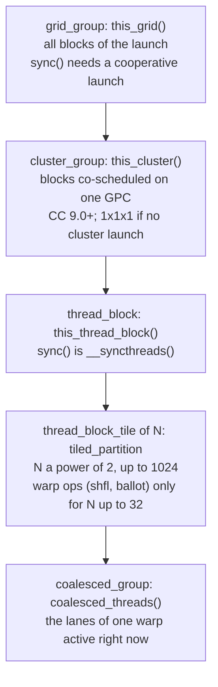
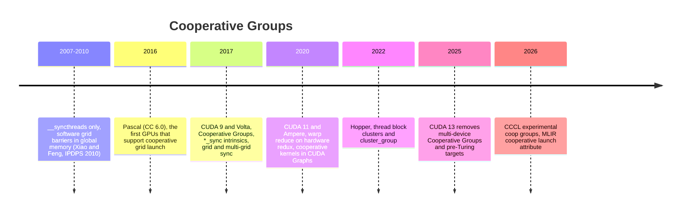
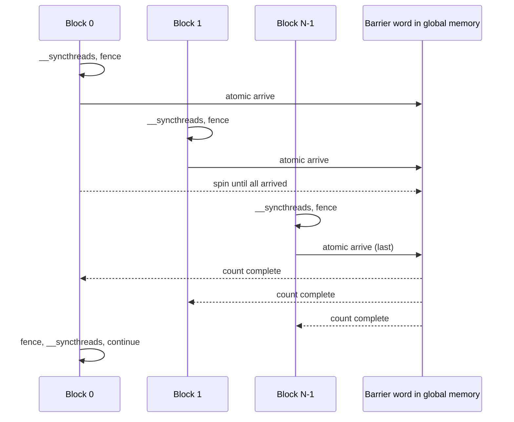

---
tags:
  - gpu-programming
  - cuda
  - cooperative-groups
  - synchronization
  - grid-sync
  - thread-block-clusters
status: complete
sources:
  - https://developer.nvidia.com/blog/controlling-data-movement-to-boost-performance-on-ampere-architecture/
  - https://docs.nvidia.com/cuda/archive/11.5.0/cuda-toolkit-release-notes
  - https://docs.nvidia.com/cuda/cuda-programming-guide/04-special-topics/cooperative-groups.html
  - https://docs.nvidia.com/cuda/archive/13.4.1/cuda-programming-guide/04-special-topics/cooperative-groups.html
  - https://docs.nvidia.com/cuda/cuda-programming-guide/05-appendices/device-callable-apis.html
  - https://docs.nvidia.com/cuda/archive/13.0.2/cuda-toolkit-release-notes/index.html.md
  - https://developer.nvidia.com/blog/cooperative-groups/
  - https://developer.nvidia.com/blog/using-cuda-warp-level-primitives/
  - https://arxiv.org/abs/2004.05371
  - https://forums.developer.nvidia.com/t/re-cooperative-groups-are-much-slower-than-cub/316928
  - https://forums.developer.nvidia.com/t/cudalaunchcooperativekernel-behaviour/341549
  - https://forums.developer.nvidia.com/t/cooperative-groups-this-grid-is-not-valid-on-my-volta-architecture-gpu-how-to-globally-synchronize/295086
  - https://swayaminsync.github.io/swayam-script/posts/Cooperative%20Groups/index.html
  - https://github.com/nvidia/cccl
  - https://forums.developer.nvidia.com/t/possible-race-in-cuda-cooperative-groups/160641
  - https://docs.nvidia.com/cuda/archive/11.0/cuda-toolkit-release-notes/index.html
  - https://docs.nvidia.com/cuda/archive/12.9.0/pdf/CUDA_C_Programming_Guide.pdf
  - https://developer.nvidia.com/blog/nvidia-hopper-architecture-in-depth/
  - https://docs.nvidia.com/cuda/volta-tuning-guide
  - https://synergy.cs.vt.edu/pubs/papers/xiao-ipdps2010-gpusync.pdf
  - https://www.doc.ic.ac.uk/~afd/papers/2016/OOPSLA.pdf
  - https://arxiv.org/abs/2204.02064
  - https://arxiv.org/html/2512.22219v1
  - https://lists.llvm.org/pipermail/mlir-commits/2026-April/163576.html
  - https://nvidia.github.io/cccl/libcudacxx/extended_api/synchronization_primitives/barrier.html
  - https://nvidia.github.io/cccl/unstable/cudax/coop/group/index.html
  - https://developer.nvidia.com/blog/nvidia-cuda-13-5-brings-nvidia-vera-rubin-ga-support/
created: 2026-11-26
updated: 2026-11-26
---

## Table Of Contents

---

- [[#TL;DR|TL;DR]]
- [[#The Problem|The Problem]]
- [[#Foundations|Foundations]]
    - [[#The Group Hierarchy|The Group Hierarchy]]
    - [[#Handles, Ranks and Collectives|Handles, Ranks and Collectives]]
    - [[#Static and Dynamic Tiles|Static and Dynamic Tiles]]
- [[#How We Got Here|How We Got Here]]
- [[#How It Works|How It Works]]
    - [[#Why Warp-Synchronous Code Broke on Volta|Why Warp-Synchronous Code Broke on Volta]]
    - [[#Example - Tile Reduction|Example: Tile Reduction]]
    - [[#Other Collectives|Other Collectives]]
    - [[#Clusters on Hopper and Blackwell|Clusters on Hopper and Blackwell]]
    - [[#Grid-Wide Sync and Cooperative Launch|Grid-Wide Sync and Cooperative Launch]]
    - [[#Sizing the Grid - Worked Example on H100|Sizing the Grid: Worked Example on H100]]
    - [[#How grid.sync Works and What It Costs|How grid.sync Works and What It Costs]]
    - [[#Grid Sync, Persistent Kernels and Megakernels|Grid Sync, Persistent Kernels and Megakernels]]
- [[#Where It Is Now|Where It Is Now]]
- [[#Trade-offs & Open Problems|Trade-offs & Open Problems]]
- [[#Resources|Resources]]
- [[#Related Notes|Related Notes]]

## ***TL;DR***
---
*Cooperative Groups (CG) is CUDA's API for naming a set of threads and then synchronizing or computing across exactly that set. It covers every level from a few lanes of a warp up to the whole grid, and it replaced the unsafe habit of assuming that a warp runs in lockstep.*

- **The idea:** a *group* is an object (`thread_block`, `thread_block_tile<N>`, `coalesced_group`, `cluster_group`, `grid_group`). Every group has the same small interface: `sync()`, `thread_rank()`, `num_threads()`, plus collectives such as `shfl`, `ballot`, `cg::reduce` and `cg::inclusive_scan`. Code that takes a group as a parameter states who must call it, so a missing participant is a visible bug rather than a silent hang ([Harris & Perelygin, 2017](https://developer.nvidia.com/blog/cooperative-groups/)).
- **Why it exists:** before CUDA 9 the only barrier was `__syncthreads()` for a whole block, and warp-level code relied on "implicit warp synchronous programming", which Volta's independent thread scheduling made unsafe. CG and the `*_sync` intrinsics (see [[Warp Divergence and Warp-Level Primitives]]) make the participating threads explicit.
- **The big one is grid sync.** `this_grid().sync()` is a barrier across every block of a kernel. It only works if every block is resident on the GPU at the same time, so the kernel must be launched with `cudaLaunchCooperativeKernel`, which refuses grids that cannot all fit ([CUDA Programming Guide](https://docs.nvidia.com/cuda/cuda-programming-guide/04-special-topics/cooperative-groups.html)). You size the grid with the occupancy API: SMs × blocks per SM.
- **History:** CUDA 9 (2017) with Volta; CUDA 11 (2020) added warp reductions (`cg::reduce`) for Ampere, `memcpy_async` was in place by CUDA 11.1, and CUDA 11.5 (2021) added scans; `cluster_group` with Hopper; CUDA 13 (2025) removed multi-device groups.
- **Where it is now (Nov 2026):** CG ships with CUDA 13.x and is the standard way to write tile-level collectives and grid barriers. Grid sync is a niche but important tool for iterative solvers and [[Persistent Kernels and Stream-K|persistent kernels]]; the fastest ML kernels mostly use clusters, mbarriers and atomics-based flags instead.

## ***The Problem***
---
*The CUDA programming model gives you one cheap barrier (the block) and treats everything above it as independent. Real algorithms need both smaller groups (a warp, a tile of 4 lanes) and larger ones (a cluster, the whole grid), and getting either wrong used to mean silent races or deadlocks.*

Three gaps drove CG:

1. **Too coarse inside a block.** `__syncthreads()` waits for all threads of the block. A library function that only some threads call, for example inside a branch, deadlocks if it calls `__syncthreads()`. Harris and Perelygin's example is a `sum()` helper: requiring a `thread_block` argument makes that mistake "much harder to make" ([NVIDIA blog, 2017](https://developer.nvidia.com/blog/cooperative-groups/)).
2. **Unsafe inside a warp.** Fast reductions used to drop all barriers in the last 32 steps because "the warp runs in lockstep". The same post calls this "implicit warp synchronous programming" and says "implicitly synchronized programs have race conditions" ([NVIDIA blog](https://developer.nvidia.com/blog/cooperative-groups/)). On Volta and later it really does break (see below).
3. **Nothing across blocks.** Blocks cannot wait for each other in a normal launch ([[CUDA Programming Model]]). A two-phase algorithm (reduce, then use the result) needs two kernel launches, atomics with a "last block" trick, or a hand-made spin barrier that deadlocks if some blocks are not yet scheduled ([[Parallel Reduction and Scan]]).

CG answers all three with one abstraction: create a handle for the set of threads you mean, and every collective on that handle is defined only for that set.

## ***Foundations***
---
*CG is a header-only C++ library (`<cooperative_groups.h>`, namespace `cooperative_groups`, usually aliased `cg`). It gives you implicit groups that come from the launch, explicit groups you carve out of them, and a uniform set of members and collectives.*

### The Group Hierarchy

Implicit groups come from the launch configuration; explicit ones are partitions of them ([CUDA Programming Guide §4.4](https://docs.nvidia.com/cuda/cuda-programming-guide/04-special-topics/cooperative-groups.html); [API reference §5.6.3](https://docs.nvidia.com/cuda/cuda-programming-guide/05-appendices/device-callable-apis.html)).



| Group | How you get it | Scope | Notes |
|---|---|---|---|
| `grid_group` | `cg::this_grid()` | Every thread of the kernel | `sync()` only valid under `cudaLaunchCooperativeKernel`; CC 6.0+ |
| `cluster_group` | `cg::this_cluster()` | Blocks of one thread block cluster | CC 9.0+; adds `map_shared_rank()` for distributed shared memory |
| `thread_block` | `cg::this_thread_block()` | One block | Same barrier as `__syncthreads()` |
| `thread_block_tile<N>` | `cg::tiled_partition<N>(parent)` | N consecutive threads | Static size; enables warp collectives when N ≤ 32 |
| `thread_group` (dynamic tile) | `cg::tiled_partition(parent, n)` | n consecutive threads | Size chosen at runtime; fewer collectives |
| `coalesced_group` | `cg::coalesced_threads()` | Currently active lanes of a warp | Ranks renumbered densely 0..k-1 |
| Labeled / binary partitions | `cg::labeled_partition(g, label)`, `cg::binary_partition(g, pred)` | Lanes with the same label | CC 7.0+; the guide says it "is still being evaluated" |

`multi_grid_group` (a barrier across kernels on several GPUs) used to sit above `grid_group`. "As of CUDA 13, cooperative groups can no longer be used for multi-device synchronization", and the multi-device launch APIs "have been removed" ([CUDA 13.4 guide](https://docs.nvidia.com/cuda/archive/13.4.1/cuda-programming-guide/04-special-topics/cooperative-groups.html); [CUDA 13.0 release notes](https://docs.nvidia.com/cuda/archive/13.0.2/cuda-toolkit-release-notes/index.html.md)). Multi-GPU coordination now belongs to NCCL and NVSHMEM ([[Multi-GPU Communication - NVLink and NCCL]]).

### Handles, Ranks and Collectives

Every group answers the same questions:

| Member | Meaning |
|---|---|
| `g.thread_rank()` | My index inside `g`, from 0 to `g.num_threads() - 1` |
| `g.num_threads()` | How many threads are in `g` (`size()` is the legacy alias) |
| `g.sync()` | Barrier plus memory ordering for exactly the threads of `g` |
| `g.meta_group_rank()` / `meta_group_size()` | For a tile: which tile I am and how many tiles the parent was split into |
| `g.block_rank()`, `g.num_blocks()` | For grid and cluster groups: which block I am in the larger group |

Three rules from the guide matter in practice ([§4.4.3–4.4.4](https://docs.nvidia.com/cuda/archive/13.4.1/cuda-programming-guide/04-special-topics/cooperative-groups.html)):

- **Make implicit handles early.** "For best performance it is recommended that you create a handle for the implicit group upfront (as early as possible, before any branching has occurred)."
- **Partitioning is collective.** "Partitioning a group is a collective operation and all threads in the group must participate." Creating a tile inside a branch that only some threads take "can lead to deadlocks or data corruption".
- **Pass handles by reference.** Handles have no default constructor, and copy-constructing them is "discouraged".

### Static and Dynamic Tiles

`tiled_partition<N>(block)` returns a `thread_block_tile<N>` whose size is a compile-time constant. The compiler knows the tile fits in a warp, so `shfl`, `shfl_down`, `ballot`, `any`, `all` and `match_any` compile straight to the warp intrinsics, and loops over the tile can be unrolled. The API reference sets the limits ([§5.6.3.1.4](https://docs.nvidia.com/cuda/cuda-programming-guide/05-appendices/device-callable-apis.html)):

- N must be a power of 2, at most 1024.
- `shfl_up`, `shfl_down`, `shfl_xor`, `ballot` and `match_*` exist only for N ≤ 32 (a tile larger than a warp has no single register file to shuffle across).
- Tiles larger than 32 need a `block_tile_memory` scratch object on CC 7.5 and older; on CC 8.0 and newer they do not.

`tiled_partition(parent, n)` with a runtime `n` returns a plain `thread_group`. The parent must be a block or a tile, the parent size must divide evenly, and the native sizes are 1, 2, 4, 8, 16 and 32. It trades speed and collectives for flexibility; Harris and Perelygin found the static version "not significantly faster" for a bandwidth-bound reduction but useful "in more computationally intensive uses" ([NVIDIA blog](https://developer.nvidia.com/blog/cooperative-groups/)).

## ***How We Got Here***
---
*CUDA started with a single block barrier. Programmers improvised the rest: lockstep warp tricks below the block and spin barriers in global memory above it. CG, released with Volta, made both explicit, and later releases filled in collectives, clusters and the removal of multi-GPU groups.*



- **Before CG.** Inter-block synchronization meant ending the kernel. Researchers built global-memory barriers anyway, notably Xiao and Feng's "Inter-Block GPU Communication via Fast Barrier Synchronization" ([IPDPS 2010](https://synergy.cs.vt.edu/pubs/papers/xiao-ipdps2010-gpusync.pdf)); a version of their "XF" barrier also shipped in NVIDIA's CUB library. Sorensen, Donaldson, Batty, Gopalakrishnan and Rakamarić showed that such barriers deadlock once a kernel launches more workgroups than can be resident: the XF barrier with 1,024 workgroups deadlocked on all eight GPUs they tested, from NVIDIA, AMD, Intel and ARM. Their fix was an "occupancy discovery" protocol that admits only workgroups that are provably running at the same time ([OOPSLA 2016](https://www.doc.ic.ac.uk/~afd/papers/2016/OOPSLA.pdf)). CG's cooperative launch is the vendor-supported answer to the same problem: the driver, which knows the occupancy, refuses a grid that cannot all be resident.
- **2017, CUDA 9 and Volta.** CG shipped with `thread_block`, tiles, `coalesced_threads()`, `grid_group` and `multi_grid_group`, alongside the new `*_sync` warp intrinsics, and "the legacy warp-level primitives are deprecated starting in CUDA 9.0" ([Lin & Grover, 2018](https://developer.nvidia.com/blog/using-cuda-warp-level-primitives/)). Grid-wide groups relied on "new features in Pascal and Volta GPUs" ([Harris & Perelygin](https://developer.nvidia.com/blog/cooperative-groups/)).
- **2020, CUDA 11.** The CUDA 11.0 release notes list "Cooperative groups improvements, which allow reduction operation across threads in a warp", that is `cg::reduce`, which uses the Ampere hardware reduction "when available (requires Compute Capability 8.0 or greater)" ([guide](https://docs.nvidia.com/cuda/archive/13.4.1/cuda-programming-guide/04-special-topics/cooperative-groups.html)). `cg::memcpy_async`, the CG face of Ampere's `cp.async`, was documented for CUDA 11.1 ([NVIDIA blog, Sep 2020](https://developer.nvidia.com/blog/controlling-data-movement-to-boost-performance-on-ampere-architecture/)), and CUDA 11.5 added "four new functions for inclusive and exclusive scans" ([CUDA 11.5 release notes](https://docs.nvidia.com/cuda/archive/11.5.0/cuda-toolkit-release-notes)). See [[Parallel Reduction and Scan]]. CUDA 11.0 also allowed cooperative kernels in [[CUDA Graphs]], "including stream capture for `cuLaunchCooperativeKernel`" ([CUDA 11.0 release notes](https://docs.nvidia.com/cuda/archive/11.0/cuda-toolkit-release-notes/index.html)).
- **2022, Hopper.** Thread block clusters added a level between block and grid, with `this_cluster()` and hardware `cluster.sync()` ([[Thread Block Clusters and Distributed Shared Memory]]).
- **2025, CUDA 13.0.** Multi-device CG removed; Maxwell, Pascal and Volta dropped as targets ([CUDA 13.0 release notes](https://docs.nvidia.com/cuda/archive/13.0.2/cuda-toolkit-release-notes/index.html.md)). CCCL 3.0 removed CUB's own `cub::GridBarrier` in favor of CG ([CCCL](https://github.com/nvidia/cccl)).

## ***How It Works***
---
*Below the block, CG is a typed wrapper around warp intrinsics and shared-memory barriers. At the block it is `bar.sync`. Above the block it relies on hardware (clusters) or on a guaranteed co-resident launch plus a barrier in global memory (grid).*

### Why Warp-Synchronous Code Broke on Volta

The full story is in [[Warp Divergence and Warp-Level Primitives]]; the short version:

- Up to Pascal, a warp had one program counter, so the 32 lanes really did execute each instruction together, and code that skipped barriers inside a warp happened to work.
- Volta gave each thread its own program counter and lets the scheduler interleave diverged paths, so lanes of one warp can be at different instructions ([Lin & Grover](https://developer.nvidia.com/blog/using-cuda-warp-level-primitives/)). A classic unrolled reduction that reads a neighbor's shared-memory slot without a barrier can now read it before the neighbor wrote it.
- The fix is to name who participates. The `*_sync(mask, ...)` intrinsics take a lane mask; CG takes a group, and the group's `sync()` (or the collective itself) supplies the barrier and the memory ordering. `coalesced_threads()` builds the group from the lanes that actually arrived, which is safe inside divergent code where a hard-coded `0xffffffff` mask is not.

### Example - Tile Reduction

A grid-stride sum where each warp reduces with `cg::reduce` and issues one atomic:

```cpp
#include <cooperative_groups.h>
#include <cooperative_groups/reduce.h>
namespace cg = cooperative_groups;

__global__ void sum_kernel(const float* in, float* out, int n) {
  cg::thread_block block = cg::this_thread_block();             // 1
  cg::thread_block_tile<32> warp = cg::tiled_partition<32>(block); // 2
  float v = 0.f;
  for (int i = blockIdx.x * blockDim.x + threadIdx.x; i < n;
       i += gridDim.x * blockDim.x)
    v += in[i];                                                 // 3
  float s = cg::reduce(warp, v, cg::plus<float>());             // 4
  if (warp.thread_rank() == 0) atomicAdd(out, s);               // 5
}
```

Line by line:

1. Make the block handle first, before any branch, as the guide recommends.
2. Split the block into 32-thread tiles. Because 32 is a template argument, the tile type knows it is one warp, and its collectives compile to warp shuffles.
3. Each thread adds up a strided slice of the input ([[Memory Coalescing|coalesced]] loads).
4. `cg::reduce` combines the 32 values and returns the result to every lane of the tile. There is no mask to get wrong: the tile is the mask. The CC 8.0+ hardware path covers 4-byte types ("Only 4B types are accelerated by hardware"); the warp `redux` instruction behind it handles integers, so a float sum like this one uses the shuffle-tree fallback, which is still a handful of instructions ([guide](https://docs.nvidia.com/cuda/archive/13.4.1/cuda-programming-guide/04-special-topics/cooperative-groups.html); [[Parallel Reduction and Scan]]).
5. Lane 0 of each warp publishes the warp's sum, so atomics drop 32-fold compared with one per thread.

The `reduce` and `scan` value type must be trivially copyable, at most 32 bytes for tiles of 32 or fewer threads and at most 8 bytes for larger tiles ([API reference](https://docs.nvidia.com/cuda/cuda-programming-guide/05-appendices/device-callable-apis.html)).

### Other Collectives

| Collective | What it does | Watch out for |
|---|---|---|
| `cg::inclusive_scan(g, v, op)` / `exclusive_scan` | Prefix sum over the group, any group size | Same value-size limits as reduce |
| `cg::invoke_one(g, fn)` / `invoke_one_broadcast` | Run `fn` on one thread of the group (and broadcast its result) | "The thread selection mechanism is not guaranteed to be deterministic"; no group sync inside `fn` |
| `cg::memcpy_async(g, dst, src, bytes)` + `cg::wait(g)` / `cg::wait_prior<N>(g)` | Group-wide global → shared copy, meant as a prefetch; `wait_prior<N>` leaves the newest N copies in flight | Only asynchronous for global → shared with 4-byte alignment (16 recommended); CC 8.0+ for real async behavior |
| `g.barrier_arrive()` / `g.barrier_wait(token)` (block, cluster, grid) | Split barrier: arrive, do independent work, then wait | No collectives between the two; `barrier_wait` "only guarantees that all threads in the group have called barrier_arrive" |

Sources: [guide §4.4.5–4.4.7](https://docs.nvidia.com/cuda/archive/13.4.1/cuda-programming-guide/04-special-topics/cooperative-groups.html), [API reference](https://docs.nvidia.com/cuda/cuda-programming-guide/05-appendices/device-callable-apis.html). `memcpy_async` is the CG face of Ampere's `cp.async`; for Hopper-style bulk copies with byte-counting barriers see [[TMA and Asynchronous Copies]].

### Clusters on Hopper and Blackwell

A cluster is a set of blocks that "are guaranteed to be co-scheduled on a single GPU Processing Cluster", which is why it can offer "hardware-supported synchronization using the Cluster Group API cluster.sync()" and shared memory that other blocks can read ([CUDA 12.9 guide](https://docs.nvidia.com/cuda/archive/12.9.0/pdf/CUDA_C_Programming_Guide.pdf); [[Thread Block Clusters and Distributed Shared Memory]]). In CG terms:

```cpp
cg::cluster_group cluster = cg::this_cluster();
unsigned r = cluster.block_rank();                    // my block's index in the cluster
int* peer = cluster.map_shared_rank(smem, (r + 1) % cluster.num_blocks()); // neighbor's smem
cluster.sync();                                       // all blocks' writes visible
```

- `this_cluster()` "assumes a 1x1x1 cluster when a non-cluster grid is launched", so the same code runs without clusters.
- `cluster_group` needs CC 9.0+ and offers `sync()`, split `barrier_arrive()` / `barrier_wait()`, `map_shared_rank()` and `query_shared_rank()` ([API reference §5.6.3.1.2](https://docs.nvidia.com/cuda/cuda-programming-guide/05-appendices/device-callable-apis.html)).
- Clusters are small: 8 blocks is the portable maximum ([CUDA 12.9 guide](https://docs.nvidia.com/cuda/archive/12.9.0/pdf/CUDA_C_Programming_Guide.pdf)) and H100 allows up to 16 ([Hopper in depth](https://developer.nvidia.com/blog/nvidia-hopper-architecture-in-depth/)), so they do not replace grid sync, but for many "neighbors need each other's partial results" patterns a cluster is enough and needs no special launch.

### Grid-Wide Sync and Cooperative Launch

A grid barrier is only safe if every block can reach it. With an ordinary launch, blocks beyond what fits on the GPU wait for earlier blocks to *finish*; if the earlier blocks are spinning at a barrier waiting for the later ones, nobody finishes. Cooperative launch removes that case: "`cudaLaunchCooperativeKernel` ensures that the kernel launch is atomic, i.e. if the API call succeeds, then the provided number of thread blocks will launch on the specified device" ([guide §4.4.8.1](https://docs.nvidia.com/cuda/archive/13.4.1/cuda-programming-guide/04-special-topics/cooperative-groups.html)).

Requirements from the CUDA 13.4 guide:

- Launch with `cudaLaunchCooperativeKernel` (not `<<<...>>>`). A forum user who launched a grid-sync kernel with `<<<2, 1>>>` saw `this_grid().is_valid()` return 0 and an "unspecified launch failure"; the fix was the cooperative launch ([NVIDIA forums, 2024](https://forums.developer.nvidia.com/t/cooperative-groups-this-grid-is-not-valid-on-my-volta-architecture-gpu-how-to-globally-synchronize/295086)).
- Compute capability 6.0 or higher; check `cudaDevAttrCooperativeLaunch`.
- Linux without MPS, Linux with MPS on CC 7.0+, or "the latest Windows platform".
- The grid must not exceed (blocks per SM that fit) × (number of SMs).

A two-phase kernel that normalizes a vector by its sum, with no second launch:

```cpp
__global__ void normalize(const float* x, float* y, float* partial, int n) {
  cg::grid_group grid = cg::this_grid();                         // 1
  cg::thread_block block = cg::this_thread_block();
  auto warp = cg::tiled_partition<32>(block);
  __shared__ float warp_sums[32];

  float v = 0.f;                                                 // 2  phase 1
  for (unsigned long long i = grid.thread_rank(); i < n; i += grid.num_threads())
    v += x[i];
  v = cg::reduce(warp, v, cg::plus<float>());
  if (warp.thread_rank() == 0) warp_sums[warp.meta_group_rank()] = v;
  block.sync();                                                  // 3
  if (block.thread_rank() == 0) {
    float s = 0.f;
    for (int w = 0; w < warp.meta_group_size(); ++w) s += warp_sums[w];
    partial[grid.block_rank()] = s;                              // 4
  }

  grid.sync();                                                   // 5  barrier

  float total = 0.f;                                             // 6  phase 2
  for (unsigned b = 0; b < grid.num_blocks(); ++b) total += partial[b];
  for (unsigned long long i = grid.thread_rank(); i < n; i += grid.num_threads())
    y[i] = x[i] / total;
}
```

1. Grid, block and warp handles, all made before any branch.
2. Phase 1: a grid-stride loop using the grid's own ranks, then a warp reduction.
3. Block barrier so warp 0's thread can read every warp's sum.
4. One partial sum per block goes to global memory, indexed by `block_rank()`.
5. `grid.sync()`: no thread continues until every block has written its partial, and those writes are visible to all blocks.
6. Phase 2: every block reads all partials (a few hundred floats, served from L2) and scales its slice. Without grid sync this would be a second kernel.

The host side:

```cpp
int dev = 0, coop = 0, sms = 0, per_sm = 0, threads = 256;
cudaDeviceGetAttribute(&coop, cudaDevAttrCooperativeLaunch, dev);          // a
cudaDeviceGetAttribute(&sms, cudaDevAttrMultiProcessorCount, dev);         // b
cudaOccupancyMaxActiveBlocksPerMultiprocessor(&per_sm, normalize, threads, 0); // c
dim3 grid(sms * per_sm), block(threads);                                   // d
void* args[] = { &d_x, &d_y, &d_partial, &n };                             // e
cudaLaunchCooperativeKernel((void*)normalize, grid, block, args, 0, stream); // f
```

- (a) Bail out or fall back to two kernels if `coop` is 0.
- (b) The number of SMs this process sees.
- (c) The occupancy calculator returns how many blocks of `normalize` with 256 threads and 0 bytes of dynamic shared memory fit on one SM, given its compiled register and static shared memory use ([[Occupancy and Latency Hiding]]).
- (d) The largest legal grid. Smaller is fine; larger is refused by the launch rather than deadlocking.
- (e) Kernel arguments are passed as an array of pointers, as with `cudaLaunchKernel`.
- (f) The cooperative launch. It returns an error instead of launching a partial grid.

### Sizing the Grid - Worked Example on H100

The number of co-resident blocks per SM is the tightest of four budgets ([[Occupancy and Latency Hiding]]):

$$
B_{\text{SM}} = \min\left( \left\lfloor \frac{T_{\text{SM}}}{T_b} \right\rfloor,\ \left\lfloor \frac{R_{\text{SM}}}{R_b} \right\rfloor,\ \left\lfloor \frac{S_{\text{SM}}}{S_b + 1\,\text{KB}} \right\rfloor,\ B_{\max} \right), \qquad G_{\max} = N_{\text{SM}} \cdot B_{\text{SM}}
$$

In words: count how many blocks fit by threads, by registers, by shared memory (plus the 1 KB the hardware reserves per block) and by the hard block limit; take the smallest; multiply by the number of SMs.

An H100 SXM has $N_{\text{SM}} = 132$ SMs, and each SM has $T_{\text{SM}} = 2{,}048$ threads, $R_{\text{SM}} = 65{,}536$ registers, up to $S_{\text{SM}} = 228$ KB of shared memory and $B_{\max} = 32$ blocks ([Hopper in depth](https://developer.nvidia.com/blog/nvidia-hopper-architecture-in-depth/); [[Occupancy and Latency Hiding]]). Take a grid-sync kernel with 256 threads per block, 64 registers per thread and 48 KB of dynamic shared memory per block:

| Budget | Per block | Blocks per SM |
|---|---|---|
| Threads | 256 | $2{,}048 / 256 = 8$ |
| Registers | $64 \times 256 = 16{,}384$ | $65{,}536 / 16{,}384 = 4$ |
| Shared memory | $48 + 1 = 49$ KB | $\lfloor 228 / 49 \rfloor = 4$ |
| Block limit | 1 | 32 |

So $B_{\text{SM}} = 4$ and the largest cooperative grid is $132 \times 4 = 528$ blocks, or 135,168 threads. Two lessons:

- **Small changes move the limit in steps.** If the compiler uses 80 registers per thread instead of 64, a block needs $80 \times 256 = 20{,}480$ registers and only $\lfloor 65{,}536 / 20{,}480 \rfloor = 3$ blocks fit: 396 blocks. A launch hard-coded to 528 now fails. Always compute the grid from `cudaOccupancyMaxActiveBlocksPerMultiprocessor` at runtime, never from a constant.
- **The grid does not scale with the problem.** A cooperative kernel has a fixed number of threads, so it must loop over the data (grid-stride loops, as above). It cannot use "one thread per element" for large inputs.

### How grid.sync Works and What It Costs

There is no hardware barrier for a whole GPU, so CG implements `grid.sync()` in software. The CG headers ship as source; the grid barrier is `sync_grids(expected, arrived)` in `include/cooperative_groups/details/sync.h`, where `arrived` points to a barrier word in global memory. As quoted in a 2020 forum thread ([NVIDIA forums](https://forums.developer.nvidia.com/t/possible-race-in-cuda-cooperative-groups/160641)):

- All threads of a block first meet at `__syncthreads()`.
- One thread per block (the "CTA master") executes `__threadfence()` and then `atomic_add(arrived, nb)`. Most blocks add 1; block 0 (the "GPU master") adds `0x80000000 - (expected - 1)`, so once all `expected` blocks have arrived the top bit of the word has flipped.
- Each CTA master spins `while (!bar_has_flipped(oldArrive, *arrived))`, then the block meets at `__syncthreads()` again and continues. Because the flipped bit acts as a phase, the same word serves the next `grid.sync()`.

That is why the co-residency rule exists: a spinning block holds its SM, so a block that never got an SM can never arrive. Smaller groups use the same style of software barrier: a multi-warp tile's `sync()` is "busy waiting on a memory location", with atomic OR to mark a warp's arrival and atomic AND to release ([NVIDIA forums, Dec 2024](https://forums.developer.nvidia.com/t/re-cooperative-groups-are-much-slower-than-cub/316928)). Only the block (`bar.sync`) and the cluster have hardware barriers.



**Cost versus a kernel boundary.** Zhang, Wahib, Zhang and Matsuoka measured both on P100 and V100 ([arXiv 2004.05371](https://arxiv.org/abs/2004.05371)):

| Measurement (null kernel) | Launch overhead | Total latency |
|---|---|---|
| Traditional launch | 1,081 ns | 8,888 ns |
| Cooperative launch | 1,063 ns | 10,248 ns |

- A cooperative launch costs about the same as a normal one.
- A single `grid.sync()` was slower than the launch overhead it replaces at every grid size, but "this performance difference is negligible (at most 2.5us with two blocks/SM)". Its cost grew with blocks per SM more than with threads per block.
- Their conclusion: single-GPU grid sync "might not bring about any benefit in performance" by itself. Its real advantage is that **registers and shared memory survive the barrier**, which a kernel boundary throws away.

So grid sync pays when the state you keep on chip across iterations is worth more than the few microseconds per barrier: iterative stencils and solvers, small-batch kernels that are dominated by launch gaps, or algorithms with many dependent phases on small data.

### Grid Sync, Persistent Kernels and Megakernels

A cooperative kernel is a [[Persistent Kernels and Stream-K|persistent kernel]] by construction: a fixed grid sized to the machine, looping over work. The difference is how blocks coordinate.

| Approach | Coordination | Good for |
|---|---|---|
| Multiple kernels | Kernel boundary (implicit global barrier) | Simple code; state goes back to HBM |
| Cooperative kernel + `grid.sync()` | All blocks meet at each phase boundary | Bulk-synchronous phases: solvers, stencils, two-pass reductions |
| Persistent kernel + work queue (Stream-K, tile schedulers) | Atomic tile counters, per-tile flags | Load balance across uneven tiles, no global barrier |
| [[Megakernels]] | Fine-grained dependency counters per task | Whole-model inference with many small ops; blocks start the next op as soon as its inputs are ready |

PERKS (Zhang, Wahib et al., [arXiv 2204.02064](https://arxiv.org/abs/2204.02064), 2023 version) is the clean example of the second row. Iterative memory-bound solvers normally launch one kernel per time step and use kernel termination as the barrier; PERKS moves the time loop inside a persistent kernel, synchronizes with device-wide barriers, and caches part of each step's output in otherwise unused registers and shared memory. It reports geomean speedups of 2.12x on 2D stencils, 1.24x on 3D stencils, and 4.86x (small) and 1.43x (large) on SuiteSparse SpMV in a conjugate-gradient solver.

Megakernel runtimes go the other way. Mirage Persistent Kernel (MPK) notes that kernel barriers prevent "cross-operator software pipelining" and instead uses event counters: "An event is activated once it has received notifications from all tasks associated with it", coordinated by "semaphores in device memory", with no kernel launches during model execution. It reports up to 1.7x lower end-to-end inference latency than SGLang and vLLM ([MPK, arXiv 2512.22219](https://arxiv.org/html/2512.22219v1); [[Megakernels]]). A global barrier makes every SM wait for the slowest task; per-task counters wait only on real dependencies.

## ***Where It Is Now***
---
*As of November 2026, Cooperative Groups is a stable, everyday part of CUDA 13.x. The API has grown split barriers and cluster ranks on the grid group, multi-GPU groups are gone, and grid sync remains a specialist tool with the same co-residency rule it had in 2017.*

- **CUDA 13.x docs.** The rewritten CUDA Programming Guide has Cooperative Groups as §4.4 (sync, barriers, reduce, scans, invoke_one, async data movement, large-scale groups) and the full API in §5.6.3; the pages read for this note are v13.4.2, updated Sep 2026 ([guide](https://docs.nvidia.com/cuda/cuda-programming-guide/04-special-topics/cooperative-groups.html); [API](https://docs.nvidia.com/cuda/cuda-programming-guide/05-appendices/device-callable-apis.html)). CUDA 13.5, announced Nov 4, 2026 with CCCL 3.5, is the newest toolkit; its announcement lists no Cooperative Groups changes ([NVIDIA, Nov 2026](https://developer.nvidia.com/blog/nvidia-cuda-13-5-brings-nvidia-vera-rubin-ga-support/)).
- **Grid sync requirements unchanged in kind:** cooperative launch, CC 6.0+, and the OS/MPS conditions above. The current guide lists no separate-compilation (`-rdc`) requirement for grid sync. Since CUDA 13 dropped every target below Turing, every GPU CUDA 13 supports clears the CC 6.0 bar ([CUDA 13.0 release notes](https://docs.nvidia.com/cuda/archive/13.0.2/cuda-toolkit-release-notes/index.html.md)).
- **`grid_group` grew up.** It now has `barrier_arrive()` / `barrier_wait()` for a split grid barrier, and cluster-aware members (`cluster_rank()`, `num_clusters()`, `dim_clusters()`), so a grid launched with clusters can be addressed as grid → cluster → block ([API reference](https://docs.nvidia.com/cuda/cuda-programming-guide/05-appendices/device-callable-apis.html)).
- **Large tiles are cheap on Ampere and newer:** tiles up to 1024 threads need no `block_tile_memory` on CC 8.0+.
- **Multi-device groups are gone.** CUDA 13.0 removed `cudaLaunchCooperativeKernelMultiDevice`, `cudaLaunchParam`, `this_multi_grid` and `multi_grid_group`, which had been deprecated in 12.x ([CUDA 13.0 release notes](https://docs.nvidia.com/cuda/archive/13.0.2/cuda-toolkit-release-notes/index.html.md)). Use NCCL or NVSHMEM for cross-GPU barriers ([[Multi-GPU Communication - NVLink and NCCL]]).
- **Launch APIs.** Besides `cudaLaunchCooperativeKernel`, the driver's extensible launch takes a `CU_LAUNCH_ATTRIBUTE_COOPERATIVE` attribute, which can be combined with cluster dimensions. MLIR's GPU dialect gained a `cooperative` attribute on `gpu.launch_func` in April 2026 that lowers to exactly that (`cuLaunchKernelEx`, CUDA 12+) ([MLIR PR #190639](https://lists.llvm.org/pipermail/mlir-commits/2026-April/163576.html)), so compilers that emit their own kernels can ask for co-residency too.
- **CCCL.** CUB dropped `cub::GridBarrier` in CCCL 3.0 and points to CG ([CCCL](https://github.com/nvidia/cccl)). libcu++'s `cuda::barrier` gives a C++-standard split arrive/wait barrier at block, device or system scope (not usable on CC 6.x and older; hardware-assisted at block scope from CC 8.0, with byte-counting transactions from CC 9.0), and it is what TMA pipelines use ([libcu++ barrier](https://nvidia.github.io/cccl/libcudacxx/extended_api/synchronization_primitives/barrier.html); [[TMA and Asynchronous Copies]]). A device-scope `cuda::barrier` does not by itself make blocks co-resident, so a barrier across all blocks still needs a cooperative launch.
- **A next-generation CG in CCCL.** CUDA Experimental (cudax) documents its own "CCCL Cooperative Groups" under `<cuda/experimental/coop/group>`: groups whose units can be any hierarchy level (threads, warps, blocks) inside a boundary, aware of the launch hierarchy at compile time, with grouping ("mappings") and synchronization ("synchronizers") separated, and a `make_group` that converts a classic CG group. It sits in the unstable docs and does not yet describe a grid group or grid sync ([CCCL Cooperative Groups](https://nvidia.github.io/cccl/unstable/cudax/coop/group/index.html)).
- **A softer alternative between kernels.** [[Programmatic Dependent Launch]] lets "cooperating kernels ... overlap execution within the same CUDA stream" ([NVIDIA, Nov 2026](https://developer.nvidia.com/blog/nvidia-cuda-13-5-brings-nvidia-vera-rubin-ga-support/)). It is not a cooperative launch: it hides the gap at a kernel boundary instead of removing the boundary, and it has no co-residency limit ([[Streams, Events and Async Execution]]).
- **Practice in ML kernels.** The fastest Hopper and Blackwell kernels use clusters, mbarriers and per-tile flags rather than `grid.sync()`, because they are persistent with tile schedulers rather than bulk-synchronous ([[Warp Specialization]]; [[Persistent Kernels and Stream-K]]). CG tiles and `cg::reduce` remain common in hand-written reductions, normalizations and sampling kernels.
- **Scheduling is still your problem.** In an August 2025 forum thread, NVIDIA's Robert Crovella stressed that "a cooperative grid is only guaranteed to work correctly when all blocks are scheduled" and "It is up to you to make sure that condition can be met"; preemption that resolves deadlocks between processes does not apply under MIG, MPS or exclusive-process mode, nor between kernels of the same process. The poster reported H100, RTX 5090 and RTX Pro 6000 holding grids back until resources were free while Ada and Ampere cards started some blocks early, which Crovella could not immediately confirm ([NVIDIA forums](https://forums.developer.nvidia.com/t/cudalaunchcooperativekernel-behaviour/341549)).

## ***Trade-offs & Open Problems***
---
*Cooperative Groups makes synchronization explicit and portable inside a block, but anything above the block runs into the same wall: there is no cheap, preemption-safe global barrier, and the grid size is tied to the hardware.*

| Choice | Gain | Cost |
|---|---|---|
| `thread_block_tile<N>` vs raw `*_sync` intrinsics | Typed, mask-free, reusable library code | Slight overhead for generic multi-warp tiles (software barrier); same code for warp tiles |
| Static vs dynamic tile size | Unrolling, all warp collectives | Size fixed at compile time |
| `cluster.sync()` | Hardware barrier, distributed shared memory | CC 9.0+, max 8 blocks portably, cluster launch needed |
| `grid.sync()` | One kernel, on-chip state survives phases | Grid ≤ co-resident limit; microseconds per barrier; whole GPU waits for the slowest block |
| Kernel relaunch | Any grid size, simple | State goes through HBM; launch gaps (use [[CUDA Graphs]] to shrink them) |

Open problems and pitfalls:

- **Co-residency is fragile.** The limit depends on registers chosen by the compiler, shared memory, the MPS share or MIG slice the process got, and other work on the GPU. A kernel tuned on one build can fail to launch after a compiler upgrade adds a few registers ([[Register Pressure and Spilling]]).
- **Sharing the GPU.** Under MPS, cooperative launch is supported only on CC 7.0+, and Crovella notes that inter-process preemption does not rescue deadlocks under MIG or MPS ([forums](https://forums.developer.nvidia.com/t/cudalaunchcooperativekernel-behaviour/341549)). A partitioned GPU also means fewer SMs and a smaller legal grid ([[MIG and MPS - Sharing a GPU]]).
- **Generic group sync is not free.** Multi-warp tile `sync()` busy-waits on a memory location rather than using a hardware named barrier, which a 2024 forum thread blamed for CG being slower than CUB in one case ([forums](https://forums.developer.nvidia.com/t/re-cooperative-groups-are-much-slower-than-cub/316928)). Hand-written `bar.sync` with a thread count, or CUB's block primitives, can be faster.
- **Debugging deadlocks.** A partition created inside a branch, a `sync()` that not every member reaches, or a grid that is too large under a hand-rolled barrier all hang silently. For warp-level misuse NVIDIA points to `compute-sanitizer`'s racecheck and synccheck tools, which "can help with locating violations" ([Volta Tuning Guide](https://docs.nvidia.com/cuda/volta-tuning-guide)); a hung grid barrier is found by attaching a debugger and seeing which blocks never arrived ([[Debugging with compute-sanitizer and cuda-gdb]]).
- **No barrier across kernels or GPUs.** With multi-grid removed, there is no CG primitive above a single launch; cross-GPU synchronization is a communication-library problem.
- **Tail effects.** A grid barrier makes every SM wait for the slowest block of each phase. Work-stealing persistent kernels and megakernels trade the barrier for fine-grained flags to avoid exactly this.

## ***Resources***
---
*Read the CUDA Programming Guide's §4.4 for rules and §5.6.3 for the API, the 2017 NVIDIA blog post for motivation, and Zhang et al. for what grid sync actually costs.*

**Primary**
- [Cooperative Groups, CUDA Programming Guide §4.4](https://docs.nvidia.com/cuda/cuda-programming-guide/04-special-topics/cooperative-groups.html): NVIDIA, v13.4.2, Sep 2026; [13.4.1 archive](https://docs.nvidia.com/cuda/archive/13.4.1/cuda-programming-guide/04-special-topics/cooperative-groups.html).
- [Device-Callable APIs §5.6.3 (Cooperative Groups API)](https://docs.nvidia.com/cuda/cuda-programming-guide/05-appendices/device-callable-apis.html): NVIDIA, Sep 2026.
- [CUDA 13.0 Update 2 release notes](https://docs.nvidia.com/cuda/archive/13.0.2/cuda-toolkit-release-notes/index.html.md): NVIDIA, 2025.
- [NVIDIA CUDA 13.5 Brings Vera Rubin GA Support](https://developer.nvidia.com/blog/nvidia-cuda-13-5-brings-nvidia-vera-rubin-ga-support/): NVIDIA, Nov 2026.
- [Cooperative Groups: Flexible CUDA Thread Programming](https://developer.nvidia.com/blog/cooperative-groups/): Mark Harris and Kyrylo Perelygin, NVIDIA, Oct 2017.
- [Using CUDA Warp-Level Primitives](https://developer.nvidia.com/blog/using-cuda-warp-level-primitives/): Yuan Lin and Vinod Grover, NVIDIA, 2018.
- [CUDA 11.0 release notes](https://docs.nvidia.com/cuda/archive/11.0/cuda-toolkit-release-notes/index.html) and [CUDA 12.9 Programming Guide PDF](https://docs.nvidia.com/cuda/archive/12.9.0/pdf/CUDA_C_Programming_Guide.pdf) (cluster co-scheduling): NVIDIA.
- [NVIDIA Hopper Architecture In-Depth](https://developer.nvidia.com/blog/nvidia-hopper-architecture-in-depth/): NVIDIA, 2022.
- [CCCL repository](https://github.com/nvidia/cccl), [libcu++ `cuda::barrier`](https://nvidia.github.io/cccl/libcudacxx/extended_api/synchronization_primitives/barrier.html) and [CCCL Cooperative Groups (cudax, unstable)](https://nvidia.github.io/cccl/unstable/cudax/coop/group/index.html): NVIDIA, 2026.
- [MLIR GPU cooperative launch, PR #190639](https://lists.llvm.org/pipermail/mlir-commits/2026-April/163576.html): Jared Hoberock, Apr 2026.

**Practitioner**
- [Possible race in CUDA Cooperative Groups](https://forums.developer.nvidia.com/t/possible-race-in-cuda-cooperative-groups/160641) (quotes `sync_grids`): NVIDIA forums, Nov-Dec 2020.
- [cudaLaunchCooperativeKernel behaviour](https://forums.developer.nvidia.com/t/cudalaunchcooperativekernel-behaviour/341549): NVIDIA forums, Robert Crovella, Aug 2025.
- [Cooperative groups are much slower than CUB](https://forums.developer.nvidia.com/t/re-cooperative-groups-are-much-slower-than-cub/316928): NVIDIA forums, Dec 2024.
- [this_grid() is not valid](https://forums.developer.nvidia.com/t/cooperative-groups-this-grid-is-not-valid-on-my-volta-architecture-gpu-how-to-globally-synchronize/295086): NVIDIA forums, Jun 2024.
- [CUDA Notes: Cooperative Groups](https://swayaminsync.github.io/swayam-script/posts/Cooperative%20Groups/index.html): Swayam Singh, Aug 2025.

**Research**
- [A Study of Single and Multi-device Synchronization Methods in Nvidia GPUs](https://arxiv.org/abs/2004.05371): Zhang, Wahib, Zhang, Matsuoka, 2020.
- [Inter-Block GPU Communication via Fast Barrier Synchronization](https://synergy.cs.vt.edu/pubs/papers/xiao-ipdps2010-gpusync.pdf): Xiao and Feng, IPDPS 2010.
- [Portable Inter-workgroup Barrier Synchronisation for GPUs](https://www.doc.ic.ac.uk/~afd/papers/2016/OOPSLA.pdf): Sorensen, Donaldson, Batty, Gopalakrishnan, Rakamarić, OOPSLA 2016.
- [PERKS: a Locality-Optimized Execution Model for Iterative Memory-bound GPU Applications](https://arxiv.org/abs/2204.02064): Zhang, Wahib, Chen, Meng, Wang, Endo, Matsuoka, 2022-2023.
- [Mirage Persistent Kernel (MPK)](https://arxiv.org/html/2512.22219v1): Ji, Cheng, Zhang et al. (CMU and others), Dec 2025.

## Related Notes

- [[Warp Divergence and Warp-Level Primitives]] — Volta's independent thread scheduling and the `*_sync` intrinsics that tiles wrap.
- [[Parallel Reduction and Scan]] — `cg::reduce`, scans and the cross-block options grid sync competes with.
- [[CUDA Programming Model]] — The grid, block and thread hierarchy that groups name.
- [[Thread Block Clusters and Distributed Shared Memory]] — The hardware level behind `cluster_group`.
- [[Occupancy and Latency Hiding]] — The occupancy math that sets the largest cooperative grid.
- [[Persistent Kernels and Stream-K]] — Machine-sized grids that loop over work, with or without grid sync.
- [[Megakernels]] — Whole models in one kernel, coordinated by counters instead of grid barriers.
- [[TMA and Asynchronous Copies]] — mbarriers and bulk copies, the successors to `memcpy_async`.
- [[CUDA Memory Model and Atomics]] — Fences and scopes that make a global barrier correct.
- [[Warp Specialization]] — Role-split kernels that synchronize with barriers, not grid sync.
- [[MIG and MPS - Sharing a GPU]] — Why cooperative launches behave differently on shared GPUs.
- [[Debugging with compute-sanitizer and cuda-gdb]] — Finding barrier misuse and hangs.
- [[CUDA Graphs]] — The other way to cut the cost of many small kernel launches.
- [[Multi-GPU Communication - NVLink and NCCL]] — Where multi-device synchronization went after CUDA 13.
- [[Locks and Synchronization]] — The CPU-side theory of barriers and spin-waiting.
- [[Programmatic Dependent Launch]] — Overlapping kernels at a boundary without co-residency.
