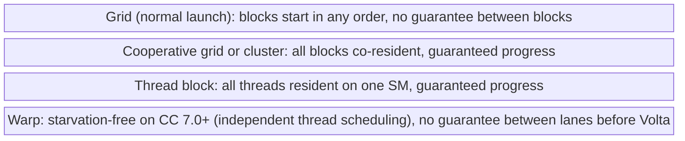
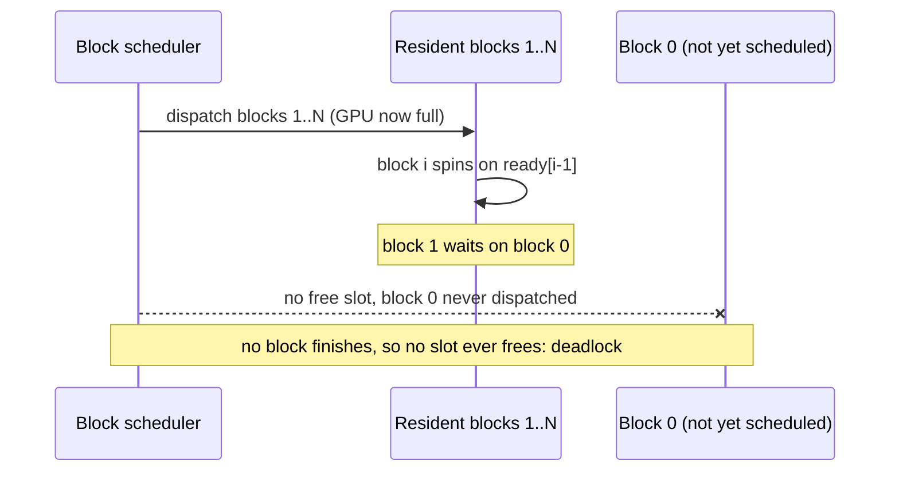
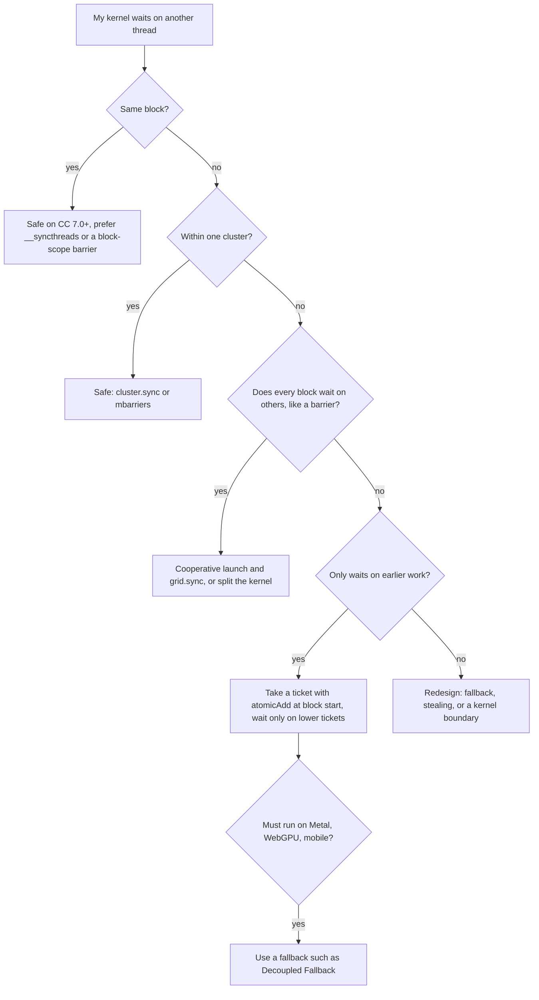

---
tags:
  - gpu-programming
  - cuda
  - forward-progress
  - synchronization
  - scheduling
  - deadlock
  - independent-thread-scheduling
status: complete
sources:
  - https://docs.nvidia.com/cuda/cuda-programming-guide/05-appendices/cuda-cpp-execution-model.html
  - https://docs.nvidia.com/cuda/archive/13.2.0/cuda-programming-guide/05-appendices/cuda-cpp-execution-model.html
  - https://nvidia.github.io/cccl/unstable/libcudacxx/extended_api/execution_model.html
  - https://docs.nvidia.com/cuda/cuda-programming-guide/01-introduction/programming-model.html
  - https://docs.nvidia.com/cuda/cuda-programming-guide/03-advanced/advanced-kernel-programming.html
  - https://docs.nvidia.com/cuda/volta-tuning-guide
  - https://developer.nvidia.com/blog/?p=7832
  - https://developer.download.nvidia.com/video/gputechconf/gtc/2019/presentation/s9329-synchronization-is-bad-but-if-you-must.pdf
  - https://developer.nvidia.com/blog/navigating-gpu-architecture-support-a-guide-for-nvidia-cuda-developers
  - https://www.doc.ic.ac.uk/~afd/papers/2016/OOPSLA.pdf
  - https://www.doc.ic.ac.uk/~afd/papers/2018/CONCUR.pdf
  - https://arxiv.org/pdf/2109.06132
  - https://pages.cs.wisc.edu/~sinclair/papers/AWG_ISCA2020.pdf
  - https://research.nvidia.com/sites/default/files/pubs/2016-03_Single-pass-Parallel-Prefix/nvr-2016-002.pdf
  - https://github.com/NVIDIA/cccl/blob/main/cub/cub/agent/agent_scan.cuh
  - https://github.com/NVIDIA/cccl/blob/main/cub/cub/agent/single_pass_scan_operators.cuh
  - https://forums.developer.nvidia.com/t/block-dispatch-order/351302
  - https://forums.developer.nvidia.com/t/understanding-a-spinlock-implementation-by-robert-crovella/267535
  - https://forums.developer.nvidia.com/t/cudalaunchcooperativekernel-behaviour/341549
  - https://escholarship.org/uc/item/0bk9z4bt
  - https://raphlinus.github.io/gpu/2021/11/17/prefix-sum-portable.html
  - https://developer.apple.com/forums/thread/831017
  - https://rocm.docs.amd.com/projects/HIP/en/develop/_sources/understand/programming_model.rst
  - https://github.com/vllm-project/vllm/blob/main/vllm/v1/sample/ops/topk_topp_sampler.py
  - https://www.together.ai/blog/road-to-together-compiler
  - https://escholarship.org/content/qt3j76d3td/qt3j76d3td.pdf
created: 2026-11-26
updated: 2026-11-26
---

## Table Of Contents

---

- [[#TL;DR|TL;DR]]
- [[#The Problem|The Problem]]
- [[#Foundations|Foundations]]
    - [[#What Forward Progress Means|What Forward Progress Means]]
    - [[#Progress Models - Fair, OBE, HSA, LOBE|Progress Models: Fair, OBE, HSA, LOBE]]
    - [[#The Three Levels on a GPU|The Three Levels on a GPU]]
- [[#How We Got Here|How We Got Here]]
- [[#How It Works|How It Works]]
    - [[#What CUDA Actually Promises|What CUDA Actually Promises]]
    - [[#Inside a Warp - Independent Thread Scheduling|Inside a Warp: Independent Thread Scheduling]]
    - [[#Across Blocks - Why Spin-Waits Deadlock|Across Blocks: Why Spin-Waits Deadlock]]
    - [[#Worked Example - The Occupancy Bound on H100|Worked Example: The Occupancy Bound on H100]]
    - [[#Fix 1 - Ticket IDs Instead of blockIdx|Fix 1: Ticket IDs Instead of blockIdx]]
    - [[#Fix 2 - Make Co-Residency a Launch Property|Fix 2: Make Co-Residency a Launch Property]]
    - [[#Fix 3 - Do Not Wait, Fall Back or Steal|Fix 3: Do Not Wait, Fall Back or Steal]]
    - [[#Spinning Well - Backoff and What Counts as a Step|Spinning Well: Backoff and What Counts as a Step]]
    - [[#Choosing a Pattern|Choosing a Pattern]]
- [[#Where It Is Now|Where It Is Now]]
- [[#Trade-offs & Open Problems|Trade-offs & Open Problems]]
- [[#Resources|Resources]]
- [[#Related Notes|Related Notes]]

## ***TL;DR***
---
*A spin-wait only terminates if the thread you are waiting for keeps getting scheduled. GPUs promise that at some levels (threads in a warp on Volta and later, threads in a block, blocks in a cluster or a cooperative grid) and not at others (ordinary blocks of an ordinary launch), and most GPU deadlocks come from confusing the two.*

- **Forward progress** is the guarantee that a thread which has started will keep being scheduled, so that a thread waiting on it eventually sees its write. The [[CUDA Memory Model and Atomics|memory model]] says *what* a waiting thread will see; forward progress says *whether* the writer ever runs.
- **CUDA's written rule (CUDA 13.x guide):** "Once a device thread makes progress", all threads in its cooperative grid, or otherwise in its thread-block cluster, "shall eventually make progress". Threads in *other* clusters are not guaranteed to ([CUDA C++ Execution Model](https://docs.nvidia.com/cuda/cuda-programming-guide/05-appendices/cuda-cpp-execution-model.html)). In a normal launch each block is its own cluster, so the guarantee stops at the block.
- **Inside a warp:** before Volta, lanes shared one program counter, and a lane spinning on a lock held by another lane of its warp could hang forever. Volta's **independent thread scheduling** (CC 7.0, 2017) made "starvation-free algorithms" possible inside a warp ([Inside Volta](https://developer.nvidia.com/blog/?p=7832)). CUDA 13 dropped offline compilation for everything below CC 7.5, so every GPU current CUDA targets has it.
- **Across blocks:** blocks "may be executed in any order" and there is "no guarantee of scheduling between thread blocks" ([CUDA Programming Guide](https://docs.nvidia.com/cuda/cuda-programming-guide/01-introduction/programming-model.html)). If a resident block spins on a block that has not been scheduled, and the resident blocks fill the GPU, nobody makes progress.
- **What GPUs do in practice** is "occupancy-bound execution" (OBE): a block that has started keeps running, and blocks not yet started may wait until a slot frees ([Sorensen et al., OOPSLA 2016](https://www.doc.ic.ac.uk/~afd/papers/2016/OOPSLA.pdf)). NVIDIA hardware behaves this way, but some Apple and ARM GPUs failed even stronger tests ([Sorensen et al., OOPSLA 2021](https://arxiv.org/pdf/2109.06132)).
- **The three fixes:** (1) wait only on blocks that *must* already be running, by handing out IDs with an atomic ticket rather than `blockIdx`; (2) make co-residency a property of the launch with a [[Cooperative Groups|cooperative launch]] or a [[Thread Block Clusters and Distributed Shared Memory|cluster]]; (3) don't wait at all: redo the predecessor's work (Decoupled Fallback) or steal it.
- **Where it is now (Nov 2026):** the CUDA Programming Guide has a formal execution-model appendix with examples of which spin-loops must terminate. CUB's single-pass scan still uses `blockIdx` and a source comment that "Blocks are launched in increasing order", which works on NVIDIA hardware but is not promised by the spec ([CCCL agent_scan.cuh](https://github.com/NVIDIA/cccl/blob/main/cub/cub/agent/agent_scan.cuh)). Portable code (WebGPU, Metal) has moved to fallback algorithms that need no inter-block progress guarantee.

## ***The Problem***
---
*Fast GPU algorithms want blocks to talk to each other mid-kernel: single-pass scans, persistent work queues, megakernel dependency counters, software grid barriers. All of them contain a loop that waits for another block, and that loop is only correct if the other block is guaranteed to run.*

The CUDA programming model was built so that this question never comes up. Blocks are independent; "a thread block cannot rely on results from other thread blocks", and the model "requires that it be possible to execute thread blocks in any order" ([CUDA Programming Guide](https://docs.nvidia.com/cuda/cuda-programming-guide/01-introduction/programming-model.html)). That rule is what lets the same binary run on a 20-SM laptop GPU and a 148-SM B200: the hardware can run blocks in waves, in any order, as resources free up.

But the fastest algorithms break the rule on purpose:

| Pattern | Who waits on whom | Note |
|---|---|---|
| Single-pass scan (decoupled look-back) | Each tile waits for its predecessor's partial sum | [[Parallel Reduction and Scan]] |
| Onesweep radix sort | Same chained look-back per digit pass | [[Sorting and Hashing on GPUs]] |
| Stream-K fix-up | A tile's owner waits for blocks computing its K-slices | [[Persistent Kernels and Stream-K]] |
| Persistent work queues | Idle workers wait for "work outstanding" to reach zero | [[Work Stealing and Dynamic Load Balancing]] |
| Megakernels | A task waits on dependency counters set by other SMs | [[Megakernels]] |
| Software grid barrier | Every block waits for every other block | [[Cooperative Groups]] |
| Locks in global memory | A thread waits for the holder to release | [[CUDA Memory Model and Atomics]] |

Each of these hides a loop like `while (flag == 0) {}`. If the thread that sets `flag` is never scheduled, the kernel hangs. There is no error and no timeout; the GPU just stops making progress, and the host waits forever in `cudaDeviceSynchronize()`. Worse, the bug is often invisible in testing: a grid that fits entirely on the test GPU never hangs, and the same code deadlocks on a smaller GPU, a [[MIG and MPS - Sharing a GPU|MIG slice]], or after a compiler upgrade adds registers and lowers occupancy.

## ***Foundations***
---
*Forward progress is a scheduling guarantee, separate from memory ordering. To reason about it you need the vocabulary from concurrency theory (starvation, fairness) and a precise picture of which GPU threads are guaranteed to be running at the same time.*

### What Forward Progress Means

C++ (and CUDA C++, which follows it) defines two levels the CUDA guide uses directly ([CUDA C++ Execution Model](https://docs.nvidia.com/cuda/cuda-programming-guide/05-appendices/cuda-cpp-execution-model.html)):

| Guarantee | Meaning in plain words | Typical holder |
|---|---|---|
| **Concurrent** forward progress | The thread eventually makes progress as long as it hasn't finished, whatever other threads do | An OS thread (`std::thread`) |
| **Parallel** forward progress | The thread may not *start* until something lets it, but once it has taken one step it gets concurrent progress | A task in a thread pool; a GPU thread |

The guide says CUDA C++ aims to provide parallel forward progress for all device threads. That word *aims* matters: the per-device rules below are narrower.

The classic progress taxonomy for algorithms (Herlihy and Shavit) tells you what a waiting algorithm *needs*. Olivier Giroux used it in his GTC 2019 talk on GPU synchronization ([S9329](https://developer.download.nvidia.com/video/gputechconf/gtc/2019/presentation/s9329-synchronization-is-bad-but-if-you-must.pdf)):

| Algorithm class | Promise | Needs from the scheduler |
|---|---|---|
| Wait-free | Every thread finishes in bounded steps | Nothing |
| Lock-free | Some thread always finishes | Nothing |
| Obstruction-free | A thread finishes if it runs alone long enough | Nothing beyond eventual isolation |
| Deadlock-free (e.g. test-and-set lock) | Some critical section eventually completes | The lock holder keeps running |
| Starvation-free (e.g. ticket lock) | Every waiting thread eventually gets in | The holder keeps running, and the lock is fair |

Anything below lock-free contains a wait, and a wait is only safe if the scheduler guarantees the thread being waited on keeps running.

### Progress Models - Fair, OBE, HSA, LOBE

Because vendor documentation was vague, Sorensen, Evrard and Donaldson formalized what GPU schedulers actually provide ([CONCUR 2018](https://www.doc.ic.ac.uk/~afd/papers/2018/CONCUR.pdf); [OOPSLA 2021](https://arxiv.org/pdf/2109.06132)). Each model says which threads (in practice, which workgroups or blocks) are guaranteed fair scheduling:

| Model | Who is guaranteed to keep running | Intuition |
|---|---|---|
| **Fair** | Every thread until it terminates | A CPU OS scheduler |
| **OBE** (occupancy-bound) | Any thread that has executed at least one step | Once a block is resident it stays; unstarted blocks may wait for a slot |
| **HSA** | The lowest-ID thread that hasn't terminated | Blocks launch in ID order, and the oldest is always served |
| **LOBE** (linear OBE) | Threads that have taken a step, *plus* every thread with a lower ID than one that has | Blocks start in ID order and, once started, stay |
| **Unfair** | Nobody | What OpenCL and Vulkan formally promise across workgroups |

What each model lets you write ([CONCUR 2018](https://www.doc.ic.ac.uk/~afd/papers/2018/CONCUR.pdf)):

| Model | Global barrier | Mutex | Producer-consumer |
|---|---|---|---|
| Fair | Yes | Yes | Yes |
| OBE | Only among co-resident blocks | Yes | Only among co-resident blocks |
| HSA | No | No | Only one way: the producer has the lower ID |
| Unfair | No | No | No |

The two practical models are incomparable. Under OBE a mutex works (the holder has taken a step, so it keeps running and releases) but "block 1 waits for block 0" can hang, because block 0 may not have started. Under HSA the producer-consumer chain works (block 0 is lowest, so it runs) but a mutex can hang, because a higher-ID holder can starve. LOBE combines the two, and it is exactly what a decoupled look-back scan with `blockIdx`-based tile IDs silently assumes.

### The Three Levels on a GPU

A GPU thread lives inside three scheduling units, and the guarantee differs at each:



- **Warp.** 32 lanes issue together. Whether a diverged lane can wait on another lane of the same warp depends on the architecture (next section).
- **Block.** All threads of a block are resident on one SM at once and stay until they finish; `__syncthreads()` relies on this. Waiting on another thread of your own block is safe on Volta and later.
- **Grid.** Blocks are scheduled as resources free up. The number that can be resident at once is the **occupancy bound** $N$; it depends on the SM count and per-block resource use ([[Occupancy and Latency Hiding]]).

## ***How We Got Here***
---
*The guarantees grew one level at a time: first inside the warp (Volta), then across a whole grid on request (cooperative launch), then across small groups of blocks by construction (clusters), and finally in writing (the CUDA 13 execution model appendix).*

- **2007 to 2016, SIMT with a shared program counter.** Tesla through Pascal ran each warp with one PC and a reconvergence stack (SASS `SSY`/`SYNC`). Giroux's summary of that model: "Forward-progress = Nope" ([S9329](https://developer.download.nvidia.com/video/gputechconf/gtc/2019/presentation/s9329-synchronization-is-bad-but-if-you-must.pdf)). The guide still warns that below CC 7.0 "algorithms requiring fine-grained sharing of data guarded by locks or mutexes can lead to deadlock" ([CUDA Programming Guide](https://docs.nvidia.com/cuda/cuda-programming-guide/03-advanced/advanced-kernel-programming.html)).
- **2010 to 2012, inter-block barriers by hand.** Xiao and Feng's fast GPU barriers and Gupta, Stuart and Owens' persistent-threads study showed big wins from staying on the GPU, and named the risk: global synchronization requires every block to be resident, and exceeding the maximal launch size deadlocks ([Gupta et al., 2012](https://escholarship.org/content/qt3j76d3td/qt3j76d3td.pdf)).
- **2016, decoupled look-back.** Merrill and Garland's single-pass scan matched memcpy on Kepler and Maxwell. The paper is explicit that it "will run to completion if the system guarantees forward-progress for all processors", that the runtime "may run them arbitrary order and without preemption", and that the fix is an ID "obtain[ed] upon activation by atomically-incrementing a global counter" ([NVR-2016-002](https://research.nvidia.com/sites/default/files/pubs/2016-03_Single-pass-Parallel-Prefix/nvr-2016-002.pdf)).
- **2016, occupancy-bound execution.** Sorensen, Donaldson, Batty, Gopalakrishnan and Rakamarić named OBE and built *occupancy discovery*: at kernel start, blocks race to join a poll protected by a fair ticket lock, then close it, so exactly the co-resident blocks participate in a barrier. On 8 GPUs from 4 vendors it found close to 100% of the true occupancy bound; a naive spin lock often found under half ([OOPSLA 2016](https://www.doc.ic.ac.uk/~afd/papers/2016/OOPSLA.pdf)).
- **2017, Volta and CUDA 9.** Independent thread scheduling gave each thread its own PC and call stack; NVIDIA wrote that "Starvation-free algorithms are a key pattern enabled by independent thread scheduling" ([Inside Volta](https://developer.nvidia.com/blog/?p=7832)). The same release added [[Cooperative Groups]] with `cudaLaunchCooperativeKernel`, which launches a grid only if all of it fits at once, making grid-wide waits legal.
- **2018, "How fair is fair enough?"** Sorensen, Evrard and Donaldson formalized OBE, HSA and LOBE and showed that real GPU code needs guarantees neither OBE nor HSA alone captures ([CONCUR 2018](https://www.doc.ic.ac.uk/~afd/papers/2018/CONCUR.pdf)).
- **2019, `cuda::std::atomic`.** Giroux's talk previewed libcu++ atomics and recommended starvation-free (ticket) locks as "your default, when deadlock-free is unsuitable" ([S9329](https://developer.download.nvidia.com/video/gputechconf/gtc/2019/presentation/s9329-synchronization-is-bad-but-if-you-must.pdf)).
- **2020, hardware help proposed.** AMD Research's Autonomous Work-Groups (ISCA 2020) proposed "waiting atomics" plus a monitor in L2 that context-switches waiting workgroups out, so oversubscribed kernels stop deadlocking; in simulation it was about 2.6x faster than timeout-based fallbacks ([Duțu et al.](https://pages.cs.wisc.edu/~sinclair/papers/AWG_ISCA2020.pdf)). It has not shipped as a programming-model guarantee.
- **2021, testing the models.** 483 synthesized progress litmus tests on 8 GPUs from 5 vendors: no violations of weak OBE or HSA, but Apple A12 and ARM Mali-G77 failed 11 LOBE tests, and an Apple-supplied spin-lock test showed OBE violations on A12 and A14 ([OOPSLA 2021](https://arxiv.org/pdf/2109.06132)).
- **2022 to 2023, clusters.** Hopper's thread block clusters guarantee that a cluster's blocks "are scheduled simultaneously on the SMs of a single GPC" ([CUDA Programming Guide](https://docs.nvidia.com/cuda/cuda-programming-guide/01-introduction/programming-model.html)): co-residency by construction for up to 8 blocks portably ([[Thread Block Clusters and Distributed Shared Memory]]).
- **2025, CUDA 13 and portable fallbacks.** CUDA 13.0 removed offline compilation below CC 7.5 ([NVIDIA](https://developer.nvidia.com/blog/navigating-gpu-architecture-support-a-guide-for-nvidia-cuda-developers)), so pre-Volta warp hazards left the supported set. Smith, Levien and Owens published Decoupled Fallback, a single-pass scan for "hardware without forward-progress guarantees" ([SPAA 2025](https://escholarship.org/uc/item/0bk9z4bt)). The rewritten CUDA Programming Guide gained its formal execution-model appendix.

## ***How It Works***
---
*The rules are short; the art is mapping every wait in a kernel onto them. Inside a block you are safe on any current GPU. Across blocks you must either prove the other block is already running, force it to be with the launch, or remove the wait.*

### What CUDA Actually Promises

The CUDA C++ Execution Model appendix (in the CUDA 13.x Programming Guide and mirrored in the libcu++ docs) states the device rules ([guide](https://docs.nvidia.com/cuda/cuda-programming-guide/05-appendices/cuda-cpp-execution-model.html); [libcu++](https://nvidia.github.io/cccl/unstable/libcudacxx/extended_api/execution_model.html)):

1. "Once a device thread makes progress": if it is in a **cooperative grid**, all threads in its grid shall eventually make progress; otherwise all threads in its **thread-block cluster** shall. Threads in other clusters get no guarantee. This implies every thread of its own block eventually progresses.
2. The implementation may assume every thread eventually terminates, calls a library I/O function, accesses a `volatile` object, or performs a synchronization or atomic read, in each case *not* on an automatic (local) variable. A loop that does none of these may be treated as making no progress at all.
3. "A CUDA API call shall eventually either return or ensure at least one device thread makes progress"; a kernel does not start until its dependencies (stream order, events) complete.

The appendix's examples make the edges concrete:

| Example | What it does | Outcome the guide allows |
|---|---|---|
| Device.0 | Thread 0 spins on a device-scope atomic until thread 1 of the same block stores 1 | Terminates |
| Device.1 | Infinite loop calling `yield()` | No thread makes progress |
| Device.2 | Spins on a local `volatile bool` | No thread makes progress |
| Device.3 | Spins on a *thread-scope* atomic in a local variable | No thread makes progress |
| Device.4 | `while (true) {}` | No thread makes progress |
| API.2 | Host spins on a flag the kernel sets, never calling a CUDA API | Eventually no progress |
| API.4 | Host spins but calls `cudaStreamQuery` in the loop | Terminates |
| Stream.0 | Kernel B spins on a flag set by kernel A, in two different streams | Eventually no progress: B may starve A |
| Stream.1 | Same kernels in one stream | Terminates |

Three lessons hide in that table. Spinning on a *local* variable, even an atomic one, is not a wait on anyone. Two kernels in different streams are not guaranteed to run concurrently, so a cross-kernel spin is the inter-block problem one level up (this is also why [[Programmatic Dependent Launch]] forbids a primary kernel from waiting on its secondary). And the host side matters too: a CPU loop polling pinned memory without touching the CUDA API can stall the device it is waiting on.

The guide adds that some of these limits are implementation defects that may be fixed later, while others are deliberate, for performance.

### Inside a Warp - Independent Thread Scheduling

Before Volta, a warp had one program counter. When lanes diverged, the warp ran one path to the reconvergence point, then the other ([[Warp Divergence and Warp-Level Primitives]]). Consider a lock taken by several lanes of one warp:

```cuda
// Naive per-thread lock. Deadlocks on pre-Volta GPUs if two lanes of the
// same warp contend.
__device__ void add_locked(int* mutex, float* x, float v) {
    while (atomicCAS(mutex, 0, 1) != 0) { }  // spin until we flip 0 -> 1
    *x += v;                                  // critical section
    __threadfence();                          // make the write visible
    atomicExch(mutex, 0);                     // release
}
```

- Line 1 of the body: each lane tries to swap 0 for 1. Exactly one lane wins; the others see 1 and loop.
- On Pascal and earlier, the warp is now split into the winner (heading to the critical section) and losers (heading back into the loop). If the hardware keeps executing the losers' path, the winner never reaches `atomicExch`, and the losers spin forever.
- On Volta and later each lane has its own PC, and the scheduler eventually runs the winner's path, so the loop terminates: the "starvation-free" pattern NVIDIA's Volta post demonstrated with per-node locks in a doubly linked list ([Inside Volta](https://developer.nvidia.com/blog/?p=7832)).

Independent thread scheduling does not make lockstep assumptions safe; it makes them *wrong*. The Volta tuning guide lists "Assumptions that code is executed in lockstep" as a porting hazard and requires `__syncwarp()` and the `*_sync` intrinsics ([Volta Tuning Guide](https://docs.nvidia.com/cuda/volta-tuning-guide)). Two caveats remain:

- **Performance.** A lock fought over by lanes of one warp serializes those lanes. Crovella's standard advice is still to have *one* thread per block take a global lock, with `__syncthreads()` around it, and let the whole block run the critical section ([NVIDIA forums](https://forums.developer.nvidia.com/t/understanding-a-spinlock-implementation-by-robert-crovella/267535)).
- **Portability.** AMD's HIP documentation describes wavefronts as "executed in lockstep", with divergent lanes masked out ([HIP programming model](https://rocm.docs.amd.com/projects/HIP/en/develop/_sources/understand/programming_model.rst)). That is the pre-Volta execution style, so treat intra-wavefront lock contention on AMD with pre-Volta caution (an inference from the docs, not a documented guarantee either way). See [[ROCm and HIP]].

### Across Blocks - Why Spin-Waits Deadlock

Here is the bug in its simplest form: a chain where block $i$ waits for block $i-1$.

```cuda
__global__ void chain(volatile int* ready, float* data) {
    int b = blockIdx.x;
    if (b > 0 && threadIdx.x == 0)
        while (ready[b - 1] == 0) { }   // wait for predecessor
    __syncthreads();
    // ... use predecessor's result, do own work ...
    __syncthreads();
    if (threadIdx.x == 0) { __threadfence(); ready[b] = 1; }  // publish
}
```

- Thread 0 of each block spins until the previous block publishes; the rest of the block waits at `__syncthreads()`.
- After its work, the block fences (so its data is visible before the flag, see [[CUDA Memory Model and Atomics]]) and sets its own flag.

This is correct under HSA or LOBE scheduling and *not* correct under the CUDA rules. Nothing stops the hardware from making blocks 1 to $N$ resident before block 0. They then occupy every slot, all spin, and block 0 never gets a slot:



In practice NVIDIA's block scheduler dispatches 1D grids in increasing `blockIdx` order (CUB's source relies on it, see Fix 1), so this usually works, which is exactly why it is dangerous. On the NVIDIA forums (Nov 2025) Robert Crovella restated that "CUDA specifies no block dispatch order" and that relying on observed behavior "does not indicate a reliable programming method" ([Block Dispatch Order](https://forums.developer.nvidia.com/t/block-dispatch-order/351302)).

### Worked Example - The Occupancy Bound on H100

The occupancy bound is how many blocks can be resident at once:

$$
N = \text{SMs} \times \min\left(\left\lfloor \frac{R_{\text{SM}}}{T \cdot r} \right\rfloor,\ \left\lfloor \frac{T_{\text{SM}}}{T} \right\rfloor,\ \left\lfloor \frac{S_{\text{SM}}}{S_{\text{blk}}} \right\rfloor,\ B_{\text{max}}\right)
$$

In words: per SM, take the smallest of the limits from registers ($R_{\text{SM}}$ registers shared by $T$ threads using $r$ each), threads, shared memory, and the hard cap on blocks per SM, then multiply by the number of SMs ([[Occupancy and Latency Hiding]]).

H100 SXM: 132 SMs, 65,536 registers and 2,048 threads per SM. A block of $T = 256$ threads at $r = 64$ registers with little shared memory:

- Registers: $65{,}536 / (256 \times 64) = 4$ blocks.
- Threads: $2{,}048 / 256 = 8$ blocks.
- So 4 blocks per SM and $N = 132 \times 4 = 528$.

Now consider a single-pass scan over $2^{28}$ floats with 2,048-element tiles: 131,072 tiles. If each block takes one tile and waits on lower-numbered tiles, the scan is safe only if the 528 resident blocks always include the ones being waited on. With `blockIdx`-ordered tiles that holds only if dispatch happens in index order. If a compiler upgrade pushes $r$ to 72, registers allow $\lfloor 65{,}536 / 18{,}432 \rfloor = 3$ blocks per SM and $N$ drops to 396. A software grid barrier sized for 528 blocks now hangs on the same GPU, with no source change. A cooperative launch would instead refuse to start ([[Cooperative Groups]]).

### Fix 1 - Ticket IDs Instead of blockIdx

The Merrill and Garland fix: don't let the hardware's `blockIdx` decide your position in the chain. Take a ticket when the block actually starts running:

```cuda
__global__ void chain_safe(int* ticket, volatile int* ready, float* data) {
    __shared__ int t;
    if (threadIdx.x == 0) t = atomicAdd(ticket, 1);  // my position = arrival order
    __syncthreads();
    int b = t;                                        // use t, never blockIdx.x
    if (b > 0 && threadIdx.x == 0)
        while (ready[b - 1] == 0) { }                 // predecessor took its ticket earlier
    __syncthreads();
    // ... work on tile b ...
    __syncthreads();
    if (threadIdx.x == 0) { __threadfence(); ready[b] = 1; }
}
```

- `atomicAdd` returns tickets in the order blocks *start running*. A block with ticket `b` knows the block with ticket `b-1` has already executed at least one instruction.
- Under OBE, a block that has taken a step keeps being scheduled, so the predecessor will finish and publish. The wait terminates without assuming any dispatch order.
- The cost is one global atomic per block and a counter that must be reset (or offset) between launches.

This converts an LOBE requirement into an OBE requirement. Note the remaining assumption: OBE itself is what NVIDIA hardware does and what the 2021 tests found on most GPUs, but CUDA's written rule only covers threads within a cluster or cooperative grid. CUB keeps the cheaper `blockIdx` version: `agent_scan.cuh` assigns `tile_idx = start_tile + blockIdx.x` under the comment "Blocks are launched in increasing order, so just assign one tile per block", and the look-back code states the precondition "thread blocks processing all of the predecessor tiles were scheduled" ([agent_scan.cuh](https://github.com/NVIDIA/cccl/blob/main/cub/cub/agent/agent_scan.cuh); [single_pass_scan_operators.cuh](https://github.com/NVIDIA/cccl/blob/main/cub/cub/agent/single_pass_scan_operators.cuh)). That is a deliberate bet on NVIDIA's dispatcher.

### Fix 2 - Make Co-Residency a Launch Property

When every block must be able to wait on every other block (a barrier), ordering tricks are not enough: all blocks must be resident. Two launch types give that in the spec:

| Mechanism | Scope | How you get it | Limit |
|---|---|---|---|
| Cooperative launch + `grid.sync()` | Whole grid | `cudaLaunchCooperativeKernel`; fails if the grid can't all fit | Grid ≤ occupancy bound $N$; about 1 µs per barrier on H100 |
| Thread block cluster + `cluster.sync()` | Up to 8 blocks (16 non-portable on H100) | Cluster launch attribute; blocks co-scheduled on one GPC | CC 9.0+; small groups only |
| Persistent grid of one block per SM | Whole grid, informally | Launch exactly SM-count blocks | Not guaranteed unless cooperative; breaks under MPS/MIG sharing |

Together AI measured a cooperative `grid.sync()` on H100 at 1,043 ns against 1,051 ns for a CUDA Graph kernel boundary, so a grid barrier saves state round trips, not barrier time ([Together AI](https://www.together.ai/blog/road-to-together-compiler)). Megakernels therefore launch cooperatively (or one block per SM) and replace barriers with point-to-point counters ([[Megakernels]]).

Co-residency can still be lost after launch. Crovella notes that "a cooperative grid is only guaranteed to work correctly when all blocks are scheduled", and that the inter-process preemption which can break deadlocks does not apply under MIG, MPS or exclusive-process mode, nor between kernels of one process ([NVIDIA forums](https://forums.developer.nvidia.com/t/cudalaunchcooperativekernel-behaviour/341549)). FlashInfer's multi-block top-k uses a software barrier across blocks and is disabled on GPUs with 16 or fewer SMs because forward progress cannot be guaranteed there ([vLLM source](https://github.com/vllm-project/vllm/blob/main/vllm/v1/sample/ops/topk_topp_sampler.py); [[Top-k and Sampling Kernels]]).

### Fix 3 - Do Not Wait, Fall Back or Steal

The most portable fix removes the dependence on the other block running at all:

- **Decoupled Fallback** (Smith, Levien and Owens, SPAA 2025): a tile that finds its predecessor stalled stops spinning and computes the predecessor's reduction itself from the input, then continues. Only performance depends on scheduling; correctness does not. It needs neither 64-bit atomics nor memory barriers for correctness, reaches "near-Memcpy speeds" on Apple M1 Max and M3 under WebGPU, and still beats reduce-then-scan in simulation with up to 50% of tiles blocked ([eScholarship](https://escholarship.org/uc/item/0bk9z4bt)).
- **Work stealing and donation**: an idle worker takes work instead of waiting for a specific block ([[Work Stealing and Dynamic Load Balancing]]).
- **Split the kernel**: a kernel boundary is a barrier the hardware always honors. Reduce-then-scan (two passes) and multi-kernel graph algorithms trade memory traffic for zero progress assumptions; [[CUDA Graphs]] and [[Programmatic Dependent Launch]] shrink the boundary cost.
- **Lock-free and wait-free structures**: where the data structure allows, a CAS loop that some thread always wins needs no fairness at all ([[Lock-Free Data Structures and Memory Ordering]]).

### Spinning Well - Backoff and What Counts as a Step

Even a correct spin-wait costs: every spinning warp issues loads that compete with the thread you are waiting for. Good practice on CC 7.0+:

```cuda
#include <cuda/atomic>
__device__ void wait_for(int* flag) {
    cuda::atomic_ref<int, cuda::thread_scope_device> f(*flag);
    unsigned ns = 32;
    while (f.load(cuda::memory_order_acquire) == 0) {  // device-scope acquire load
        __nanosleep(ns);                               // yield issue slots
        if (ns < 1024) ns *= 2;                        // exponential backoff, capped
    }
}
```

- `atomic_ref` with `thread_scope_device` on a global variable is the kind of access the execution model counts as progress-relevant (contrast Device.3, a thread-scope atomic on a local).
- `memory_order_acquire` makes the producer's earlier writes visible once the flag is seen ([[CUDA Memory Model and Atomics]]).
- `__nanosleep` (CC 7.0+) parks the warp for roughly the requested time so the SM can issue other warps; doubling with a cap is the backoff Giroux recommended, whose example history ran from 256 ns to a 256 µs ceiling ([S9329](https://developer.download.nvidia.com/video/gputechconf/gtc/2019/presentation/s9329-synchronization-is-bad-but-if-you-must.pdf)). CUB's look-back uses the same `__nanosleep` backoff ([single_pass_scan_operators.cuh](https://github.com/NVIDIA/cccl/blob/main/cub/cub/agent/single_pass_scan_operators.cuh)).

Sleeping does not release the block's SM resources, so it never fixes a deadlock caused by an unscheduled producer; it only makes a correct wait cheaper. AMD's AWG paper makes the same point: sleep instructions don't free hardware resources, which is why it proposed context-switching waiters out ([Duțu et al.](https://pages.cs.wisc.edu/~sinclair/papers/AWG_ISCA2020.pdf)).

### Choosing a Pattern



## ***Where It Is Now***
---
*As of November 2026, NVIDIA has written its rules down and every GPU current CUDA targets has independent thread scheduling. The open front is portability: Apple, ARM and WebGPU still give no inter-block guarantee, so portable libraries avoid waiting altogether.*

- **NVIDIA (CUDA 13.x).** The CUDA C++ Execution Model appendix, present in the guide's archived 13.2 through 13.4 versions and the current one, is the authoritative statement: progress is guaranteed within a block, a cluster, or a cooperative grid ([guide](https://docs.nvidia.com/cuda/cuda-programming-guide/05-appendices/cuda-cpp-execution-model.html)). With CUDA 13's CC 7.5 floor, intra-warp lock deadlocks are a legacy concern for new builds, though driver branch 580 keeps older GPUs running older binaries through 2028 ([NVIDIA](https://developer.nvidia.com/blog/navigating-gpu-architecture-support-a-guide-for-nvidia-cuda-developers)).
- **Practice on NVIDIA.** Production kernels lean on OBE plus in-order dispatch rather than on the written rule. CUB's single-pass scan uses `blockIdx` tile order, and the Onesweep sort uses the same chained look-back ([agent_scan.cuh](https://github.com/NVIDIA/cccl/blob/main/cub/cub/agent/agent_scan.cuh)); forum users have linked CCCL bug reports about this assumption ([Block Dispatch Order](https://forums.developer.nvidia.com/t/block-dispatch-order/351302)). Persistent GEMMs, [[Warp Specialization|warp-specialized]] kernels and megakernels size grids to one block per SM and use clusters, mbarriers and flags rather than `grid.sync()` ([[Persistent Kernels and Stream-K]]).
- **Apple and Metal.** No documented inter-threadgroup guarantee. A June 2026 Apple developer forum question asking exactly whether Metal documents threadgroup co-residency or occupancy-bounded synchronization had no reply ([Apple forums](https://developer.apple.com/forums/thread/831017)), and the 2021 tests found OBE violations on A12 and A14 ([OOPSLA 2021](https://arxiv.org/pdf/2109.06132)). Levien's 2021 finding that decoupled look-back fails on Metal and WebGPU still drives design ([Levien](https://raphlinus.github.io/gpu/2021/11/17/prefix-sum-portable.html)).
- **WebGPU and portable libraries.** Decoupled Fallback (SPAA 2025) is the reference design for single-pass scan without progress guarantees ([eScholarship](https://escholarship.org/uc/item/0bk9z4bt)).
- **AMD.** HIP documents arbitrary work-group order and no direct inter-work-group barriers, so work-groups coordinate only through global memory, with atomics or device-wide sync ([HIP programming model](https://rocm.docs.amd.com/projects/HIP/en/develop/_sources/understand/programming_model.rst)); cooperative groups with grid sync exist in HIP for the same co-residency purpose ([[ROCm and HIP]]). The AWG hardware proposal has not become a programming-model guarantee.
- **Tooling.** compute-sanitizer's racecheck gained deadlock detection in 2025.2 ([[Debugging with compute-sanitizer and cuda-gdb]]), but nothing checks inter-block progress assumptions; AutoMegaKernel's static checker covers per-SM queue order in megakernels only ([[Megakernels]]).

## ***Trade-offs & Open Problems***
---
*Every inter-block wait trades a progress assumption for speed. The open problems are that the assumption is rarely written down, it changes with occupancy, and the strongest portable answer (don't wait) costs performance on hardware that would have been fine.*

| Approach | Gain | Cost | Assumption |
|---|---|---|---|
| Kernel boundary / multi-pass | Always correct | Extra HBM traffic, launch gaps | None |
| `blockIdx`-ordered chain (CUB) | Cheapest single pass | Relies on dispatch order | LOBE (not in CUDA spec) |
| Ticket-ordered chain | No dispatch-order assumption | One atomic per block, counter reset | OBE |
| Cooperative launch + `grid.sync()` | Spec-guaranteed barrier | Grid ≤ occupancy bound, ~1 µs per barrier, fragile under sharing | Cooperative grid rule |
| Clusters | Spec-guaranteed, hardware barrier and DSMEM | 8 blocks portably, CC 9.0+ | Cluster rule |
| Fallback / stealing | Correct on any scheduler | Redundant work when blocked, more complex code | None for correctness |

Open problems:

- **The spec and practice disagree.** CUDA guarantees nothing between ordinary blocks, yet NVIDIA's own CUB depends on in-order dispatch. Either the guarantee should be written (an LOBE-style rule for 1D grids) or the libraries should stop relying on it.
- **Occupancy is not a stable number.** Registers chosen by the compiler, shared memory carve-outs, [[MIG and MPS - Sharing a GPU|MIG and MPS]] partitions, and [[Green Contexts and SM Partitioning|green contexts]] all change $N$. Any code that bakes in a grid size for a hand-rolled barrier is one toolchain upgrade from a hang ([[Register Pressure and Spilling]]).
- **No portable query.** The 2021 paper proposed letting devices advertise which progress model they support; no API (CUDA, Vulkan, Metal, WebGPU) exposes one today ([OOPSLA 2021](https://arxiv.org/pdf/2109.06132)).
- **Preemption and sharing.** Time-slicing between processes can preempt a resident block, and sharing modes change what preemption can rescue ([NVIDIA forums](https://forums.developer.nvidia.com/t/cudalaunchcooperativekernel-behaviour/341549)). How OBE interacts with preemption is mostly folklore.
- **Hardware support for waiting.** Proposals like AWG would let a waiting block yield its resources; without it, every wait burns a slot, and oversubscribed grids can't wait at all.
- **Verification.** Litmus testing exists for progress models ([[GPU Memory Model Testing and Verification]]), but there is no widely used tool that flags "this loop waits on a block that may not be resident".

## ***Resources***
---
*Start with the CUDA execution model appendix for the rules, the Merrill and Garland paper for the classic deadlock and its fix, and Sorensen's papers for the theory and the cross-vendor test results.*

**Primary documentation**
- [CUDA C++ Execution Model appendix](https://docs.nvidia.com/cuda/cuda-programming-guide/05-appendices/cuda-cpp-execution-model.html) and the [libcu++ execution model](https://nvidia.github.io/cccl/unstable/libcudacxx/extended_api/execution_model.html): the device, API and stream progress rules with examples.
- [CUDA Programming Guide: Programming Model](https://docs.nvidia.com/cuda/cuda-programming-guide/01-introduction/programming-model.html): block independence and cluster co-scheduling.
- [CUDA Programming Guide: Advanced Kernel Programming](https://docs.nvidia.com/cuda/cuda-programming-guide/03-advanced/advanced-kernel-programming.html) and the [Volta Tuning Guide](https://docs.nvidia.com/cuda/volta-tuning-guide): independent thread scheduling and porting hazards.
- [Inside Volta (NVIDIA, 2017)](https://developer.nvidia.com/blog/?p=7832): starvation-free algorithms and the per-node-lock linked list.
- [HIP programming model](https://rocm.docs.amd.com/projects/HIP/en/develop/_sources/understand/programming_model.rst): AMD's lockstep wavefronts and work-group ordering.

**Papers**
- [Merrill and Garland, Single-pass Parallel Prefix Scan with Decoupled Look-back (NVR-2016-002)](https://research.nvidia.com/sites/default/files/pubs/2016-03_Single-pass-Parallel-Prefix/nvr-2016-002.pdf).
- [Sorensen et al., Portable Inter-Workgroup Barrier Synchronisation for GPUs (OOPSLA 2016)](https://www.doc.ic.ac.uk/~afd/papers/2016/OOPSLA.pdf).
- [Sorensen, Evrard and Donaldson, GPU Schedulers: How Fair Is Fair Enough? (CONCUR 2018)](https://www.doc.ic.ac.uk/~afd/papers/2018/CONCUR.pdf).
- [Sorensen et al., Specifying and Testing GPU Workgroup Progress Models (OOPSLA 2021)](https://arxiv.org/pdf/2109.06132).
- [Duțu et al., Independent Forward Progress of Work-groups (ISCA 2020)](https://pages.cs.wisc.edu/~sinclair/papers/AWG_ISCA2020.pdf).
- [Smith, Levien and Owens, Decoupled Fallback: A Portable Single-Pass GPU Scan (SPAA 2025)](https://escholarship.org/uc/item/0bk9z4bt).
- [Gupta, Stuart and Owens, A Study of Persistent Threads Style GPU Programming for GPGPU Workloads (2012)](https://escholarship.org/content/qt3j76d3td/qt3j76d3td.pdf).

**Talks, code and discussion**
- [Giroux, Synchronization Is Bad, But If You Must (GTC 2019, S9329)](https://developer.download.nvidia.com/video/gputechconf/gtc/2019/presentation/s9329-synchronization-is-bad-but-if-you-must.pdf): progress taxonomy, backoff, ticket locks on GPUs.
- CCCL source: [agent_scan.cuh](https://github.com/NVIDIA/cccl/blob/main/cub/cub/agent/agent_scan.cuh) and [single_pass_scan_operators.cuh](https://github.com/NVIDIA/cccl/blob/main/cub/cub/agent/single_pass_scan_operators.cuh).
- [Levien, Prefix sum on portable compute shaders (2021)](https://raphlinus.github.io/gpu/2021/11/17/prefix-sum-portable.html).
- NVIDIA forums: [Block Dispatch Order (Nov 2025)](https://forums.developer.nvidia.com/t/block-dispatch-order/351302), [spinlock patterns](https://forums.developer.nvidia.com/t/understanding-a-spinlock-implementation-by-robert-crovella/267535), [cooperative launch behaviour (Aug 2025)](https://forums.developer.nvidia.com/t/cudalaunchcooperativekernel-behaviour/341549).
- [Apple developer forums: forward progress for persistent-thread synchronization (Jun 2026)](https://developer.apple.com/forums/thread/831017).

## ***Related Notes***
---
*The guarantees here sit between the memory model (what you see) and the scheduling machinery (who runs); these notes cover each side.*

- [[CUDA Programming Model]] — Why blocks are independent and may run in any order.
- [[CUDA Memory Model and Atomics]] — Acquire/release and fences: what a waiter sees once the writer runs.
- [[Cooperative Groups]] — Cooperative launch, `grid.sync()` and sizing a co-resident grid.
- [[Thread Block Clusters and Distributed Shared Memory]] — Co-scheduled blocks on one GPC.
- [[Warp Divergence and Warp-Level Primitives]] — The reconvergence stack and independent thread scheduling.
- [[Occupancy and Latency Hiding]] — Computing the occupancy bound.
- [[Parallel Reduction and Scan]] — Decoupled look-back and its portability problem.
- [[Sorting and Hashing on GPUs]] — Onesweep, which inherits the same assumption.
- [[Persistent Kernels and Stream-K]] — Persistent grids and Stream-K fix-up waits.
- [[Work Stealing and Dynamic Load Balancing]] — Queues that wait, and stealing instead of waiting.
- [[Megakernels]] — Dependency counters and co-residency rules at scale.
- [[Programmatic Dependent Launch]] — Overlap between kernels without inter-kernel waits.
- [[Top-k and Sampling Kernels]] — A production multi-block barrier gated on SM count.
- [[MIG and MPS - Sharing a GPU]] — How sharing shrinks and destabilizes the occupancy bound.
- [[ROCm and HIP]] — AMD's execution model and cooperative groups.
- [[Debugging with compute-sanitizer and cuda-gdb]] — Finding hangs and barrier misuse.
- [[GPU Memory Model Testing and Verification]] — Litmus testing, model checkers and race detectors for memory-model bugs, including the XF barrier.
- [[Green Contexts and SM Partitioning]] — Another way the usable SM count changes (planned).
- [[Locks and Synchronization]] — The CPU side: spin locks, ticket locks and fairness.
- [[Lock-Free Data Structures and Memory Ordering]] — Algorithms that need no scheduler fairness.
- [[CPU Scheduling]] — Fair schedulers, the model GPUs do not provide.
