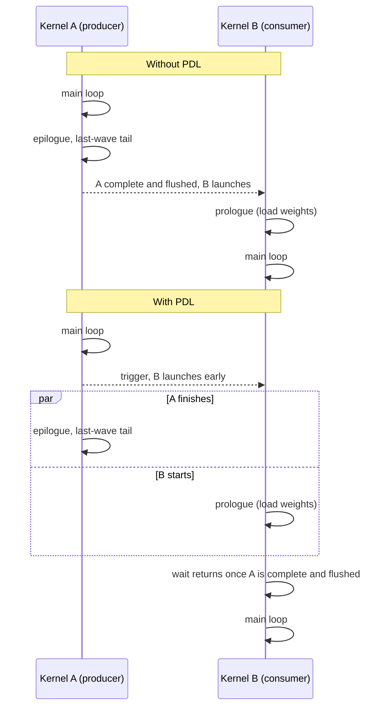
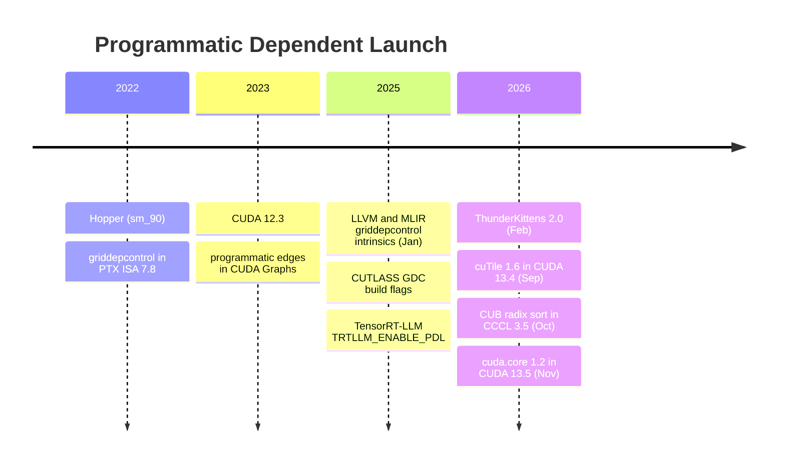
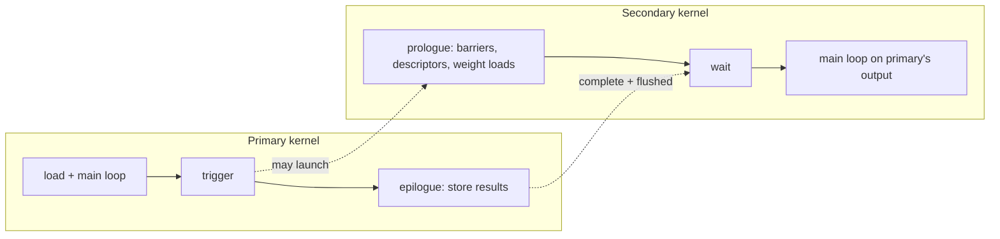
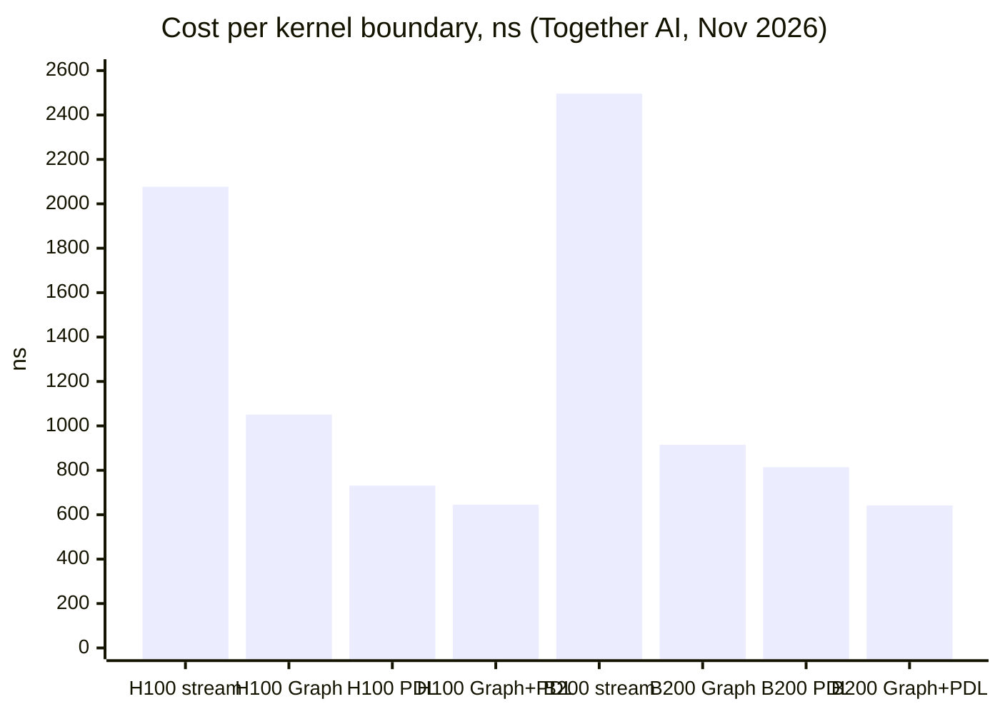

---
tags:
  - gpu-programming
  - cuda
  - pdl
  - launch-overhead
  - hopper
  - blackwell
  - llm-inference
status: complete
sources:
  - https://docs.nvidia.com/cuda/cuda-programming-guide/04-special-topics/programmatic-dependent-launch.html
  - https://lists.llvm.org/pipermail/llvm-commits/Week-of-Mon-20250113/1548451.html
  - https://lists.llvm.org/pipermail/mlir-commits/2025-January/091131.html
  - https://docs.nvidia.com/cutlass/4.7.0/media/docs/cpp/dependent_kernel_launch.html
  - https://docs.nvidia.com/cutlass/4.7.0/media/docs/pythonDSL/ts_general/ts_pdl.html
  - https://triton-lang.org/main/python-api/generated/triton.language.extra.cuda.gdc_wait.html
  - https://triton-lang.org/main/python-api/generated/triton.language.extra.cuda.gdc_launch_dependents.html
  - https://yang-yifan.github.io/blogs/pdl/pdl.html
  - https://nvidia.github.io/TensorRT-LLM/blogs/tech_blog/blog01_Pushing_Latency_Boundaries_Optimizing_DeepSeek-R1_Performance_on_NVIDIA_B200_GPUs.html
  - https://www.together.ai/blog/road-to-together-compiler
  - https://www.lmsys.org/blog/2026-10-18-sglang-low-latency-mode
  - https://arxiv.org/html/2610.24349
  - https://developer.nvidia.com/blog/nvidia-cuda-13-5-brings-nvidia-vera-rubin-ga-support/
  - https://github.com/msaroufim/megakernels-vs-cuda-graphs
  - https://hazyresearch.stanford.edu/blog/2025-05-27-no-bubbles
  - https://hazyresearch.stanford.edu/blog/2026-02-19-tk-2
  - https://github.com/NVIDIA/cccl/releases
  - https://developer.nvidia.com/blog/constant-time-launch-for-straight-line-cuda-graphs-and-other-performance-enhancements
created: 2026-11-26
updated: 2026-11-26
---

## Table Of Contents

---

- [[#TL;DR|TL;DR]]
- [[#The Problem|The Problem]]
    - [[#The Gap Between Two Kernels|The Gap Between Two Kernels]]
- [[#Foundations|Foundations]]
    - [[#Primary, Secondary, Trigger, Wait|Primary, Secondary, Trigger, Wait]]
    - [[#What the Wait Guarantees|What the Wait Guarantees]]
    - [[#Where PDL Sits Among the Alternatives|Where PDL Sits Among the Alternatives]]
- [[#How We Got Here|How We Got Here]]
- [[#How It Works|How It Works]]
    - [[#CUDA C++|CUDA C++]]
    - [[#PTX - griddepcontrol|PTX: griddepcontrol]]
    - [[#Inside CUDA Graphs|Inside CUDA Graphs]]
    - [[#Libraries and Languages|Libraries and Languages]]
    - [[#Where to Put the Trigger and the Wait|Where to Put the Trigger and the Wait]]
    - [[#Worked Example - Llama-1B Decode on H100|Worked Example: Llama-1B Decode on H100]]
- [[#Where It Is Now|Where It Is Now]]
- [[#Trade-offs & Open Problems|Trade-offs & Open Problems]]
- [[#Resources|Resources]]
- [[#Related Notes|Related Notes]]

## ***TL;DR***
---
*Programmatic Dependent Launch (PDL) lets the next kernel in a stream start before the current one has finished, so its setup work overlaps the current kernel's tail. It needs compute capability 9.0 or newer (Hopper, Blackwell) and a small, explicit protocol in both kernels.*

- **The idea:** in a normal stream, kernel B starts only after kernel A has fully finished and flushed its writes. With PDL, A says "B may launch now" (the *trigger*), B launches early, does work that does not need A's output (zeroing buffers, loading weights, setting up barriers), then blocks at a *wait* until A has completed and its writes are visible ([CUDA Programming Guide 4.5](https://docs.nvidia.com/cuda/cuda-programming-guide/04-special-topics/programmatic-dependent-launch.html)).
- **The API:** A calls `cudaTriggerProgrammaticLaunchCompletion()`; B is launched with `cudaLaunchKernelEx` and the attribute `cudaLaunchAttributeProgrammaticStreamSerialization`; B calls `cudaGridDependencySynchronize()` before reading A's output. In PTX these are `griddepcontrol.launch_dependents` and `griddepcontrol.wait`.
- **The rule:** overlap is *opportunistic*. The hardware may or may not run the kernels side by side, so code must be correct either way. Every kernel that reads its predecessor's output must call the wait.
- **Why it matters:** at batch-1 LLM decode, a step is about a hundred short kernels, and the gaps between them are a large share of the time ([[Megakernels]]). PDL attacks those gaps without merging the kernels. On H100, Together AI measured a kernel boundary at 1,051 ns with [[CUDA Graphs]] and 645 ns with Graphs plus PDL ([Together AI, Nov 2026](https://www.together.ai/blog/road-to-together-compiler)).
- **Where it is now (Nov 2026):** standard in the inference stack. CUTLASS, CUB, cuTile, ThunderKittens, Triton, TensorRT-LLM and SGLang all emit or use it, CUDA 13.5 exposes it from Python, and Together AI found that Graphs plus well-placed PDL waits got Llama-1B decode to 98% of a hand-written megakernel's speed.

## ***The Problem***
---
*Stream order is a strong guarantee: kernel B sees everything kernel A wrote. The price is a bubble at every boundary, made of launch latency, B's warm-up and A's last-wave tail. When kernels last only a few microseconds, those bubbles are a large fraction of the run.*

### The Gap Between Two Kernels

Two kernels in the same stream normally run strictly one after the other ([[Streams, Events and Async Execution]]). Between the last instruction of A and the first useful instruction of B, the GPU spends time on:

| Cost | What happens | Who removes it |
|---|---|---|
| **Launch** | The CPU runtime and driver build and submit B; the front end schedules its blocks | Mostly [[CUDA Graphs]] (CPU side); PDL hides what is left on the GPU side |
| **Flush** | A's writes must be complete and visible in global memory before B may start | Unavoidable for dependent data, but PDL lets B do other things meanwhile |
| **Prologue** | B's blocks load weights, constants or descriptors and set up barriers before the math starts | PDL overlaps it with A's tail |
| **Tail** | A's last wave leaves SMs idle while a few blocks finish ([[Occupancy and Latency Hiding]]) | PDL lets B's blocks fill those idle SMs |

Hazy Research's Llama-1B analysis named the same three bubbles (launch, prologue, tail) and estimated about 5 µs of stall per kernel boundary, against a bandwidth-limited forward pass of about 740 µs on an H100 ([Hazy Research, May 2025](https://hazyresearch.stanford.edu/blog/2025-05-27-no-bubbles)). With 112 kernels per pass, that is over 500 µs of gaps. Their answer was to remove the boundaries entirely with a [[Megakernels|megakernel]]. PDL is the lighter answer: keep the kernels, but let consecutive ones overlap at the edges.



## ***Foundations***
---
*PDL has two roles (primary and secondary), two device-side calls (trigger and wait) and one launch attribute. The trigger controls when the next kernel may launch; the wait controls when it may read. Keeping those two ideas apart is most of what there is to understand.*

### Primary, Secondary, Trigger, Wait

The CUDA Programming Guide calls the earlier kernel the *primary* and the later, dependent kernel the *secondary* ([CUDA Programming Guide 4.5](https://docs.nvidia.com/cuda/cuda-programming-guide/04-special-topics/programmatic-dependent-launch.html)):

- **Opt-in on the secondary.** The secondary must be launched with `cudaLaunchKernelEx` and the launch attribute `cudaLaunchAttributeProgrammaticStreamSerialization` with `programmaticStreamSerializationAllowed = 1`. Without the attribute, normal stream order applies.
- **Trigger in the primary.** Each block of the primary calls `cudaTriggerProgrammaticLaunchCompletion()` when it is happy for the secondary to start. The driver may launch the secondary once *every* primary block has either triggered or exited. If the primary never triggers, the launch happens implicitly when all its blocks exit, so the only overlap left is launch latency and B's setup.
- **Wait in the secondary.** `cudaGridDependencySynchronize()` blocks until the primary's blocks have completed and flushed their results to global memory. Everything before it is the secondary's "free" prologue; everything after it may read the primary's output.
- **Repeated triggers are harmless.** Further calls after a block's first have no effect, and both calls are safe to execute when the kernel was launched without PDL ([Triton gdc docs](https://triton-lang.org/main/python-api/generated/triton.language.extra.cuda.gdc_launch_dependents.html)), so one kernel binary works in both modes.

In plain words: the trigger is a permission to *launch*, not a promise that data is ready. Data readiness comes only from the wait.

### What the Wait Guarantees

The PTX-level definition, as quoted in LLVM's NVPTX support, is: `griddepcontrol.wait` blocks the thread "until all prerequisite grids in flight have completed, and their memory operations are performed and visible to the current grid" ([LLVM PR #123511](https://lists.llvm.org/pipermail/llvm-commits/Week-of-Mon-20250113/1548451.html)). Three consequences follow:

1. **Writes after the trigger are covered.** The wait is for the primary's *completion*, not for its trigger point. A primary can trigger early and still write its results afterwards; the secondary sees them after the wait.
2. **Before the wait, nothing from the primary is safe to read.** Secondary blocks "may start before the primary's data is visible," so any read of the primary's output before the wait is a race ([CUDA Programming Guide 4.5](https://docs.nvidia.com/cuda/cuda-programming-guide/04-special-topics/programmatic-dependent-launch.html)).
3. **Chains need every link to wait.** CUTLASS's guidance is that its PDL kernels wait for the prior kernel's memory flush before signalling the next, and can be combined with other PDL kernels "as long as those kernels also wait" ([CUTLASS docs](https://docs.nvidia.com/cutlass/4.7.0/media/docs/cpp/dependent_kernel_launch.html)). A kernel in the middle of a chain that skips the wait can finish, and let the third kernel through, while the first is still writing.

This sits on top of the ordinary [[CUDA Memory Model and Atomics|CUDA memory model]]: the wait acts like an acquire on the whole predecessor grid, the way a kernel boundary does.

### Where PDL Sits Among the Alternatives

| Technique | What it removes | Kernels stay separate? | Cost |
|---|---|---|---|
| Plain stream | Nothing | Yes | Full gap at every boundary |
| [[CUDA Graphs]] | CPU launch overhead | Yes | Capture and replay rules; shapes must be static |
| **PDL** | Device-side gap, prologue and tail overlap | Yes | Trigger/wait protocol in both kernels; CC 9.0+ |
| Graphs + PDL | Both of the above | Yes | Both of the above; the usual 2026 combination |
| [[Kernel Fusion]] | The boundary itself, plus the round trip through memory | No | Fused kernels must share one launch configuration |
| [[Megakernels]] | All boundaries in a step | No | On-GPU scheduler, counters, co-residency |
| [[Cooperative Groups|Cooperative launch]] + grid sync | Boundaries inside one kernel | No | All blocks must be co-resident |

PDL is not a cooperative launch: it hides the gap at a boundary instead of removing it, and it has no co-residency requirement ([[Cooperative Groups]]).

## ***How We Got Here***
---
*PDL arrived with Hopper in 2022 as one of several features for keeping SMs busy between and within kernels. It spent two years as an expert tool in CUTLASS and TensorRT-LLM, then spread through compilers and libraries in 2025 and 2026 as LLM decode made launch gaps the bottleneck.*



| When | What | Source |
|---|---|---|
| 2022 | Hopper introduces compute capability 9.0. PDL is CC 9.0+; LLVM gates `griddepcontrol` on sm_90 and PTX ISA 7.8 | [Programming Guide](https://docs.nvidia.com/cuda/cuda-programming-guide/04-special-topics/programmatic-dependent-launch.html); [LLVM PR #123511](https://lists.llvm.org/pipermail/llvm-commits/Week-of-Mon-20250113/1548451.html) |
| 2023 | CUDA 12.3 adds edge data to graph dependencies; its main use is the programmatic edge | [[CUDA Graphs]]; [NVIDIA](https://developer.nvidia.com/blog/constant-time-launch-for-straight-line-cuda-graphs-and-other-performance-enhancements) |
| Jan 2025 | LLVM's NVPTX backend and MLIR's NVVM dialect gain `griddepcontrol` ops, so LLVM- and MLIR-based compilers can emit PDL without inline PTX | [LLVM](https://lists.llvm.org/pipermail/llvm-commits/Week-of-Mon-20250113/1548451.html); [MLIR](https://lists.llvm.org/pipermail/mlir-commits/2025-January/091131.html) |
| 2025 | TensorRT-LLM's DeepSeek-R1-on-B200 work lists "Enable PDL" (`TRTLLM_ENABLE_PDL=1`) as a latency step and uses PDL to prefetch weights during a one-shot AllReduce | [TensorRT-LLM](https://nvidia.github.io/TensorRT-LLM/blogs/tech_blog/blog01_Pushing_Latency_Boundaries_Optimizing_DeepSeek-R1_Performance_on_NVIDIA_B200_GPUs.html) |
| May 2025 | Hazy Research's megakernel post names the launch, prologue and tail bubbles that PDL later became the main lighter-weight answer to | [Hazy Research](https://hazyresearch.stanford.edu/blog/2025-05-27-no-bubbles) |
| Feb 2026 | ThunderKittens 2.0 adds PDL alongside Cluster Launch Control | [Hazy Research](https://hazyresearch.stanford.edu/blog/2026-02-19-tk-2) |
| Sep to Nov 2026 | cuTile 1.6 (CUDA 13.4), CUB `DeviceRadixSort` (CCCL 3.5.0), `cuda.core` 1.2 (CUDA 13.5) all add PDL | [[CUDA Tile and cuTile]]; [CCCL](https://github.com/NVIDIA/cccl/releases); [NVIDIA](https://developer.nvidia.com/blog/nvidia-cuda-13-5-brings-nvidia-vera-rubin-ga-support/) |

## ***How It Works***
---
*Write the kernels so the secondary's independent setup comes first and the wait sits just before the first dependent read; put the trigger in the primary where its remaining work is short; launch the secondary with the PDL attribute. The same protocol appears in CUDA C++, PTX, graph edges and every tile language.*

### CUDA C++

A minimal pair, adapted from the pattern in the Programming Guide:

```cpp
__global__ void producer(const float* x, float* y, int n) {
    int i = blockIdx.x * blockDim.x + threadIdx.x;
    float v = (i < n) ? x[i] * 2.0f : 0.0f;    // the main work
    cudaTriggerProgrammaticLaunchCompletion();  // consumer may launch now
    if (i < n) y[i] = v;                         // still visible after consumer's wait
}

__global__ void consumer(const float* w, const float* y, float* out, int n) {
    int i = blockIdx.x * blockDim.x + threadIdx.x;
    float wi = (i < n) ? w[i] : 0.0f;           // prologue: does not touch y
    cudaGridDependencySynchronize();            // wait for producer to finish and flush
    if (i < n) out[i] = wi * y[i];               // now safe to read y
}

// Host side
producer<<<blocks, 256, 0, stream>>>(x, y, n);

cudaLaunchAttribute attr[1];
attr[0].id = cudaLaunchAttributeProgrammaticStreamSerialization;
attr[0].val.programmaticStreamSerializationAllowed = 1;

cudaLaunchConfig_t cfg = {};
cfg.gridDim = blocks;  cfg.blockDim = 256;  cfg.stream = stream;
cfg.attrs = attr;      cfg.numAttrs = 1;
cudaLaunchKernelEx(&cfg, consumer, w, y, out, n);
```

Line by line:

- **`producer`, line 3:** the producer does its real work first.
- **`cudaTriggerProgrammaticLaunchCompletion()`:** this block allows the consumer to launch. The consumer actually launches only when *all* producer blocks have triggered or exited.
- **The store after the trigger:** legal, because the consumer's wait covers the producer's completion, not its trigger point.
- **`consumer`, the load of `w[i]`:** the prologue. It reads a buffer the producer never writes (in a real model, this kernel's weights), so it may run while the producer is still going.
- **`cudaGridDependencySynchronize()`:** from here on, every write the producer made is visible.
- **Host:** the producer launches normally. The *consumer* carries the attribute, because PDL is a property of the edge into the secondary. `cudaLaunchKernelEx` is needed because the triple-chevron syntax cannot carry launch attributes.

There is also a `cudaLaunchAttributeProgrammaticEvent` attribute. The guide documents it only through its graph mapping: with `triggerAtBlockStart = 0` it behaves like the trigger above, and with `triggerAtBlockStart = 1` it maps to the "launch completion" port, where the dependency is released as the primary's blocks start rather than when they call the trigger ([CUDA Programming Guide 4.5](https://docs.nvidia.com/cuda/cuda-programming-guide/04-special-topics/programmatic-dependent-launch.html)).

### PTX - griddepcontrol

Under the runtime calls are two PTX instructions, both sm_90+ ([[PTX and SASS]]):

```cpp
asm volatile("griddepcontrol.launch_dependents;");        // trigger
asm volatile("griddepcontrol.wait;" ::: "memory");          // wait
```

- `launch_dependents` lets "runtime-designated dependent grids" be scheduled once all other blocks of the grid have issued it or completed. It permits, but does not guarantee, early start ([LLVM PR #123511](https://lists.llvm.org/pipermail/llvm-commits/Week-of-Mon-20250113/1548451.html)).
- `wait` blocks until all prerequisite grids have completed and their memory operations are visible.
- The `"memory"` clobber stops the compiler from moving loads of the predecessor's output above the wait.

Yifan Yang's walkthrough describes the hardware view: the dependent's prologue runs during the primary's main loop and its end-of-grid memory barrier, and only the dependent's main loop waits for that barrier ([Yang](https://yang-yifan.github.io/blogs/pdl/pdl.html)).

### Inside CUDA Graphs

PDL survives graph capture. A kernel launched with the PDL attribute during stream capture becomes a graph edge of type `cudaGraphDependencyTypeProgrammatic` leaving from the `cudaGraphKernelNodePortProgrammatic` port. Graphs built by hand set the same edge data directly, using either that port or `cudaGraphKernelNodePortLaunchCompletion` ([CUDA Programming Guide 4.5](https://docs.nvidia.com/cuda/cuda-programming-guide/04-special-topics/programmatic-dependent-launch.html)). Because graphs remove CPU-side launch cost and PDL removes GPU-side spacing, the two are usually used together ([[CUDA Graphs]]).

### Libraries and Languages

| Layer | How PDL appears | Source |
|---|---|---|
| CUTLASS (C++) | Build with `CUTLASS_ENABLE_GDC_FOR_SM90` or `..._SM100` to compile the instructions in; pass `launch_with_pdl = true` at run time. Example 63 prefetches weights in the prologue when only activations depend on the previous kernel | [CUTLASS docs](https://docs.nvidia.com/cutlass/4.7.0/media/docs/cpp/dependent_kernel_launch.html) |
| CuTe DSL task scheduling | `PdlWaitBarrier.wait_griddep()` and `PdlLaunchBarrier.launch_griddep()`; reads of predecessor data must declare a dependency on the wait resource, and the checker rejects a launch with no wait on some path | [CuTe DSL docs](https://docs.nvidia.com/cutlass/4.7.0/media/docs/pythonDSL/ts_general/ts_pdl.html) |
| Triton | `triton.language.extra.cuda.gdc_wait()` and `gdc_launch_dependents()` | [Triton docs](https://triton-lang.org/main/python-api/generated/triton.language.extra.cuda.gdc_wait.html) |
| CUDA Python | `LaunchConfig(..., programmatic_stream_serialization=True)` in `cuda.core` 1.2; "The kernel must implement the PDL synchronization protocol" | [NVIDIA, Nov 2026](https://developer.nvidia.com/blog/nvidia-cuda-13-5-brings-nvidia-vera-rubin-ga-support/) |
| cuTile, ThunderKittens, CUB | Built in (cuTile 1.6; TK 2.0; `DeviceRadixSort` in CCCL 3.5.0) | [[CUDA Tile and cuTile]]; [[ThunderKittens and Tile DSLs]]; [[Sorting and Hashing on GPUs]] |

Library support matters because PDL only helps if *both* sides of a boundary participate: a PDL-aware GEMM followed by a library kernel that never calls the wait cannot be launched with the attribute safely.

### Where to Put the Trigger and the Wait



- **Wait as late as possible.** Put it just before the first read of the predecessor's output, not at the top of the kernel. Together AI moved `griddepcontrol.wait` to the first dependent read so the consumer could preload its weights, which recovered up to 98% of the gain from a megakernel's paged weight preloading ([Together AI](https://www.together.ai/blog/road-to-together-compiler)).
- **Trigger neither too early nor too late.** Too late and there is little to overlap. Too early and the secondary finishes its prologue and sits at the wait, and its blocks can slow the primary's main loop by competing for the SM ([Yang](https://yang-yifan.github.io/blogs/pdl/pdl.html)). A common choice is the end of the main loop, before the epilogue. Together AI put the trigger at the end of each producer.
- **Leave room on the SM.** Secondary blocks need shared memory, registers, warps and, on Blackwell, Tensor Memory alongside the primary's. If they don't fit, the kernels simply run in series ([Yang](https://yang-yifan.github.io/blogs/pdl/pdl.html); [[Occupancy and Latency Hiding]]).
- **Early loads compete for bandwidth.** At Together's down-projection to QKV boundary, early weight loading slowed the down-projection by 2.2 µs and sped QKV up by about the same, a wash. Overlap helps only when the primary is not already saturating the resource the prologue needs.

### Worked Example - Llama-1B Decode on H100

Together AI's measurements on H100 ([Together AI, Nov 2026](https://www.together.ai/blog/road-to-together-compiler)):



| Configuration (Llama-3.2-1B, H100) | Tokens/s | Share of megakernel |
|---|---|---|
| `torch.compile` | 669 | 68% |
| + CUDA Graphs | 864 | 87% |
| + PDL | 953 | 96% |
| Default Inductor kernels + Graphs + fine-grained PDL | 975 | 98% |
| Hand-written megakernel | 990 | 100% |

A simple model of a two-kernel boundary separates the two things PDL saves. If $g$ is the boundary cost without PDL, $g'$ with it, $p_B$ the secondary's independent prologue, and $s$ the time the primary keeps running after its trigger:

$$
\Delta t \approx \underbrace{(g - g')}_{\text{launch/sync saved}} + \underbrace{\min(p_B,\ s)}_{\text{prologue hidden}}
$$

In plain words: PDL saves part of the gap itself, plus as much of the next kernel's warm-up as fits under the current kernel's tail.

Plugging in numbers (an estimate from the published figures, not Together's own breakdown): the model has 7 kernels per layer over 16 layers, about 112 boundaries per forward pass ([Hazy Research](https://hazyresearch.stanford.edu/blog/2025-05-27-no-bubbles)). The launch/sync part alone is

$$
112 \times (1{,}051 - 645)\ \text{ns} \approx 45\ \mu\text{s per token}
$$

The measured gain from Graphs (864 tokens/s) to Graphs plus fine-grained PDL (975 tokens/s) is

$$
\frac{1}{864} - \frac{1}{975}\ \text{s} \approx 1{,}157 - 1{,}026 = 131\ \mu\text{s per token}
$$

So roughly a third of PDL's benefit here is the cheaper boundary, and the remaining ~86 µs (about 0.8 µs per boundary) is prologue work, mostly weight loads, hidden under the previous kernel's tail. That is why wait placement matters more than the launch mechanism.

A second data point, at a different scale: FlashRT-PAI enabled PDL at the FFN and adjacent attention boundaries of an 11-kernel NVFP4 decoder layer on Jetson AGX Thor and cut the layer from 62.1 µs to 52.1 µs (16%); on an RTX 5090 one FFN block went from 14.56 µs to 12.09 µs. The whole inference call improved only 4.2% (21.96 to 21.04 ms), because PDL touches only kernel boundaries and not host work or other stages ([FlashRT-PAI, Oct 2026](https://arxiv.org/html/2610.24349)).

## ***Where It Is Now***
---
*As of November 2026, PDL is a default part of low-latency inference on Hopper and Blackwell: graphs remove CPU overhead, PDL removes most of the device-side spacing, and the debate has moved to whether anything beyond that (megakernels) is still worth its complexity.*

- **The megakernel debate.** Together AI's November 2026 post, "Last year we built megakernels. This year we deleted them," rests on PDL: Graphs plus fine-grained PDL reached 975 tokens/s against the megakernel's 990, and a Graph-plus-PDL boundary (645 ns on H100) costs the same as the megakernel's own grid sync (646 ns). They also found megakernel-style loader warps that spin on the SM cost 1.3 µs more than plain PDL at the attention-to-output-projection boundary ([Together AI](https://www.together.ai/blog/road-to-together-compiler)). An independent comparison found the Hazy megakernel only 0.69% faster than a 100-kernel Graphs-plus-PDL step on H100 and 4.59% on H200 ([megakernels-vs-cuda-graphs](https://github.com/msaroufim/megakernels-vs-cuda-graphs); [[Megakernels]]).
- **Compilers still need hand-holding.** Together had to compile Inductor's Triton kernels to PTX and insert `griddepcontrol` by hand, because the Triton backend did not expose the controls they needed. Triton itself has the `gdc_*` primitives; automatic placement of the wait in generated code is the gap ([Together AI](https://www.together.ai/blog/road-to-together-compiler); [[Triton]]).
- **Serving engines push triggers earlier.** SGLang already used PDL; its October 2026 low-latency mode for GB300 (with NVIDIA) moves dependency releases earlier, for example releasing the next layer's first projection as soon as the MoE reduction starts polling for peer results, so barrier setup, Tensor Memory allocation and weight loads overlap. The whole set of changes cut median decoder-layer latency from 96.8 µs to 68.4 µs on DeepSeek-V4.1-Flash; the post gives no PDL-only figure ([SGLang, Oct 2026](https://www.lmsys.org/blog/2026-10-18-sglang-low-latency-mode)).
- **Overlap with communication.** TensorRT-LLM uses PDL to prefetch a fused GEMM's weights while a one-shot AllReduce is still running, hiding weight loads behind [[Multi-GPU Communication - NVLink and NCCL|communication]] ([TensorRT-LLM](https://nvidia.github.io/TensorRT-LLM/blogs/tech_blog/blog01_Pushing_Latency_Boundaries_Optimizing_DeepSeek-R1_Performance_on_NVIDIA_B200_GPUs.html)).
- **Beyond the datacenter.** FlashRT-PAI (Oct 2026) applies PDL on Jetson AGX Thor (SM110) and RTX 5090 (SM120), so it is not just a Hopper/Blackwell datacenter feature.
- **Python access.** `cuda.core` 1.2 in CUDA 13.5 (Nov 4, 2026) exposes PDL as a `LaunchConfig` flag, so kernels launched from Python through `cuda.core` can use it without C++ ([NVIDIA](https://developer.nvidia.com/blog/nvidia-cuda-13-5-brings-nvidia-vera-rubin-ga-support/); [[Numba and CuPy]]).

## ***Trade-offs & Open Problems***
---
*PDL is cheap to adopt for one boundary and easy to get subtly wrong across many. Its gains are bounded by how much independent work the next kernel has, and it moves responsibility for correctness from the runtime to the programmer.*

| Concern | What goes wrong | Mitigation |
|---|---|---|
| Missing or early wait | Secondary reads stale data; a race that may appear only when overlap actually happens | Wait just before the first dependent read; test with PDL on and off; [[Debugging with compute-sanitizer and cuda-gdb|compute-sanitizer]] for races |
| Broken chains | A middle kernel without a wait lets a later kernel run ahead of an earlier one | Every PDL kernel waits, even if it doesn't read its predecessor (CUTLASS's rule) |
| Relying on overlap | The guide warns that relying on concurrent execution is unsafe and can deadlock, e.g. a primary spinning on a flag only the secondary sets | Never make the primary depend on the secondary; correctness must hold if they run in series |
| Trigger too early | Secondary blocks steal SM resources and bandwidth from the primary's main loop | Trigger near the end of the main loop; profile both kernels |
| No room on the SM | Overlap silently disappears when both kernels' blocks don't fit | Check shared memory, register and TMEM budgets ([[Register Pressure and Spilling]]) |
| Whole-grid granularity | The wait is for the *entire* primary grid; attention still waits for all of Q, K and V | Finer-grained flags or counters inside one kernel ([[Megakernels]], [[Persistent Kernels and Stream-K]]) |
| Ecosystem coverage | Any library kernel in the chain that doesn't implement the protocol forces a plain boundary | Prefer PDL-aware libraries (CUTLASS, CUB, cuTile, TK); patch PTX if needed |
| Hardware | CC 9.0+ only | On Ampere and older, [[CUDA Graphs]] and [[Kernel Fusion]] are the tools |

Open problems:

- **Automatic placement.** Compilers know which loads depend on the predecessor, so they could place the wait and trigger themselves; in 2026 most stacks still rely on hand placement or library defaults.
- **Measuring the overlap.** Whether two kernels actually overlapped is visible only on an [[Profiling with Nsight Compute and Nsight Systems|Nsight Systems]] timeline, and single-kernel profilers can't attribute the slowdown a secondary causes in its primary.
- **Partial dependencies.** PDL is all-or-nothing on the predecessor grid. Combining it with per-tile flags, [[Thread Block Clusters and Distributed Shared Memory|Cluster Launch Control]] or work stealing to let a consumer start on the tiles that are already done is where kernel boundaries and megakernels meet.

## ***Resources***
---
*Start with the Programming Guide section for the rules, then CUTLASS's page and Yang's post for placement, then Together AI's post for what it buys in practice.*

**Primary sources**
- [CUDA Programming Guide 4.5: Programmatic Dependent Launch and Synchronization](https://docs.nvidia.com/cuda/cuda-programming-guide/04-special-topics/programmatic-dependent-launch.html): NVIDIA. API, launch rules, graph edges, caveats.
- [LLVM PR #123511: griddepcontrol support](https://lists.llvm.org/pipermail/llvm-commits/Week-of-Mon-20250113/1548451.html) and [MLIR NVVM griddepcontrol ops](https://lists.llvm.org/pipermail/mlir-commits/2025-January/091131.html): Jan 2025. The PTX semantics in compiler terms.
- [CUTLASS: Dependent kernel launches](https://docs.nvidia.com/cutlass/4.7.0/media/docs/cpp/dependent_kernel_launch.html) and [CuTe DSL: Programmatic Dependent Launch](https://docs.nvidia.com/cutlass/4.7.0/media/docs/pythonDSL/ts_general/ts_pdl.html): NVIDIA.
- [Triton `gdc_wait`](https://triton-lang.org/main/python-api/generated/triton.language.extra.cuda.gdc_wait.html) and [`gdc_launch_dependents`](https://triton-lang.org/main/python-api/generated/triton.language.extra.cuda.gdc_launch_dependents.html).
- [CUDA 13.5 release blog](https://developer.nvidia.com/blog/nvidia-cuda-13-5-brings-nvidia-vera-rubin-ga-support/): NVIDIA, Nov 4, 2026. `cuda.core` 1.2 PDL support.
- [CCCL releases](https://github.com/NVIDIA/cccl/releases): PDL in CUB `DeviceRadixSort` (3.5.0).

**Explainers**
- [Programmatic Dependent Launch](https://yang-yifan.github.io/blogs/pdl/pdl.html): Yifan Yang. Hardware view, trigger and wait placement, resource conditions.
- [Look Ma, No Bubbles!](https://hazyresearch.stanford.edu/blog/2025-05-27-no-bubbles): Hazy Research, May 2025. The bubbles PDL targets.

**Measurements and practice**
- [Last year we built megakernels. This year we deleted them](https://www.together.ai/blog/road-to-together-compiler): Together AI, Nov 2026. Per-boundary costs, fine-grained wait placement, Llama-1B ablation.
- [megakernels-vs-cuda-graphs](https://github.com/msaroufim/megakernels-vs-cuda-graphs): msaroufim. Independent megakernel vs Graphs-plus-PDL comparison.
- [Pushing Latency Boundaries: DeepSeek-R1 on B200](https://nvidia.github.io/TensorRT-LLM/blogs/tech_blog/blog01_Pushing_Latency_Boundaries_Optimizing_DeepSeek-R1_Performance_on_NVIDIA_B200_GPUs.html): NVIDIA TensorRT-LLM. PDL in a production latency stack.
- [SGLang low-latency mode](https://www.lmsys.org/blog/2026-10-18-sglang-low-latency-mode): SGLang, NVIDIA and AMD, Oct 2026. Earlier dependency releases on GB300.
- [FlashRT-PAI: Fast Kernels Are Not Fast Pipelines for Physical AI Inference](https://arxiv.org/html/2610.24349): Oct 2026. PDL on Jetson Thor and RTX 5090.

## ***Related Notes***
---
*PDL sits between stream ordering and full kernel merging; these notes cover both sides and the hardware it depends on.*

- [[Streams, Events and Async Execution]] — The stream ordering PDL relaxes, alongside priorities and green contexts.
- [[CUDA Graphs]] — Removes CPU launch cost; programmatic edges carry PDL into graphs.
- [[Megakernels]] — The heavier alternative that removes boundaries entirely, and the 2026 debate over whether it still wins.
- [[Kernel Fusion]] — Merging kernels instead of overlapping them.
- [[Persistent Kernels and Stream-K]] — Finer-grained, in-kernel scheduling beyond whole-grid waits.
- [[Cooperative Groups]] — Cooperative launch and grid sync, the co-resident cousin of PDL.
- [[CUDA Memory Model and Atomics]] — What "complete and visible" means for the wait.
- [[Occupancy and Latency Hiding]] — Tail effects and whether both kernels' blocks fit on an SM.
- [[PTX and SASS]] — `griddepcontrol.launch_dependents` and `griddepcontrol.wait`.
- [[CUTLASS and CuTe]] — GDC build flags, `launch_with_pdl`, weight prefetch in Example 63.
- [[Triton]] — `gdc_wait` and `gdc_launch_dependents`.
- [[CUDA Tile and cuTile]] — PDL since cuTile 1.6.
- [[ThunderKittens and Tile DSLs]] — PDL in ThunderKittens 2.0.
- [[Sorting and Hashing on GPUs]] — PDL in CUB's radix sort.
- [[Thread Block Clusters and Distributed Shared Memory]] — Cluster Launch Control, the other Hopper/Blackwell scheduling feature.
- [[Blackwell Architecture]] — Tensor Memory and the B200 numbers.
- [[GEMM Autotuning and Kernel Selection]] — PDL as one more joint choice with tiles and fusion.
- [[Profiling with Nsight Compute and Nsight Systems]] — Seeing whether kernels actually overlapped.
- [[Numba and CuPy]] — Python launches that `cuda.core` 1.2 can now mark for PDL.
- [[Multi-GPU Communication - NVLink and NCCL]] — Hiding weight loads behind AllReduce.
- [[LLM Serving]] — The decode loop where PDL matters most.
