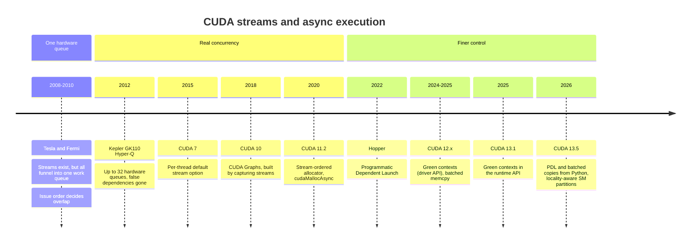
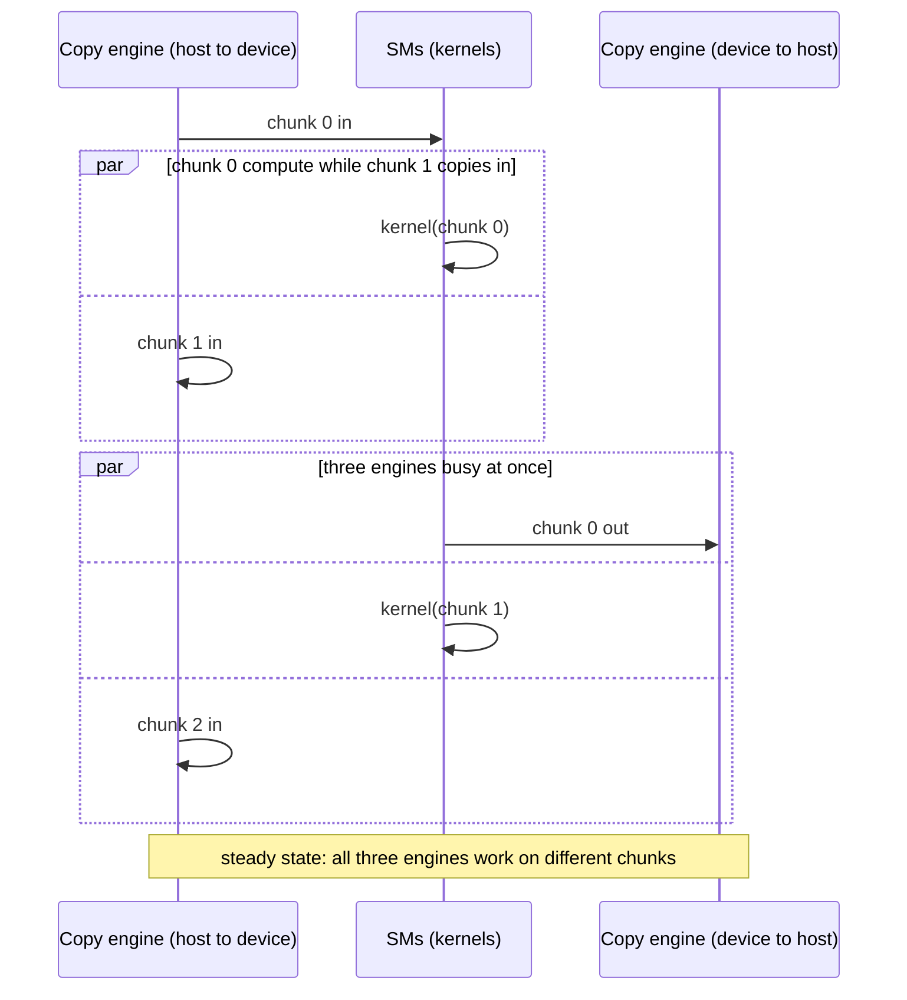
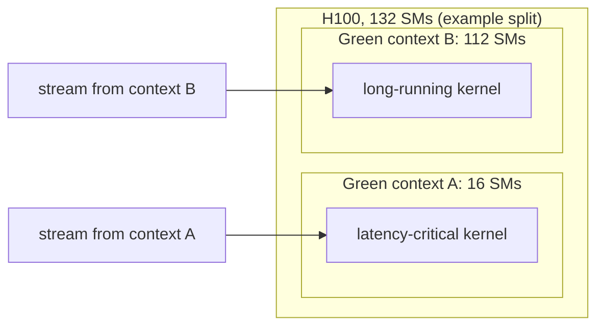

---
tags:
  - gpu-programming
  - cuda
  - streams
  - concurrency
  - async
status: draft
sources:
  - https://docs.nvidia.com/cuda/cuda-programming-guide/02-basics/asynchronous-execution.html
  - https://docs.nvidia.com/cuda/cuda-runtime-api/cuda_runtime_api/group__CUDART__EVENT.html
  - https://developer.nvidia.com/blog/how-overlap-data-transfers-cuda-cc/
  - https://docs.nvidia.com/cuda/archive/11.7.1/kepler-tuning-guide/index.html
  - https://developer.nvidia.com/blog/parallelforall/gpu-pro-tip-cuda-7-streams-simplify-concurrency
  - https://developer.nvidia.com/blog/using-cuda-stream-ordered-memory-allocator-part-1
  - https://docs.nvidia.com/cuda/cuda-programming-guide/04-special-topics/programmatic-dependent-launch.html
  - https://docs.nvidia.com/cuda/cuda-programming-guide/04-special-topics/green-contexts.html
  - https://developer.nvidia.com/blog/nvidia-cuda-13-5-brings-nvidia-vera-rubin-ga-support/
  - https://docs.pytorch.org/devlogs/eager/2026-09-29-cross-stream-memory-without-record-stream/
created: 2026-11-26
updated: 2026-11-26
---

## Table Of Contents

---

- [[#TL;DR|TL;DR]]
- [[#The Problem|The Problem]]
- [[#Foundations|Foundations]]
    - [[#Asynchronous by Default|Asynchronous by Default]]
    - [[#Streams Are In-Order Queues|Streams Are In-Order Queues]]
    - [[#Events Are Markers in a Stream|Events Are Markers in a Stream]]
    - [[#Pinned Memory and Copy Engines|Pinned Memory and Copy Engines]]
- [[#How We Got Here|How We Got Here]]
- [[#How It Works|How It Works]]
    - [[#Overlapping Copies and Kernels|Overlapping Copies and Kernels]]
    - [[#A Worked Example: How Much Overlap Buys|A Worked Example: How Much Overlap Buys]]
    - [[#Cross-Stream Dependencies With Events|Cross-Stream Dependencies With Events]]
    - [[#Timing With Events|Timing With Events]]
    - [[#The Default Stream Trap|The Default Stream Trap]]
    - [[#Stream-Ordered Memory Allocation|Stream-Ordered Memory Allocation]]
    - [[#Priorities, PDL and Green Contexts|Priorities, PDL and Green Contexts]]
- [[#Where It Is Now|Where It Is Now]]
- [[#Trade-offs & Open Problems|Trade-offs & Open Problems]]
- [[#Resources|Resources]]
- [[#Related Notes|Related Notes]]

## ***TL;DR***
---
*A CUDA stream is an in-order queue of GPU work; work in different streams may run at the same time. Events are markers you drop into a stream to time it or to make another stream wait. Together they are how you overlap data transfers, kernels and CPU work instead of running them one after another.*

- **The model:** almost every CUDA call that launches work returns to the CPU before the work is done. A *stream* orders that work: operations in one stream run in issue order, operations in different streams have no ordering and may overlap ([CUDA Programming Guide 2.5](https://docs.nvidia.com/cuda/cuda-programming-guide/02-basics/asynchronous-execution.html)).
- **Events:** `cudaEventRecord(e, s)` places a marker in stream `s`. You can wait for it on the CPU (`cudaEventSynchronize`), make another stream wait for it on the GPU (`cudaStreamWaitEvent`), or measure time between two of them (`cudaEventElapsedTime`, resolution around 0.5 microseconds) ([Runtime API](https://docs.nvidia.com/cuda/cuda-runtime-api/cuda_runtime_api/group__CUDART__EVENT.html)).
- **The classic win:** split data into chunks and pipeline copy-in, compute and copy-out across streams. On a Tesla K20c this cut a 7.10 ms sequential run to 3.97 ms ([Harris, 2012](https://developer.nvidia.com/blog/how-overlap-data-transfers-cuda-cc/)). It only works with pinned (page-locked) host memory; with ordinary memory the "async" copy silently becomes synchronous.
- **The classic trap:** the legacy default stream (stream 0) synchronizes with every other blocking stream, so one stray un-streamed call serializes everything. Use non-blocking streams or per-thread default streams.
- **Where it is now (Nov 2026):** CUDA 13.5 (Nov 4, 2026) is current. Streams now carry far more than kernels and copies: stream-ordered allocation (`cudaMallocAsync`), [[CUDA Graphs]] captured from streams, Programmatic Dependent Launch (a kernel starting before its predecessor ends, Hopper and newer), green contexts that pin a stream to a subset of SMs (in the runtime API since CUDA 13.1), and batched copies. In PyTorch, the hot topic is managing tensor lifetimes across streams without memory blowups ([PyTorch DevLog, Sep 2026](https://docs.pytorch.org/devlogs/eager/2026-09-29-cross-stream-memory-without-record-stream/)).

## ***The Problem***
---
*A GPU program has at least three kinds of work that use different hardware: copies over PCIe or NVLink, kernels on the SMs, and CPU code. Issued naively, each waits for the previous one, so most of the hardware sits idle most of the time.*

The textbook CUDA program is:

1. Copy input from host to device.
2. Run a kernel.
3. Copy the result back.

Each step waits for the one before. During step 1 the SMs are idle; during step 2 the PCIe link is idle; the CPU waits for all of it. If copies and compute take similar time, you are using at best half of the machine.

The same problem appears at larger scale everywhere GPUs are used:
- **Training:** gradient all-reduce over the network should overlap with the backward pass of earlier layers (see [[Distributed Training]]).
- **Inference serving:** loading the next batch, running the current one and returning the last one should all happen at once.
- **Small kernels:** if each kernel runs for 5 microseconds and takes a few microseconds to launch, the CPU's launch loop is the bottleneck unless launches are queued ahead.

The fix needs two things: a way to express which work is independent (so the hardware may overlap it), and a way to express the dependencies that remain (so it stays correct). Streams express the first; events express the second.

## ***Foundations***
---
*Four ideas: CUDA calls are asynchronous with respect to the CPU, a stream is a FIFO of GPU work, an event is a point in a stream you can wait on or time, and copies only overlap when the host memory is pinned and the GPU has free copy engines.*

#### **Asynchronous by Default**
Kernel launches, `cudaMemcpyAsync`, `cudaMemsetAsync` and event records return to the CPU immediately; the GPU does the work later. The CPU is free to prepare the next batch or launch more work. The price is that you must synchronize before reading results ([CUDA Programming Guide 2.5](https://docs.nvidia.com/cuda/cuda-programming-guide/02-basics/asynchronous-execution.html)). Three synchronization styles exist:

| Style | Calls | When to use |
|---|---|---|
| Blocking | `cudaDeviceSynchronize`, `cudaStreamSynchronize`, `cudaEventSynchronize` | You need the result now |
| Polling | `cudaStreamQuery`, `cudaEventQuery` (return `cudaErrorNotReady` if not done) | The CPU has other work to do meanwhile |
| Callback | `cudaLaunchHostFunc(stream, fn, data)` | Run CPU code in stream order; the callback must not call CUDA APIs |

A debugging tip from the guide: setting `CUDA_LAUNCH_BLOCKING=1` makes every launch synchronous, so an error is reported at the call that caused it. It is slow and only for debugging (see [[Debugging with compute-sanitizer and cuda-gdb]]).

#### **Streams Are In-Order Queues**
A stream is a sequence of operations that execute in the order they were issued. Two operations in the same stream never overlap (with two exceptions, Programmatic Dependent Launch and batched copies, covered below). Two operations in different streams carry no ordering at all; the hardware may run them concurrently, in either order, or one after the other.

```cpp
cudaStream_t s;
cudaStreamCreate(&s);                                   // a new blocking stream
kernel<<<grid, block, smemBytes, s>>>(args);            // 4th launch parameter = stream
cudaMemcpyAsync(dst, src, bytes, cudaMemcpyDeviceToHost, s);
cudaStreamSynchronize(s);                               // CPU waits for both
cudaStreamDestroy(s);                                   // pending work still finishes
```

- `cudaStreamCreate` returns a handle to a new queue.
- The fourth value inside `<<< >>>` names the stream the kernel goes into; the third is dynamic shared memory in bytes.
- `cudaMemcpyAsync` joins the same queue, so it runs after the kernel finishes.
- `cudaStreamSynchronize` blocks the CPU until everything in `s` is done.
- `cudaStreamDestroy` can be called while work is pending; the work completes first.

"May run concurrently" is a permission, not a promise. Two kernels in different streams only overlap if both fit on the GPU at once. A kernel that fills every SM leaves no room for the other, so streams help most with kernels that underfill the GPU and with copies, which use separate hardware.

#### **Events Are Markers in a Stream**
An event is created once and recorded into a stream. It "completes" when the stream reaches it, that is, when all work issued before it in that stream has finished. Events are used three ways: CPU waits, GPU-side waits by another stream, and timing ([Runtime API](https://docs.nvidia.com/cuda/cuda-runtime-api/cuda_runtime_api/group__CUDART__EVENT.html)).

| Flag at creation | Effect |
|---|---|
| (none) | Records a timestamp; CPU waits busy-spin |
| `cudaEventDisableTiming` | No timestamp; cheapest for pure synchronization |
| `cudaEventBlockingSync` | CPU thread sleeps in `cudaEventSynchronize` instead of spinning |
| `cudaEventInterprocess` | Shareable with another process via IPC handles (requires `DisableTiming`) |

#### **Pinned Memory and Copy Engines**
The GPU copies host data with DMA engines that need physical addresses that won't move. Ordinary `malloc` memory is pageable, so the driver first copies it into a hidden pinned staging buffer, and that step is synchronous. Allocate host buffers with `cudaMallocHost` (or register existing memory with `cudaHostRegister`) to get truly asynchronous copies ([CUDA Programming Guide 2.5](https://docs.nvidia.com/cuda/cuda-programming-guide/02-basics/asynchronous-execution.html)).

GPUs move data with dedicated *copy engines*, separate from the SMs. A GPU with one copy engine can overlap a copy with a kernel; a GPU with two can additionally run a host-to-device copy and a device-to-host copy at the same time ([Harris, 2012](https://developer.nvidia.com/blog/how-overlap-data-transfers-cuda-cc/)). `cudaGetDeviceProperties` reports the count as `asyncEngineCount`.

Pinned memory is a scarce OS resource: pinning too much starves the rest of the system, so pin staging buffers, not everything.

## ***How We Got Here***
---
*Streams have existed since early CUDA, but early GPUs fed all of them through one hardware queue, so overlap depended on the exact order you issued work. Kepler's Hyper-Q fixed that in 2012; since then streams have grown into the unit that carries allocation, graphs, cross-kernel overlap and SM partitioning.*



| Year | Step | Problem it answered | Source |
|---|---|---|---|
| Fermi era | Streams with one hardware work queue per GPU. Issuing work depth-first (all of stream 1, then all of stream 2) could block overlap, because the engine queue preserved issue order across streams. | Expressing independent work | [Harris](https://developer.nvidia.com/blog/how-overlap-data-transfers-cuda-cc/) |
| 2012 | Hyper-Q on Kepler GK110: streams map to separate hardware queues (architectural maximum 32 connections; `CUDA_DEVICE_MAX_CONNECTIONS` defaults to 8). Removed the "false dependencies" that serialized independent streams. | Overlap depending on issue order | [Kepler Tuning Guide](https://docs.nvidia.com/cuda/archive/11.7.1/kepler-tuning-guide/index.html) |
| 2015 | CUDA 7 adds the per-thread default stream (`--default-stream per-thread`) so multithreaded hosts stop serializing on stream 0. | Legacy default stream serializing everything | [Harris, CUDA 7 Streams](https://developer.nvidia.com/blog/parallelforall/gpu-pro-tip-cuda-7-streams-simplify-concurrency) |
| 2018 | [[CUDA Graphs]]: record a stream's work once, replay it with one launch. | CPU launch overhead | [CUDA Programming Guide 2.5](https://docs.nvidia.com/cuda/cuda-programming-guide/02-basics/asynchronous-execution.html) |
| 2020 | Stream-ordered allocator (`cudaMallocAsync`, `cudaFreeAsync`, memory pools). | `cudaFree` forcing a device-wide sync | [Kini & Hemstad](https://developer.nvidia.com/blog/using-cuda-stream-ordered-memory-allocator-part-1) |
| 2022 | Programmatic Dependent Launch (compute capability 9.0+): the next kernel in a stream may start before the previous one ends. | Launch gaps between dependent kernels | [PDL guide](https://docs.nvidia.com/cuda/cuda-programming-guide/04-special-topics/programmatic-dependent-launch.html) |
| 2025 | Green contexts in the runtime API (CUDA 13.1): streams bound to a fixed set of SMs. | Latency-sensitive work stuck behind big kernels | [Green contexts guide](https://docs.nvidia.com/cuda/cuda-programming-guide/04-special-topics/green-contexts.html) |

Harris's 2012 measurements show the Hyper-Q change directly. The same two loop orders, on three GPUs:

| GPU | Sequential | Per-chunk issue order | Batched issue order |
|---|---|---|---|
| Tesla C1060 (1 copy engine) | 12.92 ms | 13.64 ms (no overlap) | 8.85 ms |
| Tesla C2050 (2 copy engines, 1 queue) | 9.98 ms | 5.74 ms | 7.60 ms |
| Tesla K20c (Hyper-Q) | 7.10 ms | 3.97 ms | 3.97 ms |

On pre-Kepler GPUs the right issue order depended on the chip; on Kepler and later both orders give the same speedup.

## ***How It Works***
---
*The core pattern is a pipeline: chunk the data, give each chunk its own stream, and let copy engines and SMs work on different chunks at once. Events stitch streams together where they depend on each other, and newer features (stream-ordered allocation, PDL, green contexts) extend the same queue model.*

#### **Overlapping Copies and Kernels**
The pattern from [Harris (2012)](https://developer.nvidia.com/blog/how-overlap-data-transfers-cuda-cc/), lightly modernized:

```cpp
const int nStreams = 4;
const int chunk = N / nStreams;
cudaStream_t s[nStreams];
for (int i = 0; i < nStreams; ++i)
    cudaStreamCreateWithFlags(&s[i], cudaStreamNonBlocking);

for (int i = 0; i < nStreams; ++i) {
    int off = i * chunk;
    cudaMemcpyAsync(d_a + off, h_a + off, chunk * sizeof(float),
                    cudaMemcpyHostToDevice, s[i]);             // h_a is pinned
    kernel<<<chunk / 256, 256, 0, s[i]>>>(d_a, off);
    cudaMemcpyAsync(h_a + off, d_a + off, chunk * sizeof(float),
                    cudaMemcpyDeviceToHost, s[i]);
}
cudaDeviceSynchronize();
```

- Four non-blocking streams are created, so none of them waits on the legacy default stream.
- The array is cut into four chunks; `off` is where chunk `i` starts.
- Each chunk's copy-in, kernel and copy-out go into the same stream, so they stay in order for that chunk.
- Different chunks are in different streams, so chunk 1's kernel can run while chunk 2 is being copied in and chunk 0 is being copied out.
- `h_a` must come from `cudaMallocHost`; otherwise the copies serialize.
- One `cudaDeviceSynchronize` at the end waits for everything.

The resulting timeline, with two copy engines:



#### **A Worked Example: How Much Overlap Buys**
Let $T_{in}$, $T_k$ and $T_{out}$ be the times for the whole copy-in, kernel and copy-out. Run sequentially:

$$
T_{seq} = T_{in} + T_k + T_{out}
$$

Split into $n$ equal chunks across streams, with two copy engines, the pipeline time is roughly:

$$
T_{pipe} \approx \max(T_{in}, T_k, T_{out}) + \frac{T_{in} + T_k + T_{out} - \max(T_{in}, T_k, T_{out})}{n}
$$

*In plain English: once the pipeline is full, the slowest stage sets the pace; the other stages only cost their share for the first and last chunk.*

Example with equal stages, $T_{in} = T_k = T_{out} = 1$ ms and $n = 4$:
- $T_{seq} = 3$ ms.
- $T_{pipe} \approx 1 + 2/4 = 1.5$ ms, a 2x speedup. The ceiling as $n$ grows is 3x.

Harris's K20c run got $7.10 / 3.97 \approx 1.8$x. More chunks are not free: each one adds launch and copy setup overhead, and tiny copies use the link poorly, so a handful of chunks of at least a few megabytes is the usual sweet spot.

#### **Cross-Stream Dependencies With Events**
When stream B needs stream A's result, record an event in A and make B wait on it. The CPU is not involved; the wait happens on the GPU:

```cpp
cudaEvent_t done;
cudaEventCreateWithFlags(&done, cudaEventDisableTiming);
produce<<<g, b, 0, streamA>>>(buf);
cudaEventRecord(done, streamA);          // marker after produce
cudaStreamWaitEvent(streamB, done, 0);   // B's later work waits for the marker
consume<<<g, b, 0, streamB>>>(buf);      // runs after produce finishes
```

- `cudaEventDisableTiming` makes the event cheap since it is only used to synchronize.
- `cudaEventRecord` drops the marker into stream A right after `produce`.
- `cudaStreamWaitEvent` makes everything issued to stream B after this call wait until the marker completes. It returns to the CPU immediately.
- `consume` starts only after `produce` is done, while anything else already queued in B can still run.

This is how frameworks overlap communication and compute: gradients are produced on the compute stream, an event is recorded, and the communication stream waits on it before starting the all-reduce.

#### **Timing With Events**
```cpp
cudaEvent_t start, stop;
cudaEventCreate(&start); cudaEventCreate(&stop);
cudaEventRecord(start, s);
kernel<<<g, b, 0, s>>>(args);
cudaEventRecord(stop, s);
cudaEventSynchronize(stop);
float ms; cudaEventElapsedTime(&ms, start, stop);
```

The timestamps are taken on the GPU when the stream reaches each marker, so the measurement excludes CPU launch time and includes only GPU execution between them. Resolution is around 0.5 microseconds ([Runtime API](https://docs.nvidia.com/cuda/cuda-runtime-api/cuda_runtime_api/group__CUDART__EVENT.html)). For anything more detailed, use a profiler (see [[Profiling with Nsight Compute and Nsight Systems]]).

#### **The Default Stream Trap**
Work issued without a stream goes to the *legacy default stream* (stream 0). It is special: it waits for all work in every blocking stream, and every blocking stream waits for it. Any operation on stream 0 issued between work in two other streams prevents them from overlapping ([CUDA Programming Guide 2.5](https://docs.nvidia.com/cuda/cuda-programming-guide/02-basics/asynchronous-execution.html)).

| Fix | How | Effect |
|---|---|---|
| Non-blocking streams | `cudaStreamCreateWithFlags(&s, cudaStreamNonBlocking)` | Your streams ignore stream 0 |
| Per-thread default stream | Compile with `--default-stream per-thread` or define `CUDA_API_PER_THREAD_DEFAULT_STREAM` | Each host thread's default stream behaves like an ordinary stream |
| Avoid implicit syncs | No plain `cudaMemcpy`, `cudaMalloc` or `cudaFree` in the hot loop | Removes hidden device-wide waits |

Plain `cudaMalloc` and `cudaFree` are the sneakiest offenders: `cudaFree` has to wait until the GPU is done with the memory, so it forces a device-wide synchronization ([Kini & Hemstad, 2021](https://developer.nvidia.com/blog/using-cuda-stream-ordered-memory-allocator-part-1)).

#### **Stream-Ordered Memory Allocation**
CUDA 11.2 made allocation itself a stream operation. `cudaMallocAsync(&p, bytes, s)` and `cudaFreeAsync(p, s)` take effect in stream order, so freeing memory no longer synchronizes the device. The driver keeps freed memory in a pool for reuse; by default it returns unused memory to the OS at the next synchronization, and a *release threshold* lets the pool keep a set amount cached, which makes allocation cost independent of size in steady state ([Kini & Hemstad, 2021](https://developer.nvidia.com/blog/using-cuda-stream-ordered-memory-allocator-part-1)).

Frameworks solved the same problem earlier with their own caching allocators (PyTorch's CUDA caching allocator), and they face its cross-stream edge case: a block allocated on stream A but read on stream B can be reused by A too early. See [[#Where It Is Now|Where It Is Now]] for how PyTorch handles it in 2026.

#### **Priorities, PDL and Green Contexts**
Three ways to say more than "these are independent":

- **Priorities.** `cudaStreamCreateWithPriority(&s, flags, prio)`; lower numbers mean higher priority, and `cudaDeviceGetStreamPriorityRange` gives the range. The scheduler prefers pending blocks from high-priority streams, but priorities are hints: they do not preempt running blocks or guarantee order ([CUDA Programming Guide 2.5](https://docs.nvidia.com/cuda/cuda-programming-guide/02-basics/asynchronous-execution.html)).
- **[[Programmatic Dependent Launch]] (PDL).** Normally kernel B in a stream starts only after kernel A completely finishes and flushes memory, which leaves a gap. With PDL (compute capability 9.0+), A calls `cudaTriggerProgrammaticLaunchCompletion()` when B may start, B is launched with the `cudaLaunchAttributeProgrammaticStreamSerialization` attribute through `cudaLaunchKernelEx`, and B calls `cudaGridDependencySynchronize()` before reading A's output. B's prologue (zeroing buffers, loading constants) overlaps A's tail. The overlap is opportunistic: code must stay correct if it never happens ([PDL guide](https://docs.nvidia.com/cuda/cuda-programming-guide/04-special-topics/programmatic-dependent-launch.html)).
- **Green contexts.** Split the GPU's SMs into fixed groups with `cudaDevSmResourceSplit`, create a green context per group, and create streams in it with `cudaExecutionCtxStreamCreate`. Kernels in those streams only use that group's SMs, with no kernel changes. The guide's example gives a latency-critical kernel 16 SMs and a long-running kernel 112 on an H100, so the critical one never waits for SMs to free up. Partitions do not guarantee concurrency (shared work queues can still serialize) and each kernel gets fewer SMs ([Green contexts guide](https://docs.nvidia.com/cuda/cuda-programming-guide/04-special-topics/green-contexts.html)).



## ***Where It Is Now***
---
*As of November 2026, the stream is the backbone of CUDA's execution model: graphs are captured from it, memory is allocated in it, and newer features refine what "in order" means within it. The active work is in finer-grained overlap (PDL, batched copies), SM partitioning for mixed workloads, and safe memory reuse across streams in frameworks.*

- **CUDA 13.5 (Nov 4, 2026).** Exposes PDL from Python through `cuda.core` (`programmatic_stream_serialization` in `LaunchConfig`), adds `copy_batch()` to submit many copies in one driver call, lets green-context partitions follow the GPU's locality domains (with a flag that hands leftover SMs to each domain, so partitions may differ in size), and allows batched copies inside captured [[CUDA Graphs]] ([NVIDIA, Nov 2026](https://developer.nvidia.com/blog/nvidia-cuda-13-5-brings-nvidia-vera-rubin-ga-support/)). The same release brings MPS v3 with weighted time-slicing and SM partition borrowing between processes.
- **Green contexts in serving.** Since CUDA 13.1 green contexts are in the runtime API, which makes "reserve some SMs for the latency-sensitive path" a host-side configuration change rather than a kernel rewrite ([Green contexts guide](https://docs.nvidia.com/cuda/cuda-programming-guide/04-special-topics/green-contexts.html)). Choosing the split is still trial and error.
- **Frameworks: lifetimes across streams.** PyTorch's FSDP2 overlaps communication and compute on separate streams. A Sep 2026 PyTorch DevLog argues against `Tensor.record_stream`, which makes peak memory grow with how far the CPU runs ahead of the GPU. In a 4-layer H100 demo, `record_stream` kept up to 4 parameter buffers alive per run, while recording an event on the consumer stream, keeping one reference alive and calling `wait_event` before freeing held it at exactly 2, with no corruption in 50 trials. FSDP2 uses the `wait_event` pattern on CUDA ([PyTorch DevLog](https://docs.pytorch.org/devlogs/eager/2026-09-29-cross-stream-memory-without-record-stream/)).
- **Launch overhead keeps shrinking in importance for steady loops** because those are captured into [[CUDA Graphs]]; streams remain the way to build the graph and the way to handle the dynamic parts that graphs can't.

## ***Trade-offs & Open Problems***
---
*Streams make overlap possible but never guarantee it. They push correctness onto the programmer (every cross-stream use needs an event), and how much overlap you actually get depends on hardware queues, kernel sizes and memory behavior that the API does not show.*

| Aspect | Gain | Cost |
|---|---|---|
| Asynchronous calls | CPU runs ahead; launch latency hidden | Errors surface late; results need explicit syncs |
| Multiple streams | Copies, kernels and CPU overlap | Races if an event is missing; overlap not guaranteed |
| Pinned memory | True async copies, full link bandwidth | Scarce OS resource; slow to allocate |
| Legacy default stream | Simple single-stream code is correct | Hidden serialization in multi-stream code |
| Priorities | Latency-critical work scheduled first | Hints only; no preemption of running blocks |
| PDL | Removes inter-kernel gaps in one stream | Kernels must implement the trigger and wait protocol; Hopper and newer |
| Green contexts | Guaranteed SMs for critical work | Fewer SMs per kernel; static split chosen by experiment |

Open problems:
- **Overlap is not visible in the API.** Whether two streams actually overlap depends on hardware queue mapping, resource fit and copy-engine count. You only find out with a timeline profiler ([[Profiling with Nsight Compute and Nsight Systems|Nsight Systems]]).
- **Compute and communication interfere.** Overlapping an all-reduce with a GEMM makes both slower, because communication kernels take SMs and memory bandwidth. How many SMs to give communication (or whether to offload it to copy engines or TMA) is an active tuning question; see [[GPU Cluster Infrastructure]].
- **Memory under concurrency.** More streams in flight mean more buffers alive at once. Bounding that deterministically, as the PyTorch keepalive pattern does, is still manual.
- **Static partitioning vs dynamic load.** Green contexts and MPS partitions are fixed at creation; workloads like LLM serving shift between compute-heavy prefill and memory-heavy decode from moment to moment.

## ***Resources***
---
*Read the Programming Guide's asynchronous execution chapter for the rules, Harris's 2012 post for the canonical overlap example, then the PDL and green-context chapters for the modern refinements.*

**Primary sources**
- [CUDA Programming Guide 2.5: Asynchronous Execution](https://docs.nvidia.com/cuda/cuda-programming-guide/02-basics/asynchronous-execution.html): NVIDIA, CUDA 13.4.2 docs (updated Sep 2026). Streams, events, callbacks, default-stream rules, priorities.
- [CUDA Runtime API: Event Management](https://docs.nvidia.com/cuda/cuda-runtime-api/cuda_runtime_api/group__CUDART__EVENT.html): event flags and timing resolution.
- [Programmatic Dependent Launch and Synchronization](https://docs.nvidia.com/cuda/cuda-programming-guide/04-special-topics/programmatic-dependent-launch.html): NVIDIA Programming Guide 4.5.
- [Green Contexts](https://docs.nvidia.com/cuda/cuda-programming-guide/04-special-topics/green-contexts.html): NVIDIA Programming Guide 4.7.
- [Tuning CUDA Applications for Kepler](https://docs.nvidia.com/cuda/archive/11.7.1/kepler-tuning-guide/index.html): Hyper-Q and `CUDA_DEVICE_MAX_CONNECTIONS`.
- [NVIDIA CUDA 13.5 release blog](https://developer.nvidia.com/blog/nvidia-cuda-13-5-brings-nvidia-vera-rubin-ga-support/): Nov 4, 2026.

**Engineering posts**
- [How to Overlap Data Transfers in CUDA C/C++](https://developer.nvidia.com/blog/how-overlap-data-transfers-cuda-cc/): Mark Harris, Dec 2012. The canonical chunked-pipeline example with measurements.
- [GPU Pro Tip: CUDA 7 Streams Simplify Concurrency](https://developer.nvidia.com/blog/parallelforall/gpu-pro-tip-cuda-7-streams-simplify-concurrency): Mark Harris, 2015. The per-thread default stream.
- [Using the NVIDIA CUDA Stream-Ordered Memory Allocator, Part 1](https://developer.nvidia.com/blog/using-cuda-stream-ordered-memory-allocator-part-1): Kini & Hemstad, Jul 2021.
- [Cross-stream memory management: wait_event instead of record_stream](https://docs.pytorch.org/devlogs/eager/2026-09-29-cross-stream-memory-without-record-stream/): Wei Feng, PyTorch DevLog, Sep 2026.

## Related Notes

- [[CUDA Programming Model]] — Kernels, grids and the host/device split that streams schedule.
- [[CUDA Graphs]] — Capture a stream's work once and replay it with one launch.
- [[Programmatic Dependent Launch]] — Letting the next kernel in a stream start before the current one ends.
- [[Unified Memory]] — Prefetches and advice that run in stream order.
- [[Profiling with Nsight Compute and Nsight Systems]] — Nsight Systems shows whether streams actually overlap.
- [[Occupancy and Latency Hiding]] — Why two concurrent kernels only overlap if both fit on the SMs.
- [[TMA and Asynchronous Copies]] — Asynchrony inside a kernel, the on-chip counterpart to streams.
- [[Kernel Fusion]] — The other way to remove launch gaps: fewer kernels.
- [[GPU Architecture Basics]] — SMs, copy engines and the hardware work queues streams map onto.
- [[Distributed Training]] — Overlapping gradient communication with compute on separate streams.
- [[GPU Cluster Infrastructure]] — The networks whose transfers streams overlap with compute.
- [[MIG and MPS - Sharing a GPU]] — Sharing one GPU between processes with MPS and MIG.
