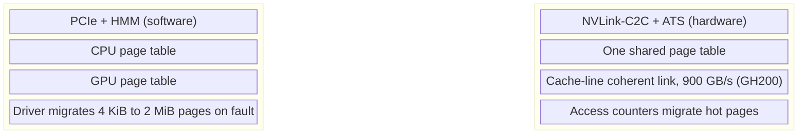
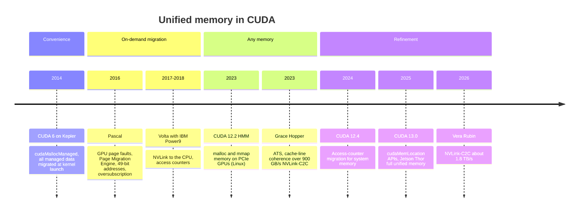
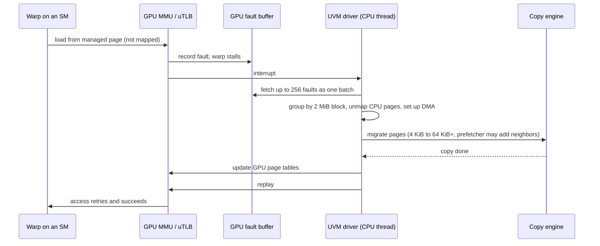

---
tags:
  - gpu-programming
  - cuda
  - memory
  - unified-memory
  - coherence
status: draft
sources:
  - https://docs.nvidia.com/cuda/cuda-programming-guide/02-basics/understanding-memory.html
  - https://docs.nvidia.com/cuda/archive/13.4.1/cuda-programming-guide/04-special-topics/unified-memory.html
  - https://developer.nvidia.com/blog/unified-memory-in-cuda-6/
  - https://developer.nvidia.com/blog/unified-memory-cuda-beginners
  - https://developer.nvidia.com/blog/simplifying-gpu-application-development-with-heterogeneous-memory-management
  - https://developer.nvidia.com/blog/nvidia-grace-hopper-superchip-architecture-in-depth/
  - https://developer.nvidia.com/blog/simplifying-gpu-programming-for-hpc-with-the-nvidia-grace-hopper-superchip
  - https://developer.nvidia.com/blog/improving-gpu-memory-oversubscription-performance/
  - https://tallendev.github.io/assets/papers/sc21.pdf
  - https://arxiv.org/abs/1910.09598
  - https://arxiv.org/abs/2411.05309
  - https://developer.nvidia.com/docs/drive/drive-os/7.2.5/public/drive-os-migration-guide/cudart_changes.html
  - https://developer.nvidia.com/blog/whats-new-and-important-in-cuda-toolkit-13-0/
  - https://developer.nvidia.com/blog/accelerate-large-scale-llm-inference-and-kv-cache-offload-with-cpu-gpu-memory-sharing
  - https://docs.nvidia.com/dccpu/vera-perf-tuning-guide/vera-cpu-and-superchip.html
created: 2026-11-26
updated: 2026-11-26
---

## Table Of Contents

---

- [[#TL;DR|TL;DR]]
- [[#The Problem|The Problem]]
- [[#Foundations|Foundations]]
    - [[#Explicit Copies, Zero-Copy and Unified Memory|Explicit Copies, Zero-Copy and Unified Memory]]
    - [[#Virtual Memory and Page Faults|Virtual Memory and Page Faults]]
    - [[#Software vs Hardware Coherence|Software vs Hardware Coherence]]
- [[#How We Got Here|How We Got Here]]
- [[#How It Works|How It Works]]
    - [[#Managed Allocations in Code|Managed Allocations in Code]]
    - [[#What Happens on a GPU Page Fault|What Happens on a GPU Page Fault]]
    - [[#A Worked Example: Faults vs Prefetch|A Worked Example: Faults vs Prefetch]]
    - [[#Hints: Prefetch, Advise, Discard|Hints: Prefetch, Advise, Discard]]
    - [[#Oversubscription|Oversubscription]]
    - [[#Which Platform Am I On?|Which Platform Am I On?]]
- [[#Where It Is Now|Where It Is Now]]
- [[#Trade-offs & Open Problems|Trade-offs & Open Problems]]
- [[#Resources|Resources]]
- [[#Related Notes|Related Notes]]

## ***TL;DR***
---
*Unified Memory gives the CPU and GPU one pointer to the same data, and the system moves or shares the bytes underneath. It makes GPU code far easier to write, but on PCIe systems its speed depends entirely on avoiding page faults, usually with prefetch hints; on [[Coherent CPU-GPU Superchips|coherent CPU-GPU superchips]] it becomes close to the default way to program.*

- **What it is:** one address space plus automatic data movement. Allocate with `cudaMallocManaged` (or, on newer Linux systems, plain `malloc`), and both CPU and GPU code can dereference the same pointer ([CUDA Programming Guide 2.6](https://docs.nvidia.com/cuda/cuda-programming-guide/02-basics/understanding-memory.html)).
- **How it moves data:** on PCIe GPUs since Pascal (2016), a GPU access to a page that lives in CPU memory raises a page fault; the driver copies the page over and the warp retries. On hardware-coherent systems (Grace Hopper, Grace Blackwell), the GPU can read CPU memory directly at cache-line granularity, and pages migrate based on access counters.
- **The cost of faults:** in Harris's P100 example, a kernel that took 26 µs with data already on the GPU took 2.12 ms when it had to fault its pages in, about 80x slower ([Harris, 2017](https://developer.nvidia.com/blog/unified-memory-cuda-beginners)). One `cudaMemPrefetchAsync` call fixed it. Clemson's SC21 study found the cost is mostly host-side driver work (unmapping CPU pages, DMA setup), not the copy itself ([Allen & Ge, 2021](https://tallendev.github.io/assets/papers/sc21.pdf)).
- **What it uniquely allows:** oversubscription, working on data larger than GPU memory without rewriting the code, and sharing pointers, atomics and libraries between CPU and GPU.
- **Where it is now (Nov 2026):** four platform tiers exist, from limited (Windows, WSL) to full hardware coherence (NVLink-C2C superchips). HMM (CUDA 12.2) lets PCIe GPUs on Linux use any `malloc`'d memory. CUDA 13 changed the prefetch and advise APIs to take a `cudaMemLocation`, added discard APIs, and brought full unified memory to Jetson Thor. Vera Rubin doubles the CPU-GPU NVLink-C2C link to about 1.8 TB/s, making "spill to CPU memory" (for example, oversized models or KV caches) increasingly practical.

## ***The Problem***
---
*A discrete GPU has its own memory, separate from the CPU's. Classic CUDA makes the programmer allocate twice and copy explicitly, which is fast but tedious, error-prone, and impossible for data structures full of pointers or datasets larger than GPU memory.*

Classic CUDA code keeps two copies of everything:

```cpp
float *h_x = (float*)malloc(bytes), *d_x;
cudaMalloc(&d_x, bytes);
cudaMemcpy(d_x, h_x, bytes, cudaMemcpyHostToDevice);
kernel<<<g, b>>>(d_x);
cudaMemcpy(h_x, d_x, bytes, cudaMemcpyDeviceToHost);
```

That is fine for flat arrays. It breaks down when:

- **Data is pointer-rich.** A linked list, tree or graph allocated with `malloc` contains CPU addresses. Copying it to the GPU means rebuilding every pointer ("deep copy").
- **Data exceeds GPU memory.** An 80 GB GPU cannot `cudaMalloc` a 200 GB array. Without unified memory, the programmer must stream it through in pieces.
- **Code is shared.** Existing CPU libraries, or a large legacy application, allocate with `malloc` and `new`. Porting to GPU means finding and doubling every allocation.
- **Only part of the data is touched.** Copying a whole array to use 1% of it wastes the link.

The goal of unified memory is to let the programmer write one pointer and have the system decide where the bytes live, without giving up too much speed.

## ***Foundations***
---
*Three ideas: there are three ways for a GPU to use host data (copy it, read it over the link, or migrate it on demand), migration is built on virtual memory and page faults, and whether coherence is done in software (drivers and faults) or hardware (a coherent link) changes the performance picture completely.*

#### **Explicit Copies, Zero-Copy and Unified Memory**

| Approach | How | Strength | Weakness |
|---|---|---|---|
| Explicit copy | `cudaMalloc` + `cudaMemcpy` | Full speed, predictable | Two pointers, manual management |
| Zero-copy (mapped pinned memory) | `cudaHostAlloc(..., cudaHostAllocMapped)` or `cudaHostRegister` | No copy; good for data read once | Every access crosses PCIe; no locality |
| Unified (managed) memory | `cudaMallocManaged`, `__managed__`, or `malloc` with HMM/ATS | One pointer; data migrates to where it is used | Fault overhead unless prefetched; less predictable |

Sources: [CUDA Programming Guide 2.6](https://docs.nvidia.com/cuda/cuda-programming-guide/02-basics/understanding-memory.html), [Garg & Sakharnykh, 2021](https://developer.nvidia.com/blog/improving-gpu-memory-oversubscription-performance/).

Underneath all three is the *unified virtual address space*: host and device allocations in a process occupy one virtual address range, so a pointer value alone tells the runtime where memory lives (`cudaPointerGetAttributes`). Unified memory goes further by letting the same address be backed by memory on either side.

#### **Virtual Memory and Page Faults**
Both CPUs and GPUs translate virtual addresses to physical ones through page tables, cached in TLBs (translation lookaside buffers). When a processor touches a virtual page that is not mapped to physical memory it can reach, it raises a *page fault*. The OS (for the CPU) or the CUDA driver (for the GPU) then finds the data, maps it, and lets the access retry.

Unified memory on PCIe GPUs is exactly this, applied across the CPU-GPU boundary: a managed page lives in one processor's memory at a time, and touching it from the other processor triggers a fault that migrates it.

Page size matters a lot ([Unified Memory guide](https://docs.nvidia.com/cuda/archive/13.4.1/cuda-programming-guide/04-special-topics/unified-memory.html)):

| Allocator or system | Page size |
|---|---|
| x86-64 CPU default | 4 KiB |
| Arm CPU (e.g. Grace) | 4, 16, 32 or 64 KiB |
| `cudaMalloc`, `cudaMallocManaged` when GPU-resident | 2 MiB |
| NVIDIA GPU preference | 2 MiB or larger |

GPU TLB misses are far more expensive than CPU ones, so random GPU access across small pages is especially slow. Bigger pages mean fewer misses but costlier migrations.

#### **Software vs Hardware Coherence**
*Coherence* means every processor sees the latest value of a memory location. CUDA unified memory reaches it two ways ([CUDA Programming Guide 2.6](https://docs.nvidia.com/cuda/cuda-programming-guide/02-basics/understanding-memory.html)):

- **Software coherence (PCIe GPUs, Linux HMM):** only one side holds a page at a time. The driver keeps the two copies consistent by migrating pages on faults, at page granularity.
- **Hardware coherence (ATS over NVLink-C2C, e.g. Grace Hopper):** CPU and GPU share one page table, and the link keeps caches coherent at cache-line granularity. The GPU can read CPU memory in place (and vice versa) without faulting, and native atomics work across the link. Migration still happens, but as an optimization driven by access counters, not as a requirement for correctness.



## ***How We Got Here***
---
*Unified Memory arrived in CUDA 6 as a convenience that copied everything at every kernel launch. Pascal made it real with GPU page faults; Linux HMM extended it to ordinary malloc'd memory; and NVLink-C2C superchips turned it into hardware coherence.*



| Year | Step | Problem it answered | Source |
|---|---|---|---|
| 2014 | CUDA 6 introduces `cudaMallocManaged`. On Kepler and Maxwell, before each launch the runtime moved *all* managed pages to the GPU, even untouched ones, and the CPU could not touch managed memory while the GPU ran. | Two pointers per allocation | [Harris, Nov 2013](https://developer.nvidia.com/blog/unified-memory-in-cuda-6/), [Harris, 2017](https://developer.nvidia.com/blog/unified-memory-cuda-beginners) |
| 2016 | Pascal adds GPU page faulting and the Page Migration Engine; 49-bit virtual addresses cover all system memory; managed data can exceed GPU memory. | Moving data nobody uses; GPU memory capacity | [Harris](https://developer.nvidia.com/blog/unified-memory-cuda-beginners) |
| 2021 | Oversubscription study: performance varies up to 100x by platform, oversubscription factor and hints; random access with faults can drop to a few hundred KB/s on x86. | Knowing when UM is safe to rely on | [Garg & Sakharnykh](https://developer.nvidia.com/blog/improving-gpu-memory-oversubscription-performance/) |
| 2023 | HMM with CUDA 12.2: GPU threads read `malloc`, `mmap` and `new` memory directly on PCIe GPUs (Turing+, Linux 6.1.24+, open kernel modules, x86-64). Pages migrate in 4 KB chunks. | Special allocators everywhere | [Hubbard et al.](https://developer.nvidia.com/blog/simplifying-gpu-application-development-with-heterogeneous-memory-management) |
| 2023 | Grace Hopper: NVLink-C2C at 900 GB/s total (about 7x PCIe Gen5 x16), one page table via ATS, 512 GB LPDDR5X at 546 GB/s next to 96 GB HBM3 at 3,000 GB/s. | Fault overhead on PCIe | [NVIDIA](https://developer.nvidia.com/blog/nvidia-grace-hopper-superchip-architecture-in-depth/) |
| 2025 | CUDA 13.0: prefetch and advise take a `cudaMemLocation` instead of a device number; Jetson Thor gains full unified memory. | Host and NUMA locations as first-class targets | [Migration guide](https://developer.nvidia.com/docs/drive/drive-os/7.2.5/public/drive-os-migration-guide/cudart_changes.html), [CUDA 13.0 blog](https://developer.nvidia.com/blog/whats-new-and-important-in-cuda-toolkit-13-0/) |

## ***How It Works***
---
*Allocate once, touch from either side. On PCIe systems the driver services GPU page faults in batches and migrates pages; prefetches and advice let you move data before it is needed. On coherent systems the GPU reads remote memory directly and hot pages migrate in the background.*

#### **Managed Allocations in Code**
```cpp
float* x;
cudaMallocManaged(&x, n * sizeof(float));
for (int i = 0; i < n; ++i) x[i] = 1.0f;     // CPU touches first: pages land in CPU memory
scale<<<(n + 255) / 256, 256>>>(x, n);       // GPU faults pages over as it touches them
cudaDeviceSynchronize();                     // must sync before the CPU reads x again
printf("%f\n", x[0]);                        // CPU access migrates that page back
cudaFree(x);
```

- `cudaMallocManaged` returns one pointer valid on both CPU and GPU. No physical memory is committed yet.
- The CPU loop is the *first touch*, so pages are created in CPU memory.
- During the kernel, each GPU access to a CPU-resident page faults and migrates it.
- `cudaDeviceSynchronize` is required before the CPU reads results, as with any asynchronous launch (see [[Streams, Events and Async Execution]]).
- `x[0]` on the CPU pulls that page back across.
- One `cudaFree` releases it.

With HMM or ATS, replacing `cudaMallocManaged` with `malloc` gives the same behavior, and memory-mapped files work too: NVIDIA's HMM post histograms about 1.3 TB of climate data straight from an `mmap`'d file ([Hubbard et al., 2023](https://developer.nvidia.com/blog/simplifying-gpu-application-development-with-heterogeneous-memory-management)).

#### **What Happens on a GPU Page Fault**
The NVIDIA UVM driver services faults like this on PCIe systems ([Allen & Ge, SC21](https://tallendev.github.io/assets/papers/sc21.pdf)):



Key facts from the SC21 measurements on a Titan V with CUDA 11.2:
- Faults are batched (up to 256 per batch) and grouped by 2 MiB "VABlocks"; eviction under oversubscription also happens per VABlock.
- A reactive *density prefetcher* migrates neighbouring pages within a VABlock; it cut the number of fault batches in sgemm by 93%.
- The copy itself was under 25% of batch time for sgemm. The rest was host-side work: unmapping CPU pages and creating DMA mappings (up to 64% of time in prefetch-heavy batches).
- The driver is a serial bottleneck facing massively parallel faults.

So a fault costs far more than its bytes suggest, and many faults in a row serialize through one driver thread.

#### **A Worked Example: Faults vs Prefetch**
Harris's `add` kernel adds two arrays of $2^{20}$ floats on a Tesla P100 ([Harris, 2017](https://developer.nvidia.com/blog/unified-memory-cuda-beginners)). The kernel reads `x` and `y` and writes `y`, so it moves:

$$
3 \times 2^{20} \times 4 \text{ bytes} \approx 12.6 \text{ MB}
$$

| Version | Kernel time | Effective bandwidth |
|---|---|---|
| Arrays initialized on CPU, faulted in by the kernel | 2.12 ms | about 6 GB/s |
| Arrays initialized by a GPU kernel (no migration) | 25.8 µs | about 488 GB/s |
| CPU init + `cudaMemPrefetchAsync` before launch | 26.1 µs | about 480 GB/s |

*In plain English: the faulting kernel ran about 80x slower, and nearly all of that was page-fault handling, not arithmetic.* With prefetch the copies still happen, but as four large 2 MB transfers on the copy engine before the kernel starts, rather than thousands of small faults during it.

Now the transfer cost itself. The 8 MB of input (`x` and `y`) over different links:

$$
t = \frac{\text{bytes}}{\text{bandwidth}}
$$

- PCIe Gen3 x16 (16 GB/s one way): $8 \text{ MB} / 16 \text{ GB/s} = 0.5$ ms.
- NVLink-C2C on GH200 (450 GB/s one way): $8 \text{ MB} / 450 \text{ GB/s} \approx 18$ µs.

*In plain English: on a coherent superchip, moving the data costs about the same as running the kernel, so spilling to CPU memory stops being a disaster.* On PCIe it is 20x the kernel time even when perfectly prefetched.

#### **Hints: Prefetch, Advise, Discard**
Hints never change correctness, only performance, and they can make things worse, so measure ([Unified Memory guide](https://docs.nvidia.com/cuda/archive/13.4.1/cuda-programming-guide/04-special-topics/unified-memory.html)). CUDA 13 versions:

```cpp
cudaMemLocation gpu{cudaMemLocationTypeDevice, dev};
cudaMemLocation cpu{cudaMemLocationTypeHost, 0};

cudaMemAdvise(weights, wBytes, cudaMemAdviseSetReadMostly, gpu);      // replicate read-only data
cudaMemAdvise(out, oBytes, cudaMemAdviseSetPreferredLocation, cpu);   // results stay on host
cudaMemPrefetchAsync(in, iBytes, gpu, 0, stream);                     // move input before use
kernel<<<g, b, 0, stream>>>(weights, in, out);
```

- `cudaMemLocation` names a target: a device, the host, or (on NUMA systems) a host node. CUDA 13 replaced the old `int device` arguments with it ([migration guide](https://developer.nvidia.com/docs/drive/drive-os/7.2.5/public/drive-os-migration-guide/cudart_changes.html)).
- `SetReadMostly` lets each processor keep a read-only copy, trading write cost for read bandwidth.
- `SetPreferredLocation` says where pages should normally live; it is a preference, and prefetches override it.
- `SetAccessedBy` (not shown) says a processor will access the data often, so keep it mapped there; on hardware-coherent systems it turns on access-counter migration.
- `cudaMemPrefetchAsync` is stream-ordered: it starts after earlier work in `stream` and overlaps with other streams. The extra `0` is the new `flags` argument.

Newer APIs mark data as dead so the driver does not waste bandwidth moving it: `cudaMemDiscardBatchAsync` (contents of these ranges are no longer needed) and `cudaMemDiscardAndPrefetchBatchAsync` (discard and prefetch in one step, for buffers that will be overwritten). Reading a discarded page before writing it returns indeterminate values.

#### **Oversubscription**
On full-support platforms you can allocate more managed memory than the GPU has; the driver evicts cold 2 MiB blocks back to the host as needed. How well that works depends heavily on the access pattern ([Garg & Sakharnykh, 2021](https://developer.nvidia.com/blog/improving-gpu-memory-oversubscription-performance/)):

| Access pattern under oversubscription | Fault-driven migration | Zero-copy (pinned host memory) |
|---|---|---|
| Streaming, block-stride | Good, falls as oversubscription grows | Near link peak on A100 PCIe Gen4 |
| Random per warp | A few hundred KB/s on x86 | Steady 3 to 4 GB/s |

Their rules of thumb: data used once should be zero-copy; data reused many times is worth migrating; pinning a hot subset on the GPU and leaving the rest on the CPU (via `SetPreferredLocation`) often beats letting the driver thrash. An academic study found prefetch gave up to 50% speedup on Intel+PCIe but little on Power9+NVLink, and that memory advice helped by up to 25% under 50% oversubscription on PCIe but hurt on NVLink ([Chien, Peng & Markidis, 2019](https://arxiv.org/abs/1910.09598)). Platform matters.

#### **Which Platform Am I On?**
Three device attributes sort every system into four tiers ([CUDA Programming Guide 2.6](https://docs.nvidia.com/cuda/cuda-programming-guide/02-basics/understanding-memory.html)):

| Tier | `ConcurrentManagedAccess` | `PageableMemoryAccess` | `...UsesHostPageTables` | Examples |
|---|---|---|---|---|
| Limited | 0 | | | Windows, WSL, some Tegra: data moves at launch and sync, no oversubscription, no CPU access while GPU runs |
| Full, managed allocations only | 1 | 0 | | Linux PCIe without HMM |
| Full, all memory, software coherence | 1 | 1 | 0 | Linux PCIe with HMM |
| Full, all memory, hardware coherence | 1 | 1 | 1 | Grace Hopper, Grace Blackwell (ATS) |

`nvidia-smi -q` shows "Addressing Mode: HMM" when HMM is active. HMM switches itself off when ATS is present.

## ***Where It Is Now***
---
*As of November 2026, unified memory has split into two worlds: on PCIe GPUs it is a convenience that needs careful hints to be fast, and on coherent superchips (GH200, GB200, GB300, Vera Rubin) it is close to the natural programming model, used to spill models and caches into large CPU memories.*

- **Coherent superchips are mainstream.** Grace Hopper's NVLink-C2C runs at 900 GB/s; NVIDIA's Vera CPU doubles the second-generation link to about 1.8 TB/s and carries up to 1.5 TB of LPDDR5X per socket at up to about 1.2 TB/s ([Vera tuning guide](https://docs.nvidia.com/dccpu/vera-perf-tuning-guide/vera-cpu-and-superchip.html)). In the Vera Rubin superchip configuration the CPU side is listed at 768 GB raw and 900 GB/s. A GPU that can read that much memory at near-HBM-class bandwidth changes what "doesn't fit" means.
- **LLMs spill to CPU memory.** NVIDIA's Sep 2025 example loads Llama 3.1 70B (about 140 GB in FP16) on a 96 GB GH200 by switching PyTorch to RAPIDS RMM's managed-memory allocator, two lines of code, so weights spill into Grace memory instead of failing with out-of-memory. The same mechanism is pitched for KV cache offload (a 128K-token cache for one Llama 3 70B user is about 40 GB) ([Syed, Goldwasser & Tichy, 2025](https://developer.nvidia.com/blog/accelerate-large-scale-llm-inference-and-kv-cache-offload-with-cpu-gpu-memory-sharing)). The post reports that it works, not how fast.
- **HPC codes drop data directives.** On Grace Hopper, the POT3D solar physics code with all OpenACC data directives removed (`-gpu=unified`) matched the hand-optimized version with about 2,000 fewer lines; across SPECaccel 2023, unified memory was about 1% slower overall than explicit data directives, ranging from +28% to -22% per benchmark ([NVIDIA, 2023](https://developer.nvidia.com/blog/simplifying-gpu-programming-for-hpc-with-the-nvidia-grace-hopper-superchip)).
- **API cleanup in CUDA 13.** `cudaMemLocation` in prefetch and advise, discard APIs, managed pools via `cudaMallocFromPoolAsync`, and full unified memory on Jetson Thor ([CUDA 13.0 blog](https://developer.nvidia.com/blog/whats-new-and-important-in-cuda-toolkit-13-0/)). Some gaps remain: managed memory cannot be pinned to a locality domain and is not usable with CUDA IPC ([Unified Memory guide](https://docs.nvidia.com/cuda/archive/13.4.1/cuda-programming-guide/04-special-topics/unified-memory.html)).
- **Deep learning frameworks still mostly avoid it on PCIe.** Training and serving stacks allocate explicitly with caching allocators for predictable performance; unified memory shows up as an opt-in for capacity, not as the default.

## ***Trade-offs & Open Problems***
---
*Unified memory trades predictability for convenience. Its performance ranges over two orders of magnitude depending on platform, access pattern and hints, and the slow cases come from operating-system work that GPUs cannot parallelize.*

| Aspect | Gain | Cost |
|---|---|---|
| One pointer | Simpler code; pointer-rich structures and CPU libraries just work | Hides where data lives, so performance surprises appear late |
| On-demand migration | Moves only touched pages | Fault handling is slow and serialized through the driver |
| Prefetch and advice | Recovers near-explicit-copy speed | Back to reasoning about data placement; wrong hints hurt |
| Oversubscription | Datasets larger than GPU memory without rewrites | Thrashing; random access can collapse to KB/s on PCIe |
| Hardware coherence | No faults for remote access; cross-device atomics | Remote reads still slower than local HBM; needs superchip hardware |
| Large pages | Fewer TLB misses | Costlier migrations, latency spikes, fragmentation |

Open problems:
- **The driver bottleneck.** Faults arrive from thousands of warps, but servicing runs largely serially on the host. SC21 suggests per-SM parallel handling; research systems such as [GPUVM](https://arxiv.org/abs/2411.05309) (2024) let GPU threads handle paging themselves through an RDMA-capable NIC, bypassing the CPU.
- **Predicting access.** The built-in prefetcher is reactive and local to a 2 MiB block. Learned and compiler-guided prefetching are active research topics.
- **Page size mismatch on coherent systems.** On Grace systems the GPU walks the CPU's page tables, so default 4 or 64 KiB CPU pages can cause heavy GPU TLB misses on large arrays; huge pages help but are not always preserved through migration.
- **Multi-GPU and multi-node.** Coherence across a whole NVLink domain (Extended GPU Memory lets a Hopper GPU address up to 150 TB across nodes) raises placement questions nobody fully automates yet; see [[GPU Cluster Infrastructure]].

## ***Resources***
---
*Start with Harris's beginner post for the intuition and the fault-vs-prefetch example, then the Programming Guide's unified memory chapters for the current API and platform tiers. The SC21 paper explains why faults are slow.*

**Primary sources**
- [CUDA Programming Guide 2.6: Unified and System Memory](https://docs.nvidia.com/cuda/cuda-programming-guide/02-basics/understanding-memory.html): NVIDIA, CUDA 13.4.2 docs (updated Sep 2026). Platform tiers, attributes, code.
- [CUDA Programming Guide 4.1: Unified Memory](https://docs.nvidia.com/cuda/archive/13.4.1/cuda-programming-guide/04-special-topics/unified-memory.html): hints, access counters, page sizes, discard APIs, limitations.
- [CUDA 12.x to 13.x API changes](https://developer.nvidia.com/docs/drive/drive-os/7.2.5/public/drive-os-migration-guide/cudart_changes.html): new `cudaMemPrefetchAsync` and `cudaMemAdvise` signatures.
- [NVIDIA Grace Hopper Superchip Architecture In-Depth](https://developer.nvidia.com/blog/nvidia-grace-hopper-superchip-architecture-in-depth/): NVIDIA, Nov 2022.
- [The NVIDIA Vera CPU and Vera Rubin](https://docs.nvidia.com/dccpu/vera-perf-tuning-guide/vera-cpu-and-superchip.html): Vera performance tuning guide.

**Engineering posts**
- [Unified Memory in CUDA 6](https://developer.nvidia.com/blog/unified-memory-in-cuda-6/): Mark Harris, Nov 2013.
- [Unified Memory for CUDA Beginners](https://developer.nvidia.com/blog/unified-memory-cuda-beginners): Mark Harris, Jun 2017.
- [Improving GPU Memory Oversubscription Performance](https://developer.nvidia.com/blog/improving-gpu-memory-oversubscription-performance/): Garg & Sakharnykh, Oct 2021.
- [Simplifying GPU Application Development with HMM](https://developer.nvidia.com/blog/simplifying-gpu-application-development-with-heterogeneous-memory-management): Hubbard et al., Aug 2023.
- [Simplifying GPU Programming for HPC with Grace Hopper](https://developer.nvidia.com/blog/simplifying-gpu-programming-for-hpc-with-the-nvidia-grace-hopper-superchip): NVIDIA, Nov 2023.
- [Accelerate Large-Scale LLM Inference and KV Cache Offload with CPU-GPU Memory Sharing](https://developer.nvidia.com/blog/accelerate-large-scale-llm-inference-and-kv-cache-offload-with-cpu-gpu-memory-sharing): NVIDIA, Sep 2025.

**Papers**
- [In-Depth Analyses of Unified Virtual Memory System for GPU Accelerated Computing](https://tallendev.github.io/assets/papers/sc21.pdf): Allen & Ge, SC21.
- [Performance Evaluation of Advanced Features in CUDA Unified Memory](https://arxiv.org/abs/1910.09598): Chien, Peng & Markidis, 2019.
- [GPUVM: GPU-driven Unified Virtual Memory](https://arxiv.org/abs/2411.05309): Nazaraliyev, Sadredini & Abu-Ghazaleh, Nov 2024.

## Related Notes

- [[GPU Memory Hierarchy]] — HBM, L2 and the on-chip memories that migrated pages land in.
- [[CUDA Programming Model]] — Host and device code, and where `cudaMalloc` fits.
- [[Streams, Events and Async Execution]] — Prefetches are stream-ordered and overlap with kernels.
- [[CUDA Graphs]] — Graph nodes for memory operations, including prefetch-like copies.
- [[Profiling with Nsight Compute and Nsight Systems]] — Nsight Systems shows page faults and migrations on the timeline.
- [[Memory Coalescing]] — Access patterns matter even more when every miss can become a page fault.
- [[GPU Architecture Basics]] — The GPU MMU and copy engines that unified memory relies on.
- [[GPU Cluster Infrastructure]] — Superchip nodes and NVLink domains at rack scale.
- [[KV Cache]] — The inference memory pressure that drives CPU offload on superchips.
- [[Multi-GPU Communication - NVLink and NCCL]] — NVLink and peer-to-peer access between GPUs.
- [[Coherent CPU-GPU Superchips]] — The NVLink-C2C hardware, coherence protocol and driver modes behind the hardware-coherent tier.
