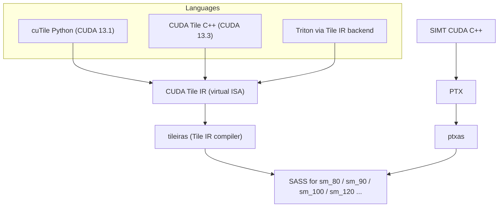
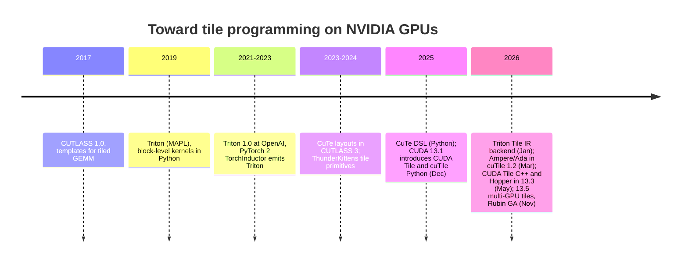
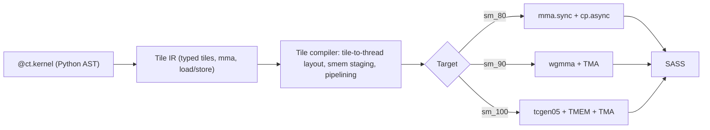

---
tags:
  - gpu-programming
  - compilers
  - cuda-tile
  - cutile
  - kernel-languages
status: complete
sources:
  - https://developer.nvidia.com/blog/simplify-gpu-programming-with-nvidia-cuda-tile-in-python
  - https://developer.nvidia.com/blog/nvidia-cuda-13-1-powers-next-gen-gpu-programming-with-nvidia-cuda-tile-and-performance-gains/
  - https://developer.nvidia.com/blog/nvidia-cuda-13-3-enhances-gpu-development-with-tile-programming-in-c-compiler-autotuning-and-python-updates/
  - https://developer.nvidia.com/blog/develop-high-performance-gpu-kernels-in-cpp-with-nvidia-cuda-tile/
  - https://developer.nvidia.com/blog/nvidia-cuda-13-5-brings-nvidia-vera-rubin-ga-support/
  - https://developer.nvidia.com/blog/advancing-gpu-programming-with-the-cuda-tile-ir-backend-for-openai-triton/
  - https://docs.nvidia.com/cuda/cuda-programming-guide/02-basics/writing-tile-kernels.html
  - https://docs.nvidia.com/cuda/cuda-compiler-driver-nvcc/tile-compilation-in-cuda.html
  - https://docs.nvidia.com/cuda/tile-ir/latest/sections/release_notes.html
  - https://docs.nvidia.com/cuda/cutile-python/generated/release_notes.html
  - https://docs.nvidia.com/cuda/cutile-python/generated/cuda.tile.mma.html
  - https://github.com/NVIDIA/cutile-python
  - https://arxiv.org/abs/2609.29067
  - https://arxiv.org/html/2609.29067
created: 2026-11-26
updated: 2026-11-26
---

## Table Of Contents

---

- [[#TL;DR|TL;DR]]
- [[#The Problem|The Problem]]
- [[#Foundations|Foundations]]
    - [[#Tiles Instead of Threads|Tiles Instead of Threads]]
    - [[#Three Layers: Model, IR, Languages|Three Layers: Model, IR, Languages]]
- [[#How We Got Here|How We Got Here]]
- [[#How It Works|How It Works]]
    - [[#Vector Add Line by Line|Vector Add Line by Line]]
    - [[#Matrix Multiply in cuTile Python|Matrix Multiply in cuTile Python]]
    - [[#CUDA Tile in C++|CUDA Tile in C++]]
    - [[#The Compiler Path|The Compiler Path]]
- [[#Where It Is Now|Where It Is Now]]
    - [[#Releases and Hardware|Releases and Hardware]]
    - [[#How Fast Is It|How Fast Is It]]
    - [[#cuTile Among Tile Languages|cuTile Among Tile Languages]]
- [[#Trade-offs & Open Problems|Trade-offs & Open Problems]]
- [[#Resources|Resources]]
- [[#Related Notes|Related Notes]]

## ***TL;DR***
---
*CUDA Tile is NVIDIA's second programming model beside SIMT: you write a kernel as operations on whole tiles of an array, and the compiler maps them to threads, shared memory, TMA and Tensor Cores. It comes as a virtual ISA (CUDA Tile IR, the tile counterpart of PTX) plus languages on top: cuTile Python since CUDA 13.1 (Dec 2025) and CUDA Tile C++ since CUDA 13.3 (May 2026).*

- **What it is:** a block-level model in the spirit of [[Triton]], but built and supported by NVIDIA inside the CUDA Toolkit. A cuTile kernel loads tiles (`ct.load`), does array math and matrix multiply-accumulate on them (`ct.mma`), and stores tiles (`ct.store`); per-thread indexing disappears.
- **Why it matters:** each recent NVIDIA generation changed the [[Tensor Cores|tensor-core]] instruction (Ampere `mma.sync`, Hopper `wgmma`, Blackwell `tcgen05`) and how data reaches it ([[TMA and Asynchronous Copies|TMA]], Tensor Memory). Tile IR moves that churn into the compiler, so the same tile kernel targets new GPUs, and NVIDIA says the tile model "abstracts away the details of using specialized hardware such as tensor cores" ([CUDA 13.1 blog](https://developer.nvidia.com/blog/nvidia-cuda-13-1-powers-next-gen-gpu-programming-with-nvidia-cuda-tile-and-performance-gains/)).
- **Where it is now (Nov 2026):** supported on Ampere, Ada, Hopper (since 13.3) and Blackwell-family GPUs, with Rubin (sm_107) formats; cuTile Python is at 1.8.1 (Nov 12, 2026). CUDA 13.5 (Nov 4, 2026) added multi-GPU tile communication over NVLink and a preview of calling SIMT library functions from tile kernels. A Triton backend can emit Tile IR instead of PTX. On performance it is still young: the 2026 TileBench study on B200 found Triton faster on 37 of 45 operators, with cuTile ahead on a small cluster of Tensor-Core/TMA-friendly kernels ([TileBench](https://arxiv.org/abs/2609.29067)).
- **Its limit:** like Triton, it hides the controls (warp roles, explicit pipelines, register budgets) that the fastest Hopper/Blackwell kernels use; for those, [[CUTLASS and CuTe]] or CuTe DSL remain the tools.

## ***The Problem***
---
*SIMT CUDA makes you program 32-thread warps and then rebuild matrix-sized operations out of them. On modern NVIDIA GPUs most of the speed sits in matrix units and copy engines that work on whole tiles, so a per-thread model is the wrong level for most AI kernels.*

Writing a fast [[Tiled Matrix Multiplication (GEMM)|GEMM]] in SIMT CUDA means choosing thread-to-element layouts, staging tiles through [[Shared Memory and Bank Conflicts|shared memory]] without bank conflicts, issuing [[TMA and Asynchronous Copies|asynchronous copies]], setting up barriers, and calling a different tensor-core instruction on each architecture. The work does not carry over: a Hopper `wgmma` kernel has to be rewritten for Blackwell's `tcgen05` and Tensor Memory.

| Approach | Who writes the thread-level details | Portable across NVIDIA generations? |
|---|---|---|
| SIMT CUDA C++ | You | No: new MMA and copy instructions each generation |
| [[CUTLASS and CuTe]] | You, with templates and layout algebra | Partly: per-architecture kernel builders |
| [[Triton]] | Compiler | Yes, but third-party and lags new hardware |
| **CUDA Tile** | NVIDIA's compiler, from a stable tile ISA | Designed to be |

The goal NVIDIA states for CUDA Tile is that the compiler handles "parallelism, memory movement, asynchrony, and other low-level details," so kernels stay portable across architectures ([CUDA 13.3 blog](https://developer.nvidia.com/blog/nvidia-cuda-13-3-enhances-gpu-development-with-tile-programming-in-c-compiler-autotuning-and-python-updates/)).

## ***Foundations***
---
*A tile is a fixed-shape chunk of an array that one block works on as a unit. CUDA Tile defines what you can do to tiles, a virtual ISA that records it, and languages that let you write it.*

### Tiles Instead of Threads

In SIMT, the grid is made of threads and each thread computes one or a few elements. In CUDA Tile, the grid is made of **tile blocks**: each block gets an index (`ct.bid(0)`), loads one or more tiles, computes on them as arrays, and stores results. The number of threads in a block and which thread holds which element are the compiler's choice.

| | SIMT CUDA | CUDA Tile |
|---|---|---|
| Unit you program | Thread | Tile block |
| Index | `blockIdx * blockDim + threadIdx` | Tile index `ct.bid(i)` |
| Data | Scalars in registers | Tiles (power-of-two shapes) |
| Matrix multiply | `mma`/`wgmma`/`tcgen05` per arch | `ct.mma` / `ct.matmul` |
| Shared memory, barriers | Manual | Compiler |
| Virtual ISA | [[PTX and SASS|PTX]] | CUDA Tile IR |

Tile shapes are compile-time constants (`ct.Constant[int]` in Python), which lets the compiler pick layouts and instructions statically. Indexing is in tile units: `index=(pid,)` with `shape=(256,)` means "the pid-th 256-element tile," not an element offset.

### Three Layers: Model, IR, Languages



NVIDIA calls Tile IR "a new virtual instruction set architecture (ISA) for programming NVIDIA GPUs" ([CUDA 13.1 blog](https://developer.nvidia.com/blog/nvidia-cuda-13-1-powers-next-gen-gpu-programming-with-nvidia-cuda-tile-and-performance-gains/)), the tile counterpart of PTX for SIMT ([cuTile Python blog](https://developer.nvidia.com/blog/simplify-gpu-programming-with-nvidia-cuda-tile-in-python)). Both paths end in the same SASS, and the CUDA Programming Guide (rewritten for CUDA 13) teaches SIMT and tile kernels side by side ([Writing Tile Kernels](https://docs.nvidia.com/cuda/cuda-programming-guide/02-basics/writing-tile-kernels.html)).

## ***How We Got Here***
---
*Triton proved in 2019-2023 that block-level kernels could reach near-expert speed with far less code. NVIDIA's answer, five years on, was to build the same idea into CUDA itself, with its own IR and long-term support.*



- **Tiles were always the real unit.** Every fast GEMM since CUTLASS 1.0 is organised around block tiles, warp tiles and MMA tiles; [[CUTLASS and CuTe]] made that explicit in C++ templates, and CuTe's layout algebra described how tiles map to threads.
- **Triton showed the model works for users.** Tillet's Triton let researchers write fused kernels in Python at a block level, and became `torch.compile`'s code generator (see [[Triton]]).
- **NVIDIA's motivation.** Hopper and Blackwell made hand-written SIMT tensor-core code much harder (asynchronous `wgmma`, TMA descriptors, `tcgen05` with Tensor Memory). A stable tile ISA lets NVIDIA change those details per generation while user kernels stay the same.
- **Dec 2025, CUDA 13.1.** NVIDIA called 13.1 "the largest and most comprehensive update to the CUDA platform since it was invented two decades ago," releasing Tile IR and cuTile Python 1.0.0 (Dec 2), with C++ promised for a later release ([CUDA 13.1 blog](https://developer.nvidia.com/blog/nvidia-cuda-13-1-powers-next-gen-gpu-programming-with-nvidia-cuda-tile-and-performance-gains/)).
- **2026.** NVIDIA released an incubator backend that compiles Triton to Tile IR ([NVIDIA, Jan 2026](https://developer.nvidia.com/blog/advancing-gpu-programming-with-the-cuda-tile-ir-backend-for-openai-triton/)); CUDA 13.3 (May 26, 2026) added CUDA Tile for C++ and Hopper (compute capability 9.0) support; CUDA 13.5 (Nov 4, 2026) brought Vera Rubin to general availability and multi-GPU tile communication ([CUDA 13.5 blog](https://developer.nvidia.com/blog/nvidia-cuda-13-5-brings-nvidia-vera-rubin-ga-support/)).

## ***How It Works***
---
*You write array code over tiles; the compiler decides threads, layouts, shared-memory staging, copies and tensor-core instructions. The two examples below show the whole surface most kernels need: load, compute, store, and mma in a loop.*

### Vector Add Line by Line

From NVIDIA's introductory post ([cuTile Python blog](https://developer.nvidia.com/blog/simplify-gpu-programming-with-nvidia-cuda-tile-in-python)):

```python
import cuda.tile as ct
import cupy as cp

@ct.kernel
def vector_add(a, b, c, tile_size: ct.Constant[int]):
    pid = ct.bid(0)                                            # which tile block am I
    a_tile = ct.load(a, index=(pid,), shape=(tile_size,))      # load tile pid of a
    b_tile = ct.load(b, index=(pid,), shape=(tile_size,))      # load tile pid of b
    result = a_tile + b_tile                                   # elementwise on tiles
    ct.store(c, index=(pid,), tile=result)                     # write tile pid of c

n, tile = 1 << 24, 1024
a, b = cp.random.rand(n, dtype=cp.float32), cp.random.rand(n, dtype=cp.float32)
c = cp.empty_like(a)
grid = (ct.cdiv(n, tile), 1, 1)
ct.launch(cp.cuda.get_current_stream(), grid, vector_add, (a, b, c, tile))
```

- **`@ct.kernel`:** marks a function to be compiled to Tile IR and then to machine code, JIT, on first launch.
- **`tile_size: ct.Constant[int]`:** a compile-time constant, so the tile shape is fixed when the kernel is specialised (like Triton's `tl.constexpr`).
- **`ct.bid(0)`:** the block index along axis 0. There is no `threadIdx`.
- **`ct.load(..., index=(pid,), shape=(tile_size,))`:** reads the `pid`-th tile of `tile_size` elements. There is no per-thread `if i < n` guard; bounds checking is on by default (a `check_bounds=False` option, added in cuTile 1.6, declares every element in range).
- **`a_tile + b_tile`:** ordinary array arithmetic on whole tiles.
- **`ct.launch(stream, grid, kernel, args)`:** launches on a CUDA stream; here CuPy supplies the arrays and the stream (see [[Numba and CuPy]]).

Install is `pip install cuda-tile[tileiras]` (which brings the `tileiras` compiler from pip), or `pip install cuda-tile` with a CUDA Toolkit 13.1+ installed; driver R580+ is required ([NVIDIA/cutile-python](https://github.com/NVIDIA/cutile-python)).

### Matrix Multiply in cuTile Python

```python
@ct.kernel
def matmul(A, B, C, tm: ct.Constant[int], tn: ct.Constant[int], tk: ct.Constant[int]):
    bx, by = ct.bid(0), ct.bid(1)                               # output tile coordinates
    acc = ct.full((tm, tn), 0, dtype=ct.float32)                # fp32 accumulator tile
    for k in range(ct.num_tiles(A, axis=1, shape=(tm, tk))):    # walk the K dimension
        a = ct.load(A, index=(bx, k), shape=(tm, tk))           # tile of A
        b = ct.load(B, index=(k, by), shape=(tk, tn))           # tile of B
        acc = ct.mma(a, b, acc)                                 # acc += a @ b on Tensor Cores
    ct.store(C, index=(bx, by), tile=acc.astype(C.dtype))       # cast and write
```

- **`ct.full`** (or `ct.zeros`) makes the accumulator tile, the form the `ct.mma` docs use ([ct.mma](https://docs.nvidia.com/cuda/cutile-python/generated/cuda.tile.mma.html)); FP32 accumulation with BF16 or FP16 inputs is the standard [[Tensor Cores|tensor-core]] recipe.
- **The loop** is the K loop of a [[Tiled Matrix Multiplication (GEMM)|tiled GEMM]]. In SIMT you would double-buffer shared memory, issue TMA or `cp.async`, and wait on barriers here; in cuTile the compiler pipelines the loads.
- **`ct.mma(a, b, acc)`** computes `(a @ b) + acc` as one operation; a `use_fast_acc` flag enables fast FP8 accumulation on Hopper. The compiler picks the architecture's tensor-core instruction (`mma.sync` on Ampere, `wgmma` on Hopper, `tcgen05.mma` on Blackwell).

**Worked example (why tile size matters).** Each loop iteration loads $tm \cdot tk + tk \cdot tn$ elements and does $2\,tm\,tn\,tk$ FLOPs. With $tm = tn = 128$, $tk = 64$ in BF16 (2 bytes):

$$I = \frac{2\cdot128\cdot128\cdot64}{2\,(128\cdot64 + 64\cdot128)} = \frac{2{,}097{,}152}{32{,}768} = 64 \text{ FLOP/byte}$$

per tile load from global memory. That is well below a B200's ridge point (hundreds of FLOP/byte, see [[Roofline Model and Arithmetic Intensity]]), so the kernel relies on L2 reuse across neighbouring blocks, and larger tiles (256×128) raise intensity at the cost of registers and shared memory. Choosing tile sizes is still your job, though cuTile 1.3 added autotuning (`tune.exhaustive_search()`), and NVIDIA's CompileIQ (CUDA 13.3) searches compiler configurations with genetic algorithms, reporting up to 15% on already-tuned Triton attention and CUTLASS GEMM kernels.

### CUDA Tile in C++

CUDA 13.3 extended the model to C++ "for high-level, tile-based kernel development" ([CUDA 13.3 blog](https://developer.nvidia.com/blog/nvidia-cuda-13-3-enhances-gpu-development-with-tile-programming-in-c-compiler-autotuning-and-python-updates/)). A tile kernel is marked `__tile_global__` and compiled by nvcc in a tile mode that emits Tile IR rather than PTX ([nvcc tile compilation](https://docs.nvidia.com/cuda/cuda-compiler-driver-nvcc/tile-compilation-in-cuda.html)). NVIDIA's walkthrough by Bentz and Scudiero (May 26, 2026) shows the same vector add ([NVIDIA](https://developer.nvidia.com/blog/develop-high-performance-gpu-kernels-in-cpp-with-nvidia-cuda-tile/)). This is a sketch of its shape:

```cpp
#include "cuda_tile.h"
namespace ct = cuda::tiles;
using namespace ct::literals;

__tile_global__ void vectorAdd(float* a, float* b, float* out, int n) {
    auto i = ct::bid();                       // which tile this block owns
    auto ta = ct::load_masked(a, i, 1024_c, n); // 1024-element tile, masked past n
    auto tb = ct::load_masked(b, i, 1024_c, n);
    ct::store_masked(out, i, ta + tb, n);     // one tile op, no per-thread index
}

// host: vectorAdd<<<BLOCKS, 1>>>(d_a, d_b, d_out, N);
```

- **`__tile_global__`:** marks a tile kernel, the C++ counterpart of `@ct.kernel`.
- **`cuda_tile.h` and `cuda::tiles`:** the tile library; `ct::literals` gives compile-time sizes such as `1024_c`.
- **`ct::bid()`:** the block index, like `ct.bid(0)` in Python.
- **`load_masked` / `store_masked`:** tile loads and stores that skip elements past `n` (plain `load`/`store` exist for exact multiples).
- **`<<<BLOCKS, 1>>>`:** the second launch argument must be 1, because the compiler, not you, picks how many threads run each block.

Build with `nvcc -std=c++20 --enable-tile -arch sm_120 -o vectorAdd vectorAdd.cu`. It needs compute capability 8.x or newer and driver R580+ (R610+ to JIT code built with 13.3). The exact argument forms of the masked calls are simplified here; check the [C++ blog](https://developer.nvidia.com/blog/develop-high-performance-gpu-kernels-in-cpp-with-nvidia-cuda-tile/) for the full signatures. The C++ form lets existing CUDA codebases add tile kernels without a Python dependency.

### The Compiler Path



The key design choice is that Tile IR keeps **tile-level semantics** (a load of a 128×64 tile, an mma of two tiles) all the way to the backend. PTX, by contrast, already fixes thread-level layouts, so a PTX-level compiler cannot change how work is split. Keeping tiles visible is what lets NVIDIA's backend choose TMA, Tensor Memory and warp roles per architecture.

## ***Where It Is Now***
---
*As of November 2026: CUDA Tile runs on Ampere, Ada, Hopper and Blackwell-family GPUs in Python and C++, with Rubin GA in CUDA 13.5. Performance is promising on GEMM-like kernels but uneven, and independent benchmarks still favour Triton on most operators.*

### Releases and Hardware

| CUDA | Date | Tile change |
|---|---|---|
| 13.1 | Dec 2025 | CUDA Tile model, Tile IR spec, cuTile Python 1.0 |
| 13.2 | Mar 2026 | cuTile 1.2: Ampere and Ada support, `ct.scan` |
| 13.3 | May 26, 2026 | CUDA Tile C++; cuTile 1.4: Hopper (CC 9.0), block-scaled MMA, JAX; CompileIQ |
| 13.4 | Sep 2026 | cuTile 1.6: [[Programmatic Dependent Launch]], bounds checks on by default |
| 13.5 | Nov 4, 2026 | Vera Rubin GA; multi-GPU tile communication; Tile-SIMT interop preview; cuTile 1.8 |

Sources: [13.1 blog](https://developer.nvidia.com/blog/nvidia-cuda-13-1-powers-next-gen-gpu-programming-with-nvidia-cuda-tile-and-performance-gains/), [13.3 blog](https://developer.nvidia.com/blog/nvidia-cuda-13-3-enhances-gpu-development-with-tile-programming-in-c-compiler-autotuning-and-python-updates/), [13.5 blog](https://developer.nvidia.com/blog/nvidia-cuda-13-5-brings-nvidia-vera-rubin-ga-support/), [Tile IR release notes](https://docs.nvidia.com/cuda/tile-ir/latest/sections/release_notes.html), [cuTile Python release notes](https://docs.nvidia.com/cuda/cutile-python/release_notes.html).

At launch cuTile supported only Blackwell-family GPUs (compute capability 10.x and 12.x); Ampere and Ada (8.x) came with 1.2.0 in March 2026 and Hopper (9.0) with 1.4.0 in May ([cuTile Python release notes](https://docs.nvidia.com/cuda/cutile-python/release_notes.html)).

### How Fast Is It

- **TileBench (Cui et al., Sep 2026)** compared tile languages on B200 under controlled conditions. Triton was faster on 37 of 45 operators and cuTile on 8; the two were within 5% on 14 and within 10% on 17. cuTile won on Tensor-Core and TMA-friendly kernels, Triton on irregular, streaming and bandwidth-bound ones. Even after autotuning only 7 Triton and 5 cuTile kernels reached 80% of roofline, and the authors conclude "most kernels remain far from roofline limits" ([TileBench](https://arxiv.org/abs/2609.29067)).
- **Triton on Tile IR.** NVIDIA's backend lets existing Triton kernels reach Blackwell features through Tile IR instead of Triton's own PTX lowering; it is an incubator project enabled with `ENABLE_TILE=1` (see [[Triton]]).
- **Where tiles win.** GEMM-shaped kernels with regular tiles map best, since `ct.mma` and TMA lowering are the parts NVIDIA has tuned most. Irregular kernels (gathers, sorting, sparse) still fit SIMT better.

### cuTile Among Tile Languages

| Language | Owner | Level | Targets |
|---|---|---|---|
| **cuTile Python / C++** | NVIDIA | Tile arrays, compiler picks threads | NVIDIA only |
| [[Triton]] | OpenAI and community | Blocks, compiler picks threads | NVIDIA, AMD, Intel |
| CuTe DSL ([[CUTLASS and CuTe]]) | NVIDIA | Explicit layouts, warp roles, TMEM | NVIDIA |
| Gluon | Triton project | Explicit layouts within Triton | NVIDIA, AMD |
| [[ThunderKittens and Tile DSLs|ThunderKittens]] | Hazy Research | C++ tile primitives, warp-level control | NVIDIA, AMD (HipKittens) |
| TileLang | Peking University / community | Python tiles with optional low-level control | NVIDIA, AMD |

cuTile is NVIDIA's productivity layer; CuTe DSL is its control layer. Most teams use both: tiles for most kernels, CuTe for the handful that must hit peak.

## ***Trade-offs & Open Problems***
---
*CUDA Tile trades control for portability and short code, like Triton, with the backing of the hardware vendor. Whether its compiler can match hand-tuned Blackwell kernels, and whether a vendor-locked tile language wins users from portable Triton, are open.*

| Strength | Cost |
|---|---|
| Same kernel across Ampere, Hopper, Blackwell, Rubin | NVIDIA only |
| NVIDIA-supported, in the CUDA Toolkit | Young: fewer kernels, examples and users than Triton |
| Tile IR keeps tile semantics for the backend | Hides warp roles, pipelines, register budgets |
| Python and C++ front ends | Tile shapes and grid still chosen by hand |
| Triton can target it | Two IR paths (PTX and Tile IR) to debug |

- **Performance gap.** TileBench's result that Triton still beats cuTile on most operators says the compiler is not yet as mature as Triton's; peak Blackwell kernels ([[Warp Specialization|warp-specialized]], deeply pipelined) remain CuTe territory.
- **Portability vs. lock-in.** Tile IR is portable across NVIDIA generations, which is exactly what it was built for, but not across vendors. Triton's pitch is the reverse.
- **Debugging and profiling.** A tile kernel's SASS is far from its source; NVIDIA ships tile-aware developer tools, and [[Profiling with Nsight Compute and Nsight Systems|Nsight]] reports at the SASS level.
- **Coverage.** Collectives, sparse and irregular access patterns arrived later or not at all; multi-GPU tile communication only landed in 13.5.

## ***Resources***
---
*Read the cuTile Python introduction and the "Writing Tile Kernels" chapter of the CUDA Programming Guide, then the C++ post. TileBench is the best independent check on performance.*

**Primary**
- [Simplify GPU Programming with NVIDIA CUDA Tile in Python](https://developer.nvidia.com/blog/simplify-gpu-programming-with-nvidia-cuda-tile-in-python), NVIDIA, Dec 2025.
- [CUDA 13.1 powers next-gen GPU programming with CUDA Tile](https://developer.nvidia.com/blog/nvidia-cuda-13-1-powers-next-gen-gpu-programming-with-nvidia-cuda-tile-and-performance-gains/), NVIDIA, Dec 2025.
- [CUDA 13.3: tile programming in C++, compiler autotuning](https://developer.nvidia.com/blog/nvidia-cuda-13-3-enhances-gpu-development-with-tile-programming-in-c-compiler-autotuning-and-python-updates/), NVIDIA, May 2026.
- [Develop high-performance GPU kernels in C++ with CUDA Tile](https://developer.nvidia.com/blog/develop-high-performance-gpu-kernels-in-cpp-with-nvidia-cuda-tile/), Bentz and Scudiero, NVIDIA, May 2026.
- [cuTile Python release notes](https://docs.nvidia.com/cuda/cutile-python/release_notes.html), NVIDIA: what each version added.
- [CUDA Programming Guide: Writing Tile Kernels](https://docs.nvidia.com/cuda/cuda-programming-guide/02-basics/writing-tile-kernels.html) and [Tile IR specification](https://docs.nvidia.com/cuda/tile-ir/latest/sections/release_notes.html).
- [NVIDIA/cutile-python](https://github.com/NVIDIA/cutile-python): source and samples (matmul, attention, MoE).

**Independent**
- [TileBench](https://arxiv.org/abs/2609.29067), Cui et al., Sep 2026: controlled benchmark of tile languages on B200.

## ***Related Notes***

- [[Triton]] — The block-level model CUDA Tile follows; can compile to Tile IR.
- [[CUTLASS and CuTe]] — NVIDIA's control-side tile tools (CuTe DSL).
- [[PTX and SASS]] — The SIMT virtual ISA that Tile IR sits beside.
- [[CUDA Programming Model]] — The SIMT model CUDA Tile complements.
- [[Tiled Matrix Multiplication (GEMM)]] — What `ct.mma` in a K loop implements.
- [[Tensor Cores]] — The hardware `ct.mma` targets on each generation.
- [[TMA and Asynchronous Copies]] — Copies the tile compiler issues for you.
- [[Warp Specialization]] — What the compiler must do automatically to match hand kernels.
- [[ThunderKittens and Tile DSLs]] — Other tile-level languages.
- [[Numba and CuPy]] — Python GPU arrays used with cuTile's launch API.
- [[Memory Coalescing]] — Handled by tile loads.
- [[Roofline Model and Arithmetic Intensity]] — The tile-size arithmetic above.
- [[Low-Precision Formats - FP8, FP4 and MX|Low-Precision Formats: FP8, FP4 and MX]] — The FP8 and block-scaled formats cuTile's `ct.mma` accepts.
- [[Multi-GPU Communication - NVLink and NCCL|Multi-GPU Communication: NVLink and NCCL]] — The links CUDA 13.5's multi-GPU tile communication uses.
