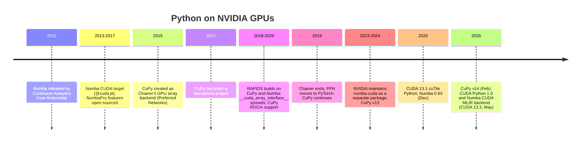

---
tags:
  - gpu-programming
  - compilers
  - python
  - numba
  - cupy
status: draft
sources:
  - https://numba.readthedocs.io/en/stable/release/0.63.0-notes.html
  - https://numba.readthedocs.io/en/stable/reference/deprecation.html
  - https://nvidia.github.io/numba-cuda/
  - https://github.com/NVIDIA/numba-cuda-mlir/releases/tag/v0.6.1
  - https://pypi.org/project/numba-cuda-mlir/
  - https://developer.nvidia.com/blog/nvidia-cuda-13-3-enhances-gpu-development-with-tile-programming-in-c-compiler-autotuning-and-python-updates/
  - https://www.preferred.jp/en/news/pr20260219
  - https://medium.com/cupy-team/announcing-cupy-v14-e8515ec05fca
  - https://docs.cupy.dev/en/stable/
  - https://docs.cupy.dev/en/stable/user_guide/kernel.html
  - https://docs.cupy.dev/en/stable/user_guide/interoperability.html
  - https://rocm.blogs.amd.com/artificial-intelligence/cupy-v13/README.html
  - https://en.wikipedia.org/wiki/Numba
  - https://en.wikipedia.org/wiki/CuPy
  - https://developer.nvidia.com/blog/simplify-gpu-programming-with-nvidia-cuda-tile-in-python
created: 2026-11-26
updated: 2026-11-26
---

## Table Of Contents

---

- [[#TL;DR|TL;DR]]
- [[#The Problem|The Problem]]
- [[#Foundations|Foundations]]
    - [[#Two Different Tools|Two Different Tools]]
    - [[#Sharing Arrays Without Copies|Sharing Arrays Without Copies]]
- [[#How We Got Here|How We Got Here]]
- [[#How It Works|How It Works]]
    - [[#A Numba CUDA Kernel Line by Line|A Numba CUDA Kernel Line by Line]]
    - [[#CuPy: Array Code on the GPU|CuPy: Array Code on the GPU]]
    - [[#CuPy Custom Kernels|CuPy Custom Kernels]]
    - [[#Why Fusion Matters Here|Why Fusion Matters Here]]
- [[#Where It Is Now|Where It Is Now]]
    - [[#Numba in 2026|Numba in 2026]]
    - [[#CuPy in 2026|CuPy in 2026]]
    - [[#The Python GPU Stack|The Python GPU Stack]]
- [[#Trade-offs & Open Problems|Trade-offs & Open Problems]]
- [[#Resources|Resources]]
- [[#Related Notes|Related Notes]]

## ***TL;DR***
---
*Numba and CuPy are the two oldest ways to use NVIDIA GPUs from Python. Numba compiles Python functions into CUDA kernels you write thread by thread; CuPy is a NumPy-compatible array library whose operations run as GPU kernels, with escape hatches for custom CUDA. Together they cover "write my own kernel" and "run my NumPy code on the GPU."*

- **Numba** (Anaconda, 2012) is a JIT compiler for numerical Python built on LLVM. Its `@cuda.jit` decorator turns a Python function into a [[CUDA Programming Model|SIMT CUDA kernel]] with `threadIdx`, `blockIdx`, shared memory and atomics. The CUDA target now lives in NVIDIA's separately maintained **numba-cuda** package; the built-in `numba.cuda` was deprecated in its favour ([deprecation notices](https://numba.readthedocs.io/en/stable/reference/deprecation.html)).
- **CuPy** (Preferred Networks, 2015) implements most of the NumPy and SciPy APIs on the GPU, calling cuBLAS, cuFFT, cuSPARSE and its own generated kernels. Change `import numpy as np` to `import cupy as cp` and much code runs unchanged. It also runs on AMD through ROCm.
- **Why they matter:** they are how scientists, data engineers and educators use GPUs without C++. They also share arrays with PyTorch, JAX and RAPIDS without copies through `__cuda_array_interface__` and DLPack.
- **Where they are now (Nov 2026):** CuPy v14 (Feb 19, 2026) adopted NumPy 2 semantics, added bfloat16 and installs CUDA from pip wheels ([CuPy v14](https://medium.com/cupy-team/announcing-cupy-v14-e8515ec05fca)). CUDA 13.3 (May 2026) introduced a Numba CUDA MLIR backend as a drop-in replacement for `numba.cuda` ([CUDA 13.3 blog](https://developer.nvidia.com/blog/nvidia-cuda-13-3-enhances-gpu-development-with-tile-programming-in-c-compiler-autotuning-and-python-updates/)). For AI kernels, most new Python work has moved to tile languages ([[Triton]], [[CUDA Tile and cuTile|cuTile]]).

## ***The Problem***
---
*Python is the language of science and ML, but CUDA is C++. Before these tools, using a GPU from Python meant writing C++ extensions or waiting for someone else to write the kernel.*

Two kinds of Python user want a GPU:

| User | Wants | Tool |
|---|---|---|
| Has NumPy/SciPy code, wants it faster | Same API, GPU underneath | **CuPy** |
| Needs an algorithm no library has (a custom stencil, a Monte Carlo step, a particle update) | Write the kernel in Python | **Numba** (`@cuda.jit`), or CuPy's raw kernels |

Both face the same obstacles: Python itself is slow, so all real work must happen in compiled GPU code; data must stay on the GPU between steps to avoid PCIe copies; and small operations pay launch overhead that C++ code can hide with fusion or [[CUDA Graphs]].

## ***Foundations***
---
*Numba compiles your Python function; CuPy runs library functions on GPU arrays. Both produce ordinary CUDA kernels, and both use the same array-sharing protocols so you can mix them.*

### Two Different Tools

| | Numba (`@cuda.jit`) | CuPy |
|---|---|---|
| Model | Write SIMT kernels in a Python subset | Call NumPy-style array functions |
| Compiles | Python bytecode → Numba IR → LLVM IR → NVVM → PTX | Kernels generated from templates and compiled with NVRTC at first use; libraries for BLAS/FFT |
| You control | Threads, blocks, shared memory, atomics | Mostly nothing below the array API (unless you write raw kernels) |
| Typical use | Custom algorithms, teaching CUDA | Drop-in NumPy acceleration, RAPIDS-style data work |
| Vendors | NVIDIA (numba-cuda); AMD support was dropped years ago | NVIDIA (CUDA) and AMD (ROCm) |

Numba's CUDA compiler takes a typed subset of Python (numbers, NumPy arrays, tuples, simple control flow), infers types at first call, and generates [[PTX and SASS|PTX]] through NVIDIA's NVVM, the same LLVM-based optimizer nvcc uses.

### Sharing Arrays Without Copies

A Python GPU program usually mixes libraries: CuPy for preprocessing, a Numba kernel for a custom step, PyTorch for a model. Two protocols let them pass device pointers instead of copying:

- **`__cuda_array_interface__`**: a dictionary (pointer, shape, strides, type) that Numba defined and CuPy, PyTorch, RAPIDS and others implement.
- **DLPack**: a cross-framework tensor exchange standard (`cp.from_dlpack(torch_tensor)`), also used by JAX and NumPy 2.

Both are zero-copy: the receiving library wraps the same GPU memory. The catch is streams: if the producer's kernel is still running on its stream, the consumer must synchronise or share the stream (see [[Streams, Events and Async Execution]]).

## ***How We Got Here***
---
*Numba began as a CPU JIT for NumPy loops and added CUDA early; CuPy began as the array backend of a deep learning framework and outlived it. Since 2023 NVIDIA has taken over Numba's CUDA target and built a broader official Python stack around both.*



- **Numba.** Released in 2012 by Continuum Analytics (later Anaconda) to compile NumPy-heavy loops with LLVM; a CUDA target followed, first in the commercial NumbaPro and then open-sourced. It became the standard way to teach CUDA concepts in Python ([Wikipedia](https://en.wikipedia.org/wiki/Numba)).
- **CuPy.** Built in 2015 at Preferred Networks as the GPU array library for the Chainer framework, split out as its own project, and kept going after Chainer was retired in favour of PyTorch ([Wikipedia](https://en.wikipedia.org/wiki/CuPy), [PFN, Feb 2026](https://www.preferred.jp/en/news/pr20260219)).
- **RAPIDS and interop.** NVIDIA's RAPIDS data-science libraries built on both, and `__cuda_array_interface__` let the Python GPU ecosystem share memory instead of copying.
- **NVIDIA takes ownership.** The CUDA target was split from Numba's core into NVIDIA's `numba-cuda` package, and the built-in target deprecated ([deprecation notices](https://numba.readthedocs.io/en/stable/reference/deprecation.html)). NVIDIA's own Python stack (`cuda.core`, `cuda.compute`, `cuda.coop`, cuTile) grew around it.

## ***How It Works***
---
*Numba gives you the CUDA programming model in Python syntax; CuPy gives you NumPy with GPU kernels behind it. The main performance rule for both is the same: keep data on the GPU and do enough work per kernel launch.*

### A Numba CUDA Kernel Line by Line

```python
from numba import cuda
import numpy as np

@cuda.jit
def saxpy(a, x, y, out):
    i = cuda.grid(1)              # global thread index: blockIdx.x*blockDim.x + threadIdx.x
    if i < x.size:                # guard the last, partial block
        out[i] = a * x[i] + y[i]  # one element per thread

n = 1 << 24
d_x = cuda.to_device(np.random.rand(n).astype(np.float32))   # host -> device copy
d_y = cuda.to_device(np.random.rand(n).astype(np.float32))
d_out = cuda.device_array_like(d_x)                          # uninitialised device array
threads = 256
blocks = (n + threads - 1) // threads
saxpy[blocks, threads](np.float32(2.0), d_x, d_y, d_out)     # launch: kernel[grid, block](args)
result = d_out.copy_to_host()                                # device -> host copy
```

- **`@cuda.jit`:** compile this function for the GPU at first call, specialised on the argument types it sees (float32 arrays here).
- **`cuda.grid(1)`:** shorthand for the global 1D thread index, exactly as in the [[CUDA Programming Model]].
- **`if i < x.size`:** the usual tail guard; 2²⁴ is a multiple of 256, but real sizes rarely are.
- **`cuda.to_device`, `device_array_like`:** explicit allocation and copy. Passing NumPy host arrays directly also works, but Numba then copies them in and out on every call, a common performance trap.
- **`saxpy[blocks, threads](...)`:** Numba's launch syntax, the Python form of `<<<blocks, threads>>>`.

The same kernel language has `cuda.shared.array` for [[Shared Memory and Bank Conflicts|shared memory]], `cuda.syncthreads()`, `cuda.atomic.add` and warp intrinsics, so classic CUDA examples (a [[Parallel Reduction and Scan|reduction]], a [[Tiled Matrix Multiplication (GEMM)|tiled matmul]]) translate line for line. What it lacks is access to the newest hardware paths ([[Tensor Cores]] via `wgmma`/`tcgen05`, [[TMA and Asynchronous Copies|TMA]]), which is why AI kernels use tile languages instead.

### CuPy: Array Code on the GPU

```python
import cupy as cp

x = cp.random.rand(1 << 24, dtype=cp.float32)   # allocated on the current GPU
y = cp.random.rand(1 << 24, dtype=cp.float32)
z = 2.0 * x + y                                  # runs as GPU kernels
s = cp.linalg.norm(z)                            # cuBLAS / reduction kernel
print(float(s))                                  # sync and copy one scalar back
```

- **`cp.random.rand`:** allocates directly in GPU memory through CuPy's memory pool, which caches freed blocks to avoid slow `cudaMalloc` calls.
- **`2.0 * x + y`:** each operator launches an elementwise kernel. CuPy generates the kernel source for each (operation, dtype) pair, compiles it with NVRTC the first time and caches the binary.
- **`cp.linalg.norm`:** dispatched to a library or reduction kernel. Matrix multiply goes to cuBLAS, FFTs to cuFFT, sparse to cuSPARSE.
- **`float(s)`:** the only point where the CPU waits for the GPU; everything before was queued asynchronously on the current stream.

### CuPy Custom Kernels

When the array API is not enough, CuPy offers three levels ([CuPy kernels guide](https://docs.cupy.dev/en/stable/user_guide/kernel.html)):

| API | You write | Example |
|---|---|---|
| `ElementwiseKernel` | One element's C++ expression; CuPy writes the loop | `'z = a * x + y'` |
| `ReductionKernel` | Map, reduce and post-map expressions | Sum of squares |
| `RawKernel` / `RawModule` | A full CUDA C++ kernel as a string | Anything nvcc accepts |
| `@cupyx.jit.rawkernel` | A kernel in Python syntax (Numba-like) | Experimental |

```python
saxpy = cp.ElementwiseKernel(
    'float32 a, float32 x, float32 y',   # inputs with types
    'float32 z',                         # output
    'z = a * x + y',                     # per-element body (C++)
    'saxpy')                             # kernel name
z = saxpy(cp.float32(2.0), x, y)
```

This compiles one fused kernel instead of the two that `2.0 * x + y` launches. CuPy also offers `cp.fuse` to fuse a Python function of array operations automatically.

### Why Fusion Matters Here

**Worked example.** For $n = 10^8$ float32 elements on an H100 SXM (about 3.35 TB/s of HBM bandwidth), `z = 2.0 * x + y` as plain CuPy runs two kernels:

| Kernel | Reads | Writes | Bytes |
|---|---|---|---|
| `t = 2.0 * x` | $x$ (0.4 GB) | $t$ (0.4 GB) | 0.8 GB |
| `z = t + y` | $t, y$ (0.8 GB) | $z$ (0.4 GB) | 1.2 GB |
| **Total** | | | **2.0 GB** |

A fused `ElementwiseKernel` reads $x$ and $y$ and writes $z$ once: 1.2 GB. At 3.35 TB/s that is about 0.60 ms unfused versus 0.36 ms fused, a 1.67× difference that comes entirely from memory traffic, since both are far below the [[Roofline Model and Arithmetic Intensity|roofline ridge]]. Longer expression chains widen the gap. This is the same argument as [[Kernel Fusion]], and why `cp.fuse` and `ElementwiseKernel` exist.

For small arrays the bottleneck flips to launch and Python overhead (several microseconds per operation), which is where [[CUDA Graphs]] or a single custom kernel help.

## ***Where It Is Now***
---
*As of November 2026: both projects are healthy and NVIDIA-backed. Numba's CUDA target is NVIDIA's numba-cuda with a new MLIR backend; CuPy v14 is current. For new AI kernels, though, the Python center of gravity is tile languages.*

### Numba in 2026

- **Core Numba** 0.63.0 shipped Dec 8, 2025 ([release notes](https://numba.readthedocs.io/en/stable/release/0.63.0-notes.html)). The built-in CUDA target is deprecated in favour of the `numba-cuda` package ([deprecation notices](https://numba.readthedocs.io/en/stable/reference/deprecation.html)).
- **numba-cuda** is maintained by NVIDIA and installed separately (`pip install numba-cuda`); existing `from numba import cuda` code keeps working once it is installed ([numba-cuda docs](https://nvidia.github.io/numba-cuda/)).
- **Numba CUDA MLIR backend.** CUDA 13.3 (May 2026) introduced it as "a drop-in replacement for `numba.cuda`" built on MLIR rather than Numba's older lowering ([CUDA 13.3 blog](https://developer.nvidia.com/blog/nvidia-cuda-13-3-enhances-gpu-development-with-tile-programming-in-c-compiler-autotuning-and-python-updates/)); it ships as `numba-cuda-mlir`, at v0.6.x by late 2026 ([releases](https://github.com/NVIDIA/numba-cuda-mlir/releases/tag/v0.6.1)).

### CuPy in 2026

- **CuPy v14** (Feb 19, 2026): NumPy v2 semantics (type promotion and API changes), bfloat16 support, and installation with CUDA libraries from pip wheels instead of a system toolkit ([CuPy v14](https://medium.com/cupy-team/announcing-cupy-v14-e8515ec05fca), [PFN](https://www.preferred.jp/en/news/pr20260219)). The 14.2 line is the stable release in late 2026.
- **AMD:** CuPy has ROCm builds; AMD documents "plug-and-play" CuPy on Instinct GPUs ([AMD ROCm blog](https://rocm.blogs.amd.com/artificial-intelligence/cupy-v13/README.html)). See [[ROCm and HIP]].
- **As a substrate.** NVIDIA's own cuTile examples use CuPy arrays and streams to launch tile kernels ([cuTile Python blog](https://developer.nvidia.com/blog/simplify-gpu-programming-with-nvidia-cuda-tile-in-python)).

### The Python GPU Stack

| Layer | Tools (late 2026) | When to use |
|---|---|---|
| Arrays | CuPy, PyTorch, JAX, cuPyNumeric | NumPy-style code |
| SIMT kernels in Python | numba-cuda (+ MLIR backend), `cupyx.jit` | Custom non-tensor-core algorithms, teaching |
| Tile kernels | [[Triton]], [[CUDA Tile and cuTile|cuTile]], CuTe DSL, [[ThunderKittens and Tile DSLs|Gluon/Helion/Pallas]] | AI kernels needing Tensor Cores and TMA |
| Device-wide algorithms | `cuda.compute` (reduce, scan, sort), `cuda.coop` (block/warp primitives) | [[Parallel Reduction and Scan]] without writing it |
| Runtime and drivers | `cuda.core` / CUDA Python 1.0 | Streams, memory, launches from Python |

## ***Trade-offs & Open Problems***
---
*Numba and CuPy make GPUs easy from Python but stop short of the newest hardware. The open questions are how they coexist with tile languages and whether NumPy-style eager execution can avoid its memory-traffic and launch-overhead costs.*

| Strength | Cost |
|---|---|
| CuPy runs NumPy code with an import change | Each operator is a kernel: extra memory traffic unless fused |
| Numba teaches and expresses the full SIMT model | No Tensor Core (`wgmma`/`tcgen05`) or TMA access |
| Zero-copy interop via CUDA Array Interface and DLPack | Stream synchronisation across libraries is easy to get wrong |
| CuPy works on NVIDIA and AMD | numba-cuda is NVIDIA-only |
| JIT at first call | First-call compile latency; type-specialisation surprises |

- **Below the tensor-core line.** Numba exposes threads, not tiles. Fast matmuls and attention need Hopper/Blackwell asynchronous paths that only tile languages and C++ libraries reach, so Numba remains for everything else (stencils, simulations, irregular algorithms).
- **Eager vs. compiled.** CuPy's eager model pays one kernel and one memory round trip per operation. `cp.fuse`, `ElementwiseKernel` and graph capture help; whole-program compilers (JAX's XLA, `torch.compile`) do it automatically, which is CuPy's competitive pressure.
- **Packaging churn.** NumPy 2 semantics, the numba-cuda split and the MLIR backend all changed in 2024-2026; older tutorials may install the wrong package or rely on deprecated APIs.

## ***Resources***
---
*For Numba, the numba-cuda docs cover the kernel API; for CuPy, the user guide's kernel and interoperability chapters are the most useful. The CuPy v14 announcement summarises current behaviour.*

**Numba**
- [numba-cuda documentation](https://nvidia.github.io/numba-cuda/), NVIDIA.
- [Numba deprecation notices](https://numba.readthedocs.io/en/stable/reference/deprecation.html) and [0.63.0 release notes](https://numba.readthedocs.io/en/stable/release/0.63.0-notes.html).
- [NVIDIA/numba-cuda-mlir releases](https://github.com/NVIDIA/numba-cuda-mlir/releases/tag/v0.6.1).

**CuPy**
- [CuPy documentation](https://docs.cupy.dev/en/stable/), especially [user-defined kernels](https://docs.cupy.dev/en/stable/user_guide/kernel.html) and [interoperability](https://docs.cupy.dev/en/stable/user_guide/interoperability.html).
- [Announcing CuPy v14](https://medium.com/cupy-team/announcing-cupy-v14-e8515ec05fca), Feb 2026.

**Context**
- [CUDA 13.3 blog](https://developer.nvidia.com/blog/nvidia-cuda-13-3-enhances-gpu-development-with-tile-programming-in-c-compiler-autotuning-and-python-updates/): CUDA Python 1.0 and the Numba MLIR backend.

## Related Notes

- [[CUDA Programming Model]] — What `@cuda.jit` kernels express.
- [[Kernel Fusion]] — Why CuPy's `ElementwiseKernel` and `cp.fuse` pay off.
- [[Triton]] — The Python tile language most AI kernels now use.
- [[CUDA Tile and cuTile]] — NVIDIA's Python tile language, launched with CuPy arrays.
- [[Streams, Events and Async Execution]] — Stream rules when sharing arrays across libraries.
- [[CUDA Graphs]] — Cutting per-launch overhead for many small operations.
- [[PTX and SASS]] — What Numba's NVVM path emits.
- [[Parallel Reduction and Scan]] — Classic kernels to write in Numba, or call from `cuda.compute`.
- [[Shared Memory and Bank Conflicts]] — `cuda.shared.array` in Numba.
- [[Roofline Model and Arithmetic Intensity]] — The bandwidth arithmetic above.
- [[ROCm and HIP]] — CuPy's AMD backend.
