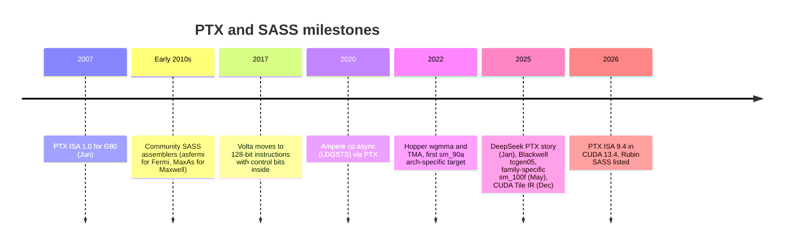
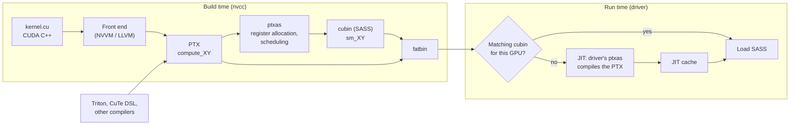

---
tags:
  - gpu-programming
  - cuda
  - compilers
  - ptx
  - sass
status: complete
sources:
  - https://docs.nvidia.com/cuda/parallel-thread-execution
  - https://www.doc.ic.ac.uk/~wl/teachlocal/arch/papers/nvidia-PTX_ISA_1.0.pdf
  - https://developer.nvidia.com/blog/understanding-ptx-the-assembly-language-of-cuda-gpu-computing
  - https://docs.nvidia.com/cuda/cuda-programming-guide/01-introduction/cuda-platform.html
  - https://docs.nvidia.com/cuda/archive/13.2.0/cuda-compiler-driver-nvcc/index.html
  - https://docs.nvidia.com/cuda/archive/13.4.3/cuda-binary-utilities/index.html
  - https://docs.nvidia.com/cuda/archive/13.4.2/inline-ptx-assembly/index.html
  - https://developer.nvidia.com/blog/nvidia-blackwell-and-nvidia-cuda-12-9-introduce-family-specific-architecture-features/
  - https://developer.nvidia.com/blog/focus-on-your-algorithm-nvidia-cuda-tile-handles-the-hardware
  - https://arxiv.org/abs/1804.06826
  - https://people.cs.rutgers.edu/zz124/assets/pdf/cgo19.pdf
  - https://newsletter.semianalysis.com/p/dissecting-nvidia-blackwell-tensor
  - https://forums.developer.nvidia.com/t/ptxas-mysterious-warning-for-wgmma-mma-async-instruction-serialization/340610
  - https://github.com/deepseek-ai/DeepEP
  - https://www.tomshardware.com/tech-industry/artificial-intelligence/deepseeks-ai-breakthrough-bypasses-industry-standard-cuda-uses-assembly-like-ptx-programming-instead
created: 2026-11-26
updated: 2026-11-26
---

## Table Of Contents

---

- [[#TL;DR|TL;DR]]
- [[#The Problem|The Problem]]
- [[#Foundations|Foundations]]
    - [[#The Two Levels|The Two Levels]]
    - [[#Compute Capability and Targets|Compute Capability and Targets]]
    - [[#What PTX Looks Like|What PTX Looks Like]]
    - [[#What SASS Looks Like|What SASS Looks Like]]
- [[#How We Got Here|How We Got Here]]
- [[#How It Works|How It Works]]
    - [[#The Compilation Pipeline|The Compilation Pipeline]]
    - [[#One Kernel at Three Levels|One Kernel at Three Levels]]
    - [[#Fatbins and the Loader's Choice|Fatbins and the Loader's Choice]]
    - [[#Architecture-Specific and Family-Specific PTX|Architecture-Specific and Family-Specific PTX]]
    - [[#Inline PTX|Inline PTX]]
    - [[#Inside a SASS Instruction|Inside a SASS Instruction]]
    - [[#PTX to SASS on Modern GPUs|PTX to SASS on Modern GPUs]]
    - [[#Tools for Reading the Levels|Tools for Reading the Levels]]
- [[#Where It Is Now|Where It Is Now]]
- [[#Trade-offs & Open Problems|Trade-offs & Open Problems]]
- [[#Resources|Resources]]
- [[#Related Notes|Related Notes]]

## ***TL;DR***
---
*CUDA code is compiled twice: first to PTX, a documented, portable "virtual assembly" for NVIDIA GPUs, then to SASS, the real, undocumented machine code of one specific GPU generation. PTX is what you write by hand when C++ can't reach a hardware feature; SASS is what you read when you want to know what the GPU actually runs.*

- **PTX (Parallel Thread Execution)** is a virtual instruction set. It has unlimited typed virtual registers, explicit memory "state spaces" (global, shared, local, ...) and stays stable across GPU generations. NVIDIA documents it in full: the PTX ISA is at version 9.4 as of CUDA 13.4 ([PTX ISA](https://docs.nvidia.com/cuda/parallel-thread-execution)).
- **SASS** (from "Streaming ASSembler") is the real instruction set of one GPU generation. It has a fixed register file, scheduling hints baked into each instruction, and changes every generation. NVIDIA publishes only opcode lists, not encodings ([CUDA Binary Utilities](https://docs.nvidia.com/cuda/archive/13.4.3/cuda-binary-utilities/index.html)).
- **ptxas** turns PTX into SASS: it allocates real registers, schedules instructions and sets the control bits. It runs either at build time (`nvcc`) or at run time inside the driver, which JIT-compiles embedded PTX for GPUs that did not exist when the program was built ([CUDA Programming Guide §1.3](https://docs.nvidia.com/cuda/cuda-programming-guide/01-introduction/cuda-platform.html)).
- **Why it matters for performance:** the newest [[Tensor Cores]] and copy engines ([[TMA and Asynchronous Copies|TMA]], Hopper `wgmma`, Blackwell `tcgen05`) are reached through PTX instructions that CUDA C++ does not expose directly, so [[CUTLASS and CuTe]], [[Triton]], [[FlashAttention]] and DeepSeek's kernels all drop to PTX. Those PTX instructions are tied to one exact GPU (`sm_90a`, `sm_100a`) or one GPU family (`sm_100f`) and give up forward compatibility.
- **Where it is now (Nov 2026):** PTX 9.4 / CUDA 13.4 add `sm_107` targets; the binary-utilities docs list Blackwell and Rubin SASS; and since CUDA 13.1 (Dec 2025) NVIDIA has a second virtual ISA, **CUDA Tile IR**, that sits beside PTX for tile-based programs ([NVIDIA, Dec 2025](https://developer.nvidia.com/blog/focus-on-your-algorithm-nvidia-cuda-tile-handles-the-hardware)).

## ***The Problem***
---
*Every NVIDIA GPU generation has a different machine instruction set, but programs and libraries must keep running for years across many generations. PTX is NVIDIA's answer: a stable target that compilers aim at, with the last step to real hardware done as late as possible.*

A CPU vendor like Intel keeps x86 binary-compatible for decades, so a compiled program just runs on the next chip. NVIDIA chose the opposite: it redesigns the machine instruction set freely each generation to fit new hardware (different register banks, new [[Tensor Cores]], new scheduling rules). The [[CUDA Programming Model|CUDA]] guide is blunt about it: "NVIDIA GPUs are not binary compatible between major compute capability versions" ([CUDA Programming Guide §1.3.4](https://docs.nvidia.com/cuda/cuda-programming-guide/01-introduction/cuda-platform.html)).

That creates three needs at once:

| Need | Who needs it | What PTX provides |
|---|---|---|
| Run old binaries on new GPUs | Every app and library vendor | PTX embedded in the binary is JIT-compiled by the driver for any newer GPU |
| One target for many compilers | `nvcc`, Clang, [[Triton]], CuTe DSL, Julia, Numba | A documented, machine-independent ISA to emit |
| Reach hardware features C++ can't express | Kernel authors ([[CUTLASS and CuTe]], [[FlashAttention]]) | Hand-written or inline PTX for `wgmma`, TMA, `tcgen05`, special loads |

The 2007 PTX 1.0 manual already stated the goal: "a stable ISA that spans multiple GPU generations", with "performance in compiled applications comparable to native GPU performance" ([PTX ISA 1.0](https://www.doc.ic.ac.uk/~wl/teachlocal/arch/papers/nvidia-PTX_ISA_1.0.pdf); the same goals still open the current manual, [PTX ISA](https://docs.nvidia.com/cuda/parallel-thread-execution)).

The cost of the design: the code that actually runs (SASS) is not what anyone writes, and its encoding is secret. "Most details of SASS are kept secret," as the Rutgers team that reverse-engineered it put it ([Hayes et al., CGO 2019](https://people.cs.rutgers.edu/zz124/assets/pdf/cgo19.pdf)).

## ***Foundations***
---
*Two ideas carry this note: a virtual ISA (PTX) versus a real ISA (SASS), and compute capability, the version number that says which real ISA a GPU speaks. Everything about compatibility follows from them.*

### The Two Levels

| | PTX | SASS |
|---|---|---|
| Kind | Virtual ISA, a "high-level assembly language" | Real machine code of one GPU generation |
| Documented? | Fully (the PTX ISA manual) | Opcode names and one-line descriptions only |
| Registers | Unlimited, typed virtual registers (`%r1`, `%f3`, `%rd8`) | Fixed physical register file, allocated by ptxas |
| Scheduling | None; plain instruction order | Each instruction carries stall counts, barriers, reuse hints |
| Stability | Forward compatible: runs on any GPU at or above its version | Breaks across major compute capability versions |
| Target name | `compute_XY` (e.g. `compute_90`) | `sm_XY` (e.g. `sm_90`) |
| Produced by | `nvcc`'s front end (NVVM), or any compiler | `ptxas`, at build time or by the driver's JIT |

The NVIDIA blog compares PTX to LLVM IR: "the PTX representation of a program can be compiled to a wide range of NVIDIA GPUs", much as Clang's IR can be compiled for many CPUs ([NVIDIA, Mar 2025](https://developer.nvidia.com/blog/understanding-ptx-the-assembly-language-of-cuda-gpu-computing)). For the CPU-side picture of compiler, assembler and linker, see [[Compiler, Assembler, Linker, and Loader]].

PTX organises memory into **state spaces**, each a different physical place with different rules ([PTX ISA, State Spaces](https://docs.nvidia.com/cuda/parallel-thread-execution)):

| State space | What it is | See |
|---|---|---|
| `.reg` | Registers; fast, private to a thread, not addressable | [[GPU Memory Hierarchy]] |
| `.sreg` | Read-only special registers (thread ID, clock, SM ID) | |
| `.const` | Read-only constant memory | |
| `.global` | Device memory (HBM), visible to all threads | [[Memory Coalescing]] |
| `.local` | Per-thread memory that spills to device memory | [[Occupancy and Latency Hiding]] |
| `.param` | Kernel or function parameters | |
| `.shared` | On-chip memory owned by a CTA (thread block), reachable across its cluster | [[Shared Memory and Bank Conflicts]] |
| `.tex` | Texture memory (deprecated) | |

### Compute Capability and Targets

Every NVIDIA GPU has a **compute capability** (CC) written `X.Y`: CC 8.0 is A100, 9.0 is H100, 10.0 is B200, 12.0 is consumer Blackwell ([CUDA Programming Guide §1.3.1](https://docs.nvidia.com/cuda/cuda-programming-guide/01-introduction/cuda-platform.html)). The CC names the SASS dialect: CC 9.0 code is `sm_90`, its PTX level is `compute_90`. The compatibility rules are simple and strict:

- **SASS (cubin) rule:** a cubin runs on its own CC and on later GPUs with the **same major** version. `sm_86` runs on `sm_89` but not on `sm_80`, and nothing built for `sm_8x` runs on `sm_90` ([NVIDIA, Mar 2025](https://developer.nvidia.com/blog/understanding-ptx-the-assembly-language-of-cuda-gpu-computing)).
- **PTX rule:** PTX can be JIT-compiled "for any compute capability equal or higher" than its own level, across major versions ([CUDA Programming Guide §1.3.4.2](https://docs.nvidia.com/cuda/cuda-programming-guide/01-introduction/cuda-platform.html)).

So the blog's example: an app built in 2018 for Turing (CC 7.5) with PTX embedded still runs on Blackwell (CC 12.0) in 2025, because the driver compiles its PTX for the new chip.

### What PTX Looks Like

PTX reads like a typed RISC assembly. These four lines come from NVIDIA's `vecAdd` example ([NVIDIA, Mar 2025](https://developer.nvidia.com/blog/understanding-ptx-the-assembly-language-of-cuda-gpu-computing)):

```
mad.lo.s32     %r1, %r5, %r4, %r3;
ld.global.f32  %f1, [%rd8];
add.f32        %f3, %f2, %f1;
st.global.f32  [%rd10], %f3;
```

- `mad.lo.s32 %r1, %r5, %r4, %r3;` computes the thread's global index, `blockIdx.x * blockDim.x + threadIdx.x`, as one multiply-add on 32-bit signed integers, keeping the low half of the product.
- `ld.global.f32 %f1, [%rd8];` loads one 32-bit float from global memory at the 64-bit address in `%rd8`. The `.global` part names the state space; the `.f32` part is the type.
- `add.f32 %f3, %f2, %f1;` adds the two loaded floats.
- `st.global.f32 [%rd10], %f3;` stores the sum back to global memory.

Every instruction spells out its type and state space, and the registers (`%r`, `%f`, `%rd`) are virtual: the compiler invents as many as it likes and leaves the real allocation to ptxas.

### What SASS Looks Like

The same kind of kernel in SASS, from NVIDIA's `cuobjdump` example ([CUDA Binary Utilities](https://docs.nvidia.com/cuda/archive/13.4.3/cuda-binary-utilities/index.html); a different build of an add kernel, not compiled from the PTX above):

```
LDC R1, c[0x0][0x37c] ;
LDG.E R2, desc[UR4][R2.64] ;
FADD R9, R2, R5 ;
STG.E desc[UR4][R6.64], R9 ;
EXIT ;
```

- `LDC R1, c[0x0][0x37c]` loads a value from the constant bank (where kernel parameters and launch constants live) into physical register `R1`.
- `LDG.E R2, desc[UR4][R2.64]` is "load global": it reads through a 64-bit address held in the register pair `R2:R3`, using a memory descriptor kept in the **uniform register** `UR4` (one value shared by the whole warp).
- `FADD R9, R2, R5` adds two floats in physical registers.
- `STG.E ...` is "store global"; `EXIT` ends the thread.

The opcodes are new (`LDG`, `STG`, `FADD` instead of `ld.global`, `st.global`, `add.f32`), the registers are real (`R2`, `R9`), and there is a second, uniform register file (`UR4`) that PTX never mentions.

## ***How We Got Here***
---
*PTX was there from CUDA's first release, and its job has not changed. What changed is how much of the hardware only PTX can reach, and how many compilers besides nvcc now emit it.*



- **2007, PTX 1.0.** The first manual (dated June 12, 2007) describes "a low-level parallel thread execution virtual machine" designed for "G80 and subsequent GPUs", whose programs "are translated at install time to the target hardware instruction set" ([PTX ISA 1.0](https://www.doc.ic.ac.uk/~wl/teachlocal/arch/papers/nvidia-PTX_ISA_1.0.pdf)).
- **The reverse-engineering era.** Because SASS is closed, researchers and practitioners built their own assemblers per generation: asfermi for Fermi (CC 2.x), Scott Gray's MaxAs for Maxwell (CC 5.x), others for Kepler and Volta. The Rutgers survey notes these tools "achieve performance beyond that of what NVIDIA's compiler, nvcc, can produce", but that "each of these existing works is limited to a specific architectural generation" ([Hayes et al., CGO 2019](https://people.cs.rutgers.edu/zz124/assets/pdf/cgo19.pdf)).
- **2017-2018, Volta's encoding.** Citadel's microbenchmarking report decoded Volta's 128-bit instructions and showed that hand-fixing register bank conflicts in a small matrix-multiply loop raised throughput 15.4% over nvcc 9.0 ([Jia et al., 2018](https://arxiv.org/abs/1804.06826)). See [[#Inside a SASS Instruction|Inside a SASS Instruction]].
- **2022, Hopper.** Hopper's warpgroup matrix multiply (`wgmma`) and [[TMA and Asynchronous Copies|TMA]] arrived as PTX instructions only usable on the exact `sm_90a` target. From here on, peak [[Tiled Matrix Multiplication (GEMM)|GEMM]] and attention speed meant PTX (usually wrapped by [[CUTLASS and CuTe]]).
- **January 2025, DeepSeek.** Reports that DeepSeek used PTX "instead of CUDA for some functions" while training V3 on H800s, including dedicating 20 of 132 SMs to communication, made PTX a mainstream news story ([Tom's Hardware, Jan 2025](https://www.tomshardware.com/tech-industry/artificial-intelligence/deepseeks-ai-breakthrough-bypasses-industry-standard-cuda-uses-assembly-like-ptx-programming-instead)). Their open-source DeepEP library still ships "aggressive" PTX load/store instructions behind a `DISABLE_AGGRESSIVE_PTX_INSTRS` build switch ([DeepEP](https://github.com/deepseek-ai/DeepEP)).
- **March and May 2025.** NVIDIA published a PTX primer for a wider audience and then, with CUDA 12.9 and Blackwell, added **family-specific** targets (`sm_100f`) between the portable baseline and the exact-chip `a` targets ([NVIDIA, May 2025](https://developer.nvidia.com/blog/nvidia-blackwell-and-nvidia-cuda-12-9-introduce-family-specific-architecture-features/)).
- **December 2025, CUDA Tile IR.** CUDA 13.1 added "a virtual instruction set for tile-based parallel programming", described as "analogous to PTX for SIMT programming", with cuTile Python on top. PTX stays the path for ordinary per-thread (SIMT) kernels ([NVIDIA, Dec 2025](https://developer.nvidia.com/blog/focus-on-your-algorithm-nvidia-cuda-tile-handles-the-hardware)).

## ***How It Works***
---
*nvcc lowers C++ to PTX, ptxas lowers PTX to SASS, and both end up packed in a fatbin that the runtime searches at load time. Knowing this path tells you why a kernel fails to load, why a new GPU runs old code slowly, and where to look when a kernel is slow.*

### The Compilation Pipeline



How to read it:

1. **Front end.** `nvcc` splits host and device code. Device code is compiled by NVIDIA's LLVM-based front end (NVVM) into PTX for a *virtual* architecture chosen by `-arch` (e.g. `compute_100`) ([nvcc docs](https://docs.nvidia.com/cuda/archive/13.2.0/cuda-compiler-driver-nvcc/index.html)).
2. **ptxas.** "The PTX optimizing assembler" turns PTX into a cubin for each *real* architecture named by `-code` (e.g. `sm_100`). This is where physical registers are assigned, which decides [[Occupancy and Latency Hiding|occupancy]], and where instructions are scheduled.
3. **fatbin.** The cubins and any PTX you ask to keep are packed into one container embedded in the host binary. `nvcc --gpu-architecture=sm_100` is shorthand for "compile to `compute_100` PTX, assemble an `sm_100` cubin, and keep the PTX too".
4. **Load time.** The runtime picks the best matching cubin for the GPU it finds. If none fits, the driver JIT-compiles the PTX and caches the result; the cache "is automatically invalidated when the device driver is upgraded" ([CUDA Programming Guide §1.3.4.3](https://docs.nvidia.com/cuda/cuda-programming-guide/01-introduction/cuda-platform.html)).

Other compilers join at the PTX box. [[Triton]] lowers its own IR through LLVM to PTX and calls ptxas; NVIDIA's own advice to DSL authors is to emit NVVM IR through libNVVM rather than write a PTX generator by hand ([NVIDIA, Mar 2025](https://developer.nvidia.com/blog/understanding-ptx-the-assembly-language-of-cuda-gpu-computing)).

To see the intermediate files: `nvcc -ptx` stops at PTX, `nvcc -cubin` stops at the cubin, and `nvcc -keep` keeps every intermediate file (NVIDIA warns their layout is "for debugging purposes only") ([nvcc docs](https://docs.nvidia.com/cuda/archive/13.2.0/cuda-compiler-driver-nvcc/index.html)).

### One Kernel at Three Levels

Put the two listings from [[#Foundations|Foundations]] next to the CUDA source they come from:

| CUDA C++ | PTX (virtual) | SASS (real) |
|---|---|---|
| `int i = blockIdx.x*blockDim.x + threadIdx.x;` | `mad.lo.s32 %r1, %r5, %r4, %r3;` | typically an `IMAD` on physical registers |
| `float a = A[i];` | `ld.global.f32 %f1, [%rd8];` | `LDG.E R2, desc[UR4][R2.64]` |
| `float c = a + b;` | `add.f32 %f3, %f2, %f1;` | `FADD R9, R2, R5` |
| `C[i] = c;` | `st.global.f32 [%rd10], %f3;` | `STG.E desc[UR4][R6.64], R9` |

Two things happen between the middle and right columns that matter for speed. ptxas maps unlimited virtual registers onto a fixed register file; if it runs out, values spill to `.local` memory, which lives in slow device memory. And it inserts the per-instruction scheduling information that decides how long each instruction waits for its inputs ([[#Inside a SASS Instruction|below]]). Neither is visible in PTX, which is why "the PTX looks fine" does not mean the kernel is fine.

### Fatbins and the Loader's Choice

A worked example. Suppose a library ships one fatbin containing:

- an `sm_80` cubin (Ampere),
- an `sm_90a` cubin (Hopper, using `wgmma` and TMA through arch-specific PTX),
- `compute_90` PTX (baseline Hopper level, without the arch-specific instructions).

| GPU | CC | What the loader does | Result |
|---|---|---|---|
| A100 | 8.0 | Exact `sm_80` cubin | Native code |
| RTX 4090 | 8.9 | `sm_80` cubin (same major 8, higher minor) | Runs, but tuned for A100 |
| H100 | 9.0 | `sm_90a` cubin (exact CC) | Full speed, `wgmma` and TMA |
| B200 | 10.0 | No cubin with major 10; JIT the `compute_90` PTX | Runs, but without the Hopper-only fast path, and pays a one-time JIT cost |

The last row is the trap: the program "works" on the new GPU, so nobody notices it is running a fallback path. The rules come from [CUDA Programming Guide §1.3.4](https://docs.nvidia.com/cuda/cuda-programming-guide/01-introduction/cuda-platform.html) and [NVIDIA, May 2025](https://developer.nvidia.com/blog/nvidia-blackwell-and-nvidia-cuda-12-9-introduce-family-specific-architecture-features/).

### Architecture-Specific and Family-Specific PTX

Since Hopper there are three kinds of target ([NVIDIA, May 2025](https://developer.nvidia.com/blog/nvidia-blackwell-and-nvidia-cuda-12-9-introduce-family-specific-architecture-features/)):

| Target | Example | Runs on | Gives you |
|---|---|---|---|
| Baseline | `compute_100` / `sm_100` | That CC and later (PTX); later minors of the same major (cubin) | Portable features only |
| Family-specific (`f`) | `compute_100f` | GPUs in the same family; "currently, this is 10.0 and 10.3" | Most Blackwell [[Tensor Cores|Tensor Core]] PTX |
| Architecture-specific (`a`) | `compute_90a`, `sm_100a` | Exactly one CC; "not forward-compatible with any future GPU architecture" | Everything that chip has |

NVIDIA says "a majority of these features are related to the use of Tensor Cores", reached through PTX. If you don't write PTX yourself and don't use a library that does, you don't need `a` or `f` at all. For code that does, the recommended build keeps a baseline PTX entry so future GPUs can still JIT something:

```
nvcc -gencode arch=compute_90,code=sm_90 \
     -gencode arch=compute_100f,code=sm_100 \
     -gencode arch=compute_100,code=compute_100 -c kernels.cu
```

- Line 1 builds a Hopper cubin.
- Line 2 builds a Blackwell-family cubin that may use family-specific instructions; it runs on CC 10.0 and 10.3.
- Line 3 embeds plain `compute_100` PTX, so a future GPU the build has never seen can still JIT-compile the kernel.

Inside the source, such code is guarded with `__CUDA_ARCH_SPECIFIC__` or `__CUDA_ARCH_FAMILY_SPECIFIC__` so the baseline compile skips it.

### Inline PTX

You don't need to write whole PTX files. CUDA C++ accepts inline PTX with GCC-style `asm` ([Inline PTX Assembly](https://docs.nvidia.com/cuda/archive/13.4.2/inline-ptx-assembly/index.html)):

```cpp
int i, j, k;
asm("add.s32 %0, %1, %2;" : "=r"(i) : "r"(j), "r"(k));
asm volatile ("mov.u32 %0, %%clock;" : "=r"(x));
asm ("st.u32 [%0], %1;" :: "l"(p), "r"(x) : "memory");
```

- Line 2: one PTX add. `%0`, `%1`, `%2` are the operands in order; `"=r"(i)` says `i` is a 32-bit register the asm writes, `"r"(j)` and `"r"(k)` are 32-bit register inputs. Other constraint letters: `h` (16-bit), `l` (64-bit), `f` (float), `d` (double), `n` (an immediate constant).
- Line 3: reads the SM's cycle counter. `volatile` stops the compiler from deleting or moving the statement, which it otherwise may do because it only sees the declared outputs.
- Line 4: a store. The `"memory"` clobber tells the compiler the asm touches memory it can't see, so it must not reorder other loads and stores around it.

This is how real libraries use PTX: thin C++ wrappers around single instructions. libcu++ ships a `cuda::ptx` namespace of such wrappers so you can call PTX instructions as functions ([NVIDIA, Mar 2025](https://developer.nvidia.com/blog/understanding-ptx-the-assembly-language-of-cuda-gpu-computing)).

### Inside a SASS Instruction

SASS is where scheduling lives. On Volta and later, each instruction is one 128-bit word that holds both the operation and its **control information**. Citadel's decoding of Volta found at least 91 bits of instruction, at least 23 bits of control, and these control fields ([Jia et al., 2018](https://arxiv.org/abs/1804.06826)):

| Field | Bits | What it tells the warp scheduler |
|---|---|---|
| Stall cycles | 4 | How many cycles to wait before issuing this warp's next instruction |
| Yield | 1 | Whether to keep issuing from this warp or switch (switching costs a cycle) |
| Write barrier index | 3 | Which scoreboard to signal when a variable-latency result (e.g. a load) is ready |
| Read barrier index | 3 | Which scoreboard protects source registers until they have been read |
| Wait barrier mask | 6 | Which scoreboards must clear before this instruction may issue |
| Reuse flags | 4 | Which source operands to keep in the operand reuse cache |

In plain words: the hardware does not detect most hazards itself. ptxas has worked out ahead of time how long each instruction takes and writes "wait N cycles" or "wait for barrier 2" into the instruction. Fixed-latency math (an `FFMA`) uses stall counts; variable-latency work (a load from memory) uses the barriers. Older chips put this information in a separate control word every few instructions (every 4th on Maxwell/Pascal, every 8th on Kepler) ([Hayes et al., CGO 2019](https://people.cs.rutgers.edu/zz124/assets/pdf/cgo19.pdf)).

The **reuse flags** matter because of register bank conflicts. On Volta the register file has two 64-bit banks (bank = register index mod 2), and an `FFMA` whose three sources sit in the same bank stalls. Citadel removed such conflicts by hand in the inner loop of an 8×8 matrix-multiply kernel:

$$
\text{speedup} = \frac{152.43 - 132.05}{132.05} \approx 15.4\%
$$

That is GFLOP/s per SM before and after the binary rewrite, with 128 threads. It is a small kernel, not a full GEMM, but it shows the size of gains ptxas can leave behind and why people once wrote their own SASS assemblers.

### PTX to SASS on Modern GPUs

The newest features are where PTX and SASS look least alike, and where reading SASS pays off:

| PTX instruction | SASS opcode | What it does | Notes |
|---|---|---|---|
| `cp.async` | `LDGSTS` | Copy global to shared without going through registers (Ampere+) | [[TMA and Asynchronous Copies]] |
| `cp.async.bulk.tensor` | `UTMALDG` | [[TMA and Asynchronous Copies|TMA]] tensor load, global to shared (Hopper+) | Issued from the uniform datapath |
| `cp.async.bulk` | `UBLKCP` | Bulk copy, e.g. into another SM's shared memory | |
| `wgmma.mma_async` | `HGMMA`, `QGMMA` (FP8), `IGMMA` | "Matrix multiply and accumulate across a warpgroup" (Hopper) | 4 warps issue one MMA together |
| `mma.sync` | `HMMA`, `IMMA`, `DMMA` | Per-warp [[Tensor Cores|Tensor Core]] MMA | Since Volta |
| `ld.shared` vs `ld.shared::cluster` | `LDS` vs generic `LD` | Local vs distributed shared memory load | Generic `LD` is slower |
| `tcgen05.mma ... cta_group::2` | `2CTA` modifier | Blackwell MMA spanning two SMs | Issued by one thread for the whole CTA |

Sources: Hopper opcode table in [CUDA Binary Utilities](https://docs.nvidia.com/cuda/archive/13.4.3/cuda-binary-utilities/index.html); PTX-to-SASS pairs and Blackwell behaviour from SemiAnalysis's Blackwell microbenchmarks ([Chen & Patel, Mar 2026](https://newsletter.semianalysis.com/p/dissecting-nvidia-blackwell-tensor)). The Blackwell/Rubin table in NVIDIA's own docs also lists `QMMA` (FP8) and `OMMA` (FP4) warp-level MMAs.

A concrete case of PTX and SASS disagreeing: ptxas can serialize a pipeline of Hopper `wgmma` instructions by inserting `WARPGROUP.DEPBAR` and `WARPGROUP.ARRIVE` between them, and warns `C7514 Potential Performance Loss: wgmma.mma_async instructions are serialized`. In one 2025 report the trigger was a loop using `wgmma.wait_group 1`; NVIDIA confirmed the compiler was being "overly conservative", and the issue was still present in CUDA 13.0 ([NVIDIA forums](https://forums.developer.nvidia.com/t/ptxas-mysterious-warning-for-wgmma-mma-async-instruction-serialization/340610)). The PTX was correct; only the SASS showed the problem.

### Tools for Reading the Levels

| Tool | Input | Use |
|---|---|---|
| `nvcc -ptx`, `-keep` | `.cu` | See the PTX your C++ became |
| `cuobjdump -sass`, `-ptx` | cubin or host binary | Dump SASS or embedded PTX, list embedded cubins, show resource usage |
| `nvdisasm` | cubin only | Richer SASS: control-flow graphs, register live ranges, source-line annotation, JSON |
| Nsight Compute source view | profiled kernel | SASS side by side with CUDA source and per-instruction stall reasons |

([CUDA Binary Utilities](https://docs.nvidia.com/cuda/archive/13.4.3/cuda-binary-utilities/index.html); for profiling see [[Profiling with Nsight Compute and Nsight Systems]].)

## ***Where It Is Now***
---
*As of November 2026, PTX is busier than ever: more instructions are tied to one chip or family, more compilers emit it, and NVIDIA has added a second virtual ISA beside it for tile programs. SASS is still closed.*

- **Versions.** CUDA 13.4 ships PTX ISA 9.4, which adds `sm_107`, `sm_107f` and `sm_107a` targets and extends `tcgen05`, `mbarrier` and `cp.async.bulk` ([PTX ISA](https://docs.nvidia.com/cuda/parallel-thread-execution)). The CUDA Programming Guide is at v13.4.2 (Sep 2026), and NVIDIA's binary-utilities docs now carry SASS opcode tables for "Blackwell and Rubin" ([CUDA Binary Utilities](https://docs.nvidia.com/cuda/archive/13.4.3/cuda-binary-utilities/index.html)).
- **Shared memory by target.** The PTX manual lets `sm_90a`, `sm_100a`, `sm_103a`, `sm_107a` and `sm_110a` statically allocate up to 228 KB of shared memory, versus 100 KB on consumer `sm_120a`/`sm_121a`, a reminder that "Blackwell" is not one target ([PTX ISA](https://docs.nvidia.com/cuda/parallel-thread-execution)).
- **PTX is the backend of the kernel DSLs.** [[Triton]], NVIDIA's CuTe DSL (used by FlashAttention-4, see [[FlashAttention]]) and [[CUTLASS and CuTe]] all end in PTX and ptxas. Writing PTX by hand is rare; generating it is the norm. NVIDIA's guidance remains that hand-written PTX is like hand-written CPU assembly: worth it for "performance-critical inner loops" ([NVIDIA, Mar 2025](https://developer.nvidia.com/blog/understanding-ptx-the-assembly-language-of-cuda-gpu-computing)).
- **Tile IR beside PTX.** Since CUDA 13.1, tile programs (cuTile Python) compile through CUDA Tile IR instead of PTX, leaving PTX as the SIMT path ([NVIDIA, Dec 2025](https://developer.nvidia.com/blog/focus-on-your-algorithm-nvidia-cuda-tile-handles-the-hardware)).
- **SASS knowledge comes from microbenchmarks.** The best public picture of Blackwell's SASS-level behaviour is still outside work, e.g. SemiAnalysis's March 2026 study: `tcgen05` is issued by one thread for the whole CTA, 2-SM MMAs scale almost perfectly, and TMA latency rises sharply past about 12 KiB in flight ([Chen & Patel, Mar 2026](https://newsletter.semianalysis.com/p/dissecting-nvidia-blackwell-tensor)).
- **Undocumented-behaviour PTX in production.** DeepEP's "aggressive" loads remain on by default, with a switch to turn them off for portability ([DeepEP](https://github.com/deepseek-ai/DeepEP)).

## ***Trade-offs & Open Problems***
---
*PTX buys portability and reach at the price of a compiler step you can't fully see or control. Arch-specific PTX buys peak speed at the price of the portability PTX was invented for.*

| Choice | Gain | Cost |
|---|---|---|
| Ship only PTX | Runs on every future GPU | JIT delay at first load; no tuning for any GPU |
| Ship only cubins | No JIT, tuned code | Stops working on the next major GPU generation |
| Use `a` targets | Every hardware feature | Rebuild for each chip; no forward compatibility |
| Use `f` targets | Most new features, a whole family | Still breaks at the next family |
| Hand-write inline PTX | Reach `wgmma`, TMA, special loads | Hard to read and maintain; correctness on you |
| Edit SASS directly | Last 10-15% in hot loops | No official assembler; redo per generation |

Open problems:

- **ptxas is a black box.** It decides register allocation, spills and instruction order, and it can undo a careful PTX schedule (the `wgmma` serialization case). The only feedback is warnings and the SASS dump.
- **Undocumented SASS.** Without encodings, nobody outside NVIDIA can build a supported SASS assembler, so tools like MaxAs stop at one generation ([Hayes et al., CGO 2019](https://people.cs.rutgers.edu/zz124/assets/pdf/cgo19.pdf)).
- **Portability is eroding at the top.** The fastest kernels for each generation are now written against arch- or family-specific PTX, so "PTX runs everywhere" is true mostly for code that does not need peak speed.
- **Two virtual ISAs.** With Tile IR beside PTX, it is not yet clear how much future kernel work goes through each, or how they mix in one program.
- **Lock-in.** PTX and SASS are NVIDIA-only; AMD's equivalent stack is covered in [[ROCm and HIP]].

## ***Resources***
---
*Start with NVIDIA's PTX primer blog post and the "CUDA platform" chapter of the programming guide; keep the PTX ISA manual as a reference. For SASS, read the Citadel and Rutgers papers, then the binary utilities docs.*

**Primary documentation**
- [Parallel Thread Execution ISA (current, v9.4)](https://docs.nvidia.com/cuda/parallel-thread-execution): the full PTX reference, including state spaces, targets and release notes.
- [PTX ISA 1.0 (Jun 2007)](https://www.doc.ic.ac.uk/~wl/teachlocal/arch/papers/nvidia-PTX_ISA_1.0.pdf): the original manual, for the design goals.
- [CUDA Programming Guide §1.3, The CUDA Platform](https://docs.nvidia.com/cuda/cuda-programming-guide/01-introduction/cuda-platform.html): compute capability, cubins, fatbins, JIT and compatibility rules.
- [NVCC Compiler Driver](https://docs.nvidia.com/cuda/archive/13.2.0/cuda-compiler-driver-nvcc/index.html): `-arch`, `-code`, `-gencode`, keeping intermediate files.
- [CUDA Binary Utilities](https://docs.nvidia.com/cuda/archive/13.4.3/cuda-binary-utilities/index.html): `cuobjdump`, `nvdisasm`, and SASS opcode tables from Turing to Blackwell and Rubin.
- [Inline PTX Assembly in CUDA](https://docs.nvidia.com/cuda/archive/13.4.2/inline-ptx-assembly/index.html): `asm()` syntax and constraints.

**NVIDIA engineering posts**
- [Understanding PTX, the Assembly Language of CUDA GPU Computing](https://developer.nvidia.com/blog/understanding-ptx-the-assembly-language-of-cuda-gpu-computing): Scudiero & Bentz, Mar 2025. The best short introduction.
- [Blackwell and CUDA 12.9 Introduce Family-Specific Architecture Features](https://developer.nvidia.com/blog/nvidia-blackwell-and-nvidia-cuda-12-9-introduce-family-specific-architecture-features/): Bentz & Scudiero, May 2025. Baseline vs `a` vs `f` targets.
- [Focus on Your Algorithm: NVIDIA CUDA Tile Handles the Hardware](https://developer.nvidia.com/blog/focus-on-your-algorithm-nvidia-cuda-tile-handles-the-hardware): Bentz & Scudiero, Dec 2025. Tile IR as PTX's sibling.

**Papers and analysis**
- [Dissecting the NVIDIA Volta GPU Architecture via Microbenchmarking](https://arxiv.org/abs/1804.06826): Jia, Maggioni, Staiger, Scarpazza (Citadel), Apr 2018. Instruction encoding, control bits, register banks.
- [Decoding CUDA Binary](https://people.cs.rutgers.edu/zz124/assets/pdf/cgo19.pdf): Hayes, Hua, Huang, Chen, Zhang (Rutgers), CGO 2019. SASS encodings across four generations.
- [Dissecting Nvidia Blackwell: Tensor Cores, PTX Instructions, SASS](https://newsletter.semianalysis.com/p/dissecting-nvidia-blackwell-tensor): Chen & Patel (SemiAnalysis), Mar 2026. PTX-to-SASS mappings and microbenchmarks; partly paywalled.

**Practice**
- [DeepEP](https://github.com/deepseek-ai/DeepEP): DeepSeek's expert-parallel communication library, an example of production PTX tricks.
- [ptxas wgmma serialization thread](https://forums.developer.nvidia.com/t/ptxas-mysterious-warning-for-wgmma-mma-async-instruction-serialization/340610): NVIDIA forums, 2025. A real case of reading SASS to find a ptxas problem.

## Related Notes

- [[CUDA Programming Model]] — The source level that compiles down to PTX.
- [[GPU Architecture Basics]] — SMs, warps and schedulers, the hardware SASS runs on.
- [[GPU Memory Hierarchy]] — The physical places behind PTX's state spaces.
- [[Occupancy and Latency Hiding]] — Register counts set by ptxas decide how many warps fit.
- [[Tensor Cores]] — Reached through `mma`, `wgmma` and `tcgen05` PTX.
- [[TMA and Asynchronous Copies]] — `cp.async` and `cp.async.bulk.tensor`, the copy instructions in the table above.
- [[Warp Specialization]] — The kernel style that arch-specific PTX enables on Hopper and Blackwell.
- [[Triton]] — A compiler that emits PTX from Python.
- [[CUTLASS and CuTe]] — C++ and Python libraries that wrap arch-specific PTX.
- [[Profiling with Nsight Compute and Nsight Systems]] — Reading SASS with stall reasons.
- [[Blackwell Architecture]] — `sm_100`, `sm_103`, `sm_120` and the `tcgen05` instructions.
- [[ROCm and HIP]] — AMD's counterpart stack.
- [[FlashAttention]] — A kernel family written against arch-specific PTX via CUTLASS and the CuTe DSL.
- [[Compiler, Assembler, Linker, and Loader]] — The CPU-side pipeline this one mirrors.
- [[CUDA Tile and cuTile]] — Tile IR, the tile counterpart of PTX.
- [[Register Pressure and Spilling]] — Reading ptxas register counts and spill reports.
- [[CUDA Memory Model and Atomics]] — PTX's scopes, fences and memory orderings.
- [[Instruction Cache and Code Size on GPUs]] — 16-byte SASS instructions, kernel size from `cuobjdump`, and fatbin size.
