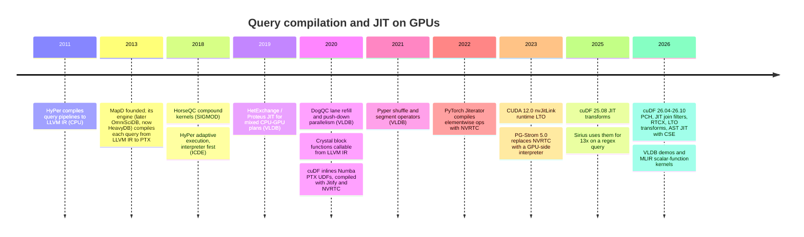
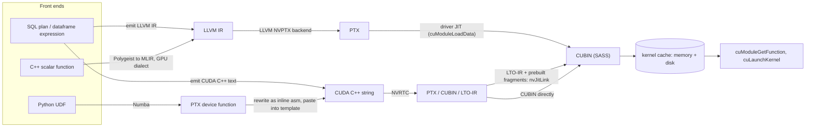
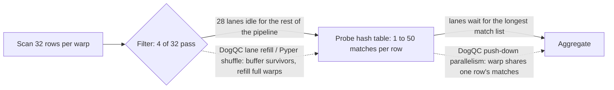
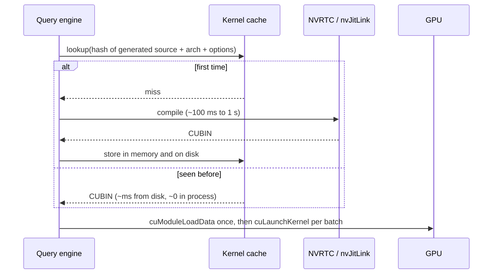

---
tags:
  - gpu-programming
  - compilers
  - cuda
  - databases
  - query-compilation
  - jit
  - nvrtc
  - nvjitlink
  - cudf
  - code-generation
status: complete
sources:
  - https://event.cwi.nl/lsde/papers/hyper.pdf
  - https://blog.acolyer.org/2016/05/23/efficiently-compiling-efficient-query-plans-for-modern-hardware/
  - https://db.in.tum.de/~leis/papers/adaptiveexecution.pdf
  - https://heavyai.github.io/heavydb/execution/codegen.html
  - https://dbis.cs.tu-dortmund.de/storages/dbis-cs/r/papers/2018/pipelined-query-processing/pipelined-query-processing.pdf
  - https://dbis.cs.tu-dortmund.de/storages/dbis-cs/r/papers/2020/divergence/divergence-pub.pdf
  - https://github.com/Henning1/dogqc
  - https://www.vldb.org/pvldb/vol14/p202-paul.pdf
  - https://infoscience.epfl.ch/record/262531/files/HetExchange-vldb19-final.pdf
  - https://arxiv.org/pdf/2003.01178
  - https://arxiv.org/pdf/2302.00734
  - https://developer.nvidia.com/blog/efficient-transforms-in-cudf-using-jit-compilation/
  - https://developer.nvidia.com/blog/running-python-udfs-in-native-cuda-kernels-with-rapids-cudf
  - https://docs.nvidia.com/cudf/26.12/libcudf/api_docs/transformation_transform/
  - https://newreleases.io/project/github/rapidsai/cudf/release/v26.04.00
  - https://newreleases.io/project/github/rapidsai/cudf/release/v26.08.00
  - https://newreleases.io/project/github/rapidsai/cudf/release/v26.10.00
  - https://developer.nvidia.com/blog/nvidia-gpu-accelerated-sirius-achieves-record-setting-clickbench-record/
  - https://docs.nvidia.com/cuda/archive/13.4.3/nvrtc/index.html
  - https://developer.nvidia.com/blog/cuda-12-0-compiler-support-for-runtime-lto-using-nvjitlink-library
  - https://github.com/NVIDIA/jitify
  - https://docs.nvidia.com/cuvs/developer-guide/advanced-topics/jit-compilation.md
  - https://docs.nvidia.com/cuvs/developer-guide/link-time-optimization
  - https://dev-discuss.pytorch.org/t/keeping-pytorchs-ops-maintainable-the-jiterator/468
  - https://heterodb.github.io/pg-strom/release_v5.0/
  - https://www.vldb.org/pvldb/vol19/p4658-schule.pdf
  - https://www.vldb.org/pvldb/vol19/p1441-rajan.pdf
  - https://arxiv.org/pdf/2607.07632
  - https://www.vldb.org/2026/Workshops/VLDB-Workshops-2026/ADMS/ADMS26_2.pdf
created: 2026-11-28
updated: 2026-11-28
---

## Table Of Contents

---

- [[#TL;DR|TL;DR]]
- [[#The Problem|The Problem]]
- [[#Foundations|Foundations]]
    - [[#Interpret, Vectorize or Compile|Interpret, Vectorize or Compile]]
    - [[#Pipelines Become Kernels|Pipelines Become Kernels]]
    - [[#The Break-Even Equation|The Break-Even Equation]]
- [[#How We Got Here|How We Got Here]]
- [[#How It Works|How It Works]]
    - [[#Five Ways to Run an Expression on a GPU|Five Ways to Run an Expression on a GPU]]
    - [[#The Toolchain: From Plan to SASS|The Toolchain: From Plan to SASS]]
    - [[#A Generated Pipeline, End to End|A Generated Pipeline, End to End]]
    - [[#Output Positions, Hash Tables and Building Blocks|Output Positions, Hash Tables and Building Blocks]]
    - [[#Divergence and Register Pressure in Fused Kernels|Divergence and Register Pressure in Fused Kernels]]
    - [[#Paying for Compilation: Caches, PCH and Fragments|Paying for Compilation: Caches, PCH and Fragments]]
    - [[#JIT in cuDF|JIT in cuDF]]
- [[#Where It Is Now|Where It Is Now]]
- [[#Trade-offs & Open Problems|Trade-offs & Open Problems]]
- [[#Resources|Resources]]
- [[#Related Notes|Related Notes]]

## ***TL;DR***
---
*Query compilation turns a SQL plan or a user expression into a kernel written for that one query, so filters, arithmetic and aggregation happen in registers inside one launch instead of as a chain of library kernels. It is faster to run and slower to start, and the whole engineering problem is paying the compile bill only when it pays back.*

- **What it is.** Instead of calling one precompiled kernel per operator, a GPU query engine generates code for a whole pipeline (scan, filter, project, probe, aggregate), compiles it at runtime, and launches it as one kernel. Runtime compilation uses **NVRTC** (CUDA C++ to PTX/CUBIN/LTO-IR), **LLVM's NVPTX backend** (LLVM IR to PTX, then the driver to SASS), or **nvJitLink** (linking precompiled LTO-IR fragments) ([NVRTC docs](https://docs.nvidia.com/cuda/archive/13.4.3/nvrtc/index.html), [HeavyDB codegen](https://heavyai.github.io/heavydb/execution/codegen.html), [nvJitLink](https://developer.nvidia.com/blog/cuda-12-0-compiler-support-for-runtime-lto-using-nvjitlink-library)). This is [[Kernel Fusion]] decided at query time, the GPU form of [[JIT Compilation]].
- **Why it's fast.** Fewer kernels, fewer intermediates in HBM, registers sized for the actual expression. cuDF's JIT transforms cut a string pipeline from **45 kernels / 114 ms to 4 kernels / 25 ms** on 200M rows on a GH200 ([NVIDIA, Aug 2025](https://developer.nvidia.com/blog/efficient-transforms-in-cudf-using-jit-compilation/)); compiled pipelines in HorseQC cut memory traffic up to **7.5×** and kernel time up to **9.5×** vs operator-at-a-time ([SIGMOD 2018](https://dbis.cs.tu-dortmund.de/storages/dbis-cs/r/papers/2018/pipelined-query-processing/pipelined-query-processing.pdf)).
- **Why it's hard.** Compilation costs **tens of milliseconds to a second** per kernel (NVRTC ~80 to 120 ms fixed per call, cuDF ~600 ms per first-time kernel), which can exceed the query itself ([Bamberg, VLDB 2026](https://www.vldb.org/pvldb/vol19/p4658-schule.pdf), [NVIDIA](https://developer.nvidia.com/blog/efficient-transforms-in-cudf-using-jit-compilation/)). Big fused kernels also suffer [[Warp Divergence and Warp-Level Primitives|divergence]] and [[Register Pressure and Spilling|register pressure]], which DogQC and Pyper attack directly.
- **How engines cope.** Persistent kernel caches (cuDF: ~3 ms to load a cached kernel), NVRTC precompiled headers (CUDA 12.8+), one fused NVRTC call per query instead of one per pipeline (5.9× faster compile), LTO fragments linked at runtime (cuVS, cuFFT, cuDF 26.08+), or giving up native code for a GPU-side interpreter (PG-Strom 5.0).
- **State in late 2026.** Production JIT lives in **libcudf** (JIT transforms, AST-to-JIT with common-subexpression elimination, JIT join filters, its own RTCX runtime replacing Jitify), available to every engine built on libcudf (Sirius already uses it, and Java bindings reach Spark); whole-query compilers (HeavyDB, DogQC, Pyper, Proteus) remain the research and niche-engine path.

## ***The Problem***
---
*A library of precompiled operators is general but wasteful: every operator writes its output to global memory and the next one reads it back. Specializing per query removes that traffic, but compiling per query costs time the user can see.*

Analytical queries are [[Roofline Model and Arithmetic Intensity|bandwidth-bound]]. Running them as one library kernel per operator (the "operator-at-a-time" model in [[GPU Databases and Dataframes]]) moves every intermediate through HBM:

| Cost | Operator-at-a-time | Compiled pipeline | Source |
|---|---|---|---|
| Selection over $2^{29}$ values | 3 kernels (count, scan, write): **19 ms** | 1 tile kernel: **2.1 ms** | [Crystal](https://arxiv.org/pdf/2003.01178) |
| Memory traffic, SSB/TPC-H pipelines | 1× | up to **7.5× less** | [HorseQC](https://dbis.cs.tu-dortmund.de/storages/dbis-cs/r/papers/2018/pipelined-query-processing/pipelined-query-processing.pdf) |
| `localize_phone` string transform, 200M rows | 45 kernels, 114 ms | 4 kernels, 25 ms | [cuDF JIT](https://developer.nvidia.com/blog/efficient-transforms-in-cudf-using-jit-compilation/) |
| ClickBench q28 regex | precompiled cuDF API, 32% warp occupancy | JIT transform, 85% occupancy, **13× faster** | [Sirius](https://developer.nvidia.com/blog/nvidia-gpu-accelerated-sirius-achieves-record-setting-clickbench-record/) |

Three things go wrong without specialization:

- **Intermediates.** Each kernel boundary is a write and a read of a full column or a bitmap. Fewer kernels also means less memory: cuDF's JIT path processed about **30% more data** before hitting the GH200's memory limit because it materialized fewer intermediates ([NVIDIA](https://developer.nvidia.com/blog/efficient-transforms-in-cudf-using-jit-compilation/)).
- **Worst-case registers.** A generic kernel that interprets any expression must reserve registers for the worst case; a kernel compiled for one expression allocates only what it needs, raising [[Occupancy and Latency Hiding|occupancy]] ([NVIDIA](https://developer.nvidia.com/blog/efficient-transforms-in-cudf-using-jit-compilation/)).
- **Kernel explosion.** Precompiling every combination of types, operators and options grows binaries without bound. PyTorch moved rare elementwise ops to runtime compilation partly to shrink CUDA context by 37.5 MB ([Jiterator, 2022](https://dev-discuss.pytorch.org/t/keeping-pytorchs-ops-maintainable-the-jiterator/468)); cuFFT and cuVS link kernel fragments at runtime for the same reason ([nvJitLink](https://developer.nvidia.com/blog/cuda-12-0-compiler-support-for-runtime-lto-using-nvjitlink-library), [cuVS](https://docs.nvidia.com/cuvs/developer-guide/link-time-optimization)). See also [[Instruction Cache and Code Size on GPUs]].

The catch is the bill. In a 2023 study, HeavyDB's optimization plus compilation plus transfer on a cold run of TPC-H Q21 at SF16 exceeded the GPU execution itself, and its warm-run overheads were "not negligible" either ([Cao et al.](https://arxiv.org/pdf/2302.00734)).

## ***Foundations***
---
*Three ideas carry over from CPU databases: the interpreter/vectorized/compiled spectrum, pipelines split at "breakers", and a break-even point between compile time and per-row savings.*

### Interpret, Vectorize or Compile

| Model | Per-row work | Who does it on GPUs |
|---|---|---|
| **Tuple-at-a-time interpreter** (Volcano `next()`) | Virtual call and type dispatch per row per operator | Nobody: hopeless on GPUs |
| **Expression interpreter on device** | A loop on the GPU walks an expression tree or bytecode for each row | cuDF `compute_column` (AST), PG-Strom 5.0 pseudo-code |
| **Operator-at-a-time / vectorized** | Precompiled kernel per operator over whole columns | libcudf API, Crystal-style libraries |
| **Data-centric compilation** | Generated code per pipeline; values stay in registers | HeavyDB, HorseQC, DogQC, Pyper, Proteus, cuDF JIT transforms |

HyPer (VLDB 2011) set the template for compilation: each operator exposes `produce()` and `consume()` only inside the compiler; data is *pushed* from scans to consumers, and each pipeline becomes one tight loop. A **pipeline breaker** is an operator that forces tuples out of registers into memory, such as a hash-table build or a sort. HyPer switched from generating C++ to generating LLVM IR because C++ compile times were "unacceptable", while LLVM usually compiled queries "in a few milliseconds" ([Neumann](https://event.cwi.nl/lsde/papers/hyper.pdf), [summary](https://blog.acolyer.org/2016/05/23/efficiently-compiling-efficient-query-plans-for-modern-hardware/)). See [[LLVM]] and [[Intermediate Representations]].

### Pipelines Become Kernels

On a GPU the mapping is direct: **one pipeline becomes one kernel**, and "keep the tuple in registers" becomes "keep each thread's rows in registers". A pipeline breaker becomes a kernel boundary (or a grid-wide barrier, see [[Cooperative Groups]]). Two things differ from the CPU:

- **Output positions.** A CPU loop appends to an output buffer one row at a time. Thousands of GPU threads must agree where each passing row goes, which needs a [[Parallel Reduction and Scan|prefix sum]] or atomics in the middle of the pipeline (see below).
- **Lockstep.** Threads in a warp run together. A filter that kills most lanes, or a join probe with one match for one row and fifty for another, leaves lanes idle for the rest of the fused pipeline ([DogQC](https://dbis.cs.tu-dortmund.de/storages/dbis-cs/r/papers/2020/divergence/divergence-pub.pdf)).

### The Break-Even Equation

Compiling pays off once the per-row saving has covered the compile cost:

$$
N^{*} = \frac{C_{\text{compile}}}{t_{\text{generic}} - t_{\text{compiled}}}
$$

*In words:* the break-even row count $N^{*}$ is the one-time compile cost divided by the time saved per row.

**Worked example (cuDF, GH200, 200M rows).** `localize_phone` drops from 114 ms to 25 ms, a saving of $89\ \text{ms} / 2\times10^{8} = 0.445\ \text{ns}$ per row. With a first-time compile of about 600 ms, $N^{*} = 0.6\ \text{s} / 0.445\ \text{ns} \approx 1.35$ billion rows. For `extract_email` (49 ms to 22 ms) the saving is 0.135 ns/row and $N^{*} \approx 4.4$ billion rows. NVIDIA's post gives the same order, about **1 to 3 billion rows** with a deferred compile. With a **pre-populated cache** the cost drops to about 3 ms, and the simple model gives $N^{*} \approx 7$ million rows for `localize_phone`; NVIDIA reports benefits "within the first million rows" ([NVIDIA](https://developer.nvidia.com/blog/efficient-transforms-in-cudf-using-jit-compilation/)). The lesson: **the cache, not the compiler, decides whether JIT is worth it for interactive work.**

The same equation drives CPU engines. HyPer's TPC-H Q1 takes 0.4 ms to turn into bytecode, 6 ms to compile unoptimized and 42 ms optimized; the largest TPC-DS query takes about 911 ms optimized, which is why HyPer starts every query in an interpreter and compiles in the background only when progress shows it will pay ([Kohn, Leis and Neumann](https://db.in.tum.de/~leis/papers/adaptiveexecution.pdf); see [[Tiering Policies and Warm-up]]).

## ***How We Got Here***
---
*GPU query compilation borrowed HyPer's design within two years, spent the late 2010s fixing what fusion breaks on SIMT hardware, and since 2025 has moved into the shared library (libcudf) that most GPU SQL engines run on.*



- **Port the CPU idea (2013 to 2019).** MapD's engine (now HeavyDB) generates LLVM IR for each query, sends it through LLVM's NVPTX backend to PTX, and has the CUDA driver turn PTX into a cubin, with an LRU code cache keyed on the IR ([HeavyDB docs](https://heavyai.github.io/heavydb/execution/codegen.html)). Proteus/HetExchange did the same and added device-crossing operators, so one plan could run pipelines on both CPUs and GPUs; it reported 2.8× and 6.4× over the best CPU and GPU systems it compared ([VLDB 2019](https://infoscience.epfl.ch/record/262531/files/HetExchange-vldb19-final.pdf)).
- **Make fusion work on SIMT (2018 to 2021).** HorseQC (inside CoGaDB) showed that naive compilation still splits pipelines at every prefix sum, and fixed it with **compound kernels** that compute output offsets in-kernel ([SIGMOD 2018](https://dbis.cs.tu-dortmund.de/storages/dbis-cs/r/papers/2018/pipelined-query-processing/pipelined-query-processing.pdf)). DogQC targeted **divergence** from skewed joins and selective filters ([VLDB 2020](https://dbis.cs.tu-dortmund.de/storages/dbis-cs/r/papers/2020/divergence/divergence-pub.pdf)). Pyper measured divergence plus resource contention at over 50% of runtime in JIT-compiled GPU engines and inserted **shuffle** and **segment** operators to fix both ([VLDB 2021](https://www.vldb.org/pvldb/vol14/p202-paul.pdf)). Crystal took the library route, noting its block-wide functions "can also [be] called directly from LLVM IR" by a code generator ([SIGMOD 2020](https://arxiv.org/pdf/2003.01178)).
- **JIT for UDFs and expressions (2020 to 2026).** cuDF's first JIT path took a Python UDF, let Numba compile it to PTX, rewrote the PTX into an inline-asm device function and pasted it into a kernel template compiled with Jitify and NVRTC ([NVIDIA, Jul 2020](https://developer.nvidia.com/blog/running-python-udfs-in-native-cuda-kernels-with-rapids-cudf)). cuDF 25.08 added general **JIT transforms** from CUDA C++ strings ([NVIDIA, Aug 2025](https://developer.nvidia.com/blog/efficient-transforms-in-cudf-using-jit-compilation/)), and 2026 releases turned that into infrastructure (see [[#JIT in cuDF|JIT in cuDF]]).
- **Counter-movement.** PG-Strom 5.0 (Dec 2023) stopped generating CUDA C++ altogether: queries become pseudo-code that a statically built GPU interpreter runs, which "improved the first response time" by removing NVRTC compilation ([PG-Strom](https://heterodb.github.io/pg-strom/release_v5.0/)).

## ***How It Works***
---
*An engine picks a strategy per expression, generates source or IR, compiles it through NVRTC, LLVM or nvJitLink, caches the result, and launches it. The interesting parts are how generated kernels find output positions, how they avoid divergence, and how the compile cost is hidden.*

### Five Ways to Run an Expression on a GPU

| Strategy | Compile cost at query time | Runtime quality | Example |
|---|---|---|---|
| **Chain of precompiled operators** | None | Many kernels, intermediates in HBM | libcudf API: `extract_email` = 19 kernels ([NVIDIA](https://developer.nvidia.com/blog/efficient-transforms-in-cudf-using-jit-compilation/)) |
| **Device-side interpreter** | None (or tiny bytecode build) | One kernel, but dispatch per node per row and worst-case registers | cuDF `compute_column` AST; PG-Strom 5.0 pseudo-code |
| **Link precompiled fragments (JIT LTO)** | Link + optimize only (fragments built at install time) | Near-native, inlined across fragments | cuVS search kernels, cuFFT callbacks, cuDF `transform_lto` |
| **Compile a fused kernel from source/IR** | Full compile, ~0.1 to 1 s cold | Specialized registers, one kernel | cuDF `transform`, HeavyDB, DogQC, Proteus |
| **Synthesize the whole query program** | Minutes to hours (LLM loop) | Best measured, not portable | SHADB ([EURECOM 2026](https://arxiv.org/pdf/2607.07632)) |

The device-side interpreter is limited too: cuDF's AST path cannot express the ternary if-else or string functions like `find` and `substring`, which the JIT path can ([NVIDIA](https://developer.nvidia.com/blog/efficient-transforms-in-cudf-using-jit-compilation/)).

### The Toolchain: From Plan to SASS



- **NVRTC** compiles a CUDA C++ string in-process to PTX, CUBIN or (with `-dlto`) LTO-IR; it needs no GPU and no toolkit install, and since CUDA 13.3 can ship its own CUDA and CCCL headers ([NVRTC docs](https://docs.nvidia.com/cuda/archive/13.4.3/nvrtc/index.html)). Templates are reached by registering a name expression (`nvrtcAddNameExpression`) and asking for the mangled name afterwards. This is what cuDF, the Jiterator and the Bamberg demo use. The [Jitify](https://github.com/NVIDIA/jitify) header library wrapped NVRTC's rough edges (header lookup, template instantiation, a kernel cache) for many years.
- **LLVM NVPTX** suits engines already built on LLVM IR: HeavyDB, Proteus. The PTX is then compiled to SASS by the driver. See [[PTX and SASS]].
- **nvJitLink** (CUDA 12.0+) links LTO-IR modules at runtime and optimizes across them, so code compiled offline and code generated now can be inlined into each other ([NVIDIA, Jan 2023](https://developer.nvidia.com/blog/cuda-12-0-compiler-support-for-runtime-lto-using-nvjitlink-library)). See [[Linking and LTO]].
- **MLIR** is the newer path for big C++ function libraries: Microsoft lifted SQL Server's ~100,000 lines of scalar-function C++ into MLIR with Polygeist and lowered it through the GPU dialect, though it precompiles these kernels at build time rather than per query ([VLDB 2026](https://www.vldb.org/pvldb/vol19/p1441-rajan.pdf)). See [[MLIR]].

### A Generated Pipeline, End to End

Take a TPC-H Q6-like query: `SELECT SUM(price * (1 - discount)) FROM lineitem WHERE shipdate <= ? AND quantity < ?`. A data-centric generator walks `produce`/`consume` and emits one kernel for the single pipeline (scan, filter, project, aggregate):

```cpp
// Source text generated for this query's only pipeline
extern "C" __global__ void q6_pipeline(
    const int* __restrict__ shipdate, const float* __restrict__ qty,
    const float* __restrict__ price,  const float* __restrict__ disc,
    long long n, int date_hi, float qty_hi, double* __restrict__ out)
{
  double acc = 0.0;
  for (long long i = blockIdx.x * (long long)blockDim.x + threadIdx.x; i < n;
       i += (long long)gridDim.x * blockDim.x) {
    if (shipdate[i] <= date_hi && qty[i] < qty_hi)   // filter, no bitmap written
      acc += (double)price[i] * (1.0 - disc[i]);      // projection kept in a register
  }
  for (int off = 16; off > 0; off >>= 1)              // warp-level sum
    acc += __shfl_down_sync(0xffffffff, acc, off);
  if ((threadIdx.x & 31) == 0) atomicAdd(out, acc);   // one atomic per warp
}
```

- **`extern "C"`** keeps the name unmangled so the host can look it up as `"q6_pipeline"`.
- **Parameters** are the four columns the plan touches and the two literals. Passing literals as arguments, not pasting them into the source, means the next query with different dates produces identical text and hits the kernel cache.
- **The grid-stride loop** reads each column in [[Memory Coalescing|coalesced]] order; each thread visits rows `i`, `i + total threads`, and so on.
- **The `if`** is the filter fused into the scan. No selection vector or bitmap goes to HBM.
- **`acc +=`** is the projection and the aggregate in one register: the "tuple in registers" idea.
- **The shuffle loop and the atomic** are a [[Parallel Reduction and Scan|warp reduction]] then one [[CUDA Memory Model and Atomics|atomic]] per warp instead of per row.

The host side compiles and launches it:

```cpp
nvrtcProgram prog;
nvrtcCreateProgram(&prog, src.c_str(), "q6.cu", 0, nullptr, nullptr);
const char* opts[] = {"--gpu-architecture=sm_90", "-default-device"};
nvrtcCompileProgram(prog, 2, opts);                    // ~0.1 s cold
size_t sz; nvrtcGetCUBINSize(prog, &sz);
std::vector<char> cubin(sz); nvrtcGetCUBIN(prog, cubin.data());
CUmodule mod;  cuModuleLoadData(&mod, cubin.data());   // store cubin in the cache
CUfunction fn; cuModuleGetFunction(&fn, mod, "q6_pipeline");
cuLaunchKernel(fn, grid, 1, 1, 256, 1, 1, 0, stream, args, nullptr);
```

- **`nvrtcCreateProgram`** wraps the generated string as a program.
- **`--gpu-architecture=sm_90`** names a real architecture, so NVRTC can emit a CUBIN directly and skip the driver's PTX JIT. A virtual architecture (`compute_90`) yields only PTX.
- **`-default-device`** treats undecorated functions as device code, handy for generated helpers.
- **`nvrtcGetCUBIN`** returns the SASS binary; this is the thing to persist in the cache.
- **`cuModuleLoadData` / `cuModuleGetFunction` / `cuLaunchKernel`** are the Driver API path for loading code that was not linked into the program.

The roughly 0.1 s compile matches the measured NVRTC fixed cost of 80 to 120 ms per call ([Bamberg, VLDB 2026](https://www.vldb.org/pvldb/vol19/p4658-schule.pdf)). On an H100 with about 3.35 TB/s of HBM, the kernel itself would scan four 4-byte columns of 600M rows (9.6 GB) in about 3 ms, so a cold compile costs over 30 executions of the query.

### Output Positions, Hash Tables and Building Blocks

Pipelines that *emit* rows (a filter feeding a join build, a projection written out) need each passing row's output slot. Options, in order of how much they keep in one kernel:

| Method | Kernels | Notes |
|---|---|---|
| Count, prefix-sum, write | 3, input read twice | Classic primitive-based approach |
| Multi-pass compiled | 2 compiled + a scan between | Still materializes per-row flags |
| **Compound kernel** | 1 | Offsets resolved in registers: per-workgroup offsets from a local scan, then **one atomic add per workgroup** ("local resolution, global propagation"). Output is ordered within a block's segment but blocks land in any order ([HorseQC](https://dbis.cs.tu-dortmund.de/storages/dbis-cs/r/papers/2018/pipelined-query-processing/pipelined-query-processing.pdf)) |

HorseQC's pipelined prefix sums alone cut kernel time up to **6.3×**, and pre-aggregating group-bys in shared memory before inserting into the global hash table gave up to **126×** for small group counts ([SIGMOD 2018](https://dbis.cs.tu-dortmund.de/storages/dbis-cs/r/papers/2018/pipelined-query-processing/pipelined-query-processing.pdf)). Hash-table probes and builds in generated code call the same structures described in [[Sorting and Hashing on GPUs]]. Generators usually call hand-written runtime functions rather than emitting every instruction: HeavyDB keeps C++ "runtime functions" marked always-inline and prunes unused ones from the module before compiling ([HeavyDB](https://heavyai.github.io/heavydb/execution/codegen.html)), and Crystal's tile functions were designed to be callable from generated LLVM IR ([Crystal](https://arxiv.org/pdf/2003.01178)).

### Divergence and Register Pressure in Fused Kernels

Fusing a whole pipeline means one kernel carries every operator's branches and live values. Two problems follow, and two research systems fixed them:



- **Filter divergence.** After a selective filter only a few lanes of each warp still have a row. **Lane Refill** (DogQC) buffers surviving rows in shared memory, using `popc`-based prefix sums to place them, and refills idle lanes before continuing; one buffer slot per lane suffices. Up to **2.8×** on a filter workload ([DogQC](https://dbis.cs.tu-dortmund.de/storages/dbis-cs/r/papers/2020/divergence/divergence-pub.pdf)). Pyper's **Shuffle** operator does the same with `__ballot` warp votes at block or grid level ([Pyper](https://www.vldb.org/pvldb/vol14/p202-paul.pdf)). See [[Warp Divergence and Warp-Level Primitives]].
- **Expansion divergence.** A join row with fifty matches holds its warp while others have one. **Push-down Parallelism** (DogQC) parallelizes over match items instead of probe rows, redistributing work with warp shuffles: up to **4.2×** on skewed joins, **10.3×** when many operators follow ([DogQC](https://dbis.cs.tu-dortmund.de/storages/dbis-cs/r/papers/2020/divergence/divergence-pub.pdf)). Compare [[Work Stealing and Dynamic Load Balancing]].
- **Register pressure.** A long fused pipeline holds many live values, lowering [[Occupancy and Latency Hiding|occupancy]]. Pyper's **Segment** operator splits such a pipeline into two kernels connected through global memory, chosen by a cost model and branch-and-bound search whose overhead stays under 1% of query time ([Pyper](https://www.vldb.org/pvldb/vol14/p202-paul.pdf)). The Sirius regex case is the same effect in a library: a monolithic regex kernel had 32% warp occupancy, the JIT-decomposed one 85% ([NVIDIA](https://developer.nvidia.com/blog/nvidia-gpu-accelerated-sirius-achieves-record-setting-clickbench-record/)). See [[Register Pressure and Spilling]].

Measured on a V100 at TPC-H SF50, Pyper averaged **1.40× over DogQC**, 3.06× over GPL and 5.01× over OmniSci ([Pyper](https://www.vldb.org/pvldb/vol14/p202-paul.pdf)). DogQC itself ran all 22 TPC-H queries while OmniSci ran 13 and often fell back to the CPU ([DogQC](https://dbis.cs.tu-dortmund.de/storages/dbis-cs/r/papers/2020/divergence/divergence-pub.pdf)).

### Paying for Compilation: Caches, PCH and Fragments

Measured compile costs, cold:

| System | What is compiled | Cold cost | Warm / cached | Source |
|---|---|---|---|---|
| HyPer (CPU, for scale) | TPC-H Q1, LLVM | 6 ms unopt., 42 ms opt. | bytecode 0.4 ms | [Kohn et al.](https://db.in.tum.de/~leis/papers/adaptiveexecution.pdf) |
| NVRTC, any program | fixed per invocation | ~80 to 120 ms | n/a | [Bamberg](https://www.vldb.org/pvldb/vol19/p4658-schule.pdf) |
| CUDA Code-General, TPC-H Q8 (7 kernels) | nvcc, sequential | ~2.9 s | n/a | [Bamberg](https://www.vldb.org/pvldb/vol19/p4658-schule.pdf) |
| same | NVRTC, one call per kernel | ~420 ms | n/a | same |
| same | NVRTC, all kernels in one call | ~91 to 98 ms | n/a | same |
| cuDF JIT transform | one fused kernel | ~600 ms | ~3 ms load, ~130 KB per kernel | [NVIDIA](https://developer.nvidia.com/blog/efficient-transforms-in-cudf-using-jit-compilation/) |
| PyTorch Jiterator | one elementwise op | >2,500× a 58 µs call (~0.15 s) | ~1 ms from file cache | [Jiterator](https://dev-discuss.pytorch.org/t/keeping-pytorchs-ops-maintainable-the-jiterator/468) |
| SYCLDB (AdaptiveCpp) | scan / join query shape | 0.40 s / 0.84 to 1.05 s | paid once per shape | [EURECOM](https://arxiv.org/pdf/2607.07632) |



The tools for shrinking the bill:

- **Caches at three levels.** In-process (cuDF's `transform_program`, added in 26.10, keeps the compiled kernel for repeated `run` calls; HeavyDB's per-query LRU code cache), on disk (cuDF's `LIBCUDF_KERNEL_CACHE_PATH`), and the **CUDA driver's compute cache** for PTX-to-SASS and JIT LTO results (`CUDA_CACHE_PATH`, `CUDA_CACHE_MAX_SIZE`; invalidated by a driver upgrade; shareable over network storage) ([cuDF](https://developer.nvidia.com/blog/efficient-transforms-in-cudf-using-jit-compilation/), [cuDF 26.10](https://newreleases.io/project/github/rapidsai/cudf/release/v26.10.00), [cuVS](https://docs.nvidia.com/cuvs/developer-guide/advanced-topics/jit-compilation.md)). NVIDIA recommends pre-populating the cache for production ([NVIDIA](https://developer.nvidia.com/blog/efficient-transforms-in-cudf-using-jit-compilation/)).
- **Make cache keys stable.** Literals as kernel parameters (as in the example above), canonical column order and type-only specialization let many queries share one kernel.
- **Compile less, compile once.** Fusing all of a query's kernels into one NVRTC invocation gave **5.9×** faster compile for Q8 (576 vs 98 ms), and **32×** vs nvcc ([Bamberg](https://www.vldb.org/pvldb/vol19/p4658-schule.pdf)).
- **NVRTC options.** Precompiled headers (`--pch`, CUDA 12.8+) skip re-parsing heavy headers such as CCCL; `-minimal` drops the default header set for small programs; `-Ofc` trades code quality for compile speed; `--split-compile` runs optimization passes on several threads ([NVRTC docs](https://docs.nvidia.com/cuda/archive/13.4.3/nvrtc/index.html)). cuDF turned PCH on for its JIT in 26.04 ([release notes](https://newreleases.io/project/github/rapidsai/cudf/release/v26.04.00)).
- **Fragments instead of source.** Compile the expensive, generic parts offline as LTO-IR, generate only small glue at query time, and let nvJitLink inline across them. cuVS builds 341 IVF-Flat fragments that combine into many more kernels at runtime ([cuVS](https://docs.nvidia.com/cuvs/developer-guide/link-time-optimization)); cuFFT callbacks linked this way ran nearly 2× faster than indirect calls ([NVIDIA](https://developer.nvidia.com/blog/cuda-12-0-compiler-support-for-runtime-lto-using-nvjitlink-library)). LTO-IR is only link-compatible within one CUDA major version.
- **Do not compile at all.** Interpret first and compile in the background only for long pipelines (HyPer's adaptive execution; [[Tiering Policies and Warm-up]]), or interpret on the GPU permanently (PG-Strom 5.0).

### JIT in cuDF

libcudf is where most production GPU SQL runs in 2026 ([[GPU Databases and Dataframes]]), so its JIT stack matters most:

| API | What it does |
|---|---|
| `cudf::transform(udf, source_type, ...)` | Compiles a row-wise UDF given as CUDA C++ or PTX (`udf_source_type`) into a kernel over input columns; supports nullable inputs, string inputs/outputs, scalar inputs and user device data ([libcudf 26.12](https://docs.nvidia.com/cudf/26.12/libcudf/api_docs/transformation_transform/)) |
| `transform_lto(...)` | Same, but the UDF arrives as LTO-IR, FATBIN or PTX fragments named `transform` |
| `transform_program` | Compile once from specs or AST expressions, then `run` many times without re-dispatch (26.10) |
| `compute_column` | AST expression evaluated by a device-side interpreter |
| `compute_column_jit`, `compute_table_jit` | The same AST compiled to a kernel; multiple outputs share common subexpressions, which are evaluated once (26.10) |
| JIT join filters | Applies a conditional predicate to join output indices with a generated kernel (26.04) |

The 2026 releases also replaced Jitify with cuDF's own **RTCX** runtime-compilation library (26.08), added LTO-IR transform kernels, an "ANSI SQL operator" JIT library for Spark semantics, a JIT Parquet-filtering option, cache management functions, and Java bindings for AST JIT, the layer Spark-RAPIDS builds on ([26.04](https://newreleases.io/project/github/rapidsai/cudf/release/v26.04.00), [26.08](https://newreleases.io/project/github/rapidsai/cudf/release/v26.08.00), [26.10](https://newreleases.io/project/github/rapidsai/cudf/release/v26.10.00)). For Python users, Numba still produces the PTX for `apply`-style UDFs ([[Numba and CuPy]]).

## ***Where It Is Now***
---
*As of November 2026: JIT has become standard library infrastructure in libcudf rather than a separate kind of engine, research is about compile latency and portability, and the "compile everything per query" engines remain niche.*

- **Library JIT is the mainstream (Nov 2026).** libcudf 26.04 to 26.10 added PCH, JIT join filtering, RTCX, LTO transforms, multi-output AST JIT with CSE and `transform_program` (see above). Sirius, the DuckDB-based GPU engine, already used the JIT transform framework for its record ClickBench regex query (Dec 2025) ([NVIDIA](https://developer.nvidia.com/blog/nvidia-gpu-accelerated-sirius-achieves-record-setting-clickbench-record/)), and the Java AST JIT bindings bring it to Spark.
- **Whole-query GPU compilers.** HeavyDB keeps its LLVM-to-PTX design with a per-query code cache ([docs](https://heavyai.github.io/heavydb/execution/codegen.html)). A VLDB 2026 demo (University of Bamberg) generates CUDA C++ per TPC-H pipeline and compares sequential kernels, one cooperative-groups kernel with `grid.sync()` between phases, and dynamic parallelism, concluding that **NVRTC with fused compilation** is needed to keep interactive response well under a second ([Alwahibi, Jangebashvili and Schüle](https://www.vldb.org/pvldb/vol19/p4658-schule.pdf)). See [[Forward Progress and Inter-Block Synchronization]] and [[CUDA Dynamic Parallelism and Device Graph Launch]].
- **LLM-synthesized query programs (Jul 2026).** EURECOM's SHADB had an LLM write a CUDA/HIP program per SSB query with a profile-guided loop: 77.9 ms total at SF100 on an L40S, 2.6× faster than Crystal and 7.4× faster than HeavyDB, at about 4.2 hours and $126 of synthesis. Code written for SF10 was correct on only 2 of 13 queries at SF100. Their portable SYCL engine, built from the generalizable tricks (fusion, coarsening, register dataflow) and runtime-linked operator functions, came within 1.27× ([arXiv 2607.07632](https://arxiv.org/pdf/2607.07632)). See [[LLM-Written Kernels]] and [[Correctness Checking for Generated Kernels]].
- **Precompiled-but-generated kernels.** Microsoft compiles SQL Server's scalar functions to GPU kernels through MLIR at build time, reporting 7.6× average per-query speedup on a scalar-heavy TPC-H at SF100 with data on the GPU, and 6.4× on 50 production queries ([VLDB 2026](https://www.vldb.org/pvldb/vol19/p1441-rajan.pdf)).
- **Faster compilers are coming from the CPU side.** LingoDB's MLIR backend with TPDE generates code 16× to 19× faster than LLVM -O0 ([ADMS 2026](https://www.vldb.org/2026/Workshops/VLDB-Workshops-2026/ADMS/ADMS26_2.pdf)); nothing equivalent exists yet for PTX/SASS, where NVRTC's ~100 ms floor dominates.

**Trends:** compile in fragments and link at runtime; cache aggressively and pre-warm; decompose huge kernels (regex) into fusable simple ones; and treat LLM synthesis as a way to discover optimizations for engines rather than as the engine.

## ***Trade-offs & Open Problems***
---
*Every JIT design trades first-query latency for steady-state speed, and fusion trades fewer memory round trips for divergence and register pressure. None of these has one right answer.*

- **Latency vs throughput.** A 100 ms to 1 s compile is invisible in a batch ETL job and fatal for a dashboard returning in 50 ms. Interpreter-first tiering is standard on CPUs but rare on GPUs; PG-Strom chose the interpreter outright.
- **Cache validity.** Driver upgrades invalidate the compute cache, LTO-IR only links within one CUDA major version, and a cache keyed on generated text misses if literals or column order leak into the source ([cuVS](https://docs.nvidia.com/cuvs/developer-guide/advanced-topics/jit-compilation.md), [nvJitLink](https://developer.nvidia.com/blog/cuda-12-0-compiler-support-for-runtime-lto-using-nvjitlink-library)). See [[CUDA Binary Compatibility and Fatbins]].
- **Fusion vs occupancy.** One kernel per pipeline avoids HBM round trips but can spill registers and diverge; Pyper's segment operator deliberately un-fuses. Where to cut is a cost-model problem, related to [[Megakernels]] and [[Kernel Fusion]].
- **Coverage.** Generated code must handle nulls, strings, decimals and nested types; DogQC beat OmniSci on coverage, and cuDF's AST path still lacks string functions ([DogQC](https://dbis.cs.tu-dortmund.de/storages/dbis-cs/r/papers/2020/divergence/divergence-pub.pdf), [NVIDIA](https://developer.nvidia.com/blog/efficient-transforms-in-cudf-using-jit-compilation/)).
- **Portability.** Engines built on NVRTC or NVPTX are NVIDIA-only; SYCL and HIP ports and MLIR's GPU dialect are the paths to AMD ([[ROCm and HIP]]).
- **Debuggability and safety.** A bug in generated code is a bug in no source file. HeavyDB exposes the IR via `EXPLAIN` and can log `.IR`, `.PTX` and `.ASM` ([HeavyDB](https://heavyai.github.io/heavydb/execution/codegen.html)). Accepting UDF source strings from users means compiling and running untrusted code on a shared GPU, which multi-tenant services must sandbox ([[MIG and MPS - Sharing a GPU]]).
- **Open:** a sub-10 ms GPU compile path; cost models that decide per pipeline between interpret, link fragments and compile; and fusing across GPUs, where shuffles ([[Distributed GPU Shuffles]]) are pipeline breakers.

## ***Resources***
---
*Read HyPer for the idea, HorseQC and DogQC for the GPU specifics, the cuDF JIT post for production numbers, and the NVRTC docs for the knobs.*

**Papers**
- [Efficiently Compiling Efficient Query Plans for Modern Hardware](https://event.cwi.nl/lsde/papers/hyper.pdf): Neumann, VLDB 2011. Produce/consume, pipelines, LLVM.
- [Adaptive Execution of Compiled Queries](https://db.in.tum.de/~leis/papers/adaptiveexecution.pdf): Kohn, Leis and Neumann, ICDE 2018. Compile-time numbers and interpreter-first tiering.
- [Pipelined Query Processing in Coprocessor Environments](https://dbis.cs.tu-dortmund.de/storages/dbis-cs/r/papers/2018/pipelined-query-processing/pipelined-query-processing.pdf): Funke et al., SIGMOD 2018 (HorseQC). Compound kernels, in-kernel prefix sums.
- [Data-Parallel Query Processing on Non-Uniform Data](https://dbis.cs.tu-dortmund.de/storages/dbis-cs/r/papers/2020/divergence/divergence-pub.pdf): Funke and Teubner, VLDB 2020 (DogQC; [code](https://github.com/Henning1/dogqc)). Lane refill, push-down parallelism.
- [Improving Execution Efficiency of JIT-Compilation-based Query Processing on GPUs](https://www.vldb.org/pvldb/vol14/p202-paul.pdf): Paul et al., VLDB 2021 (Pyper). Shuffle and segment operators.
- [HetExchange](https://infoscience.epfl.ch/record/262531/files/HetExchange-vldb19-final.pdf): Chrysogelos et al., VLDB 2019. LLVM JIT across CPUs and GPUs.
- [Revisiting Query Performance in GPU Database Systems](https://arxiv.org/pdf/2302.00734): Cao et al., 2023. Where compile and other non-GPU overheads go.
- [Into the CUDA Multiverse of Runtime Compilation](https://www.vldb.org/pvldb/vol19/p4658-schule.pdf): Alwahibi, Jangebashvili and Schüle, VLDB 2026 demo. NVRTC vs nvcc, fusion strategies, compile times.
- [Scalable GPU Acceleration of Scalar Functions in Analytical Databases](https://www.vldb.org/pvldb/vol19/p1441-rajan.pdf): Rajan et al. (Microsoft), VLDB 2026. MLIR-compiled scalar functions.
- [From Custom-Fit to Portable](https://arxiv.org/pdf/2607.07632): Kabadzhov, Marinelli and Appuswamy, Jul 2026. LLM-synthesized vs engineered GPU query code.

**Engineering posts and docs**
- [Efficient Transforms in cuDF Using JIT Compilation](https://developer.nvidia.com/blog/efficient-transforms-in-cudf-using-jit-compilation/): Ayantunde, Wendt and Kimball, NVIDIA, Aug 2025.
- [Running Python UDFs in Native CUDA Kernels with RAPIDS cuDF](https://developer.nvidia.com/blog/running-python-udfs-in-native-cuda-kernels-with-rapids-cudf): NVIDIA, Jul 2020.
- [libcudf transform API](https://docs.nvidia.com/cudf/26.12/libcudf/api_docs/transformation_transform/) and cuDF release notes [26.04](https://newreleases.io/project/github/rapidsai/cudf/release/v26.04.00), [26.08](https://newreleases.io/project/github/rapidsai/cudf/release/v26.08.00), [26.10](https://newreleases.io/project/github/rapidsai/cudf/release/v26.10.00).
- [HeavyDB code generation](https://heavyai.github.io/heavydb/execution/codegen.html).
- [NVRTC documentation](https://docs.nvidia.com/cuda/archive/13.4.3/nvrtc/index.html), [nvJitLink runtime LTO](https://developer.nvidia.com/blog/cuda-12-0-compiler-support-for-runtime-lto-using-nvjitlink-library), [Jitify](https://github.com/NVIDIA/jitify).
- [cuVS JIT compilation](https://docs.nvidia.com/cuvs/developer-guide/advanced-topics/jit-compilation.md) and [JIT LTO fragments](https://docs.nvidia.com/cuvs/developer-guide/link-time-optimization).
- [The Jiterator](https://dev-discuss.pytorch.org/t/keeping-pytorchs-ops-maintainable-the-jiterator/468): PyTorch, Jan 2022.
- [PG-Strom v5.0 release notes](https://heterodb.github.io/pg-strom/release_v5.0/): the interpreter alternative.
- [Sirius ClickBench post](https://developer.nvidia.com/blog/nvidia-gpu-accelerated-sirius-achieves-record-setting-clickbench-record/): NVIDIA, Dec 2025.

## ***Related Notes***
---
*The database engines this serves, the GPU effects that make fused kernels tricky, and the compiler machinery underneath.*

- [[GPU Databases and Dataframes]] — The engines and operators these kernels implement.
- [[GPU String Processing]] — Regex and string transforms, the biggest JIT win in cuDF.
- [[GPU Parquet and File Decoding]] — The scans feeding generated pipelines; cuDF's JIT Parquet filtering.
- [[Kernel Fusion]] — Query compilation is fusion decided per query.
- [[Megakernels]] — Fusing further, across pipelines.
- [[PTX and SASS]] — What NVRTC and NVPTX emit and what the driver finalizes.
- [[CUDA Binary Compatibility and Fatbins]] — Why caches and LTO-IR expire across drivers and CUDA versions.
- [[Numba and CuPy]] — Python front ends that produce PTX for UDFs.
- [[Triton]] — Another runtime-compiled kernel language with its own cache.
- [[Warp Divergence and Warp-Level Primitives]] — Filter and expansion divergence, ballots and shuffles.
- [[Register Pressure and Spilling]] — Why big fused kernels lose occupancy.
- [[Occupancy and Latency Hiding]] — What register-tight specialized kernels buy back.
- [[Parallel Reduction and Scan]] — Output positions and aggregates inside pipelines.
- [[Sorting and Hashing on GPUs]] — The hash tables generated probes call.
- [[Cooperative Groups]] — `grid.sync()` as a pipeline breaker inside one kernel.
- [[Instruction Cache and Code Size on GPUs]] — The other cost of specializing kernels.
- [[Approximate Nearest Neighbor Search on GPUs]] — cuVS's JIT LTO kernels.
- [[FFT on GPUs]] — cuFFT's runtime-linked callbacks.
- [[GEMM Autotuning and Kernel Selection]] — Choosing among precompiled kernels, the alternative to generating one.
- [[Distributed GPU Shuffles]] — The pipeline breakers between GPUs.
- [[JIT Compilation]], [[LLVM]], [[MLIR]], [[Linking and LTO]], [[Tiering Policies and Warm-up]], [[GPU Kernel Compilers]], [[LLM-Written Kernels]] — The general compiler background in the Compilers area.
- [[Distributed SQL]] — The CPU-side query engines whose plans get compiled.
