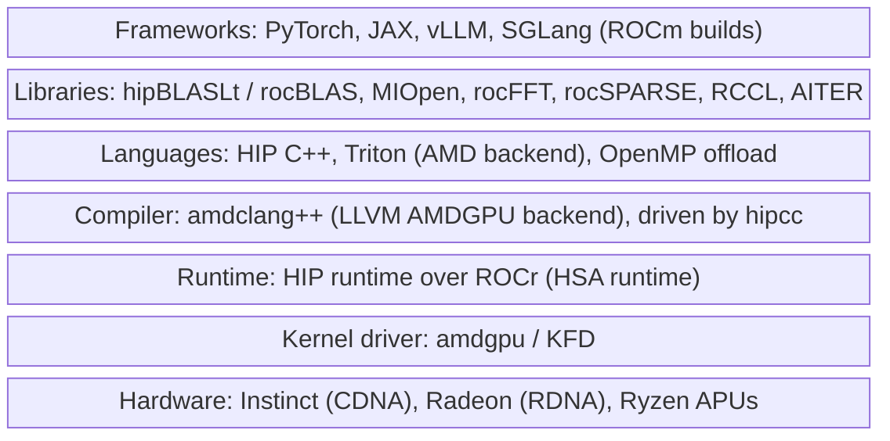
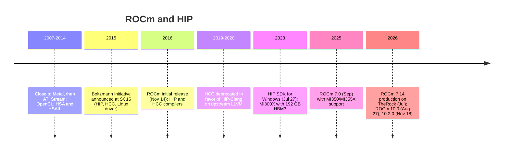
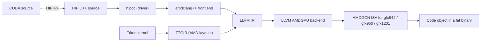

---
tags:
  - gpu-programming
  - compilers
  - rocm
  - hip
  - amd
status: complete
sources:
  - https://rocm.docs.amd.com/en/latest/release.html
  - https://rocm.blogs.amd.com/ecosystems-and-partners/rocm-x-blog/README.html
  - https://phoronix.com/news/AMD-ROCm-10.0
  - https://rocm.docs.amd.com/projects/HIP/en/latest/how-to/hip_porting_guide.html
  - https://rocm.docs.amd.com/en/latest/reference/gpu-arch/mi350.html
  - https://www.amd.com/content/dam/amd/en/documents/instinct-tech-docs/white-papers/amd-cdna-4-architecture-whitepaper.pdf
  - https://en.wikipedia.org/wiki/ROCm
  - https://www.theregister.com/2025/09/17/amd_rocm_7_chases_nvidia_cuda/
  - https://rocm.blogs.amd.com/ecosystems-and-partners/cdna5-helios/README.html
  - https://newsroom.amd.com/news/aai-2026-helios-update/
  - https://hazyresearch.stanford.edu/blog/2025-11-09-amd-brr
  - https://arxiv.org/abs/2511.08083
  - https://newsletter.semianalysis.com/p/inferencex-v2-nvidia-blackwell-vs
  - https://inferencex.semianalysis.com/blog/deepseek-v4-pro-agentx-mi355x-vs-b200-august
  - https://hpcwire.com/2026/07/09/spectral-compute-aims-to-set-cuda-free-will-it-succeed
  - https://rocm.docs.amd.com/projects/HIP/en/docs-7.1.0/understand/hardware_implementation.html
  - https://vllm.ai/blog/2026-03-04-vllm-triton-backend-deep-dive
created: 2026-11-26
updated: 2026-11-26
---

## Table Of Contents

---

- [[#TL;DR|TL;DR]]
- [[#The Problem|The Problem]]
- [[#Foundations|Foundations]]
    - [[#What ROCm Is|What ROCm Is]]
    - [[#What HIP Is|What HIP Is]]
    - [[#CUDA to AMD Vocabulary|CUDA to AMD Vocabulary]]
- [[#How We Got Here|How We Got Here]]
- [[#How It Works|How It Works]]
    - [[#A HIP Kernel Line by Line|A HIP Kernel Line by Line]]
    - [[#Porting with HIPIFY|Porting with HIPIFY]]
    - [[#The Wave64 Trap|The Wave64 Trap]]
    - [[#The Compiler Path|The Compiler Path]]
    - [[#What the Hardware Rewards|What the Hardware Rewards]]
- [[#Where It Is Now|Where It Is Now]]
    - [[#Releases and Hardware|Releases and Hardware]]
    - [[#How Close to CUDA|How Close to CUDA]]
    - [[#Other Roads to AMD|Other Roads to AMD]]
- [[#Trade-offs & Open Problems|Trade-offs & Open Problems]]
- [[#Resources|Resources]]
- [[#Related Notes|Related Notes]]

## ***TL;DR***
---
*ROCm is AMD's open-source GPU software stack, and HIP is its C++ kernel language, a near copy of CUDA that compiles for AMD GPUs (and, with a thin header layer, for NVIDIA). The language is the easy part; the hard parts are 64-wide wavefronts, a different memory and chiplet layout, and a library and serving ecosystem that still trails NVIDIA's.*

- **What it is:** ROCm (once "Radeon Open Compute") bundles the driver, the LLVM-based compiler (`amdclang++`, driven by `hipcc`), the HIP runtime, math and communication libraries (rocBLAS/hipBLASLt, MIOpen, RCCL), profilers and framework builds. HIP is the programming interface: `hipMalloc`, `hipMemcpy`, `__global__` kernels and `<<<grid, block>>>` launches, spelled almost exactly like the [[CUDA Programming Model|CUDA]] runtime ([HIP porting guide](https://rocm.docs.amd.com/projects/HIP/en/latest/how-to/hip_porting_guide.html)).
- **Why it matters:** it is the only production path to AMD Instinct GPUs. MI355X has 288 GB of HBM3E and up to 10 PFLOPS of MXFP4, more memory per GPU than NVIDIA's B200, so the software decides whether that hardware gets used ([AMD MI350 docs](https://rocm.docs.amd.com/en/latest/reference/gpu-arch/mi350.html)).
- **The catch:** code that assumes a 32-lane warp, 32-bit lane masks or NVIDIA-only features (TMA, `wgmma`, `tcgen05`) breaks or runs slowly. Hazy Research found that NVIDIA's dominant kernel pattern, [[Warp Specialization|warp specialization]], "is not the right answer on AMD" ([HipKittens blog](https://hazyresearch.stanford.edu/blog/2025-11-09-amd-brr)).
- **Where it is now (Nov 2026):** ROCm jumped from 7.14 to **10.0** on Aug 27, 2026, its tenth anniversary, and now ships about every six weeks; **10.2.0** (Nov 18, 2026) is current. Linux and Windows share one version. On LLM inference, MI355X traded leads with B200 through 2026, and SemiAnalysis still names "composability" of optimizations as AMD's biggest software gap ([ROCm 10 blog](https://rocm.blogs.amd.com/ecosystems-and-partners/rocm-x-blog/README.html), [10.2.0 notes](https://rocm.docs.amd.com/en/latest/release.html), [SemiAnalysis, Feb 2026](https://newsletter.semianalysis.com/p/inferencex-v2-nvidia-blackwell-vs)).

## ***The Problem***
---
*Almost all GPU code written since 2007 targets CUDA, which only runs on NVIDIA hardware. A second vendor needs a way to run that code without asking everyone to rewrite it, and a stack good enough that people choose to.*

CUDA's lead is less the language than the ecosystem: cuBLAS, cuDNN, NCCL, [[CUTLASS and CuTe]], Nsight, and fifteen years of kernels tuned for NVIDIA's warps and caches. A competitor faces three separate problems:

| Problem | What AMD needs | ROCm's answer |
|---|---|---|
| Source compatibility | Existing CUDA C++ compiles with minimal edits | HIP mirrors the CUDA runtime API; HIPIFY rewrites `cuda*` to `hip*` |
| Library parity | Drop-in BLAS, DNN, FFT, collectives | `hip*` wrapper libraries over `roc*` implementations; RCCL for collectives |
| Performance parity | Kernels tuned for AMD's different chip | Hand-written assembly libraries (e.g. AITER), [[Triton]]'s AMD backend, tile DSLs like HipKittens |

Source compatibility is mostly solved. Performance parity is where the work is, because the same kernel source makes different trade-offs on a chip with 64-wide wavefronts, eight chiplets and no NVIDIA-style asynchronous matrix engine.

## ***Foundations***
---
*ROCm is the whole stack and HIP is the language. If you know CUDA, most HIP concepts map one to one; the names change and a few hardware numbers change, and those numbers are what bite.*

### What ROCm Is

ROCm is an open-source stack from kernel driver to framework. From bottom to top:



The libraries come in pairs: a `roc*` implementation (rocBLAS, rocFFT) and a `hip*` wrapper with a cuBLAS-like API (hipBLAS, hipFFT) so ported code changes only names. hipBLASLt is the one that matters for AI GEMMs, the counterpart of cuBLASLt. RCCL is AMD's fork of NCCL, see [[Multi-GPU Communication - NVLink and NCCL|Multi-GPU Communication: NVLink and NCCL]].

### What HIP Is

HIP (Heterogeneous-compute Interface for Portability) is a C++ runtime API and kernel language. On AMD it compiles through `amdclang++`; on NVIDIA, HIP headers turn each `hip*` call into the matching `cuda*` call and nvcc compiles the result. The porting guide states that HIP "mostly uses a single API" where CUDA has separate driver (`cu*`) and runtime (`cuda*`) APIs; driver-style calls get a `hipDrv` or `hipModule` prefix ([porting guide](https://rocm.docs.amd.com/projects/HIP/en/latest/how-to/hip_porting_guide.html)).

### CUDA to AMD Vocabulary

| CUDA / NVIDIA | HIP / AMD | Note |
|---|---|---|
| Streaming Multiprocessor (SM) | Compute Unit (CU) | MI355X: 256 CUs, 4 SIMDs each |
| Warp (32 threads) | Wavefront (64 on CDNA, 32 on RDNA) | Always query `warpSize` |
| Shared memory | LDS (Local Data Share) | MI355X: 160 KB per CU |
| Tensor Cores | Matrix Cores (MFMA instructions) | Smaller, finer-grained instructions |
| `__shfl_sync`, `__ballot_sync` | `__shfl`, `__ballot` (64-bit masks on wave64) | See [[Warp Divergence and Warp-Level Primitives]] |
| PTX / SASS | LLVM IR / AMDGCN ISA (`gfx950` etc.) | No stable virtual ISA like PTX; see [[PTX and SASS]] |
| nvcc | hipcc → amdclang++ | `--maxregcount` not supported; use `__launch_bounds__` |
| Nsight Compute / Systems | ROCm Compute Profiler / Systems Profiler | See [[Profiling with Nsight Compute and Nsight Systems]] |
| `__CUDA_ARCH__` | `__HIP_DEVICE_COMPILE__` plus feature macros | |

Sources: [porting guide](https://rocm.docs.amd.com/projects/HIP/en/latest/how-to/hip_porting_guide.html), [MI350 microarchitecture](https://rocm.docs.amd.com/en/latest/reference/gpu-arch/mi350.html), [HIP hardware implementation](https://rocm.docs.amd.com/projects/HIP/en/docs-7.1.0/understand/hardware_implementation.html).

## ***How We Got Here***
---
*AMD's GPU compute story went through several abandoned stacks before ROCm. HIP's bet, copy CUDA's API instead of inventing a new one, is what finally stuck, and the AI boom turned ROCm from an HPC niche into a business AMD has to win.*



- **Before ROCm.** AMD's first general-purpose stack, Close to Metal, became ATI Stream; OpenCL followed, then the HSA effort with its HSAIL intermediate language, which was later dropped for LLVM's AMDGPU backend ([Wikipedia](https://en.wikipedia.org/wiki/ROCm)).
- **2015-2016, Boltzmann.** AMD announced the Boltzmann Initiative at SC15 and shipped ROCm in 2016, built around a C++ compiler and "a GPU programming language called HIP, aimed at high-performance computing" ([ROCm 10 blog](https://rocm.blogs.amd.com/ecosystems-and-partners/rocm-x-blog/README.html)). There were two compilers: HCC (AMD's own C++ dialect) and HIP. HCC was later deprecated "to focus on HIP," and HIP moved to Clang on upstream LLVM.
- **2017-2022, HPC first.** ROCm's early customers were supercomputers (Frontier, the first exascale machine, runs MI250X). Consumer Radeon support was patchy and often broke between releases, which shaped ROCm's reputation among hobbyists.
- **2023-2025, the AI turn.** MI300X gave AMD a credible LLM accelerator. PyTorch, vLLM and SGLang gained ROCm builds, and [[Triton]]'s AMD backend let `torch.compile` emit AMD kernels. ROCm 7.0 (September 2025) added MI350 support and AMD claimed large inference speedups over ROCm 6 ([The Register](https://www.theregister.com/2025/09/17/amd_rocm_7_chases_nvidia_cuda/)).
- **2026, process.** The open TheRock build system reached production in 7.14, and ROCm 10.0 reset the confusing 7.x "tech preview" numbering with a six-week cadence and one SDK for Linux and Windows ([Phoronix](https://phoronix.com/news/AMD-ROCm-10.0)).

## ***How It Works***
---
*A HIP program looks like CUDA with a find-and-replace. What changes is underneath: a different compiler, a different ISA per chip, wavefronts of 64, and a chip that rewards different kernel structure.*

### A HIP Kernel Line by Line

```cpp
#include <hip/hip_runtime.h>

__global__ void saxpy(int n, float a, const float* x, float* y) {
    int i = blockIdx.x * blockDim.x + threadIdx.x;   // global thread index
    if (i < n) y[i] = a * x[i] + y[i];               // guard the tail
}

int main() {
    int n = 1 << 24;
    float *x, *y;
    hipMalloc(&x, n * sizeof(float));                // device allocation
    hipMalloc(&y, n * sizeof(float));
    // ... fill x and y with hipMemcpy(..., hipMemcpyHostToDevice) ...
    saxpy<<<(n + 255) / 256, 256>>>(n, 2.0f, x, y);  // same launch syntax as CUDA
    hipDeviceSynchronize();                          // wait for the kernel
    hipFree(x); hipFree(y);
}
```

- **Line 1:** the HIP header replaces `cuda_runtime.h`.
- **The kernel:** `__global__`, `blockIdx`, `blockDim`, `threadIdx` mean exactly what they mean in CUDA. A block of 256 threads becomes 4 wavefronts of 64 on CDNA (8 warps of 32 on NVIDIA).
- **`hipMalloc`, `hipMemcpy`, `hipFree`:** one-to-one with the CUDA runtime calls.
- **`<<<grid, block>>>`:** HIP-Clang accepts CUDA's triple-chevron launch (older code uses the `hipLaunchKernelGGL` macro).
- **Build:** `hipcc saxpy.cpp -o saxpy --offload-arch=gfx950` produces a binary for MI355X. Each chip generation has its own ISA name (`gfx942` MI300, `gfx950` MI350), and there is no PTX-style virtual ISA, so you compile for each target you want to run on.

### Porting with HIPIFY

HIPIFY rewrites CUDA source to HIP. There are two tools:

| Tool | How | Needs | Good for |
|---|---|---|---|
| `hipify-clang` | Parses the code into a Clang AST | A working CUDA install; code must compile | Accurate, large codebases |
| `hipify-perl` | Regex pattern matching | Nothing | Quick, broken or partial code |

Both have `--examine` (dry run with statistics) and `--inplace` (rewrite, keeping a `.prehip` backup) ([porting guide](https://rocm.docs.amd.com/projects/HIP/en/latest/how-to/hip_porting_guide.html)). What HIPIFY cannot do is change algorithms: inline PTX, warp-size assumptions and NVIDIA-only hardware features must be rewritten by hand.

### The Wave64 Trap

The porting guide says it plainly: "Code should not assume a warp size of 32 or 64, as AMD GPU architectures have different warp sizes." CDNA (Instinct) runs 64-wide wavefronts; RDNA (Radeon) runs 32-wide by default.

The classic bug is a lane mask:

```cpp
unsigned mask = 1u << lane;            // breaks: lane can be 32..63 on wave64
uint64_t mask = uint64_t{1} << lane;   // works on wave64
```

- **Line 1:** shifting a 32-bit `1` by 32 or more is undefined in C++ and yields garbage, so lanes 32-63 of every wavefront lose their bit.
- **Line 2:** a 64-bit mask has room for all 64 lanes. The guide recommends a `lane_mask_t` typedef (`uint64_t` on GFX8/GFX9-class chips, `uint32_t` otherwise) so one source serves both.

**Worked example.** A warp-shuffle reduction written for 32 lanes does 5 steps ($\log_2 32$) and sums 32 values. On a 64-wide wavefront the same code does 5 steps and leaves you with two partial sums, one per half, so the result is silently wrong unless the loop runs $\log_2(\text{warpSize}) = 6$ steps. That is why [[Parallel Reduction and Scan]] code written for CUDA must be audited, not just renamed.

### The Compiler Path



Because the AMD backend lives in upstream LLVM, any LLVM-based front end can target AMD GPUs; [[Triton]] lowers to LLVM IR and reuses the same backend. The `hipcc` driver mostly adds the right include paths, link flags and `__HIP_PLATFORM_AMD__` macro. Register limits are set with `__launch_bounds__`, since `amdclang++` does not accept nvcc's `--maxregcount` ([porting guide](https://rocm.docs.amd.com/projects/HIP/en/latest/how-to/hip_porting_guide.html)).

### What the Hardware Rewards

MI355X (CDNA 4, `gfx950`) in numbers, from AMD's documentation:

| Resource | MI355X |
|---|---|
| Chiplets (XCDs) | 8, each with 32 active CUs (36 physical) |
| Compute Units | 256 |
| LDS per CU | 160 KB, with doubled read bandwidth vs CDNA 3 |
| HBM | 288 GB HBM3E, up to 8 TB/s |
| Infinity Cache (last level) | 256 MB |
| Dense BF16 matrix | 2.5 PFLOPS |
| Dense FP8 / MXFP4 | 5.0 / 10 PFLOPS |
| FP64 matrix and vector | 78.6 TFLOPS |

Source: [AMD MI350 microarchitecture](https://rocm.docs.amd.com/en/latest/reference/gpu-arch/mi350.html).

**Ridge point worked example.** Using the [[Roofline Model and Arithmetic Intensity|roofline]] formula, the arithmetic intensity a BF16 kernel needs before compute becomes the limit is

$$I^* = \frac{\text{peak FLOP/s}}{\text{peak bytes/s}} = \frac{2.5\times10^{15}}{8\times10^{12}} \approx 312 \text{ FLOP/byte}.$$

In plain words: an MI355X must do about 312 BF16 operations per byte it reads from HBM to stay busy. A 4096³ BF16 [[Tiled Matrix Multiplication (GEMM)|GEMM]] has an intensity of roughly $2\cdot4096^3 / (3\cdot4096^2\cdot2) \approx 1365$, so it can be compute-bound; an elementwise add (about 0.17 FLOP/byte) never is.

Hazy Research's HipKittens work (MLSys 2026) lists what differs from Hopper and Blackwell when you write a fast kernel ([blog](https://hazyresearch.stanford.edu/blog/2025-11-09-amd-brr), [paper](https://arxiv.org/abs/2511.08083)):

- **No asynchronous matrix engine.** AMD "lacks asynchronous matrix multiplication instructions that operate on inputs in shared or tensor memory," and has no `mbarrier` primitives or register reallocation. Matrix instructions take operands from registers.
- **Bigger register file.** About twice B200's per processor, statically split across waves, which is why producer/consumer [[Warp Specialization|wave specialization]] wastes registers. HipKittens instead uses an 8-wave "ping-pong" schedule and a 4-wave interleave.
- **Direct global-to-LDS loads** (`buffer_load_dword ... lds`) that skip registers, AMD's nearest equivalent to `cp.async` (see [[TMA and Asynchronous Copies]]).
- **Chiplets matter.** Blocks are assigned to the 8 XCDs round-robin and each XCD has a private L2. Reordering the grid so neighbouring tiles land on the same XCD raised a 14592³ BF16 GEMM from 900 to 1068 TFLOPS.
- **Compiler limits.** The authors write that "even the HIPCC compiler imposes severe limitations" on register use, "no wonder AMD uses raw assembly." Their BF16 GEMM reached 1605 TFLOPS on MI355X.

## ***Where It Is Now***
---
*As of November 2026: ROCm 10.2 is current, releases come every six weeks, MI355X is shipping and MI455X racks are announced for the second half of 2026. The language gap is closed; the gaps left are tuned libraries, composable serving optimizations and developer tooling.*

### Releases and Hardware

- **ROCm 10.0** (Aug 27, 2026) was "the first major version bump since the 7.x series," marking ten years of ROCm. TheRock, the open build system, ships every release; the HIP SDK for Windows was retired in favour of a single ROCm Core SDK with the same version and cadence on both OSes. It also introduced **ROCm.AI** (a ROCm CLI, "AMD Skills" agent instructions and Hyperloom) ([ROCm 10 blog](https://rocm.blogs.amd.com/ecosystems-and-partners/rocm-x-blog/README.html)).
- **ROCm 10.2.0** (Nov 18, 2026) supports Instinct `gfx950` (MI350/MI355X), `gfx942` (MI300), `gfx90a` and `gfx908`; RDNA 4, 3 and 2 Radeons; and Ryzen APUs including Strix Halo. It ships with PyTorch 2.15.0, JAX 0.11.2, vLLM 0.32.0 and SGLang 0.5.21, and adds complex GEMM to hipBLASLt. The HIP component is version 7.17.0 ([10.2.0 notes](https://rocm.docs.amd.com/en/latest/release.html)).
- **CDNA 5 / MI455X.** Announced at Advancing AI on Jul 23, 2026 as the GPU of AMD's 72-GPU **Helios** rack: 432 GB of HBM4 per GPU, and per rack 2.9 exaflops peak FP4, 31 TB of HBM4 and 1.7 PB/s. The architecture adds "Tensor Data Movers," larger L2 caches and register files, an unsigned E5M3 scale format and a 4-bit lookup-table instruction that expands 4-bit values into MX formats ([CDNA 5 blog](https://rocm.blogs.amd.com/ecosystems-and-partners/cdna5-helios/README.html), [AMD newsroom](https://newsroom.amd.com/news/aai-2026-helios-update/)). Tensor Data Movers look like AMD's answer to NVIDIA's [[TMA and Asynchronous Copies|TMA]]; how kernels will program them is not public yet.

### How Close to CUDA

The best public yardstick is SemiAnalysis's open InferenceMAX/InferenceX benchmark, which runs the same models nightly on both vendors:

| Date | Finding |
|---|---|
| Feb 16, 2026 | MI355X is competitive on FP8 with disaggregated serving and wide expert parallelism in SGLang, but "enabling all three major optimizations that labs use, AMD's performance is currently not competitive"; FP4 "suffers from composability issues"; AMD "more than six months behind on open source distributed inferencing" ([SemiAnalysis](https://newsletter.semianalysis.com/p/inferencex-v2-nvidia-blackwell-vs)) |
| Aug 25, 2026 | On DeepSeek V4 Pro, MI355X with SGLang had matched B200 with vLLM on end-to-end performance per dollar until upstream vLLM work on Aug 21 put B200 back ahead: "a close race rather than a settled one" ([InferenceX](https://inferencex.semianalysis.com/blog/deepseek-v4-pro-agentx-mi355x-vs-b200-august)) |

The pattern: AMD's hardware is competitive on paper, especially in memory capacity (MI355X has 1.5x B200's HBM), and individual kernels can match NVIDIA, but each optimization lands on ROCm later and they do not always combine. Portable layers help: vLLM's ~800-line [[Triton]] attention backend is the default on ROCm ([vLLM, Mar 2026](https://vllm.ai/blog/2026-03-04-vllm-triton-backend-deep-dive)).

### Other Roads to AMD

| Path | What it does | Status (2026) |
|---|---|---|
| HIP + HIPIFY | Source port to HIP | AMD's official route |
| [[Triton]] | Same Python kernel on NVIDIA and AMD | Default for `torch.compile` on ROCm |
| HipKittens | Tile primitives for AMD, see [[ThunderKittens and Tile DSLs]] | Research code, MLSys 2026 oral |
| SCALE (Spectral Compute) | Compiles unmodified CUDA source for AMD with an nvcc replacement | Shipping about two years; claims ~6x over HIPIFY-ported code (company claim) ([HPCwire](https://hpcwire.com/2026/07/09/spectral-compute-aims-to-set-cuda-free-will-it-succeed)) |
| ZLUDA | Runs compiled CUDA binaries on non-NVIDIA GPUs | Once AMD-backed; works at binary level, which costs performance |

## ***Trade-offs & Open Problems***
---
*HIP makes porting cheap and performance expensive: the code compiles quickly, but making it fast on AMD needs AMD-specific tuning. The open questions are whether AMD's libraries and serving stacks can keep pace with NVIDIA's release speed, and whether portable layers like Triton make the vendor choice matter less.*

| Strength | Cost |
|---|---|
| Open source end to end, upstream LLVM backend | Fewer engineers and users than CUDA, so fewer tuned kernels |
| HIP is nearly CUDA; HIPIFY automates most renaming | Warp-size, mask and inline-PTX code must be fixed by hand |
| More HBM per GPU (288 GB MI355X, 432 GB MI455X) | No PTX-like virtual ISA: one binary per `gfx` target |
| Same source can target NVIDIA via HIP headers | NVIDIA-only features (TMA, `tcgen05`, clusters) have no direct HIP equivalent |
| Six-week releases since 10.0 | Frequent breaking CLI and API changes (e.g. profiler flags in 10.2) |

- **Kernel structure doesn't transfer.** The fastest NVIDIA kernels are built around warp specialization and asynchronous MMA; on AMD the winning schedules are different (ping-pong, interleave) and register allocation is static. A kernel tuned for Blackwell ports correctly but not fast.
- **Assembly as the norm.** Many of AMD's fastest kernels (in AITER and hipBLASLt) are hand-written assembly because the compiler limits register use. That makes them hard to fuse or modify, the composability problem in miniature.
- **Chiplet-aware scheduling.** Eight XCDs with private L2s mean grid order changes cache hit rates by double digits; NVIDIA's monolithic-per-die L2 hides this.
- **Documentation gaps.** HipKittens' authors reverse-engineered LDS phase behaviour because it "is not well-documented even within AMD."
- **Ecosystem pace.** Each new serving optimization (disaggregation, wide EP, FP4 MoE) tends to land on NVIDIA first; ROCm's six-week cadence is meant to shrink that lag.

## ***Resources***
---
*Start with the HIP porting guide and the MI350 microarchitecture page, then read HipKittens for what fast AMD kernels actually look like. Track the InferenceX dashboard for an honest, continuously updated comparison.*

**Primary**
- [HIP porting guide](https://rocm.docs.amd.com/projects/HIP/en/latest/how-to/hip_porting_guide.html): HIPIFY, API mapping, warp size, macros.
- [AMD Instinct MI350 Series microarchitecture](https://rocm.docs.amd.com/en/latest/reference/gpu-arch/mi350.html) and the [CDNA 4 whitepaper](https://www.amd.com/content/dam/amd/en/documents/instinct-tech-docs/white-papers/amd-cdna-4-architecture-whitepaper.pdf).
- [ROCm 10.2.0 release notes](https://rocm.docs.amd.com/en/latest/release.html), Nov 18, 2026.
- [ROCm 10.0: A Decade of Open Compute](https://rocm.blogs.amd.com/ecosystems-and-partners/rocm-x-blog/README.html), AMD, Aug 27, 2026.
- [Introducing CDNA 5 and Helios](https://rocm.blogs.amd.com/ecosystems-and-partners/cdna5-helios/README.html), AMD, Aug 4, 2026.

**Practitioners and papers**
- [AMD GPUs go brrr (HipKittens)](https://hazyresearch.stanford.edu/blog/2025-11-09-amd-brr) and [HipKittens: Fast and Furious AMD Kernels](https://arxiv.org/abs/2511.08083), Hazy Research, MLSys 2026.
- [InferenceX v2: NVIDIA Blackwell vs AMD](https://newsletter.semianalysis.com/p/inferencex-v2-nvidia-blackwell-vs), SemiAnalysis, Feb 2026, and the [InferenceX dashboard](https://inferencex.semianalysis.com).
- [Spectral Compute aims to set CUDA free](https://hpcwire.com/2026/07/09/spectral-compute-aims-to-set-cuda-free-will-it-succeed), HPCwire, Jul 2026.

## Related Notes

- [[CUDA Programming Model]] — The model HIP copies almost name for name.
- [[GPU Architecture Basics]] — SMs vs CUs, warps vs wavefronts.
- [[Warp Divergence and Warp-Level Primitives]] — Where 64-lane wavefronts change the code.
- [[Parallel Reduction and Scan]] — Shuffle reductions that must be audited for wave64.
- [[PTX and SASS]] — NVIDIA's virtual ISA, which AMD has no equivalent of.
- [[Triton]] — The most-used portable kernel language on ROCm.
- [[ThunderKittens and Tile DSLs]] — HipKittens, the AMD port of ThunderKittens.
- [[Warp Specialization]] — The NVIDIA pattern that doesn't pay off on AMD.
- [[TMA and Asynchronous Copies]] — NVIDIA's copy engine; AMD's Tensor Data Movers are its counterpart.
- [[Tensor Cores]] — NVIDIA's matrix units; AMD calls them Matrix Cores.
- [[Low-Precision Formats - FP8, FP4 and MX|Low-Precision Formats: FP8, FP4 and MX]] — MXFP4/MXFP6 on CDNA 4.
- [[Multi-GPU Communication - NVLink and NCCL|Multi-GPU Communication: NVLink and NCCL]] — RCCL is AMD's NCCL fork.
- [[Roofline Model and Arithmetic Intensity]] — The ridge-point arithmetic above.
- [[AI Accelerators]] — The wider accelerator landscape.
