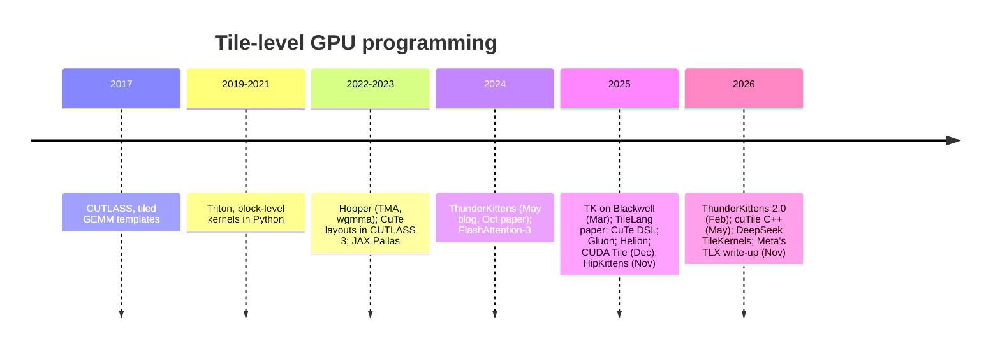
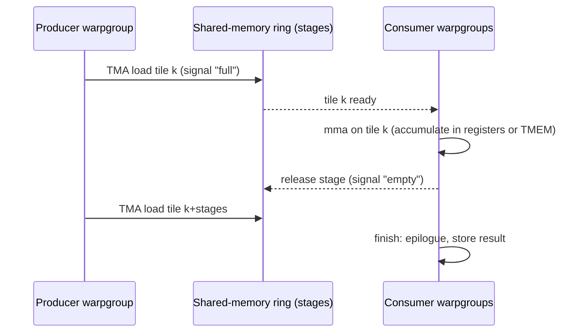
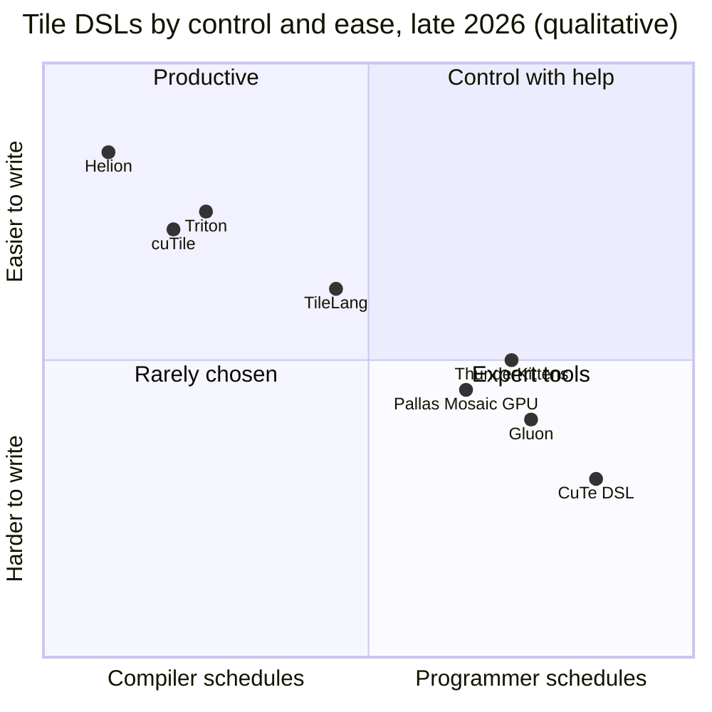

---
tags:
  - gpu-programming
  - compilers
  - thunderkittens
  - tile-dsl
  - kernel-languages
status: complete
sources:
  - https://arxiv.org/abs/2410.20399
  - https://hazyresearch.stanford.edu/blog/2024-05-12-tk
  - https://hazyresearch.stanford.edu/blog/2025-03-15-tk-blackwell
  - https://hazyresearch.stanford.edu/blog/2026-02-19-tk-2
  - https://github.com/HazyResearch/ThunderKittens
  - https://hazyresearch.stanford.edu/blog/2025-11-09-amd-brr
  - https://arxiv.org/abs/2511.08083
  - https://github.com/tile-ai/tilelang
  - https://arxiv.org/abs/2504.17577
  - https://github.com/deepseek-ai/TileKernels
  - https://docs.jax.dev/en/latest/pallas/gpu/reference.html
  - https://docs.jax.dev/en/latest/_sources/pallas/gpu/blackwell_matmul.md
  - https://triton-lang.org/main/gluon/
  - https://pytorch.org/blog/helion/
  - https://arxiv.org/abs/2609.29067
  - https://engineering.fb.com/2026/11/10/open-source/tlx-a-hardware-native-gpu-compiler-for-production-ml/
created: 2026-11-26
updated: 2026-11-26
---

## Table Of Contents

---

- [[#TL;DR|TL;DR]]
- [[#The Problem|The Problem]]
- [[#Foundations|Foundations]]
    - [[#What a Tile DSL Is|What a Tile DSL Is]]
    - [[#Why 16 by 16|Why 16 by 16]]
- [[#How We Got Here|How We Got Here]]
- [[#How It Works|How It Works]]
    - [[#ThunderKittens' Three Levels|ThunderKittens' Three Levels]]
    - [[#A Tile Kernel Line by Line|A Tile Kernel Line by Line]]
    - [[#The Load-Compute-Store-Finish Template|The Load-Compute-Store-Finish Template]]
    - [[#HipKittens: The Same Idea on AMD|HipKittens: The Same Idea on AMD]]
- [[#Where It Is Now|Where It Is Now]]
    - [[#ThunderKittens 2.0|ThunderKittens 2.0]]
    - [[#The Tile DSL Landscape|The Tile DSL Landscape]]
- [[#Trade-offs & Open Problems|Trade-offs & Open Problems]]
- [[#Resources|Resources]]
- [[#Related Notes|Related Notes]]

## ***TL;DR***
---
*ThunderKittens (TK) is a small C++ library from Stanford's Hazy Research that gives you tiles (16×16 blocks of data in registers or shared memory) and a handful of operations on them, while leaving warp-level control in your hands. It is the best-known of a 2024-2026 wave of "tile DSLs" that sit between Triton's compiler-driven blocks and CUTLASS's full template machinery.*

- **What it is:** an embedded C++/CUDA library (header-only) whose basic types are register tiles, shared-memory tiles and vectors, plus operations like `mma`, `load`, `exp` and row reductions. Introduced in the "GPUs Go Brrr" post (May 2024) and the paper *ThunderKittens: Simple, Fast, and Adorable AI Kernels* (ICLR 2025) ([paper](https://arxiv.org/abs/2410.20399)).
- **The idea:** modern GPUs are built to multiply small matrices, so make a small matrix tile the unit you program, then give programmers control over warps, pipelines and [[Warp Specialization|producer/consumer roles]] instead of hiding them.
- **Why it matters:** the paper reports GEMM on par with cuBLAS and attention inference on par with FlashAttention-3, plus 10-40% faster attention backward, 8× on state-space models and 14× on linear attention over the best baselines, and TK is the base for Hazy's [[Megakernels|megakernels]] and its AMD port **HipKittens** (MLSys 2026) ([HipKittens](https://arxiv.org/abs/2511.08083)).
- **The wider field (Nov 2026):** TK 2.0 (Feb 2026, MXFP8 and NVFP4 GEMMs that match or beat cuBLAS on B200), TileLang (used for DeepSeek's TileKernels), JAX Pallas on Mosaic GPU, Triton's Gluon and Meta's TLX, PyTorch's Helion, NVIDIA's [[CUDA Tile and cuTile|cuTile]] and CuTe DSL. They differ mainly in how much of the chip they let you steer.

## ***The Problem***
---
*Hopper and Blackwell put most of their speed in asynchronous matrix units and copy engines that work on tiles, and reaching peak needs warp-level choreography. Triton hides that choreography; CUTLASS exposes it behind thousands of lines of templates. Researchers wanted something in between.*

| Tool | What you control | Cost |
|---|---|---|
| Raw CUDA + PTX | Everything | Thousands of lines per kernel, per architecture |
| [[CUTLASS and CuTe]] | Layouts, pipelines, warp roles via templates | Steep learning curve, heavy C++ metaprogramming |
| [[Triton]] | Block-level math; compiler does the rest | Can't express warp specialization or explicit pipelines (outside Gluon) |
| **Tile DSLs (TK etc.)** | Tiles plus explicit warp roles and pipelines | Fewer abstractions to learn; still need GPU knowledge |

Hazy Research's framing: on an H100 "all of the compute happens in the SM's. *Most* of it happens in the registers," and the tensor cores supply nearly all the FLOPs, so everything else (loads, softmax, bookkeeping) has to be arranged so those units never wait; without `wgmma`, they found the H100 tops out around 63% of peak ([GPUs Go Brrr](https://hazyresearch.stanford.edu/blog/2024-05-12-tk)). That arrangement is the hard part, and the right abstraction for it is a tile, not a thread.

## ***Foundations***
---
*A tile DSL gives you data tiles as first-class values and operations that map to hardware tile instructions. The design question is how much scheduling stays with the programmer.*

### What a Tile DSL Is

A **tile** is a small 2D block of a matrix (16×16, 64×64, 128×256...) stored in one level of the [[GPU Memory Hierarchy|memory hierarchy]]. A tile DSL provides:

- **Tile types** tagged by where they live: registers (spread across a warp's or warpgroup's threads), shared memory (with a [[Shared Memory and Bank Conflicts|swizzled]] layout), Tensor Memory on Blackwell.
- **Tile operations**: load/store between levels (often via [[TMA and Asynchronous Copies|TMA]]), matrix multiply-accumulate on [[Tensor Cores]], elementwise math, row/column reductions.
- **Some notion of scheduling**: who issues which operation, how loads overlap compute.

Languages split on that last point. In [[Triton]] and cuTile the compiler schedules; in TK, Gluon, TLX and CuTe DSL the programmer does.

### Why 16 by 16

The [[Tensor Cores|tensor-core]] instructions on NVIDIA GPUs since Ampere operate on fragments built from 16×16 (or 16×8) pieces spread across the 32 threads of a warp. TK made the 16×16 tile its smallest unit so that every tile operation maps directly to whole tensor-core fragments, with no partial tiles to handle ([paper](https://arxiv.org/abs/2410.20399)). Larger tiles are just multiples of 16.

**Worked example.** A 64×64 BF16 tile holds 4,096 values = 8 KB. Spread across one warpgroup (4 warps, 128 threads), that is 32 values or 64 bytes (16 32-bit registers) per thread. A 64×64 FP32 accumulator is 32 registers per thread. Hopper allows 255 registers per thread, so one warpgroup can hold a few such tiles at once, which is why tile sizes in TK attention kernels are chosen around the register budget (see [[Occupancy and Latency Hiding]]).

## ***How We Got Here***
---
*Tile thinking came from GEMM libraries; Triton showed a block-level language could be productive; Hopper's asynchronous hardware made explicit scheduling worth exposing again. TK arrived in 2024 as a deliberately small library and spawned a family.*



- **May 2024:** "GPUs Go Brrr" introduced TK with an H100 FlashAttention forward kernel in "just 100 lines" that ran about 30% faster than FlashAttention-2, and a 4090 version in about 60 lines ([blog](https://hazyresearch.stanford.edu/blog/2024-05-12-tk)).
- **Oct 2024:** the TK paper (Spector, Arora, Singhal, Fu, Ré; ICLR 2025) formalised the three-level design and benchmarked GEMM, attention, linear attention and state-space kernels on H100 ([paper](https://arxiv.org/abs/2410.20399)).
- **Mar 2025:** TK added Blackwell support (`tcgen05`, Tensor Memory, 2-CTA MMA) ([TK on Blackwell](https://hazyresearch.stanford.edu/blog/2025-03-15-tk-blackwell)).
- **2025:** Hazy built [[Megakernels|megakernels]] (whole-model persistent kernels for LLM decode) on TK, and ported the ideas to AMD as HipKittens. Others followed with their own tile DSLs (TileLang, Gluon, Helion, cuTile).
- **Feb 2026:** ThunderKittens 2.0, by Stuart Sul and Chris Ré, added MXFP8 and NVFP4, cluster launch control scheduling and [[Programmatic Dependent Launch|programmatic dependent launch]] ([blog](https://hazyresearch.stanford.edu/blog/2026-02-19-tk-2)).

## ***How It Works***
---
*TK works at three levels: tiles and their operations inside a warp, a producer/consumer template inside a block, and persistent scheduling across the grid. The programmer writes the middle level; the library makes the bottom level one line each.*

### ThunderKittens' Three Levels

| Level | What TK provides | Hardware it maps to |
|---|---|---|
| Warp / warpgroup | `rt` register tiles, `st` shared tiles, `rv`/`sv` vectors; `mma_AB`, `load`, `store`, `exp`, `row_max`, `row_sum` | Tensor cores (`mma.sync`, `wgmma`, `tcgen05`), registers, swizzled shared memory |
| Thread block | LCSF template: load, compute, store, finish; producer and consumer warpgroups; semaphores | [[TMA and Asynchronous Copies|TMA]], `mbarrier`, [[Warp Specialization]] |
| Grid | Persistent grid that overlaps loads across block boundaries; block order chosen for L2 reuse | SMs, L2 cache |

Source: [TK paper](https://arxiv.org/abs/2410.20399).

### A Tile Kernel Line by Line

A simplified piece of an attention inner loop in TK style (illustrative, not verbatim from the repo):

```cpp
rt_bf<16, 64> q_reg;                 // 16x64 bf16 register tile (one warp)
rt_fl<16, 64> att;                   // fp32 scores tile
rt_fl<16, 64>::col_vec max_vec;      // per-row running max

load(q_reg, q_smem[warpid]);         // shared -> registers
mma_ABt(att, q_reg, k_smem[i], att); // att = Q * K^T on tensor cores
row_max(max_vec, att, max_vec);      // update running row max
sub_row(att, att, max_vec);          // subtract max per row
exp(att, att);                       // elementwise exp
```

- **`rt_bf<16, 64>`:** a register tile, 16 rows by 64 columns of BF16, distributed across the 32 threads of a warp in the layout the tensor cores expect.
- **`load(q_reg, q_smem[...])`:** copy from a shared-memory tile into the register tile; TK handles the swizzle so there are no [[Shared Memory and Bank Conflicts|bank conflicts]].
- **`mma_ABt`:** multiply A by B-transpose and accumulate, one call for what would be dozens of `mma` instructions.
- **`row_max`, `sub_row`, `exp`:** the online-softmax steps of [[FlashAttention]], each operating on whole rows of the tile.

The point is visible: the code reads like the math, but each line is a known, fixed-cost hardware operation, and you still decide which warp runs it and when.

### The Load-Compute-Store-Finish Template



The LCSF template packages the [[Warp Specialization|warp-specialized]] pipeline that every fast Hopper/Blackwell kernel uses: one producer warpgroup issues TMA loads into a ring of shared-memory stages, consumer warpgroups run tensor-core MMAs, and `mbarrier`s say when a stage is full or free. You fill in four functions (load, compute, store, finish) and the template handles the ring and barriers ([paper](https://arxiv.org/abs/2410.20399)).

### HipKittens: The Same Idea on AMD

HipKittens (Hu et al., MLSys 2026) ported TK's tile abstractions to AMD's CDNA3 and CDNA4 GPUs (MI355X in the benchmarks) and found that the tile layer transfers but the scheduling does not ([HipKittens blog](https://hazyresearch.stanford.edu/blog/2025-11-09-amd-brr), [paper](https://arxiv.org/abs/2511.08083)):

- The MI355X has no register reallocation, so producer waves hold registers they don't need and producer/consumer wave specialization underperforms.
- Two schedules worked instead: **8-wave ping-pong** (two groups of waves alternate between memory and compute) and **4-wave interleave** (fine-grained alternation within each wave).
- A chiplet-aware grid order mattered on the 8-XCD MI355X, raising a 14592³ GEMM from 900 to 1068 TFLOPS. The best BF16 GEMM reached 1605 TFLOPS, and the 4-wave pattern beat AMD's baselines by 2.3× on GQA non-causal attention backward. The paper sums it up as competitive with AMD's hand-written assembly on GEMM and attention, and 1.2-2.4× faster than the best baselines in some settings.

See [[ROCm and HIP]] for the hardware behind these differences.

## ***Where It Is Now***
---
*As of November 2026: TK 2.0 is current and underpins Hazy's megakernel work; tile DSLs have multiplied, and NVIDIA, Google, Meta, OpenAI's Triton project, PyTorch and DeepSeek each back at least one. Independent benchmarks show none reliably reaching roofline across operators.*

### ThunderKittens 2.0

Hazy released ThunderKittens 2.0 on Feb 19, 2026 under the title "Even Faster Kernels for Your GPUs," focused on Blackwell: its BF16, MXFP8 and NVFP4 GEMMs "surpass or match cuBLAS performance on Nvidia B200s," and reworking tensor-core and copy scheduling alone recovered about 10% on NVFP4 GEMM ([TK 2.0 blog](https://hazyresearch.stanford.edu/blog/2026-02-19-tk-2), [repo](https://github.com/HazyResearch/ThunderKittens)). The post says TK 2.0 powers inference kernels at Together AI and training kernels for Cursor's Composer.

### The Tile DSL Landscape

| DSL | From | Language | Scheduling | Targets |
|---|---|---|---|---|
| **ThunderKittens** | Hazy Research (Stanford) | C++ (CUDA) | Programmer: warp roles, LCSF template | NVIDIA; AMD via HipKittens |
| **TileLang** | tile-ai (started at Peking Univ.) | Python on TVM | Compiler by default, low-level escape hatches | NVIDIA, AMD, Huawei Ascend 950, Apple Metal |
| **Pallas / Mosaic GPU** | Google (JAX) | Python | Programmer (warpgroups, barriers) on Mosaic GPU | NVIDIA Hopper/Blackwell; TPU via Mosaic TPU |
| **Gluon** | Triton project | Python | Programmer: layouts, warp specialization | NVIDIA, AMD |
| **TLX** | Meta | Triton extensions | Programmer: warp-group roles, mbarriers, TMEM, clusters | NVIDIA Hopper/Blackwell; AMD MI300/MI350X |
| **Helion** | PyTorch | Python, compiles to Triton | Compiler plus heavy autotuning | Where Triton runs |
| **CuTe DSL** | NVIDIA | Python | Programmer: layouts, TMEM, warp roles | NVIDIA |
| **cuTile** | NVIDIA | Python, C++ | Compiler, via Tile IR | NVIDIA |

Sources: [TileLang](https://github.com/tile-ai/tilelang), [Pallas Mosaic GPU](https://docs.jax.dev/en/latest/pallas/gpu/reference.html), [Gluon](https://triton-lang.org/main/gluon/), [Helion](https://pytorch.org/blog/helion/), [TLX](https://engineering.fb.com/2026/11/10/open-source/tlx-a-hardware-native-gpu-compiler-for-production-ml/); see [[CUTLASS and CuTe]] and [[CUDA Tile and cuTile]].

- **TileLang in production.** DeepSeek published **TileKernels**, "dozens of highly optimized kernels implemented in TileLang" for MoE routing, FP8/FP4 quantization, RoPE and more; it added Huawei Ascend support in September 2026 ([TileKernels](https://github.com/deepseek-ai/TileKernels)).
- **Pallas on Blackwell.** JAX's docs include a tutorial for high-performance Blackwell matmuls in Pallas on Mosaic GPU ([JAX docs](https://docs.jax.dev/en/latest/_sources/pallas/gpu/blackwell_matmul.md)).
- **TLX at Meta.** Meta described TLX (Triton Low-Level Extensions) in November 2026: warp groups as explicit producer, consumer and epilogue roles, synchronised with mbarriers, used for production training and recommendation kernels and "typically on par with hand-tuned CUDA" ([Meta Engineering](https://engineering.fb.com/2026/11/10/open-source/tlx-a-hardware-native-gpu-compiler-for-production-ml/)).
- **Independent check.** The 2026 TileBench study on B200 found "most kernels remain far from roofline limits" across tile languages ([TileBench](https://arxiv.org/abs/2609.29067)).



The placement is this note's judgement, not a measurement.

## ***Trade-offs & Open Problems***
---
*Tile DSLs trade some portability and compiler automation for control and readable code. The open questions are whether compilers can learn the schedules experts write by hand, and whether one DSL wins or the field stays fragmented.*

| Strength | Cost |
|---|---|
| Code reads like the math; each op has predictable cost | You still need to know warps, pipelines and memory levels |
| Explicit warp roles reach Hopper/Blackwell peak | Schedules are per-architecture (HipKittens needed new ones) |
| Small libraries, easy to read end to end | Fewer operators and less tooling than cuBLAS/CUTLASS |
| Good base for fused and megakernel designs | Fragmented field: many DSLs, few shared standards |

- **Schedules don't port.** TK's tile layer moved to AMD; its producer/consumer schedule did not. Every new architecture may need new schedules, which is the problem compiler-driven tools (Triton autoWS, cuTile) try to automate.
- **Compilers catching up.** Automatic [[Warp Specialization|warp specialization]] research (Tawa, Twill, Cypress) aims to derive the schedules TK users write by hand; if it succeeds, explicit-scheduling DSLs lose their main advantage.
- **Fragmentation.** Eight active tile DSLs in late 2026, each with its own layouts and conventions. Kernel authors increasingly pick by ecosystem (PyTorch, JAX, DeepSeek-style serving) rather than by language.
- **Distance from roofline.** TileBench's finding applies to all of them: tile abstractions make kernels easier to write, but not automatically fast.

## ***Resources***
---
*Read "GPUs Go Brrr" first for the philosophy, then the TK paper for the design, then HipKittens for what changes on AMD. For the rest of the field, the TileLang repo and the JAX Pallas GPU docs are the best entry points.*

**ThunderKittens**
- [GPUs Go Brrr](https://hazyresearch.stanford.edu/blog/2024-05-12-tk), Hazy Research, May 2024.
- [ThunderKittens: Simple, Fast, and Adorable AI Kernels](https://arxiv.org/abs/2410.20399), Spector et al., ICLR 2025.
- [ThunderKittens Now on Blackwells](https://hazyresearch.stanford.edu/blog/2025-03-15-tk-blackwell), Mar 2025, and [ThunderKittens 2.0](https://hazyresearch.stanford.edu/blog/2026-02-19-tk-2), Feb 2026.
- [HazyResearch/ThunderKittens](https://github.com/HazyResearch/ThunderKittens).
- [HipKittens: Fast and Furious AMD Kernels](https://arxiv.org/abs/2511.08083), Hu et al., MLSys 2026, and the [AMD GPUs go brrr](https://hazyresearch.stanford.edu/blog/2025-11-09-amd-brr) post.

**Other tile DSLs**
- [TileLang](https://github.com/tile-ai/tilelang) and its [paper](https://arxiv.org/abs/2504.17577); [DeepSeek TileKernels](https://github.com/deepseek-ai/TileKernels).
- [Pallas: Writing Mosaic GPU kernels](https://docs.jax.dev/en/latest/pallas/gpu/reference.html), JAX docs.
- [Gluon](https://triton-lang.org/main/gluon/), [Helion](https://pytorch.org/blog/helion/), [How We Built TLX](https://engineering.fb.com/2026/11/10/open-source/tlx-a-hardware-native-gpu-compiler-for-production-ml/) (Meta, Nov 2026).
- [TileBench](https://arxiv.org/abs/2609.29067), 2026.

## ***Related Notes***

- [[Triton]] — The compiler-scheduled block language TK sits beside.
- [[CUDA Tile and cuTile]] — NVIDIA's own tile model.
- [[CUTLASS and CuTe]] — The template library and CuTe DSL on the control side.
- [[Warp Specialization]] — The producer/consumer pattern TK's LCSF template packages.
- [[TMA and Asynchronous Copies]] — How TK producers load tiles on Hopper/Blackwell.
- [[Tensor Cores]] — Why the 16×16 tile is the base unit.
- [[Megakernels]] — Hazy's whole-model kernels built on TK.
- [[ROCm and HIP]] — The AMD stack under HipKittens.
- [[FlashAttention]] — TK's flagship kernel.
- [[Shared Memory and Bank Conflicts]] — The swizzles TK's shared tiles handle.
- [[Occupancy and Latency Hiding]] — Register budgets that bound tile sizes.
- [[Tiled Matrix Multiplication (GEMM)]] — The tiling every DSL here builds on.
- [[Low-Precision Formats - FP8, FP4 and MX|Low-Precision Formats: FP8, FP4 and MX]] — The MXFP8 and NVFP4 formats TK 2.0 kernels target.
