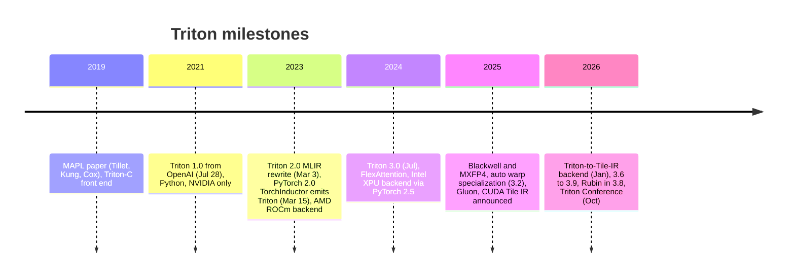
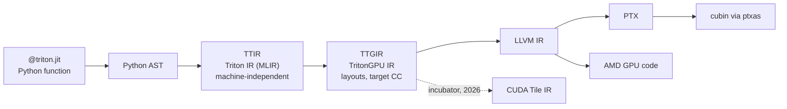
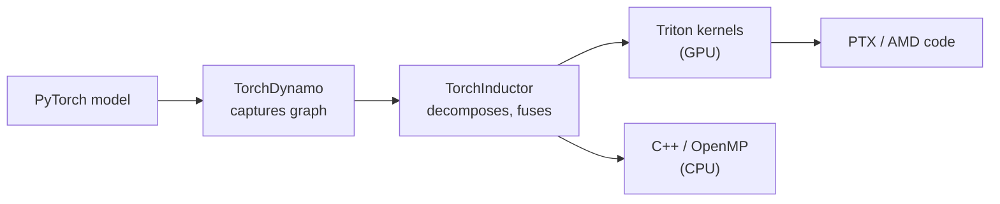
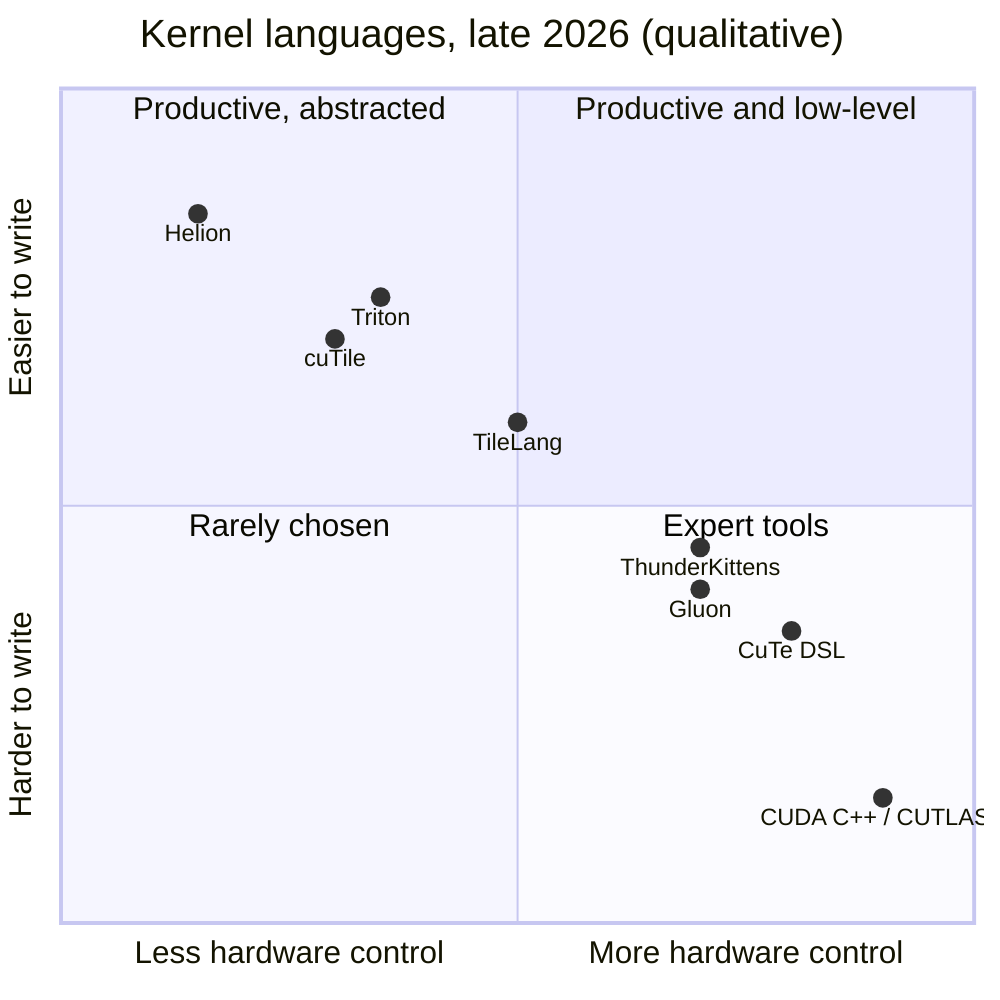

---
tags:
  - gpu-programming
  - compilers
  - triton
  - kernel-languages
  - python
status: complete
sources:
  - https://www.eecs.harvard.edu/~htk/publication/2019-mapl-tillet-kung-cox.pdf
  - https://openai.com/index/triton/
  - https://triton-lang.org/main/getting-started/tutorials/01-vector-add.html
  - https://triton-lang.org/main/getting-started/tutorials/02-fused-softmax.html
  - https://triton-lang.org/main/getting-started/tutorials/03-matrix-multiplication.html
  - https://triton-lang.org/main/python-api/generated/triton.Config.html
  - https://pytorch.org/blog/triton-kernel-compilation-stages/
  - https://pypi.org/project/triton/#history
  - https://pytorch.org/blog/pytorch-2.0-release/
  - https://pytorch.org/blog/warp-specialization/
  - https://pytorch.org/blog/warp-specialization-in-triton-design-and-roadmap/
  - https://triton-lang.org/main/gluon/
  - https://triton-lang.org/main/getting-started/tutorials/gluon/intro.html
  - https://newreleases.io/project/github/triton-lang/triton/release/v3.8.0
  - https://newreleases.io/project/pypi/triton/release/3.9.0
  - https://pytorch.org/blog/flexattention-flashattention-4-fast-and-flexible/
  - https://vllm.ai/blog/2026-03-04-vllm-triton-backend-deep-dive
  - https://developer.nvidia.com/blog/advancing-gpu-programming-with-the-cuda-tile-ir-backend-for-openai-triton/
  - https://developer.nvidia.com/blog/openai-triton-on-nvidia-blackwell-boosts-ai-performance-and-programmability/
  - https://arxiv.org/html/2605.10905v2
  - https://pytorch.org/blog/helion/
  - https://triton-lang.org/main/programming-guide/chapter-3/debugging.html
  - https://pytorch.org/blog/experience-in-reducing-pt2-compilation-time-for-meta-internal-workloads/
  - https://arxiv.org/pdf/2609.29067
  - https://tritonconference2026.splashthat.com/
  - https://www.nvidia.com/en-us/data-center/h100/
  - https://arxiv.org/abs/2410.10989
  - https://unsloth.ai/introducing
created: 2026-11-26
updated: 2026-11-26
---

## Table Of Contents

---

- [[#TL;DR|TL;DR]]
- [[#The Problem|The Problem]]
- [[#Foundations|Foundations]]
    - [[#Blocks Instead of Threads|Blocks Instead of Threads]]
    - [[#What the Compiler Takes Over|What the Compiler Takes Over]]
- [[#How We Got Here|How We Got Here]]
- [[#How It Works|How It Works]]
    - [[#A First Kernel Line by Line|A First Kernel Line by Line]]
    - [[#Fused Softmax and Why It Wins|Fused Softmax and Why It Wins]]
    - [[#Matrix Multiply, Tuning and Tensor Cores|Matrix Multiply, Tuning and Tensor Cores]]
    - [[#The Compiler Pipeline|The Compiler Pipeline]]
    - [[#Triton Inside PyTorch|Triton Inside PyTorch]]
- [[#Where It Is Now|Where It Is Now]]
    - [[#Releases and Hardware|Releases and Hardware]]
    - [[#Gluon, Warp Specialization and TLX|Gluon, Warp Specialization and TLX]]
    - [[#Who Uses It|Who Uses It]]
    - [[#The Kernel-Language Field|The Kernel-Language Field]]
- [[#Trade-offs & Open Problems|Trade-offs & Open Problems]]
- [[#Resources|Resources]]
- [[#Related Notes|Related Notes]]

## ***TL;DR***
---
*Triton is a Python-embedded language and compiler for writing GPU kernels one block of data at a time, instead of one thread at a time as in CUDA. The compiler handles the parts of GPU programming that are tedious and easy to get wrong, so researchers write fast fused kernels in tens of lines, and PyTorch generates Triton automatically for every `torch.compile` call.*

- **What it is:** a kernel language (`@triton.jit` Python functions) plus an MLIR-based compiler that lowers to PTX for NVIDIA GPUs and to AMD and Intel GPU code. Started as Philippe Tillet's Harvard research (MAPL 2019), released by OpenAI as Triton 1.0 in July 2021 ([OpenAI, 2021](https://openai.com/index/triton/)).
- **The idea:** each program instance works on a *block* (a small power-of-two-sized array). The compiler decides how that block is spread over threads, how loads are [[Memory Coalescing|coalesced]], what goes in [[Shared Memory and Bank Conflicts|shared memory]], where barriers go, and how loops are pipelined. You still decide how work is split across SMs.
- **Why it matters:** it is the default code generator behind `torch.compile` (TorchInductor emits Triton for GPUs), and the language of popular fused-kernel libraries (Liger, Unsloth) and of vLLM's portable attention backend ([PyTorch 2.0](https://pytorch.org/blog/pytorch-2.0-release/), [vLLM, Mar 2026](https://vllm.ai/blog/2026-03-04-vllm-triton-backend-deep-dive)).
- **Its limit:** on Hopper and Blackwell the fastest kernels need explicit [[Warp Specialization|warp specialization]], [[TMA and Asynchronous Copies|TMA]] pipelines and Tensor Memory, which Triton's abstraction hides. PyTorch measured FlexAttention-in-Triton at about 60% of FlashAttention-3 on Hopper, and the CuTe DSL backend 1.6–3.2x faster than Triton on GB200 forward passes ([PyTorch, Mar 2026](https://pytorch.org/blog/flexattention-flashattention-4-fast-and-flexible/)).
- **Where it is now (Nov 2026):** Triton 3.9.0 (Oct 27, 2026) is the latest release. The project's answer to the performance gap is **Gluon**, a lower-level dialect that exposes layouts, shared memory and warp specialization, plus automatic warp specialization in the main compiler. Rubin (SM107) support arrived in 3.8 ([PyPI](https://pypi.org/project/triton/#history), [3.8.0 notes](https://newreleases.io/project/github/triton-lang/triton/release/v3.8.0)).

## ***The Problem***
---
*Writing a fast CUDA kernel means managing dozens of low-level details by hand, and getting any of them wrong costs 2-10x. Most ML researchers can't spend weeks per kernel, so before Triton they either used slow PyTorch ops or waited for an expert.*

In [[CUDA Programming Model|CUDA]] you write the program for **one thread**. To make that fast you must also arrange, by hand:

| Detail | What goes wrong if you don't | Vault note |
|---|---|---|
| Coalesced global loads | Each warp issues many memory transactions instead of a few | [[Memory Coalescing]] |
| Shared-memory staging and layout | Data is re-read from HBM; bank conflicts serialize accesses | [[Shared Memory and Bank Conflicts]] |
| `__syncthreads()` placement | Race conditions, or too many barriers | [[CUDA Programming Model]] |
| Software pipelining of loads | Tensor Cores sit idle waiting for data | [[TMA and Asynchronous Copies]] |
| Tensor Core instructions | Matrix math runs at a fraction of peak | [[Tensor Cores]] |
| Register and occupancy tuning | Spills or too few warps to hide latency | [[Occupancy and Latency Hiding]] |

The result is a skill gap. OpenAI's launch post put it as: Triton makes it possible "to reach peak hardware performance with relatively little effort", and its FP16 matrix multiply "can match the performance of cuBLAS—something that many GPU programmers can't do—in under 25 lines of code" ([OpenAI, Jul 2021](https://openai.com/index/triton/)).

The other half of the problem is that deep-learning workloads are full of memory-bound chains of small ops (softmax, normalization, activations). Each PyTorch op is its own kernel that round-trips through HBM, so the biggest wins come from fusing them, which needs custom kernels ([[Kernel Fusion]]).

## ***Foundations***
---
*Triton keeps CUDA's grid of independent workers but changes what one worker is: a program instance that operates on whole blocks of data with array operations. Understanding that one shift explains both what Triton automates and what it leaves to you.*

### Blocks Instead of Threads

| | CUDA | Triton |
|---|---|---|
| Unit you write | One thread | One **program instance** (runs on a whole CTA of threads) |
| Data per unit | Scalars, a few registers | **Blocks**: arrays with power-of-two dimensions |
| Index | `blockIdx.x * blockDim.x + threadIdx.x` | `tl.program_id(0) * BLOCK + tl.arange(0, BLOCK)` |
| Bounds checks | `if (i < n)` per thread | A boolean **mask** on each load and store |
| Matrix multiply | Hand-written tiles, `mma`/`wgmma` PTX | `tl.dot(a, b, acc)` on two blocks |
| Compile-time sizes | Template parameters | `tl.constexpr` arguments ("meta-parameters") |

A Triton kernel looks like NumPy code run on tiles. The compiler then decides, for each block, which of the instance's threads holds which elements (its **layout**). The launch post compared the model to Numba, but "based on blocks" rather than threads ([OpenAI, 2021](https://openai.com/index/triton/)).

### What the Compiler Takes Over

The launch post's own table ([OpenAI, 2021](https://openai.com/index/triton/)):

| Optimization | CUDA | Triton |
|---|---|---|
| Memory coalescing | Manual | Automatic |
| Shared memory management | Manual | Automatic |
| Scheduling within an SM | Manual | Automatic |
| Scheduling across SMs | Manual | Manual |

The 2019 paper lists the passes that make this work: hierarchical tiling, [[Memory Coalescing|memory coalescing]], shared-memory allocation by live-range analysis, automatic insertion of shared-memory barriers by detecting read-after-write and write-after-read hazards, and automatic prefetching in loops ([Tillet, Kung, Cox, MAPL 2019](https://www.eecs.harvard.edu/~htk/publication/2019-mapl-tillet-kung-cox.pdf)).

The knobs you still turn are launch parameters, set per configuration ([triton.Config](https://triton-lang.org/main/python-api/generated/triton.Config.html)):

- `num_warps`: how many warps run one program instance (`num_warps=8` means 8 × 32 = 256 threads).
- `num_stages`: how many stages to use when software-pipelining loops, "mostly useful for matrix multiplication workloads on SM80+ GPUs".
- `num_ctas`: CTAs per thread-block cluster (SM90+).
- `maxnreg`: a register cap, passed to PTX's `.maxnreg`.

## ***How We Got Here***
---
*Triton went from a PhD project to the code generator of PyTorch in four years. Since 2025 its story has been about keeping up with Hopper and Blackwell, which reward exactly the low-level control Triton was designed to hide.*



- **2019, the paper.** "Triton: An Intermediate Language and Compiler for Tiled Neural Network Computations" by Philippe Tillet, H. T. Kung and David Cox (Harvard) used a C-like front end ("Triton-C") and an LLVM-based IR. On a GTX 1070 it matched cuBLAS on matrix multiply and was "up to 3×" faster than other DSLs ([MAPL 2019](https://www.eecs.harvard.edu/~htk/publication/2019-mapl-tillet-kung-cox.pdf)).
- **July 28, 2021, Triton 1.0.** OpenAI released the Python version (Tillet by then at OpenAI), NVIDIA GPUs only. Researchers reported kernels "up to 2x more efficient than equivalent Torch implementations" ([OpenAI](https://openai.com/index/triton/), [PyPI](https://pypi.org/project/triton/#history)).
- **March 2023, MLIR and PyTorch 2.0.** Triton 2.0.0 (Mar 3) rebuilt the compiler on MLIR. Twelve days later PyTorch 2.0 shipped TorchInductor, which uses "OpenAI Triton as a key building block" for NVIDIA and AMD GPUs That made Triton code something most PyTorch users run without ever writing it ([PyTorch 2.0](https://pytorch.org/blog/pytorch-2.0-release/)).
- **2024.** Triton 3.0 (Jul 9). PyTorch's FlexAttention generates fused attention variants as Triton kernels (see [[FlashAttention]]).
- **2025, chasing Hopper and Blackwell.** Meta and NVIDIA added automatic warp specialization for Hopper in Triton 3.2, reporting 10–15% gains on FlashAttention and FP8 GEMM ([PyTorch, Feb 2025](https://pytorch.org/blog/warp-specialization/)); NVIDIA and OpenAI added Blackwell support with MXFP8/MXFP4 ([NVIDIA, Feb 2025](https://developer.nvidia.com/blog/openai-triton-on-nvidia-blackwell-boosts-ai-performance-and-programmability/)). Gluon, the low-level dialect, appeared and grew through 3.4 and 3.5.
- **2026.** NVIDIA released an incubator backend that compiles Triton to CUDA Tile IR instead of PTX (Blackwell, CUDA 13.1+, `ENABLE_TILE=1`) ([NVIDIA, Jan 2026](https://developer.nvidia.com/blog/advancing-gpu-programming-with-the-cuda-tile-ir-backend-for-openai-triton/)); releases 3.6 through 3.9 followed (see [[#Where It Is Now|Where It Is Now]]).

## ***How It Works***
---
*Three official tutorials carry the whole model: vector add shows the syntax, fused softmax shows why Triton exists, and matrix multiply shows tuning and Tensor Cores. Behind them, an MLIR pipeline turns block code into PTX.*

### A First Kernel Line by Line

The vector-add tutorial ([Triton docs](https://triton-lang.org/main/getting-started/tutorials/01-vector-add.html)):

```python
@triton.jit
def add_kernel(x_ptr, y_ptr, output_ptr, n_elements, BLOCK_SIZE: tl.constexpr):
    pid = tl.program_id(axis=0)
    offsets = pid * BLOCK_SIZE + tl.arange(0, BLOCK_SIZE)
    mask = offsets < n_elements
    x = tl.load(x_ptr + offsets, mask=mask)
    y = tl.load(y_ptr + offsets, mask=mask)
    tl.store(output_ptr + offsets, x + y, mask=mask)

grid = lambda meta: (triton.cdiv(n_elements, meta['BLOCK_SIZE']),)
add_kernel[grid](x, y, output, n_elements, BLOCK_SIZE=1024)
```

- `@triton.jit` marks a function to be compiled for the GPU the first time it is called with given types and constants.
- `BLOCK_SIZE: tl.constexpr` is a compile-time constant, so it can be used as an array shape. Each distinct value compiles a separate kernel.
- `tl.program_id(axis=0)` is this instance's index in the launch grid, like `blockIdx.x`.
- `offsets = pid * BLOCK_SIZE + tl.arange(0, BLOCK_SIZE)` builds a whole vector of 1024 indices at once: instance 0 gets 0..1023, instance 1 gets 1024..2047.
- `mask = offsets < n_elements` is a vector of booleans that switches off the out-of-range lanes in the last block.
- `tl.load(x_ptr + offsets, mask=mask)` loads a block. Pointer plus vector of offsets is a vector of pointers; the compiler turns it into coalesced, vectorized loads.
- `tl.store(...)` writes `x + y` back, again masked.
- `grid` returns how many instances to launch: the ceiling of `n_elements / BLOCK_SIZE`. `add_kernel[grid](...)` launches.

Nowhere does the code say which thread loads which element; the compiler picks that layout. The tutorial measures about 1684 GB/s for Triton versus 1686 GB/s for PyTorch at the largest size: an elementwise add is memory-bound, so both hit the bandwidth ceiling (see [[Roofline Model and Arithmetic Intensity]]).

### Fused Softmax and Why It Wins

Softmax of each row of an $M \times N$ matrix, written with PyTorch ops, runs several kernels (row max, subtract, exponentiate, row sum, divide). The tutorial counts the memory traffic of that naive version as reading $5MN + 2M$ elements and writing $3MN + 2M$. A fused Triton kernel loads each row once into on-chip memory, does everything there, and writes the result once: about $MN$ reads and $MN$ writes ([Triton docs](https://triton-lang.org/main/getting-started/tutorials/02-fused-softmax.html)).

$$
\frac{\text{naive traffic}}{\text{fused traffic}} = \frac{8MN + 4M}{2MN} \approx 4 \quad (\text{for large } N)
$$

In words: the fused kernel moves about a quarter of the bytes, so a memory-bound op should run about 4x faster.

**Worked example.** $M = N = 4096$ in FP32 (4 bytes) on an H100 SXM, whose HBM3 delivers 3.35 TB/s ([NVIDIA](https://www.nvidia.com/en-us/data-center/h100/)):

| Version | Elements moved | Bytes | Time at 3.35 TB/s |
|---|---|---|---|
| Naive | $8 \cdot 4096^2 + 4 \cdot 4096 \approx 134.2$M | ≈ 537 MB | ≈ 160 µs |
| Fused | $2 \cdot 4096^2 \approx 33.6$M | ≈ 134 MB | ≈ 40 µs |

These are bandwidth floors, not measurements. The tutorial itself reports the fused kernel "4x faster than the Torch JIT" and "noticeably faster" than `torch.softmax`, which is already a hand-fused CUDA kernel (about 1406 vs 1315 GB/s at $N = 4096$). The kernel assumes a row fits on chip; the tutorial computes `num_stages` from the GPU's shared-memory size and estimates occupancy from register and shared-memory use. This is [[Kernel Fusion]] in its simplest form.

### Matrix Multiply, Tuning and Tensor Cores

The matmul tutorial ([Triton docs](https://triton-lang.org/main/getting-started/tutorials/03-matrix-multiplication.html)) computes one `[BLOCK_M, BLOCK_N]` output tile per program instance, looping over K (simplified):

```python
acc = tl.zeros((BLOCK_M, BLOCK_N), dtype=tl.float32)
for k in range(0, tl.cdiv(K, BLOCK_K)):
    a = tl.load(a_ptrs, mask=..., other=0.0)
    b = tl.load(b_ptrs, mask=..., other=0.0)
    acc = tl.dot(a, b, acc)
    a_ptrs += BLOCK_K * stride_ak
    b_ptrs += BLOCK_K * stride_bk
```

- `acc` is a tile of FP32 accumulators that lives in registers for the whole loop.
- Each iteration loads one K-slice of A and B as blocks (masked at the edges, filled with 0).
- `tl.dot(a, b, acc)` multiplies the blocks and adds into `acc`. This is where the compiler emits [[Tensor Cores|Tensor Core]] instructions (`mma`, `wgmma`, or Blackwell's `tcgen05`, see [[PTX and SASS]]); you never name them.
- The pointer updates step to the next K-slice. With `num_stages > 1`, the compiler software-pipelines these loads so the next tiles arrive while the current `tl.dot` runs.

Three more ideas from the tutorial:

- **Grouped ordering for L2 reuse.** Launching tiles row by row reloads the same columns of B many times. Grouping `GROUP_SIZE_M` rows of tiles together makes neighbouring instances share A and B tiles in L2. In the tutorial's example this cuts block loads from 90 to 54, worth more than 10% on some GPUs (see [[GPU Memory Hierarchy]]).
- **Autotuning.** `@triton.autotune(configs=[...], key=['M','N','K'])` benchmarks a list of `triton.Config`s (block sizes, `num_warps`, `num_stages`) the first time a new shape appears and caches the winner (see [[GEMM Autotuning and Kernel Selection]]).
- **Fused epilogue.** An activation (the tutorial uses leaky ReLU) is applied to `acc` "while the accumulator is still in FP32", before the store, saving a second kernel.

The tutorial reports performance "on par with cuBLAS": about 217 TFLOPS against cuBLAS's 224 at 4096 on its A100. The tiling logic itself is the subject of [[Tiled Matrix Multiplication (GEMM)]].

### The Compiler Pipeline



([PyTorch, Oct 2024](https://pytorch.org/blog/triton-kernel-compilation-stages/); Tile IR branch from [NVIDIA, Jan 2026](https://developer.nvidia.com/blog/advancing-gpu-programming-with-the-cuda-tile-ir-backend-for-openai-triton/))

1. **TTIR (Triton IR).** The function's AST becomes an MLIR dialect of block operations: loads, stores, `dot`, reductions. No hardware details yet.
2. **TTGIR (TritonGPU IR).** The key step. Each block value gets a **layout** (encoding) saying how its elements map to threads, warps and registers: `#blocked` (each warp owns a contiguous piece), `shared` (lives in shared memory), `dot_op` (arranged for a matrix multiply), `nvidia_mma`, `amd_mfma`, `amd_wmma` (Tensor Core / matrix-core result layouts), and `slice`. Passes here do coalescing, pipelining and layout conversions. The project is moving all of these to a single "linear layout" representation.
3. **LLVM IR**, then **PTX**, then a **cubin** via `ptxas`. For Hopper and newer, Triton bundles its own CUDA 13 `ptxas` ([3.9.0 notes](https://newreleases.io/project/pypi/triton/release/3.9.0)).

Every stage can be inspected from the compiled kernel object: `kernel.asm['ttir']`, `['ttgir']`, `['llir']`, `['ptx']`, `['cubin']` ([PyTorch, Oct 2024](https://pytorch.org/blog/triton-kernel-compilation-stages/)). Reading the TTGIR is the fastest way to see which layout the compiler chose and whether a `dot` landed on Tensor Cores.

### Triton Inside PyTorch



`torch.compile` captures the model's graph, and TorchInductor fuses pointwise and reduction ops and writes the fused kernels as Triton source ([PyTorch 2.0](https://pytorch.org/blog/pytorch-2.0-release/)). Most Triton code in the world is therefore machine-written. Higher-level tools sit on the same base: PyTorch's **Helion** (beta, Oct 2025) is a DSL that compiles to Triton and autotunes far more aggressively, reporting 1.85x average speedup over hand-written Triton on B200 ([PyTorch, Oct 2025](https://pytorch.org/blog/helion/)).

## ***Where It Is Now***
---
*As of November 2026, Triton is one of the most widely used GPU kernel languages, but the fastest Blackwell kernels are written below it. The project's response is Gluon, automatic warp specialization, and faster releases with each new NVIDIA and AMD generation.*

### Releases and Hardware

| Release | Date | Highlights |
|---|---|---|
| 3.5.0 | Oct 13, 2025 | Gluon AutoLayout, Hopper WGMMA in Gluon; warp specialization on by default for persistent matmul and attention |
| 3.6.0 | Jan 20, 2026 | Gluon 2-CTA mode, gfx1250 (AMD) |
| 3.7.0 / 3.7.1 | May 7 / Jun 17, 2026 | |
| 3.8.0 | Aug 28, 2026 | Initial Rubin (SM107) support, Cluster Launch Control in Gluon, experimental Triton-to-Gluon translator, TMA im2col, sanitizers (FpSan, GSan, ConSan); `tl.dot` now defaults its output type to the accumulator type |
| 3.9.0 | Oct 27, 2026 | Gluon `inline_asm`, persistent CLC; block pointers removed in favour of tensor descriptors; gfx10 dropped |

Sources: [PyPI](https://pypi.org/project/triton/#history), [3.8.0](https://newreleases.io/project/github/triton-lang/triton/release/v3.8.0), [3.9.0](https://newreleases.io/project/pypi/triton/release/3.9.0). Supported targets are Linux on NVIDIA compute capability 8.0+, AMD ROCm, and Intel GPUs via the XPU backend; CPU is "under development". The Triton Conference 2026 (Oct 19, San Jose, hosted by Meta) had talks on Gluon for AMD MI450, Rubin and the CUDA Tile IR backend ([agenda](https://tritonconference2026.splashthat.com/)).

### Gluon, Warp Specialization and TLX

The core tension: Triton's abstraction hides the controls that Hopper and Blackwell kernels need ([[Warp Specialization|warp roles]], [[TMA and Asynchronous Copies|TMA]] pipelines, Tensor Memory). Three answers coexist:

| Layer | Who | What you control | Status |
|---|---|---|---|
| Triton + autoWS | Meta, OpenAI, NVIDIA | Add `warp_specialize=True` to a `tl.range` loop; the compiler splits producer and consumer warps | "limited and experimental", Hopper and Blackwell |
| **Gluon** | In the Triton repo | Layouts, shared memory, warp specialization, TMA, WGMMA, `tcgen05`, clusters, written explicitly | Main low-level path; tutorials for each feature |
| **TLX** | Meta fork (`facebookexperimental/triton`) | Additive extensions: warp-group roles, local memory, async ops, clusters | Paper says deployed in production |

Sources: [PyTorch, Jan 2026](https://pytorch.org/blog/warp-specialization-in-triton-design-and-roadmap/), [Gluon docs](https://triton-lang.org/main/gluon/), [TLX paper](https://arxiv.org/html/2605.10905v2).

Gluon is described as "Triton's lower-level GPU programming model" that "exposes layouts, shared memory, warp specialization, and target-specific features directly"; it shares Triton's front end and JIT. The Gluon tutorial explains why it exists: the Triton compiler "can be beaten by hand-tuned low-level code. When this happens, there is little the user can do... since all the details are hidden" ([Gluon intro](https://triton-lang.org/main/getting-started/tutorials/gluon/intro.html)).

How close autoWS gets: on B200 flash-attention forward kernels, Meta reports throughput "close to Gluon and cuDNN implementations, and 1.5-2x of stock Triton (cuDNN still leads by 10-20%)" ([PyTorch, Jan 2026](https://pytorch.org/blog/warp-specialization-in-triton-design-and-roadmap/)).

### Who Uses It

- **PyTorch:** TorchInductor emits Triton by default on GPUs. FlexAttention began as Triton; since March 2026 it also has a [[CUTLASS and CuTe|CuTe DSL]]/FlashAttention-4 backend on Hopper and Blackwell because Triton had fallen to "roughly 60% of FlashAttention-3's throughput" ([PyTorch, Mar 2026](https://pytorch.org/blog/flexattention-flashattention-4-fast-and-flexible/)).
- **vLLM:** a Triton attention backend of about 800 lines (FlashAttention-3 is about 70,000) is the default on AMD ROCm, runs on Intel XPU, and reached 100.7% of FA3's speed on one H100 long-decode benchmark ([vLLM, Mar 2026](https://vllm.ai/blog/2026-03-04-vllm-triton-backend-deep-dive)). Portability with good-enough speed is Triton's strongest case.
- **Fused-kernel libraries:** Liger Kernel writes its training kernels (RMSNorm, RoPE, SwiGLU, fused linear cross-entropy) in Triton ([Liger, 2024](https://arxiv.org/abs/2410.10989)), and Unsloth "rewrote all kernels in OpenAI's Triton language" ([Unsloth](https://unsloth.ai/introducing)). See [[Kernel Fusion]].
- **Benchmarks:** a 2026 study of tile languages on B200 found Triton beat NVIDIA's cuTile on 37 of 45 operators, but "most kernels remain far from roofline" ([TileBench, 2026](https://arxiv.org/pdf/2609.29067)).

### The Kernel-Language Field



The placement is this note's judgement, not a measurement. The pattern behind it is the real point: every tool trades how much of the chip you can steer against how much you must write. Triton sits on the productive side; [[CUTLASS and CuTe]], ThunderKittens and Gluon sit on the control side, and NVIDIA's cuTile (Tile IR, see [[PTX and SASS]]) is a vendor take on Triton's block model.

## ***Trade-offs & Open Problems***
---
*Triton trades peak performance and transparency for speed of development and portability. The open question is whether automatic compiler passes can close the Hopper/Blackwell gap, or whether serious users will always drop to Gluon or CuTe.*

| Strength | Cost |
|---|---|
| Tens of lines instead of hundreds | You can't directly control layouts or warp roles (outside Gluon) |
| Same source on NVIDIA, AMD, Intel | Peak speed needs per-target tuning; AMD needs different `num_warps` |
| Autotuning finds good configs | Autotuning and compilation are slow |
| Generated by `torch.compile` | Generated code is hard to read and debug |
| Fast-moving project | API churn (block pointers removed, `tl.dot` default changed) |

- **The Hopper/Blackwell gap.** PyTorch states plainly that the warp-specialized, deeply pipelined attention Blackwell needs "aren't expressible in our Triton-based implementation" ([PyTorch, Mar 2026](https://pytorch.org/blog/flexattention-flashattention-4-fast-and-flexible/)). autoWS narrows this to cuDNN's 10–20% lead on one benchmark, but it is still experimental.
- **Compile time.** On one Meta model, compilation took 1825.6 s, including 844 s waiting on async compilation and 238 s benchmarking autotune configs; cold starts can take "up to an hour—or more" ([PyTorch](https://pytorch.org/blog/experience-in-reducing-pt2-compilation-time-for-meta-internal-workloads/)). Helion's first autotune "typically takes around 10 minutes".
- **Debugging.** `TRITON_INTERPRET=1` runs kernels on the CPU through NumPy (no bf16, no indirect loads); `device_print` and `device_assert` (with `TRITON_DEBUG=1`) work on the GPU; [[Debugging with compute-sanitizer and cuda-gdb|compute-sanitizer]] and the newer built-in sanitizers catch races and bad accesses ([debugging guide](https://triton-lang.org/main/programming-guide/chapter-3/debugging.html)).
- **Two languages in one.** With Gluon, "Triton" now spans a high-level and a low-level dialect, and an experimental translator between them. Whether most performance work lives in Gluon, TLX or autoWS is unsettled.
- **Vendor competition.** NVIDIA's cuTile and Tile IR backend target the same block-level niche with vendor support; Triton's answer is to be the portable front end that can sit on either PTX or Tile IR.

## ***Resources***
---
*Do the three official tutorials (vector add, fused softmax, matmul) first, then read the compilation-stages post to see what the compiler did. For the frontier, read PyTorch's FlexAttention-on-FA4 post and the warp-specialization roadmap.*

**Primary**
- [Triton: An Intermediate Language and Compiler for Tiled Neural Network Computations](https://www.eecs.harvard.edu/~htk/publication/2019-mapl-tillet-kung-cox.pdf): Tillet, Kung, Cox, MAPL 2019.
- [Introducing Triton: Open-source GPU programming for neural networks](https://openai.com/index/triton/): Tillet (OpenAI), Jul 2021.
- [Triton tutorials](https://triton-lang.org/main/getting-started/tutorials/01-vector-add.html): vector add, fused softmax, matmul, attention, persistent matmul.
- [Gluon tutorials](https://triton-lang.org/main/getting-started/tutorials/gluon/intro.html): the low-level dialect, with TMA, WGMMA, `tcgen05` and warp specialization.
- [triton-lang/triton](https://github.com/triton-lang/triton) and [PyPI release history](https://pypi.org/project/triton/#history).

**Engineering posts**
- [Triton Kernel Compilation Stages](https://pytorch.org/blog/triton-kernel-compilation-stages/): IBM and Meta, Oct 2024. TTIR, TTGIR, layouts.
- [Warp Specialization in Triton: Design and Roadmap](https://pytorch.org/blog/warp-specialization-in-triton-design-and-roadmap/): Meta, Jan 2026.
- [FlexAttention + FlashAttention-4: Fast and Flexible](https://pytorch.org/blog/flexattention-flashattention-4-fast-and-flexible/): PyTorch, Mar 2026. An honest account of where Triton falls short on Blackwell.
- [vLLM Triton attention backend deep dive](https://vllm.ai/blog/2026-03-04-vllm-triton-backend-deep-dive): vLLM, Mar 2026. Portable production kernels.
- [CUDA Tile IR backend for OpenAI Triton](https://developer.nvidia.com/blog/advancing-gpu-programming-with-the-cuda-tile-ir-backend-for-openai-triton/): NVIDIA, Jan 2026.
- [Helion](https://pytorch.org/blog/helion/): PyTorch, Oct 2025. A higher-level DSL that compiles to Triton.

**Papers**
- [TLX: Triton Low-level Language Extensions](https://arxiv.org/html/2605.10905v2): Meta and UCSD, 2026.
- [TileBench](https://arxiv.org/pdf/2609.29067): 2026 benchmark of tile languages on B200.

## Related Notes

- [[CUDA Programming Model]] — The per-thread model Triton replaces with blocks.
- [[PTX and SASS]] — What Triton compiles to on NVIDIA GPUs.
- [[Kernel Fusion]] — Triton's main use: fusing memory-bound op chains.
- [[Tiled Matrix Multiplication (GEMM)]] — The tiling Triton's matmul tutorial automates.
- [[Tensor Cores]] — What `tl.dot` targets.
- [[Memory Coalescing]] — Done automatically by Triton's layouts.
- [[Shared Memory and Bank Conflicts]] — Allocated and swizzled by the compiler.
- [[Occupancy and Latency Hiding]] — What `num_warps` and `num_stages` trade off.
- [[TMA and Asynchronous Copies]] — Reached through tensor descriptors and Gluon.
- [[Warp Specialization]] — The Hopper/Blackwell technique Triton is racing to automate.
- [[CUTLASS and CuTe]] — The control-side alternative; CuTe DSL backs FlexAttention's FA4 path.
- [[Roofline Model and Arithmetic Intensity]] — Why vector add and softmax are bandwidth-bound.
- [[ROCm and HIP]] — The AMD stack Triton's ROCm backend targets.
- [[FlashAttention]] — The attention kernels FlexAttention is measured against.
- [[CUDA Tile and cuTile]] — NVIDIA's tile language; Triton can compile to its Tile IR.
- [[ThunderKittens and Tile DSLs]] — ThunderKittens, Gluon, TileLang and other tile DSLs.
- [[Numba and CuPy]] — The older Python GPU tools.
- [[GEMM Autotuning and Kernel Selection]] — `@triton.autotune`, `max-autotune` and pruning the config search.
