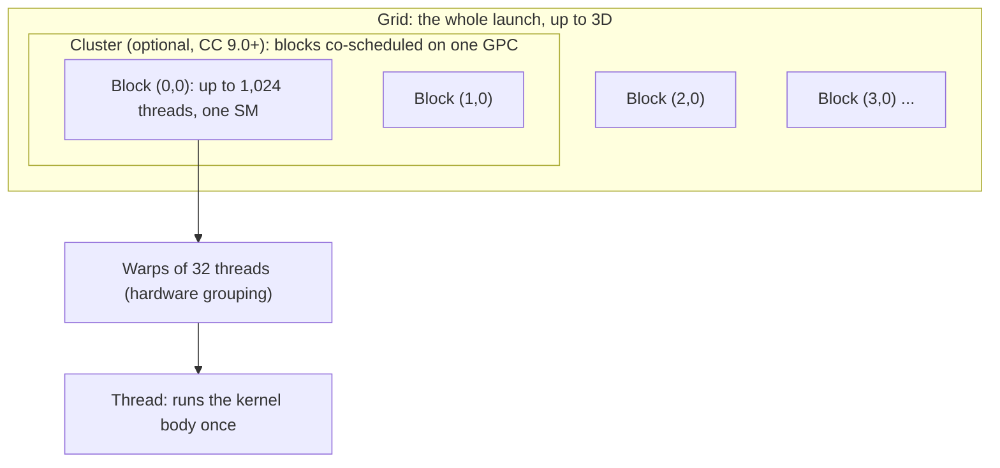
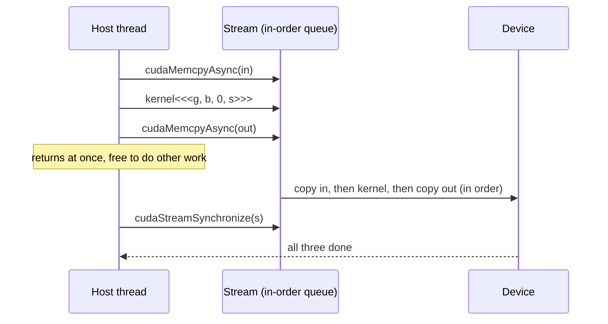

---
tags:
  - gpu-programming
  - foundations
  - cuda
  - programming-model
status: complete
sources:
  - https://docs.nvidia.com/cuda/cuda-programming-guide/01-introduction/programming-model.html
  - https://docs.nvidia.com/cuda/cuda-programming-guide/02-basics/intro-to-cuda-cpp.html
  - https://docs.nvidia.com/cuda/archive/13.2.0/cuda-programming-guide/02-basics/writing-cuda-kernels.html
  - https://docs.nvidia.com/cuda/archive/13.2.1/cuda-programming-guide/02-basics/asynchronous-execution.html
  - https://docs.nvidia.com/cuda/cuda-programming-guide/05-appendices/compute-capabilities.html
  - https://developer.nvidia.com/blog/cuda-pro-tip-write-flexible-kernels-grid-stride-loops/
  - https://developer.nvidia.com/blog/nvidia-hopper-architecture-in-depth/
  - https://docs.nvidia.com/cuda/blackwell-tuning-guide
  - https://www.jonpeddie.com/news/8800-gtx-laid-ai-computing-foundation/
  - https://research.nvidia.com/publication/2008-04_nvidia-tesla-unified-graphics-and-computing-architecture
  - https://developer.nvidia.com/blog/using-cuda-warp-level-primitives/
  - https://developer.nvidia.com/blog/nvidia-cuda-13-1-powers-next-gen-gpu-programming-with-nvidia-cuda-tile-and-performance-gains/
  - https://developer.nvidia.com/blog/nvidia-cuda-13-3-enhances-gpu-development-with-tile-programming-in-c-compiler-autotuning-and-python-updates/
created: 2026-11-26
updated: 2026-11-26
---

## Table Of Contents

---

- [[#TL;DR|TL;DR]]
- [[#The Problem|The Problem]]
- [[#Foundations|Foundations]]
    - [[#Host and Device|Host and Device]]
    - [[#Kernels|Kernels]]
    - [[#The Thread Hierarchy|The Thread Hierarchy]]
    - [[#Which Memory Each Level Can See|Which Memory Each Level Can See]]
- [[#How We Got Here|How We Got Here]]
- [[#How It Works|How It Works]]
    - [[#A Complete Program, Line by Line|A Complete Program, Line by Line]]
    - [[#Choosing Grid and Block Sizes|Choosing Grid and Block Sizes]]
    - [[#Grid-Stride Loops|Grid-Stride Loops]]
    - [[#2D Indexing|2D Indexing]]
    - [[#Cooperation Inside a Block|Cooperation Inside a Block]]
    - [[#Thread Block Clusters|Thread Block Clusters]]
    - [[#Asynchrony and Streams|Asynchrony and Streams]]
    - [[#Errors|Errors]]
- [[#Where It Is Now|Where It Is Now]]
- [[#Trade-offs & Open Problems|Trade-offs & Open Problems]]
- [[#Resources|Resources]]
- [[#Related Notes|Related Notes]]

## ***TL;DR***
---
*CUDA lets you write one scalar function, a kernel, and run it on millions of threads at once. Threads are grouped into blocks that can cooperate through shared memory, blocks are grouped into a grid that covers the whole problem, and the CPU launches the grid and moves data. The model has stayed almost unchanged since 2007, which is why CUDA code ages so well.*

- **Two processors, two memories.** The CPU (*host*) runs the program and launches work; the GPU (*device*) runs kernels on its own memory. "Applications always start on the CPU" ([CUDA Programming Guide](https://docs.nvidia.com/cuda/cuda-programming-guide/01-introduction/programming-model.html)).
- **A three-level hierarchy.** A *grid* of *thread blocks*, each a group of up to 1,024 *threads*. Each thread finds its piece of the data from `blockIdx`, `blockDim` and `threadIdx` ([Compute Capabilities](https://docs.nvidia.com/cuda/cuda-programming-guide/05-appendices/compute-capabilities.html)).
- **Blocks are the unit of cooperation and of scaling.** Threads in a block share fast on-chip memory and can sync with `__syncthreads()`. Blocks cannot rely on each other, so the same grid runs on a GPU with 20 SMs or 148.
- **Since Hopper there is a fourth level.** *Thread block clusters* group blocks that are scheduled together and can read each other's shared memory ([Hopper in depth](https://developer.nvidia.com/blog/nvidia-hopper-architecture-in-depth/)).
- **Launches are asynchronous.** The CPU queues work and moves on; it waits only when you ask it to.
- **Where it is now (Nov 2026):** the SIMT model above is still the foundation, CUDA is at 13.5, and NVIDIA has added *tile programming* (CUDA Tile, Python since 13.1, C++ since 13.3) where you write per-block code on whole tiles and the compiler assigns threads.

## ***The Problem***
---
*Before CUDA, using a GPU for general computing meant disguising your data as textures and your math as pixel shaders. The problem CUDA solved was giving programmers a direct way to say "run this function on every element", in a form that would keep working as GPUs grew from tens of SMs to hundreds.*

A good GPU programming model has to satisfy three demands at once:

| Demand | Why it is hard | CUDA's answer |
|---|---|---|
| Express massive parallelism simply | Programmers think in loops, not in hardware lanes | Write the loop body once as a kernel; the launch says how many copies to run |
| Let nearby threads cooperate cheaply | Cooperation needs shared state and synchronization, which do not scale to a whole chip | Cooperation only inside a block, which lives on one SM |
| Run unchanged on bigger future GPUs | Hardware SM counts change every generation | Blocks are independent, so the hardware can schedule them onto any number of SMs |

The third point is the clever one. Because thread blocks make no assumptions about each other, a GPU with twice the SMs simply runs twice as many blocks at once. NVIDIA's guide puts the rule plainly: the model "does not provide mechanisms or guarantees that enable synchronization across thread blocks" ([CUDA Programming Guide, Writing Kernels](https://docs.nvidia.com/cuda/archive/13.2.0/cuda-programming-guide/02-basics/writing-cuda-kernels.html)).

## ***Foundations***
---
*Learn four words before any code: host, device, kernel, and the grid/block/thread hierarchy. Then learn which memory each level can see, because that is what decides how threads can share work.*

#### **Host and Device**
- The *host* is "the CPU and its directly connected memory"; the *device* is the GPU and its memory ([CUDA Programming Guide](https://docs.nvidia.com/cuda/cuda-programming-guide/01-introduction/programming-model.html)).
- The two memories are separate. Data must be copied (explicitly with `cudaMemcpy`, or automatically with [[Unified Memory]]) before a kernel can use it.
- Host code decides what runs; device code does the heavy work. One `.cu` file holds both, and the `nvcc` compiler splits them ([Intro to CUDA C++](https://docs.nvidia.com/cuda/cuda-programming-guide/02-basics/intro-to-cuda-cpp.html)).

#### **Kernels**
A *kernel* is "a function that is invoked for execution on the GPU" ([CUDA Programming Guide](https://docs.nvidia.com/cuda/cuda-programming-guide/01-introduction/programming-model.html)). In CUDA C++:

| Specifier | Runs on | Called from | Notes |
|---|---|---|---|
| `__global__` | Device | Host (a launch) | A kernel; must return `void` |
| `__device__` | Device | Device code | An ordinary helper function on the GPU |
| `__host__ __device__` | Both | Either | Compiled twice, for CPU and GPU |

Source: [Intro to CUDA C++](https://docs.nvidia.com/cuda/cuda-programming-guide/02-basics/intro-to-cuda-cpp.html).

#### **The Thread Hierarchy**


| Level | Size limits (CC 9.0, H100) | Identified by | Can sync with | Can share |
|---|---|---|---|---|
| Thread | 255 registers max | `threadIdx` | Itself | Its registers |
| Warp | Always 32 threads | `threadIdx.x / 32` (in 1D) | `__syncwarp()` | Values via shuffles |
| Block | Up to 1,024 threads; x and y up to 1,024, z up to 64 | `blockIdx` | `__syncthreads()` | Shared memory |
| Cluster | Up to 8 blocks portable, 16 on B200 opt-in | Cluster rank | `cluster.sync()` | Distributed shared memory |
| Grid | x up to $2^{31}-1$ blocks, y and z up to 65,535 | The launch | Kernel end (or cooperative launch) | Global memory |

Sources: [Compute Capabilities](https://docs.nvidia.com/cuda/cuda-programming-guide/05-appendices/compute-capabilities.html), [Blackwell Tuning Guide](https://docs.nvidia.com/cuda/blackwell-tuning-guide) (cluster sizes), [Lin & Grover](https://developer.nvidia.com/blog/using-cuda-warp-level-primitives/) (warp primitives). How warps and blocks map to hardware is in [[GPU Architecture Basics]].

#### **Which Memory Each Level Can See**
| Memory | Visible to | Lives as long as | Speed |
|---|---|---|---|
| Registers | One thread | The thread | Fastest |
| Shared memory | One block (or a cluster, on CC 9.0+) | The block | On-chip, near register speed |
| Global memory | Every thread, and the host | Until freed | Off-chip HBM, hundreds of cycles |
| Constant memory | Every thread, read-only | Until freed | Cached; fast when all threads read the same address |

Source: [CUDA Programming Guide](https://docs.nvidia.com/cuda/cuda-programming-guide/01-introduction/programming-model.html). Details, sizes and bandwidths are in [[GPU Memory Hierarchy]].

## ***How We Got Here***
---
*CUDA arrived with NVIDIA's first unified-shader GPU and has grown by adding levels and features around the same core. Each addition (cooperative groups, clusters, tiles) loosened one restriction of the original model without breaking old code.*

| Year | Step | What it changed | Source |
|---|---|---|---|
| 2007 | CUDA SDK beta (Feb), CUDA 1.0 (Jun), for the G80 | GPU programs written as C functions with grids, blocks and threads | [Jon Peddie Research](https://www.jonpeddie.com/news/8800-gtx-laid-ai-computing-foundation/) |
| 2008 | Tesla architecture paper | The hardware side of the model: SMs, warps, SIMT | [Lindholm et al., IEEE Micro](https://research.nvidia.com/publication/2008-04_nvidia-tesla-unified-graphics-and-computing-architecture) |
| 2013 | Grid-stride loops popularized | Kernels decoupled from problem size | [Harris, NVIDIA blog](https://developer.nvidia.com/blog/cuda-pro-tip-write-flexible-kernels-grid-stride-loops/) |
| 2017–18 | CUDA 9: `*_sync` warp primitives; legacy ones deprecated | Warps no longer assumed to run in lockstep (Volta) | [Lin & Grover](https://developer.nvidia.com/blog/using-cuda-warp-level-primitives/) |
| 2022 | Thread block clusters and distributed shared memory (Hopper, CC 9.0) | A level between block and grid | [Hopper in depth](https://developer.nvidia.com/blog/nvidia-hopper-architecture-in-depth/) |
| 2025 | CUDA Tile and cuTile Python (CUDA 13.1, Dec) | A tile model "at a layer above SIMT" | [NVIDIA, Dec 2025](https://developer.nvidia.com/blog/nvidia-cuda-13-1-powers-next-gen-gpu-programming-with-nvidia-cuda-tile-and-performance-gains/) |
| 2026 | CUDA Tile in C++ and on Hopper; CUDA Python 1.0 (CUDA 13.3, May) | Tile model reaches the main language; stable Python bindings | [NVIDIA, May 2026](https://developer.nvidia.com/blog/nvidia-cuda-13-3-enhances-gpu-development-with-tile-programming-in-c-compiler-autotuning-and-python-updates/) |

## ***How It Works***
---
*A CUDA program allocates device memory, copies inputs in, launches a kernel with a grid and block size, waits, and copies results out. Inside the kernel each thread computes a global index, checks it is in range, and does its one piece of work.*

#### **A Complete Program, Line by Line**
Adapted from the vector-add example in NVIDIA's guide ([Intro to CUDA C++](https://docs.nvidia.com/cuda/cuda-programming-guide/02-basics/intro-to-cuda-cpp.html)):

```cuda
__global__ void vecAdd(const float* A, const float* B, float* C, int n) {
    int i = blockIdx.x * blockDim.x + threadIdx.x;   // global thread index
    if (i < n) C[i] = A[i] + B[i];                   // guard the tail
}

int main() {
    int n = 1 << 20;  size_t bytes = n * sizeof(float);
    float *A, *B, *C;
    cudaMalloc(&A, bytes); cudaMalloc(&B, bytes); cudaMalloc(&C, bytes);
    cudaMemcpy(A, hA, bytes, cudaMemcpyHostToDevice);  // hA, hB: host arrays
    cudaMemcpy(B, hB, bytes, cudaMemcpyHostToDevice);
    int threads = 256;
    int blocks  = (n + threads - 1) / threads;         // round up: 4,096 blocks
    vecAdd<<<blocks, threads>>>(A, B, C, n);           // returns immediately
    cudaMemcpy(hC, C, bytes, cudaMemcpyDeviceToHost);  // waits for the kernel
    cudaFree(A); cudaFree(B); cudaFree(C);
}
```

- `__global__ void vecAdd(...)`: a kernel. Every thread runs this whole body.
- `int i = blockIdx.x * blockDim.x + threadIdx.x;`: block 3 of 256-thread blocks starts at element 768, so its thread 5 handles element 773. `threadIdx` and `blockIdx` are zero-indexed.
- `if (i < n)`: the grid is rounded up to whole blocks, so the last block may have threads past the end; they do nothing.
- `cudaMalloc`: allocates global memory on the GPU and returns a device pointer the CPU must not dereference.
- `cudaMemcpy(..., cudaMemcpyHostToDevice)`: copies inputs across PCIe or NVLink. It is synchronous.
- `blocks = (n + threads - 1) / threads`: ceiling division, $\lceil 1{,}048{,}576 / 256 \rceil = 4{,}096$ blocks.
- `vecAdd<<<blocks, threads>>>`: the *execution configuration*. Optional third and fourth parameters set dynamic shared memory bytes and a stream. The call "is asynchronous with respect to the host thread" ([Intro to CUDA C++](https://docs.nvidia.com/cuda/cuda-programming-guide/02-basics/intro-to-cuda-cpp.html)).
- The copy back to the host waits for the kernel, because work in the default stream runs in order.

The guide's alternative uses `cudaMallocManaged` ([[Unified Memory]]) and drops the copies, at the cost of less control over when data moves.

#### **Choosing Grid and Block Sizes**
- **Block size:** a multiple of 32, since the hardware runs whole warps; NVIDIA recommends multiples of 32 ([CUDA Programming Guide](https://docs.nvidia.com/cuda/cuda-programming-guide/01-introduction/programming-model.html)). Common choices are 128 to 512. Larger blocks give more threads that can share memory; too large a block, with many registers each, may not fit on an SM at all.
- **Grid size:** enough blocks to fill every SM several times. An H100 holds at most 32 resident blocks and 2,048 threads per SM ([Compute Capabilities](https://docs.nvidia.com/cuda/cuda-programming-guide/05-appendices/compute-capabilities.html)), so 256-thread blocks fit at most 8 per SM (fewer if they use many registers or much shared memory), and $8 \times 132 = 1{,}056$ blocks fill the chip once. The vector-add above, with 4,096 blocks, fills it about four times.
- How these choices interact with registers and shared memory is [[Occupancy and Latency Hiding]].

#### **Grid-Stride Loops**
Instead of one thread per element, launch a fixed-size grid and have each thread loop:

```cuda
__global__ void saxpy(int n, float a, const float* x, float* y) {
    for (int i = blockIdx.x * blockDim.x + threadIdx.x;  // my first element
         i < n;
         i += blockDim.x * gridDim.x)                    // jump by the whole grid
        y[i] = a * x[i] + y[i];
}
```

- The first index is the same global index as before.
- Each step jumps by the total number of threads in the grid, so on every pass neighbouring threads still touch neighbouring elements, which keeps accesses [[Memory Coalescing|coalesced]].
- It works for any `n`, even larger than the maximum grid, lets you size the grid to the GPU (for example a multiple of the SM count), and a `<<<1,1>>>` launch runs it serially for debugging ([Harris, 2013](https://developer.nvidia.com/blog/cuda-pro-tip-write-flexible-kernels-grid-stride-loops/)).

#### **2D Indexing**
For matrices and images, use 2D blocks and grids. In a block, "the first index `x` moves the fastest, followed by `y` and then `z`" ([Writing CUDA Kernels](https://docs.nvidia.com/cuda/archive/13.2.0/cuda-programming-guide/02-basics/writing-cuda-kernels.html)):

```cuda
int col = blockDim.x * blockIdx.x + threadIdx.x;   // x walks along a row
int row = blockDim.y * blockIdx.y + threadIdx.y;
if (row < rows && col < cols) out[row * cols + col] = f(in[row * cols + col]);
```

Mapping `x` to columns of a row-major array means the 32 threads of a warp read 32 consecutive floats. Swapping the mapping (x to rows) is the classic mistake that makes each thread of a warp hit a different row; see [[Memory Coalescing]].

#### **Cooperation Inside a Block**
Threads in a block share `__shared__` memory and synchronize with a barrier. `__syncthreads()` "blocks all threads in the thread block until all threads have reached the call" ([Writing CUDA Kernels](https://docs.nvidia.com/cuda/archive/13.2.0/cuda-programming-guide/02-basics/writing-cuda-kernels.html)):

```cuda
__global__ void reverseBlock(float* d) {
    __shared__ float s[256];          // one copy per block, on-chip
    int t = threadIdx.x;
    s[t] = d[blockIdx.x * 256 + t];   // each thread loads one value
    __syncthreads();                  // wait until every load landed
    d[blockIdx.x * 256 + t] = s[255 - t];  // read a value another thread wrote
}
```

- `__shared__` gives the block a 256-float array in the SM's on-chip memory.
- Without the barrier, a thread might read `s[255 - t]` before the thread responsible for it has written it.
- Every thread of the block must reach `__syncthreads()`; putting it inside a branch only some threads take is undefined behaviour.

Shared memory can also be sized at launch with `extern __shared__ float s[];` and the third `<<<>>>` parameter. This pattern, load to shared, sync, compute, is the basis of [[Tiled Matrix Multiplication (GEMM)]] and [[Parallel Reduction and Scan]].

#### **Thread Block Clusters**
On compute capability 9.0 and later, a launch can group blocks into clusters. A cluster is "a group of thread blocks that are guaranteed to be concurrently scheduled onto a group of SMs", and its blocks can load, store and run atomics on each other's shared memory ([Hopper in depth](https://developer.nvidia.com/blog/nvidia-hopper-architecture-in-depth/)). NVIDIA's own example sets a cluster dimension with `cudaLaunchKernelEx` and the `cudaLaunchAttributeClusterDimension` attribute ([Writing CUDA Kernels](https://docs.nvidia.com/cuda/archive/13.2.0/cuda-programming-guide/02-basics/writing-cuda-kernels.html)). The portable maximum is 8 blocks; B200 allows 16 with an opt-in ([Blackwell Tuning Guide](https://docs.nvidia.com/cuda/blackwell-tuning-guide)). Clusters are what let Hopper and Blackwell GEMM kernels share one tile load across several SMs (see [[TMA and Asynchronous Copies]]).

#### **Asynchrony and Streams**


A *stream* is an in-order queue of GPU work; work in different streams may overlap. Kernel launches and `cudaMemcpyAsync` return immediately, `cudaStreamSynchronize()` waits for one stream and `cudaDeviceSynchronize()` for all ([Asynchronous Execution](https://docs.nvidia.com/cuda/archive/13.2.1/cuda-programming-guide/02-basics/asynchronous-execution.html)). One trap: an async copy from ordinary (pageable) host memory "quietly runs synchronously"; it needs pinned memory to overlap. Streams, events and overlap get their own note, [[Streams, Events and Async Execution]], and recording a whole sequence once to replay it cheaply is [[CUDA Graphs]].

#### **Errors**
Every CUDA API call returns a `cudaError_t`. A kernel launch itself returns nothing, so check `cudaGetLastError()` right after launching (bad configuration) and the result of `cudaDeviceSynchronize()` later (faults while running). A clean launch "does not confirm that the kernel ran successfully" ([Intro to CUDA C++](https://docs.nvidia.com/cuda/cuda-programming-guide/02-basics/intro-to-cuda-cpp.html)). Tools for finding those faults are in [[Debugging with compute-sanitizer and cuda-gdb]].

## ***Where It Is Now***
---
*In November 2026 the SIMT model is unchanged and still how almost every CUDA kernel is written, but the newest layer is tiles: you describe what a block does to whole arrays, and the compiler decides which threads, warps and tensor cores do it.*

- **CUDA 13.5 is current** (the Programming Guide is at v13.5, Oct 2026), and it presents SIMT and tile programming side by side. Tile code is written per thread block on "tiles" with the compiler mapping operations to threads, and the guide states that "Tile programming does not replace SIMT programming"; both kinds of kernel can live in one application ([CUDA Programming Guide](https://docs.nvidia.com/cuda/cuda-programming-guide/01-introduction/programming-model.html)).
- **CUDA Tile timeline.** CUDA 13.1 (Dec 2025) introduced CUDA Tile, a virtual ISA (Tile IR) and cuTile Python, on Ampere, Ada and Blackwell. CUDA 13.3 (May 2026) added CUDA Tile C++ and Hopper support ([NVIDIA, Dec 2025](https://developer.nvidia.com/blog/nvidia-cuda-13-1-powers-next-gen-gpu-programming-with-nvidia-cuda-tile-and-performance-gains/); [NVIDIA, May 2026](https://developer.nvidia.com/blog/nvidia-cuda-13-3-enhances-gpu-development-with-tile-programming-in-c-compiler-autotuning-and-python-updates/)).
- **Python is a first-class host language.** CUDA Python reached 1.0 in CUDA 13.3 with a semantic-versioning commitment, adding *green contexts* (split one GPU's SMs into separate partitions) and inter-process memory sharing ([NVIDIA, May 2026](https://developer.nvidia.com/blog/nvidia-cuda-13-3-enhances-gpu-development-with-tile-programming-in-c-compiler-autotuning-and-python-updates/)).
- **Most new kernels are written one layer up.** Tile-level languages ([[Triton]], [[CUTLASS and CuTe|CuTe DSL]], cuTile) all keep the grid of independent blocks from this note but hide threads and warps inside the block. The block-level contract (independent blocks, cooperation only inside a block or cluster) is what all of them inherit.
- **Compiler autotuning.** CUDA 13.3 also shipped CompileIQ, which searches compiler settings per kernel and reports up to 15% speedups on already-tuned Triton attention and CUTLASS GEMM kernels ([NVIDIA, May 2026](https://developer.nvidia.com/blog/nvidia-cuda-13-3-enhances-gpu-development-with-tile-programming-in-c-compiler-autotuning-and-python-updates/)).

## ***Trade-offs & Open Problems***
---
*CUDA's restrictions are the source of its scalability: independent blocks scale, but global coordination is awkward. The open question in 2026 is how much of the thread-level detail programmers should still see.*

| Design choice | Benefit | Cost |
|---|---|---|
| Blocks independent, no inter-block sync | Same code scales across any SM count | Reductions and global steps need multiple kernels, atomics, clusters or cooperative launches |
| Scalar per-thread code (SIMT) | Easy to write; natural `if` and loops | Hides warp effects; divergent or scattered code is slow without warning |
| Separate host and device memory | Explicit control over data movement | Copies are easy to get wrong or forget; [[Unified Memory]] trades control for convenience |
| Asynchronous launches | CPU and GPU work overlap | Errors surface later, at a sync, far from their cause |
| Block size fixed at launch | Hardware can plan resources | Choice interacts with registers and shared memory; often needs tuning |

Open problems:

- **Threads or tiles?** Fast Hopper and Blackwell kernels manage warpgroups, TMA and tensor memory by hand ([[Warp Specialization]]). Tile models promise that performance without the detail. Whether they reach it for irregular kernels (sparse, ragged batches) is still open.
- **Vendor lock-in.** HIP copies CUDA's model almost name for name on AMD ([[ROCm and HIP]]), and Triton targets both, but CUDA C++ itself is NVIDIA-only.
- **Global synchronization.** Cooperative groups can sync a whole grid only if every block is resident at once, which caps the grid size; there is still no cheap, general "barrier across the GPU".

## ***Resources***
---
*NVIDIA rewrote the Programming Guide for CUDA 13; its first two parts are now the best introduction and are short. Read the intro, then "Writing CUDA SIMT Kernels", then keep the compute-capability tables at hand.*

**Primary documentation**
- [CUDA Programming Guide, Programming Model](https://docs.nvidia.com/cuda/cuda-programming-guide/01-introduction/programming-model.html): v13.5, Oct 2026.
- [Intro to CUDA C++](https://docs.nvidia.com/cuda/cuda-programming-guide/02-basics/intro-to-cuda-cpp.html): the vector-add program, launches, errors.
- [Writing CUDA SIMT Kernels](https://docs.nvidia.com/cuda/archive/13.2.0/cuda-programming-guide/02-basics/writing-cuda-kernels.html): indexing, shared memory, `__syncthreads`, clusters.
- [Asynchronous Execution](https://docs.nvidia.com/cuda/archive/13.2.1/cuda-programming-guide/02-basics/asynchronous-execution.html): streams and synchronization.
- [Compute Capabilities appendix](https://docs.nvidia.com/cuda/cuda-programming-guide/05-appendices/compute-capabilities.html): every limit in one table.

**Engineering posts**
- [Write Flexible Kernels with Grid-Stride Loops](https://developer.nvidia.com/blog/cuda-pro-tip-write-flexible-kernels-grid-stride-loops/): Mark Harris, 2013.
- [Using CUDA Warp-Level Primitives](https://developer.nvidia.com/blog/using-cuda-warp-level-primitives/): Lin & Grover, 2018.
- [NVIDIA Hopper Architecture In-Depth](https://developer.nvidia.com/blog/nvidia-hopper-architecture-in-depth/): clusters and distributed shared memory.
- [CUDA 13.1 and CUDA Tile](https://developer.nvidia.com/blog/nvidia-cuda-13-1-powers-next-gen-gpu-programming-with-nvidia-cuda-tile-and-performance-gains/) and [CUDA 13.3](https://developer.nvidia.com/blog/nvidia-cuda-13-3-enhances-gpu-development-with-tile-programming-in-c-compiler-autotuning-and-python-updates/): NVIDIA, Dec 2025 and May 2026.

**History**
- [NVIDIA Tesla: A Unified Graphics and Computing Architecture](https://research.nvidia.com/publication/2008-04_nvidia-tesla-unified-graphics-and-computing-architecture): Lindholm et al., IEEE Micro, 2008.

## ***Related Notes***
---
*The hardware this model runs on, the memory it exposes, and the techniques built on blocks and shared memory.*

- [[GPU Architecture Basics]] — SMs, warps and SIMT: what blocks and threads run on.
- [[GPU Memory Hierarchy]] — Registers, shared memory, caches and HBM behind each level of the hierarchy.
- [[Roofline Model and Arithmetic Intensity]] — How to tell whether a kernel is limited by math or by memory.
- [[Memory Coalescing]] — Why the mapping from `threadIdx` to addresses matters so much.
- [[Occupancy and Latency Hiding]] — How block size, registers and shared memory decide how many warps fit.
- [[Shared Memory and Bank Conflicts]] — Using the block's shared memory well.
- [[Warp Divergence and Warp-Level Primitives]] — Branches inside a warp and `__shfl_sync`.
- [[Parallel Reduction and Scan]] — The standard patterns for combining results across threads and blocks.
- [[Tiled Matrix Multiplication (GEMM)]] — The model applied to the most important kernel.
- [[Streams, Events and Async Execution]] — Overlapping copies and kernels.
- [[CUDA Graphs]] — Cutting launch overhead for many small kernels.
- [[Unified Memory]] — Letting the driver move data between host and device.
- [[TMA and Asynchronous Copies]] — Hardware copies that clusters share.
- [[Triton]] — A block-level language over the same grid model.
- [[CUTLASS and CuTe]] — NVIDIA's template library and layout algebra for tiled kernels.
- [[PTX and SASS]] — What `nvcc` compiles kernels into.
- [[ROCm and HIP]] — AMD's near-copy of this model.
- [[CUDA Tile and cuTile]] — The tile model beside SIMT.
- [[Numba and CuPy]] — SIMT kernels and GPU arrays from Python.
- [[Thread Block Clusters and Distributed Shared Memory]] — The cluster level of the hierarchy in depth.
- [[Multi-GPU Communication - NVLink and NCCL]] — Programming many GPUs: NVLink and NCCL collectives.
- [[Cooperative Groups]] — Explicit groups of threads at every level, up to the grid.
- [[CUDA Memory Model and Atomics]] — What one thread is guaranteed to see of another's writes.
