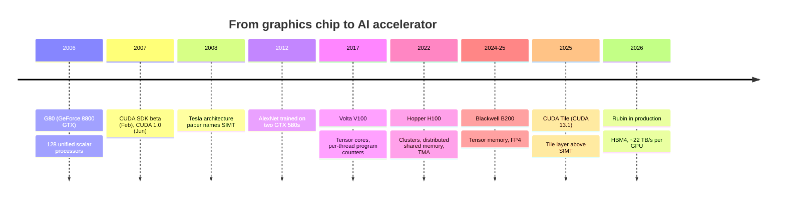
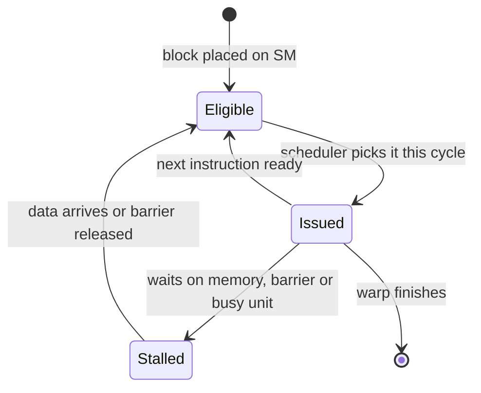

---
tags:
  - gpu-programming
  - foundations
  - gpu-architecture
  - cuda
  - simt
status: complete
sources:
  - https://docs.nvidia.com/cuda/cuda-programming-guide/01-introduction/programming-model.html
  - https://docs.nvidia.com/cuda/cuda-programming-guide/05-appendices/compute-capabilities.html
  - https://developer.nvidia.com/blog/nvidia-hopper-architecture-in-depth/
  - https://www.nvidia.com/en-us/data-center/h100/
  - https://docs.nvidia.com/cuda/blackwell-tuning-guide
  - https://modal.com/gpu-glossary/device-hardware/streaming-multiprocessor
  - https://research.nvidia.com/publication/2008-04_nvidia-tesla-unified-graphics-and-computing-architecture
  - https://www.jonpeddie.com/news/8800-gtx-laid-ai-computing-foundation/
  - https://developer.nvidia.com/blog/?p=7832
  - https://developer.nvidia.com/blog/using-cuda-warp-level-primitives/
  - https://arxiv.org/html/2507.10789v2
  - https://arxiv.org/html/2512.02189v3
  - https://glennklockwood.com/garden/processors/b200
  - https://rocm.docs.amd.com/en/docs-10.0.0/reference/gpu-arch/mi350.html
  - https://developer.nvidia.com/blog/nvidia-cuda-13-1-powers-next-gen-gpu-programming-with-nvidia-cuda-tile-and-performance-gains/
  - https://developer.nvidia.com/blog/nvidia-cuda-13-3-enhances-gpu-development-with-tile-programming-in-c-compiler-autotuning-and-python-updates/
  - https://www.techtimes.com/articles/319203/20260627/nvidia-vera-rubin-ships-this-fall-8-cloud-partners-10x-lower-token-cost-hbm4-triples-bandwidth.htm
created: 2026-11-26
updated: 2026-11-26
---

## Table Of Contents

---

- [[#TL;DR|TL;DR]]
- [[#The Problem|The Problem]]
- [[#Foundations|Foundations]]
    - [[#Latency vs Throughput|Latency vs Throughput]]
    - [[#The Streaming Multiprocessor|The Streaming Multiprocessor]]
    - [[#Warps and SIMT|Warps and SIMT]]
    - [[#Hardware Generations and Compute Capability|Hardware Generations and Compute Capability]]
- [[#How We Got Here|How We Got Here]]
- [[#How It Works|How It Works]]
    - [[#From Chip to Thread|From Chip to Thread]]
    - [[#Inside One SM|Inside One SM]]
    - [[#How a Warp Gets Scheduled|How a Warp Gets Scheduled]]
    - [[#Latency Hiding, Worked Example|Latency Hiding, Worked Example]]
    - [[#Divergence and Independent Thread Scheduling|Divergence and Independent Thread Scheduling]]
    - [[#CPU and GPU Side by Side|CPU and GPU Side by Side]]
- [[#Where It Is Now|Where It Is Now]]
- [[#Trade-offs & Open Problems|Trade-offs & Open Problems]]
- [[#Resources|Resources]]
- [[#Related Notes|Related Notes]]

## ***TL;DR***
---
*A GPU is a throughput machine: instead of making one thread fast, it keeps tens of thousands of threads in flight and switches between them every clock cycle, so while some wait on memory others compute. Everything else in GPU programming, from [[Memory Coalescing]] to [[Occupancy and Latency Hiding]], follows from that one design choice.*

- **The unit of hardware is the SM.** A GPU is a grid of *streaming multiprocessors* (SMs), each roughly analogous to a simple CPU core with its own registers, schedulers and fast on-chip memory. An H100 SXM has 132 SMs; a B200 has 148 ([NVIDIA Hopper in depth](https://developer.nvidia.com/blog/nvidia-hopper-architecture-in-depth/), [Jarmusch & Chandrasekaran, 2026](https://arxiv.org/html/2512.02189v3)).
- **The unit of execution is the warp.** Threads run in groups of 32 called *warps*. A warp issues one instruction at a time for all its threads, a model NVIDIA calls SIMT (single instruction, multiple threads) ([CUDA Programming Guide](https://docs.nvidia.com/cuda/cuda-programming-guide/01-introduction/programming-model.html)).
- **Latency is hidden, not avoided.** An H100 SM can hold 64 warps (2,048 threads) at once and its four warp schedulers can switch warps in one cycle, so a warp waiting hundreds of cycles for memory costs nothing if another warp is ready ([Modal GPU Glossary](https://modal.com/gpu-glossary/device-hardware/streaming-multiprocessor)).
- **Most of the silicon is math, not control.** No branch prediction, no speculative execution, no out-of-order engine per thread. The area goes to arithmetic units, a huge register file (256 KB per SM) and [[Tensor Cores]].
- **Where it is now (Nov 2026):** Blackwell (B200/B300) is the deployed workhorse, Rubin entered full production in June 2026 with cloud shipments this fall, and NVIDIA's programming model is adding a tile layer (CUDA Tile, in Python since CUDA 13.1 and C++ since 13.3) on top of SIMT rather than replacing it.

## ***The Problem***
---
*CPUs spend most of their transistors making a single thread finish sooner. That stopped scaling, and it was never what graphics, simulation or neural networks needed: they need the same small operation done on millions of independent pieces of data, and they care about total work per second, not how long any one piece takes.*

Two ways to spend a chip's transistor budget:

| Goal | Spend transistors on | Good at | Example |
|---|---|---|---|
| **Low latency** (finish one task fast) | Big caches, branch predictors, out-of-order execution, high clocks | Branchy, serial code; operating systems; databases | A server CPU core |
| **High throughput** (finish many tasks per second) | Many simple arithmetic units, a huge register file, fast thread switching | The same operation over huge arrays | A GPU SM |

Memory is the core difficulty. Reading from off-chip DRAM takes hundreds of cycles on any processor. A CPU fights that latency with caches and speculation so its one thread rarely waits. A GPU accepts the wait and keeps enough other work on hand that the arithmetic units never sit idle. This only works if the program has a huge amount of independent parallel work, which is why GPUs fit matrix multiplies, image processing and [[Transformer]] layers so well, and fit pointer-chasing code badly.

## ***Foundations***
---
*Four ideas carry the rest of the note: the latency vs throughput split, the SM as the building block, the warp as the scheduling unit, and compute capability as the way to name what a given GPU can do.*

#### **Latency vs Throughput**
*Latency* is how long one operation takes from start to finish. *Throughput* is how many operations complete per second. A highway with a 60 mph limit and 10 lanes has the same latency as one with 1 lane but ten times the throughput. GPUs widen the highway: each thread is slower than a CPU thread, but many more run at once.

*Little's law* ties the two together and is the most useful single equation for GPU intuition:

$$
\text{work in flight} = \text{throughput} \times \text{latency}
$$

*In plain English: to keep a pipe full you need as many requests outstanding as the pipe delivers per unit time, multiplied by how long each request takes. If memory takes 400 ns to answer and you want 3 TB/s from it, you need 1.2 MB of requests in flight at every moment.* The [[#Latency Hiding, Worked Example|worked example]] below runs these numbers for an H100.

#### **The Streaming Multiprocessor**
An SM is the GPU's core. It holds arithmetic units (FP32, INT32, FP64, [[Tensor Cores]], special-function units for things like $\sin$ and $e^x$), load/store units, a large register file, and a block of on-chip SRAM that serves as both L1 cache and programmer-managed *shared memory* (see [[GPU Memory Hierarchy]]). NVIDIA describes SMs as "roughly analogous to the cores of CPUs", but much simpler: no speculative execution or instruction-pointer prediction ([Modal GPU Glossary](https://modal.com/gpu-glossary/device-hardware/streaming-multiprocessor)).

Each SM is split into four partitions (sub-cores), each with its own warp scheduler ([Jarmusch et al., 2025](https://arxiv.org/html/2507.10789v2); [Modal](https://modal.com/gpu-glossary/device-hardware/streaming-multiprocessor)).

#### **Warps and SIMT**
CUDA programs launch huge numbers of threads (see [[CUDA Programming Model]]). The hardware groups every 32 consecutive threads of a block into a *warp*: "Within a thread block, threads are organized into groups of 32 threads called warps" ([CUDA Programming Guide](https://docs.nvidia.com/cuda/cuda-programming-guide/01-introduction/programming-model.html)). A warp fetches and issues one instruction, and all 32 threads execute it on their own data.

That is *SIMT*: single instruction, multiple threads. It looks like SIMD (one instruction, many data lanes) from the hardware side, but you write ordinary scalar code for one thread, with its own `if` statements and loops. When threads of one warp take different branches, the hardware runs each branch in turn with the threads that did not take it masked off. That is correct but wastes lanes; see [[Warp Divergence and Warp-Level Primitives]].

#### **Hardware Generations and Compute Capability**
Each NVIDIA architecture has a *compute capability* (CC) number that tells the compiler and programmer which features and limits apply. The ones that matter in late 2026:

| CC | Architecture | Data center chip | Notable for |
|---|---|---|---|
| 7.0 | Volta (2017) | V100 | First [[Tensor Cores]], independent thread scheduling |
| 8.0 | Ampere (2020) | A100 | Up to 164 KB shared memory per SM |
| 9.0 | Hopper (2022) | H100, H200 | Thread block clusters, distributed shared memory, [[TMA and Asynchronous Copies|TMA]] |
| 10.0 | Blackwell (2024–25) | B200, GB200 | Tensor memory (TMEM), FP4 tensor math |
| 12.x | Blackwell (consumer/workstation) | RTX 50-series, RTX PRO | Smaller SM: 48 warps, 100 KB shared memory |

Sources: [Compute Capabilities appendix](https://docs.nvidia.com/cuda/cuda-programming-guide/05-appendices/compute-capabilities.html), [Blackwell Tuning Guide](https://docs.nvidia.com/cuda/blackwell-tuning-guide), [Hopper in depth](https://developer.nvidia.com/blog/nvidia-hopper-architecture-in-depth/). A trap worth knowing: "Blackwell" covers both CC 10.0 (data center) and CC 12.x (consumer), and the two have different SM limits and tensor core instructions.

## ***How We Got Here***
---
*GPUs became general-purpose when NVIDIA replaced fixed graphics pipelines with one pool of programmable processors in 2006 and shipped CUDA to program it in C. Since then the SIMT core has stayed recognisable, while each generation added hardware for matrix math and for moving data asynchronously.*



| Year | Step | Why it mattered | Source |
|---|---|---|---|
| 2006 | G80 replaced separate vertex and pixel shader pipelines with 128 scalar stream processors. | One programmable pool could run graphics or general math. | [Jon Peddie Research](https://www.jonpeddie.com/news/8800-gtx-laid-ai-computing-foundation/) |
| 2007 | CUDA SDK beta (Feb), CUDA 1.0 (Jun). | GPUs programmable in a C dialect, no graphics API tricks. | [Jon Peddie Research](https://www.jonpeddie.com/news/8800-gtx-laid-ai-computing-foundation/) |
| 2008 | Lindholm, Nickolls, Oberman and Montrym describe the Tesla architecture: a "scalable parallel array of processors" that is "massively multithreaded". | Defines the SM, warp and SIMT vocabulary still used. | [IEEE Micro, 2008](https://research.nvidia.com/publication/2008-04_nvidia-tesla-unified-graphics-and-computing-architecture) |
| 2012 | AlexNet trained on two GeForce GTX 580s (Fermi). | Deep learning finds its hardware. | [Jon Peddie Research](https://www.jonpeddie.com/news/8800-gtx-laid-ai-computing-foundation/) |
| 2017 | Volta V100: 80 SMs, 8 tensor cores per SM (640 total) doing 4×4×4 matrix multiply-accumulates; per-thread program counter and call stack. | Matrix units become a first-class part of the SM; warps no longer run in strict lockstep. | [Inside Volta](https://developer.nvidia.com/blog/?p=7832) |
| 2022 | Hopper H100: 132 SMs, thread block clusters ("guaranteed to be concurrently scheduled onto a group of SMs"), SM-to-SM distributed shared memory, TMA copy engine. | The SM stops being an island; data movement becomes asynchronous hardware. | [Hopper in depth](https://developer.nvidia.com/blog/nvidia-hopper-architecture-in-depth/) |
| 2024–25 | Blackwell B200: 148 SMs, 256 KB of tensor memory per SM, 8 TB/s HBM3e. | Tensor core results get their own memory; low precision (FP4) goes mainstream. | [Jarmusch & Chandrasekaran](https://arxiv.org/html/2512.02189v3), [Glenn Lockwood](https://glennklockwood.com/garden/processors/b200) |

## ***How It Works***
---
*Follow the chip from the outside in: a GPU is a set of SMs around a shared L2 and HBM; an SM is four partitions sharing on-chip memory; each partition's scheduler picks a ready warp each cycle and issues one instruction for its 32 threads. Speed comes from always having a ready warp.*

#### **From Chip to Thread**
| Level | What it is | H100 SXM count | Who you program it as |
|---|---|---|---|
| GPU | The whole chip plus HBM | 1 chip, 80 GB HBM3 at 3.35 TB/s | A *grid* of thread blocks |
| GPC | Graphics processing cluster, a group of SMs | Up to 9 TPCs (18 SMs) per GPC in full GH100 | A *thread block cluster* runs inside one GPC |
| SM | Streaming multiprocessor | 132 | Each *thread block* runs on one SM |
| SM partition | One quarter of an SM with its own warp scheduler | 4 per SM | Warps are spread across partitions |
| Warp | 32 threads issued together | Up to 64 resident per SM | Hidden from the code, but shapes performance |
| Thread | One lane of a warp | Up to 2,048 resident per SM | Your kernel code |

Sources: [Hopper in depth](https://developer.nvidia.com/blog/nvidia-hopper-architecture-in-depth/), [H100 product page](https://www.nvidia.com/en-us/data-center/h100/), [Compute Capabilities](https://docs.nvidia.com/cuda/cuda-programming-guide/05-appendices/compute-capabilities.html), [CUDA Programming Guide](https://docs.nvidia.com/cuda/cuda-programming-guide/01-introduction/programming-model.html) (clusters "are executed in a single GPC").

The block-to-SM mapping is the important contract: once the hardware places a thread block on an SM, the block stays there until it finishes, which is what lets its threads share that SM's shared memory. Blocks have no ordering guarantee among themselves: "Different thread blocks within the grid are scheduled among the available SMs and may be executed in any order" ([CUDA Programming Guide](https://docs.nvidia.com/cuda/cuda-programming-guide/01-introduction/programming-model.html)).

#### **Inside One SM**


H100 per-SM figures: 128 FP32 cores, 4 tensor cores, a 256 KB register file (64K 32-bit registers), and 256 KB of combined L1 and shared memory, configurable up to 228 KB of shared memory ([Hopper in depth](https://developer.nvidia.com/blog/nvidia-hopper-architecture-in-depth/), [Compute Capabilities](https://docs.nvidia.com/cuda/cuda-programming-guide/05-appendices/compute-capabilities.html)). The register file is split evenly across the four partitions. Note the register file is as big as the L1: registers are where the GPU keeps the state of every resident thread, which is what makes free warp switching possible.

#### **How a Warp Gets Scheduled**
Each cycle, each partition's scheduler looks at its warps and picks one that is *eligible*: its next instruction's inputs are ready and the needed unit is free. Every other warp is *stalled* on something.



Because every resident warp's registers stay in the register file, switching warps is one cycle, which the Modal glossary puts at more than 1,000 times faster than a CPU context switch ([Modal](https://modal.com/gpu-glossary/device-hardware/streaming-multiprocessor)). This is why "more warps resident" (occupancy) helps up to a point: it gives the scheduler more candidates. How many fit depends on registers and shared memory per thread; see [[Occupancy and Latency Hiding]].

#### **Latency Hiding, Worked Example**
How much parallelism does an H100 need just to keep its memory busy?

- Measured DRAM latency on an H100 PCIe is about 659 cycles; L2 hits about 273 cycles; L1 about 30 to 40 cycles ([Jarmusch et al., 2025](https://arxiv.org/html/2507.10789v2)). Call DRAM latency roughly 400 ns.
- H100 SXM bandwidth is 3.35 TB/s ([H100 product page](https://www.nvidia.com/en-us/data-center/h100/)).

$$
\text{bytes in flight} = 3.35 \times 10^{12}\ \tfrac{\text{B}}{\text{s}} \times 400 \times 10^{-9}\ \text{s} \approx 1.34\ \text{MB}
$$

*In plain English: at every moment, about 1.34 MB of loads must be outstanding, or the memory system sits partly idle.* Spread over 132 SMs, that is about 10 KB per SM. If each thread loads one 4-byte `float` at a time, that is about 2,500 outstanding loads per SM, more than the 2,048 threads an SM can hold. So a simple one-float-per-thread kernel cannot saturate H100 bandwidth even at full occupancy. Real kernels fix this by having each thread issue several independent loads, use 16-byte vector loads, or hand bulk copies to the [[TMA and Asynchronous Copies|TMA engine]]. The same arithmetic, with bigger numbers, is why each new generation's higher bandwidth demands more bytes in flight.

#### **Divergence and Independent Thread Scheduling**
```cuda
__global__ void relu(float* x, int n) {
    int i = blockIdx.x * blockDim.x + threadIdx.x;  // this thread's element
    if (i < n && x[i] < 0.0f)                       // some lanes take the branch
        x[i] = 0.0f;                                // others idle for this instruction
}
```

- Line 1: `__global__` marks a function that runs on the GPU and is launched from the CPU.
- Line 2: each thread computes which array element it owns from its block and thread index (see [[CUDA Programming Model]]).
- Line 3: lanes whose value is negative take the branch; the rest are masked off while it runs.
- Line 4: only the active lanes write. The warp still spends the cycle; the inactive lanes just do nothing.

Before Volta, a warp had one program counter, so divergent paths ran strictly one after another and reconverged at a fixed point. Volta gave each thread its own program counter and call stack, so divergent paths can interleave ([Inside Volta](https://developer.nvidia.com/blog/?p=7832)). The catch: old code that assumed a warp always runs in lockstep became unsafe. NVIDIA's guidance is that "thread convergence is guaranteed only within explicitly synchronous warp-level primitives" such as `__syncwarp()` and the `*_sync` shuffle functions ([Lin & Grover, 2018](https://developer.nvidia.com/blog/using-cuda-warp-level-primitives/)).

#### **CPU and GPU Side by Side**
| | AMD EPYC 9965 (CPU) | NVIDIA H100 SXM (GPU) |
|---|---|---|
| Cores / SMs | 192 cores | 132 SMs |
| Threads running truly in parallel | 384 (2 per core) | 128 per SM (4 schedulers × 32 lanes), over 16,000 total |
| Threads resident at once | 384 | Over 250,000 (2,048 per SM) |
| Power | Up to 500 W | Up to 700 W |
| Per-thread machinery | Branch prediction, out-of-order, speculation | None; in-order issue per warp |

Source: [Modal GPU Glossary](https://modal.com/gpu-glossary/device-hardware/streaming-multiprocessor). The CPU spends about 1.25 W per thread; the GPU about 0.05 W. AMD's GPUs follow the same design with different words: a *compute unit* (CU) instead of an SM and a *wavefront* instead of a warp (see [[ROCm and HIP]]). The MI355X has 256 CUs across 8 chiplets, 160 KB of local data share (AMD's shared memory) per CU and 8 TB/s of HBM3E ([AMD ROCm docs](https://rocm.docs.amd.com/en/docs-10.0.0/reference/gpu-arch/mi350.html)).

## ***Where It Is Now***
---
*As of November 2026 the SIMT core is unchanged in spirit, but almost all new performance comes from specialized units (tensor cores, tensor memory, copy engines) that the SM orchestrates, and from memory bandwidth. NVIDIA's programming model is following, with a tile layer that hides those units.*

| Chip (Nov 2026) | Status | SMs / CUs | Memory | Dense BF16 tensor | Source |
|---|---|---|---|---|---|
| H100 SXM | Widely deployed | 132 | 80 GB HBM3, 3.35 TB/s | ~989 TFLOPS (1,979 with sparsity) | [NVIDIA](https://www.nvidia.com/en-us/data-center/h100/) |
| B200 | Main training and inference part | 148 | ~180 GB HBM3e, 8 TB/s | 2,250 (HGX) to 2,500 (GB200) TFLOPS | [Lockwood](https://glennklockwood.com/garden/processors/b200), [Blackwell Tuning Guide](https://docs.nvidia.com/cuda/blackwell-tuning-guide) |
| AMD MI355X | Shipping since H2 2025 | 256 CUs | 288 GB HBM3E, 8 TB/s | 2.5 PFLOPS FP16 | [AMD ROCm docs](https://rocm.docs.amd.com/en/docs-10.0.0/reference/gpu-arch/mi350.html) |
| Rubin | Full production since Jun 1, 2026; cloud shipments starting fall 2026 | Not published in detail | 288 GB HBM4, ~22 TB/s | 50 PFLOPS NVFP4 inference (headline) | [Tech Times, Jun 2026](https://www.techtimes.com/articles/319203/20260627/nvidia-vera-rubin-ships-this-fall-8-cloud-partners-10x-lower-token-cost-hbm4-triples-bandwidth.htm) |

Three trends that matter for programmers:

- **The SM is becoming an orchestrator.** On Blackwell, tensor core instructions (`tcgen05.mma`) issue with about 11 cycles of latency versus 32 to 128 for Hopper's `wgmma`, and results land in a dedicated 256 KB-per-SM tensor memory instead of registers ([Jarmusch & Chandrasekaran, 2026](https://arxiv.org/html/2512.02189v3)). Fast kernels now spend their thread-level effort feeding these units, which is the idea behind [[Warp Specialization]].
- **Bandwidth is the scarce resource.** Rubin's ~22 TB/s is nearly 3x Blackwell's 8 TB/s, but measured STREAM bandwidth on B200 reached only about 52% of its 8 TB/s peak in one microbenchmark study ([Jarmusch & Chandrasekaran](https://arxiv.org/html/2512.02189v3)), a reminder that peak numbers assume perfectly [[Memory Coalescing|coalesced]], deep-in-flight access.
- **A tile layer above SIMT.** CUDA 13.1 (Dec 2025) added CUDA Tile, a tile-based model with its own virtual ISA (Tile IR) and a Python DSL (cuTile) that "abstracts away the details of using specialized hardware such as tensor cores" ([NVIDIA, Dec 2025](https://developer.nvidia.com/blog/nvidia-cuda-13-1-powers-next-gen-gpu-programming-with-nvidia-cuda-tile-and-performance-gains/)). CUDA 13.3 (May 2026) brought it to C++ and to Hopper ([NVIDIA, May 2026](https://developer.nvidia.com/blog/nvidia-cuda-13-3-enhances-gpu-development-with-tile-programming-in-c-compiler-autotuning-and-python-updates/)). NVIDIA's own guide is explicit that "Tile programming does not replace SIMT programming" ([CUDA Programming Guide v13.5](https://docs.nvidia.com/cuda/cuda-programming-guide/01-introduction/programming-model.html)); it is the same bet [[Triton]] made in 2019.

## ***Trade-offs & Open Problems***
---
*The GPU's bargain is excellent throughput in exchange for demanding a lot of the program: massive parallelism, regular memory access and little branching. The open questions are about how much of that burden hardware and compilers can take back.*

| Trade-off | What you gain | What it costs |
|---|---|---|
| Thousands of resident threads | Memory latency hidden for free | Registers and shared memory split many ways; too much per thread lowers [[Occupancy and Latency Hiding|occupancy]] |
| SIMT with 32-wide warps | Simple scalar code, wide hardware | Divergent branches waste lanes; scattered addresses waste bandwidth |
| No speculation or out-of-order per thread | Silicon goes to math | Serial or irregular code (graph traversal, parsing) runs poorly |
| Specialized units (tensor cores, TMA, TMEM) | Most of the peak FLOPs | Only reachable with architecture-specific code; kernels age with each generation |
| Weak ordering between thread blocks | Scales to any number of SMs | Global synchronization needs separate kernels, clusters or cooperative launches |

Open problems in late 2026:

- **Portability vs peak.** Hand-tuned Hopper kernels (`wgmma`) do not run on Blackwell's `tcgen05` path and vice versa. Tile languages (CUDA Tile, [[Triton]], [[CUTLASS and CuTe|CuTe DSL]]) aim to recompile one source per generation; how close they get to hand-written kernels on each new chip is still measured case by case.
- **Feeding the math.** Each generation roughly doubles tensor throughput faster than it grows bandwidth or on-chip memory, so more kernels fall on the memory side of the [[Roofline Model and Arithmetic Intensity|roofline]].
- **Two Blackwells.** CC 10.0 and 12.x share a name but not SM limits or tensor instructions, which keeps tripping up libraries and tutorials.

## ***Resources***
---
*Start with the Modal glossary for vocabulary and the CUDA Programming Guide's programming-model chapter for the official picture; then read one architecture deep dive (Hopper's is the most complete) and one microbenchmark paper to see the real numbers behind the marketing ones.*

**Primary documentation**
- [CUDA Programming Guide v13.5, Programming Model](https://docs.nvidia.com/cuda/cuda-programming-guide/01-introduction/programming-model.html): NVIDIA, Oct 2026. Threads, warps, SIMT, memory spaces, tile programming.
- [Compute Capabilities appendix](https://docs.nvidia.com/cuda/cuda-programming-guide/05-appendices/compute-capabilities.html): per-CC limits (warps, registers, shared memory).
- [NVIDIA Hopper Architecture In-Depth](https://developer.nvidia.com/blog/nvidia-hopper-architecture-in-depth/): NVIDIA, 2022. SM layout, clusters, TMA.
- [Inside Volta](https://developer.nvidia.com/blog/?p=7832): NVIDIA, 2017. Tensor cores and independent thread scheduling.
- [Blackwell Tuning Guide](https://docs.nvidia.com/cuda/blackwell-tuning-guide): CC 10.0 vs 12.0 limits.
- [AMD Instinct MI350 Series microarchitecture](https://rocm.docs.amd.com/en/docs-10.0.0/reference/gpu-arch/mi350.html): AMD's equivalent picture.

**Papers**
- [NVIDIA Tesla: A Unified Graphics and Computing Architecture](https://research.nvidia.com/publication/2008-04_nvidia-tesla-unified-graphics-and-computing-architecture): Lindholm, Nickolls, Oberman, Montrym, IEEE Micro, 2008.
- [Dissecting the NVIDIA Blackwell Architecture with Microbenchmarks](https://arxiv.org/html/2507.10789v2): Jarmusch, Graddon, Chandrasekaran, Jul 2025. Measured latencies on GH100 and GB203.
- [Microbenchmarking NVIDIA's Blackwell Architecture](https://arxiv.org/html/2512.02189v3): Jarmusch & Chandrasekaran, rev. Mar 2026. B200 tensor memory and tensor core latency.

**Explainers and practitioners**
- [Modal GPU Glossary: Streaming Multiprocessor](https://modal.com/gpu-glossary/device-hardware/streaming-multiprocessor): the clearest CPU vs GPU comparison.
- [Using CUDA Warp-Level Primitives](https://developer.nvidia.com/blog/using-cuda-warp-level-primitives/): Lin & Grover, 2018.
- [8800 GTX laid AI computing foundation](https://www.jonpeddie.com/news/8800-gtx-laid-ai-computing-foundation/): Jon Peddie Research. History.
- [Glenn Lockwood: B200](https://glennklockwood.com/garden/processors/b200): spec sheet with sources.
- [CUDA 13.1 and CUDA Tile](https://developer.nvidia.com/blog/nvidia-cuda-13-1-powers-next-gen-gpu-programming-with-nvidia-cuda-tile-and-performance-gains/), [CUDA 13.3](https://developer.nvidia.com/blog/nvidia-cuda-13-3-enhances-gpu-development-with-tile-programming-in-c-compiler-autotuning-and-python-updates/): NVIDIA, Dec 2025 and May 2026.

## ***Related Notes***
---
*Read the other Foundations notes next, in order: the programming model, the memory hierarchy, then the roofline.*

- [[CUDA Programming Model]] — How grids, blocks and threads map onto the SMs and warps described here.
- [[GPU Memory Hierarchy]] — Registers, shared memory, L2 and HBM in detail.
- [[Roofline Model and Arithmetic Intensity]] — When a kernel is limited by math vs by memory.
- [[Memory Coalescing]] — Why a warp's 32 addresses should be next to each other.
- [[Occupancy and Latency Hiding]] — How many warps an SM can hold and why it matters.
- [[Warp Divergence and Warp-Level Primitives]] — The cost of branches inside a warp, and shuffles.
- [[Shared Memory and Bank Conflicts]] — The SM's programmer-managed SRAM.
- [[Tensor Cores]] — The matrix units that now supply most of the FLOPs.
- [[TMA and Asynchronous Copies]] — Hopper and Blackwell's bulk copy engine.
- [[Warp Specialization]] — Splitting warps into producers and consumers to feed tensor cores.
- [[Blackwell Architecture]] — The current generation in detail.
- [[ROCm and HIP]] — AMD's version of the same ideas.
- [[Triton]] — A tile-level language that hides warps from the programmer.
- [[AI Accelerators]] — How GPUs compare with TPUs and other AI chips.
- [[GPU Cluster Infrastructure]] — What happens when you connect thousands of these chips.
- [[FlashAttention]] — A case study in fitting one algorithm to each GPU generation.
- [[Thread Block Clusters and Distributed Shared Memory]] — GPCs, clusters and the SM-to-SM network.
