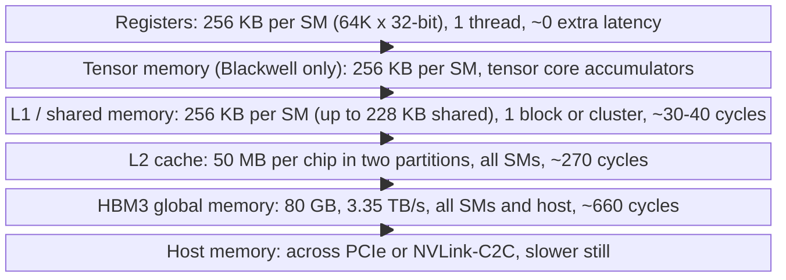
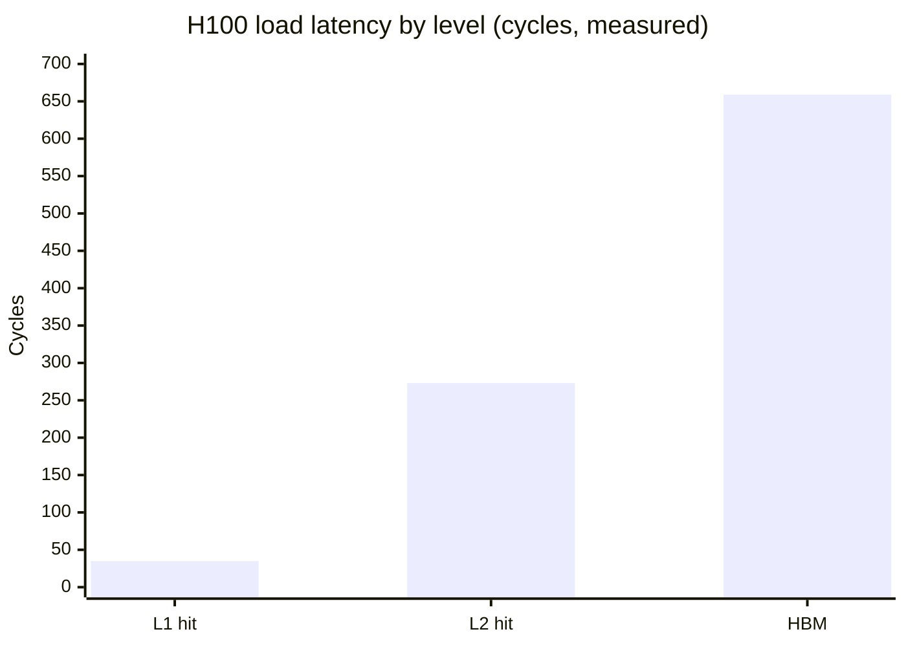

---
tags:
  - gpu-programming
  - foundations
  - memory
  - cuda
status: complete
sources:
  - https://docs.nvidia.com/cuda/cuda-programming-guide/01-introduction/programming-model.html
  - https://docs.nvidia.com/cuda/cuda-programming-guide/05-appendices/compute-capabilities.html
  - https://docs.nvidia.com/cuda/pdf/CUDA_C_Best_Practices_Guide.pdf
  - https://docs.nvidia.com/cuda/cuda-programming-guide/04-special-topics/l2-cache-control.html
  - https://docs.nvidia.com/cuda/blackwell-tuning-guide
  - https://developer.nvidia.com/blog/nvidia-hopper-architecture-in-depth/
  - https://www.nvidia.com/en-us/data-center/h100/
  - https://developer.nvidia.com/blog/using-shared-memory-cuda-cc
  - https://developer.nvidia.com/blog/?p=7832
  - https://modal.com/gpu-glossary/device-hardware/l1-data-cache
  - https://modal.com/gpu-glossary/device-software/memory-hierarchy
  - https://modal.com/gpu-glossary/device-hardware/tensor-memory
  - https://chipsandcheese.com/p/nvidias-h100-funny-l2-and-tons-of-bandwidth
  - https://arxiv.org/html/2507.10789v2
  - https://arxiv.org/html/2512.02189v3
  - https://glennklockwood.com/garden/processors/b200
  - https://rocm.docs.amd.com/en/docs-10.0.0/reference/gpu-arch/mi350.html
  - https://www.techtimes.com/articles/319203/20260627/nvidia-vera-rubin-ships-this-fall-8-cloud-partners-10x-lower-token-cost-hbm4-triples-bandwidth.htm
  - https://arxiv.org/abs/2205.14135
created: 2026-11-26
updated: 2026-11-26
---

## Table Of Contents

---

- [[#TL;DR|TL;DR]]
- [[#The Problem|The Problem]]
- [[#Foundations|Foundations]]
    - [[#Why a Hierarchy|Why a Hierarchy]]
    - [[#Programmer-Managed vs Hardware-Managed|Programmer-Managed vs Hardware-Managed]]
    - [[#Logical Spaces vs Physical Places|Logical Spaces vs Physical Places]]
- [[#How We Got Here|How We Got Here]]
- [[#How It Works|How It Works]]
    - [[#The Levels on an H100|The Levels on an H100]]
    - [[#Registers|Registers]]
    - [[#Shared Memory and L1|Shared Memory and L1]]
    - [[#Distributed Shared Memory|Distributed Shared Memory]]
    - [[#L2 Cache|L2 Cache]]
    - [[#Global Memory (HBM)|Global Memory (HBM)]]
    - [[#Local and Constant Memory|Local and Constant Memory]]
    - [[#Worked Example, Why Reuse Matters|Worked Example, Why Reuse Matters]]
- [[#Where It Is Now|Where It Is Now]]
- [[#Trade-offs & Open Problems|Trade-offs & Open Problems]]
- [[#Resources|Resources]]
- [[#Related Notes|Related Notes]]

## ***TL;DR***
---
*A GPU has a small, very fast memory next to the math units and a huge, much slower memory off the chip, with caches in between. Almost every GPU optimization is a way of moving data up this ladder once and using it many times before it falls back down.*

- **Five levels, fastest to slowest:** registers (per thread), shared memory and L1 (per SM, same SRAM), L2 (shared by the whole chip), HBM global memory (off-chip), and host memory across PCIe or NVLink.
- **The gaps are large.** On an H100, an L1 hit takes about 30 to 40 cycles, an L2 hit about 270 and an HBM access about 660 ([Jarmusch et al., 2025](https://arxiv.org/html/2507.10789v2)). Shared memory latency is "roughly 100x lower than uncached global memory" ([Harris, 2013](https://developer.nvidia.com/blog/using-shared-memory-cuda-cc)).
- **The fast levels are tiny.** Per H100 SM: 256 KB of registers and 256 KB of L1/shared memory, against 50 MB of L2 and 80 GB of HBM at 3.35 TB/s for the whole chip ([Hopper in depth](https://developer.nvidia.com/blog/nvidia-hopper-architecture-in-depth/), [H100 page](https://www.nvidia.com/en-us/data-center/h100/)).
- **Unlike a CPU, the programmer manages much of it.** Shared memory is an explicit scratchpad you load and sync yourself; registers are assigned by the compiler but bounded by your code.
- **Where it is now (Nov 2026):** Blackwell added a sixth on-chip store, tensor memory (256 KB per SM) for [[Tensor Cores]] accumulators, and grew L2 to 126 MB on GB200. HBM bandwidth went from 3.35 TB/s (H100) to 8 TB/s (B200) to about 22 TB/s (Rubin, HBM4), but compute grew faster still.

## ***The Problem***
---
*Arithmetic is cheap and moving data is expensive. A GPU can do hundreds of floating-point operations in the time it takes to fetch one number from off-chip memory, so a kernel that fetches every input from HBM spends most of its time waiting.*

An H100 SXM does about 989 TFLOPS of dense BF16 tensor math and 67 TFLOPS of FP32, but reads HBM at 3.35 TB/s ([H100 page](https://www.nvidia.com/en-us/data-center/h100/)). Divide one by the other:

$$
\frac{67 \times 10^{12}\ \text{FLOP/s (FP32)}}{3.35 \times 10^{12}\ \text{B/s}} = 20\ \text{FLOPs per byte} \approx 80\ \text{FLOPs per 4-byte float}
$$

*In plain English: to keep even the plain FP32 units busy, a kernel must do about 80 operations on every float it reads from HBM. With tensor cores the ratio is about 295 FLOPs per byte.* Few operations do that much work per input on their own. The only way to close the gap is reuse: load a value once into a faster, closer memory and use it many times. That is what the hierarchy is for, and the [[Roofline Model and Arithmetic Intensity]] note turns this ratio into a full model.

## ***Foundations***
---
*Three ideas: speed and size trade off, so memory comes in layers; on a GPU some layers are managed by you rather than by hardware; and the names in your code (global, shared, local) are not always the physical places the bytes live.*

#### **Why a Hierarchy**
Fast memory (SRAM built next to the logic) costs area and power per bit; dense memory (DRAM stacked in HBM) is cheap per bit but sits off the die and takes hundreds of cycles to answer. So every processor has a small fast layer near the logic and a big slow layer far away, with caches in between. What makes GPUs different is the shape: tens of thousands of threads, each with a little private state, all sharing one memory system.

#### **Programmer-Managed vs Hardware-Managed**
| Kind | Examples on a GPU | Who decides what is in it |
|---|---|---|
| Hardware-managed cache | L1, L2, constant cache | The hardware, on every access (CUDA offers hints) |
| Programmer-managed scratchpad | Shared memory, tensor memory | Your kernel: explicit loads, stores and barriers |
| Compiler-allocated | Registers, local memory (spills) | The compiler, from your code |

Modal's glossary puts it bluntly: unlike CPU L1 caches, "GPU L1 caches are mostly programmer-managed" ([Modal GPU Glossary](https://modal.com/gpu-glossary/device-hardware/l1-data-cache)). The [[CUDA Programming Model]] maps each level of the thread hierarchy to a level of memory: registers to a thread, shared memory to a block, global memory to the grid ([Modal, Memory Hierarchy](https://modal.com/gpu-glossary/device-software/memory-hierarchy)).

#### **Logical Spaces vs Physical Places**
| Space in CUDA code | Physically lives in | Cached in | Scope | Lifetime |
|---|---|---|---|---|
| Register | Register file (on-chip) | n/a | 1 thread | Thread |
| Local | HBM (off-chip) | L1 and L2 | 1 thread | Thread |
| Shared | L1/shared SRAM (on-chip) | n/a | Block (cluster on CC 9.0+) | Block |
| Global | HBM (off-chip) | L1 and L2 | All threads and host | Until freed |
| Constant | HBM (off-chip) | Constant cache | All threads (read-only) and host | Until freed |
| Texture | HBM (off-chip) | Texture/L1 | All threads (read-only) and host | Until freed |

Adapted from the device memory spaces table in the [CUDA C++ Best Practices Guide (13.4)](https://docs.nvidia.com/cuda/pdf/CUDA_C_Best_Practices_Guide.pdf). The trap is *local* memory: despite the name, it lives off-chip in HBM. It is where the compiler puts per-thread arrays it cannot keep in registers, and register *spills*.

## ***How We Got Here***
---
*Early CUDA GPUs had a scratchpad but no real data cache, so programmers staged everything through shared memory by hand. Each generation since has added cache and on-chip capacity, merged L1 and shared memory into one configurable SRAM, and lately added asynchronous hardware to move data between levels.*

| Year | Chip | Change | Source |
|---|---|---|---|
| 2010 | Fermi (CC 2.0) | Shared memory goes from 16 to 32 banks; multicast lets any number of threads in a warp read one address at once | [Harris, 2013](https://developer.nvidia.com/blog/using-shared-memory-cuda-cc) |
| 2017 | V100 (Volta) | L1 and shared memory combined into one 128 KB/SM block; 6 MB L2; 900 GB/s HBM2 | [Inside Volta](https://developer.nvidia.com/blog/?p=7832) |
| 2020 | A100 (Ampere) | Up to 164 KB shared memory per SM (192 KB unified); programmable L2 persistence (CC 8.0+) | [Compute Capabilities](https://docs.nvidia.com/cuda/cuda-programming-guide/05-appendices/compute-capabilities.html), [L2 Cache Control](https://docs.nvidia.com/cuda/cuda-programming-guide/04-special-topics/l2-cache-control.html) |
| 2022 | H100 (Hopper) | 256 KB unified L1/shared (228 KB shared), 50 MB L2, HBM3, distributed shared memory across a cluster, TMA copy engine | [Hopper in depth](https://developer.nvidia.com/blog/nvidia-hopper-architecture-in-depth/) |
| 2024–25 | B200 (Blackwell) | 256 KB tensor memory per SM, 8 TB/s HBM3e; GB200 L2 to 126 MB | [Jarmusch & Chandrasekaran](https://arxiv.org/html/2512.02189v3), [Blackwell Tuning Guide](https://docs.nvidia.com/cuda/blackwell-tuning-guide) |
| 2026 | Rubin | HBM4, 288 GB at about 22 TB/s per GPU | [Tech Times, Jun 2026](https://www.techtimes.com/articles/319203/20260627/nvidia-vera-rubin-ships-this-fall-8-cloud-partners-10x-lower-token-cost-hbm4-triples-bandwidth.htm) |

## ***How It Works***
---
*Walk down the ladder on one chip: each level is about an order of magnitude bigger and slower than the one above. For each level, know its size, who can see it, and the one rule that makes it fast.*

#### **The Levels on an H100**

| Level | Size (H100 SXM) | Latency (H100 PCIe, measured) | Bandwidth | Scope |
|---|---|---|---|---|
| Registers | 256 KB/SM, about 33 MB total | Operand read, effectively free | Highest | Thread |
| L1 / shared | 256 KB/SM, about 33 MB total | ~30 to 40 cycles (L1) | 32 banks × 4 B per clock per SM | Block |
| L2 | 50 MB | ~273 cycles | ~5.5 TB/s near partition, ~3.8 TB/s across both (PCIe card) | Chip |
| HBM | 80 GB | ~659 cycles | 3.35 TB/s peak | Chip + host |

Sources: sizes from [Hopper in depth](https://developer.nvidia.com/blog/nvidia-hopper-architecture-in-depth/) and [Compute Capabilities](https://docs.nvidia.com/cuda/cuda-programming-guide/05-appendices/compute-capabilities.html); latencies from [Jarmusch et al., 2025](https://arxiv.org/html/2507.10789v2); L2 bandwidth from [Chips and Cheese](https://chipsandcheese.com/p/nvidias-h100-funny-l2-and-tons-of-bandwidth) (measured on the 114-SM PCIe card); banks from [Harris](https://developer.nvidia.com/blog/using-shared-memory-cuda-cc). Note the inversion: the whole chip has about as much register file (33 MB) as L1 (33 MB), and nearly as much as L2 (50 MB).

#### **Registers**
- Each SM has 64K 32-bit registers (256 KB), split among all its resident threads; one thread can use at most 255 ([Compute Capabilities](https://docs.nvidia.com/cuda/cuda-programming-guide/05-appendices/compute-capabilities.html)).
- Registers hold every live variable of every resident thread, which is why warps can switch in one cycle (see [[GPU Architecture Basics]]).
- The budget is a trade: 64K registers shared by 2,048 threads is 32 registers each. A kernel that needs 128 registers per thread fits only 512 threads (16 warps) per SM, which lowers [[Occupancy and Latency Hiding|occupancy]].
- If a kernel needs more than it is allowed, the compiler *spills* to local memory, which is in HBM. Spills are one of the most common hidden slowdowns; the compiler reports them (`-Xptxas -v`) and [[Profiling with Nsight Compute and Nsight Systems|Nsight Compute]] shows them.

#### **Shared Memory and L1**
Shared memory and the L1 data cache are the same physical SRAM, split at a carveout you can influence. On CC 9.0 and 10.0 the unified block is 256 KB, of which up to 228 KB can be shared memory (227 KB per block); consumer Blackwell (CC 12.x) has 128 KB with up to 100 KB shared ([Compute Capabilities](https://docs.nvidia.com/cuda/cuda-programming-guide/05-appendices/compute-capabilities.html); [Blackwell Tuning Guide](https://docs.nvidia.com/cuda/blackwell-tuning-guide)). Statically declared shared memory is capped at 48 KB; larger amounts need dynamic allocation with an opt-in attribute.

The one rule: shared memory is split into 32 banks, and "successive 32-bit words map to successive banks", each serving 32 bits per clock. If several threads of a warp hit different addresses in the same bank, the accesses are serialized; if they all read the same address it is a broadcast ([Harris, 2013](https://developer.nvidia.com/blog/using-shared-memory-cuda-cc)). Peak per SM is therefore $32 \times 4 = 128$ bytes per clock. At an assumed 1.8 GHz across 132 SMs that is about $128 \times 1.8 \times 10^9 \times 132 \approx 30$ TB/s, roughly 9x HBM. Bank conflicts and how to avoid them are [[Shared Memory and Bank Conflicts]].

#### **Distributed Shared Memory**
On Hopper and later, blocks in the same [[CUDA Programming Model#Thread Block Clusters|thread block cluster]] can load, store and run atomics on each other's shared memory directly. NVIDIA reports inter-block exchange about 7x faster than going through global memory ([Hopper in depth](https://developer.nvidia.com/blog/nvidia-hopper-architecture-in-depth/)). It turns a cluster's combined shared memory (up to 8 × 228 KB portable) into one larger, slightly slower scratchpad, used for example to multicast one tile to several SMs in a GEMM.

#### **L2 Cache**
- Shared by all SMs, it is the point where every global memory access meets. H100 has 50 MB ([Hopper in depth](https://developer.nvidia.com/blog/nvidia-hopper-architecture-in-depth/)); GB200 has 126 MB ([Blackwell Tuning Guide](https://docs.nvidia.com/cuda/blackwell-tuning-guide)).
- H100's L2 is split into two partitions joined by a link. Any SM can reach all 50 MB, but the far half takes "nearly twice as long", so it "feels like a two-level setup rather than a single level of cache" ([Chips and Cheese, 2023](https://chipsandcheese.com/p/nvidias-h100-funny-l2-and-tons-of-bandwidth)).
- Since CC 8.0 you can mark a window of global memory as *persisting* in a set-aside part of L2, with `cudaLimitPersistingL2CacheSize` and an access policy window (`base_ptr`, `num_bytes`, `hitRatio`, `hitProp`, `missProp`) attached to a stream ([L2 Cache Control](https://docs.nvidia.com/cuda/cuda-programming-guide/04-special-topics/l2-cache-control.html)). Useful when a small, hot buffer (a lookup table, a KV block) would otherwise be evicted by a large streaming one.
- Because L2 is now tens of MB, whole working sets of small models or of one layer can fit, which changes the [[Roofline Model and Arithmetic Intensity|roofline]] for those workloads.

#### **Global Memory (HBM)**
Global memory is the GPU's DRAM, "accessible to all SMs in the GPU" ([CUDA Programming Guide](https://docs.nvidia.com/cuda/cuda-programming-guide/01-introduction/programming-model.html)). On data center parts it is HBM, DRAM stacks placed beside the GPU die on one package with very wide buses: H100 SXM has 80 GB at 3.35 TB/s.

The one rule: HBM is fast only for wide, aligned, contiguous accesses. A warp's loads are served in 32-byte sectors, so 32 threads reading 32 consecutive floats need four sectors, while 32 threads reading scattered floats can need 32. That is [[Memory Coalescing]], the single most important rule for global memory. The other rule is to touch it as rarely as possible, by fusing operations ([[Kernel Fusion]]) and reusing tiles in shared memory.

#### **Local and Constant Memory**
- **Local memory** is per-thread but lives in HBM, cached in L1 and L2 ([Best Practices Guide](https://docs.nvidia.com/cuda/pdf/CUDA_C_Best_Practices_Guide.pdf)). Each thread can have up to 512 KB ([Compute Capabilities](https://docs.nvidia.com/cuda/cuda-programming-guide/05-appendices/compute-capabilities.html)). You rarely ask for it; the compiler uses it for spills and for arrays indexed with values it cannot resolve at compile time.
- **Constant memory** is 64 KB, read-only from the kernel, served through a per-SM constant cache ([Compute Capabilities](https://docs.nvidia.com/cuda/cuda-programming-guide/05-appendices/compute-capabilities.html); [CUDA Programming Guide](https://docs.nvidia.com/cuda/cuda-programming-guide/01-introduction/programming-model.html)). It is fastest when all threads of a warp read the same address, which makes it a good home for kernel parameters and small coefficient tables.

#### **Worked Example, Why Reuse Matters**
Multiply two $N \times N$ FP32 matrices with $N = 4096$.

- **Work:** $2N^3 \approx 1.37 \times 10^{11}$ FLOPs.
- **Naive kernel, one thread per output, everything from HBM:** each output reads a row of $A$ and a column of $B$, $2N$ floats, so total traffic is $N^2 \times 2N \times 4 = 8N^3$ bytes $\approx 550$ GB. At 3.35 TB/s that is about 164 ms just for traffic. Caches soften this a lot in practice, but the kernel is still memory-bound.
- **Tiled kernel with 64×64 tiles in shared memory:** each element of $A$ and $B$ is loaded from HBM once per tile-row or tile-column it meets, cutting traffic by about the tile width, 64x, to about 8.6 GB, about 2.6 ms of traffic. Now the math (about 2 ms at 67 TFLOPS FP32) is the limit.

*In plain English: same math, 64x less memory traffic, and the bottleneck flips from memory to compute.* The general formula is that tiling raises [[Roofline Model and Arithmetic Intensity|arithmetic intensity]] in proportion to tile size, which is bounded by how much shared memory and how many registers you have. That is why every generation's bigger shared memory and tensor memory matter, and why [[FlashAttention]] (which applies the same idea to attention) was such a large win ([Dao et al., 2022](https://arxiv.org/abs/2205.14135)). The full progression is [[Tiled Matrix Multiplication (GEMM)]].

## ***Where It Is Now***
---
*By late 2026 the hierarchy has grown a new level for tensor cores, much bigger caches and much faster HBM, and data increasingly moves between levels through dedicated copy hardware rather than thread loads.*

| | H100 SXM (2022) | B200 (2025) | AMD MI355X (2025) | Rubin (2026) |
|---|---|---|---|---|
| Compute units | 132 SMs | 148 SMs | 256 CUs | Not detailed publicly |
| On-chip per SM/CU | 256 KB regs, 256 KB L1/shared | Same, plus 256 KB TMEM | 160 KB LDS, 32 KB L1 | — |
| Last-level cache | 50 MB L2 | GB200: 126 MB L2 | 4 MB L2 per XCD + 256 MB Infinity Cache | — |
| HBM | 80 GB HBM3, 3.35 TB/s | ~180 GB HBM3e, 8 TB/s | 288 GB HBM3E, 8 TB/s | 288 GB HBM4, ~22 TB/s |

Sources: [Hopper in depth](https://developer.nvidia.com/blog/nvidia-hopper-architecture-in-depth/), [H100 page](https://www.nvidia.com/en-us/data-center/h100/), [Blackwell Tuning Guide](https://docs.nvidia.com/cuda/blackwell-tuning-guide), [Lockwood, B200](https://glennklockwood.com/garden/processors/b200), [Jarmusch & Chandrasekaran](https://arxiv.org/html/2512.02189v3), [AMD ROCm docs](https://rocm.docs.amd.com/en/docs-10.0.0/reference/gpu-arch/mi350.html), [Tech Times](https://www.techtimes.com/articles/319203/20260627/nvidia-vera-rubin-ships-this-fall-8-cloud-partners-10x-lower-token-cost-hbm4-triples-bandwidth.htm).

- **Tensor memory.** Blackwell's TMEM is 256 KB per SM, arranged as 512 columns by 128 lanes of 32-bit cells ([Jarmusch & Chandrasekaran](https://arxiv.org/html/2512.02189v3)). It exists because matmul accumulators are touched far more often than input tiles; `tcgen05.mma` keeps the accumulator in TMEM, reads one input from TMEM or shared memory and the other from shared memory, and uses no registers. Data moves in and out only collectively, by the four warps of a warpgroup ([Modal, Tensor Memory](https://modal.com/gpu-glossary/device-hardware/tensor-memory)). It is not related to the [[TMA and Asynchronous Copies|Tensor Memory Accelerator]], despite the name.
- **Copies move to hardware.** On Hopper and Blackwell, fast kernels move tiles from HBM to shared memory with TMA rather than thread loads, which frees registers and threads and makes [[Memory Coalescing]] a property of the copy descriptor.
- **Peak is not achieved bandwidth.** One study measured STREAM Triad on a B200 at about 4.14 TB/s, roughly 52% of its 8 TB/s peak ([Jarmusch & Chandrasekaran](https://arxiv.org/html/2512.02189v3)). Tuned libraries get closer, but real kernels plan for well under peak.
- **Bigger caches change strategy.** With 126 MB of L2 on GB200 and 256 MB of Infinity Cache on MI355X, working sets that used to stream from HBM can now stay on-chip, which favours [[Kernel Fusion]] and persistent kernels that keep data resident across steps.

## ***Trade-offs & Open Problems***
---
*Every on-chip byte is contested: registers, shared memory, L1 and tensor memory all come out of the same area budget and are divided among the same resident threads. And bandwidth keeps falling behind compute.*

| Choice | Gain | Cost |
|---|---|---|
| More registers per thread | Bigger per-thread tiles, fewer reloads | Fewer resident warps; spills if over budget |
| More shared memory per block | Larger tiles, more reuse | Less L1 cache, fewer resident blocks |
| Larger L1 carveout | Better automatic caching for irregular access | Smaller tiles for tiled kernels |
| Persisting L2 window | Hot data stays on-chip | Less L2 for everything else; disabled under MIG |
| Explicit scratchpads (shared, TMEM) | Predictable, programmer-controlled reuse | More code, barriers, architecture-specific instructions |

Open problems:

- **The memory wall keeps rising.** From H100 to B200, dense BF16 tensor throughput rose about 2.3 to 2.5x (989 to 2,250–2,500 TFLOPS) while HBM bandwidth rose about 2.4x; FP4 rose much more. Rubin's ~22 TB/s helps, but low-precision math keeps outrunning it, so more kernels land on the memory side of the roofline.
- **HBM is scarce and expensive.** Capacity and bandwidth per GPU now depend as much on HBM supply as on GPU design (see [[AI Accelerators]]).
- **Portability of on-chip tricks.** TMEM, distributed shared memory and L2 partitions differ by vendor and generation; code that exploits them is hard to keep portable, which is part of the case for tile languages like [[Triton]] and [[CUTLASS and CuTe|CuTe]].

## ***Resources***
---
*The Best Practices Guide's memory chapter is still the best single read; pair it with the compute-capability tables for exact sizes and one microbenchmark paper for measured latencies.*

**Primary documentation**
- [CUDA C++ Best Practices Guide 13.4, Memory Optimizations](https://docs.nvidia.com/cuda/pdf/CUDA_C_Best_Practices_Guide.pdf): device memory spaces, coalescing, shared memory.
- [Compute Capabilities appendix](https://docs.nvidia.com/cuda/cuda-programming-guide/05-appendices/compute-capabilities.html): registers, shared memory, constant memory per CC.
- [L2 Cache Control](https://docs.nvidia.com/cuda/cuda-programming-guide/04-special-topics/l2-cache-control.html): persisting accesses.
- [NVIDIA Hopper Architecture In-Depth](https://developer.nvidia.com/blog/nvidia-hopper-architecture-in-depth/): L1/shared, L2, DSMEM, TMA.
- [Blackwell Tuning Guide](https://docs.nvidia.com/cuda/blackwell-tuning-guide): CC 10.0 vs 12.0 memory limits, GB200 L2.

**Measurements**
- [Dissecting the NVIDIA Blackwell Architecture with Microbenchmarks](https://arxiv.org/html/2507.10789v2): Jarmusch, Graddon, Chandrasekaran, 2025. Measured L1, L2 and DRAM latency.
- [Microbenchmarking NVIDIA's Blackwell Architecture](https://arxiv.org/html/2512.02189v3): Jarmusch & Chandrasekaran, 2026. TMEM layout, B200 STREAM bandwidth.
- [Nvidia's H100: Funny L2, and Tons of Bandwidth](https://chipsandcheese.com/p/nvidias-h100-funny-l2-and-tons-of-bandwidth): Chester Lam, Chips and Cheese, 2023.

**Explainers**
- [Using Shared Memory in CUDA C/C++](https://developer.nvidia.com/blog/using-shared-memory-cuda-cc): Mark Harris, 2013. Banks and broadcast.
- [Modal GPU Glossary: Memory Hierarchy](https://modal.com/gpu-glossary/device-software/memory-hierarchy), [L1 Data Cache](https://modal.com/gpu-glossary/device-hardware/l1-data-cache), [Tensor Memory](https://modal.com/gpu-glossary/device-hardware/tensor-memory).

## ***Related Notes***
---
*Where each level gets used: coalescing for HBM, bank conflicts for shared memory, occupancy for registers, and tiling to tie them together.*

- [[GPU Architecture Basics]] — The SMs and warps these memories feed.
- [[CUDA Programming Model]] — How threads, blocks and clusters map to registers, shared and global memory.
- [[Roofline Model and Arithmetic Intensity]] — Turning bandwidths and FLOPs into a performance bound.
- [[Memory Coalescing]] — The rule for reading HBM efficiently.
- [[Shared Memory and Bank Conflicts]] — The rule for reading shared memory efficiently.
- [[Occupancy and Latency Hiding]] — How register and shared-memory use limits resident warps.
- [[Tiled Matrix Multiplication (GEMM)]] — The canonical use of the hierarchy for reuse.
- [[TMA and Asynchronous Copies]] — Hardware copies from HBM to shared memory.
- [[Tensor Cores]] — The units tensor memory was built for.
- [[Unified Memory]] — How host and device memory are made to look like one space.
- [[Kernel Fusion]] — Keeping intermediates on-chip instead of round-tripping HBM.
- [[Profiling with Nsight Compute and Nsight Systems]] — Measuring traffic at each level.
- [[FlashAttention]] — The hierarchy argument applied to attention.
- [[AI Accelerators]] — How other AI chips arrange SRAM and HBM.
- [[Thread Block Clusters and Distributed Shared Memory]] — Distributed shared memory across a cluster's SMs.
- [[MIG and MPS - Sharing a GPU]] — Partitioning L2 and HBM between tenants with MIG.
- [[Multi-GPU Communication - NVLink and NCCL]] — NVLink, the next level out from HBM.
- [[Register Pressure and Spilling]] — What spills to local memory and what it costs.
- [[Coherent CPU-GPU Superchips]] — Host memory reached over NVLink-C2C instead of PCIe.
