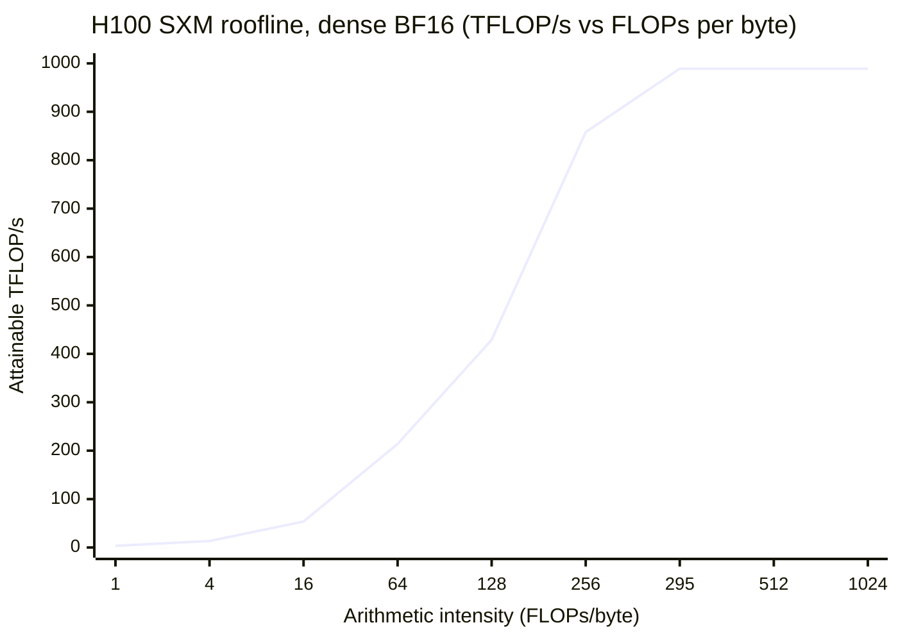

---
tags:
  - gpu-programming
  - foundations
  - performance
  - roofline
status: complete
sources:
  - https://www.cs.colostate.edu/~cs475/f19/more_assignments/Labs/L10/RooflineCACM2009.pdf
  - https://www2.eecs.berkeley.edu/Pubs/TechRpts/2008/EECS-2008-134.html
  - https://www.osti.gov/pages/biblio/1574050-hierarchical-roofline-analysis-gpus-accelerating-performance-optimization-nersc9-perlmutter-system
  - https://developer.nvidia.com/blog/accelerating-hpc-applications-with-nsight-compute-roofline-analysis
  - https://horace.io/brrr_intro.html
  - https://jax-ml.github.io/scaling-book/roofline
  - https://arxiv.org/abs/2402.16363v4
  - https://www.nvidia.com/en-us/data-center/h100/
  - https://glennklockwood.com/garden/processors/b200
  - https://rocm.docs.amd.com/en/docs-10.0.0/reference/gpu-arch/mi350.html
  - https://www.techtimes.com/articles/319203/20260627/nvidia-vera-rubin-ships-this-fall-8-cloud-partners-10x-lower-token-cost-hbm4-triples-bandwidth.htm
  - https://arxiv.org/html/2512.02189v3
  - https://arxiv.org/abs/2205.14135
  - https://arxiv.org/abs/2603.05451
  - https://gwern.net/doc/www/siboehm.com/d4b3e9d6de0655f490fe6369f4d004936248a833.html
created: 2026-11-26
updated: 2026-11-26
---

## Table Of Contents

---

- [[#TL;DR|TL;DR]]
- [[#The Problem|The Problem]]
- [[#Foundations|Foundations]]
    - [[#FLOPs, Bytes and Time|FLOPs, Bytes and Time]]
    - [[#Arithmetic Intensity|Arithmetic Intensity]]
    - [[#Machine Balance and the Ridge Point|Machine Balance and the Ridge Point]]
- [[#How We Got Here|How We Got Here]]
- [[#How It Works|How It Works]]
    - [[#The Roofline Equation|The Roofline Equation]]
    - [[#Drawing the Roof for an H100|Drawing the Roof for an H100]]
    - [[#Worked Examples|Worked Examples]]
    - [[#Ceilings|Ceilings]]
    - [[#Hierarchical Roofline|Hierarchical Roofline]]
    - [[#The Third Regime, Overhead|The Third Regime, Overhead]]
    - [[#Using It in Practice|Using It in Practice]]
- [[#Where It Is Now|Where It Is Now]]
- [[#Trade-offs & Open Problems|Trade-offs & Open Problems]]
- [[#Resources|Resources]]
- [[#Related Notes|Related Notes]]

## ***TL;DR***
---
*The roofline model says a kernel's speed is capped by whichever runs out first: the chip's arithmetic or its memory bandwidth. Which one depends on a single number, the kernel's arithmetic intensity (FLOPs per byte moved), compared against the chip's own FLOPs-per-byte ratio. It tells you in one line whether optimizing math or memory traffic can help.*

- **The formula:** attainable FLOP/s $= \min(\text{peak FLOP/s},\ \text{bandwidth} \times \text{arithmetic intensity})$ ([Williams, Waterman & Patterson, 2009](https://www.cs.colostate.edu/~cs475/f19/more_assignments/Labs/L10/RooflineCACM2009.pdf)).
- **Arithmetic intensity (AI)** is FLOPs performed divided by bytes moved to or from memory. Vector add is about 0.08 FLOP/byte; a large BF16 matrix multiply is in the thousands.
- **The ridge point** is where the two limits meet: the minimum AI to reach peak compute. For an H100 SXM in dense BF16 it is about $989 / 3.35 \approx 295$ FLOPs/byte ([JAX scaling book](https://jax-ml.github.io/scaling-book/roofline)).
- **Below the ridge you are memory-bound;** only reducing bytes (fusion, tiling, lower precision) helps. **Above it you are compute-bound;** only better use of the math units (tensor cores, fewer instructions) helps.
- **Where it is now (Nov 2026):** ridge points keep climbing because math grows faster than bandwidth (about 1,100 FLOPs/byte for FP4 on a B200), so more of every model, notably LLM decode, sits on the memory side. Nsight Compute draws rooflines for every kernel, and the model is the standard language for LLM inference planning.

## ***The Problem***
---
*When a kernel is slow, there are two very different reasons it might be: it is waiting on arithmetic, or it is waiting on memory. The fixes are opposite, and guessing wrong wastes days. You need a quick way to know which limit applies and how far from it you are.*

Consider two kernels on the same GPU that both take 1 ms. One runs elementwise `y = relu(x)` over a huge array; the other multiplies two big matrices. Making the arithmetic faster (say, switching to tensor cores) will not help the first at all, because its units already idle while it waits for data. Halving the memory traffic of the second will barely help, because it is limited by math. A profiler gives you hundreds of counters; the roofline gives you one picture that says which knob matters ([Williams et al., 2009](https://www.cs.colostate.edu/~cs475/f19/more_assignments/Labs/L10/RooflineCACM2009.pdf)).

The model is also a target. It tells you the best time a kernel could possibly achieve on this chip, so you know whether a kernel at 40% of the roof has room to improve and a kernel at 90% does not.

## ***Foundations***
---
*Three quantities: how much work (FLOPs), how much traffic (bytes), and the ratio of the two. Compare that ratio to the hardware's ratio and you know the bottleneck.*

#### **FLOPs, Bytes and Time**
- **FLOPs:** floating-point operations a kernel performs. A fused multiply-add $a \times b + c$ counts as 2.
- **Bytes:** data moved between the processor and a given level of memory (usually DRAM/HBM). Williams et al. count only the traffic that reaches main memory "after being filtered by the cache hierarchy" ([CACM 2009](https://www.cs.colostate.edu/~cs475/f19/more_assignments/Labs/L10/RooflineCACM2009.pdf)).
- **Time lower bound:** a kernel needs at least the time to do its math and at least the time to move its bytes. If the two overlap perfectly, the larger one wins:

$$
T \geq \max\left(\frac{\text{FLOPs}}{\text{peak FLOP/s}},\ \frac{\text{bytes}}{\text{bandwidth}}\right)
$$

*In plain English: the kernel can be no faster than its math alone, and no faster than its data movement alone. If they don't overlap at all, the time is the sum instead* ([JAX scaling book](https://jax-ml.github.io/scaling-book/roofline)).

#### **Arithmetic Intensity**
$$
\text{AI} = \frac{\text{FLOPs performed}}{\text{bytes moved}} \quad [\text{FLOPs/byte}]
$$

*In plain English: how much work the kernel does for each byte it fetches.* The original paper calls it *operational intensity* ([Williams et al.](https://www.cs.colostate.edu/~cs475/f19/more_assignments/Labs/L10/RooflineCACM2009.pdf)). AI is a property of the algorithm *and* its implementation: the same matrix multiply has low AI if every thread re-reads its inputs from HBM, and high AI if tiles are reused from [[GPU Memory Hierarchy|shared memory]].

#### **Machine Balance and the Ridge Point**
The chip has its own ratio, peak FLOP/s divided by bandwidth, called *machine balance*. Plotted, it is the x-coordinate of the *ridge point*: "the minimum operational intensity required to achieve maximum performance" ([Williams et al.](https://www.cs.colostate.edu/~cs475/f19/more_assignments/Labs/L10/RooflineCACM2009.pdf)). The authors note it also "suggests the level of difficulty for programmers and compiler writers to achieve peak performance": the further right the ridge, the harder peak is to reach.

## ***How We Got Here***
---
*The roofline came from Berkeley's multicore research in 2008 as a way to reason about CPUs whose cores were outrunning memory. GPUs made it essential, and it has since grown to cover cache levels, tensor cores and whole LLM serving systems.*

| Year | Step | Source |
|---|---|---|
| 2008 | Berkeley tech report EECS-2008-134 introduces the roofline for floating-point programs on multicore chips | [Williams, Waterman & Patterson](https://www2.eecs.berkeley.edu/Pubs/TechRpts/2008/EECS-2008-134.html) |
| 2009 | *Roofline: An Insightful Visual Performance Model for Multicore Architectures*, CACM vol. 52 no. 4: formula, ridge point, ceilings | [CACM 2009](https://www.cs.colostate.edu/~cs475/f19/more_assignments/Labs/L10/RooflineCACM2009.pdf) |
| 2019–20 | Hierarchical roofline for GPUs: L1, L2, device and system memory on one chart, extended to reduced precision and tensor cores, for NERSC's Perlmutter | [Yang, Kurth & Williams](https://www.osti.gov/pages/biblio/1574050-hierarchical-roofline-analysis-gpus-accelerating-performance-optimization-nersc9-perlmutter-system) |
| 2020 | Roofline chart built into Nsight Compute; hierarchical version via custom sections | [NVIDIA, Nov 2020](https://developer.nvidia.com/blog/accelerating-hpc-applications-with-nsight-compute-roofline-analysis) |
| 2022 | "Brrr" framing for deep learning: compute, memory bandwidth and overhead as the three regimes | [Horace He](https://horace.io/brrr_intro.html) |
| 2022 | [[FlashAttention]] argued explicitly in IO terms: attention was memory-bound, so cut HBM traffic | [Dao et al.](https://arxiv.org/abs/2205.14135) |
| 2024–25 | Roofline as the standard tool for LLM inference: LLM-Viewer survey; Google DeepMind's scaling book opens with rooflines | [Yuan et al., 2024](https://arxiv.org/abs/2402.16363v4), [JAX scaling book](https://jax-ml.github.io/scaling-book/roofline) |

## ***How It Works***
---
*Plot attainable FLOP/s against arithmetic intensity on log-log axes. Memory bandwidth draws a slanted line, peak compute a flat one; the roof is the lower of the two. Place a kernel on the x-axis by its AI and read off the best it can do.*

#### **The Roofline Equation**
$$
P_{\text{attainable}}(\text{AI}) = \min\left(P_{\text{peak}},\ B \times \text{AI}\right)
$$

*In plain English: at low intensity, performance rises in proportion to how much work you do per byte (slope = bandwidth $B$). Once intensity passes the ridge, performance is flat at the chip's peak $P_{\text{peak}}$.* The ridge sits at $\text{AI}^\ast = P_{\text{peak}} / B$.

#### **Drawing the Roof for an H100**
H100 SXM: $P_{\text{peak}} \approx 989$ TFLOP/s dense BF16 (1,979 is the sparse figure), $B = 3.35$ TB/s ([H100 page](https://www.nvidia.com/en-us/data-center/h100/)). Ridge: $989 / 3.35 \approx 295$ FLOPs/byte. Values of $\min(989,\ 3.35 \times \text{AI})$:

The x-axis is not evenly spaced (it doubles), which is why the slanted part looks curved here; on a true log-log plot it is a straight line. The chart's message: a kernel at AI 16 can never exceed about 54 TFLOP/s on this chip, about 5% of peak, however clever its math.

#### **Worked Examples**
| Kernel | FLOPs | Bytes moved (HBM) | AI (FLOPs/byte) | H100 BF16 verdict |
|---|---|---|---|---|
| Vector add, FP32: $c_i = a_i + b_i$ | 1 per element | 12 (read 8, write 4) | 0.083 | Deeply memory-bound: max ~0.28 TFLOP/s |
| SAXPY, FP32: $y_i = a x_i + y_i$ | 2 | 12 | 0.17 | Memory-bound |
| Dot product, BF16, length $N$ | $\approx 2N$ | $\approx 4N$ | $\to 0.5$ | Memory-bound ([JAX scaling book](https://jax-ml.github.io/scaling-book/roofline)) |
| LLM decode, one token, BF16 weights $D \times F$ | $2DF$ | $\approx 2DF$ (weights dominate) | $\approx 1$ | Memory-bound; time ≈ weight bytes / bandwidth |
| Same layer, batch of $B$ tokens | $2BDF$ | $\approx 2DF$ | $\approx B$ | Compute-bound once $B$ passes ~300 |
| Square GEMM, BF16, $N = 4096$ | $2N^3$ | $3 \times 2N^2$ (read A, B; write C, once each) | $N/3 \approx 1{,}365$ | Compute-bound, if tiled well |

Working the decode row with numbers: a 70B-parameter model in BF16 has about 140 GB of weights. Generating one token at batch 1 must read all of them, so the lower bound is $140\ \text{GB} / 3.35\ \text{TB/s} \approx 42$ ms per token on one H100's bandwidth (ignoring that 140 GB does not fit in 80 GB). The math is only $2 \times 70 \times 10^9 = 1.4 \times 10^{11}$ FLOPs, about 0.14 ms at peak. *In plain English: the GPU's math units are idle more than 99% of the time; batching more users together is free until the batch reaches about the ridge.* That is the whole economic logic of LLM serving batch sizes, and the scaling book derives the same ~240 to 300 token threshold ([JAX scaling book](https://jax-ml.github.io/scaling-book/roofline)).

Working the GEMM row: AI of $N/3$ assumes each matrix crosses HBM exactly once, which only a well-[[Tiled Matrix Multiplication (GEMM)|tiled]] kernel approaches. A naive kernel that re-reads inputs has far lower *achieved* AI. Simon Boehm's FP32 SGEMM worklog shows this: the naive kernel reaches 309 GFLOP/s on an RTX A6000, coalescing alone brings it to 1,987, and tiling and register blocking bring it to 21,779, 94% of cuBLAS ([Boehm, 2022](https://gwern.net/doc/www/siboehm.com/d4b3e9d6de0655f490fe6369f4d004936248a833.html)). Most of that climb is the kernel moving right along the x-axis.

#### **Ceilings**
The roof is the best case. Williams et al. add *ceilings* below it for optimizations a kernel has not done: "you cannot break through a ceiling without first performing the associated optimization" ([CACM 2009](https://www.cs.colostate.edu/~cs475/f19/more_assignments/Labs/L10/RooflineCACM2009.pdf)). On a GPU the important ones:

| Ceiling | Roof without it | Example on H100 SXM |
|---|---|---|
| No tensor cores | FP32 CUDA-core peak | 67 TFLOP/s instead of 989 (BF16 tensor) |
| No FMA | Half of the CUDA-core peak | Each multiply and add issued separately |
| Uncoalesced access | Effective bandwidth far below peak | Strided loads using a fraction of each 32-byte sector ([[Memory Coalescing]]) |
| Low occupancy | Bandwidth not saturated | Too few bytes in flight to cover latency ([[Occupancy and Latency Hiding]]) |

H100 numbers from the [H100 page](https://www.nvidia.com/en-us/data-center/h100/). Ceilings explain why a kernel can sit far below the roof even when its AI says it should be fine.

#### **Hierarchical Roofline**
A GPU has several memories, each with its own bandwidth, so there is a slanted line for each: L1/shared, L2 and HBM. Each kernel then has several AIs, one per level, computed from that level's traffic. Yang, Kurth and Williams combine "L1, L2, device memory, and system memory bandwidths in one figure" ([CCPE 2020](https://www.osti.gov/pages/biblio/1574050-hierarchical-roofline-analysis-gpus-accelerating-performance-optimization-nersc9-perlmutter-system)). The reading: if a kernel's HBM point is near the HBM line, HBM is the bottleneck; if its L2 point hugs the L2 line, the fix is better reuse inside the SM, not fewer HBM bytes. In Nsight Compute "each circle represents a different level of the memory subsystem (L1, L2, or DRAM)" ([NVIDIA, 2020](https://developer.nvidia.com/blog/accelerating-hpc-applications-with-nsight-compute-roofline-analysis)).

#### **The Third Regime, Overhead**
The roofline covers compute and bandwidth. Horace He adds a third regime that dominates small workloads: *overhead*, "everything else", such as Python interpreter time, framework dispatch and kernel launches ([He, 2022](https://horace.io/brrr_intro.html)). A kernel that runs for 5 µs after 10 µs of launch and dispatch cost is neither compute- nor memory-bound. The fixes are bigger batches, [[CUDA Graphs]] and [[Kernel Fusion]], not anything the roofline suggests. He also gives the fusion argument in roofline terms: unfused `x.cos().cos()` makes four global memory accesses, fused it makes two, "so operator fusion will speed it up by 2x" ([He](https://horace.io/brrr_intro.html)).

#### **Using It in Practice**
1. Compute the kernel's ideal AI on paper from its FLOPs and minimum bytes.
2. Compare to the chip's ridge for the right precision and units (tensor vs CUDA cores).
3. Profile: Nsight Compute's `SpeedOfLight_RooflineChart` section (in `--set detailed` and `--set full`) plots the kernel's achieved AI and FLOP/s ([NVIDIA, 2020](https://developer.nvidia.com/blog/accelerating-hpc-applications-with-nsight-compute-roofline-analysis)).
4. If achieved AI is far below ideal, traffic is being wasted: fix [[Memory Coalescing|coalescing]], add tiling or fusion.
5. If the point sits near the slanted line, you are bandwidth-bound and close to optimal for this algorithm; only a different algorithm or lower precision helps.
6. If it sits well below both lines, look for ceilings: occupancy, divergence, missing tensor cores, or overhead.

In NVIDIA's own HPC example, optimizing a kernel moved it from an AI of 7.39 to about 20 FLOPs/byte on a V100, whose FP64 ridge is 7.5 ([NVIDIA, 2020](https://developer.nvidia.com/blog/accelerating-hpc-applications-with-nsight-compute-roofline-analysis)).

## ***Where It Is Now***
---
*As of November 2026 the roofline is the default way people reason about GPU and LLM performance, and its main lesson is getting louder each generation: ridge points keep moving right, so the memory side of the roof covers more and more real work.*

| Chip | Dense peak used | Bandwidth | Ridge (FLOPs/byte) | Source |
|---|---|---|---|---|
| V100 | FP64 | — | 7.5 | [NVIDIA, 2020](https://developer.nvidia.com/blog/accelerating-hpc-applications-with-nsight-compute-roofline-analysis) |
| A100 (40 GB) | 312 TFLOP/s BF16 | 1.5 TB/s | ~208 | [He, 2022](https://horace.io/brrr_intro.html) |
| H100 SXM | 989 TFLOP/s BF16 | 3.35 TB/s | ~295 | [NVIDIA](https://www.nvidia.com/en-us/data-center/h100/) |
| B200 (HGX) | 2,250 TFLOP/s BF16 | 8 TB/s | ~281 | [Lockwood](https://glennklockwood.com/garden/processors/b200) |
| B200 (HGX) | 9,000 TFLOP/s FP4 | 8 TB/s | ~1,125 | [Lockwood](https://glennklockwood.com/garden/processors/b200) |
| AMD MI355X | 2.5 PFLOP/s FP16 | 8 TB/s | ~312 | [AMD](https://rocm.docs.amd.com/en/docs-10.0.0/reference/gpu-arch/mi350.html) |
| Rubin | 50 PFLOP/s NVFP4 (headline inference figure) | ~22 TB/s | ~2,270 | [Tech Times, Jun 2026](https://www.techtimes.com/articles/319203/20260627/nvidia-vera-rubin-ships-this-fall-8-cloud-partners-10x-lower-token-cost-hbm4-triples-bandwidth.htm) |

What this means in late 2026:

- **Low precision moves the ridge.** In BF16 the ridge has hovered near 300 FLOPs/byte for three generations, because bandwidth kept pace. In FP4 it jumps past 1,000, so a kernel that was compute-bound in BF16 can become memory-bound when you quantize it, unless the bytes shrink as fast as the FLOPs grow. That is why low-bit formats help memory-bound decode so much (fewer bytes per weight) and help compute-bound prefill only if kernels are retuned ([[Quantization]]).
- **Measured bandwidth is below peak.** A 2026 microbenchmark measured STREAM Triad on a B200 at about 4.14 TB/s, roughly 52% of the 8 TB/s peak ([Jarmusch & Chandrasekaran](https://arxiv.org/html/2512.02189v3)). Practical rooflines use measured, not datasheet, slopes.
- **LLM serving is planned on the roofline.** The decode-is-memory-bound argument above drives batching, speculative decoding, KV-cache compression and disaggregated prefill/decode serving (see [[LLM Serving]], [[KV Cache]], [[Speculative Decoding]]). Surveys and tools such as LLM-Viewer are built around it ([Yuan et al., 2024](https://arxiv.org/abs/2402.16363v4)).
- **New bottlenecks need new roofs.** On Blackwell, the [[FlashAttention]]-4 authors found the exponential units and shared-memory bandwidth, not tensor cores or HBM, limiting attention ([Zadouri et al., 2026](https://arxiv.org/abs/2603.05451)), a ceiling the classic two-line model does not draw.

## ***Trade-offs & Open Problems***
---
*The roofline is a bound, not a prediction. It is deliberately simple, which makes it fast to use and easy to misread.*

| Strength | Limitation |
|---|---|
| One number (AI) decides the bottleneck | AI depends on cache behaviour, which is hard to know on paper |
| Gives an upper bound to aim for | Says nothing about latency, launch overhead or synchronization |
| Works for any chip with a peak and a bandwidth | Assumes compute and memory overlap perfectly |
| Hierarchical version shows which level limits | Real GPUs have more limits than two lines: exponential units, shared-memory banks, register ports, interconnects |
| Ridge point shows how hard peak is | Different peaks per precision and per unit; easy to compare against the wrong roof |

Open problems:

- **Multiple specialized units.** Tensor cores, special-function units, TMA and tensor memory each have their own throughput; a single horizontal roof hides which one binds. Practitioners now reason about "feeds and speeds" per unit, as the FlashAttention-4 work does.
- **Communication rooflines.** For multi-GPU work the same min-of-two logic applies to NVLink or network bandwidth versus compute ([JAX scaling book](https://jax-ml.github.io/scaling-book/roofline)), but there is no standard tool that draws compute, HBM and interconnect roofs together for a real job.
- **Power.** At 1,000 W and above, chips may throttle before reaching either roof; energy rooflines exist in research but are not in everyday tools.

## ***Resources***
---
*Read the 2009 CACM paper once, it is short and clear. Then Horace He's post for the deep-learning version, the JAX scaling book chapter for worked LLM numbers, and the NVIDIA Nsight Compute roofline post to do it on a real kernel.*

**Primary papers**
- [Roofline: An Insightful Visual Performance Model for Multicore Architectures](https://www.cs.colostate.edu/~cs475/f19/more_assignments/Labs/L10/RooflineCACM2009.pdf): Williams, Waterman, Patterson, CACM, Apr 2009.
- [Roofline tech report EECS-2008-134](https://www2.eecs.berkeley.edu/Pubs/TechRpts/2008/EECS-2008-134.html): Berkeley, 2008.
- [Hierarchical Roofline Analysis for GPUs](https://www.osti.gov/pages/biblio/1574050-hierarchical-roofline-analysis-gpus-accelerating-performance-optimization-nersc9-perlmutter-system): Yang, Kurth, Williams, CCPE, 2020 (online 2019).
- [LLM Inference Unveiled: Survey and Roofline Model Insights](https://arxiv.org/abs/2402.16363v4): Yuan et al., 2024.

**Tools and engineering posts**
- [Accelerating HPC Applications with Nsight Compute Roofline Analysis](https://developer.nvidia.com/blog/accelerating-hpc-applications-with-nsight-compute-roofline-analysis): Marusarz, Katz, Yang, Williams, NVIDIA, Nov 2020.

**Explainers**
- [Making Deep Learning Go Brrrr From First Principles](https://horace.io/brrr_intro.html): Horace He, 2022. Compute, bandwidth, overhead.
- [How to Scale Your Model, ch. 1: All About Rooflines](https://jax-ml.github.io/scaling-book/roofline): Google DeepMind. Also in the vault as [[1 - All About Rooflines (NOT DONE)|note 1]].
- [How to Optimize a CUDA Matmul Kernel](https://gwern.net/doc/www/siboehm.com/d4b3e9d6de0655f490fe6369f4d004936248a833.html): Simon Boehm, 2022. A kernel climbing toward the roof step by step.

## ***Related Notes***
---
*The roofline ties hardware numbers to optimization choices; these notes supply the numbers and the optimizations.*

- [[GPU Architecture Basics]] — Where the peak FLOP/s figures come from.
- [[GPU Memory Hierarchy]] — The bandwidths behind each slanted line.
- [[Memory Coalescing]] — Getting near the bandwidth roof instead of a fraction of it.
- [[Tiled Matrix Multiplication (GEMM)]] — Raising arithmetic intensity by reuse.
- [[Kernel Fusion]] — Raising arithmetic intensity by never writing intermediates.
- [[Tensor Cores]] — The units behind the top roof.
- [[Occupancy and Latency Hiding]] — Why a kernel can sit below both roofs.
- [[Profiling with Nsight Compute and Nsight Systems]] — Drawing the roofline for real kernels.
- [[CUDA Graphs]] — Removing launch overhead, the regime the roofline ignores.
- [[FlashAttention]] — An algorithm redesigned around the memory roof.
- [[Quantization]] — Fewer bytes per weight, which moves memory-bound kernels up the slope.
- [[LLM Serving]] — Batching decisions made on the roofline.
- [[AI Accelerators]] — Roofline comparisons across chips.
- [[1 - All About Rooflines (NOT DONE)|1 - All About Rooflines (NOT DONE)]] — The scaling book's chapter, in the vault.
- [[Benchmarking GPU Kernels Correctly]] — Roofline floors as a sanity check on measured times.
