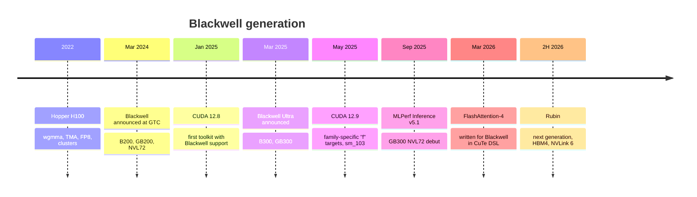
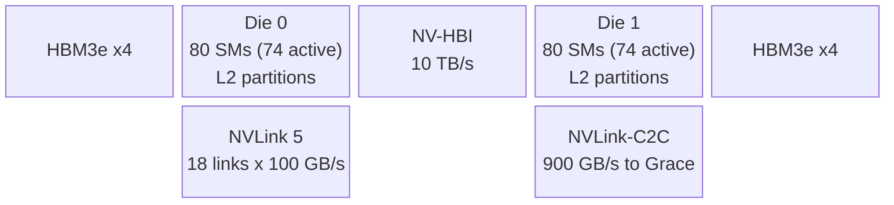
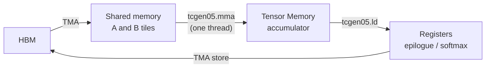

---
aliases:
  - Blackwell
  - B200
  - GB200
  - B300
  - Blackwell Ultra
  - SM100
tags:
  - gpu-programming
  - hardware
  - blackwell
  - nvidia
  - tensor-cores
status: complete
sources:
  - https://nvidianews.nvidia.com/news/nvidia-blackwell-platform-arrives-to-power-a-new-era-of-computing
  - https://developer.nvidia.com/blog/inside-nvidia-blackwell-ultra-the-chip-powering-the-ai-factory-era
  - https://docs.nvidia.com/cuda/blackwell-tuning-guide
  - https://developer.nvidia.com/cuda/gpus
  - https://developer.nvidia.com/blog/nvidia-blackwell-and-nvidia-cuda-12-9-introduce-family-specific-architecture-features/
  - https://developer.nvidia.com/blog/cuda-toolkit-12-8-delivers-nvidia-blackwell-support/
  - https://docs.nvidia.com/cuda/archive/12.9.2/parallel-thread-execution/index.html
  - https://research.colfax-intl.com/cutlass-tutorial-writing-gemm-kernels-using-tensor-memory-for-nvidia-blackwell-gpus/
  - https://docs.nvidia.com/cutlass/latest/media/docs/pythonDSL/guides/mma/tcgen05_programming.html
  - https://developer.nvidia.com/blog/introducing-nvfp4-for-efficient-and-accurate-low-precision-inference
  - https://www.nvidia.com/en-us/data-center/gb200-nvl72/
  - https://glennklockwood.com/garden/processors/b200
  - https://glennklockwood.com/garden/processors/b300
  - https://glennklockwood.com/garden/processors/R200
  - https://arxiv.org/html/2603.05451v1
  - https://newsletter.semianalysis.com/p/dissecting-nvidia-blackwell-tensor
  - https://newsletter.semianalysis.com/p/inferencex-v2-nvidia-blackwell-vs
  - https://arxiv.org/html/2512.02189v3
  - https://arxiv.org/html/2507.10789v2
  - https://developer.nvidia.com/blog/nvidia-blackwell-ultra-sets-new-inference-records-in-mlperf-debut
  - https://developer.nvidia.com/blog/whats-new-in-cuda-toolkit-13-0-for-jetson-thor-unified-arm-ecosystem-and-more/
  - https://mlc.ai/modern-gpu-programming-for-mlsys/chapter_tmem/index.html
  - https://www.nvidia.com/en-us/data-center/h100/
created: 2026-11-26
updated: 2026-11-26
---

## Table Of Contents

---

- [[#TL;DR|TL;DR]]
- [[#The Problem|The Problem]]
- [[#Foundations|Foundations]]
    - [[#One Name, Several Chips|One Name, Several Chips]]
    - [[#The Numbers That Matter|The Numbers That Matter]]
- [[#How We Got Here|How We Got Here]]
- [[#How It Works|How It Works]]
    - [[#Two Dies, One GPU|Two Dies, One GPU]]
    - [[#Inside the SM|Inside the SM]]
    - [[#Tensor Memory and tcgen05|Tensor Memory and tcgen05]]
    - [[#Block-Scaled FP4|Block-Scaled FP4]]
    - [[#The Rack Is the Computer - GB200 NVL72|The Rack Is the Computer: GB200 NVL72]]
    - [[#Compiling for Blackwell|Compiling for Blackwell]]
- [[#Where It Is Now|Where It Is Now]]
- [[#Trade-offs & Open Problems|Trade-offs & Open Problems]]
- [[#Resources|Resources]]
- [[#Related Notes|Related Notes]]

## ***TL;DR***
---
*Blackwell (2024) is NVIDIA's GPU generation after Hopper. It glues two reticle-sized dies into one GPU, moves the Tensor Core's accumulator out of registers into a new Tensor Memory, adds hardware block-scaled FP4, and is sold mostly as 72-GPU NVLink racks.*

- **The chip:** B200 has 208 billion transistors on TSMC 4NP across "two reticle-limit GPU dies" joined by a "10 TB/s chip-to-chip link into one GPU" ([NVIDIA, Mar 2024](https://nvidianews.nvidia.com/news/nvidia-blackwell-platform-arrives-to-power-a-new-era-of-computing)). CUDA sees one device with 148 SMs and 8 TB/s of HBM3e.
- **The SM:** fifth-generation [[Tensor Cores]] are driven by `tcgen05.mma`, issued by one thread, with results kept in a 256 KB per-SM **Tensor Memory (TMEM)**; Hopper's `wgmma` is deprecated ([Colfax](https://research.colfax-intl.com/cutlass-tutorial-writing-gemm-kernels-using-tensor-memory-for-nvidia-blackwell-gpus/)).
- **The formats:** FP6 and FP4 with hardware micro-scaling, including NVIDIA's **NVFP4** (see [[Low-Precision Formats - FP8, FP4 and MX]]). Dense FP4 is about 2x dense FP8.
- **The system:** GB200 NVL72 puts 72 GPUs in one NVLink 5 domain with 130 TB/s of aggregate bandwidth ([NVIDIA](https://www.nvidia.com/en-us/data-center/gb200-nvl72/); see [[Multi-GPU Communication - NVLink and NCCL]]).
- **Where it is now (Nov 2026):** Blackwell Ultra (B300/GB300) adds 50% more FP4, 288 GB HBM3e and faster attention exponentials while cutting FP64 to about 1 TFLOPS. Rubin is next.

## ***The Problem***
---
*By 2024 the limit on AI models was no longer how fast one GPU multiplied matrices, but how much memory, bandwidth and interconnect could be packed around those multipliers, and how cheaply each token could be produced.*

- **The reticle wall.** A lithography scanner can only expose a die up to a fixed maximum area (the reticle limit, about 26 x 33 mm). Hopper's H100 was already close to it, so a bigger single die was not an option.
- **Registers were the bottleneck for bigger tiles.** On Hopper, `wgmma` accumulators live in registers, and a 64K-register file shared by a whole SM limits how large a tile one SM can hold (see [[Register Pressure and Spilling]]).
- **Inference cost dominated.** Reasoning models generate many tokens per request, so the price of one token, set by memory bandwidth, low-precision math and how many GPUs can share a model, became the metric ([[LLM Serving]]).
- **Models outgrew 8 GPUs.** A trillion-parameter [[Mixture of Experts]] model spread over 8-GPU NVLink boxes pays InfiniBand costs for every expert exchange. A bigger NVLink domain keeps that traffic on the fast fabric.

Blackwell's answers map one-to-one: two dies acting as one, TMEM, FP4 with hardware scaling, and NVL72.

## ***Foundations***
---
*"Blackwell" names a whole family, from a 1,400 W data-center part to a laptop GPU. They share an instruction set lineage but differ a lot in what the SM can do.*

### One Name, Several Chips

| Compute capability | Parts | What sets it apart |
|---|---|---|
| **10.0** (`sm_100`) | B200, GB200 | `tcgen05`, TMEM, 2-SM MMA, 228 KB shared memory per SM |
| **10.3** (`sm_103`) | B300, GB300 (Blackwell Ultra) | More FP4, faster exponentials, little FP64 |
| **11.0** (`sm_110`) | Jetson T5000/T4000 (Thor) | Robotics SoC; was `sm_101` in CUDA 12.x |
| **12.0** (`sm_120`) | RTX PRO Blackwell, GeForce RTX 50 | No `tcgen05`; FP4 via warp-level `mma.sync`; 128 KB L1/shared |
| **12.1** (`sm_121`) | GB10 (DGX Spark) | Desktop Grace-Blackwell |

Sources: [NVIDIA CC table](https://developer.nvidia.com/cuda/gpus), [PTX ISA 8.8](https://docs.nvidia.com/cuda/archive/12.9.2/parallel-thread-execution/index.html), [arXiv 2507.10789](https://arxiv.org/html/2507.10789v2). The consumer study found that tcgen05 "is yet to be supported for the arch. sm_120a" and that Hopper's wgmma is not available either, so kernels written for B200 do not run on an RTX 5090 (same source). This note is about the data-center parts unless it says otherwise.

### The Numbers That Matter

| | H100 (SXM) | B200 (HGX, 1,000 W) | B300 / Blackwell Ultra |
|---|---|---|---|
| Transistors | 80 B | 208 B (2 dies) | 208 B (2 dies) |
| SMs (enabled) | 132 | 148 of 160 | up to 160, "varies by SKU" |
| HBM | 80 GB HBM3 | 180 to 192 GB HBM3e | 288 GB HBM3e |
| HBM bandwidth | 3.35 TB/s | 8 TB/s | 8 TB/s |
| L2 | 50 MB | 126 MB | n/a |
| Dense FP8 | 2 PF | 4.5 PF (5 PF in GB200) | 5 PF |
| Dense FP4 | none | 9 PF (10 PF in GB200) | 15 PF (NVFP4) |
| FP64 | 67 TF (tensor) | 37 TF (45 TF in GB200) | about 1.2 to 1.3 TF |
| NVLink per GPU | 900 GB/s (NVLink 4) | 1.8 TB/s (NVLink 5) | 1.8 TB/s |
| Power | up to 700 W | 1,000 W (1,200 W in GB200) | up to 1,400 W |

Sources: [NVIDIA Ultra blog](https://developer.nvidia.com/blog/inside-nvidia-blackwell-ultra-the-chip-powering-the-ai-factory-era), [tuning guide](https://docs.nvidia.com/cuda/blackwell-tuning-guide), [Lockwood B200](https://glennklockwood.com/garden/processors/b200), [Lockwood B300](https://glennklockwood.com/garden/processors/b300), [GB200 NVL72](https://www.nvidia.com/en-us/data-center/gb200-nvl72/). H100 figures are from [NVIDIA's H100 page](https://www.nvidia.com/en-us/data-center/h100/) and the Ultra blog's Hopper column.

**Sources disagree on B200 memory.** The tuning guide says "capacity up to 180 GB", the GB200 NVL72 page implies 186 GB per GPU, and papers quote the 192 GB physical figure. Usable memory depends on the SKU. FP64 likewise reads as 37, 40 or 45 TF depending on the configuration and the page.

**Worked example: where is the ridge point?** The [[Roofline Model and Arithmetic Intensity|roofline]] ridge point is the arithmetic intensity at which a kernel stops being memory-bound:

$$I^{*} = \frac{P_{\text{peak}}}{B_{\text{HBM}}}$$

*In words: divide peak FLOPs per second by bytes per second of memory bandwidth to get how many FLOPs a kernel must do per byte it loads before compute, not memory, is the limit.*

- HGX B200, dense BF16: $2.25 \times 10^{15} / 8 \times 10^{12} \approx 281$ FLOP/byte.
- Dense FP4: $9 \times 10^{15} / 8 \times 10^{12} \approx 1{,}125$ FLOP/byte.
- H100 dense BF16: about $990 \times 10^{12} / 3.35 \times 10^{12} \approx 295$ FLOP/byte.

So in BF16, B200 is balanced much like H100: both compute and bandwidth roughly doubled. FP4 is a different story: a kernel needs four times the reuse to keep the FP4 units busy. That is why low-precision decode, which streams weights with little reuse, gains mostly from the smaller *bytes*, not from the extra FLOPs.

## ***How We Got Here***
---
*Blackwell was announced in March 2024, reached customers at the end of 2024, and was refreshed as Blackwell Ultra a year later. Each step leaned further toward low-precision inference.*



- **Launch (GTC, March 18, 2024).** NVIDIA listed six headline technologies: the 208B-transistor two-die chip, a second-generation Transformer Engine with "new micro-tensor scaling support" for FP4, NVLink 5, a RAS engine for "AI-based preventative maintenance", confidential computing, and a Decompression Engine for databases ([NVIDIA](https://nvidianews.nvidia.com/news/nvidia-blackwell-platform-arrives-to-power-a-new-era-of-computing)). It claimed up to 30x LLM-inference performance for NVL72 versus the same number of H100s.
- **Software (Jan 2025).** CUDA 12.8 was the first toolkit with Blackwell support, adding cuBLAS block-scaled FP4 and FP8 GEMMs and Nsight Compute views of "Blackwell Hardware Tensor Memory" ([NVIDIA](https://developer.nvidia.com/blog/cuda-toolkit-12-8-delivers-nvidia-blackwell-support/)).
- **Blackwell Ultra (GTC, March 2025).** Same two-die design, re-balanced: "15 PetaFLOPS dense NVFP4", 288 GB HBM3e, attention exponentials doubled, FP64 mostly removed ([NVIDIA Ultra blog](https://developer.nvidia.com/blog/inside-nvidia-blackwell-ultra-the-chip-powering-the-ai-factory-era); [Lockwood](https://glennklockwood.com/garden/processors/b300)).
- **Compiler targets (May 2025).** CUDA 12.9 added "family-specific" targets: code built for `sm_100f` runs on both CC 10.0 and 10.3 ([NVIDIA](https://developer.nvidia.com/blog/nvidia-blackwell-and-nvidia-cuda-12-9-introduce-family-specific-architecture-features/)).

## ***How It Works***
---
*Blackwell's ideas stack: two dies make one big GPU, a reworked SM keeps bigger tiles in flight, FP4 makes each byte count, and NVLink turns 72 such GPUs into one machine.*

### Two Dies, One GPU



*Approximate layout from NVIDIA's descriptions; the even split of active SMs between the dies is illustrative.*

- The two dies are joined by NV-HBI, which "provides 10 TB/s of bandwidth", and the pair is programmed as one CUDA GPU ([NVIDIA Ultra blog](https://developer.nvidia.com/blog/inside-nvidia-blackwell-ultra-the-chip-powering-the-ai-factory-era)).
- The full design has 160 SMs, 80 per die; B200 enables 148 ([Lockwood](https://glennklockwood.com/garden/processors/b200)). A benchmark paper reports "148 SMs spread across eight GPCs" and "four L2 cache partitions (double those in Hopper)" ([arXiv 2512.02189](https://arxiv.org/html/2512.02189v3)).
- "One GPU" is not quite free: SemiAnalysis measured a die-to-die penalty of "roughly 300 cycles" for memory on the far die ([SemiAnalysis, Mar 2026](https://newsletter.semianalysis.com/p/dissecting-nvidia-blackwell-tensor)).

### Inside the SM

*Most per-SM limits match Hopper. The big changes are in the Tensor Core path, not in the general-purpose resources.*

| Per SM (CC 10.0) | Value |
|---|---|
| Max resident warps | 64 (48 on CC 12.0) |
| Max resident blocks | 32 |
| Registers | 64K 32-bit, max 255 per thread |
| L1 + texture + shared | 256 KB combined |
| Shared memory | up to 228 KB per SM, 227 KB per block; carveouts 0, 8, 16, 32, 64, 100, 132, 164, 196, 228 KB |
| **Tensor Memory** | **256 KB** (new) |
| Cluster size | 8 portable, 16 non-portable on B200 |

Sources: [tuning guide](https://docs.nvidia.com/cuda/blackwell-tuning-guide), [Colfax](https://research.colfax-intl.com/cutlass-tutorial-writing-gemm-kernels-using-tensor-memory-for-nvidia-blackwell-gpus/). On CC 12.0 (consumer) shared memory is 128 KB per SM with at most 99 KB per block. See [[Occupancy and Latency Hiding]] for how these limits decide how many blocks fit, and [[Thread Block Clusters and Distributed Shared Memory]] for clusters.

**The balance shifted.** Tensor Core throughput per SM doubled again, but the special-function unit's exponential stayed at 16 ops per clock per SM and shared-memory reads stayed at 128 bytes per clock per SM ([FlashAttention-4](https://arxiv.org/html/2603.05451v1)). In attention, the softmax's `exp` became the bottleneck, which is why FlashAttention-4 computes part of the exponentials with a polynomial on the ordinary FMA units, and why Blackwell Ultra doubled the exponential rate to "10.7 TeraExponentials/s" for "up to 2x faster attention-layer compute" ([NVIDIA Ultra blog](https://developer.nvidia.com/blog/inside-nvidia-blackwell-ultra-the-chip-powering-the-ai-factory-era)).

### Tensor Memory and tcgen05

*This is the programming-model change. The full instruction-level story is in [[Tensor Cores]]; here is the architectural shape.*

- **TMEM** "is 256KB per SM in size, and is organized 2-dimensionally in 512 columns and 128 rows, or lanes, of 32-bit cells" ([Colfax](https://research.colfax-intl.com/cutlass-tutorial-writing-gemm-kernels-using-tensor-memory-for-nvidia-blackwell-gpus/)).
- **Accumulators live there:** "The accumulator is always stored in TMEM"; operand A comes from shared memory or TMEM, B from shared memory ([CUTLASS tcgen05 guide](https://docs.nvidia.com/cutlass/latest/media/docs/pythonDSL/guides/mma/tcgen05_programming.html)). So the MMA needs "no registers for data" (Colfax), which frees registers for the epilogue and softmax.
- **One thread issues it.** "Only one thread issues the MMA instruction" (CUTLASS guide), against a whole 128-thread warpgroup for `wgmma`. The rest of the block is free for loads and epilogues, which fits [[Warp Specialization]].
- **CTA pairs.** "Two adjacent CTAs can jointly execute a single MMA, doubling the tile size without extra synchronization logic" (`cta_group::2`, same guide). SemiAnalysis measured "perfect weak scaling" up to 2x for the 2-SM form.
- **Allocation is explicit.** `tcgen05.alloc` is warp-collective and takes 32, 64, 128, 256 or 512 columns; each warp of a warpgroup can only reach its own 32 lanes; data moves with `tcgen05.ld`/`st` (to registers) and `tcgen05.cp` (from shared memory) ([MLC book](https://mlc.ai/modern-gpu-programming-for-mlsys/chapter_tmem/index.html)).



Measured on B200, a single `tcgen05.mma` has about 11 cycles of latency ([arXiv 2512.02189](https://arxiv.org/html/2512.02189v3)), and a 1-SM MMA with M=64 reaches only about half of peak, so full-rate kernels use M=128 or the 2-SM form ([SemiAnalysis](https://newsletter.semianalysis.com/p/dissecting-nvidia-blackwell-tensor)).

### Block-Scaled FP4

*A 4-bit float (E2M1) can only represent values between about -6 and 6. Block scaling attaches a small scale factor to each short run of values, and Blackwell applies those scales inside the Tensor Core.*

- **NVFP4:** E2M1 values with "a fine-grained E4M3 scaling factor to each 16-value micro-block" plus "a second-level FP32 scalar applied per tensor" ([NVIDIA, Jun 2025](https://developer.nvidia.com/blog/introducing-nvfp4-for-efficient-and-accurate-low-precision-inference)).
- **MXFP4** (the OCP standard) uses "1 shared power-of-two scale per 32 value block", an 8-bit exponent-only E8M0 (same source).
- The PTX `tcgen05.mma` kinds include `mxf4nvf4`, `mxf4`, `mxf8f6f4`, `f8f6f4`, `f16`, `tf32` and `i8`; scale factors must be "staged in TMEM before gemm" ([PTX ISA 8.8](https://docs.nvidia.com/cuda/archive/12.9.2/parallel-thread-execution/index.html); [CUTLASS guide](https://docs.nvidia.com/cutlass/latest/media/docs/pythonDSL/guides/mma/tcgen05_programming.html)).

**Worked example: bits per value.** NVFP4 stores 16 values of 4 bits plus one 8-bit scale:

$$b_{\text{eff}} = 4 + \frac{8}{16} = 4.5 \text{ bits per value}$$

*In words: each value costs its own 4 bits plus a sixteenth share of the 8-bit scale.* Compared with FP16 that is $16 / 4.5 \approx 3.6\times$ smaller, and with FP8 $8/4.5 \approx 1.8\times$, matching NVIDIA's "~3.5x" and "~1.8x" ([NVIDIA](https://developer.nvidia.com/blog/introducing-nvfp4-for-efficient-and-accurate-low-precision-inference)). MXFP4 is $4 + 8/32 = 4.25$ bits: cheaper, but a power-of-two scale per 32 values fits the data less tightly. SemiAnalysis found the scaling has "virtually no overhead" in throughput. The formats themselves are covered in [[Low-Precision Formats - FP8, FP4 and MX]] and [[Quantization]].

### The Rack Is the Computer - GB200 NVL72

| GB200 NVL72 | Value |
|---|---|
| GPUs / CPUs | 72 Blackwell, 36 Grace (2,592 Arm Neoverse V2 cores) |
| NVLink | 130 TB/s aggregate, NVLink 5 at 1.8 TB/s per GPU |
| HBM | 13.4 TB HBM3e at 576 TB/s |
| CPU memory | 17 TB LPDDR5X |
| FP4 | 720 PF dense / 1,440 PF sparse |
| Power | about 120 kW per rack |

Sources: [NVIDIA](https://www.nvidia.com/en-us/data-center/gb200-nvl72/), [Lockwood](https://glennklockwood.com/garden/processors/b200).

- Each Grace CPU connects to two B200s over NVLink-C2C at 900 GB/s ([[Coherent CPU-GPU Superchips]]), so CPU memory is coherent, fast overflow space for KV caches and optimizer state (see [[Unified Memory]]).
- Because all 72 GPUs share one NVLink domain, tensor- and expert-parallel groups can span far more than 8 GPUs without touching InfiniBand. SemiAnalysis measured NVL72 at "over 9x higher bandwidth" than multi-node B300 over InfiniBand ([SemiAnalysis, Feb 2026](https://newsletter.semianalysis.com/p/inferencex-v2-nvidia-blackwell-vs)). The plumbing is in [[Multi-GPU Communication - NVLink and NCCL]]; the data-center side in [[GPU Cluster Infrastructure]].

### Compiling for Blackwell

```bash
nvcc -gencode arch=compute_100a,code=sm_100a  gemm.cu -o gemm_b200   # 1
nvcc -gencode arch=compute_100f,code=sm_100f  gemm.cu -o gemm_b2xx   # 2
nvcc -gencode arch=compute_100,code=compute_100 app.cu -o app_ptx    # 3
nvcc -gencode arch=compute_120,code=sm_120 app.cu -o app_rtx50       # 4
```

1. **Architecture-specific (`a`):** may use every Blackwell feature (`tcgen05`, TMEM), but the binary "only runs on GPUs of that specific CC and no others", here only CC 10.0. The `a` suffix dates from Hopper's `sm_90a`.
2. **Family-specific (`f`, new in CUDA 12.9):** uses the features shared by the family; code is "compatible to run on GPU devices with the same major compute capability version", so it runs on both B200 (10.0) and B300 (10.3). This is what most libraries ship.
3. **Plain PTX:** no architecture-specific features, but it can be JIT-compiled for future GPUs (see [[PTX and SASS]]).
4. **Consumer Blackwell:** a separate target. `tcgen05` code from lines 1 and 2 will not run here.

Sources: [NVIDIA, May 2025](https://developer.nvidia.com/blog/nvidia-blackwell-and-nvidia-cuda-12-9-introduce-family-specific-architecture-features/). Few people write `tcgen05` by hand: [[CUTLASS and CuTe]], [[cuBLAS and cuDNN]], [[Triton]] and [[ThunderKittens and Tile DSLs]] do it for them.

## ***Where It Is Now***
---
*As of November 2026, Blackwell and Blackwell Ultra are the deployed workhorses, the software has caught up with the hardware, and Rubin is arriving.*

- **Blackwell Ultra in production.** GB300 NVL72 made its MLPerf debut in Inference v5.1 (Sep 2025) with 5,842 tokens/s per GPU offline on DeepSeek-R1, "45% higher performance per GPU" than GB200 NVL72, using NVFP4 weights and disaggregated serving ([NVIDIA](https://developer.nvidia.com/blog/nvidia-blackwell-ultra-sets-new-inference-records-in-mlperf-debut)).
- **Kernels caught up.** [[FlashAttention]]-4 (Mar 2026) reaches "up to 1613 TFLOPs/s (71% utilization)" in BF16 on B200, 1.3x over cuDNN 9.13, written entirely in CuTe DSL with "20-30× faster compile times" than C++ templates ([arXiv 2603.05451](https://arxiv.org/html/2603.05451v1)). CUTLASS claims "up to 98% relative peak" on Tensor Core operations ([NVIDIA](https://developer.nvidia.com/blog/cuda-toolkit-12-8-delivers-nvidia-blackwell-support/)).
- **Rack-scale vs per-GPU.** SemiAnalysis's InferenceX v2 (Feb 2026) found each GB200 NVL72 GPU gives "slightly less than triple" a B200's throughput at 60 tokens/s per user but "nearly no advantage" at 130, and that Blackwell Ultra beats Blackwell by "up to 1.5x" in FP8 but only about 1.1x in FP4 ([SemiAnalysis](https://newsletter.semianalysis.com/p/inferencex-v2-nvidia-blackwell-vs)).
- **Blackwell at the edge.** Jetson Thor and DGX Spark bring the architecture to robots and desks; CUDA 13.0 unified the Arm toolkit and gave Thor MPS and green contexts ([NVIDIA, Sep 2025](https://developer.nvidia.com/blog/whats-new-in-cuda-toolkit-13-0-for-jetson-thor-unified-arm-ecosystem-and-more/); see [[MIG and MPS - Sharing a GPU]]).
- **Next: Rubin.** Due in the second half of 2026: two reticle-sized dies, 288 GB of HBM4 at 22 TB/s, NVLink 6 at 3.5 to 3.6 TB/s per GPU (sources differ), and 35 PF dense NVFP4. NVIDIA kept the "NVL72" name for the Vera Rubin rack ([Lockwood, Apr 2026](https://glennklockwood.com/garden/processors/R200)). [[Tensor Cores]] tracks its production status.
- **Competition.** AMD's MI355X is "quite competitive with B200" in FP8 serving but trails in FP4 disaggregated serving, per SemiAnalysis ([Feb 2026](https://newsletter.semianalysis.com/p/inferencex-v2-nvidia-blackwell-vs)); see [[AI Accelerators]].

## ***Trade-offs & Open Problems***
---
*Blackwell is a bet that AI workloads will keep moving toward low precision and rack-scale systems. That bet costs scientific computing, portability and power.*

- **FP64 is fading.** B300 has "essentially no FP64 performance" (about 1.2 TF versus 37 TF on B200) ([Lockwood](https://glennklockwood.com/garden/processors/b300)). HPC codes must stay on B200, move to emulated FP64 (see [[Floating-Point Emulation on Tensor Cores]]), or look elsewhere.
- **Two programming models in one generation.** Data-center Blackwell uses `tcgen05` and TMEM; consumer Blackwell uses warp-level `mma.sync`. A kernel tuned on a workstation teaches little about B200.
- **Harder to program.** TMEM allocation, CTA pairs, scale-factor staging and single-thread issue make a hand-written GEMM a pipeline-design exercise; the move to Python DSLs ([[CUTLASS and CuTe]], [[CUDA Tile and cuTile]]) is partly a response.
- **Compute outran everything else.** The Tensor Core doubled but exponentials, shared-memory bandwidth and HBM did not keep pace ([FlashAttention-4](https://arxiv.org/html/2603.05451v1)). Kernels now hide softmax and data movement behind the MMA instead of the reverse.
- **FP4 accuracy is model-specific.** NVIDIA reports "1% or less accuracy degradation" for DeepSeek-R1 going from FP8 to NVFP4, but that is the vendor's own evaluation; training in FP4 is newer still.
- **Power and cooling.** At 120 kW per NVL72 rack, liquid cooling is mandatory and many data centers cannot host it; NVIDIA offers a two-rack NVL36x2 for sites that "cannot support 120 kW racks" ([Lockwood](https://glennklockwood.com/garden/processors/b200)).
- **Benchmarks disagree.** One paper measured only 4.1 TB/s STREAM bandwidth on B200 while SemiAnalysis reached 6.6 TB/s with asynchronous copies ([arXiv 2512.02189](https://arxiv.org/html/2512.02189v3); [SemiAnalysis](https://newsletter.semianalysis.com/p/dissecting-nvidia-blackwell-tensor)). How you measure matters as much as the chip.

## ***Resources***
---
*Start with NVIDIA's Blackwell Ultra deep dive and the tuning guide, then Colfax's TMEM tutorial for the programming model.*

**Primary**
- [Inside NVIDIA Blackwell Ultra](https://developer.nvidia.com/blog/inside-nvidia-blackwell-ultra-the-chip-powering-the-ai-factory-era): NVIDIA, Aug 2025. Best architecture overview, with a Hopper/Blackwell/Ultra table.
- [Blackwell Tuning Guide](https://docs.nvidia.com/cuda/blackwell-tuning-guide): per-SM limits and memory.
- [Family-specific architecture features](https://developer.nvidia.com/blog/nvidia-blackwell-and-nvidia-cuda-12-9-introduce-family-specific-architecture-features/): NVIDIA, May 2025. The `a` versus `f` targets.
- [PTX ISA](https://docs.nvidia.com/cuda/archive/12.9.2/parallel-thread-execution/index.html): `tcgen05` reference.
- [Introducing NVFP4](https://developer.nvidia.com/blog/introducing-nvfp4-for-efficient-and-accurate-low-precision-inference): NVIDIA, Jun 2025.

**Programming**
- [CUTLASS tutorial: GEMM with Tensor Memory](https://research.colfax-intl.com/cutlass-tutorial-writing-gemm-kernels-using-tensor-memory-for-nvidia-blackwell-gpus/): Colfax, Apr 2025.
- [CUTLASS tcgen05 programming guide](https://docs.nvidia.com/cutlass/latest/media/docs/pythonDSL/guides/mma/tcgen05_programming.html).
- [FlashAttention-4](https://arxiv.org/html/2603.05451v1): Tri Dao and coauthors, Mar 2026.

**Measurements**
- [Dissecting NVIDIA Blackwell Tensor Cores](https://newsletter.semianalysis.com/p/dissecting-nvidia-blackwell-tensor): SemiAnalysis, Mar 2026.
- [InferenceX v2](https://newsletter.semianalysis.com/p/inferencex-v2-nvidia-blackwell-vs): SemiAnalysis, Feb 2026.
- [Microbenchmarking B200](https://arxiv.org/html/2512.02189v3): University of Delaware, 2026. Useful but some numbers are internally inconsistent.
- [Consumer Blackwell microbenchmarks](https://arxiv.org/html/2507.10789v2): RTX 5080 vs H100, Jul 2025.
- Glenn Lockwood's spec pages: [B200](https://glennklockwood.com/garden/processors/b200), [B300](https://glennklockwood.com/garden/processors/b300), [Rubin](https://glennklockwood.com/garden/processors/R200).

## ***Related Notes***
---
*The pieces of Blackwell each have their own note; these are the ones to read next.*

- [[Floating-Point Emulation on Tensor Cores]] — How FP64 work survives B300's FP64 cut.

- [[Tensor Cores]] — `tcgen05`, TMEM and the instruction-level history.
- [[TMA and Asynchronous Copies]] — How tiles reach shared memory fast enough to feed TMEM.
- [[Warp Specialization]] — The producer/consumer pattern that single-thread MMA issue enables.
- [[Thread Block Clusters and Distributed Shared Memory]] — Clusters, CTA pairs and cluster launch control.
- [[Low-Precision Formats - FP8, FP4 and MX]] — NVFP4 and MXFP4 in detail.
- [[Persistent Kernels and Stream-K]] — Tile scheduling on 148 SMs.
- [[Register Pressure and Spilling]] — The constraint TMEM relieves.
- [[GPU Architecture Basics]] — SMs, warps and the memory hierarchy in general.
- [[CUTLASS and CuTe]] — The main way Blackwell GEMMs are written.
- [[Multi-GPU Communication - NVLink and NCCL]] — NVLink 5 and NVL72.
- [[MIG and MPS - Sharing a GPU]] — Splitting one B200 or B300 into slices.
- [[FlashAttention]] — The kernel that shows Blackwell's balance most clearly.
- [[AI Accelerators]] — Blackwell against TPUs, MI355X and others.
- [[GPU Cluster Infrastructure]] — Power, cooling and networking around NVL72.
- [[Coherent CPU-GPU Superchips]] — Grace, NVLink-C2C and coherence in GB200, GB300 and Vera Rubin.
