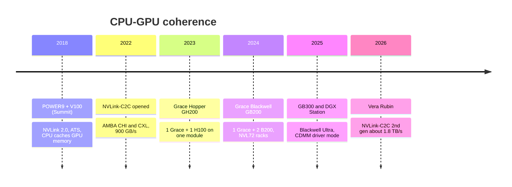
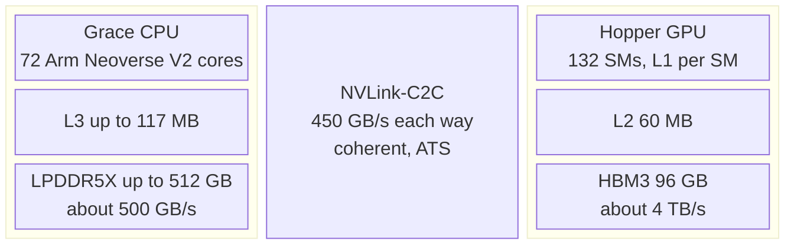
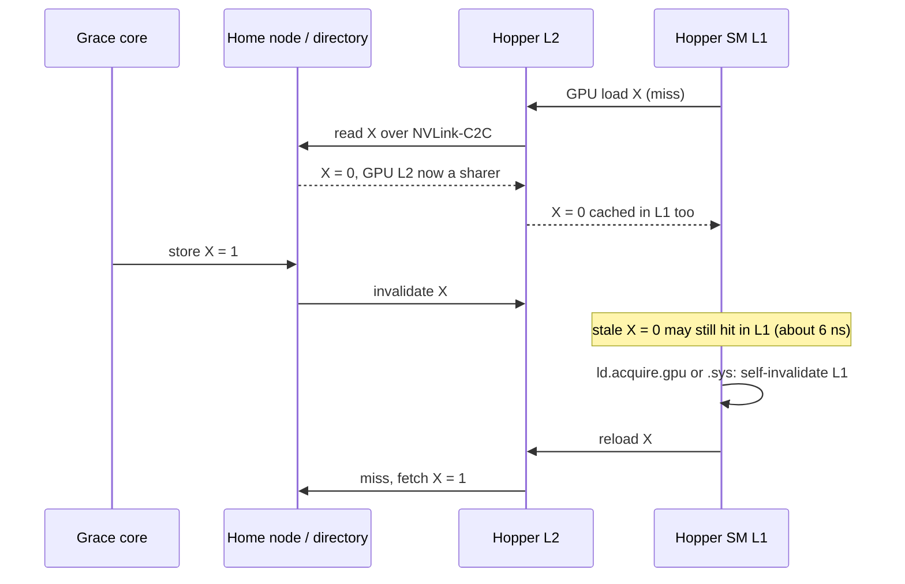
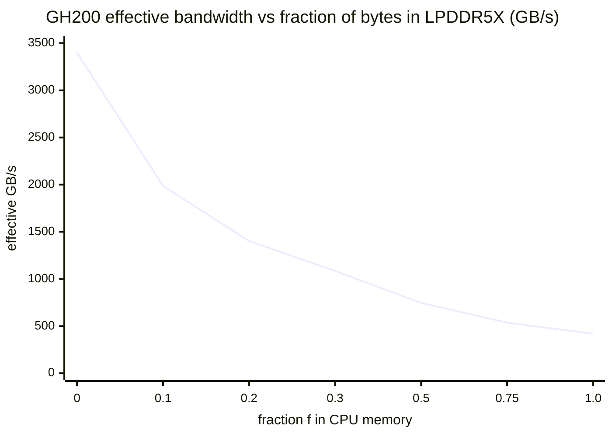

---
tags:
  - gpu-programming
  - hardware
  - superchip
  - coherence
  - nvlink-c2c
  - grace-hopper
  - grace-blackwell
  - memory-model
status: complete
sources:
  - https://developer.nvidia.com/blog/nvidia-grace-hopper-superchip-architecture-in-depth/
  - https://nvidianews.nvidia.com/news/nvidia-opens-nvlink-for-custom-silicon-integration
  - https://arxiv.org/html/2408.11556v1
  - https://arxiv.org/pdf/2407.07850
  - https://users.cs.utah.edu/~vijay/papers/ismm26.pdf
  - https://docs.nvidia.com/cuda/cuda-programming-guide/04-special-topics/unified-memory.html
  - https://developer.nvidia.com/blog/understanding-memory-management-on-hardware-coherent-platforms
  - https://docs.nvidia.com/dgx/dgx-station-development-guide/coherency.html
  - https://docs.nvidia.com/multi-node-nvlink-systems/multi-node-tuning-guide/overview.html
  - https://www.nvidia.com/en-us/data-center/gb200-nvl72/
  - https://docs.nvidia.com/dccpu/vera-perf-tuning-guide/vera-cpu-and-superchip.html
  - https://www.olcf.ornl.gov/wp-content/uploads/2019/02/STF_Feb_UVM_feb.pdf
  - https://cvw.cac.cornell.edu/gpu-architecture/gpu-example-tesla-v100/v100_mem_nvlink2
  - https://arxiv.org/html/2508.12743v1
  - https://arxiv.org/html/2509.21271v1
  - https://www.theregister.com/2025/03/18/nvidia_blackwell_ultra/
  - https://nvidianews.nvidia.com/news/vera-rubin-full-production-agentic-ai-factory
  - https://hpcwire.com/off-the-wire/asus-ramps-up-nvidia-vera-rubin-nvl72-shipments-showcases-ai-factory-reference-architecture-at-sc26
created: 2026-11-27
updated: 2026-11-27
---

## Table Of Contents

---

- [[#TL;DR|TL;DR]]
- [[#The Problem|The Problem]]
- [[#Foundations|Foundations]]
    - [[#What "Coherent" Means Here|What "Coherent" Means Here]]
    - [[#One Page Table: ATS|One Page Table: ATS]]
    - [[#Scopes and System-Scope Atomics|Scopes and System-Scope Atomics]]
- [[#How We Got Here|How We Got Here]]
- [[#How It Works|How It Works]]
    - [[#Anatomy of a Superchip|Anatomy of a Superchip]]
    - [[#The Coherence Protocol Underneath|The Coherence Protocol Underneath]]
    - [[#Memory Types and Where Bytes Live|Memory Types and Where Bytes Live]]
    - [[#Code: Detecting the Platform and Sharing a Flag|Code: Detecting the Platform and Sharing a Flag]]
    - [[#Worked Example: The Cost of Spilling Across the Link|Worked Example: The Cost of Spilling Across the Link]]
    - [[#NUMA Mode vs CDMM|NUMA Mode vs CDMM]]
- [[#Where It Is Now|Where It Is Now]]
- [[#Trade-offs & Open Problems|Trade-offs & Open Problems]]
- [[#Resources|Resources]]
- [[#Related Notes|Related Notes]]

## ***TL;DR***
---
*A coherent superchip puts a CPU and one or two GPUs on one module, joined by a cache-coherent link (NVLink-C2C) and one shared page table, so either side can load, store and do atomics on the other's memory with plain pointers. It removes the PCIe copy wall, but it does not remove the bandwidth gap: CPU memory is still about an order of magnitude slower for the GPU than its own HBM.*

- **What it is:** NVIDIA's Grace Hopper (GH200), Grace Blackwell (GB200, GB300) and Vera Rubin modules pair an Arm CPU with GPUs over NVLink-C2C, a die-to-die link of 900 GB/s total (450 GB/s each way) on Grace, "7x the bandwidth of x16 PCIe Gen links at lower latency" at 1.3 pJ/bit ([NVIDIA, 2022](https://developer.nvidia.com/blog/nvidia-grace-hopper-superchip-architecture-in-depth/)). Vera doubles it to about 1.8 TB/s ([Vera tuning guide](https://docs.nvidia.com/dccpu/vera-perf-tuning-guide/vera-cpu-and-superchip.html)).
- **What "coherent" buys:** Address Translation Services (ATS) gives CPU and GPU "a single per-process page table", so a GPU kernel can dereference a pointer from `malloc`, and the hardware keeps caches consistent at cache-line granularity instead of migrating whole pages. CPU-GPU atomics are native ([NVIDIA, 2022](https://developer.nvidia.com/blog/nvidia-grace-hopper-superchip-architecture-in-depth/)).
- **What it costs:** on GH200 the GPU reads Grace's LPDDR5X at about 93% of the 450 GB/s link, while its own HBM3 delivers about 3.4 TB/s ([Fusco et al., 2024](https://arxiv.org/html/2408.11556v1); [Schieffer et al., 2024](https://arxiv.org/pdf/2407.07850)). A CPU-GPU atomic round trip takes about 800 ns ([Bagchi et al., ISMM 2026](https://users.cs.utah.edu/~vijay/papers/ismm26.pdf)).
- **How it behaves:** the ISMM 2026 study found directory-based invalidations "consistent with an AMBA CHI-like protocol", far atomics at the memory's home node, and self-invalidating GPU L1 caches; all 1,960 CPU-GPU litmus variants matched the formal model.
- **Where it is now (Nov 2026):** GB200 and GB300 NVL72 racks are the mainstream AI deployment, Vera Rubin NVL72 began volume shipments in Q4 2026, and NVIDIA's driver now defaults hardware-coherent nodes to CDMM, which keeps GPU memory out of the OS's NUMA pool. AMD's MI300A takes the other route: one shared HBM pool, no link at all.

## ***The Problem***
---
*On a normal server the GPU sits behind PCIe, with its own memory and its own page table, so every byte the CPU produces must be copied before a kernel can use it. Superchips exist to make the CPU's large memory, and the CPU itself, cheap to reach from the GPU.*

Three walls separate a PCIe GPU from its host:

| Wall | What it means on PCIe | What a superchip changes |
|---|---|---|
| **Bandwidth** | PCIe Gen5 x16 is about 64 GB/s each way (900 GB/s / 7 / 2), roughly 1/50 of HBM3 | NVLink-C2C carries 450 GB/s each way, about 7x PCIe ([NVIDIA](https://developer.nvidia.com/blog/nvidia-grace-hopper-superchip-architecture-in-depth/)) |
| **Address spaces** | CPU and GPU keep "independent per-process page tables", so `malloc`'d memory is not directly visible to the GPU (same source) | One page table through ATS; the GPU walks the CPU's tables |
| **Coherence** | Without hardware coherence, data moves by page faults and page migration (see [[Unified Memory]]) | Caches stay consistent line by line, so the GPU can read 128 bytes of CPU memory without moving a 64 KiB page |

The pressure comes from memory capacity. A GH200 has 96 GB of HBM3 next to up to 512 GB of LPDDR5X, "608 GB of fast-accessible memory" in all ([NVIDIA](https://developer.nvidia.com/blog/nvidia-grace-hopper-superchip-architecture-in-depth/)). Large language models, their [[KV Cache]]s, optimizer states and database working sets ([[GPU Databases and Dataframes]]) routinely exceed HBM. On PCIe, spilling to host memory is a disaster; on a superchip it becomes a design choice with a measurable price.

The second problem is fine-grained cooperation. Producer-consumer handoffs, shared counters and work queues between CPU and GPU threads need atomics and memory ordering that actually hold across the two processors. On most PCIe systems "CPU and GPU atomics on the same word are not atomic with each other" (see [[CUDA Memory Model and Atomics]]).

## ***Foundations***
---
*Three ideas carry the whole topic: cache coherence (every cached copy of a line agrees), a shared page table (one virtual address means one physical location for everyone), and memory-model scopes (how far a fence or atomic must reach).*

### What "Coherent" Means Here

A system is **cache coherent** if, for each memory location, all processors see writes to it in one order and no cache keeps serving a stale value forever. The usual invariant is SWMR, "single writer, multiple readers": at any moment a cache line has either one writer or any number of readers. Hardware enforces it by invalidating other copies before a write (writer-initiated invalidation, as on CPUs) or by having readers throw away possibly stale copies at synchronization points (self-invalidation, as in GPU L1s).

NVIDIA's CUDA Programming Guide uses the term narrowly: "We refer to systems with a combined page table for both CPUs and GPUs as *hardware coherent* systems", and these systems "are coherent at cache-line granularity instead of page-size granularity" ([CUDA Programming Guide 4.1](https://docs.nvidia.com/cuda/cuda-programming-guide/04-special-topics/unified-memory.html)). Linux HMM gives PCIe GPUs the same programming model in software, using page faults instead of cache-line coherence.

Coherence is not the same as consistency. Coherence is about one location; the **memory consistency model** says how writes to *different* locations may appear reordered. Grace follows the Arm model, Hopper follows the PTX model, and correct CPU-GPU code needs both (see [[CUDA Memory Model and Atomics]]).

### One Page Table: ATS

**Address Translation Services (ATS)** is a PCIe-originated mechanism by which a device asks the host's IOMMU (on Arm, the SMMU) to translate virtual addresses using the CPU process's own page tables. On Grace systems, ATS "enables the CPU and GPU to share a single per-process page table, enabling all CPU and GPU threads to access all system-allocated memory" ([NVIDIA](https://developer.nvidia.com/blog/nvidia-grace-hopper-superchip-architecture-in-depth/)). Schieffer et al. describe the split precisely: system memory uses one OS-managed page table walked by the SMMU with 4 KiB or 64 KiB pages, while `cudaMalloc` and GPU-resident managed memory use a separate GPU page table with 2 MiB pages ([Schieffer et al., 2024](https://arxiv.org/pdf/2407.07850)).

Plain English: on a superchip, `int* p = (int*)malloc(n)` produces a pointer that a kernel can use directly, and the first touch decides whether the physical page lands in LPDDR5X or HBM.

### Scopes and System-Scope Atomics

PTX gives every atomic and fence a **scope**: `.cta` (the thread block), `.cluster`, `.gpu` (the device) and `.sys` (the whole system, including CPUs and other GPUs). A scope says which threads are guaranteed to observe the operation in order. libcu++ exposes them as `cuda::thread_scope_block`, `thread_scope_device` and `thread_scope_system`.

System scope is the one that matters here. On a superchip, NVLink-C2C "accelerates all atomic operations supported by the CPU and GPU on system-allocated memory" and scoped atomics are supported across all threads ([NVIDIA](https://developer.nvidia.com/blog/nvidia-grace-hopper-superchip-architecture-in-depth/)). The CUDA attribute `cudaDevAttrHostNativeAtomicSupported` is 1 on such devices ([CUDA Programming Guide 4.1](https://docs.nvidia.com/cuda/cuda-programming-guide/04-special-topics/unified-memory.html)).

## ***How We Got Here***
---
*CPU-GPU coherence first shipped on IBM POWER9 with NVLink 2.0 in Summit, then disappeared from mainstream x86 servers, and came back as NVIDIA's own Arm CPU on the same module as its GPUs.*



- **2018, POWER9 + V100.** Summit's nodes linked each POWER9 to its V100s over NVLink 2.0 (150 GB/s per GPU in the 2-GPU layout), "giving the V100s coherent access to system memory" ([Cornell CVW](https://cvw.cac.cornell.edu/gpu-architecture/gpu-example-tesla-v100/v100_mem_nvlink2)). OLCF's 2019 training slides list the same three features Grace would later bring back: "ATS: GPU can access all system memory (malloc, stack, etc.)", "CPU can directly access and cache GPU memory; native CPU-GPU atomics", and access counters guiding migration of managed memory ([Abbott, OLCF, Feb 2019](https://www.olcf.ornl.gov/wp-content/uploads/2019/02/STF_Feb_UVM_feb.pdf)). x86 CPUs never got NVLink, so most developers never saw it.
- **2022, NVLink-C2C.** NVIDIA opened its die-to-die link for custom silicon, claiming "up to 25x more energy efficiency" and "90x more area-efficient than PCIe Gen 5", support for Arm's AMBA CHI coherence protocol and CXL, and work with Arm "to enhance AMBA CHI to support fully coherent, secure accelerators" ([NVIDIA, Mar 2022](https://nvidianews.nvidia.com/news/nvidia-opens-nvlink-for-custom-silicon-integration)).
- **2023, Grace Hopper.** GH200 put a 72-core Grace (up to 512 GB LPDDR5X at 546 GB/s, 117 MB L3) and an H100 (96 GB HBM3 at 3,000 GB/s, 60 MB L2) on one module over 900 GB/s C2C ([NVIDIA](https://developer.nvidia.com/blog/nvidia-grace-hopper-superchip-architecture-in-depth/)). Extended GPU Memory (EGM) let GPUs in an NVLink Switch System address "up to 150 TBs of system memory" across nodes (same source).
- **2024 to 2025, Grace Blackwell.** GB200 pairs one Grace with two Blackwell GPUs: 372 GB HBM3E and up to 480 GB LPDDR5X per superchip, 36 such superchips per NVL72 rack ([NVIDIA GB200 NVL72](https://www.nvidia.com/en-us/data-center/gb200-nvl72/); [multi-node tuning guide](https://docs.nvidia.com/multi-node-nvlink-systems/multi-node-tuning-guide/overview.html)). Blackwell Ultra raised HBM to 288 GB per GPU for GB300 ([The Register, Mar 2025](https://www.theregister.com/2025/03/18/nvidia_blackwell_ultra/)). See [[Blackwell Architecture]].
- **2025 to 2026, software catches up.** CDMM (Oct 2025) changed how the OS sees GPU memory; DGX Station GB300 introduced a "mixed coherency" desktop with one coherent and one PCIe GPU; Vera doubled the link.

## ***How It Works***
---
*A superchip is two NUMA domains (LPDDR5X near the CPU, HBM near the GPU) joined by a coherent link; every access is either local (fast) or crosses C2C (slower), and the coherence protocol and the memory model decide what each side sees and when.*

### Anatomy of a Superchip



GH200 figures from [NVIDIA](https://developer.nvidia.com/blog/nvidia-grace-hopper-superchip-architecture-in-depth/) and [Fusco et al.](https://arxiv.org/html/2408.11556v1) (who use 4,000 GB/s HBM and 500 GB/s DDR as theoretical peaks). "From an OS perspective, the Grace CPU and Hopper GPU are just two separate NUMA nodes" (NVIDIA). Cross-processor accesses move 64-byte lines on the CPU side and 128-byte lines on the GPU side ([Schieffer et al.](https://arxiv.org/pdf/2407.07850)).

The generations differ mainly in how many GPUs share one CPU and how fast the link is:

| Module | CPU | GPUs | GPU memory | CPU memory | CPU-GPU link |
|---|---|---|---|---|---|
| GH200 | Grace, 72 cores | 1 H100 | 96 GB HBM3 | up to 512 GB LPDDR5X, 546 GB/s | NVLink-C2C, 900 GB/s total |
| GB200 | Grace | 2 B200 | 372 GB HBM3E (two GPUs) | up to 480 GB, up to 512 GB/s | NVLink-C2C, 900 GB/s (NVIDIA gives one figure for the module) |
| GB300 | Grace | 2 Blackwell Ultra | 288 GB HBM3E per GPU | LPDDR5X | NVLink-C2C |
| Vera Rubin | Vera, 88 Olympus cores (176 threads) | 2 Rubin | HBM4 | 768 GB raw (720 GB usable), 900 GB/s | NVLink-C2C gen 2, about 1.8 TB/s |

Sources: [NVIDIA GH200](https://developer.nvidia.com/blog/nvidia-grace-hopper-superchip-architecture-in-depth/), [GB200 NVL72](https://www.nvidia.com/en-us/data-center/gb200-nvl72/), [The Register](https://www.theregister.com/2025/03/18/nvidia_blackwell_ultra/), [Vera tuning guide](https://docs.nvidia.com/dccpu/vera-perf-tuning-guide/vera-cpu-and-superchip.html). On Vera Rubin the CPU feeds two GPUs from 900 GB/s of LPDDR5X, so the CPU memory, not the link, is the tighter limit if both GPUs stream from it at once.

### The Coherence Protocol Underneath

NVIDIA has not published the protocol. The best evidence is the ISMM 2026 study by Bagchi, Srivastava, Levine, Sorensen, Stutsman and Nagarajan, which probed a GH200 with litmus tests and latency measurements ([ISMM 2026](https://users.cs.utah.edu/~vijay/papers/ismm26.pdf)). Their model:

| Layer | Observed behavior |
|---|---|
| Between CPU and GPU | Directory-based single-writer invalidations, "consistent with an AMBA CHI-like protocol" |
| Grace caches | Writer-initiated invalidation (a normal CPU protocol) |
| Hopper L1 | Write-through to L2; "an acquire operation on the Hopper GPU with a scope of gpu or higher triggers a self-invalidation of the local L1 cache" |
| Hopper L2 | Caches CPU (`malloc`'d) lines; CPU writes invalidate the GPU's L2 copy, but these invalidations "do not appear to directly propagate to the GPU's L1 caches" |
| Atomics (RMW) | Executed "as far atomics at the home node", bypassing caches |



Plain English: the link keeps the GPU's L2 honest automatically, but an SM's L1 can keep serving an old value (they measured stale hits at L1 latency, about 6 ns, versus about 145 ns for L2) until the GPU thread does an acquire at `.gpu` or `.sys` scope. That is exactly what the PTX memory model already requires, so correct code is fine; racy code that "worked on PCIe" may not be.

What the tests found ([ISMM 2026](https://users.cs.utah.edu/~vijay/papers/ismm26.pdf)):

- **Conformance:** 7 message-passing variants on Grace (225 million runs each), 560 on Hopper and 1,960 mixed CPU-GPU variants. "Across all 1,960 variants, weak behaviors appeared exactly where the CMCM predicts", and "No correctly synchronized system-scope test exhibited weak behaviors." CMCM is the compound Arm-plus-PTX model.
- **Stronger than spec:** two threads doing a billion fetch-and-adds each always reached two billion, even with `.cta` and `.gpu` scoped atomics across devices. The authors warn this "is not guaranteed by the PTX specification and may not hold on future hardware."
- **Latency:** CPU-GPU read-modify-write ping-pong is about 800 ns "regardless of the scope used"; load-store ping-pong is about 3x slower and deadlocks at `.cta` scope, showing that narrow scopes really are narrow for plain stores.

There is one open discrepancy. NVIDIA's DGX Station guide says, for GB300, that "the CPU can cache accesses to GB300 memory" but GB300 access to CPU memory "is not cached" ([DGX Station guide, Jul 2026](https://docs.nvidia.com/dgx/dgx-station-development-guide/coherency.html)), while the ISMM probes saw a GH200 cache `malloc`'d data in L1 and L2. Either Blackwell Ultra changed this or the two sources mean different caches; neither says.

### Memory Types and Where Bytes Live

Every CUDA allocator still exists on a superchip, but they now differ in placement, page size and migration rather than in whether the other processor can see them. From [Fusco et al., 2024](https://arxiv.org/html/2408.11556v1) and [Schieffer et al., 2024](https://arxiv.org/pdf/2407.07850):

| Allocation | Physical placement | Page table, page size | Migrates? | Notes |
|---|---|---|---|---|
| `malloc`, `new`, `mmap` | First touch (LPDDR5X or HBM) | System (SMMU), 4 or 64 KiB | Access-counter migration since CUDA 12.4 (NUMA mode only) | Fine-grained over C2C; best for irregular access |
| `numa_alloc_onnode` | Chosen NUMA node | System | No | Explicit placement in NUMA mode |
| `cudaMallocManaged` | First touch | GPU page table, 2 MiB in HBM | Yes, fault-and-migrate by default | Best for GPU-heavy reuse |
| `cudaMallocHost` | LPDDR5X | System | No | Pinned; enables async copies |
| `cudaMalloc` | HBM | GPU MMU, 2 MiB | No | Fastest for the GPU; CPU reads it over C2C on coherent systems |

Measured consequences:

- **Bandwidth over the link is asymmetric.** Hopper reading LPDDR5X reached 93% of the theoretical link rate and 84% writing; Grace reading HBM reached only 53%, writing 64%; paths that cross both C2C and NVLink (a GPU reading a *neighbor's* CPU memory) "never exceed 60% of theoretical" ([Fusco et al.](https://arxiv.org/html/2408.11556v1)). Comm|Scope copies measured 375 GB/s host-to-device and 297 GB/s device-to-host ([Schieffer et al.](https://arxiv.org/pdf/2407.07850)).
- **Page size matters twice.** GPUs "prefer 2MiB physical pages or larger", and with the CPU's 4 or 64 KiB pages "accesses to large virtual memory areas will cause significant TLB misses" ([CUDA Programming Guide 4.1](https://docs.nvidia.com/cuda/cuda-programming-guide/04-special-topics/unified-memory.html)). Schieffer et al. saw 64 KiB pages cut allocation time 15.9x on average and the 33-qubit Qiskit run 2.9x, yet most Rodinia kernels ran 1.1x to 2.1x *faster* with 4 KiB pages.
- **GPU first touch is expensive.** A GPU's first touch of system memory raises a replayable fault that the CPU services; touching on the CPU first avoids it ([Schieffer et al.](https://arxiv.org/pdf/2407.07850)).
- **Access counters take time to pay off.** In SRAD, access-counter migration (default threshold 256 accesses) made iterations 2 to 4 slower than managed memory and iterations 5 to 12 faster (same source).
- **Don't copy between two system pointers with `cudaMemcpy`.** Fusco et al. found system-allocated memory "always uses the slower host-based copy path", and NVIDIA advises a kernel or `std::memcpy` instead ([CUDA Programming Guide 4.1](https://docs.nvidia.com/cuda/cuda-programming-guide/04-special-topics/unified-memory.html)).

### Code: Detecting the Platform and Sharing a Flag

```cpp
#include <cuda/atomic>
#include <cstdio>
#include <cstdlib>

__global__ void produce(float* data, int* flag, int n) {
    int i = blockIdx.x * blockDim.x + threadIdx.x;
    if (i < n) data[i] = 2.0f * i;                        // write into malloc'd CPU memory
    __syncthreads();
    if (i == 0) {                                         // one thread publishes (single-block launch)
        cuda::atomic_ref<int, cuda::thread_scope_system> f(*flag);
        f.store(1, cuda::memory_order_release);           // release at system scope
    }
}

int main() {
    int dev = 0, ats = 0, atomics = 0;
    cudaDeviceGetAttribute(&ats, cudaDevAttrPageableMemoryAccessUsesHostPageTables, dev);
    cudaDeviceGetAttribute(&atomics, cudaDevAttrHostNativeAtomicSupported, dev);
    if (!ats || !atomics) { printf("not a hardware-coherent system\n"); return 1; }

    int n = 256;
    float* data = (float*)malloc(n * sizeof(float));      // plain malloc, no cudaMalloc
    int* flag = (int*)calloc(1, sizeof(int));

    produce<<<1, 256>>>(data, flag, n);                   // asynchronous launch
    cuda::atomic_ref<int, cuda::thread_scope_system> f(*flag);
    while (f.load(cuda::memory_order_acquire) == 0) {}    // CPU spins on the GPU's flag
    printf("data[255] = %f\n", data[255]);                // safe: acquire pairs with release
    cudaDeviceSynchronize();
}
```

Line by line:

- `cudaDevAttrPageableMemoryAccessUsesHostPageTables` is 1 when the GPU walks the CPU's page tables (ATS); `cudaDevAttrHostNativeAtomicSupported` is 1 when CPU-GPU atomics are native. Both together mean a hardware-coherent superchip. On a PCIe system with HMM, the first can be 0 while pageable access still works in software.
- `malloc` and `calloc` give ordinary pointers; the kernel writes `data` directly, and the bytes land wherever first touch put them (here the CPU touched `flag` via `calloc`, so it lives in LPDDR5X).
- `cuda::atomic_ref<int, cuda::thread_scope_system>` wraps an existing `int` as an atomic visible to every processor. The GPU's release store orders all its earlier writes to `data` before the flag.
- The CPU's acquire load in the loop pairs with that release, so once it reads 1, all of `data` is visible. libcu++ atomics compile to Arm atomics on the host side.
- Using `thread_scope_device` here would be a bug by the PTX model even though, per the ISMM study, today's GH200 would probably still deliver the value.
- The spin costs real link traffic; a hand-off like this tops out around $1/(800\text{ ns}) \approx 1.25$ million round trips per second ([ISMM 2026](https://users.cs.utah.edu/~vijay/papers/ismm26.pdf)).

### Worked Example: The Cost of Spilling Across the Link

When a kernel streams $B$ bytes and a fraction $f$ of them live in CPU memory, the time is roughly the sum of the two streams:

$$
T \approx B\left(\frac{1-f}{BW_{\text{HBM}}} + \frac{f}{BW_{\text{C2C}}}\right), \qquad BW_{\text{eff}} = \frac{B}{T}
$$

*In plain English: the slow fraction dominates, the same way the slowest leg dominates a relay.* Take a GH200 with the measured $BW_{\text{HBM}} \approx 3{,}400$ GB/s and $BW_{\text{C2C}} \approx 0.93 \times 450 \approx 419$ GB/s, and a 100 GB working set (for example, weights for a model slightly bigger than HBM), with $f = 0.3$:

$$
T \approx \frac{70}{3400} + \frac{30}{419} \approx 0.021 + 0.072 = 0.093 \text{ s}, \qquad BW_{\text{eff}} \approx 1{,}085 \text{ GB/s}
$$

So 30% of the bytes take 78% of the time, and the effective bandwidth falls to about a third of HBM. Over PCIe Gen5 (about 64 GB/s each way) the same 30 GB would take about 0.47 s by itself, five times longer. This is why superchips make CPU-memory spill workable but not free: it pays when the spilled data is touched rarely (cold experts, old KV blocks, optimizer state updated once per step), and it hurts when it is streamed every iteration. The same arithmetic is the [[Roofline Model and Arithmetic Intensity]] with a second, lower bandwidth roof.



Values come from the formula above with the measured bandwidths, not from a benchmark.

### NUMA Mode vs CDMM

The OS can see a superchip's GPU memory in two ways ([Sankaran et al., NVIDIA, Oct 2025](https://developer.nvidia.com/blog/understanding-memory-management-on-hardware-coherent-platforms)):

| | NUMA mode | CDMM (Coherent Driver-based Memory Management) |
|---|---|---|
| GPU memory | Exposed to Linux as a NUMA node | Managed by the NVIDIA driver, hidden from the OS |
| `malloc` pages | Can land in, and migrate to, HBM | "system-allocated memory is not migrated to the GPU"; the GPU still reads it over C2C |
| `numactl`, `mbind` on GPU memory | Work | "won't have any effect" |
| Kubernetes | GPU memory counted as system memory; pod limits apply to it; pods can reach unassigned GPU memory | Recommended |
| Setting | `NVreg_CoherentGPUMemoryMode=numa` | `NVreg_CoherentGPUMemoryMode=driver` |

NVIDIA calls CDMM "the recommended mode for most workloads", and says it becomes the default on hardware-coherent platforms with the R615 driver in CUDA 13.4 (the same post gives 580.65.06 as the default for Kubernetes GPU Operator deployments, so check your driver). The DGX Station guide says CDMM is the default with R610 or later there ([DGX Station guide](https://docs.nvidia.com/dgx/dgx-station-development-guide/coherency.html)). Choose NUMA mode only if your code places GPU memory with OS NUMA APIs or depends on `malloc` pages migrating into HBM. Explicit `cudaMalloc` plus copies behave the same in both modes.

## ***Where It Is Now***
---
*As of November 2026, coherent superchips are the standard building block of large NVIDIA AI systems, their second-generation link is shipping in Vera Rubin, and the software has settled on "explicit HBM for hot data, coherent CPU memory for overflow and control."*

- **GB200 and GB300 NVL72 dominate deployments.** Each rack holds 36 Grace CPUs and 72 Blackwell GPUs with 17 TB of LPDDR5X next to 13.4 TB of HBM3E for GB200 ([NVIDIA](https://www.nvidia.com/en-us/data-center/gb200-nvl72/)); see [[Blackwell Architecture]] and [[GPU Cluster Infrastructure]].
- **Vera Rubin is shipping.** NVIDIA announced full production on May 31, 2026 with shipments "starting this fall" ([NVIDIA](https://nvidianews.nvidia.com/news/vera-rubin-full-production-agentic-ai-factory)); on Nov 17, 2026 ASUS said it was "ramping up volume shipments of NVIDIA Vera Rubin NVL72 in Q4" ([HPCwire](https://hpcwire.com/off-the-wire/asus-ramps-up-nvidia-vera-rubin-nvl72-shipments-showcases-ai-factory-reference-architecture-at-sc26)). Vera brings about 1.8 TB/s NVLink-C2C, a second-generation Scalable Coherency Fabric at 3.4 TB/s, 120 ns CPU-to-DRAM latency (Grace: 170 ns) and CXL 3.1 ([Vera tuning guide](https://docs.nvidia.com/dccpu/vera-perf-tuning-guide/vera-cpu-and-superchip.html)).
- **Coherence reached the desktop.** DGX Station GB300 is a "mixed coherency environment": a GB300 coherent with Grace through ATS, plus a PCIe RTX PRO that uses HMM. `nvmlDeviceGetAddressingMode` reports ATS or HMM per GPU, and NVIDIA still advises `cudaMalloc` plus explicit copies for best performance, using unified memory "mainly for programming convenience or when the working set exceeds GB300 memory" ([DGX Station guide, Jul 2026](https://docs.nvidia.com/dgx/dgx-station-development-guide/coherency.html)).
- **Training systems use the CPU side on purpose.** SuperOffload (UIUC, Anyscale, Snowflake) trains up to 25B parameters on one GH200, 7x larger than GPU-only, with up to 2.5x the throughput of earlier offloading systems, by keeping some optimizer buckets on the GPU, running Adam on Grace (GraceAdam), and casting on the GPU because CPU casting was about 2x slower ([Lian et al., 2025](https://arxiv.org/html/2509.21271v1)). They found C2C transfers saturate at about 64 MB tensors.
- **Measurement and verification are mature.** Microbenchmark studies (Fusco et al., Schieffer et al.) and the ISMM 2026 coherence study give a public, consistent picture of GH200; equivalent public studies of GB200 and Vera Rubin coherence were not available as of this note. Testing context is in [[GPU Memory Model Testing and Verification]].
- **AMD took the other path.** MI300A has no CPU-GPU link: CPU and GPU share 128 GiB of HBM3 (5.3 TB/s peak) and a 256 MiB Infinity Cache that "does not participate in coherency". It still keeps two page tables synced by HMM, and its GPU reaches 3.5 to 3.6 TB/s with `hipMalloc` but only 1.8 to 1.9 TB/s with plain `malloc` because of TLB misses and page fragmentation ([Wahlgren et al., 2025](https://arxiv.org/html/2508.12743v1)). See [[ROCm and HIP]].

## ***Trade-offs & Open Problems***
---
*Coherence makes correctness easy and performance subtle: the code works with any pointer, but speed depends on where first touch put each page, the page size, the driver mode and how often data crosses the link.*

| Choice | Gains | Costs |
|---|---|---|
| Coherent link (NVIDIA) | Huge CPU memory reachable at cache-line granularity; native atomics; existing CPU code shares data in place | Two memory domains with a 5x to 10x bandwidth gap; placement still matters |
| Unified physical memory (MI300A) | No link and no gap: one HBM pool at full bandwidth for both | Capacity limited to HBM (128 GiB); CPU gets only a few percent of peak bandwidth in measurements |
| System-allocated memory | Zero porting effort; fine-grained, no migration storms | Small CPU pages mean TLB misses; first touch by GPU is slow; `cudaMemcpy` on it is slow |
| `cudaMalloc` + copies | Best bandwidth, predictable | Back to explicit data management |
| CDMM driver mode | Clean OS and container accounting; no surprise spill onto HBM | No automatic migration of `malloc` pages into HBM; NUMA tools stop working on GPU memory |

Open problems:

- **Stronger-than-spec behavior.** GH200's atomics are atomic system-wide even at `.cta` scope. Code that relies on that may break on later chips; the ISMM authors tell compilers to "target the CMCM exclusively" ([ISMM 2026](https://users.cs.utah.edu/~vijay/papers/ismm26.pdf)).
- **Undocumented protocol.** What the GPU caches from CPU memory, and how that changed from Hopper to Blackwell Ultra, is known only from probing and a one-line remark in a desktop guide (see [[#The Coherence Protocol Underneath|above]]).
- **Migration policy.** Access-counter migration helps iterative codes after a few iterations and hurts one-pass codes; Schieffer et al. call for a deeper understanding of it across workloads, and CDMM now switches it off for `malloc` memory by default.
- **Topology at rack scale.** Reaching another superchip's CPU memory crosses NVLink and C2C and stays under 60% of theoretical bandwidth; Fusco et al. recommend treating the four GH200s in a node "as individual Superchips", not one flat memory pool. NCCL performance depends on locality more than on HBM vs DDR (see [[Multi-GPU Communication - NVLink and NCCL]]).
- **I/O is still on PCIe.** NICs and NVMe hang off PCIe, and migratable memory does not use the GPUDirect Storage P2P path on Grace Hopper (see [[GPUDirect RDMA and Storage]]).
- **CPU-side capacity per GPU is shrinking.** GH200 offered about 5 GB of LPDDR5X per GB of HBM; GB200 shares 480 GB across two GPUs with 372 GB of HBM, and Vera Rubin's superchip configuration lists 720 GB usable for two GPUs. Overflow capacity per GPU is no longer the headline it was in 2023.

## ***Resources***
---
*Read NVIDIA's Grace Hopper architecture post for the design, the two 2024 microbenchmark papers for real numbers, and the ISMM 2026 paper for the coherence protocol and memory model. The CDMM post is required reading before running superchips under Kubernetes.*

**Official documentation**
- [NVIDIA Grace Hopper Superchip Architecture In-Depth](https://developer.nvidia.com/blog/nvidia-grace-hopper-superchip-architecture-in-depth/): NVIDIA, Nov 2022. C2C, ATS, EGM, capacities.
- [CUDA Programming Guide 4.1: Unified Memory](https://docs.nvidia.com/cuda/cuda-programming-guide/04-special-topics/unified-memory.html): CUDA 13.5, Oct 2026. Hardware-coherent systems, attributes, access counters, page sizes, tips.
- [Understanding Memory Management on Hardware-Coherent Platforms](https://developer.nvidia.com/blog/understanding-memory-management-on-hardware-coherent-platforms): Sankaran et al., NVIDIA, Oct 2025. NUMA mode vs CDMM.
- [DGX Station: Mixed Coherency Environment](https://docs.nvidia.com/dgx/dgx-station-development-guide/coherency.html): NVIDIA, Jul 2026. ATS vs HMM GPUs on one desktop.
- [Multi-Node Tuning Guide: The Grace Blackwell Superchip](https://docs.nvidia.com/multi-node-nvlink-systems/multi-node-tuning-guide/overview.html): NVIDIA. GB200 composition.
- [The NVIDIA Vera CPU and Vera Rubin](https://docs.nvidia.com/dccpu/vera-perf-tuning-guide/vera-cpu-and-superchip.html): Vera performance tuning guide. NVLink-C2C gen 2, SCF, memory configurations.
- [NVIDIA Opens NVLink for Custom Silicon Integration](https://nvidianews.nvidia.com/news/nvidia-opens-nvlink-for-custom-silicon-integration): NVIDIA, Mar 2022. CHI and CXL support.

**Papers**
- [Consistency and Coherence of the NVIDIA Grace-Hopper Superchip](https://users.cs.utah.edu/~vijay/papers/ismm26.pdf): Bagchi, Srivastava, Levine, Sorensen, Stutsman & Nagarajan, ISMM 2026.
- [Understanding Data Movement in Tightly Coupled Heterogeneous Systems: A Case Study with the Grace Hopper Superchip](https://arxiv.org/html/2408.11556v1): Fusco, Khalilov, Chrapek, Chukkapalli, Schulthess & Hoefler, Aug 2024 (Alps quad-GH200 nodes).
- [Harnessing Integrated CPU-GPU System Memory for HPC: a first look into Grace Hopper](https://arxiv.org/pdf/2407.07850): Schieffer, Wahlgren, Faj, Peng & Ren, Jul 2024.
- [Dissecting CPU-GPU Unified Physical Memory on AMD MI300A APUs](https://arxiv.org/html/2508.12743v1): Wahlgren, Schieffer, Shi, Peng, León, Pearce & Gokhale, Aug 2025.
- [SuperOffload: Unleashing the Power of Large-Scale LLM Training on Superchips](https://arxiv.org/html/2509.21271v1): Lian, Tanaka, Ruwase & Zhang, Sep 2025.

**History**
- [Unified Memory on P9+V100](https://www.olcf.ornl.gov/wp-content/uploads/2019/02/STF_Feb_UVM_feb.pdf): Steve Abbott, OLCF, Feb 2019. ATS and coherence on Summit.
- [Tesla V100 memory and NVLink 2.0](https://cvw.cac.cornell.edu/gpu-architecture/gpu-example-tesla-v100/v100_mem_nvlink2): Cornell Virtual Workshop.

**News for "where it is now"**
- [Blackwell Ultra GPUs will have 288 GB](https://www.theregister.com/2025/03/18/nvidia_blackwell_ultra/): The Register, Mar 2025.
- [NVIDIA Vera Rubin ramps into full production](https://nvidianews.nvidia.com/news/vera-rubin-full-production-agentic-ai-factory): NVIDIA, May 2026.
- [ASUS ramps up Vera Rubin NVL72 shipments](https://hpcwire.com/off-the-wire/asus-ramps-up-nvidia-vera-rubin-nvl72-shipments-showcases-ai-factory-reference-architecture-at-sc26): HPCwire, Nov 2026.
- [GB200 NVL72 specifications](https://www.nvidia.com/en-us/data-center/gb200-nvl72/): NVIDIA.

## ***Related Notes***
---
*The programming model for the shared memory is in Unified Memory, the ordering rules are in CUDA Memory Model and Atomics, and the hardware around the link is in Blackwell Architecture and the multi-GPU notes.*

- [[Unified Memory]] — The programming model superchips make fast: managed and system-allocated memory, hints, platform tiers.
- [[CUDA Memory Model and Atomics]] — Scopes, release/acquire and `cuda::atomic_ref`, which system-scope sharing depends on.
- [[GPU Memory Model Testing and Verification]] — Litmus testing, including the Grace Hopper CPU-GPU study.
- [[Blackwell Architecture]] — GB200 and GB300 superchips and NVL72 racks.
- [[GPU Memory Hierarchy]] — HBM, L2 and L1, and where host memory sits below them.
- [[Roofline Model and Arithmetic Intensity]] — The bandwidth reasoning behind the spill example.
- [[Multi-GPU Communication - NVLink and NCCL]] — The GPU-GPU NVLink fabric that EGM and cross-superchip accesses ride on.
- [[GPUDirect RDMA and Storage]] — NICs and storage still on PCIe, and what changes on Grace.
- [[ROCm and HIP]] — AMD's stack, including MI300A's unified physical memory.
- [[MIG and MPS - Sharing a GPU]] — Partitioning one GPU between tenants, the GPU-side half of the isolation story CDMM addresses for memory.
- [[GPU Databases and Dataframes]] — Why GH200 is a favorite box for GPU analytics.
- [[GPU Cluster Infrastructure]] — Superchip nodes in racks and clusters.
- [[KV Cache]] — The inference memory pressure that drives CPU-memory spill.
- [[GPU Data Compression]] — Blackwell's Decompression Engine decompresses host data in transit over NVLink-C2C.
