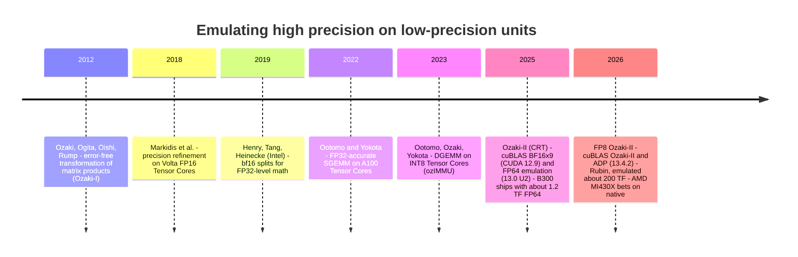
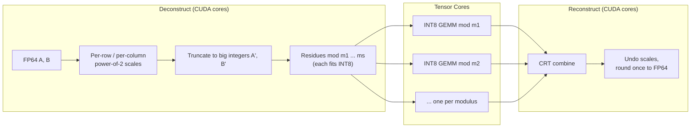

---
tags:
  - gpu-programming
  - hardware
  - tensor-cores
  - fp64
  - emulation
  - ozaki-scheme
  - hpc
aliases:
  - FP64 Emulation
  - Ozaki Scheme
  - Ozaki-II
  - BF16x9
status: complete
sources:
  - https://waseda.elsevierpure.com/en/publications/error-free-transformations-of-matrix-multiplication-by-using-fast/
  - https://arxiv.org/abs/1803.04014v1
  - https://ar5iv.labs.arxiv.org/html/1904.06376
  - https://arxiv.org/abs/2203.03341v2
  - https://arxiv.org/abs/2306.11975
  - https://arxiv.org/html/2504.08009v1
  - https://arxiv.org/html/2508.03984v2
  - https://arxiv.org/html/2508.00441v1
  - https://arxiv.org/html/2511.13778v1
  - https://arxiv.org/html/2603.10634v1
  - https://arxiv.org/html/2603.29975v1
  - https://arxiv.org/html/2606.06510
  - https://arxiv.org/pdf/2606.23698
  - https://arxiv.org/pdf/2611.13332
  - https://docs.nvidia.com/cuda/archive/13.4.3/cublas/index.html
  - https://developer.nvidia.com/blog/unlocking-tensor-core-performance-with-floating-point-emulation-in-cublas/
  - https://developer.nvidia.com/blog/faster-scientific-simulations-with-new-fp64-algorithms-in-nvidia-cublas/
  - https://glennklockwood.com/garden/processors/B300
  - https://www.hpcwire.com/2025/12/09/nvidia-says-its-not-abandoning-64-bit-computing/
  - https://www.theregister.com/2026/01/18/nvidia_fp64_emulation/
  - https://www.hpcwire.com/2026/11/16/nvidia-recommits-to-fp64-with-a-new-gpu-the-rubin-hpc/
  - https://theregister.com/hpc/2026/11/17/gpu-giants-throw-hpc-users-some-tasty-crumbs/5310611
created: 2026-11-26
updated: 2026-11-27
---

## Table Of Contents

---

- [[#TL;DR|TL;DR]]
- [[#The Problem|The Problem]]
- [[#Foundations|Foundations]]
    - [[#Why Integer Products Can Be Exact|Why Integer Products Can Be Exact]]
    - [[#Slicing versus Residues|Slicing versus Residues]]
    - [[#The Chinese Remainder Theorem in One Example|The Chinese Remainder Theorem in One Example]]
- [[#How We Got Here|How We Got Here]]
- [[#How It Works|How It Works]]
    - [[#BF16x9: FP32 from BF16|BF16x9: FP32 from BF16]]
    - [[#Ozaki-I: Slice and Multiply|Ozaki-I: Slice and Multiply]]
    - [[#Ozaki-II: One GEMM per Modulus|Ozaki-II: One GEMM per Modulus]]
    - [[#A Working Toy in NumPy|A Working Toy in NumPy]]
    - [[#When INT8 Disappears: FP8 Ozaki-II|When INT8 Disappears: FP8 Ozaki-II]]
    - [[#Choosing the Precision: ADP|Choosing the Precision: ADP]]
    - [[#Using It from cuBLAS|Using It from cuBLAS]]
    - [[#The Speed Ceiling, Worked|The Speed Ceiling, Worked]]
    - [[#Beyond GEMM: FFT and Complex Products|Beyond GEMM: FFT and Complex Products]]
- [[#Where It Is Now|Where It Is Now]]
- [[#Trade-offs & Open Problems|Trade-offs & Open Problems]]
- [[#Resources|Resources]]
- [[#Related Notes|Related Notes]]

## ***TL;DR***
---
*Floating-point emulation computes FP64 (or FP32) matrix products out of many exact low-precision Tensor Core products. As AI GPUs trade FP64 units for INT8, FP8 and FP4 throughput, it has become NVIDIA's main answer for double-precision GEMM, and the center of a live argument about the future of HPC hardware.*

- **The trick:** turn each FP64 matrix into integers with a shared power-of-two scale, multiply those integers *exactly* on INT8 (or FP8) [[Tensor Cores]], and recombine. Because the low-precision products are exact, the result can match or beat native FP64 accuracy.
- **Two schemes.** *Ozaki-I* (Ozaki, Ogita, Oishi, Rump, 2012) slices each number into 7 to 8 small pieces and needs a triangle of $k(k+1)/2$ GEMMs. *Ozaki-II* (Ozaki, Uchino, Imamura, 2025) uses the Chinese Remainder Theorem: one integer GEMM per modulus, about 14 to 16 for FP64-level accuracy ([Ozaki-II paper](https://arxiv.org/html/2504.08009v1)).
- **FP32 too.** *BF16x9* stores each FP32 value exactly as three BF16 numbers and runs on BF16 Tensor Cores; cuBLAS ships it for compute capability 10.0 and 10.3 ([cuBLAS docs](https://docs.nvidia.com/cuda/archive/13.4.3/cublas/index.html)).
- **In production:** cuBLAS added FP64 emulation in CUDA 13.0 Update 2 and Ozaki-II in CUDA 13.4.2, with Automatic Dynamic Precision (ADP) choosing the bit count per call and falling back to native FP64 when emulation would be unsafe or slower ([NVIDIA, Nov 2026](https://developer.nvidia.com/blog/faster-scientific-simulations-with-new-fp64-algorithms-in-nvidia-cublas/)).
- **Where it is now (Nov 2026):** NVIDIA reports Ozaki-II DGEMM at 147 TFLOPS on GB200 (3.9x native) and 175 TFLOPS on Vera Rubin NVL72 (5.5x native). B300 has only about 1.2 TFLOPS native FP64 and also a much smaller INT8 rate, which pushed research toward FP8-based Ozaki-II. AMD argues emulation helps under 10% of HPC and is shipping the MI430X with 288 TFLOPS of native FP64 instead ([AMD preprint](https://arxiv.org/pdf/2611.13332), [The Register](https://theregister.com/hpc/2026/11/17/gpu-giants-throw-hpc-users-some-tasty-crumbs/5310611)).

## ***The Problem***
---
*Scientific codes need FP64 matrix math, but the silicon in new datacenter GPUs is going to low-precision Tensor Cores. Native FP64 throughput stopped growing after Hopper and collapsed on Blackwell Ultra, so the only big pool of FLOPs left is the AI datapath.*

| GPU | Native FP64 (dense, TFLOPS) | Low-precision Tensor Core (dense) | Ratio |
|---|---|---|---|
| H100 / H200 | 34 | — | the "last HPC-balanced GPU" in Matsuoka's framing |
| B200 | about 37 to 40 | INT8 about 4.5 POPS | about 120x (INT8) |
| B300 (HGX) | 1.2 | FP8 4,500 TFLOPS; INT8 only 154 TOPS | about 3,750x (FP8) |
| Rubin | about 33 | FP8 17.5 PFLOPS (DGX Rubin NVL8 spec) | more than 500x |

Sources: B300 and B200 FP64 from [Lockwood](https://glennklockwood.com/garden/processors/B300); B200 INT8, Rubin FP8 and the H100 framing from [Matsuoka Part 1](https://arxiv.org/html/2606.06510) and [Part 2](https://arxiv.org/pdf/2606.23698); H100 and Rubin FP64 from [HPCwire, Nov 2026](https://www.hpcwire.com/2026/11/16/nvidia-recommits-to-fp64-with-a-new-gpu-the-rubin-hpc/). The Register puts Rubin's FP64 vector rate more than 1,000x below its low-precision Tensor Cores ([The Register, Jan 2026](https://www.theregister.com/2026/01/18/nvidia_fp64_emulation/)).

Jack Dongarra's complaint about Blackwell sums up the mood: "The floating-point capability of the platform is not improved–not improved–over the previous generation" ([HPCwire, Dec 2025](https://www.hpcwire.com/2025/12/09/nvidia-says-its-not-abandoning-64-bit-computing/)). If a lab buys AI GPUs, it either lives with flat FP64, or it finds a way to make the AI units do FP64 work. Emulation is that way, but only for the part of a code that is matrix multiplication (see [[Tiled Matrix Multiplication (GEMM)]]).

## ***Foundations***
---
*Three ideas carry the whole field: integer products below a size limit are exact, a big number can be split into small numbers by slicing its bits or by taking remainders, and the Chinese Remainder Theorem rebuilds a big integer from its remainders.*

### Why Integer Products Can Be Exact

An FP64 number has a 53-bit significand. Floating-point multiplication rounds; integer multiplication does not, as long as the result fits. An INT8 Tensor Core multiplies 8-bit integers and adds them into a 32-bit integer accumulator.

$$k \cdot 128^2 < 2^{31} \quad\Longrightarrow\quad k \le 2^{17} = 131{,}072$$

Plain reading: every INT8 value has magnitude at most 128, so each product is at most $2^{14}$, and the INT32 accumulator cannot overflow until you add about 131 thousand of them. Any GEMM with an inner dimension below that is computed with **zero rounding error**; longer ones are split along $K$. (Arithmetic derived here from the INT8/INT32 widths.) This is why emulation can promise FP64 accuracy at all: the only rounding happens in the conversion steps, which you control.

To use integers, each row of $A$ and each column of $B$ is multiplied by a power of two so its largest entry becomes a big integer, and the fractional rest is truncated. Powers of two make the scaling itself error-free. cuBLAS describes its inputs exactly this way: a shared power-of-two scale times an M-bit integer mantissa, with one scale per row of $A$ and per column of $B$ ([cuBLAS docs](https://docs.nvidia.com/cuda/archive/13.4.3/cublas/index.html)).

### Slicing versus Residues

Once a row is a big integer (say 55 bits), it has to be fed through 8-bit hardware. There are two ways to chop it:

| | Slicing (Ozaki-I) | Residues (Ozaki-II) |
|---|---|---|
| Split | Cut the bits into 7 to 8 chunks of about 7 bits | Take the number modulo several small coprime integers |
| Products needed | Every pair of chunks whose combined weight matters: a triangle, $k(k+1)/2$ | One per modulus, $s$ |
| Recombine | Shift and add | Chinese Remainder Theorem |
| Grows with precision | Quadratically | Linearly |

### The Chinese Remainder Theorem in One Example

If moduli $m_1, \dots, m_s$ share no common factor, then any integer $c$ with $|c| < M/2$, where $M = m_1 m_2 \cdots m_s$, is fixed uniquely by its remainders $c \bmod m_i$. And remainders respect multiplication and addition: $(a \cdot b) \bmod m = ((a \bmod m)(b \bmod m)) \bmod m$.

Worked example with $m = 7, 11, 13$ (so $M = 1001$), $a = 23$, $b = 19$:

| Modulus | $a \bmod m$ | $b \bmod m$ | product mod $m$ |
|---|---|---|---|
| 7 | 2 | 5 | $10 \bmod 7 = 3$ |
| 11 | 1 | 8 | $8$ |
| 13 | 10 | 6 | $60 \bmod 13 = 8$ |

Rebuild: $c \equiv 8 \pmod{11}$ and $\pmod{13}$ means $c = 8 + 143t$. Then $8 + 143t \equiv 3 \pmod 7$ gives $1 + 3t \equiv 3$, so $t = 3$ and $c = 437 = 23 \times 19$. Every multiplication used numbers below 13, yet the answer is exact, because $437 < M/2$. Ozaki-II does the same thing with whole matrices and moduli near 256, so each residue fits in INT8.

## ***How We Got Here***
---
*The idea is older than Tensor Cores: accurate dot products from error-free transformations go back to the 2000s. Tensor Cores turned it from a precision trick on CPUs into a speed trick on GPUs, and Blackwell Ultra's FP64 cut turned it into a necessity.*



- **2012, the scheme.** Ozaki, Ogita, Oishi and Rump showed how to rewrite a product of floating-point matrices as an *exact* sum of floating-point matrices, so accurate products could be built from ordinary fast BLAS calls. It used lots of memory but beat XBLAS's `gemmx` on large matrices ([Numerical Algorithms 59, 2012](https://waseda.elsevierpure.com/en/publications/error-free-transformations-of-matrix-multiplication-by-using-fast/)).
- **2018, Tensor Cores arrive.** Markidis and colleagues at KTH and ORNL measured up to 83 TFLOPS mixed precision on a V100 and showed the precision loss from FP16 inputs "can be considerably reduced at the cost of increased computation" ([Markidis et al.](https://arxiv.org/abs/1803.04014v1)).
- **2019, BF16 splitting.** Intel's Henry, Tang and Heinecke stored an FP32 value as three BF16 numbers (each the BF16 rounding of what was left) and expanded a dot product into nine BF16 partial products; a six-product version already gave about FP32-level error ([Henry et al.](https://ar5iv.labs.arxiv.org/html/1904.06376)). That is the ancestor of cuBLAS's BF16x9.
- **2022, beating FP32 with FP16.** Ootomo and Yokota handled the rounding inside Tensor Cores and underflow during correction, and reached about 51 TFLOPS (FP16, limited exponent range) and 33 TFLOPS (TF32, full range) on an A100, above its 19.5 TFLOPS FP32 peak, while matching FP32 SIMT accuracy ([Ootomo & Yokota](https://arxiv.org/abs/2203.03341v2)).
- **2023, integers for FP64.** Ootomo, Ozaki and Yokota ran Ozaki-I on INT8 Tensor Cores and beat both cuBLAS DGEMM and an earlier FP16 Tensor Core Ozaki implementation on consumer GPUs; their `ozIMMU` library intercepts cuBLAS DGEMM calls ([Ootomo et al.](https://arxiv.org/abs/2306.11975)).
- **2025, Ozaki-II and production.** Ozaki, Uchino and Imamura (Shibaura Institute of Technology, RIKEN) replaced slicing with CRT residues ([Ozaki-II](https://arxiv.org/html/2504.08009v1)), and at SC25 showed 1.4x over native DGEMM and 3.0x over native SGEMM on GH200, with 43% and 154% better power efficiency ([Uchino et al.](https://arxiv.org/html/2508.03984v2)). NVIDIA shipped BF16x9 in CUDA 12.9 and Ozaki-I-style FP64 emulation in CUDA 13.0 Update 2 ([NVIDIA, Oct 2025](https://developer.nvidia.com/blog/unlocking-tensor-core-performance-with-floating-point-emulation-in-cublas/)), while B300 shipped with FP64 "dramatically lower (1.2 TF on B300 vs. 37 TF on B200)" ([Lockwood](https://glennklockwood.com/garden/processors/B300)).
- **2026, FP8 and the argument.** INT8 shrank too, so Ozaki-II moved to FP8 ([Uchino et al., Mar 2026](https://arxiv.org/html/2603.10634v1)); cuBLAS added Ozaki-II and published ADP ([NVIDIA, Nov 2026](https://developer.nvidia.com/blog/faster-scientific-simulations-with-new-fp64-algorithms-in-nvidia-cublas/)); and AMD answered with native FP64 hardware and a preprint on emulation's limits (see [[#Where It Is Now|Where It Is Now]]).

## ***How It Works***
---
*Every scheme has the same shape: convert inputs to exact low-precision pieces, run several Tensor Core GEMMs, then rebuild the answer. The schemes differ in how many GEMMs they need, and the cost of the conversion steps often decides whether emulation actually wins.*



### BF16x9: FP32 from BF16

Write $a = a_0 + a_1 + a_2$ where $a_0$ is $a$ rounded to BF16, $a_1$ is the remainder rounded to BF16, and $a_2$ is what is left. BF16 has 8 significand bits, so three of them cover FP32's 24; cuBLAS calls this an exact representation of each FP32 value as three BF16 values, and says it supports all normal and subnormal FP32 values ([cuBLAS docs](https://docs.nvidia.com/cuda/archive/13.4.3/cublas/index.html), [NVIDIA, Oct 2025](https://developer.nvidia.com/blog/unlocking-tensor-core-performance-with-floating-point-emulation-in-cublas/)). The product $ab$ expands into nine products $a_i b_j$, each run on BF16 Tensor Cores with FP32 accumulation.

$$ab = \sum_{i=0}^{2}\sum_{j=0}^{2} a_i b_j$$

Plain reading: nine BF16 GEMMs replace one FP32 GEMM. That only pays when BF16 Tensor Cores are more than nine times faster than FP32 units, which the cuBLAS docs give as the condition, and it needs hardware support, so it runs only on compute capability 10.0 and 10.3 (B200, B300). NVIDIA reports up to 3x over native FP32 on GB200 NVL72, and 2.4x on the matrix products of the ecTrans weather code with accuracy equal to or better than native ([NVIDIA, Oct 2025](https://developer.nvidia.com/blog/unlocking-tensor-core-performance-with-floating-point-emulation-in-cublas/)).

### Ozaki-I: Slice and Multiply

Scale each row of $A$ (column of $B$) so its largest entry has the target number of bits, then cut each integer into $k$ slices of about 7 bits: $A' = \sum_i 2^{-7i} A_i$. Products of slices $A_i B_j$ are exact on INT8 Tensor Cores. Slices whose combined weight $2^{-7(i+j)}$ falls below the target precision are skipped, which leaves a triangle:

$$N_\text{GEMM}^\text{Ozaki-I} = \frac{k(k+1)}{2}$$

Worked example: FP64 needs at least 53 significand bits ([NVIDIA, Oct 2025](https://developer.nvidia.com/blog/unlocking-tensor-core-performance-with-floating-point-emulation-in-cublas/)). With $k = 8$ signed slices that is $8 \cdot 9 / 2 = 36$ INT8 GEMMs per DGEMM; NVIDIA's unsigned slicing removes redundant sign bits so seven slices suffice, $7 \cdot 8 / 2 = 28$, which the authors put at a 22% compute saving ([Schwarz et al.](https://arxiv.org/html/2511.13778v1)). The Ozaki-II paper also puts Ozaki-I at 7 to 8 slices for double-precision accuracy ([Ozaki-II](https://arxiv.org/html/2504.08009v1)).

### Ozaki-II: One GEMM per Modulus

Ozaki-II never slices. It scales $A$ and $B$ to integer matrices $A'$, $B'$ just large enough that the exact product fits under $M/2$, takes residues modulo pairwise-coprime moduli (for INT8, values between 2 and 256; the paper lists 16, from 256 down to 191), runs one exact GEMM per modulus, and rebuilds with the CRT using precomputed coefficients ([Ozaki-II](https://arxiv.org/html/2504.08009v1)):

$$C' \equiv \sum_{i=1}^{s} \big( (A' \bmod m_i)(B' \bmod m_i) \bmod m_i \big)\, M_i\, y_i \pmod M, \qquad M_i = \frac{M}{m_i},\; y_i = M_i^{-1} \bmod m_i$$

Plain reading: each Tensor Core GEMM sees only small residues, the CRT sum glues the remainders back into the exact big-integer product, and dividing by the scales returns FP64. The cost is $N_\text{GEMM} = s$, linear in precision. For HPL-like inputs, 14 or 15 moduli match DGEMM accuracy, and NVIDIA says Ozaki-I needs roughly twice as many Tensor Core GEMMs at the same accuracy ([Ozaki-II](https://arxiv.org/html/2504.08009v1), [NVIDIA, Nov 2026](https://developer.nvidia.com/blog/faster-scientific-simulations-with-new-fp64-algorithms-in-nvidia-cublas/)).

The paper's two variants differ in how they bound $|A'||B'|$ to pick the scale: *fast* uses the Cauchy–Schwarz inequality, *accurate* spends one extra INT8 GEMM to estimate it and tolerates wider value ranges. On GH200, native cuBLAS DGEMM ran at 60.9 TFLOPS at $n = 16384$; Ozaki-II fast with 14 moduli reached 80.2 and accurate 71.1. On an RTX 4090, whose native DGEMM is about 0.62 TFLOPS, it reached 9.81 TFLOPS, about 15x ([Ozaki-II](https://arxiv.org/html/2504.08009v1)). The paper also notes the GPU time is dominated by the INT8 conversion, not the GEMMs.

### A Working Toy in NumPy

This runs (tested for this note) and shows Ozaki-II end to end. NumPy's `int64` matmul stands in for an INT8 Tensor Core with INT32 accumulation.

```python
import numpy as np
from math import prod

def ozaki2_gemm(A, B, moduli):
    M = prod(moduli)
    k = A.shape[1]
    bits = ((M // 2 // k).bit_length() - 1) // 2
    sa = 2.0 ** (bits - np.ceil(np.log2(np.abs(A).max(1, keepdims=True))))
    sb = 2.0 ** (bits - np.ceil(np.log2(np.abs(B).max(0, keepdims=True))))
    toint = np.frompyfunc(int, 1, 1)
    Ai, Bi = toint(np.trunc(A * sa)), toint(np.trunc(B * sb))
    C = 0
    for m in moduli:
        Am = ((Ai + m // 2) % m - m // 2).astype(np.int64)
        Bm = ((Bi + m // 2) % m - m // 2).astype(np.int64)
        Cm = (Am @ Bm) % m
        Mi = M // m
        C = C + Cm.astype(object) * Mi * pow(Mi, -1, m)
    C = C % M
    C = np.where(C > M // 2, C - M, C)
    return C.astype(np.float64) / sa / sb
```

Line by line:
- `M = prod(moduli)`: the CRT range; the exact integer product must stay under $M/2$.
- `bits = ...`: how many integer bits each operand may have so that $k \cdot 2^{\text{bits}} \cdot 2^{\text{bits}} < M/2$. More moduli give a larger $M$, so more bits survive, so more precision.
- `sa`, `sb`: per-row and per-column powers of two that push each row's largest entry up to about `bits` bits. Powers of two keep the scaling exact.
- `toint(np.trunc(...))`: truncate to exact Python integers (the truncation is the only rounding in the whole method).
- `Am`, `Bm`: residues centered on zero, so for $m \le 256$ they fit in INT8.
- `Cm = (Am @ Bm) % m`: the one exact low-precision GEMM per modulus; on a GPU this is the Tensor Core call.
- `C = C + Cm * Mi * pow(Mi, -1, m)`: the CRT accumulation with precomputed coefficients $M_i y_i$.
- `C % M` and the `np.where`: bring the sum back to the signed range $(-M/2, M/2]$.
- `/ sa / sb`: undo the scaling and land in FP64, the single final rounding.

On a random $64 \times 256$ by $256 \times 64$ normal product with moduli 256, 255, 253, 251, 247, 241, 239, 233, 229, 227, 223, 217, 211, 199, 197, 193, the maximum error relative to the largest entry was $4 \times 10^{-8}$ with 8 moduli, $1.1 \times 10^{-12}$ with 12, $5.3 \times 10^{-15}$ with 14 and $6.1 \times 10^{-17}$ with 16, against $7.9 \times 10^{-16}$ for native NumPy FP64 (measured in this run against an extended-precision reference). That matches the literature's 14 to 16 moduli for FP64-level accuracy, and shows that 16 moduli can be *more* accurate than native FP64.

### When INT8 Disappears: FP8 Ozaki-II

INT8 throughput is shrinking on AI GPUs: Nagoya's Daichi Mukunoki noted the GB300 NVL72 offers 720 PFLOPS of FP8 and FP6 but "only 23 POps/s for INT8," and Tenstorrent Blackhole has no INT8 at all; he showed Ozaki-I on FP8 (E4M3, FP32 accumulate) beats the FP16 Tensor Core version for $m \ge 8192$ on an RTX 5060 Ti ([Mukunoki](https://arxiv.org/html/2508.00441v1)). Per GPU, B300 lists 154 dense INT8 TOPS against 4,500 dense FP8 TFLOPS ([Lockwood](https://glennklockwood.com/garden/processors/B300)).

FP8 E4M3 represents consecutive integers only from −16 to 16, so residues near 256 do not fit. Uchino, Ozaki and Imamura split each residue into two or three FP8 matrices (a Karatsuba-style extension, plus a modular trick for square moduli $p = s^2$), costing **three FP8 GEMMs per modulus**; 12 moduli give FP64-comparable accuracy, so 36 FP8 GEMMs (fast) or 37 (accurate). On an HGX B200 at $16384^3$, INT8 Ozaki-II reached 125 TFLOPS and FP8 Ozaki-II 61 to 64 TFLOPS; the authors keep INT8 where it is plentiful and aim FP8 at B300 and Rubin ([Uchino et al., Mar 2026](https://arxiv.org/html/2603.10634v1)).

### Choosing the Precision: ADP

Ozaki-style emulation is only exact for the bits you keep, and how many bits you need depends on the data: a row with entries spanning $10^{-20}$ to $10^{20}$ needs far more than a row of similar-sized numbers. NVIDIA's **Automatic Dynamic Precision** runs on the GPU, uses an *Exponent Span Capacity* estimator to decide how many slices or moduli give FP64-level accuracy, and costs "less than 10% run time overhead" on the BLAS grading tests ([Schwarz et al.](https://arxiv.org/html/2511.13778v1)). If the bits needed exceed the library default or a user maximum, cuBLAS "dynamically dispatches to native FP64" ([cuBLAS docs](https://docs.nvidia.com/cuda/archive/13.4.3/cublas/index.html)).

You can also pick fewer bits on purpose. Quantum ESPRESSO on an RTX PRO 6000 Blackwell Server Edition ran 1.5x faster end to end with ADP and nearly 3x with a fixed 39 bits, still consistent to 12 significant digits ([NVIDIA, Oct 2025](https://developer.nvidia.com/blog/unlocking-tensor-core-performance-with-floating-point-emulation-in-cublas/)). That is no longer FP64; it is a tunable precision dial, which some codes want and others must not touch.

### Using It from cuBLAS

```c
cublasHandle_t h;
cublasCreate(&h);
cublasSetWorkspace(h, d_ws, ws_bytes);
cublasSetMathMode(h, CUBLAS_FP64_EMULATED_FIXEDPOINT_MATH);
cublasSetEmulationStrategy(h, CUBLAS_EMULATION_STRATEGY_EAGER);
cublasDgemm(h, CUBLAS_OP_N, CUBLAS_OP_N, m, n, k,
            &alpha, dA, lda, dB, ldb, &beta, dC, ldc);
```

- `cublasSetWorkspace`: hand cuBLAS its own scratch memory. Emulation needs workspace that depends on size, bits, architecture and version and "never exceeds 8 GB"; NVIDIA recommends setting it for reproducibility and speed, and if allocation fails the call falls back to non-emulated code.
- `CUBLAS_FP64_EMULATED_FIXEDPOINT_MATH`: allow FP64 routines to use fixed-point (Ozaki) emulation. The FP32 counterpart is `CUBLAS_FP32_EMULATED_BF16X9_MATH`; per-call compute types `CUBLAS_COMPUTE_64F_EMULATED_FIXEDPOINT` and `CUBLAS_COMPUTE_32F_EMULATED_16BFX9` do the same in cuBLASLt-style calls.
- `CUBLAS_EMULATION_STRATEGY_EAGER`: emulate whenever possible. The default, `PERFORMANT`, emulates only when it is faster.
- `cublasDgemm`: an ordinary DGEMM call; the dynamic mantissa control (the default) picks the bit count.

No code change is needed with environment variables: `CUBLAS_EMULATE_DOUBLE_PRECISION=1`, `CUBLAS_EMULATE_SINGLE_PRECISION=1`, `CUBLAS_EMULATION_STRATEGY`, and `CUBLAS_FIXEDPOINT_EMULATION_MANTISSA_BIT_COUNT`. Fixed-point FP64 emulation supports compute capabilities 8.x, 9.0, 10.x, 11.0 and 12.x from CUDA 13.0 Update 2; fixed mantissa control defaults to 55 bits; and `cublasSetFixedPointEmulationMantissaBitOffset()` nudges ADP's choice ([cuBLAS docs](https://docs.nvidia.com/cuda/archive/13.4.3/cublas/index.html)). Samples live in NVIDIA's CUDALibrarySamples under cuBLAS/Emulation ([NVIDIA, Nov 2026](https://developer.nvidia.com/blog/faster-scientific-simulations-with-new-fp64-algorithms-in-nvidia-cublas/)). The same calls slot into anything that already uses [[cuBLAS and cuDNN]].

### The Speed Ceiling, Worked

Ignoring conversion, emulated throughput can be no better than the low-precision rate divided by the number of GEMMs:

$$R_\text{emu} \lesssim \frac{R_\text{low}}{N_\text{GEMM}}$$

Worked example on HGX B300 (rates from [Lockwood](https://glennklockwood.com/garden/processors/B300); GEMM counts from [Uchino et al.](https://arxiv.org/html/2603.10634v1) and [Matsuoka](https://arxiv.org/html/2606.06510), who counts $r+1$ GEMMs for INT8 and $3r+1$ for FP8):

| Path | $R_\text{low}$ (dense) | $N_\text{GEMM}$ | Ceiling |
|---|---|---|---|
| Native FP64 | — | — | 1.2 TFLOPS |
| INT8 Ozaki-II, 16 moduli | 154 TOPS | 17 | $154/17 \approx 9$ TFLOPS |
| FP8 Ozaki-II, 12 moduli | 4,500 TFLOPS | 37 | $4500/37 \approx 122$ TFLOPS |

Plain reading: on B300 the INT8 path is crippled, and only the FP8 path gives a big multiple of native FP64; Matsuoka's model, using the GB300's 5 PFLOPS FP8, puts the ceiling at about 135 TFLOPS. Real kernels land well below such ceilings because deconstruction and CRT reconstruction run on ordinary CUDA cores and stream the residues through memory, which is a [[Roofline Model and Arithmetic Intensity|roofline]] problem of its own. On B200, for example, INT8 at about 4.5 POPS over 17 GEMMs gives a ceiling near 265 TFLOPS, while the measured INT8 Ozaki-II rate was 125 TFLOPS ([Uchino et al.](https://arxiv.org/html/2603.10634v1)).

For a sense of time saved, NVIDIA's GB200 figure of 147 TFLOPS at 3.9x native implies native near 38 TFLOPS; an $8192^3$ DGEMM ($2 \cdot 8192^3 \approx 1.1 \times 10^{12}$ FLOPs) drops from about 29 ms to about 7.5 ms (worked through in [[cuBLAS and cuDNN]]).

### Beyond GEMM: FFT and Complex Products

- **Complex GEMM.** Exact integer arithmetic makes the cheap "2M" complex product safe: cuBLAS computes ZGEMM with two real GEMMs instead of four, about 5x faster than native complex FP64 on GB200, with no accuracy change because the integer products are exact ([NVIDIA, Nov 2026](https://developer.nvidia.com/blog/faster-scientific-simulations-with-new-fp64-algorithms-in-nvidia-cublas/)).
- **FFT.** An FFT is not a GEMM, but a Bailey six-step FFT turns its DFT stages into dense matrix multiplies. Matsuoka's Part 2 designs a full-FP64 $1024^3$ 3-D FFT on FP8 Tensor Cores via Ozaki-II, with twiddles folded into the second DFT stage, complex math as Karatsuba combines in residue form, and exact Kulisch accumulation, so the only rounding is the final FP64 conversion. The catch he names is the *integer-epilogue wall*: about 203 to 281 integer instructions per output for deconstruction and reconstruction, which on B300 means 63 to 87 ms against a 12.9 ms memory roof, and on Rubin a loss of 8 to 11x against native, so "should not be run." It is a model, not a measurement, and it proposes hardware fixes up to modular reduction at the MMA output ([Matsuoka Part 2](https://arxiv.org/pdf/2606.23698)). The cuFFT side of this is in [[FFT on GPUs]].

## ***Where It Is Now***
---
*As of November 2026, FP64 emulation is a shipped cuBLAS feature with real application wins, NVIDIA's flagship FP64 number is an emulated one, and the HPC community is split: RIKEN argues FP8 can carry most FP64 matrix work, while AMD argues emulation covers a small slice of real codes and builds native FP64 instead.*

**NVIDIA's numbers (CUDA 13.4.2, post of Nov 13, 2026)** ([NVIDIA](https://developer.nvidia.com/blog/faster-scientific-simulations-with-new-fp64-algorithms-in-nvidia-cublas/)):

| Platform | Ozaki-II DGEMM | vs native FP64 |
|---|---|---|
| Vera Rubin NVL72 | up to 175 TFLOPS | 5.5x |
| GB200 | up to 147 TFLOPS | 3.9x (2x Ozaki-I) |
| RTX PRO 6000 Blackwell Server Edition | up to 37 TFLOPS | 10x to 23x |

- **Applications.** CCSD quantum chemistry ran 2x (VR NVL72) and 1.4x (GB200) faster end to end at full FP64, 5x and 3.5x with a 32-bit mantissa budget; BerkeleyGW's Epsilon module ran 6.6x (VR NVL72) and 3.9x (GB200) over native ZGEMM, matching native to 10 decimal places ([NVIDIA, Nov 2026](https://developer.nvidia.com/blog/faster-scientific-simulations-with-new-fp64-algorithms-in-nvidia-cublas/)). TACC and Pittsburgh ran the CPU code MuST LSMS on GB200 through automatic BLAS offload with INT8 emulation, getting 1.7x on the scattering-matrix inversion; 55-bit modes converged like FP64 while a 31-bit mode "failed to converge" ([Liu et al., Mar 2026](https://arxiv.org/html/2603.29975v1)).
- **Rubin.** NVIDIA rates Rubin at about 33 TFLOPS native FP64 and up to 200 TFLOPS of emulated FP64 matrix math; NVIDIA's Dan Ernst says "it's still FP64. It's not mixed precision" ([The Register, Jan 2026](https://www.theregister.com/2026/01/18/nvidia_fp64_emulation/)). At SC26 (Nov 16, 2026) NVIDIA announced **Rubin HPC** for 2028, with more than 50,000 CUDA cores and native FP64 matrix support, a sign that emulation alone did not satisfy its HPC customers ([HPCwire](https://www.hpcwire.com/2026/11/16/nvidia-recommits-to-fp64-with-a-new-gpu-the-rubin-hpc/), [The Register, Nov 2026](https://theregister.com/hpc/2026/11/17/gpu-giants-throw-hpc-users-some-tasty-crumbs/5310611)).
- **The FP8-maximalist case.** RIKEN's Satoshi Matsuoka argues, in a modeling study with measurements deferred to a planned Part 3, that FP8 matrix units plus Ozaki-II can be the main substrate for matrix-dominated FP64 kernels, with native FP64 as a fallback; he models a B300 ceiling near 135 TFLOPS and keeps SpMV and single-vector GEMV on native FP64 because conversion costs dominate there ([Matsuoka Part 1, Sep 2026](https://arxiv.org/html/2606.06510)).
- **The AMD case.** An AMD preprint (Nov 2026) across 47 configurations from 11 applications finds ten of the eleven have no dominant DGEMM, and estimates emulation applies to "less than 10% of the HPC ecosystem." It measured INT8 Ozaki-II with 16 moduli at 136.31 TFLOPS against 64.36 native on MI355X at $40960^2$ (2.12x), large speedups on GB300 (8.24x) only because native there is about 1.1 TFLOPS, workspace of 100 to 120 GB at that size (2.6 to 3.1x native), and losses above 25% on misaligned shapes. It also found Ozaki-II results bit-identical across MI355X, B200 and GB300 ([Świrydowicz et al.](https://arxiv.org/pdf/2611.13332)). AMD's MI430X (2027) offers 288 TFLOPS of native FP64 and uses no emulation ([The Register, Nov 2026](https://theregister.com/hpc/2026/11/17/gpu-giants-throw-hpc-users-some-tasty-crumbs/5310611)).

## ***Trade-offs & Open Problems***
---
*Emulation is a GEMM accelerator, not an FP64 unit. It wins on large, well-shaped matrix products where conversion is cheap relative to the GEMMs, and it loses, or does nothing, on vector-heavy, small, skewed or memory-tight work.*

| Gains | Costs |
|---|---|
| Uses the huge low-precision Tensor Core budget | Only matrix products benefit; vector, stencil and sparse kernels stay on native FP64 |
| Accuracy can match or beat native FP64, set by bit count | Bits needed depend on data; wide exponent spans need more moduli or fall back |
| Bit-identical results across vendors (AMD measurement) | Not bitwise identical to native FP64; cuBLAS's determinism guarantee excludes fixed-point emulation |
| Tunable precision (39, 47, 55 bits) | Workspace up to 8 GB in cuBLAS; 2.6 to 3.1x native footprint at very large sizes |
| Better energy per FP64 operation (GH200: 43% better) | Small or misaligned GEMMs lose; conversion and CRT steps can dominate |

- **Coverage.** AMD's Nicholas Malaya estimates 60 to 70% of HPC workloads get little or no benefit because they are vector-bound, and says emulation works best on well-conditioned problems like HPL, while it can break down in materials science, combustion and banded linear algebra ([The Register, Jan 2026](https://www.theregister.com/2026/01/18/nvidia_fp64_emulation/)). NVIDIA's reply is that IEEE ordering rarely matters inside a matrix product and that NaN and infinity handling has been added.
- **Special values.** Fixed-point emulation does not natively carry infinities or NaNs; cuBLAS adds them through a configurable mask, by default signed infinity and NaN, at some performance cost ([cuBLAS docs](https://docs.nvidia.com/cuda/archive/13.4.3/cublas/index.html)).
- **Determinism.** cuBLAS's run-to-run bitwise guarantee "no longer holds when multiple CUDA streams are active or fixed-point emulation is used" (see [[cuBLAS and cuDNN]]).
- **Hardware drift.** Each generation changes which low-precision unit is plentiful: INT8 on B200, FP8 on B300, a "TI16" integer format through `tcgen05.mma` on Rubin ([NVIDIA, Nov 2026](https://developer.nvidia.com/blog/faster-scientific-simulations-with-new-fp64-algorithms-in-nvidia-cublas/)). Algorithms and libraries have to follow, and portable codes cannot assume one path. See [[Low-Precision Formats - FP8, FP4 and MX]] for the formats.
- **The epilogue wall.** Once the Tensor Core part is cheap, the integer work before and after it is the bottleneck. Matsuoka's proposals (a restored INT8 path, wide cross-column accumulators, modular reduction at the MMA output) are hardware asks nobody has committed to ([Matsuoka Part 2](https://arxiv.org/pdf/2606.23698)). Fusing conversion into the GEMM's prologue and epilogue is the software side of the same problem (see [[Kernel Fusion]]).
- **Beyond GEMM.** NVIDIA plans to extend emulation to more BLAS level-3 and LAPACK routines ([NVIDIA, Oct 2025](https://developer.nvidia.com/blog/unlocking-tensor-core-performance-with-floating-point-emulation-in-cublas/)). Factorizations with pivoting, eigen-solvers and FFTs need either GEMM-shaped reformulation or stay native.
- **Unproven at scale.** The strongest pro-emulation case for whole applications is still modeled (Matsuoka), and the strongest skeptical case comes from the vendor with the native FP64 product (AMD). Independent, measured whole-application studies are still few.

## ***Resources***
---
*Start with NVIDIA's two cuBLAS emulation posts and the cuBLAS emulation section for the practical picture, then the Ozaki-II paper for the math. Read Matsuoka and the AMD preprint together for the two sides of the hardware debate.*

**Papers (algorithms)**
- [Error-free transformations of matrix multiplication by using fast routines of matrix multiplication](https://waseda.elsevierpure.com/en/publications/error-free-transformations-of-matrix-multiplication-by-using-fast/), Ozaki, Ogita, Oishi, Rump, Numerical Algorithms, 2012: Ozaki-I.
- [Ozaki Scheme II: a GEMM-oriented emulation using an integer modular technique](https://arxiv.org/html/2504.08009v1), Ozaki, Uchino, Imamura, 2025.
- [High-Performance and Power-Efficient Emulation of Matrix Multiplication using INT8 Matrix Engines](https://arxiv.org/html/2508.03984v2), Uchino, Ozaki, Imamura, SC25.
- [Double-Precision Matrix Multiplication Emulation via Ozaki-II with FP8 Quantization](https://arxiv.org/html/2603.10634v1), Uchino, Ozaki, Imamura, Mar 2026.
- [DGEMM on Integer Matrix Multiplication Unit](https://arxiv.org/abs/2306.11975), Ootomo, Ozaki, Yokota, 2023 (ozIMMU).
- [DGEMM without FP64 Arithmetic](https://arxiv.org/html/2508.00441v1), Mukunoki, 2025: FP8 Ozaki-I.
- [Guaranteed DGEMM Accuracy … Through Extensions of the Ozaki Scheme](https://arxiv.org/html/2511.13778v1), Schwarz et al. (NVIDIA), SCA/HPCAsia 2026: ADP.
- [Recovering single precision accuracy from Tensor Cores](https://arxiv.org/abs/2203.03341v2), Ootomo and Yokota, 2022.
- [Leveraging the bfloat16 datatype for higher-precision computations](https://ar5iv.labs.arxiv.org/html/1904.06376), Henry, Tang, Heinecke, 2019.

**The debate**
- [FP8 is All You Need, Part 1](https://arxiv.org/html/2606.06510) and [Part 2 (3-D FFT)](https://arxiv.org/pdf/2606.23698), Matsuoka (RIKEN), 2026.
- [FP64 Performance and the Limits of Ozaki Emulation on HPC Systems](https://arxiv.org/pdf/2611.13332), Świrydowicz et al. (AMD), Nov 2026.
- [Nvidia leans on emulation …](https://www.theregister.com/2026/01/18/nvidia_fp64_emulation/), The Register, Jan 2026; [NVIDIA says it's not abandoning 64-bit computing](https://www.hpcwire.com/2025/12/09/nvidia-says-its-not-abandoning-64-bit-computing/), HPCwire, Dec 2025.

**Libraries and docs**
- [cuBLAS 13.4 docs, section 1.5 Floating Point Emulation](https://docs.nvidia.com/cuda/archive/13.4.3/cublas/index.html).
- [Unlocking Tensor Core Performance with Floating Point Emulation in cuBLAS](https://developer.nvidia.com/blog/unlocking-tensor-core-performance-with-floating-point-emulation-in-cublas/), NVIDIA, Oct 2025.
- [Faster Scientific Simulations with New FP64 Algorithms in cuBLAS](https://developer.nvidia.com/blog/faster-scientific-simulations-with-new-fp64-algorithms-in-nvidia-cublas/), NVIDIA, Nov 13, 2026.
- [A Precision Emulation Approach to … Ab Initio Electronic Structure](https://arxiv.org/html/2603.29975v1), Liu et al. (TACC, PSC), 2026: emulation in a real code via automatic offload, including the GEMMul8 library.

**Hardware numbers**
- [Glenn Lockwood, B300](https://glennklockwood.com/garden/processors/B300).

## ***Related Notes***
---
*Emulation sits where Tensor Core hardware, low-precision formats and the BLAS library meet.*

- [[Tensor Cores]] — The units emulation runs on, and the generation-by-generation shift away from FP64.
- [[Low-Precision Formats - FP8, FP4 and MX]] — FP8, BF16 and integer formats that emulation borrows.
- [[cuBLAS and cuDNN]] — The library that ships BF16x9 and Ozaki emulation, with its determinism rules.
- [[Blackwell Architecture]] — B200 vs B300 and the FP64 cut.
- [[Tiled Matrix Multiplication (GEMM)]] — Each emulated GEMM is many ordinary tiled GEMMs.
- [[Roofline Model and Arithmetic Intensity]] — Why conversion and reconstruction, not the MMAs, often set the speed.
- [[FFT on GPUs]] — FP64 FFTs and the six-step route onto Tensor Cores.
- [[Kernel Fusion]] — Fusing deconstruction and CRT reconstruction into GEMM prologues and epilogues.
- [[CUTLASS and CuTe]] — Where custom emulation kernels get their integer GEMMs.
- [[Sparse Linear Algebra on GPUs]] — The sparse kernels emulation does not help.
- [[AI Accelerators]] — Chips built for low precision, where emulation may be the only route to FP64.
- [[Mixed-Precision Iterative Refinement and HPL-MxP]] — The other route to FP64 answers: factor in low precision, refine in FP64, and the HPL-MxP benchmark built on it.
- [[Dense LU and Cholesky Factorization on GPUs]] — Dense factorizations whose trailing GEMMs emulation speeds up, and whose panels it does not.
