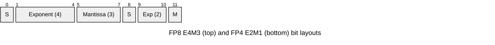
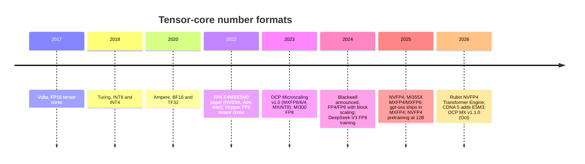
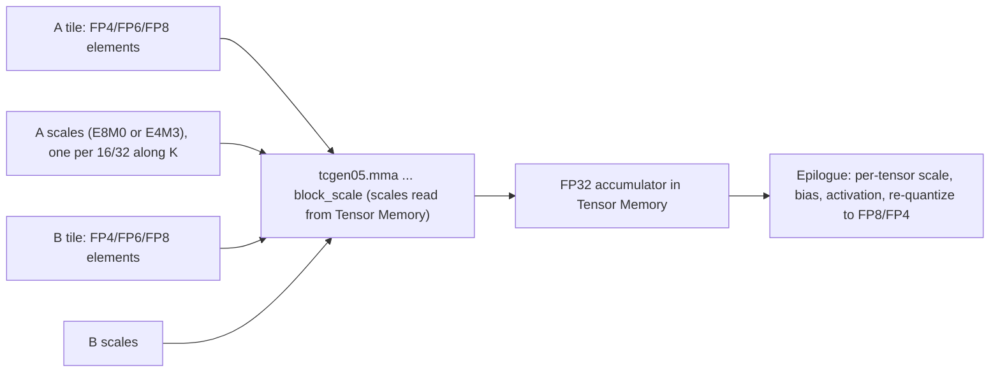

---
tags:
  - gpu-programming
  - hardware
  - low-precision
  - fp8
  - fp4
  - microscaling
aliases:
  - "Low-Precision Formats: FP8, FP4 and MX"
status: draft
sources:
  - https://arxiv.org/abs/2209.05433
  - https://arxiv.org/abs/2310.10537
  - https://opencompute.org/documents/ocp-microscaling-formats-mx-v1-0-spec-final-pdf
  - https://www.opencompute.org/wp-content/uploads/2026/10/OCP_MicroXcaling_Spec_v1.1.0.pdf
  - https://developer.nvidia.com/blog/introducing-nvfp4-for-efficient-and-accurate-low-precision-inference
  - https://arxiv.org/html/2509.25149v2
  - https://arxiv.org/abs/2412.19437
  - https://arxiv.org/html/2506.08027v2
  - https://docs.nvidia.com/cuda/parallel-thread-execution/
  - https://docs.nvidia.com/cutlass/latest/media/docs/pythonDSL/mma_docs/tcgen05_programming.html
  - https://github.com/NVIDIA/cutlass/blob/main/media/docs/cpp/blackwell_functionality.md
  - https://research.colfax-intl.com/cutlass-tutorial-nvfp4-blockscaled-gemm-on-nvidia-rtx-pro-blackwell-gpus-sm12x/
  - https://danielvegamyhre.github.io/2026/03/29/mxfp8-gemm.html
  - https://rocm.docs.amd.com/en/latest/reference/gpu-arch/mi350.html
  - https://rocm.blogs.amd.com/ecosystems-and-partners/cdna5-helios/README.html
  - https://glennklockwood.com/garden/processors/R200
  - https://www.nvidia.com/en-us/data-center/h100/
created: 2026-11-26
updated: 2026-11-26
---

## Table Of Contents

---

- [[#TL;DR|TL;DR]]
- [[#The Problem|The Problem]]
- [[#Foundations|Foundations]]
    - [[#How a Float Is Built|How a Float Is Built]]
    - [[#The Formats Side by Side|The Formats Side by Side]]
    - [[#Scaling: Tensor, Block, Microscaling|Scaling: Tensor, Block, Microscaling]]
- [[#How We Got Here|How We Got Here]]
- [[#How It Works|How It Works]]
    - [[#Quantizing a Block by Hand|Quantizing a Block by Hand]]
    - [[#Inside a Block-Scaled GEMM|Inside a Block-Scaled GEMM]]
    - [[#Accumulation and the Hopper FP8 Catch|Accumulation and the Hopper FP8 Catch]]
    - [[#What It Buys: Memory and FLOPs|What It Buys: Memory and FLOPs]]
- [[#Where It Is Now|Where It Is Now]]
    - [[#Hardware Support|Hardware Support]]
    - [[#Software and Models|Software and Models]]
- [[#Trade-offs & Open Problems|Trade-offs & Open Problems]]
- [[#Resources|Resources]]
- [[#Related Notes|Related Notes]]

## ***TL;DR***
---
*Each halving of number width roughly doubles tensor-core throughput and halves memory traffic, so GPUs went from FP16 (Volta) to FP8 (Hopper) to FP4 and FP6 (Blackwell, MI355X). Below 8 bits a number is useless without a scale, so the real innovation is block scaling: every 16 or 32 values share a scale factor that the tensor cores apply in hardware.*

- **FP8** comes as E4M3 (max 448, more precision) and E5M2 (max 57,344, more range), standardised in 2022 by NVIDIA, Arm and Intel ([Micikevicius et al.](https://arxiv.org/abs/2209.05433)). Hopper was the first GPU with FP8 [[Tensor Cores]].
- **Microscaling (MX)**, an Open Compute Project spec from 2023, groups 32 elements under one shared power-of-two (E8M0) scale: MXFP8, MXFP6, MXFP4 and MXINT8 ([Rouhani et al.](https://arxiv.org/abs/2310.10537)). **NVFP4** is NVIDIA's variant: 16-element blocks with an E4M3 scale plus a per-tensor FP32 scale ([NVIDIA](https://developer.nvidia.com/blog/introducing-nvfp4-for-efficient-and-accurate-low-precision-inference)).
- **In hardware:** Blackwell's `tcgen05.mma` takes block-scaled FP8/FP6/FP4 operands and applies the scales inside the MMA; AMD's MI355X runs MXFP4/MXFP6 at 10 PFLOPS dense, twice its FP8 rate ([AMD MI350 docs](https://rocm.docs.amd.com/en/latest/reference/gpu-arch/mi350.html)).
- **Where it is now (Nov 2026):** FP8 is the serving and increasingly the training baseline; 4-bit block formats are the frontier, with NVFP4 pretraining shown at 12B parameters on 10T tokens ([NVIDIA](https://arxiv.org/html/2509.25149v2)). Rubin (2H 2026) is rated at 50 PFLOPS of NVFP4, AMD's CDNA 5 adds an E5M3 format, and OCP published MX spec v1.1.0 in Oct 2026. The model-side story (PTQ, QAT, outliers) is in [[Quantization]].

## ***The Problem***
---
*Large models are limited by memory bandwidth and capacity during inference and by tensor-core FLOPs during training. Fewer bits per number helps both, but each bit removed loses range or precision, and naive 4-bit rounding wrecks accuracy.*

Two costs scale with bits per value:

| Cost | Why bits matter | Example |
|---|---|---|
| Memory traffic | Decode reads every weight per token; bytes per weight set the speed limit | 70B parameters: 140 GB in BF16, 70 GB in FP8, ~37 GB in MXFP4 |
| Tensor-core throughput | A multiplier for narrower inputs is smaller, so more fit per SM | MI355X: 2.5 PFLOPS BF16, 5.0 FP8, 10 MXFP4 |

The price is representable values. FP4 E2M1 can only express ±{0, 0.5, 1, 1.5, 2, 3, 4, 6}. Real tensors span many orders of magnitude and contain outliers, so one scale per tensor either clips the large values or crushes small ones to zero. Directly casting LLaMA-7B to MXFP4 raised WikiText perplexity from 9.49 to 27.2 ([Rouhani et al.](https://arxiv.org/abs/2310.10537)). Making these formats usable is a joint hardware, kernel and algorithm problem.

## ***Foundations***
---
*A floating-point number spends its bits on sign, exponent (range) and mantissa (precision). Low-precision formats choose that split carefully and borrow range back from a shared scale.*

### How a Float Is Built

A normal float with $e$ exponent bits and $m$ mantissa bits encodes

$$x = (-1)^s \cdot 2^{E - \text{bias}} \cdot \left(1 + \frac{M}{2^m}\right)$$

In plain words: the exponent picks a power of two (the range), the mantissa picks one of $2^m$ evenly spaced steps between that power and the next (the precision). More exponent bits mean a wider range; more mantissa bits mean finer steps.

**Worked example (E4M3).** Bias is 7. The bits `0 1111 110` give $2^{15-7}\cdot(1 + 6/8) = 256 \cdot 1.75 = 448$, the largest E4M3 value. E4M3 gives up infinities and keeps only `S 1111 111` as NaN, which is how it reaches 448 instead of 240 ([Micikevicius et al.](https://arxiv.org/abs/2209.05433)).

### The Formats Side by Side

| Format | Sign/Exp/Mant | Max normal | Hardware since | Typical use |
|---|---|---|---|---|
| FP32 | 1/8/23 | 3.4e38 | Always | Accumulators, master weights |
| BF16 | 1/8/7 | 3.4e38 | Ampere | Training default |
| FP16 | 1/5/10 | 65,504 | Volta tensor cores | Inference, older training |
| FP8 E5M2 | 1/5/2 | 57,344 | Hopper, MI300 | Gradients |
| FP8 E4M3 | 1/4/3 | 448 | Hopper, MI300 | Weights and activations |
| FP6 E3M2 / E2M3 | 1/3/2, 1/2/3 | 28 / 7.5 | Blackwell, MI355X | MXFP6 |
| FP4 E2M1 | 1/2/1 | 6 | Blackwell, MI355X | MXFP4, NVFP4 weights and activations |
| E8M0 (scale only) | 0/8/0 | 2^127 | Blackwell, MI355X | MX block scales (powers of two) |

Sources: [FP8 paper](https://arxiv.org/abs/2209.05433), [OCP MX v1.0 spec](https://opencompute.org/documents/ocp-microscaling-formats-mx-v1-0-spec-final-pdf).

### Scaling: Tensor, Block, Microscaling

Every low-precision tensor is stored as small elements times a scale: $x_i \approx s \cdot q_i$. The design question is how many elements share one $s$.

| Granularity | Elements per scale | Scale type | Used by |
|---|---|---|---|
| Per tensor | Whole tensor | FP32 | Hopper FP8 with Transformer Engine (delayed scaling) |
| Per channel / row | One row | FP32 | INT8 inference, FP8 weights |
| Block (2D tile) | 128×128 weights, 1×128 activations | FP32 | DeepSeek-V3 FP8 training, DeepGEMM |
| **MX** | 32 | E8M0 (power of two) | MXFP8/6/4, OCP standard; Blackwell, MI355X |
| **NVFP4** | 16 | E4M3, plus FP32 per tensor | Blackwell, Rubin |

Bits per element including the scale: MXFP4 is $4 + 8/32 = 4.25$; NVFP4 is $4 + 8/16 = 4.5$ (plus a negligible per-tensor FP32). Smaller blocks follow local magnitudes more closely; NVFP4's E4M3 scale can land between powers of two, which MX's E8M0 cannot ([NVIDIA](https://developer.nvidia.com/blog/introducing-nvfp4-for-efficient-and-accurate-low-precision-inference)).

## ***How We Got Here***
---
*Every NVIDIA generation since Volta added a narrower tensor-core input. The jump below 8 bits only worked once hardware applied fine-grained scales inside the matrix instruction.*

- **2022, FP8.** NVIDIA, Arm and Intel proposed E4M3 and E5M2 and showed FP8 training matching 16-bit quality on models up to 175B with unchanged hyperparameters ([Micikevicius et al.](https://arxiv.org/abs/2209.05433)). Hopper shipped FP8 tensor cores at twice the FP16 rate, with Transformer Engine managing per-tensor scales.
- **2023, MX.** AMD, Arm, Intel, Meta, Microsoft, NVIDIA and Qualcomm published the OCP Microscaling spec, defining block formats with a 32-element shared E8M0 scale ([OCP v1.0](https://opencompute.org/documents/ocp-microscaling-formats-mx-v1-0-spec-final-pdf), [Rouhani et al.](https://arxiv.org/abs/2310.10537)).
- **2024, block scaling in practice.** DeepSeek-V3 trained a 671B MoE in FP8 using 1×128 activation tiles and 128×128 weight blocks, each with its own scale, plus higher-precision accumulation ([DeepSeek-V3](https://arxiv.org/abs/2412.19437)).
- **2025, FP4 arrives.** Blackwell's tensor cores consume MXFP4/MXFP6/MXFP8 and NVFP4 natively; MI355X added MXFP4 and MXFP6 at 10 PFLOPS. NVIDIA pretrained a 12B model in NVFP4 on 10T tokens with MMLU-Pro 62.58 vs 62.62 for FP8 ([NVIDIA](https://arxiv.org/html/2509.25149v2)). MXFP8 pretraining recipes showed parity with BF16 ([MXFP8 recipes](https://arxiv.org/html/2506.08027v2)).

## ***How It Works***
---
*Quantizing means picking a scale per block, dividing, and rounding to the format's grid. The GPU's job is to multiply these small numbers fast, apply the scales without slowing down, and accumulate in enough precision.*

### Quantizing a Block by Hand

The OCP MX rule for the shared scale is $X = 2^{\lfloor \log_2(\max_i |v_i|) \rfloor - e_{\max}}$, where $e_{\max}$ is the largest exponent of the element format (2 for E2M1, whose max is $6 = 1.5 \cdot 2^2$) ([OCP v1.0](https://opencompute.org/documents/ocp-microscaling-formats-mx-v1-0-spec-final-pdf)).

**Worked example (MXFP4).** Take a block whose values include 0.3, 1.1 and a maximum of 3.2.

1. $\lfloor\log_2 3.2\rfloor = 1$, so $X = 2^{1-2} = 0.5$.
2. Divide: 0.3 → 0.6, 1.1 → 2.2, 3.2 → 6.4.
3. Round to the E2M1 grid {0, 0.5, 1, 1.5, 2, 3, 4, 6}, saturating: 0.6 → 0.5, 2.2 → 2, 6.4 → 6.
4. Decode ($\times X$): 0.25, 1.0, 3.0.

Errors are 0.05, 0.1 and 0.2: the block maximum was clipped because a power-of-two scale cannot put 3.2 exactly on the grid's top value. NVFP4 sets its scale to about $\max/6$ in E4M3 (here near 0.53), so the maximum lands at or near 6 without a power-of-two jump; this is the accuracy argument for NVFP4's finer scale and smaller block.

### Inside a Block-Scaled GEMM

On Blackwell (SM100), the [[Tensor Cores|tensor-core]] instruction family `tcgen05.mma` has block-scaled kinds (for MX FP8/FP6/FP4 and NVFP4) whose scale factors sit in Tensor Memory beside the accumulator; the hardware multiplies each partial product by its A and B block scales before accumulating ([PTX ISA](https://docs.nvidia.com/cuda/parallel-thread-execution/), [CUTLASS tcgen05 guide](https://docs.nvidia.com/cutlass/latest/media/docs/pythonDSL/mma_docs/tcgen05_programming.html)). For the kernel writer this means:

- **Scale layout.** Scales must be stored in the specific interleaved layout the MMA expects, loaded with [[TMA and Asynchronous Copies|TMA]] and copied into Tensor Memory alongside operand tiles.
- **Block size vs. K tile.** The K tile must be a multiple of the scale block (16 or 32), so each MMA step consumes whole blocks.
- **Epilogue.** The FP32 result usually gets the per-tensor scale, then is re-quantized (computing new block scales) for the next layer, a natural place for [[Kernel Fusion|fusion]].

[[CUTLASS and CuTe]] ships block-scaled GEMM examples for SM100 and SM12x ([CUTLASS Blackwell doc](https://github.com/NVIDIA/cutlass/blob/main/media/docs/cpp/blackwell_functionality.md), [Colfax NVFP4 on SM12x](https://research.colfax-intl.com/cutlass-tutorial-nvfp4-blockscaled-gemm-on-nvidia-rtx-pro-blackwell-gpus-sm12x/)); a 2026 hand-written MXFP8 GEMM reached up to 99% of cuBLAS with CUDA and PTX ([Vega-Myhre, Mar 2026](https://danielvegamyhre.github.io/2026/03/29/mxfp8-gemm.html)).

### Accumulation and the Hopper FP8 Catch

Narrow inputs are fine only if the running sum is wide. DeepSeek reported that Hopper's FP8 tensor-core GEMM keeps only about 14 bits of accumulation precision, which causes errors for long K. Their fix: every 128 elements along K, copy the partial sum out to CUDA cores and add it into a full FP32 accumulator, applying the block scales there ([DeepSeek-V3](https://arxiv.org/abs/2412.19437)). Blackwell's block-scaled MMA applies scales and accumulates in FP32 inside the instruction, removing that workaround.

### What It Buys: Memory and FLOPs

**Worked example (decode bandwidth).** Single-stream decode reads all weights once per token, so tokens/s is bounded by bandwidth over model bytes. For a 70B dense model on one GPU with 8 TB/s:

| Format | Bits/weight | Model bytes | Upper bound tokens/s |
|---|---|---|---|
| BF16 | 16 | 140 GB | 57 |
| FP8 | 8 (+ small scales) | 70 GB | 114 |
| MXFP4 | 4.25 | 37.2 GB | 215 |
| NVFP4 | 4.5 | 39.4 GB | 203 |

In plain words: going from BF16 to 4-bit nearly quadruples the ceiling, and the extra scale bits cost NVFP4 about 5% versus MXFP4. Real numbers are lower (KV cache, activations, kernel efficiency), but the ratios hold; see [[Roofline Model and Arithmetic Intensity]].

**Dense tensor-core peaks (vendor specs):**

| GPU | BF16 | FP8 | FP4 (MX/NV) |
|---|---|---|---|
| H100 SXM | ~0.99 PF | ~1.98 PF | — |
| MI355X | 2.5 PF | 5.0 PF | 10 PF (MXFP4/MXFP6) |
| Rubin (R200) | — | — | 50 PF NVFP4 (inference) |

Sources: [H100](https://www.nvidia.com/en-us/data-center/h100/), [MI350 docs](https://rocm.docs.amd.com/en/latest/reference/gpu-arch/mi350.html), [Rubin](https://glennklockwood.com/garden/processors/R200).

## ***Where It Is Now***
---
*As of November 2026: FP8 is standard for serving and common in training; MXFP4 and NVFP4 ship in released models and run natively on Blackwell, Rubin and MI355X; new formats (E5M3) and a revised OCP MX spec are arriving.*

### Hardware Support

| Vendor / generation | FP8 | MXFP8 | MXFP6 | MXFP4 | NVFP4 | Notes |
|---|---|---|---|---|---|---|
| NVIDIA Hopper (SM90) | Yes | Software | No | No | No | Per-tensor or software block scaling |
| NVIDIA Blackwell (SM100/103, SM12x) | Yes | Yes | Yes | Yes | Yes | Scales applied in `tcgen05`/`mma` block-scale instructions |
| NVIDIA Rubin (2H 2026) | Yes | Yes | Yes | Yes | Yes | NVFP4 Transformer Engine, 50 PF NVFP4 |
| AMD MI300 (CDNA 3) | Yes | No | No | No | No | FP8 variant differs from OCP on MI300 |
| AMD MI355X (CDNA 4) | OCP FP8 | Yes | Yes | Yes | No | MXFP6 at FP4 rate |
| AMD MI455X (CDNA 5) | Yes | Yes | Yes | Yes | — | Adds E5M3; 4-bit lookup instruction expands compressed weights |

Sources: [AMD MI350 docs](https://rocm.docs.amd.com/en/latest/reference/gpu-arch/mi350.html), [CDNA 5 blog](https://rocm.blogs.amd.com/ecosystems-and-partners/cdna5-helios/README.html), [CUTLASS Blackwell doc](https://github.com/NVIDIA/cutlass/blob/main/media/docs/cpp/blackwell_functionality.md). See also [[Blackwell Architecture]] and [[ROCm and HIP]].

The OCP published **Microscaling spec v1.1.0** in October 2026 ([OCP v1.1.0](https://www.opencompute.org/wp-content/uploads/2026/10/OCP_MicroXcaling_Spec_v1.1.0.pdf)), the first revision since 2023.

### Software and Models

- **Libraries.** cuBLAS added block-scaled FP8/FP4 GEMMs for Blackwell in 12.9 (see [[cuBLAS and cuDNN]]); CUTLASS and CuTe DSL ship block-scaled kernels; [[Triton]] supports MXFP4 dot products on Blackwell; AMD's hipBLASLt covers MXFP4/MXFP8 on MI355X.
- **Models.** gpt-oss ships in MXFP4, DeepSeek-V4 uses FP4 experts with FP8 elsewhere, and NVIDIA's Nemotron 3 Super was pretrained in NVFP4 (details and sources in [[Quantization]]).
- **Attention.** FP8 attention kernels (FlashAttention-3 on Hopper, FP4/FP8 paths on Blackwell) are covered in [[Low-Precision Attention]].

## ***Trade-offs & Open Problems***
---
*Fewer bits buy speed and memory at the cost of accuracy and kernel complexity. Which block format wins, how low training can go, and how to keep scale handling from eating the gains are open.*

| Strength | Cost |
|---|---|
| 2× FLOPs per halving of width | Accuracy loss, especially for activations and gradients |
| ~4× less weight memory vs BF16 at 4 bits | Scale tensors with awkward layouts to load and manage |
| Block scales handle outliers locally | Quantize and re-quantize kernels add memory passes unless fused |
| Hardware applies scales inside the MMA | Formats differ by vendor (NVFP4 is NVIDIA-only; FP8 variants differed on MI300) |

- **MX vs NVFP4.** NVFP4's smaller block and finer scale are more accurate; MX is an open multi-vendor standard. AMD's MI355X does not list NVFP4, so 4-bit checkpoints are not fully portable.
- **Training below FP8.** NVFP4 pretraining works at 12B with careful recipes (random Hadamard transforms, stochastic rounding, some layers in higher precision); whether it holds at frontier scale without loss is still being tested.
- **Scale overhead in kernels.** Loading, laying out and copying scale factors into Tensor Memory is extra work per K step; small GEMMs (decode, MoE experts) feel it most.
- **Accumulation.** Hopper's limited FP8 accumulation precision forced software promotion; any future narrower accumulator would reopen the issue.
- **Format sprawl.** E4M3, E5M2, E3M2, E2M3, E2M1, E8M0, UE4M3, now E5M3: every new format needs conversion instructions, library kernels and framework support on every vendor.

## ***Resources***
---
*Read the FP8 paper and the MX paper for the formats, NVIDIA's NVFP4 post for the 4-bit design, and DeepSeek-V3's FP8 section for practical training. For kernels, the CUTLASS tcgen05 guide and Colfax's NVFP4 tutorial show how scales flow through a GEMM.*

**Formats and specs**
- [FP8 Formats for Deep Learning](https://arxiv.org/abs/2209.05433), Micikevicius et al., 2022.
- [Microscaling Data Formats for Deep Learning](https://arxiv.org/abs/2310.10537), Rouhani et al., 2023.
- [OCP Microscaling Formats v1.0](https://opencompute.org/documents/ocp-microscaling-formats-mx-v1-0-spec-final-pdf) and [v1.1.0](https://www.opencompute.org/wp-content/uploads/2026/10/OCP_MicroXcaling_Spec_v1.1.0.pdf).
- [Introducing NVFP4](https://developer.nvidia.com/blog/introducing-nvfp4-for-efficient-and-accurate-low-precision-inference), NVIDIA, Jun 2025.

**Training**
- [DeepSeek-V3 Technical Report](https://arxiv.org/abs/2412.19437), FP8 training framework section.
- [Pretraining LLMs with NVFP4](https://arxiv.org/html/2509.25149v2), NVIDIA, 2025.
- [Recipes for Pre-training LLMs with MXFP8](https://arxiv.org/html/2506.08027v2), 2025.

**Kernels**
- [CUTLASS tcgen05 MMA programming guide](https://docs.nvidia.com/cutlass/latest/media/docs/pythonDSL/mma_docs/tcgen05_programming.html).
- [NVFP4 block-scaled GEMM on RTX Pro Blackwell](https://research.colfax-intl.com/cutlass-tutorial-nvfp4-blockscaled-gemm-on-nvidia-rtx-pro-blackwell-gpus-sm12x/), Colfax Research.
- [MXFP8 GEMM: up to 99% of cuBLAS](https://danielvegamyhre.github.io/2026/03/29/mxfp8-gemm.html), Mar 2026.

## Related Notes

- [[Tensor Cores]] — The units whose input formats this note describes.
- [[Quantization]] — Model-side methods (PTQ, QAT, outliers) and released low-precision models.
- [[Low-Precision Attention]] — FP8 and FP4 attention kernels.
- [[Tiled Matrix Multiplication (GEMM)]] — Where block-scaled MMAs run.
- [[CUTLASS and CuTe]] — Block-scaled GEMM kernels for Blackwell.
- [[cuBLAS and cuDNN]] — Vendor block-scaled GEMMs.
- [[Blackwell Architecture]] — The first GPU with native FP4 and block scaling.
- [[ROCm and HIP]] — MXFP4/MXFP6 on MI355X and E5M3 on CDNA 5.
- [[TMA and Asynchronous Copies]] — How operand and scale tiles are loaded.
- [[Kernel Fusion]] — Fusing quantization into epilogues.
- [[Roofline Model and Arithmetic Intensity]] — The bandwidth arithmetic above.
- [[AI Accelerators]] — Low-precision support beyond GPUs.
