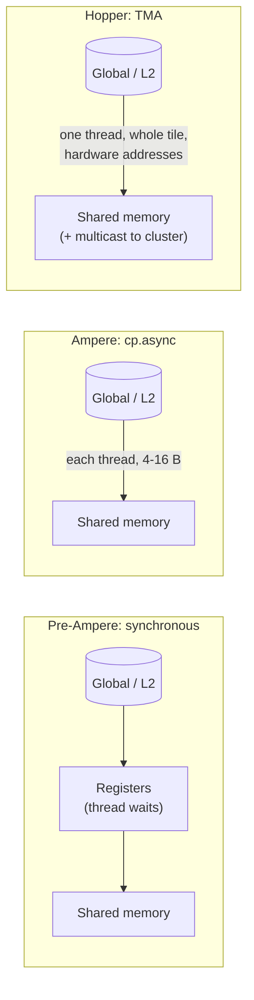
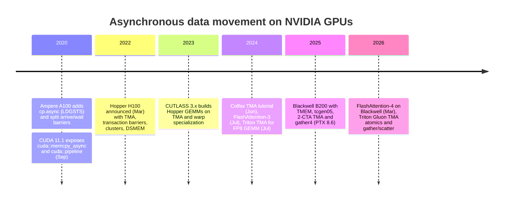
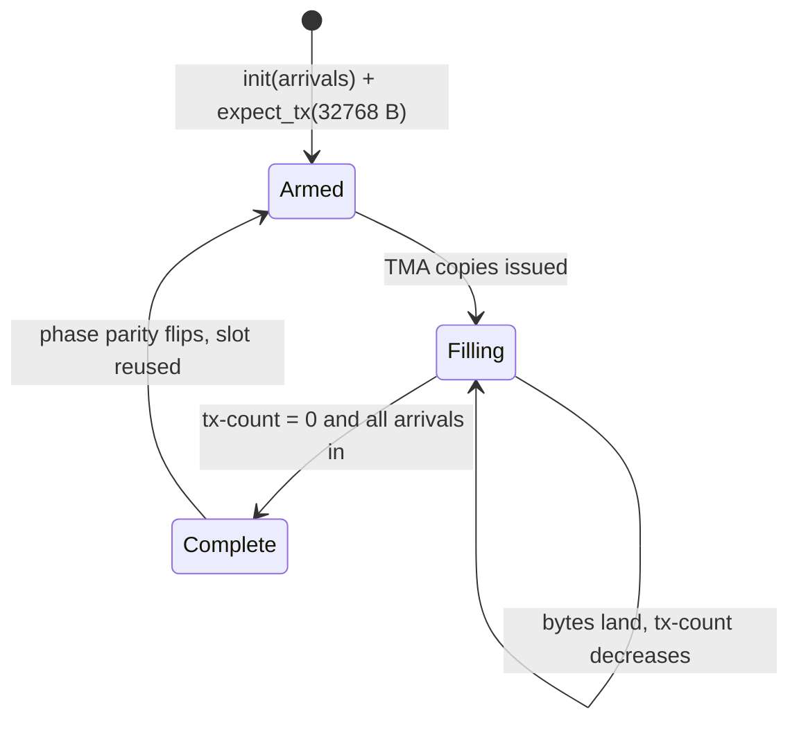
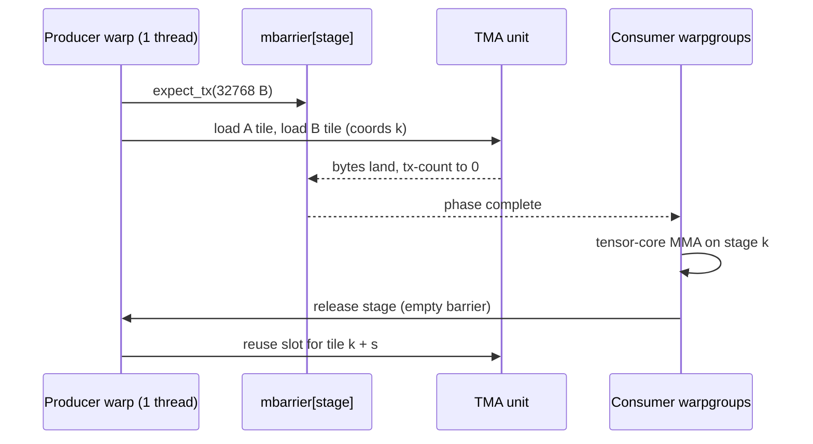

---
tags:
  - gpu-programming
  - hardware
  - memory
  - hopper
  - blackwell
  - tma
status: complete
sources:
  - https://developer.nvidia.com/blog/controlling-data-movement-to-boost-performance-on-ampere-architecture/
  - https://images.nvidia.com/aem-dam/en-zz/Solutions/data-center/nvidia-ampere-architecture-whitepaper.pdf
  - https://docs.nvidia.com/cuda/archive/13.2.2/ampere-tuning-guide/index.html
  - https://docs.nvidia.com/cuda/cuda-programming-guide/04-special-topics/async-copies.html
  - https://docs.nvidia.com/cuda/cuda-programming-guide/04-special-topics/async-barriers.html
  - https://docs.nvidia.com/cuda/cuda-programming-guide/04-special-topics/pipelines.html
  - https://docs.nvidia.com/cuda/cuda-driver-api/group__CUDA__TENSOR__MEMORY.html
  - https://docs.nvidia.com/cuda/cuda-driver-api/structCUtensorMap.html
  - https://developer.nvidia.com/blog/nvidia-hopper-architecture-in-depth/
  - https://www.nvidia.com/en-us/data-center/h100/
  - https://research.colfax-intl.com/tutorial-hopper-tma/
  - https://research.colfax-intl.com/cutlass-tutorial-writing-gemm-kernels-using-tensor-memory-for-nvidia-blackwell-gpus/
  - https://research.colfax-intl.com/cutlass-tutorial-gemm-with-thread-block-clusters-on-nvidia-blackwell-gpus/
  - https://nvidia.github.io/cccl/libcudacxx/ptx/instructions/cp_async_bulk_tensor.html
  - https://nvidia.github.io/cccl/unstable/libcudacxx/ptx/instructions/mbarrier_expect_tx.html
  - https://nvidia.github.io/cccl/unstable/libcudacxx/ptx/instructions/cp_async_bulk_prefetch_tensor.html
  - https://docs.nvidia.com/cuda/blackwell-tuning-guide
  - https://docs.nvidia.com/cuda/cuda-programming-guide/05-appendices/compute-capabilities.html
  - https://arxiv.org/html/2407.08608v2
  - https://arxiv.org/abs/2603.05451v1
  - https://pytorch.org/blog/hopper-tma-unit/
  - https://triton-lang.org/main/python-api/generated/triton.language.make_tensor_descriptor.html
  - https://triton-lang.org/main/gluon/api/generated/triton.experimental.gluon.language.nvidia.rubin.tma.html
  - https://hazyresearch.stanford.edu/blog/2024-05-12-tk
  - https://newsletter.semianalysis.com/p/dissecting-nvidia-blackwell-tensor
created: 2026-11-26
updated: 2026-11-26
---

## Table Of Contents

---

- [[#TL;DR|TL;DR]]
- [[#The Problem|The Problem]]
    - [[#How Much Data Must Be in Flight|How Much Data Must Be in Flight]]
- [[#Foundations|Foundations]]
    - [[#Three Ways to Fill Shared Memory|Three Ways to Fill Shared Memory]]
    - [[#Multi-Stage Pipelines|Multi-Stage Pipelines]]
- [[#How We Got Here|How We Got Here]]
- [[#How It Works|How It Works]]
    - [[#Ampere - cp.async (LDGSTS)|Ampere: cp.async (LDGSTS)]]
    - [[#Hopper - the Tensor Memory Accelerator|Hopper: the Tensor Memory Accelerator]]
    - [[#Tensor Maps|Tensor Maps]]
    - [[#Transaction Barriers|Transaction Barriers]]
    - [[#A TMA Load in Code|A TMA Load in Code]]
    - [[#Stores, Reductions, Multicast and Prefetch|Stores, Reductions, Multicast and Prefetch]]
    - [[#Warp Specialization on Top of TMA|Warp Specialization on Top of TMA]]
    - [[#Blackwell|Blackwell]]
- [[#Where It Is Now|Where It Is Now]]
- [[#Trade-offs & Open Problems|Trade-offs & Open Problems]]
- [[#Resources|Resources]]
- [[#Related Notes|Related Notes]]

## ***TL;DR***
---
*Asynchronous copies let a GPU kernel move data from global memory into shared memory without routing it through registers and without the issuing threads waiting for it. Ampere added per-thread async copies (`cp.async`); Hopper added the Tensor Memory Accelerator (TMA), a hardware unit that copies whole multi-dimensional tiles on one thread's request.*

- **The problem:** a normal load goes HBM → registers → shared memory, so every byte in flight occupies a register and the loading threads stall until it arrives. Fast kernels need tens of kilobytes in flight per SM, which eats registers and occupancy.
- **Ampere (2020):** `cp.async` / LDGSTS copies 4, 8 or 16 bytes per thread straight into shared memory, asynchronously; threads batch copies into groups and wait on them later ([NVIDIA, 2020](https://developer.nvidia.com/blog/controlling-data-movement-to-boost-performance-on-ampere-architecture/)).
- **Hopper (2022):** the TMA copies a 1D–5D tile described by a **tensor map**. "A single thread creates a copy descriptor before launching the TMA, and from then on address generation and data movement are handled in hardware" ([Hopper In-Depth](https://developer.nvidia.com/blog/nvidia-hopper-architecture-in-depth/)). Completion is tracked by an **mbarrier** that counts bytes. TMA can also store, reduce-add, prefetch into L2 and **multicast** one load to several blocks in a cluster.
- **Why it matters:** TMA frees the other warps entirely, which enables **warp specialization**: a producer warp issues TMA loads while consumer warpgroups run [[Tensor Cores|tensor-core]] math. FlashAttention-3 and -4, CUTLASS 3.x/4.x and Triton's tensor descriptors are all built on it.
- **Where it is now (Nov 2026):** Blackwell extends TMA with 2-CTA pairs, gather4/scatter4 and wider im2col modes, feeding the new tensor memory (TMEM). The costs are strict alignment, non-portable arch-specific features and hard-to-debug barrier hangs.

## ***The Problem***
---
*HBM is far away. To keep it busy, a kernel must have many bytes requested before earlier ones arrive, and with ordinary loads every one of those bytes has to sit in a register.*

Before Ampere, filling shared memory took two steps: load from global memory into registers, then store from registers into shared memory, which NVIDIA describes as "a long journey through the memory hierarchy" ([NVIDIA, 2020](https://developer.nvidia.com/blog/controlling-data-movement-to-boost-performance-on-ampere-architecture/)). Three costs follow:

- **Registers.** A loaded value lives in a register until it is stored, so latency hiding costs registers, and registers limit [[Occupancy and Latency Hiding|occupancy]].
- **Instructions.** Threads must compute every address and issue every load and store. ThunderKittens' authors found address generation "takes a substantial fraction of the resources of the chip" in an H100 attention kernel ([Hazy Research, 2024](https://hazyresearch.stanford.edu/blog/2024-05-12-tk)).
- **Stalls.** The threads that load are the threads that compute, so overlap only comes from switching between warps.



### How Much Data Must Be in Flight

Little's law says the bytes in flight must equal bandwidth times latency. For an H100 SXM at 3.35 TB/s ([NVIDIA](https://www.nvidia.com/en-us/data-center/h100/)) and an assumed load latency of about 600 ns (an illustrative round figure; real latency varies with load and level of the hierarchy):

$$
\text{bytes in flight} = 3.35 \times 10^{12}\ \tfrac{\text{B}}{\text{s}} \times 600 \times 10^{-9}\ \text{s} \approx 2.0\ \text{MB}
$$

Spread over 132 SMs, that is about **15 KB per SM** in flight at all times. Held in 4-byte registers, 15 KB is about 3,800 registers doing nothing but waiting, on top of whatever the computation needs. Async copies move that waiting data out of the register file and into shared memory, where it was going anyway.

## ***Foundations***
---
*An async copy is a request that completes later, so every async-copy API comes with two halves: a way to issue copies and a way to wait for them. Pipelining several outstanding tiles is what turns that into speed.*

### Three Ways to Fill Shared Memory

| | Synchronous load/store | `cp.async` (LDGSTS) | TMA (`cp.async.bulk.tensor`) |
|---|---|---|---|
| First GPU | All | Ampere, CC 8.0 | Hopper, CC 9.0 |
| Who issues | Every thread | Every thread | One thread per tile |
| Unit of copy | One register | 4, 8 or 16 bytes | 1D bulk range, or a 1D–5D tile |
| Address generation | Threads | Threads | Hardware, from a tensor map |
| Passes through registers | Yes | No | No |
| Completion | Instruction retires | `commit_group` / `wait_group` | mbarrier with byte count (loads), bulk async-group (stores) |
| Extras | — | Optional L1 bypass | Store, reduce, multicast, L2 prefetch, swizzle, out-of-bounds fill |

Sources: [async-copies guide](https://docs.nvidia.com/cuda/cuda-programming-guide/04-special-topics/async-copies.html), [Hopper In-Depth](https://developer.nvidia.com/blog/nvidia-hopper-architecture-in-depth/).

TMA and `cp.async` write shared memory through the "async proxy", a separate path from ordinary loads and stores. That is why TMA code needs explicit proxy fences before an async store reads data that threads just wrote ([async-copies guide](https://docs.nvidia.com/cuda/cuda-programming-guide/04-special-topics/async-copies.html)).

### Multi-Stage Pipelines

With async copies, a kernel keeps a ring of shared-memory buffers. While it computes on tile $t$, the copies for tiles $t+1, \dots, t+s-1$ are already in flight. Two stages is double buffering; more stages hide more latency at the price of more shared memory ([pipelines guide](https://docs.nvidia.com/cuda/cuda-programming-guide/04-special-topics/pipelines.html)).

A worked budget for a [[Tiled Matrix Multiplication (GEMM)|GEMM]] mainloop on H100 with BF16 (2 bytes per element):

| Item | Shape | Bytes |
|---|---|---|
| A tile per stage | 128 × 64 | 16,384 |
| B tile per stage | 64 × 128 | 16,384 |
| One stage | A + B | 32,768 (32 KB) |
| Shared memory per block | H100 maximum | 227 KB |

$$
s_{\max} = \left\lfloor \frac{227\ \text{KB}}{32\ \text{KB}} \right\rfloor = 7\ \text{stages}
$$

In practice a kernel keeps a few stages and leaves room for the epilogue, but even 4 stages put 4 × 32 KB = 128 KB in flight per SM, far above the ~15 KB Little's law asked for. (Hopper allows up to 228 KB of shared memory per SM, of which one block can use 227 KB; see the [Hopper In-Depth blog](https://developer.nvidia.com/blog/nvidia-hopper-architecture-in-depth/) and the [compute-capabilities table](https://docs.nvidia.com/cuda/cuda-programming-guide/05-appendices/compute-capabilities.html).)

## ***How We Got Here***
---
*Each generation took one more job away from the threads: Ampere stopped data passing through registers, Hopper stopped threads computing addresses, and Blackwell stopped warps issuing the math.*



## ***How It Works***
---
*The code differs by generation, but the shape is the same: describe the copy, start it, do something else, and wait on a counter before touching the data.*

### Ampere - cp.async (LDGSTS)

Ampere "adds hardware acceleration for copying data from global memory to shared memory", asynchronous with respect to computation, avoiding "extra registers for memory copies" and optionally bypassing L1 ([Ampere tuning guide](https://docs.nvidia.com/cuda/archive/13.2.2/ampere-tuning-guide/index.html)). The SASS instruction is LDGSTS (see [[PTX and SASS]]).

- **Sizes:** 4, 8 or 16 bytes per thread. 4 and 8 bytes go through L1; 16 bytes can bypass it (`.cg` in PTX, which only allows 16).
- **Alignment:** pointers aligned to the copy size; best when both addresses are 128-byte aligned.
- **Waiting:** copies are grouped. `__pipeline_commit()` closes a batch (PTX `cp.async.commit_group`), and `__pipeline_wait_prior(N)` "waits for all batches except the last N" ([pipelines guide](https://docs.nvidia.com/cuda/cuda-programming-guide/04-special-topics/pipelines.html)).
- **Visibility:** each thread waits only on its own copies, so other threads need a `__syncthreads()` before reading them ([async-copies guide](https://docs.nvidia.com/cuda/cuda-programming-guide/04-special-topics/async-copies.html)).

A double-buffered loop (this note's own illustration, built on the documented primitives):

```cpp
for (int s = 0; s < 2; ++s) {
  __pipeline_memcpy_async(&smem[s][tid*4], &g[(s*T + tid)*4], 16);
  __pipeline_commit();
}
for (int t = 0; t < T; ++t) {
  __pipeline_wait_prior(1);
  __syncthreads();
  compute(smem[t % 2]);
  __syncthreads();
  if (t + 2 < T) __pipeline_memcpy_async(&smem[t % 2][tid*4], &g[((t+2)*T + tid)*4], 16);
  __pipeline_commit();
}
```

- Lines 1-4: the prologue starts copies for tiles 0 and 1. Each thread copies 16 bytes (four floats) straight into shared memory and closes a batch.
- Line 6: wait until every batch except the newest is done, so tile `t` has landed while tile `t+1` may still be in flight.
- Line 7: make other threads' copies visible.
- Line 8: compute on the current buffer.
- Line 9: make sure everyone has finished reading the buffer before it is overwritten.
- Line 10: start the copy for tile `t+2` into the buffer just freed.
- Line 11: commit even when nothing was issued, so the batch count stays uniform and `wait_prior(1)` keeps meaning "all but the newest".

The higher-level `cuda::pipeline` API wraps the same idea in `producer_acquire` / `producer_commit` and `consumer_wait` / `consumer_release` calls ([pipelines guide](https://docs.nvidia.com/cuda/cuda-programming-guide/04-special-topics/pipelines.html)).

### Hopper - the Tensor Memory Accelerator

On A100, "the threads were responsible for generating all addresses." On H100 the TMA does it: one thread hands it a descriptor plus tile coordinates and it moves "large blocks of data and multidimensional tensors" between global and shared memory, for 1D–5D tensors, including into other blocks of a cluster ([Hopper In-Depth](https://developer.nvidia.com/blog/nvidia-hopper-architecture-in-depth/)).

Two kinds of copy exist ([async-copies guide](https://docs.nvidia.com/cuda/cuda-programming-guide/04-special-topics/async-copies.html)):

- **Bulk** (`cp.async.bulk`): a contiguous 1D range, given as a pointer and a size (multiple of 16 bytes). No descriptor needed.
- **Bulk tensor** (`cp.async.bulk.tensor`): a tile of a 1D–5D tensor described by a tensor map.

| Direction | How completion is tracked |
|---|---|
| Global → shared (own block) | mbarrier |
| Global → shared (cluster, optional multicast) | mbarrier |
| Shared (own block) → shared (another block in the cluster) | mbarrier |
| Shared → global | Bulk async-group (commit, then wait) |

### Tensor Maps

A tensor map (`CUtensorMap`) is an opaque 128-byte descriptor built on the host, usually with `cuTensorMapEncodeTiled`, and passed to the kernel as a `const __grid_constant__` parameter ([driver API](https://docs.nvidia.com/cuda/cuda-driver-api/structCUtensorMap.html), [async-copies guide](https://docs.nvidia.com/cuda/cuda-programming-guide/04-special-topics/async-copies.html)). It records the tensor's base address, shape, strides, element type, the **box** (tile) size, the swizzle pattern and what to do out of bounds. Main constraints ([driver API](https://docs.nvidia.com/cuda/cuda-driver-api/group__CUDA__TENSOR__MEMORY.html)):

| Field | Rule |
|---|---|
| Rank | 1 to 5 |
| Global address | 16-byte aligned |
| Global strides | Multiples of 16 bytes, below $2^{40}$ |
| Box size | 1 to 256 per dimension; innermost dimension × element size a multiple of 16 bytes |
| Element strides | 1 to 8 |
| Swizzle | None, 32B, 64B or 128B (newer atom variants exist); inner box dimension ≤ swizzle span |
| L2 promotion | None, 64B, 128B or 256B |
| Out of bounds | Zero fill (or a NaN request mode) |

Worked check for the GEMM tile above: a BF16 A-tile box of 128 × 64 has an inner dimension of 64 × 2 = **128 bytes**. That is a multiple of 16 and exactly the 128B swizzle span, so it is legal with 128-byte swizzling, which spreads each row across shared-memory banks to avoid [[Shared Memory and Bank Conflicts|bank conflicts]] when tensor cores read it. A 128B-swizzled shared buffer should be 1024-byte aligned ([async-copies guide](https://docs.nvidia.com/cuda/cuda-programming-guide/04-special-topics/async-copies.html)). For an FP32 matrix with 1,001 columns, the row stride is 4,004 bytes, not a multiple of 16, so it must be padded to 1,004 columns before TMA can describe it ([Colfax, 2024](https://research.colfax-intl.com/tutorial-hopper-tma/)).

Because out-of-bounds elements are zero-filled, the edge tiles of a matrix need no special masking code.

### Transaction Barriers

Hopper adds an "asynchronous transaction barrier" that counts transactions, which are "essentially a byte count" ([Hopper In-Depth](https://developer.nvidia.com/blog/nvidia-hopper-architecture-in-depth/)). An mbarrier phase completes when both conditions hold ([async-barriers guide](https://docs.nvidia.com/cuda/cuda-programming-guide/04-special-topics/async-barriers.html)):

1. Every expected thread has arrived.
2. The transaction count (tx-count) is back to zero.

The issuing thread tells the barrier how many bytes to expect (`mbarrier.expect_tx`, PTX 8.0, SM_90, [CCCL](https://nvidia.github.io/cccl/unstable/libcudacxx/ptx/instructions/mbarrier_expect_tx.html)); the TMA decrements the count as bytes land. For one pipeline stage of the GEMM example, the producer expects 16,384 + 16,384 = **32,768 bytes**; the phase flips only when all of A and B have arrived. Waiters check the phase's parity bit (0 or 1), so a ring of barriers can be reused stage after stage.



### A TMA Load in Code

Adapted from the CUDA programming guide's TMA example (names from libcu++'s `cuda::device::experimental`, shortened to `cde`); the host builds `tmap` with `cuTensorMapEncodeTiled`:

```cpp
__global__ void kernel(const __grid_constant__ CUtensorMap tmap, int x, int y) {
  __shared__ alignas(128) int tile[64][64];
  __shared__ cuda::barrier<cuda::thread_scope_block> bar;
  if (threadIdx.x == 0) { init(&bar, blockDim.x); cde::fence_proxy_async_shared_cta(); }
  __syncthreads();

  cuda::barrier<cuda::thread_scope_block>::arrival_token token;
  if (threadIdx.x == 0) {
    cde::cp_async_bulk_tensor_2d_global_to_shared(&tile, &tmap, x, y, bar);
    token = cuda::device::barrier_arrive_tx(bar, 1, sizeof(tile));
  } else {
    token = bar.arrive();
  }
  bar.wait(std::move(token));
  // tile[][] is now valid for every thread
}
```

- Line 1: the tensor map arrives as a grid constant, so it lives in parameter space and the TMA can read it.
- Lines 2-3: a 16 KB destination tile (128-byte aligned, as TMA requires) and a block-wide barrier in shared memory.
- Lines 4-5: one thread initializes the barrier for all threads, then fences so the async proxy sees the initialized barrier.
- Line 9: one thread asks the TMA for the 64 × 64 tile whose corner is at `(x, y)`, signalling `bar` on completion.
- Line 10: the same thread arrives and tells the barrier to expect `sizeof(tile)` = 16,384 bytes.
- Line 12: everyone else just arrives.
- Line 14: all threads wait until both the arrivals and the 16,384 bytes are in.

In CuTe the same steps are `make_tma_copy(SM90_TMA_LOAD{}, ...)` on the host, then `set_barrier_transaction_bytes` and `wait_barrier` in the kernel ([Colfax, 2024](https://research.colfax-intl.com/tutorial-hopper-tma/), see [[CUTLASS and CuTe]]). In [[Triton]], `tl.make_tensor_descriptor(base, shape, strides, block_shape)` creates the descriptor inside the kernel (base 16-byte aligned, last dimension contiguous, 2–5D, and a global-memory allocator set with `triton.set_allocator`) and loads through it compile to TMA ([Triton docs](https://triton-lang.org/main/python-api/generated/triton.language.make_tensor_descriptor.html)).

### Stores, Reductions, Multicast and Prefetch

- **Store** (shared → global): threads write the tile into shared memory, fence the async proxy (`tma_store_fence()` in CuTe), and one thread issues the store; completion is tracked with bulk async-groups, so a kernel can wait only until the shared buffer has been *read* before reusing it ([Colfax, 2024](https://research.colfax-intl.com/tutorial-hopper-tma/)).
- **Reduce:** `cp.reduce.async.bulk` adds (or min/max/etc.) a shared tile into global memory atomically, useful for split-K GEMM and gradient accumulation; CuTe exposes it as `SM90_TMA_REDUCE_ADD`.
- **Multicast:** one load lands at the same offset in the shared memory of several blocks in a cluster, chosen by a 16-bit block mask, so tiles shared by neighbouring blocks (like the B tile in a GEMM row) are read from L2 once ([Colfax, 2024](https://research.colfax-intl.com/tutorial-hopper-tma/)). It is an `sm_90a` arch-specific feature, and NVIDIA warns it "may perform significantly worse" on parts other than data-center GPUs ([CCCL](https://nvidia.github.io/cccl/libcudacxx/ptx/instructions/cp_async_bulk_tensor.html), [async-copies guide](https://docs.nvidia.com/cuda/cuda-programming-guide/04-special-topics/async-copies.html)).
- **Prefetch:** `cp.async.bulk.prefetch.tensor` loads a tile into L2 only ([CCCL](https://nvidia.github.io/cccl/unstable/libcudacxx/ptx/instructions/cp_async_bulk_prefetch_tensor.html)). CUTLASS also prefetches the descriptor itself, "which allows pipelining of TMA loads" ([PyTorch, 2024](https://pytorch.org/blog/hopper-tma-unit/)).

### Warp Specialization on Top of TMA

Because one thread can keep the TMA busy, a block can split its warps by job: "Producers elect a leader thread that fires off TMA requests, which are then asynchronously coordinated with the consumer (MMA) warp-groups via an arrival barrier" ([PyTorch, 2024](https://pytorch.org/blog/hopper-tma-unit/)). Producers need few registers, so they give theirs away with `setmaxnreg`, and consumers use the extra for accumulators ([FlashAttention-3](https://arxiv.org/html/2407.08608v2)). See [[Warp Specialization]].



FlashAttention-3 uses this layout on H100: producer warps load Q, K and V with TMA into a circular buffer while consumers run WGMMA. Adding ping-pong scheduling between two consumer warpgroups raised FP16 forward throughput from 570 to 620–640 TFLOPS, and the full kernel reaches up to 740 TFLOPS FP16 (75% utilization) and close to 1.2 PFLOPS in FP8 ([Shah et al., 2024](https://arxiv.org/html/2407.08608v2)). In Triton, TMA alone raised an FP8 GEMM's global-memory throughput from 910 GB/s to 1.45 TB/s ([PyTorch, 2024](https://pytorch.org/blog/hopper-tma-unit/)).

### Blackwell

Data-center Blackwell (CC 10.0) keeps TMA and builds the matrix pipeline around it ([Colfax, Apr 2025](https://research.colfax-intl.com/cutlass-tutorial-writing-gemm-kernels-using-tensor-memory-for-nvidia-blackwell-gpus/), [Colfax, May 2025](https://research.colfax-intl.com/cutlass-tutorial-gemm-with-thread-block-clusters-on-nvidia-blackwell-gpus/)):

- **Tensor memory (TMEM):** 256 KB per SM of accumulator storage (128 lanes × 512 columns of 32-bit cells). The `tcgen05.mma` instruction is issued by a single thread, reads operands from shared memory (A may come from TMEM) and accumulates in TMEM. So on Blackwell both data movement (TMA) and math (tcgen05) are single-thread operations.
- **CTA pairs:** `tcgen05.mma.cta_group::2` runs one MMA across two blocks, each loading half of each operand tile. TMA's `cta_group::2` variant can signal the leader block's mbarrier. A 256 × 256 pair MMA "transfers half the operand data" of two separate 128 × 256 MMAs.
- **New TMA modes (PTX 8.6):** `tile::gather4` loads four arbitrary rows (useful for sparse or MoE indexing) and `tile::scatter4` stores them; `cta_group` and scatter variants are `sm_100a`/`sm_101a` arch-specific ([CCCL](https://nvidia.github.io/cccl/libcudacxx/ptx/instructions/cp_async_bulk_tensor.html)). Wide im2col modes for convolution need CC 10.0 ([driver API](https://docs.nvidia.com/cuda/cuda-driver-api/group__CUDA__TENSOR__MEMORY.html)).
- **Measured on B200:** SemiAnalysis's microbenchmarks found LDGSTS throughput saturates around 6.6 TB/s at 32 KiB in flight, while TMA keeps scaling to 128 KiB in flight but with latency rising sharply past about 12 KiB; explicit multicast eliminated the duplicated L2 traffic ([SemiAnalysis, 2026](https://newsletter.semianalysis.com/p/dissecting-nvidia-blackwell-tensor)).

Consumer Blackwell (CC 12.x) has TMA and clusters but no TMEM ([compute-capabilities table](https://docs.nvidia.com/cuda/cuda-programming-guide/05-appendices/compute-capabilities.html)). NVIDIA's own pages disagree on its shared memory per SM: the Blackwell tuning guide says 128 KB, the compute-capabilities table 100 KB (both give 99 KB per block).

## ***Where It Is Now***
---
*As of November 2026, every fast GEMM and attention kernel on Hopper and Blackwell moves its operands with TMA, and the tools have moved from raw PTX to descriptors in CuTe, CuTe DSL and Triton.*

- **Libraries:** CUTLASS and CuTe wrap TMA as copy atoms (`SM90_TMA_LOAD`, `_MULTICAST`, `_STORE`, `_REDUCE_ADD`) and build warp-specialized Hopper and Blackwell kernels on them ([[CUTLASS and CuTe]]).
- **Attention:** FlashAttention-4 (March 2026, MLSys 2026) targets Blackwell with TMEM and 2-CTA MMA, written in CuTe DSL, and reaches up to 1,613 TFLOPS BF16 on B200, about 71% utilization ([Zadouri et al., 2026](https://arxiv.org/abs/2603.05451v1)).
- **Triton:** tensor descriptors (`tl.make_tensor_descriptor`) are the standard way to get TMA; the lower-level Gluon dialect now has a `nvidia.rubin.tma` module with async gather/scatter, TMA atomics (add, min, max, and, or, xor) and im2col loads ([Gluon docs](https://triton-lang.org/main/gluon/api/generated/triton.experimental.gluon.language.nvidia.rubin.tma.html)).
- **Research DSLs:** ThunderKittens wraps TMA layouts and barriers in tile primitives for H100 and Blackwell ([Hazy Research](https://hazyresearch.stanford.edu/blog/2024-05-12-tk)).

## ***Trade-offs & Open Problems***
---
*TMA trades thread work for setup work and rules: descriptors, alignment, byte counts and fences. Get any of them wrong and the kernel is slower, wrong or hung.*

| Concern | What it costs | Detail |
|---|---|---|
| Descriptor setup | Host encode per tensor shape, or device-side `tensormap.replace` plus fences | Triton additionally needs a global-memory allocator for descriptors |
| Alignment | 16-byte global address and strides, 128-byte shared buffer, 1024-byte for 128B swizzle | `cuda::memcpy_async` silently falls back to synchronous copies when rules fail; raw TMA APIs give undefined behavior |
| Odd shapes | Padding | A row stride that isn't a multiple of 16 bytes can't be described |
| Byte counts | Hangs | `expect_tx` must match the bytes actually delivered, or the barrier never completes |
| Complexity | Phase parity, proxy fences, cluster sync before exit | ThunderKittens' authors call swizzled layouts "flat-out incorrectly documented" |
| Portability | Arch-specific code | Multicast is `sm_90a`; pair, gather and scatter variants are `sm_100a`/`sm_101a`; consumer CC 12.x lacks TMEM |
| Small copies | Latency | For tiny transfers per-thread `cp.async` can match or beat TMA |

Open problems:

- **Choosing tile and stage counts.** Deeper pipelines hide more latency but eat shared memory that the epilogue and occupancy also need; most kernels still pick by autotuning.
- **Irregular access.** TMA is built for dense boxes. Gather4 and scatter4 help with row indexing, but sparse and paged layouts (KV caches, MoE token routing) still need extra work.
- **Programmability.** The tools hide some of the machinery, but correctness still rests on the programmer getting byte counts, barrier phases and fences right, and a mistake usually shows up as a hang, not an error.

## ***Resources***
---
*Start with NVIDIA's async-copies guide page for the rules, then Colfax's TMA tutorial for working CuTe code. FlashAttention-3 shows what the pieces add up to.*

**Official documentation**
- [Asynchronous data copies](https://docs.nvidia.com/cuda/cuda-programming-guide/04-special-topics/async-copies.html): CUDA programming guide. LDGSTS vs TMA, directions, alignment, tensor maps, swizzle.
- [Asynchronous barriers](https://docs.nvidia.com/cuda/cuda-programming-guide/04-special-topics/async-barriers.html) and [Pipelines](https://docs.nvidia.com/cuda/cuda-programming-guide/04-special-topics/pipelines.html): mbarrier phases and tx-count; `cuda::pipeline`.
- [Tensor map driver API](https://docs.nvidia.com/cuda/cuda-driver-api/group__CUDA__TENSOR__MEMORY.html): every `cuTensorMapEncode*` constraint.
- [cp.async.bulk.tensor in CCCL](https://nvidia.github.io/cccl/libcudacxx/ptx/instructions/cp_async_bulk_tensor.html): PTX variants with their PTX versions and SM targets.

**Architecture**
- [Controlling Data Movement to Boost Performance on Ampere](https://developer.nvidia.com/blog/controlling-data-movement-to-boost-performance-on-ampere-architecture/): NVIDIA, Sep 2020. Why async copies exist.
- [NVIDIA Hopper Architecture In-Depth](https://developer.nvidia.com/blog/nvidia-hopper-architecture-in-depth/): NVIDIA, Mar 2022. The original TMA introduction.
- [Dissecting NVIDIA Blackwell](https://newsletter.semianalysis.com/p/dissecting-nvidia-blackwell-tensor): SemiAnalysis, 2026. Microbenchmarks of LDGSTS, TMA and multicast.

**Tutorials and case studies**
- [Mastering the NVIDIA TMA](https://research.colfax-intl.com/tutorial-hopper-tma/): Colfax Research, Jun 2024. Load, store, reduce and multicast in CuTe.
- [Blackwell GEMM with thread block clusters](https://research.colfax-intl.com/cutlass-tutorial-gemm-with-thread-block-clusters-on-nvidia-blackwell-gpus/): Colfax Research, May 2025. 2-CTA MMA and TMA.
- [Deep Dive on the Hopper TMA Unit for FP8 GEMMs](https://pytorch.org/blog/hopper-tma-unit/): PyTorch, Jul 2024. TMA in Triton.
- [FlashAttention-3](https://arxiv.org/html/2407.08608v2): Shah et al., 2024. Warp specialization with TMA and WGMMA.
- [ThunderKittens](https://hazyresearch.stanford.edu/blog/2024-05-12-tk): Hazy Research, May 2024. Why address generation matters.

## Related Notes

- [[GPU Memory Hierarchy]] — The global, L2 and shared-memory levels these copies move between.
- [[Shared Memory and Bank Conflicts]] — Why TMA swizzles tiles as it writes them.
- [[Memory Coalescing]] — The access-pattern rule TMA handles for you on tile loads.
- [[Occupancy and Latency Hiding]] — The register and warp budget async copies relieve.
- [[Tensor Cores]] — The consumers TMA keeps fed.
- [[Warp Specialization]] — The producer/consumer kernel design TMA enables.
- [[Tiled Matrix Multiplication (GEMM)]] — The multi-stage mainloop built on async copies.
- [[CUTLASS and CuTe]] — TMA copy atoms and warp-specialized schedules.
- [[Triton]] — Tensor descriptors and Gluon's TMA module.
- [[PTX and SASS]] — `cp.async`, `cp.async.bulk.tensor`, LDGSTS and UTMALDG.
- [[Blackwell Architecture]] — TMEM, tcgen05 and CTA pairs.
- [[FlashAttention]] — FlashAttention-3 and -4 are built on TMA pipelines.
- [[Kernel Fusion]] — Fused kernels lean on async pipelines to overlap their memory and math.
