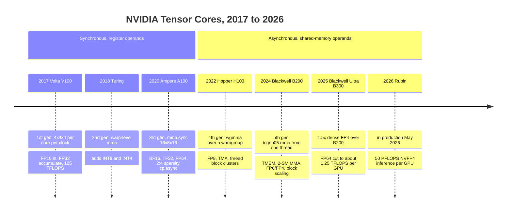
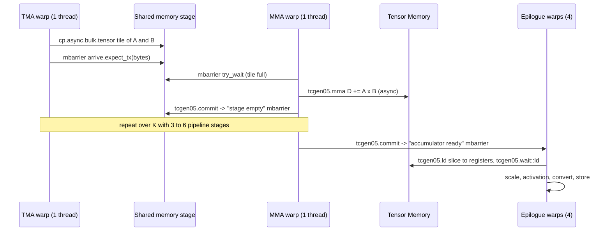

---
tags:
  - gpu-programming
  - hardware
  - tensor-cores
  - matrix-multiply
  - low-precision
status: draft
sources:
  - https://developer.nvidia.com/blog/programming-tensor-cores-cuda-9
  - https://www.nvidia.com/content/dam/en-zz/Solutions/Data-Center/a100/pdf/nvidia-a100-datasheet-nvidia-us-2188504-web.pdf
  - https://www.nvidia.com/en-us/data-center/h100/
  - https://www.nvidia.com/en-us/data-center/hgx/
  - https://newsletter.semianalysis.com/p/nvidia-tensor-core-evolution-from-volta-to-blackwell
  - https://arxiv.org/abs/2512.02189
  - https://mlc.ai/modern-gpu-programming-for-mlsys/chapter_tensor_cores/index.html
  - https://jianyuh.github.io/cuda/2026/04/12/blackwell-sm100.html
  - https://gau-nernst.github.io/tcgen05/
  - https://docs.nvidia.com/cutlass/4.7.0/media/docs/cpp/blackwell_functionality.html
  - https://0xsero.github.io/blackwell-gpu-wiki/blackwell/sm100-vs-sm120/
  - https://arxiv.org/abs/2412.19437
  - https://investor.nvidia.com/news/press-release-details/2026/NVIDIA-Kicks-Off-the-Next-Generation-of-AI-With-Rubin--Six-New-Chips-One-Incredible-AI-Supercomputer/default.aspx
  - https://en.wikipedia.org/wiki/Rubin_(microarchitecture)
  - https://rocm.blogs.amd.com/software-tools-optimization/matrix-cores-cdna/README.html
created: 2026-11-26
updated: 2026-11-26
---

## Table Of Contents

---

- [[#TL;DR|TL;DR]]
- [[#The Problem|The Problem]]
- [[#Foundations|Foundations]]
    - [[#What a Tensor Core Computes|What a Tensor Core Computes]]
    - [[#Why Bigger Tiles Win|Why Bigger Tiles Win]]
    - [[#Precision Formats|Precision Formats]]
- [[#How We Got Here|How We Got Here]]
- [[#How It Works|How It Works]]
    - [[#The Programming Ladder|The Programming Ladder]]
    - [[#WMMA in Twelve Lines|WMMA in Twelve Lines]]
    - [[#Hopper wgmma: Warpgroups and Shared-Memory Operands|Hopper wgmma: Warpgroups and Shared-Memory Operands]]
    - [[#Blackwell tcgen05: One Thread, Tensor Memory|Blackwell tcgen05: One Thread, Tensor Memory]]
    - [[#A Worked Example: Peak FLOPs From First Principles|A Worked Example: Peak FLOPs From First Principles]]
    - [[#Block-Scaled Low Precision|Block-Scaled Low Precision]]
- [[#Where It Is Now|Where It Is Now]]
- [[#Trade-offs & Open Problems|Trade-offs & Open Problems]]
- [[#Resources|Resources]]
- [[#Related Notes|Related Notes]]

## ***TL;DR***
---
*Tensor Cores are dedicated matrix-multiply units inside each streaming multiprocessor. They do a small block of $D = A \times B + C$ per instruction, at many times the rate of the ordinary CUDA cores, and almost every fast deep-learning kernel exists to keep them fed.*

- **What they are:** fixed-function hardware that multiplies two small matrix tiles and adds the result to an accumulator in one instruction. On a V100 (2017), each of 8 Tensor Cores per SM did a $4 \times 4 \times 4$ multiply-accumulate every clock, 64 FMAs, for 125 TFLOPS per GPU, 12x the P100's FP32 rate ([NVIDIA, 2017](https://developer.nvidia.com/blog/programming-tensor-cores-cuda-9)).
- **How they grew:** every generation roughly doubled dense FP16 throughput per SM (1,024 FLOPs/clock on Volta, 2,048 on Ampere, 4,096 on Hopper, 8,192 on Blackwell) and added narrower formats: INT8 (Turing), BF16 and TF32 (Ampere), FP8 (Hopper), FP6 and FP4 with block scaling (Blackwell).
- **What changed in how you program them:** the instruction got bigger and more asynchronous. Volta and Ampere used warp-level, synchronous `mma` on registers. Hopper's `wgmma` spans a 4-warp warpgroup and reads shared memory directly. Blackwell's `tcgen05.mma` is issued by a single thread, reads operands from shared memory and writes results into a new 256 KB per-SM Tensor Memory (TMEM).
- **Why it matters for programmers:** the math is rarely the bottleneck anymore. A kernel that cannot move tiles into shared memory fast enough (see [[TMA and Asynchronous Copies]]) or overlap loads with math (see [[Warp Specialization]]) leaves most of the Tensor Core idle. On a B200, a basic hand-written `tcgen05` GEMM reaches about 250 TFLOPS; the same author's fully pipelined, warp-specialized, persistent version reaches about 1,476, close to cuBLAS's 1,507 ([gau-nernst, Dec 2025](https://gau-nernst.github.io/tcgen05/)).
- **Where it is now (Nov 2026):** Blackwell (B200, B300) is the deployed workhorse, Rubin entered full production in May 2026 and is shipping in racks to the first clouds, rated at 50 PFLOPS NVFP4 (sparse) per GPU ([NVIDIA HGX specs](https://www.nvidia.com/en-us/data-center/hgx/)). FP64 is being cut back on AI parts (B300's FP64 is about 1.25 TFLOPS per GPU) while 4-bit throughput keeps climbing.

## ***The Problem***
---
*Deep learning is mostly matrix multiplication, and a general-purpose ALU spends most of its energy fetching operands and decoding instructions rather than doing arithmetic. A unit that does a whole tile of multiply-adds per instruction cuts that overhead and raises throughput by an order of magnitude.*

A transformer layer's forward pass is dominated by GEMMs (general matrix multiplies): the QKV and output projections, the MLP, and the two matrix multiplies inside [[FlashAttention|attention]]. Training adds two more GEMMs per forward GEMM for the backward pass. If the GEMMs run 10x faster, the model trains nearly 10x faster.

On ordinary CUDA cores, one FMA instruction does one multiply-add per thread. Every one of those instructions has to be fetched, decoded, scheduled, and have its three operands read from the register file. For a tight loop of FMAs, that control and operand traffic costs far more energy than the multiply itself. A Tensor Core instruction amortizes it: one instruction, one register-file read pattern, hundreds to thousands of multiply-adds.

There is a second, deeper reason. For an $M \times N \times K$ matrix multiply:

$$
\text{FLOPs} = 2MNK, \qquad \text{data} \approx (MK + KN + MN) \times \text{bytes per element}
$$

*In plain English: the work grows with the cube of the matrix size, but the data you must move grows only with the square. So the bigger the tile you multiply at once, the more math you get per byte moved.*

Since moving data costs more than computing on it (the "memory wall"), hardware that handles bigger tiles per instruction gets better reuse of each loaded byte ([SemiAnalysis, Jun 2025](https://newsletter.semianalysis.com/p/nvidia-tensor-core-evolution-from-volta-to-blackwell)). That one observation explains most of the design history below.

## ***Foundations***
---
*Three ideas carry this note: a Tensor Core computes a fixed-size tile of $D = AB + C$, bigger tiles reuse data better, and narrower number formats let the same silicon do more multiplies per clock.*

#### **What a Tensor Core Computes**
Every generation computes the same thing:

$$
D = A \times B + C
$$

where $A$ is $M \times K$, $B$ is $K \times N$, and $C$ and $D$ are $M \times N$ accumulators. The hardware fixes the allowed shapes and types. Inputs are usually low precision (FP16, BF16, FP8, FP4); the accumulator is usually FP32. A big GEMM is then a loop of these small tile operations, organized by the techniques in [[Tiled Matrix Multiplication (GEMM)]].

What differs by generation is the instruction's tile size, how many threads cooperate to issue it, and where the operands live.

| | Volta / Turing | Ampere | Hopper | Blackwell (SM100) |
|---|---|---|---|---|
| Instruction (PTX) | `mma` / `wmma` | `mma.sync` | `wgmma.mma_async` | `tcgen05.mma` |
| Who issues | 8-thread quadpair (Volta), warp (Turing) | Warp (32 threads) | Warpgroup (4 warps, 128 threads) | One thread, for the whole CTA or a CTA pair |
| Example shape | 8x8x4 | 16x8x16 | m64nNk16, N from 8 to 256 | M = 64/128 (1 SM) or 128/256 (2 SMs), N up to 256 |
| A operand | Registers | Registers | Registers or shared memory | Shared memory (or TMEM) |
| B operand | Registers | Registers | Shared memory | Shared memory |
| Accumulator | Registers | Registers | Registers | Tensor Memory (TMEM) |
| Synchronous? | Yes | Yes | No (async, wait with fences) | No (async, completion signals an mbarrier) |

Sources: [SemiAnalysis](https://newsletter.semianalysis.com/p/nvidia-tensor-core-evolution-from-volta-to-blackwell), [MLC book](https://mlc.ai/modern-gpu-programming-for-mlsys/chapter_tensor_cores/index.html).

The trend in the bottom rows matters most. Operands moved out of registers and into shared memory, and on Blackwell the accumulator left the register file too. Registers are per-thread and scarce, so freeing them lets one SM keep a much bigger tile in flight.

#### **Why Bigger Tiles Win**
Take one Tensor Core instruction tile of $M \times N \times K$ with 2-byte (FP16) inputs. Its arithmetic intensity, counting only the input operands it must read, is:

$$
I = \frac{2MNK}{2(MK + KN)} = \frac{MNK}{K(M + N)} = \frac{MN}{M + N}
$$

*In plain English: FLOPs per byte of operand read grows with the tile's output size. Square tiles roughly double it each time you double the side.*

| Tile ($M \times N$, any $K$) | FLOPs per operand byte |
|---|---|
| 8 x 8 (Volta-era) | 4 |
| 16 x 8 (Ampere `mma`) | 5.3 |
| 64 x 256 (Hopper `wgmma` max) | 51 |
| 256 x 256 (Blackwell 2-SM `tcgen05`) | 128 |

The catch: a 256x256 instruction tile wastes work when the matrix is small or its dimensions are not a multiple of the tile ("tile quantization"), and a GPU with 148 SMs wastes a whole wave when the number of output tiles is not a multiple of 148 ("wave quantization") ([SemiAnalysis](https://newsletter.semianalysis.com/p/nvidia-tensor-core-evolution-from-volta-to-blackwell)). Big tiles favor big GEMMs. This is part of why small-batch inference rarely sees peak FLOPs.

#### **Precision Formats**
A multiplier's area and energy grow roughly with the square of the mantissa width, so halving the bits roughly doubles throughput in the same silicon. Each generation exposed narrower formats:

| Format | Bits (sign/exponent/mantissa) | Introduced on Tensor Cores | Typical use |
|---|---|---|---|
| FP16 | 1/5/10 | Volta | Mixed-precision training (with loss scaling) |
| INT8, INT4 | integer | Turing | Inference |
| BF16 | 1/8/7 | Ampere | Training without loss scaling (FP32's exponent range) |
| TF32 | 1/8/10 (19 bits used) | Ampere | Drop-in for FP32 matmuls |
| FP64 | 1/11/52 | Ampere | Scientific computing |
| FP8 (E4M3, E5M2) | 1/4/3, 1/5/2 | Hopper | Training and inference |
| FP6 (E2M3, E3M2), FP4 (E2M1) | 6 and 4 bits | Blackwell | Inference, increasingly training |

Narrow formats only work with *scaling*: values are stored relative to a scale factor so they fit the tiny range. Hopper's FP8 used per-tensor scales held in software. Blackwell moved scaling into the hardware with block scaling (see [[#Block-Scaled Low Precision|below]]). See [[Quantization]] for how models use these formats.

## ***How We Got Here***
---
*Tensor Cores were a late addition to Volta, a few months before tape-out. Each later generation doubled per-SM throughput, added narrower formats, and made the instruction bigger and more asynchronous, until the Tensor Core became the thing the rest of the SM is designed around.*



| Generation | Dense FP16 FLOPs per clock per SM | Headline GPU, dense FP16 tensor | What it added | Source |
|---|---|---|---|---|
| Volta (2017) | 1,024 | V100: 125 TFLOPS | Tensor Cores; WMMA API in CUDA 9 | [NVIDIA](https://developer.nvidia.com/blog/programming-tensor-cores-cuda-9) |
| Turing (2018) | (consumer part) | | INT8/INT4; full-warp `mma` | [SemiAnalysis](https://newsletter.semianalysis.com/p/nvidia-tensor-core-evolution-from-volta-to-blackwell) |
| Ampere (2020) | 2,048 | A100: 312 TFLOPS (624 with sparsity) | BF16, TF32 (156 TFLOPS), FP64 tensor (19.5), 2:4 sparsity, `cp.async`, `ldmatrix` | [A100 datasheet](https://www.nvidia.com/content/dam/en-zz/Solutions/Data-Center/a100/pdf/nvidia-a100-datasheet-nvidia-us-2188504-web.pdf) |
| Hopper (2022) | 4,096 | H100 SXM: about 989 TFLOPS (1,979 with sparsity) | FP8 (1,979 dense), async `wgmma`, TMA, clusters | [H100 page](https://www.nvidia.com/en-us/data-center/h100/) |
| Blackwell (2024) | 8,192 | B200: about 2.25 PFLOPS | `tcgen05`, TMEM, 2-SM MMA, FP6/FP4, MX and NV block scaling | [HGX specs](https://www.nvidia.com/en-us/data-center/hgx/), [Jianyu Huang notes](https://jianyuh.github.io/cuda/2026/04/12/blackwell-sm100.html) |
| Rubin (2026) | | About 4 PFLOPS FP16; 35 PFLOPS NVFP4 training | 3rd-gen Transformer Engine with adaptive compression | [HGX specs](https://www.nvidia.com/en-us/data-center/hgx/), [NVIDIA press release](https://investor.nvidia.com/news/press-release-details/2026/NVIDIA-Kicks-Off-the-Next-Generation-of-AI-With-Rubin--Six-New-Chips-One-Incredible-AI-Supercomputer/default.aspx) |

The per-SM figures for Ampere, Hopper and Blackwell are derived here from the spec sheets with the formula in the [[#A Worked Example: Peak FLOPs From First Principles|worked example]]; NVIDIA states Volta's 1,024 directly and SemiAnalysis states Ampere's 2,048.

Two side notes from that history:
- **Sparsity under-delivered.** Ampere introduced [[Sparse Linear Algebra on GPUs|2:4 structured sparsity]] (two of every four weights zero) with a "2x" headline, and NVIDIA's spec sheets still lead with sparse numbers. SemiAnalysis reports that 2:4 sparse GEMMs on Hopper come nowhere near 2x in practice, because pruning hurts accuracy and the kernels are immature. Blackwell added a 4:8 pair-wise variant for NVFP4. Read any "with sparsity" figure as half that for real dense work.
- **The bottleneck kept moving off the Tensor Core.** Ampere added `cp.async` so loads bypass registers. Hopper added the TMA copy engine and asynchronous MMA. Blackwell added TMEM so the accumulator stops occupying registers. Each step exists because the previous generation's Tensor Core sat idle waiting for data.

## ***How It Works***
---
*You reach Tensor Cores through a ladder of abstractions: libraries, then templates and DSLs, then the CUDA WMMA API, then raw PTX instructions. The lower you go, the more of the hardware's asynchrony you control, and the more of the data-movement pipeline you must build yourself.*

#### **The Programming Ladder**

| Level | What you write | Who uses it |
|---|---|---|
| Library call | `cublasGemmEx`, `torch.matmul` | Almost everyone; [[cuBLAS and cuDNN\|cuBLAS]] picks the kernel |
| Template or DSL | [[CUTLASS and CuTe]], [[Triton]], CuTe DSL | Kernel authors fusing custom epilogues or new formats |
| CUDA WMMA API | `nvcuda::wmma` fragments | Teaching; portable but slow on Hopper and Blackwell |
| Inline PTX | `mma.sync`, `wgmma`, `tcgen05.*` | Library and framework kernel teams (see [[PTX and SASS]]) |

Two portability traps sit at the bottom rungs. `wgmma` only exists on the `sm_90a` target (Hopper), and `tcgen05` only on datacenter Blackwell (`sm_100`-class). Consumer and workstation Blackwell (`sm_120`, RTX 50 series) has no `tcgen05` and no TMEM; its FP4 support comes through the warp-level `mma.sync` path instead ([Blackwell GPU wiki](https://0xsero.github.io/blackwell-gpu-wiki/blackwell/sm100-vs-sm120/)). A kernel written for one Tensor Core generation usually has to be rewritten for the next.

#### **WMMA in Twelve Lines**
The CUDA 9 WMMA API is the gentlest entry point. One warp computes one 16x16 output tile ([NVIDIA, 2017](https://developer.nvidia.com/blog/programming-tensor-cores-cuda-9)):

```cpp
#include <mma.h>
using namespace nvcuda;

__global__ void wmma_tile(const half* A, const half* B, float* C, int K) {
    wmma::fragment<wmma::matrix_a, 16, 16, 16, half, wmma::row_major> a;
    wmma::fragment<wmma::matrix_b, 16, 16, 16, half, wmma::col_major> b;
    wmma::fragment<wmma::accumulator, 16, 16, 16, float> acc;
    wmma::fill_fragment(acc, 0.0f);
    for (int k = 0; k < K; k += 16) {
        wmma::load_matrix_sync(a, A + k, K);          // 16x16 slice of A's row block
        wmma::load_matrix_sync(b, B + k, K);          // 16x16 slice of B's column block
        wmma::mma_sync(acc, a, b, acc);               // acc = a * b + acc on Tensor Cores
    }
    wmma::store_matrix_sync(C, acc, 16, wmma::mem_row_major);
}
```

Line by line:
- `#include <mma.h>` and the `nvcuda` namespace bring in the warp matrix API.
- The three `fragment` declarations are opaque per-warp register arrays. Each of the 32 threads holds a slice; you never see which elements a thread owns. `matrix_a` and `matrix_b` hold FP16 inputs, `accumulator` holds FP32 results, and `16, 16, 16` is the $M \times N \times K$ tile.
- `fill_fragment(acc, 0.0f)` zeroes the accumulator in every thread's slice.
- The loop walks the shared $K$ dimension 16 at a time.
- `load_matrix_sync` has all 32 threads cooperatively load a 16x16 tile from memory into fragments. The last argument is the leading dimension (row stride). `_sync` means every thread in the warp must reach it.
- `mma_sync` is the Tensor Core instruction: multiply the two tiles and add into `acc`.
- `store_matrix_sync` writes the 16x16 FP32 result back.

This reads tiles straight from global memory and does nothing to overlap loads with math, so it runs far below peak. Real kernels stage tiles through [[Shared Memory and Bank Conflicts|shared memory]], double-buffer them, and use the PTX instructions below.

#### **Hopper wgmma: Warpgroups and Shared-Memory Operands**
Hopper's `wgmma.mma_async` makes four warps (a 128-thread warpgroup) issue one large MMA together, for shapes $m64 \times nN \times k16$ with $N$ up to 256. $B$ must sit in shared memory, described by a 64-bit *matrix descriptor* (address, stride, swizzle mode); $A$ can come from registers or shared memory; the accumulator lives in the warpgroup's registers ([SemiAnalysis](https://newsletter.semianalysis.com/p/nvidia-tensor-core-evolution-from-volta-to-blackwell)).

The key change is asynchrony. The instruction returns immediately, the warpgroup keeps working, and it later calls `wgmma.commit_group` and `wgmma.wait_group` to wait for results. Meanwhile, the [[TMA and Asynchronous Copies|TMA]] engine fills the next shared-memory tile. That overlap is what lets FlashAttention-3 and Hopper cuBLAS kernels reach 70 to 80% of peak.

Its weakness is that the accumulator still occupies registers. A 128x256 FP32 accumulator tile across a warpgroup costs 256 registers per thread, which is the whole budget, so the tile size is capped by the register file.

#### **Blackwell tcgen05: One Thread, Tensor Memory**
Blackwell's 5th-generation Tensor Core changes three things at once ([MLC book](https://mlc.ai/modern-gpu-programming-for-mlsys/chapter_tensor_cores/index.html), [gau-nernst](https://gau-nernst.github.io/tcgen05/)):

1. **Single-thread issue.** One thread issues `tcgen05.mma` for the whole CTA. The other threads are free to do loads, softmax or the epilogue. This pushes kernels naturally toward [[Warp Specialization]]: one warp issues TMA loads, one warp issues MMAs, and four warps run the epilogue.
2. **Tensor Memory (TMEM).** A dedicated 256 KB per SM, arranged as 128 lanes by 512 columns of 32-bit cells. Accumulators live here, not in registers. Software allocates it explicitly with `tcgen05.alloc` (one full warp, in columns) and must free it with `tcgen05.dealloc` before exit. To read results, a warp calls `tcgen05.ld` to copy a slice of TMEM into registers, and each warp can only reach its own quarter of the lanes, so the epilogue needs at least 4 warps.
3. **CTA pairs.** With `cta_group::2`, two CTAs on two SMs in the same cluster jointly execute one MMA of up to $256 \times 256$. Each SM holds half of the operands, which effectively doubles the shared memory feeding the instruction.

Completion is tracked with mbarriers rather than per-thread waits:



The `tcgen05.mma` operands are given as shared-memory descriptors for $A$ and $B$, a TMEM address for $D$, and an *instruction descriptor* that encodes $M$, $N$, $K$, the data types and the operand layouts. A flag selects $D = AB$ (first $K$ step) or $D = AB + D$ (later steps).

Measured on a B200, `tcgen05.mma` latency stays near 11 cycles regardless of tile size (m64n64k16 to m256n256k16), against 32 to 128 cycles for Hopper `wgmma`, which grows with tile width ([Jarmusch & Chandrasekaran, 2026](https://arxiv.org/abs/2512.02189)). Blackwell got faster by making the datapath wider, not deeper.

The step-by-step optimization ladder on a B200 (M = N = K = 4096, BF16) shows where the performance comes from ([gau-nernst](https://gau-nernst.github.io/tcgen05/)):

| Version | Change | TFLOPS |
|---|---|---|
| v1 | Basic TMA + `tcgen05`, 16-byte swizzle | 255 |
| v2 | 128-byte swizzle (bank-conflict-free loads) | 695 |
| v3 | Multi-stage pipelining | 940 |
| v4 | Warp specialization (TMA / MMA / epilogue warps) | 1,209 |
| v5 | 2-SM MMA | 1,302 |
| v6 | Persistent kernel, static tile scheduling | 1,476 |
| cuBLAS | | 1,507 |

Every step after v1 is about feeding the Tensor Core, not about the Tensor Core itself.

#### **A Worked Example: Peak FLOPs From First Principles**
A GPU's peak tensor throughput is:

$$
\text{Peak FLOPs/s} = \text{SMs} \times \text{FLOPs per clock per SM} \times \text{clock (Hz)}
$$

*In plain English: count the matrix units, multiply by how much each does per tick, multiply by ticks per second.*

| GPU | SMs | Dense FP16 FLOPs/clock/SM | Clock | Peak |
|---|---|---|---|---|
| V100 | 80 | 1,024 | 1.53 GHz | $80 \times 1024 \times 1.53 \times 10^9 \approx 125$ TFLOPS |
| A100 | 108 | 2,048 | 1.41 GHz | $108 \times 2048 \times 1.41 \times 10^9 \approx 312$ TFLOPS |
| H100 SXM | 132 | 4,096 | about 1.83 GHz | $132 \times 4096 \times 1.83 \times 10^9 \approx 989$ TFLOPS |
| B200 | 148 | 8,192 | about 1.86 GHz (implied) | $148 \times 8192 \times 1.86 \times 10^9 \approx 2.25$ PFLOPS |

The B200's 148 SMs come from the [Delaware microbenchmark paper](https://arxiv.org/abs/2512.02189) and its 8,192 FLOPs per clock per SM from [Jianyu Huang's notes](https://jianyuh.github.io/cuda/2026/04/12/blackwell-sm100.html); the clock is what those two numbers imply for NVIDIA's 2.25 PFLOPS.

Now the [[Roofline Model and Arithmetic Intensity|roofline]] consequence. The *ridge point*, the arithmetic intensity a kernel needs before it is compute-bound, is peak FLOPs divided by memory bandwidth:

- A100 SXM: $312 \text{ TFLOPS} / 2.04 \text{ TB/s} \approx 153$ FLOPs per byte.
- H100 SXM: $989 \text{ TFLOPS} / 3.35 \text{ TB/s} \approx 295$ FLOPs per byte.
- B200: $2.25 \text{ PFLOPS} / 8 \text{ TB/s} \approx 281$ FLOPs per byte in FP16, but about 1,125 in dense FP4 (9 PFLOPS).

*In plain English: on an H100, a kernel must do about 300 FP16 operations on every byte it fetches from HBM, or the Tensor Cores wait on memory.* From A100 to H100 the FP16 ridge nearly doubled (153 to 295). Blackwell held the FP16 ridge level by nearly doubling bandwidth, but its narrow formats push the ridge far higher, so low-precision kernels fall on the memory-bound side unless they reuse each byte heavily. That is the pressure behind [[Kernel Fusion]], FP8 and FP4 (fewer bytes per element), and [[FlashAttention]].

#### **Block-Scaled Low Precision**
At 4 bits a number has only a handful of representable values, so one scale per tensor loses too much. Blackwell's Tensor Cores apply a separate scale to each small block of the $K$ dimension inside the instruction ([CUTLASS docs](https://docs.nvidia.com/cutlass/4.7.0/media/docs/cpp/blackwell_functionality.html)):

$$
D = C + (A \cdot SF_A)(B \cdot SF_B)
$$

| Format | Element | Block size (dense) | Scale format | Standard |
|---|---|---|---|---|
| MXFP8 / MXFP6 / MXFP4 | E4M3, E5M2 / E2M3, E3M2 / E2M1 | 32 | UE8M0 (power of two) | OCP Microscaling |
| NVFP4 | E2M1 | 16 | UE4M3 (an 8-bit float) | NVIDIA |

NVFP4's smaller blocks and finer-grained scales track the data more closely, which is why it is the format NVIDIA leads with. The scale factors themselves are copied into TMEM with `tcgen05.cp` and read by the MMA ([MLC book](https://mlc.ai/modern-gpu-programming-for-mlsys/chapter_tensor_cores/index.html)). CUTLASS lists the FP4 kinds at 4x Hopper's per-type throughput and the others at 2x.

Accumulation precision is the hidden catch. DeepSeek found that FP8 GEMM accumulation on H800 Tensor Cores keeps only about 14 bits, giving nearly 2% maximum relative error at $K = 4096$, so DeepSeek-V3 copies partial sums out to FP32 on the CUDA cores every 128 elements (every 4 `wgmma`s) ([DeepSeek-AI, 2024](https://arxiv.org/abs/2412.19437)). Block-scaled Blackwell instructions always accumulate in FP32.

## ***Where It Is Now***
---
*As of November 2026, Blackwell is the volume platform, Rubin is starting to ship, and the frontier has moved from raw Tensor Core speed to the plumbing around it: TMEM, 2-SM instructions, 4-bit formats and Python DSLs that make them programmable.*

**Hardware (Nov 2026)**

| Part | Status | Dense FP16/BF16 per GPU | Dense FP4 per GPU | FP64 per GPU |
|---|---|---|---|---|
| H100 / H200 | Installed base | about 0.99 PFLOPS | n/a (FP8: about 2) | 67 TFLOPS (tensor) |
| B200 | Volume shipping | 2.25 PFLOPS | 9 PFLOPS | 37 TFLOPS |
| B300 (Blackwell Ultra) | Volume shipping | 2.25 PFLOPS | 13.5 PFLOPS | about 1.25 TFLOPS |
| Rubin | In production since May 2026, first racks deployed | 4 PFLOPS | 35 PFLOPS (NVFP4 training), 50 sparse for inference | 33 TFLOPS |
| AMD MI355X (CDNA 4) | Shipping | 2.5 PFLOPS | 10 PFLOPS | 78.6 TFLOPS |

Sources: [NVIDIA HGX specs](https://www.nvidia.com/en-us/data-center/hgx/) (8-GPU figures divided by 8; dense = half the listed sparse figure), [H100 page](https://www.nvidia.com/en-us/data-center/h100/), [Rubin](https://en.wikipedia.org/wiki/Rubin_(microarchitecture)), [AMD ROCm blog](https://rocm.blogs.amd.com/software-tools-optimization/matrix-cores-cdna/README.html).

- **Rubin's rollout.** NVIDIA announced Rubin at CES on Jan 5, 2026 with a 3rd-generation Transformer Engine that adds hardware "adaptive compression" ([press release](https://investor.nvidia.com/news/press-release-details/2026/NVIDIA-Kicks-Off-the-Next-Generation-of-AI-With-Rubin--Six-New-Chips-One-Incredible-AI-Supercomputer/default.aspx)). It entered full production in May 2026; CoreWeave's first Vera Rubin NVL72 racks were operational by September, and Nscale deployed the first rack outside the US in November ([Wikipedia](https://en.wikipedia.org/wiki/Rubin_(microarchitecture))). Public detail on Rubin's Tensor Core instruction set is still thin; expect a `tcgen05`-style model.
- **FP64 is leaving AI chips.** B300 dropped FP64 to about 1.25 TFLOPS per GPU from B200's 37. Rubin restores some (33 TFLOPS), but the direction is clear: datacenter "AI GPUs" spend their area on low-precision Tensor Cores, and scientific computing has to emulate FP64 with lower-precision Tensor Core math or buy different parts.
- **Measured, not marketed.** The University of Delaware microbenchmark study of B200 measured about 1,930 TFLOPS FP16, 3,851 FP8 and up to 7,700 FP4 on `tcgen05`, and found FP8 only 1.27x H200's measured 3,027, well below the spec-sheet ratio ([Jarmusch & Chandrasekaran, 2026](https://arxiv.org/abs/2512.02189)). Its own tables are not fully consistent across shapes, so treat the FP4 number as an upper bound.
- **Hand-written kernels are catching libraries.** Open blog-level `tcgen05` GEMMs now reach about 98% of cuBLAS on large square shapes ([gau-nernst](https://gau-nernst.github.io/tcgen05/)), and [[CUTLASS and CuTe|CuTe DSL]] lets teams write Blackwell kernels in Python; FlashAttention-4 is written that way (see [[FlashAttention]]).
- **AMD's matrix cores.** AMD's equivalent (MFMA, "matrix fused multiply-add") is issued by a 64-thread wavefront through compiler intrinsics like `__builtin_amdgcn_mfma_f32_16x16x16f16`. CDNA 4 (MI355X) added FP6, FP4 and block-scaled MFMA with E8M0 scales ([AMD ROCm blog, Sep 2025](https://rocm.blogs.amd.com/software-tools-optimization/matrix-cores-cdna/README.html)). See [[ROCm and HIP]].

## ***Trade-offs & Open Problems***
---
*Tensor Cores buy enormous throughput by narrowing what the hardware does well: big matrix tiles in low precision. Everything outside that shape (small matrices, irregular sparsity, high precision, non-matmul math) gets relatively slower each generation.*

| Aspect | Gain | Cost |
|---|---|---|
| Bigger instruction tiles | More reuse per byte, higher peak | Tile and wave quantization on small or odd-shaped GEMMs |
| Asynchronous, single-thread issue | Math overlaps loads; registers freed | Kernels need mbarriers, pipelines and warp specialization to work at all |
| TMEM | Accumulators off the register file; bigger tiles | Explicit allocation, a new epilogue path, kernels rewritten per generation |
| Narrow formats (FP8, FP4) | 2x to 4x throughput, fewer bytes moved | Accuracy risk; needs scaling recipes and careful accumulation |
| Structured sparsity | 2x on paper | Rarely realized; accuracy loss from pruning |
| Specialization for AI | Area spent on matmul | FP64 and general FP32 shrink relative to tensor throughput |

Open problems:
- **Amdahl's law at the SM level.** Tensor throughput doubles each generation; exponentials, reductions and shared-memory bandwidth do not. FlashAttention-4 had to compute exponentials in software because the special-function units became the bottleneck. Which non-matmul unit limits Rubin kernels is still being found out.
- **Portability.** WMMA is portable but slow; `wgmma` is Hopper-only; `tcgen05` is SM100-only and absent from consumer Blackwell. Libraries absorb this, but every new format or fused operation pays a per-generation rewrite. DSLs ([[Triton]], CuTe DSL) reduce the cost without removing it.
- **How low can training go?** FP8 training is mainstream, and NVFP4 training is arriving, but the recipes (scaling granularity, which layers stay in BF16, stochastic rounding) are still empirical.
- **Small-batch inference.** Decode GEMMs are skinny (one or a few tokens), far below the tile sizes Tensor Cores want, so they are memory-bound regardless of Tensor Core speed.

## ***Resources***
---
*Start with NVIDIA's CUDA 9 post for the core idea, then SemiAnalysis's generation-by-generation history. For hands-on Blackwell work, gau-nernst's tcgen05 walkthrough and the MLC book chapter are the clearest public material.*

**Primary sources**
- [Programming Tensor Cores in CUDA 9](https://developer.nvidia.com/blog/programming-tensor-cores-cuda-9): Appleyard & Yokim, NVIDIA, Oct 2017. Volta Tensor Cores and the WMMA API.
- [NVIDIA A100 datasheet](https://www.nvidia.com/content/dam/en-zz/Solutions/Data-Center/a100/pdf/nvidia-a100-datasheet-nvidia-us-2188504-web.pdf) and [H100 product page](https://www.nvidia.com/en-us/data-center/h100/): peak tensor figures.
- [NVIDIA HGX platform specs](https://www.nvidia.com/en-us/data-center/hgx/): B200, B300 and Rubin figures (dense is half the listed sparse).
- [CUTLASS Blackwell SM100 GEMMs](https://docs.nvidia.com/cutlass/4.7.0/media/docs/cpp/blackwell_functionality.html): `tcgen05.mma` kinds and block-scaled formats.
- [NVIDIA Rubin announcement](https://investor.nvidia.com/news/press-release-details/2026/NVIDIA-Kicks-Off-the-Next-Generation-of-AI-With-Rubin--Six-New-Chips-One-Incredible-AI-Supercomputer/default.aspx): Jan 5, 2026.

**Papers and analysis**
- [NVIDIA Tensor Core Evolution: From Volta To Blackwell](https://newsletter.semianalysis.com/p/nvidia-tensor-core-evolution-from-volta-to-blackwell): Patel & Chen, SemiAnalysis, Jun 2025 (partly paywalled).
- [Microbenchmarking NVIDIA's Blackwell Architecture](https://arxiv.org/abs/2512.02189): Jarmusch & Chandrasekaran, Dec 2025, rev. Mar 2026.
- [DeepSeek-V3 Technical Report](https://arxiv.org/abs/2412.19437): DeepSeek-AI, Dec 2024. FP8 accumulation precision and the promotion workaround (section 3.3).

**Practitioner walkthroughs**
- [tcgen05 for dummies](https://gau-nernst.github.io/tcgen05/): gau-nernst, Dec 2025. Builds a B200 GEMM from 255 to 1,476 TFLOPS.
- [Modern GPU Programming for MLSys: Blackwell Tensor Core](https://mlc.ai/modern-gpu-programming-for-mlsys/chapter_tensor_cores/index.html): MLC community, 2026.
- [NVIDIA Blackwell SM100: TMEM, TMA, and the New Tensor Core Roofline](https://jianyuh.github.io/cuda/2026/04/12/blackwell-sm100.html): reading notes, Apr 2026.
- [Blackwell GPU wiki: SM100 vs SM120](https://0xsero.github.io/blackwell-gpu-wiki/blackwell/sm100-vs-sm120/): what consumer Blackwell lacks.
- [Matrix Core Programming on AMD CDNA3 and CDNA4](https://rocm.blogs.amd.com/software-tools-optimization/matrix-cores-cdna/README.html): AMD, Sep 2025.

## Related Notes

- [[GPU Architecture Basics]] — Where Tensor Cores sit inside the SM, next to the CUDA cores and warp schedulers.
- [[Tiled Matrix Multiplication (GEMM)]] — How a big GEMM is broken into the tiles Tensor Core instructions consume.
- [[Roofline Model and Arithmetic Intensity]] — Why the rising ridge point pushes kernels toward memory-bound.
- [[Shared Memory and Bank Conflicts]] — The staging buffer that feeds `wgmma` and `tcgen05`, and why swizzling matters.
- [[TMA and Asynchronous Copies]] — The copy engine that keeps Hopper and Blackwell Tensor Cores busy.
- [[Warp Specialization]] — The producer, MMA and epilogue warp split that single-thread `tcgen05` encourages.
- [[CUTLASS and CuTe]] — NVIDIA's templates and Python DSL for Tensor Core kernels.
- [[Triton]] — A compiler that generates Tensor Core code from block-level Python.
- [[PTX and SASS]] — The instruction sets where `mma`, `wgmma` and `tcgen05` live.
- [[Kernel Fusion]] — Keeping data on-chip so the Tensor Cores are not starved.
- [[Blackwell Architecture]] — The rest of the SM100 design around the 5th-generation Tensor Core.
- [[ROCm and HIP]] — AMD's matrix cores and how to program them.
- [[Quantization]] — How models use FP8, MXFP and NVFP4 formats.
- [[FlashAttention]] — A case study in reshaping one algorithm around each Tensor Core generation.
- [[AI Accelerators]] — How other chips (TPUs, Trainium, wafer-scale) approach the same matrix-multiply problem.
- [[Low-Precision Formats - FP8, FP4 and MX|Low-Precision Formats: FP8, FP4 and MX]] — FP8, FP6, FP4 and block-scaled formats the tensor cores consume.
- [[CUDA Tile and cuTile]] — Tile programming that targets tensor cores portably.
