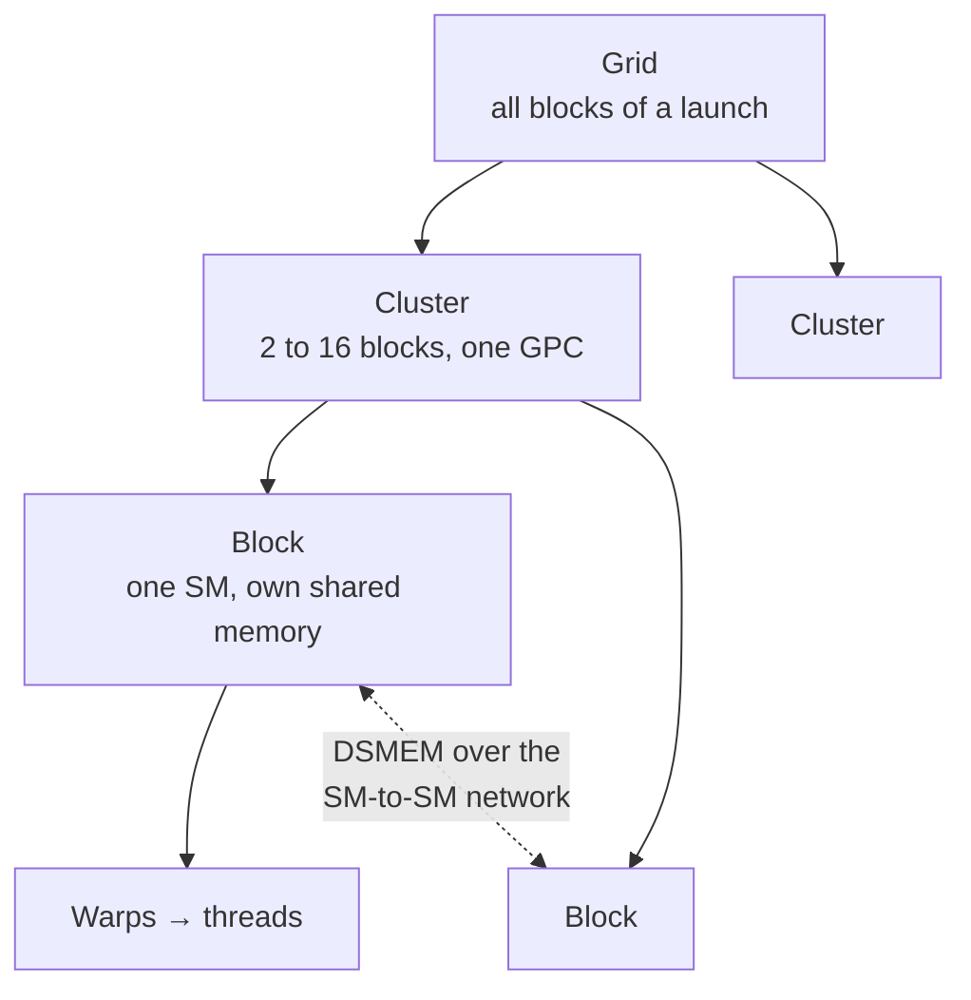
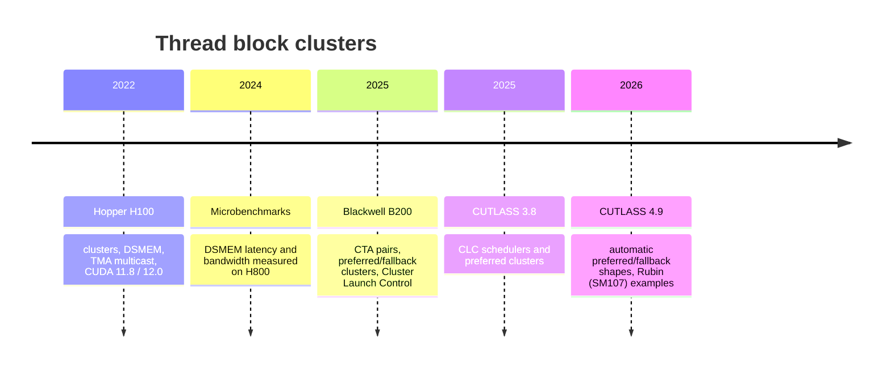
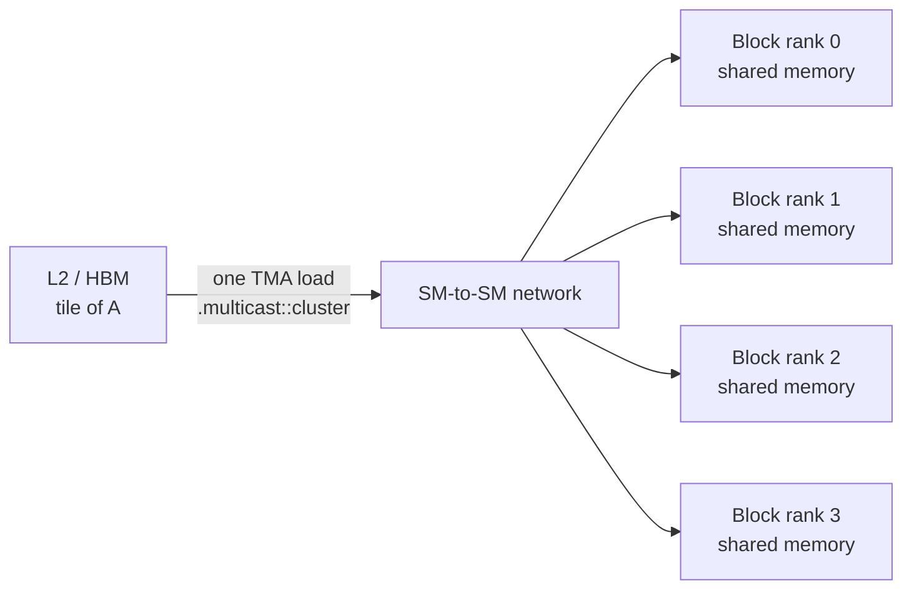
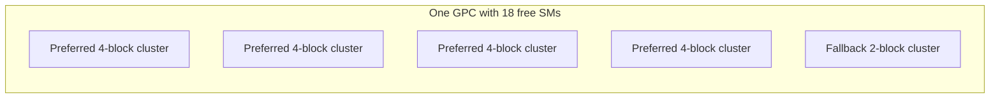

---
aliases:
  - Thread Block Clusters
  - Distributed Shared Memory
  - DSMEM
  - DSM
  - CTA clusters
  - TMA multicast
tags:
  - gpu-programming
  - hardware
  - hopper
  - blackwell
  - clusters
  - shared-memory
status: draft
sources:
  - https://developer.nvidia.com/blog/nvidia-hopper-architecture-in-depth/
  - https://docs.nvidia.com/cuda/hopper-tuning-guide/index.html
  - https://docs.nvidia.com/cuda/blackwell-tuning-guide
  - https://docs.nvidia.com/cuda/cuda-programming-guide/01-introduction/programming-model.html
  - https://docs.nvidia.com/cuda/cuda-programming-guide/02-basics/intro-to-cuda-cpp.html
  - https://docs.nvidia.com/cuda/cuda-programming-guide/02-basics/writing-cuda-kernels.html
  - https://docs.nvidia.com/cuda/cuda-programming-guide/04-special-topics/async-copies.html
  - https://docs.nvidia.com/cuda/cuda-programming-guide/04-special-topics/cluster-launch-control.html
  - https://nvidia.github.io/cccl/unstable/libcudacxx/ptx/instructions/barrier_cluster.html
  - https://nvidia.github.io/cccl/unstable/libcudacxx/ptx/instructions/mapa.html
  - https://github.com/NVIDIA/cutlass/blob/main/include/cute/arch/cluster_sm90.hpp
  - https://github.com/NVIDIA/cutlass/blob/main/include/cutlass/cluster_launch.hpp
  - https://github.com/NVIDIA/cccl/blob/main/docs/libcudacxx/ptx/instructions/generated/cp_async_bulk_tensor_multicast.rst
  - https://github.com/NVIDIA/cutlass/blob/main/examples/73_blackwell_gemm_preferred_cluster/blackwell_gemm_preferred_cluster.cu
  - https://github.com/NVIDIA/cutlass/blob/main/media/docs/cpp/blackwell_functionality.md
  - https://github.com/NVIDIA/cutlass/blob/main/examples/93_blackwell_low_latency_gqa/readme.md
  - https://github.com/NVIDIA/cutlass/blob/main/CHANGELOG.md
  - https://arxiv.org/html/2501.12084v2
  - https://arxiv.org/html/2402.13499v1
  - https://newsletter.semianalysis.com/p/dissecting-nvidia-blackwell-tensor
  - https://arxiv.org/html/2512.02189v3
  - https://forums.developer.nvidia.com/t/implementing-h100-tma-multicast-with-cuda-functions-but-its-slower-than-8-independent-tma-operations-fetching-same-tile-in-cluster/355253
  - https://github.com/deepseek-ai/FlashMLA/blob/main/docs/20250929-hopper-fp8-sparse-deep-dive.md
  - https://github.com/Dao-AILab/flash-attention/blob/main/flash_attn/cute/flash_fwd_sm100.py
  - https://github.com/xinhao-luo/ClusterFusion
  - https://github.com/HazyResearch/ThunderKittens
created: 2026-11-26
updated: 2026-11-26
---

## Table Of Contents

---

- [[#TL;DR|TL;DR]]
- [[#The Problem|The Problem]]
- [[#Foundations|Foundations]]
    - [[#A New Level in the Hierarchy|A New Level in the Hierarchy]]
    - [[#Why Clusters Live in a GPC|Why Clusters Live in a GPC]]
- [[#How We Got Here|How We Got Here]]
- [[#How It Works|How It Works]]
    - [[#Launching a Cluster|Launching a Cluster]]
    - [[#Distributed Shared Memory|Distributed Shared Memory]]
    - [[#Example - A Cluster-Wide Histogram|Example: A Cluster-Wide Histogram]]
    - [[#What It Compiles To|What It Compiles To]]
    - [[#TMA Multicast|TMA Multicast]]
    - [[#Blackwell - CTA Pairs, Preferred Clusters and Launch Control|Blackwell: CTA Pairs, Preferred Clusters and Launch Control]]
    - [[#How Fast Is It|How Fast Is It]]
- [[#Where It Is Now|Where It Is Now]]
- [[#Trade-offs & Open Problems|Trade-offs & Open Problems]]
- [[#Resources|Resources]]
- [[#Related Notes|Related Notes]]

## ***TL;DR***
---
*Since Hopper (2022), CUDA can group thread blocks into a cluster that is guaranteed to run at the same time on neighbouring SMs. Blocks in a cluster can read, write and do atomics on each other's shared memory, and one memory load can fill several blocks' shared memory at once.*

- **What a cluster is:** "a group of thread blocks that are guaranteed to be concurrently scheduled onto a group of SMs", all within one GPC ([NVIDIA, Mar 2022](https://developer.nvidia.com/blog/nvidia-hopper-architecture-in-depth/)). Up to 8 blocks portably, 16 on H100 and B200 by opting in.
- **Distributed shared memory (DSMEM):** "A thread block can read from, write to, and perform atomics in shared memory of other thread blocks within its cluster" ([Hopper Tuning Guide](https://docs.nvidia.com/cuda/hopper-tuning-guide/index.html)), over a dedicated SM-to-SM network. NVIDIA claims about 7x faster exchange than going through global memory.
- **TMA multicast:** one [[TMA and Asynchronous Copies|TMA]] load writes the same tile into the shared memory of several blocks, cutting L2 traffic by the cluster size. This is the main reason fast GEMMs use clusters.
- **Blackwell (2024)** builds on it: CTA pairs run one Tensor Core instruction across two SMs, kernels can name a preferred and a fallback cluster shape, and Cluster Launch Control lets blocks steal work.
- **Where it is now (Nov 2026):** every top GEMM and attention kernel on Hopper and Blackwell uses clusters, and research systems fuse whole transformer layers by reducing through DSMEM. Remote shared memory is still several times slower than local.

## ***The Problem***
---
*Before Hopper, the thread block was the largest group of threads that could cooperate cheaply. Anything bigger had to go through global memory, which is hundreds of cycles away.*

- **Blocks are islands.** Threads in one block share fast on-chip [[Shared Memory and Bank Conflicts|shared memory]] and can `__syncthreads()`. Different blocks can only talk through global memory and L2, and the CUDA model never promised two blocks would even run at the same time (see [[CUDA Programming Model]]).
- **One SM's shared memory is small.** About 228 KB per SM on Hopper and data-center Blackwell. A tile, a histogram or a reduction that needs more must spill to global memory.
- **Duplicate loads waste bandwidth.** In a [[Tiled Matrix Multiplication (GEMM)|tiled GEMM]], blocks computing neighbouring output tiles load the same input tiles. Each copy costs L2 bandwidth, the resource fast kernels most often run out of.
- **Cross-block reductions are slow.** [[Parallel Reduction and Scan|Reductions]] and split-K GEMMs that span blocks write partial results to global memory and re-read them, or need a second kernel.

Clusters fix all four by giving a small group of blocks co-scheduling, shared on-chip memory and a shared load path.

## ***Foundations***
---
*A cluster sits between the block and the grid. It is defined by where it runs (one GPC) more than by what it computes.*

### A New Level in the Hierarchy



| Level | Runs on | Shares | Synchronises with |
|---|---|---|---|
| Thread | a core lane | registers | |
| Warp | an SM sub-partition | registers via shuffles | `__syncwarp()` |
| Block (CTA) | one SM | shared memory | `__syncthreads()` |
| **Cluster** | **SMs of one GPC** | **distributed shared memory** | **`cluster.sync()`** |
| Grid | whole GPU | global memory | kernel boundary or grid sync |

Sources: [CUDA Programming Guide](https://docs.nvidia.com/cuda/cuda-programming-guide/01-introduction/programming-model.html), [Hopper Tuning Guide](https://docs.nvidia.com/cuda/hopper-tuning-guide/index.html). Clusters need compute capability 9.0 or newer; "Thread blocks within a cluster are always adjacent to each other within the grid" (Programming Guide).

### Why Clusters Live in a GPC

- A **GPC** (graphics processing cluster) "is a group of SMs in the hardware hierarchy that are always physically close together" ([NVIDIA](https://developer.nvidia.com/blog/nvidia-hopper-architecture-in-depth/)). A full GH100 has 8 GPCs of 9 TPCs (pairs of SMs), 144 SMs; the H100 SXM ships 132.
- "A dedicated SM-to-SM network for SMs in a GPC provides fast data sharing between threads in a cluster" (same source). That network is why a cluster cannot span GPCs: there is no fast path between them.
- **Size limits follow.** "a maximum of 8 thread blocks in a cluster is supported as a portable cluster size"; larger sizes are architecture-specific and must be queried with `cudaOccupancyMaxPotentialClusterSize`; MIG slices with fewer than 8 SMs get less ([Programming Guide](https://docs.nvidia.com/cuda/cuda-programming-guide/02-basics/intro-to-cuda-cpp.html)). H100 and B200 allow 16 with `cudaFuncAttributeNonPortableClusterSizeAllowed` ([Hopper](https://docs.nvidia.com/cuda/hopper-tuning-guide/index.html) and [Blackwell](https://docs.nvidia.com/cuda/blackwell-tuning-guide) tuning guides).
- **GPCs are uneven.** 132 SMs over 8 GPCs is 16.5 SMs on average, so manufacturing floorsweeping leaves some GPCs smaller than others. SemiAnalysis estimated B200's GPCs at between 8 and 10 TPCs each ([SemiAnalysis, Mar 2026](https://newsletter.semianalysis.com/p/dissecting-nvidia-blackwell-tensor)). A 16-block cluster only fits in a GPC with 16 free SMs.

**Worked example: cluster quantization.** If a GPC has $S$ SMs and each block takes one SM, at most $\lfloor S / c \rfloor$ clusters of size $c$ fit, leaving

$$S_{\text{idle}} = S - c \left\lfloor \frac{S}{c} \right\rfloor$$

*In words: SMs left over after packing as many whole clusters as possible sit idle.* CUTLASS's own example: "a 2x2 cluster on an 18 SM GPU would only utilize 16 SMs, leaving 2 SMs idle" ($18 - 4 \cdot 4 = 2$, about 11%) ([CUTLASS example 73](https://github.com/NVIDIA/cutlass/blob/main/examples/73_blackwell_gemm_preferred_cluster/blackwell_gemm_preferred_cluster.cu)). With $c = 2$ the same GPC wastes nothing. This is the core tension: bigger clusters share more, but fit worse (see [[Occupancy and Latency Hiding]]).

## ***How We Got Here***
---
*Clusters arrived with Hopper as part of a package (TMA, asynchronous transaction barriers, `wgmma`) designed to keep Tensor Cores fed. Blackwell made them central to its Tensor Core instruction.*



- **Hopper (announced Mar 2022)** introduced clusters, DSMEM, TMA and the asynchronous transaction barrier together ([NVIDIA](https://developer.nvidia.com/blog/nvidia-hopper-architecture-in-depth/)). The non-portable size attribute "was added in CUDA 11.8" ([CUTLASS source](https://github.com/NVIDIA/cutlass/blob/main/include/cutlass/cluster_launch.hpp)).
- **Measurement (2024 to 2025).** Luo et al. dissected DSMEM on an H800, finding remote access about 6x faster than a global-memory round trip, close to NVIDIA's 7x claim ([arXiv 2501.12084](https://arxiv.org/html/2501.12084v2)).
- **Blackwell (2024 to 2025)** added cluster-aware Tensor Core instructions (CTA pairs), two-shape cluster launches and Cluster Launch Control; CUTLASS 3.8 (Jan 2025) shipped the first kernels using them ([CUTLASS changelog](https://github.com/NVIDIA/cutlass/blob/main/CHANGELOG.md)).

## ***How It Works***
---
*Using clusters takes three things: a launch that asks for them, a way to address another block's shared memory, and barriers that make sure the other block is there.*

### Launching a Cluster

Compile-time shape, from the Programming Guide:

```cpp
__global__ void __cluster_dims__(2, 1, 1) cluster_kernel(float* in, float* out) { /* ... */ }  // 1
cluster_kernel<<<numBlocks, threadsPerBlock>>>(in, out);                                      // 2
```

1. `__cluster_dims__(2,1,1)` fixes clusters of 2 blocks along x. The size "cannot be changed at launch".
2. An ordinary launch. `numBlocks` still counts *blocks*, not clusters, and must be a multiple of the cluster size.

Runtime shape, with the extensible launch API:

```cpp
cudaLaunchConfig_t config = {0};                                   // 1
config.gridDim = numBlocks;  config.blockDim = threadsPerBlock;    // 2
cudaLaunchAttribute attr[1];                                       // 3
attr[0].id = cudaLaunchAttributeClusterDimension;                  // 4
attr[0].val.clusterDim.x = 4;                                      // 5
attr[0].val.clusterDim.y = 1;  attr[0].val.clusterDim.z = 1;
config.attrs = attr;  config.numAttrs = 1;                         // 6
cudaLaunchKernelEx(&config, my_kernel, arg0, arg1);                // 7
```

1. A launch configuration, zero-initialised.
2. Grid and block sizes, as with `<<< >>>`.
3. A list of launch attributes.
4. The attribute that sets the cluster shape.
5. Clusters of 4 blocks along x.
6. Attach the attribute list.
7. Launch. Use `cudaOccupancyMaxActiveClusters` first: "Using larger cluster sizes may reduce the maximum number of active blocks across the GPU" ([Hopper Tuning Guide](https://docs.nvidia.com/cuda/hopper-tuning-guide/index.html)).

Sources: [Programming Guide 2.1.10](https://docs.nvidia.com/cuda/cuda-programming-guide/02-basics/intro-to-cuda-cpp.html), [writing kernels](https://docs.nvidia.com/cuda/cuda-programming-guide/02-basics/writing-cuda-kernels.html).

### Distributed Shared Memory

- The "shared memory virtual address space is logically distributed across all the blocks in the cluster" ([NVIDIA](https://developer.nvidia.com/blog/nvidia-hopper-architecture-in-depth/)). A block gets a pointer into a peer's shared memory and uses it with normal loads, stores and atomics.
- Peers are named by **rank** within the cluster, not by `blockIdx`. In [[Cooperative Groups]], `cg::this_cluster()` gives a `cluster_group` with `block_rank()`, `map_shared_rank(ptr, rank)` and `sync()`.
- **Lifetime rule.** "Accessing data in distributed shared memory requires all the thread blocks to exist." Call `cluster.sync()` before the first remote access (so every block has started) and again before exiting (so no block leaves while others still read its memory) ([Programming Guide 2.3.3.8](https://docs.nvidia.com/cuda/cuda-programming-guide/02-basics/writing-cuda-kernels.html)).
- DSMEM and L2 can be used at the same time, so a kernel can draw on "the combined bandwidth of both" ([Hopper Tuning Guide](https://docs.nvidia.com/cuda/hopper-tuning-guide/index.html)).

**Worked example: how big is distributed shared memory?** Total DSMEM is just the sum of the members' shared memory:

$$M_{\text{DSMEM}} = c \times M_{\text{block}}$$

*In words: a cluster of $c$ blocks can see $c$ times one block's shared memory.* On H100 or B200 with 227 KB per block: $8 \times 227 \approx 1.8$ MB portably, or $16 \times 227 \approx 3.6$ MB with the non-portable size. A 1 MB histogram (256K 4-byte bins) does not fit in one block but fits in a cluster of 8. On GeForce Blackwell, with about 99 KB per block ([arXiv 2507.10789](https://arxiv.org/html/2507.10789v2)), the same cluster has well under half as much.

### Example - A Cluster-Wide Histogram

*Adapted from the CUDA Programming Guide's DSMEM example: each block owns a slice of the bins, and every block adds into whichever block owns the bin.*

```cpp
namespace cg = cooperative_groups;
__global__ void clusterHist(int* bins, int nbins, int bins_per_block,
                            const int* in, size_t n) {
  extern __shared__ int smem[];                                          // 1
  cg::cluster_group cluster = cg::this_cluster();                        // 2
  for (int i = threadIdx.x; i < bins_per_block; i += blockDim.x) smem[i] = 0;
  cluster.sync();                                                        // 3
  for (size_t i = cg::this_grid().thread_rank(); i < n; i += blockDim.x * gridDim.x) {
    int b = min(max(in[i], 0), nbins - 1);                               // 4
    int* dst = cluster.map_shared_rank(smem, b / bins_per_block);        // 5
    atomicAdd(dst + b % bins_per_block, 1);                              // 6
  }
  cluster.sync();                                                        // 7
  int* out = bins + cluster.block_rank() * bins_per_block;               // 8
  for (int i = threadIdx.x; i < bins_per_block; i += blockDim.x) atomicAdd(&out[i], smem[i]);
}
```

1. This block's slice of the histogram, in its own shared memory.
2. A handle to the cluster this block belongs to.
3. Wait until every block has zeroed its slice and is running, so remote writes are safe.
4. Clamp the value into a valid bin.
5. Get a pointer to the shared memory of the block whose rank owns bin `b`. This compiles to the PTX `mapa` instruction.
6. Atomically count into that block's shared memory, local or remote.
7. Wait until all remote atomics are done before anyone reads or exits.
8. Each block adds its finished slice into the global histogram, at its rank's offset.

Source: [Programming Guide 2.3.3.8](https://docs.nvidia.com/cuda/cuda-programming-guide/02-basics/writing-cuda-kernels.html); launched with `cudaLaunchKernelEx` as above and `bins_per_block * sizeof(int)` bytes of dynamic shared memory. Luo et al. found this pattern gave "over 30% performance improvement" at block size 512, with throughput falling for clusters bigger than 2 to 4 ([arXiv 2501.12084](https://arxiv.org/html/2501.12084v2)).

### What It Compiles To

| PTX | What it does |
|---|---|
| `%cluster_ctarank`, `%cluster_ctaid`, `%clusterid` | Special registers: this block's rank and position |
| `mapa.shared::cluster` | Map a local shared address to the same offset in the block of a given rank |
| `ld/st/atom ... .shared::cluster` | Access the cluster-wide shared window |
| `barrier.cluster.arrive` / `.wait` | Split cluster barrier: arrive, do other work, then wait |
| `st.async ... mbarrier::complete_tx::bytes` | Store into a peer's shared memory and signal the *peer's* barrier |
| `getctarank` | Which rank owns a given cluster address |

Sources: [CuTe `cluster_sm90.hpp`](https://github.com/NVIDIA/cutlass/blob/main/include/cute/arch/cluster_sm90.hpp), [CCCL PTX docs](https://nvidia.github.io/cccl/unstable/libcudacxx/ptx/instructions/barrier_cluster.html). The split barrier matters: a block can arrive, keep computing, and only wait when it actually needs its peers. libcu++ does not wrap `mapa`; it is reached through the [[Cooperative Groups]] API or inline PTX ([CCCL](https://nvidia.github.io/cccl/unstable/libcudacxx/ptx/instructions/mapa.html); see [[PTX and SASS]]).

### TMA Multicast

*In a GEMM, blocks in the same row of output tiles all need the same tile of A. Multicast loads it from L2 once and delivers it to all of them.*



- The PTX form `cp.async.bulk.tensor ... .multicast::cluster` takes a 16-bit `ctaMask` of destination ranks; data lands at the same offset in each, and the barrier signal "is also multicast" ([CCCL docs](https://github.com/NVIDIA/cccl/blob/main/docs/libcudacxx/ptx/instructions/generated/cp_async_bulk_tensor_multicast.rst); [NVIDIA forum](https://forums.developer.nvidia.com/t/implementing-h100-tma-multicast-with-cuda-functions-but-its-slower-than-8-independent-tma-operations-fetching-same-tile-in-cluster/355253)). On Hopper it is an `sm_90a` feature, not portable `sm_90`.
- The Programming Guide notes "The multicast feature is optimized for global memory accesses to the current device" ([async copies](https://docs.nvidia.com/cuda/cuda-programming-guide/04-special-topics/async-copies.html)).

**Worked example: L2 traffic.** If $c$ blocks need the same tile of $T$ bytes:

$$\text{L2 bytes} = \begin{cases} c \cdot T & \text{without multicast} \\ T & \text{with multicast} \end{cases} \qquad \frac{\text{L2 bytes}}{\text{shared bytes}} = \frac{1}{c}$$

*In words: multicast reads the tile once instead of once per block.* For a 128x64 BF16 tile (16 KB) shared by a 2x1 cluster, L2 reads drop from 32 KB to 16 KB per step. SemiAnalysis measured exactly this "ideal "1 / cluster_size" L2 bytes per SMEM byte" on B200 ([SemiAnalysis](https://newsletter.semianalysis.com/p/dissecting-nvidia-blackwell-tensor)).

**It is not automatically faster.** On an NVIDIA forum thread, one H100 user saw multicast run slower than eight independent loads; a reply measured about 38 bytes/cycle/SM without multicast and about 70 with 4-way multicast, then no further gain at 8-way, "limited by intra-GPC bandwidth instead" (community measurements, [forum](https://forums.developer.nvidia.com/t/implementing-h100-tma-multicast-with-cuda-functions-but-its-slower-than-8-independent-tma-operations-fetching-same-tile-in-cluster/355253)). Multicast saves L2 bandwidth; it does not raise the issue rate of a single producer.

### Blackwell - CTA Pairs, Preferred Clusters and Launch Control

- **CTA pairs.** `tcgen05.mma.cta_group::2` runs one Tensor Core instruction across two blocks on two SMs, so a pair computes a 256-row tile ([CUTLASS Blackwell docs](https://github.com/NVIDIA/cutlass/blob/main/media/docs/cpp/blackwell_functionality.md); see [[Tensor Cores]]). The pair maps to a TPC and "leverages a dedicated intra-TPC communication network" ([arXiv 2512.02189](https://arxiv.org/html/2512.02189v3)). CUTLASS's 2-SM kernels need a cluster shape whose first mode "should be a multiple of 2". SemiAnalysis measured "perfect weak scaling ... reaching 2x" over the 1-SM form.
- **Preferred and fallback clusters.** "Starting with Compute Capability 10.0, the CUDA programming model adds the ability to specify two clusters: preferred cluster and fallback cluster" ([CUTLASS example 73](https://github.com/NVIDIA/cutlass/blob/main/examples/73_blackwell_gemm_preferred_cluster/blackwell_gemm_preferred_cluster.cu)). The hardware places big clusters where they fit and fills leftover SMs with small ones; "the fallback cluster should be size 2 or size 1" to fill the GPU ([SemiAnalysis](https://newsletter.semianalysis.com/p/dissecting-nvidia-blackwell-tensor)). The fallback shape "must evenly divide the preferred cluster shape". This directly attacks the quantization problem above.
- **Cluster Launch Control (CLC).** A block "attempts to cancel the launch of another thread block that has not started executing yet" and does its work instead; with clusters, the result is multicast to every block, and "Cancelling in the cluster case requires all the thread blocks to exist" ([Programming Guide 4.14](https://docs.nvidia.com/cuda/cuda-programming-guide/04-special-topics/cluster-launch-control.html)). The scheduling side is covered in [[Persistent Kernels and Stream-K]].



*With only a 4-block shape, 2 of the 18 SMs would stay idle; a 2-block fallback uses them.*

### How Fast Is It

| Measurement (H800, Luo et al.) | Value |
|---|---|
| Local shared memory latency | 29 cycles |
| Local access through the cluster window | 33 cycles |
| Remote block, cluster size 2 | 181 cycles, "a 30% reduction compared to L2 cache" |
| Remote, cluster sizes 2 to 16 | 184 to 213 cycles |
| Global memory store + load round trip | 1,110 cycles (DSMEM about 6.1x faster) |
| Aggregate DSMEM throughput | about 3.28 TB/s at cluster size 2, 2.78 TB/s at size 4 |

Source: [arXiv 2501.12084](https://arxiv.org/html/2501.12084v2). "DSM does not achieve the original shared memory bandwidth", and throughput falls as more blocks contend for the SM-to-SM network. On B200, SemiAnalysis likewise found DSMEM reads have "significantly lower throughput than SMEM's 128 bytes per clock cycle", that bulk copies (`cp.async.bulk`) move DSMEM data faster than individual loads, and that `ld.shared::cluster` on a *local* address is slower than plain `ld.shared` ([SemiAnalysis](https://newsletter.semianalysis.com/p/dissecting-nvidia-blackwell-tensor)). Rule of thumb: use DSMEM to exchange data a few times, in bulk; keep the hot loop in local shared memory.

## ***Where It Is Now***
---
*As of November 2026, clusters are a standard tool in production GEMM and attention kernels, a building block for fusing whole layers, and still growing in Rubin.*

- **GEMM.** CUTLASS kernels on Hopper take a static `ClusterShape` for multicast; Blackwell kernels add 2-SM MMA, runtime cluster shapes and preferred/fallback launches. CUTLASS 4.9.0 (Nov 13, 2026) made CuTe DSL launch preferred/fallback shapes automatically "without DSL code duplication" across Blackwell and Rubin examples ([changelog](https://github.com/NVIDIA/cutlass/blob/main/CHANGELOG.md)).
- **Attention.** [[FlashAttention]]-4's Blackwell forward pass uses a 2-block cluster for the 2-CTA MMA and CLC scheduling ([source](https://github.com/Dao-AILab/flash-attention/blob/main/flash_attn/cute/flash_fwd_sm100.py)). DeepSeek's FlashMLA FP8 sparse decoder on Hopper had each block of a 2-block cluster dequantize half of K/V and `st.async` it into its partner's shared memory, reaching 410 versus 250 TFLOPS without the exchange on H800 ([FlashMLA blog, Sep 2025](https://github.com/deepseek-ai/FlashMLA/blob/main/docs/20250929-hopper-fp8-sparse-deep-dive.md)).
- **Decode-time reductions.** CUTLASS example 93 (Feb 2026) does flash decoding "with cluster reduction": the splits of one KV head form a cluster and combine partial softmax results through DSMEM instead of a second kernel ([CUTLASS](https://github.com/NVIDIA/cutlass/blob/main/examples/93_blackwell_low_latency_gqa/readme.md)). See [[LLM Serving]].
- **Whole-layer fusion.** ClusterFusion (NeurIPS 2025) adds cluster-level collectives such as `cluster_reduce` to fuse a decoder layer's QKV projection, attention and output projection into one kernel through DSMEM ([repo](https://github.com/xinhao-luo/ClusterFusion)); it is part of the same trend as [[Megakernels]] and [[Kernel Fusion]].
- **DSLs.** [[ThunderKittens and Tile DSLs|ThunderKittens]] lists DSMEM as a first-class feature ("L2 is _so_ last year") ([repo](https://github.com/HazyResearch/ThunderKittens)); [[Triton]] exposes cluster size through `num_ctas` (SM90+); CuTe DSL added a `CopyDsmemStoreOp` in CUTLASS 4.4.
- **Rubin.** CUTLASS calls it SM107 and gives it 327 KiB of shared memory per SM. Its PTX adds multicast forms with a 32-bit CTA mask where Hopper and Blackwell use 16 bits, which suggests clusters beyond 16 blocks, though NVIDIA has not said so in the pages read here ([changelog](https://github.com/NVIDIA/cutlass/blob/main/CHANGELOG.md)).
- **Other vendors.** LLVM gained cluster barriers and a `__cluster_dims__` attribute for AMD's upcoming gfx1250 target in late 2025 (commit titles only), a sign the idea is spreading beyond NVIDIA; see [[ROCm and HIP]].

## ***Trade-offs & Open Problems***
---
*Clusters trade scheduling flexibility for cooperation. The bigger the cluster, the more it can share and the harder it is to place.*

- **Placement is all-or-nothing.** A whole cluster must find room in one GPC at once, so a launch can wait even when enough SMs are free across the GPU. Preferred/fallback shapes help only on Blackwell and later.
- **Uneven GPCs.** Floorswept GPCs differ in size and NVIDIA does not publish the split, so the best cluster size can vary between two cards of the same model.
- **Remote is not local.** DSMEM is 6x better than global memory but about 6x worse than local shared memory in latency, and its bandwidth drops as clusters grow. Kernels that treat it like local memory slow down.
- **Correctness burden.** Every remote access needs the peer to exist; a missing `cluster.sync()` before exit is a use-after-free on another SM. Tools like compute-sanitizer help (see [[Debugging with compute-sanitizer and cuda-gdb]]).
- **Portability.** Multicast is `sm_90a`-specific on Hopper, 2-SM MMA is data-center Blackwell only, and CUTLASS fixes GeForce Blackwell kernels at a 1x1x1 cluster because "there is no multicast feature" there ([CUTLASS](https://github.com/NVIDIA/cutlass/blob/main/media/docs/cpp/blackwell_functionality.md)). MIG slices get smaller limits ([[MIG and MPS - Sharing a GPU]]).
- **Interaction with other tenants.** A large cluster competes poorly with other kernels or green-context partitions for whole free GPCs; CUTLASS lets callers override the maximum active cluster count for that reason.

## ***Resources***
---
*Read the Programming Guide's cluster and DSMEM sections first, then the Hopper whitepaper blog, then Luo et al. for measured numbers.*

**Primary**
- [CUDA Programming Guide: clusters](https://docs.nvidia.com/cuda/cuda-programming-guide/02-basics/intro-to-cuda-cpp.html) and [distributed shared memory](https://docs.nvidia.com/cuda/cuda-programming-guide/02-basics/writing-cuda-kernels.html).
- [NVIDIA Hopper Architecture In-Depth](https://developer.nvidia.com/blog/nvidia-hopper-architecture-in-depth/): NVIDIA, Mar 2022.
- [Hopper Tuning Guide](https://docs.nvidia.com/cuda/hopper-tuning-guide/index.html) and [Blackwell Tuning Guide](https://docs.nvidia.com/cuda/blackwell-tuning-guide).
- [Cluster Launch Control](https://docs.nvidia.com/cuda/cuda-programming-guide/04-special-topics/cluster-launch-control.html) and [asynchronous copies](https://docs.nvidia.com/cuda/cuda-programming-guide/04-special-topics/async-copies.html).

**Code**
- [CuTe `cluster_sm90.hpp`](https://github.com/NVIDIA/cutlass/blob/main/include/cute/arch/cluster_sm90.hpp): every cluster PTX instruction in one file.
- [CUTLASS example 73: preferred clusters](https://github.com/NVIDIA/cutlass/blob/main/examples/73_blackwell_gemm_preferred_cluster/blackwell_gemm_preferred_cluster.cu) and [example 93: cluster-reduction decoding](https://github.com/NVIDIA/cutlass/blob/main/examples/93_blackwell_low_latency_gqa/readme.md).
- [FlashMLA Hopper FP8 sparse deep dive](https://github.com/deepseek-ai/FlashMLA/blob/main/docs/20250929-hopper-fp8-sparse-deep-dive.md): DeepSeek, Sep 2025.

**Measurements**
- [Dissecting the NVIDIA Hopper Architecture through Microbenchmarking](https://arxiv.org/html/2501.12084v2): Luo et al., 2025.
- [Dissecting Nvidia Blackwell](https://newsletter.semianalysis.com/p/dissecting-nvidia-blackwell-tensor): SemiAnalysis, Mar 2026.

## ***Related Notes***
---
*Clusters connect the per-SM world of shared memory to the whole-GPU world of scheduling.*

- [[CUDA Programming Model]] — Threads, blocks, clusters and grids.
- [[Shared Memory and Bank Conflicts]] — The local memory that DSMEM extends.
- [[TMA and Asynchronous Copies]] — The copy engine behind multicast and remote stores.
- [[Tensor Cores]] — Blackwell's 2-CTA MMA.
- [[Blackwell Architecture]] — CTA pairs, preferred clusters and CLC hardware.
- [[Cooperative Groups]] — The `cluster_group` API.
- [[Persistent Kernels and Stream-K]] — Cluster Launch Control and cluster-shaped tile scheduling.
- [[Warp Specialization]] — Producer warps that issue multicast loads.
- [[Tiled Matrix Multiplication (GEMM)]] — Why neighbouring blocks need the same tiles.
- [[Parallel Reduction and Scan]] — Cross-block reductions that DSMEM speeds up.
- [[CUDA Memory Model and Atomics]] — Ordering and scopes for remote atomics.
- [[Occupancy and Latency Hiding]] — How cluster size limits active blocks.
- [[FlashAttention]] — 2-CTA clusters in FlashAttention-4.
- [[Megakernels]] — Fusing whole layers, where DSMEM reductions help.
