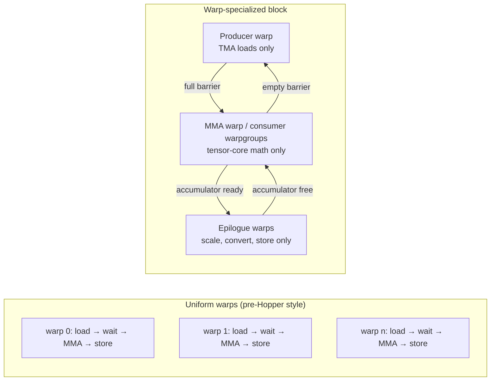
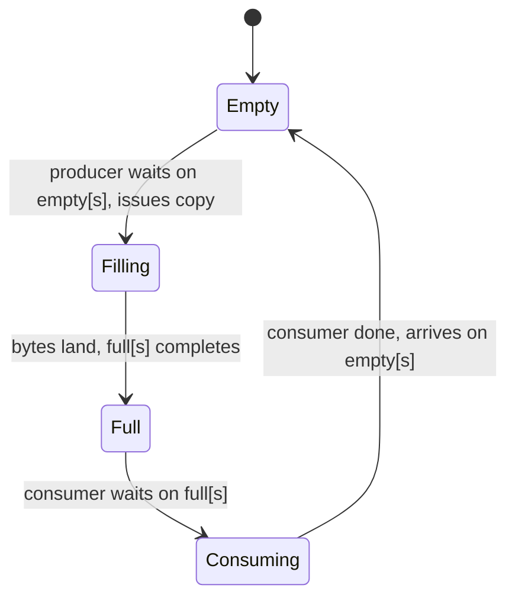
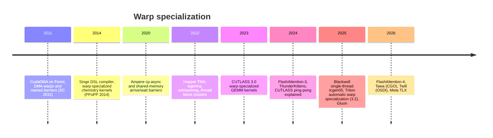
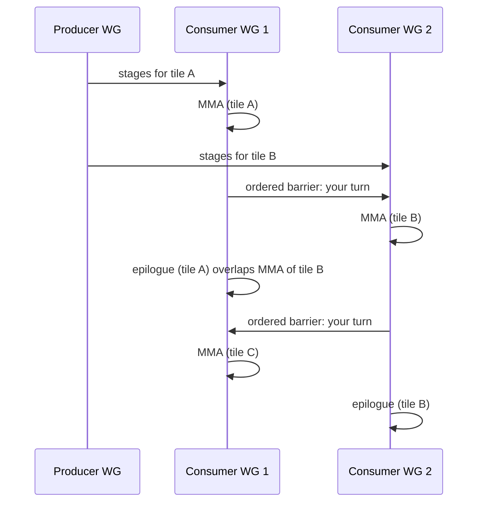
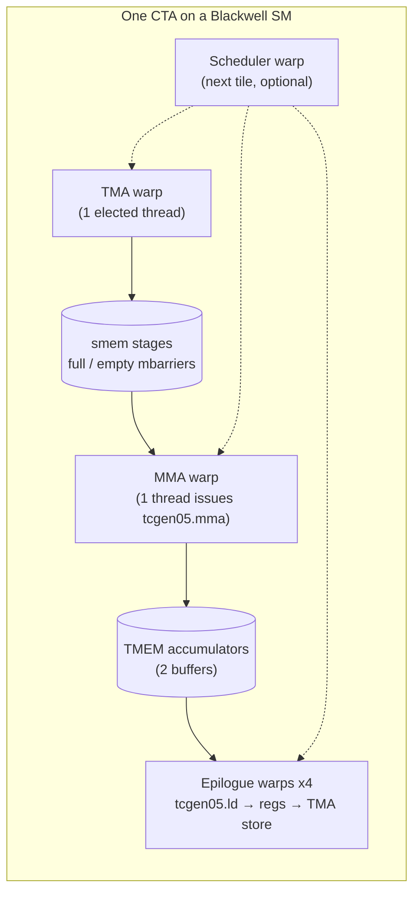

---
tags:
  - gpu-programming
  - hardware
  - hopper
  - blackwell
  - warp-specialization
  - pipelining
status: draft
sources:
  - https://research.nvidia.com/publication/2011-11_cudadma-optimizing-gpu-memory-bandwidth-warp-specialization
  - https://lightsighter.github.io/CudaDMA
  - https://doi.org/10.1145/2555243.2555258
  - https://arxiv.org/html/2407.08608v2
  - https://pytorch.org/blog/cutlass-ping-pong-gemm-kernel/
  - https://pytorch.org/blog/hopper-tma-unit/
  - https://docs.nvidia.com/cutlass/latest/media/docs/cpp/efficient_gemm.html
  - https://docs.nvidia.com/cutlass/4.8.0/media/docs/cpp/blackwell.html
  - https://nvidia.github.io/cccl/unstable/libcudacxx/ptx/instructions/setmaxnreg.html
  - https://docs.nvidia.com/cuda/parallel-thread-execution/
  - https://arxiv.org/html/2603.05451
  - https://tridao.me/blog/2026/flash4/
  - https://gau-nernst.github.io/tcgen05/
  - https://cudaforfun.substack.com/p/outperforming-cublas-on-h100-a-worklog
  - https://hazyresearch.stanford.edu/blog/2024-05-12-tk
  - https://arxiv.org/abs/2410.20399v1
  - https://pytorch.org/blog/warp-specialization/
  - https://pytorch.org/blog/warp-specialization-in-triton-design-and-roadmap/
  - https://triton-lang.org/main/getting-started/tutorials/gluon/warp-specialization.html
  - https://arxiv.org/html/2605.10905v2
  - https://engineering.fb.com/2026/11/10/open-source/tlx-a-hardware-native-gpu-compiler-for-production-ml/
  - https://arxiv.org/abs/2510.14719
  - https://arxiv.org/abs/2512.18134
  - https://www.usenix.org/system/files/osdi26-soi.pdf
  - https://arxiv.org/abs/2504.07004
  - https://arxiv.org/abs/2506.11209
  - https://arxiv.org/abs/2511.08083
  - https://hazyresearch.stanford.edu/blog/2025-05-27-no-bubbles
created: 2026-11-26
updated: 2026-11-26
---

## Table Of Contents

---

- [[#TL;DR|TL;DR]]
- [[#The Problem|The Problem]]
- [[#Foundations|Foundations]]
    - [[#Roles, Not Replicas|Roles, Not Replicas]]
    - [[#The Pipeline Between Roles|The Pipeline Between Roles]]
    - [[#Splitting the Register File|Splitting the Register File]]
- [[#How We Got Here|How We Got Here]]
- [[#How It Works|How It Works]]
    - [[#Version 1 - Named Barriers (Any GPU)|Version 1: Named Barriers (Any GPU)]]
    - [[#Version 2 - Hopper Producer and Consumer Warpgroups|Version 2: Hopper Producer and Consumer Warpgroups]]
    - [[#Cooperative vs Ping-Pong|Cooperative vs Ping-Pong]]
    - [[#Version 3 - Blackwell Role Split|Version 3: Blackwell Role Split]]
    - [[#Attention - FlashAttention-3 and -4|Attention: FlashAttention-3 and -4]]
    - [[#Compilers Take Over|Compilers Take Over]]
- [[#Where It Is Now|Where It Is Now]]
- [[#Trade-offs & Open Problems|Trade-offs & Open Problems]]
- [[#Resources|Resources]]
- [[#Related Notes|Related Notes]]

## ***TL;DR***
---
*Warp specialization gives different warps in the same thread block different jobs: some only move data, some only issue matrix math, some only write results. The roles hand work to each other through shared-memory buffers and barriers, so loading, computing and storing all run at once.*

- **The idea:** instead of every warp running the same load → compute → store loop, a block is split into **producer** warps (issue copies) and **consumer** warps (do math), plus on newer GPUs dedicated **MMA-issue** and **epilogue** warps. It is deliberate divergence *between* warps, which costs nothing (see [[Warp Divergence and Warp-Level Primitives]]).
- **Why it exists:** on Hopper and Blackwell, one thread can launch a whole tile copy ([[TMA and Asynchronous Copies|TMA]]) or a whole matrix multiply (`tcgen05.mma`, see [[Tensor Cores]]). With so few instructions needed to drive the big units, giving every warp the same mixed job wastes registers and issue slots; dedicated roles keep the units fed with low [[Occupancy and Latency Hiding|occupancy]].
- **How roles talk:** a ring of shared-memory stages, each with a "full" and an "empty" barrier. Producers wait for *empty*, fill, signal *full*; consumers wait for *full*, compute, signal *empty*. Producers also hand registers to consumers with `setmaxnreg`.
- **History:** the term comes from **CudaDMA** (Bauer, Cook, Khailany, SC 2011), which dedicated "DMA warps" to loading on Fermi. It became the default design for fast kernels with Hopper's TMA and `wgmma` in 2022–2023 (CUTLASS 3, FlashAttention-3).
- **Where it is now (Nov 2026):** every top Hopper/Blackwell GEMM and attention kernel uses it (CUTLASS, cuBLAS-class libraries, FlashAttention-4, ThunderKittens, DeepGEMM). The frontier is **making compilers do it**: Triton's automatic warp specialization, Gluon and Meta's TLX for explicit control, and research compilers (Tawa, Twill, Cypress) that derive the role split automatically.

## ***The Problem***
---
*A modern SM has several independent engines (copy engine, tensor core, ALUs, special-function units). One instruction stream per warp interleaves their work, so each engine sits idle while the warp waits on another. Warp specialization gives each engine its own instruction stream.*

The classic latency-hiding recipe is **many identical warps**: while one warp waits on memory, the scheduler runs another ([[Occupancy and Latency Hiding]]). It breaks down on Hopper and Blackwell for three reasons:

1. **Registers.** A [[Tensor Cores|tensor-core]] accumulator for a 128×256 FP32 tile is 128 KB, which on Hopper lives in registers. Big accumulators mean few warps fit on the SM, so "hide latency with more warps" is not available.
2. **The work is no longer per-thread.** One thread issues a TMA tile load; on Blackwell one thread issues the MMA for the whole block. Having 256 threads each run "load, wait, compute" makes 255 of them idle bystanders for the copy and the math.
3. **Engines run at very different speeds.** On H100 SXM5 the FlashAttention-3 authors note 989 TFLOPS of FP16 matmul but only 3.9 TFLOPS of special functions such as `exp` ([Shah et al., 2024](https://arxiv.org/html/2407.08608v2)). If the same warp does the matmul and then the softmax, the tensor core is idle during the softmax.

Warp specialization answers all three: producers need almost no registers, so consumers get more; only the warps whose job is a unit drive that unit; and different roles run on different engines at the same time.



## ***Foundations***
---
*Three ideas carry the whole technique: assign roles by warp index, connect roles with a multi-stage buffer and two barriers per stage, and rebalance registers so each role holds only what it needs.*

### Roles, Not Replicas

A role is chosen once, at the top of the kernel, from the warp's index. Because whole warps take the same branch, there is no [[Warp Divergence and Warp-Level Primitives|divergence]] penalty.

| Role | Typical size | Does | Needs |
|---|---|---|---|
| Producer (load) | 1 warp, often 1 elected thread | Issues [[TMA and Asynchronous Copies|TMA]] or `cp.async` copies into shared memory | Few registers, a few barriers |
| Consumer / math | 1–2 warpgroups (Hopper), or 1 warp issuing `tcgen05.mma` (Blackwell) | Tensor-core MMAs on staged tiles | Many registers on Hopper (accumulators); few on Blackwell (accumulators in TMEM) |
| Epilogue | 4 warps (Blackwell) or the consumers themselves (Hopper) | Reads accumulators, applies bias/activation/scaling, stores via TMA | Registers for one slice of the output |
| Scheduler (optional) | 1 warp | Fetches the next tile in a persistent kernel | Almost nothing |

A **warpgroup** is 4 consecutive warps (128 threads), the unit that issues Hopper's `wgmma` (see [[Tensor Cores]]).

### The Pipeline Between Roles

Producers and consumers share an array of **stages** in shared memory, used as a ring buffer. Each stage has two barriers:

- **full[s]:** "stage s has data". Producers make it complete; consumers wait on it.
- **empty[s]:** "stage s may be overwritten". Consumers make it complete; producers wait on it.



How many stages fit is a shared-memory budget question. For a BF16 GEMM tile of 128×128 output with K-slice 64, one stage holds an A slice of $128 \times 64 \times 2 = 16$ KB and a B slice of the same size, so 32 KB per stage. Hopper allows up to 227 KB of shared memory per block ([[GPU Memory Hierarchy]]), so

$$
\text{stages} \le \left\lfloor \frac{227\ \text{KB} - \text{epilogue buffer}}{32\ \text{KB}} \right\rfloor
$$

With a 32 KB epilogue buffer that is $\lfloor 195/32 \rfloor = 6$ stages. In plain words: the deeper the ring, the more loads can be in flight while math runs, until shared memory runs out. CUTLASS's builders compute this "stage count" automatically ([CUTLASS efficient GEMM](https://docs.nvidia.com/cutlass/latest/media/docs/cpp/efficient_gemm.html)).

### Splitting the Register File

On Hopper, PTX `setmaxnreg` lets a warpgroup lower or raise its own register limit at runtime ([CCCL PTX docs](https://nvidia.github.io/cccl/unstable/libcudacxx/ptx/instructions/setmaxnreg.html)). Producers drop to a small count; consumers claim what was freed.

Worked example with an H100 SM's 65,536 32-bit registers and a block of 3 warpgroups (384 threads), one producer and two consumers:

$$
\underbrace{128 \times 40}_{\text{producer}} + \underbrace{2 \times 128 \times 232}_{\text{consumers}} = 5{,}120 + 59{,}392 = 64{,}512 \le 65{,}536
$$

Without the split, each of 384 threads could have at most $65{,}536 / 384 \approx 170$ registers (168 after rounding to the allocation granularity of 8). With it, the threads holding accumulators get 232, about 38% more, which is what makes 128×256 tiles fit. These are the counts CUTLASS's ping-pong kernel uses ([PyTorch, 2024](https://pytorch.org/blog/cutlass-ping-pong-gemm-kernel/)).

## ***How We Got Here***
---
*Warp specialization started as a research workaround for Fermi's lack of a DMA engine, stayed niche for a decade, and became mandatory once Hopper gave the GPU real asynchronous copy and matrix engines.*



- **2011, CudaDMA.** Michael Bauer, Henry Cook and Brucek Khailany (NVIDIA Research, Stanford, Berkeley) proposed splitting a block's warps into compute warps and "DMA warps" that only move data from global into shared memory, synchronizing through Fermi's named barriers ([CudaDMA, SC 2011](https://research.nvidia.com/publication/2011-11_cudadma-optimizing-gpu-memory-bandwidth-warp-specialization); [project page](https://lightsighter.github.io/CudaDMA)). The point was to emulate a DMA engine the hardware did not have.
- **2014, Singe.** Bauer, Treichler and Aiken built a DSL compiler that warp-specializes combustion-chemistry kernels, giving each warp different parts of a large, irregular computation so the working set fits on chip ([Singe, PPoPP 2014](https://doi.org/10.1145/2555243.2555258)).
- **2020, Ampere.** `cp.async` let loads go straight to shared memory, and hardware-accelerated arrive/wait barriers in shared memory appeared, the precursor of the mbarriers that Hopper pipelines use ([[TMA and Asynchronous Copies]]).
- **2022–2023, Hopper.** TMA, asynchronous `wgmma`, `setmaxnreg` and clusters made producer/consumer kernels the natural design. CUTLASS 3.0 (Jan 2023) shipped `KernelTmaWarpSpecialized` and its cooperative and ping-pong variants ([[CUTLASS and CuTe]]).
- **2024.** FlashAttention-3 brought the design to attention and reached up to 740 TFLOPS FP16 on H100 ([Shah et al.](https://arxiv.org/html/2407.08608v2)); ThunderKittens packaged it as a small "load-compute-store" template ([Spector et al.](https://arxiv.org/abs/2410.20399v1)); Pranjal Shankhdhar's public H100 GEMM worklog showed warp specialization as one rung on the way to 764 TFLOPS ([worklog](https://cudaforfun.substack.com/p/outperforming-cublas-on-h100-a-worklog)).
- **2025.** Blackwell's single-thread `tcgen05.mma` and Tensor Memory pushed kernels to finer roles (one MMA warp, separate epilogue warps). Triton 3.2 added automatic warp specialization ([PyTorch, Feb 2025](https://pytorch.org/blog/warp-specialization/)).
- **2026.** FlashAttention-4 (MLSys 2026), and compiler papers that treat role assignment as an optimization problem: Tawa (CGO 2026), Twill (OSDI 2026).

## ***How It Works***
---
*The same producer/consumer idea has three hardware generations of plumbing: named barriers on any GPU, mbarriers plus TMA plus register reallocation on Hopper, and a four-role split around Tensor Memory on Blackwell.*

### Version 1 - Named Barriers (Any GPU)

Every CUDA GPU has 16 hardware barriers per block. `__syncthreads()` uses barrier 0 for all threads; PTX `bar.sync id, count` waits on barrier `id` until `count` threads have arrived, and `bar.arrive id, count` adds an arrival *without waiting* ([PTX ISA](https://docs.nvidia.com/cuda/parallel-thread-execution/)). That asymmetry is exactly a producer/consumer signal. This sketch is the CudaDMA pattern: one producer warp, four consumer warps, two stages.

```cpp
// 160 threads: warp 0 = producer, warps 1-4 = consumers
#define NT 160
__device__ void bar_sync(int id)   { asm volatile("bar.sync %0, %1;"   :: "r"(id), "r"(NT) : "memory"); }
__device__ void bar_arrive(int id) { asm volatile("bar.arrive %0, %1;" :: "r"(id), "r"(NT) : "memory"); }

__global__ void ws_kernel(const float* in, float* out, int K) {
  __shared__ float buf[2][1024];                // two stages
  const int FULL = 1, EMPTY = 3;                // barrier ids 1-2 and 3-4
  int warp = threadIdx.x / 32;

  if (warp == 0) {                              // ---- producer ----
    for (int k = 0; k < K; ++k) {
      int s = k % 2;
      if (k >= 2) bar_sync(EMPTY + s);          // wait until consumers freed stage s
      for (int i = threadIdx.x; i < 1024; i += 32)
        buf[s][i] = in[k * 1024 + i];           // fill stage s
      bar_arrive(FULL + s);                     // signal "full", do not wait
    }
  } else {                                      // ---- consumers ----
    float acc = 0.f;
    for (int k = 0; k < K; ++k) {
      int s = k % 2;
      bar_sync(FULL + s);                       // wait for data
      for (int i = threadIdx.x - 32; i < 1024; i += 128)
        acc += buf[s][i];                       // "compute"
      if (k + 2 < K) bar_arrive(EMPTY + s);     // free the stage, do not wait
    }
    out[blockIdx.x * 128 + threadIdx.x - 32] = acc;
  }
}
```

Line by line:

- `bar_sync` / `bar_arrive` wrap the two PTX instructions; `NT` is the number of threads that must arrive (all 160 here, producers plus consumers), and it must be a multiple of 32.
- Barrier ids 1–2 are "full" for stages 0–1, ids 3–4 are "empty". Id 0 is left for `__syncthreads()`.
- The **producer** skips the empty-wait for the first two iterations (both stages start empty), copies a slice into `buf[s]`, then *arrives* on full without blocking, so it can start the next stage.
- The **consumers** *sync* on full (they block until the producer's arrival completes the count), use the data, then *arrive* on empty. They skip that arrival for the last two stages so no barrier is left half-counted when the kernel ends.
- `"memory"` clobbers stop the compiler from moving shared-memory accesses across the barriers.

On pre-Hopper GPUs this rarely beats a well-tuned uniform kernel, because the producer warp still moves data through registers; CudaDMA's gains came from cases where address math or register pressure dominated ([CudaDMA](https://lightsighter.github.io/CudaDMA)).

### Version 2 - Hopper Producer and Consumer Warpgroups

Hopper replaces each piece with hardware built for it:

| Piece | Named-barrier version | Hopper version |
|---|---|---|
| Copy | Producer threads load and store | One elected producer thread issues a TMA tile copy |
| "Full" signal | `bar.arrive` | mbarrier with a transaction count: completes when the expected **bytes** have landed |
| "Empty" signal | `bar.arrive` | Consumers arrive on an mbarrier per stage |
| Math | Ordinary FMAs | Asynchronous `wgmma` from shared memory, accumulators in registers |
| Registers | Fixed per thread | `setmaxnreg` moves registers from producer to consumers |

In CUTLASS's `KernelTmaWarpSpecialized` family, one warpgroup is the producer and the others are consumers; they "hand off stages through 'full' and 'empty' barriers" ([[CUTLASS and CuTe]]). The producer's loop is: wait on `empty[s]` → set the expected byte count on `full[s]` → issue TMA for the A and B slices → move to the next stage. The consumer's loop is: wait on `full[s]` → issue `wgmma` on stage s → when the MMA that read stage s has finished, arrive on `empty[s]`. Because `wgmma` is asynchronous, consumers keep one or more MMAs in flight and release a stage only after the MMA that reads it completes. The sequence diagram in [[TMA and Asynchronous Copies#Warp Specialization on Top of TMA|TMA and Asynchronous Copies]] shows one round.

The role switch itself is two lines at the top of the kernel:

```cpp
int wg = threadIdx.x / 128;                       // warpgroup index
if (wg == 0) {                                    // producer
  asm volatile("setmaxnreg.dec.sync.aligned.u32 40;");
  producer_loop();                                // TMA issue, one elected thread
} else {                                          // consumers
  asm volatile("setmaxnreg.inc.sync.aligned.u32 232;");
  consumer_loop();                                // wgmma + epilogue
}
```

- `threadIdx.x / 128` picks the warpgroup; the whole warpgroup takes the same branch.
- `setmaxnreg.dec ... 40` gives back registers so the warpgroup keeps only 40 per thread; `.inc ... 232` waits until enough registers are free and claims 232. Both must be executed by all threads of the warpgroup (`.sync.aligned`), and the count must be a multiple of 8 between 24 and 256 ([CCCL PTX docs](https://nvidia.github.io/cccl/unstable/libcudacxx/ptx/instructions/setmaxnreg.html)).
- The kernel must be compiled for `sm_90a` (or a later arch-specific target), since `setmaxnreg` is not part of the portable `sm_90` feature set ([[PTX and SASS]]).

### Cooperative vs Ping-Pong

With two consumer warpgroups there are two ways to use them ([PyTorch, 2024](https://pytorch.org/blog/cutlass-ping-pong-gemm-kernel/); [[CUTLASS and CuTe]]):

| Schedule | What each consumer warpgroup does | Good at | Weak at |
|---|---|---|---|
| **Cooperative** | Both work on the **same** output tile, split along M; they run the epilogue together | Large tiles, fewer tiles in flight | Tensor cores idle during the epilogue |
| **Ping-pong** | Each owns a **different** output tile; an ordered barrier makes them take turns on the tensor core | Epilogue of one overlaps math of the other | Smaller tile per warpgroup, more registers each |



Both run as **persistent kernels**: one block per SM that loops over output tiles, so the pipeline never drains between tiles. PyTorch found ping-pong the better choice for many FP8 inference shapes, where the epilogue (scaling, conversion) is a large share of each tile's time ([PyTorch, 2024](https://pytorch.org/blog/cutlass-ping-pong-gemm-kernel/)).

### Version 3 - Blackwell Role Split

Blackwell's `tcgen05.mma` is issued by a single thread and writes its accumulator to **Tensor Memory (TMEM)**, 256 KB per SM, instead of registers ([[Tensor Cores]]). That removes the reason consumers needed big register files and splits "consumer" into two roles ([CUTLASS Blackwell docs](https://docs.nvidia.com/cutlass/4.8.0/media/docs/cpp/blackwell.html); [gau-nernst](https://gau-nernst.github.io/tcgen05/)):



- **TMA warp:** issues tile loads into the shared-memory ring (often 2-CTA, multicast across a cluster).
- **MMA warp:** one thread waits on `full[s]`, issues `tcgen05.mma`, and uses `tcgen05.commit` to arrive on an mbarrier when the MMA finishes, which both frees the smem stage and tells the epilogue the accumulator is ready.
- **Epilogue warps:** four warps, because TMEM's 128 lanes are split so each warp of a warpgroup reads its own 32 lanes with `tcgen05.ld`. They convert, scale and store.
- **Double-buffered accumulators:** with two TMEM accumulator buffers, the MMA warp starts the next tile while the epilogue drains the previous one, the Blackwell version of ping-pong.
- **Scheduler:** in persistent kernels a warp can query the next tile, on Blackwell via Cluster Launch Control, and broadcast it to the other roles.

The payoff is measurable in gau-nernst's B200 walkthrough: adding warp specialization (TMA / MMA / epilogue warps) took a hand-written BF16 GEMM to 1,209 TFLOPS, and later steps (persistence, double-buffered TMEM) reached about 1,476, against about 1,507 for cuBLAS ([gau-nernst, Dec 2025](https://gau-nernst.github.io/tcgen05/)).

### Attention - FlashAttention-3 and -4

Attention is harder than GEMM because two matmuls are separated by a softmax that runs on slow special-function units.

- **FlashAttention-3 (Hopper, 2024).** Producer warps load Q, K and V with TMA; two consumer warpgroups use ping-pong scheduling so one warpgroup's softmax runs while the other's GEMMs use the tensor cores, and inside a warpgroup the softmax of one block overlaps the GEMM of the next. Ping-pong alone raised FP16 forward throughput from about 570 to 620–640 TFLOPS; the full kernel reaches up to 740 TFLOPS FP16 (75% utilization) and close to 1.2 PFLOPS FP8 ([Shah et al., 2024](https://arxiv.org/html/2407.08608v2)).
- **FlashAttention-4 (Blackwell, 2026).** Built in CuTe DSL around `tcgen05` and TMEM, with more roles: load, MMA, several softmax warpgroups, a correction warpgroup that rescales outputs when the running max changes, and an epilogue. Because the exponential unit became the bottleneck, part of `exp` is computed in software on the FMA units ([FlashAttention-4](https://arxiv.org/html/2603.05451); [Tri Dao, 2026](https://tridao.me/blog/2026/flash4/); [[FlashAttention]]).

### Compilers Take Over

Hand-writing roles, barriers and phase bits is error-prone, so the 2025–2026 work is about generating them.

| Approach | Who | How roles are chosen |
|---|---|---|
| CUTLASS / CuTe DSL kernel schedules | NVIDIA | Picked from a fixed menu (`...WarpSpecialized`, `Cooperative`, `Pingpong`, SM100 variants) |
| Triton automatic warp specialization | Meta, OpenAI, NVIDIA | Add `warp_specialize=True` to a `tl.range` loop; the compiler partitions the loop body into producer and consumer warp groups ([PyTorch, Feb 2025](https://pytorch.org/blog/warp-specialization/)) |
| Gluon `gl.warp_specialize` | Triton project | Programmer writes each partition as a function, with its own warp and register count ([Gluon tutorial](https://triton-lang.org/main/getting-started/tutorials/gluon/warp-specialization.html)) |
| TLX | Meta | Triton extensions with explicit warp-group roles, async ops and local memory; in production at Meta ([TLX paper](https://arxiv.org/html/2605.10905v2); [Meta, Nov 2026](https://engineering.fb.com/2026/11/10/open-source/tlx-a-hardware-native-gpu-compiler-for-production-ml/)) |
| Tawa | Research (CGO 2026) | Compiler IR with "asynchronous references" that partitions a tile program into warp roles automatically ([Tawa](https://arxiv.org/abs/2510.14719)) |
| Twill | Stanford (OSDI 2026) | Solves software pipelining and warp assignment together as an optimization problem ([Twill](https://arxiv.org/abs/2512.18134); [OSDI paper](https://www.usenix.org/system/files/osdi26-soi.pdf)) |
| Cypress | NVIDIA Research / Stanford (PLDI 2025) | Task-based programs mapped onto warp roles and async units by the compiler ([Cypress](https://arxiv.org/abs/2504.07004)) |

Meta reports that Triton's automatic warp specialization gets B200 flash-attention forward kernels "close to Gluon and cuDNN implementations, and 1.5-2x of stock Triton (cuDNN still leads by 10-20%)" ([PyTorch, Jan 2026](https://pytorch.org/blog/warp-specialization-in-triton-design-and-roadmap/)).

## ***Where It Is Now***
---
*As of November 2026, warp specialization is how every state-of-the-art NVIDIA GEMM and attention kernel is built. The open question is no longer whether to use it but who writes it: hand-tuned templates, DSLs with explicit roles, or compilers that derive the roles.*

- **Libraries.** CUTLASS 4.x ships warp-specialized schedules for Hopper (SM90) and Blackwell (SM100), with initial Rubin support in 4.8 ([[CUTLASS and CuTe]]). DeepGEMM and ThunderKittens use the same structure ([[Tiled Matrix Multiplication (GEMM)]]).
- **Attention.** FlashAttention-4 is the reference Blackwell attention kernel, and since March 2026 FlexAttention can generate kernels on top of it ([[Kernel Fusion]]).
- **Triton.** Warp specialization is on by default for persistent matmul and attention since Triton 3.5 (Oct 2025); Gluon gives explicit control; Meta's TLX is a production fork with explicit roles ([[Triton]]).
- **Research compilers.** Tawa (CGO 2026) and Twill (OSDI 2026) show that role assignment and pipelining can be derived automatically, with Twill framing it as finding optimal schedules rather than hand-picked ones.
- **Megakernels** extend the idea from one operator to a whole model: dedicated warps load weights, compute, and store, with an on-GPU scheduler handing out tasks ([Hazy Research, 2025](https://hazyresearch.stanford.edu/blog/2025-05-27-no-bubbles); [[Megakernels]]).
- **AMD.** AMD GPUs have no TMA and allocate registers statically per wave, and HipKittens (Hazy Research, Nov 2025) reports that producer/consumer "wave specialization" underperforms on MI355X; it uses 8-wave ping-pong and 4-wave interleave schedules instead ([HipKittens](https://arxiv.org/abs/2511.08083); [[ROCm and HIP]]).
- **Tile languages** such as CUDA Tile/cuTile aim to hide roles from the programmer entirely ([[CUDA Tile and cuTile]]).

## ***Trade-offs & Open Problems***
---
*Warp specialization buys overlap at the cost of complexity: more synchronization, harder debugging, arch-specific code, and a schedule that must be retuned for every new GPU.*

| Choice | Gain | Cost |
|---|---|---|
| Dedicated producer warps | Copies never wait behind math | Producer registers and issue slots are wasted if the copy engine is already saturated |
| `setmaxnreg` register split | Bigger tiles for consumers | Hopper/Blackwell-only (`sm_90a`+), arch-specific binaries |
| Deeper stage ring | More loads in flight | Less shared memory for the epilogue and for other blocks |
| Ping-pong vs cooperative | Epilogue overlap | Half-size tiles per warpgroup; shape-dependent winner |
| Persistent, one block per SM | No pipeline drain between tiles | Load imbalance on ragged shapes; needs a tile scheduler |

Open problems:

- **Deadlocks and hangs.** A missed arrival, a wrong expected byte count or a flipped phase bit hangs the kernel with no error. Tools for checking mbarrier protocols are still thin; megakernel work has started adding static deadlock checkers ([[Kernel Fusion]]).
- **Performance modeling.** Which role split and stage count wins depends on shape, data type and GPU. Analytical models for warp-specialized kernels are an active topic ([Performance model, 2025](https://arxiv.org/abs/2506.11209)), and most libraries still pick by autotuning.
- **Portability.** Schedules written for Hopper must be rewritten for Blackwell (TMEM, single-thread MMA) and again for Rubin, and they do not carry over to AMD.
- **Compiler quality.** Automatic warp specialization in Triton still trails cuDNN by 10–20% on Blackwell attention ([PyTorch, Jan 2026](https://pytorch.org/blog/warp-specialization-in-triton-design-and-roadmap/)); closing that gap without hand-written roles is the main goal of Tawa, Twill and TLX.
- **Irregular work.** Fixed roles suit GEMM-like loops. Sparse, ragged or data-dependent kernels need dynamic role assignment, which is still mostly hand-built.

## ***Resources***
---
*Read the FlashAttention-3 paper for the clearest motivation, the PyTorch ping-pong post for the GEMM schedules, and gau-nernst's walkthrough for Blackwell code. CudaDMA is the origin of the idea.*

**Origins**
- [CudaDMA: Optimizing GPU Memory Bandwidth via Warp Specialization](https://research.nvidia.com/publication/2011-11_cudadma-optimizing-gpu-memory-bandwidth-warp-specialization): Bauer, Cook, Khailany, SC 2011; [project page](https://lightsighter.github.io/CudaDMA).
- [Singe: Leveraging Warp Specialization for High Performance on GPUs](https://doi.org/10.1145/2555243.2555258): Bauer, Treichler, Aiken, PPoPP 2014.

**Primary docs and kernels**
- [CUTLASS: Efficient GEMM in CUDA](https://docs.nvidia.com/cutlass/latest/media/docs/cpp/efficient_gemm.html) and [Blackwell functionality](https://docs.nvidia.com/cutlass/4.8.0/media/docs/cpp/blackwell.html): NVIDIA.
- [setmaxnreg](https://nvidia.github.io/cccl/unstable/libcudacxx/ptx/instructions/setmaxnreg.html) and the [PTX ISA](https://docs.nvidia.com/cuda/parallel-thread-execution/) barrier instructions.
- [FlashAttention-3](https://arxiv.org/html/2407.08608v2): Shah et al., 2024.
- [FlashAttention-4](https://arxiv.org/html/2603.05451): 2026; [Tri Dao's blog post](https://tridao.me/blog/2026/flash4/).

**Practitioner walkthroughs**
- [Deep Dive on CUTLASS Ping-Pong GEMM Kernel](https://pytorch.org/blog/cutlass-ping-pong-gemm-kernel/): PyTorch, 2024.
- [Deep Dive on the Hopper TMA Unit for FP8 GEMMs](https://pytorch.org/blog/hopper-tma-unit/): PyTorch, 2024.
- [tcgen05 for dummies](https://gau-nernst.github.io/tcgen05/): gau-nernst, Dec 2025.
- [Outperforming cuBLAS on H100: a Worklog](https://cudaforfun.substack.com/p/outperforming-cublas-on-h100-a-worklog): Pranjal Shankhdhar, Nov 2024.
- [GPUs Go Brrr](https://hazyresearch.stanford.edu/blog/2024-05-12-tk) and [ThunderKittens paper](https://arxiv.org/abs/2410.20399v1): Hazy Research.

**Compilers and research**
- [Warp Specialization in Triton](https://pytorch.org/blog/warp-specialization/) (Feb 2025) and [Design and Roadmap](https://pytorch.org/blog/warp-specialization-in-triton-design-and-roadmap/) (Jan 2026): PyTorch.
- [Gluon warp specialization tutorial](https://triton-lang.org/main/getting-started/tutorials/gluon/warp-specialization.html).
- [TLX paper](https://arxiv.org/html/2605.10905v2) and [Meta engineering post](https://engineering.fb.com/2026/11/10/open-source/tlx-a-hardware-native-gpu-compiler-for-production-ml/), Nov 2026.
- [Tawa: Automatic Warp Specialization for Modern GPUs with Asynchronous References](https://arxiv.org/abs/2510.14719): CGO 2026.
- [Optimal Software Pipelining and Warp Specialization for Tensor Core GPUs (Twill)](https://arxiv.org/abs/2512.18134): OSDI 2026.
- [Task-Based Tensor Computations on Modern GPUs (Cypress)](https://arxiv.org/abs/2504.07004): PLDI 2025.
- [A Performance Model for Warp Specialization Kernels](https://arxiv.org/abs/2506.11209): 2025.
- [HipKittens: Fast and Furious AMD Kernels](https://arxiv.org/abs/2511.08083): Hazy Research, Nov 2025.

## Related Notes

- [[TMA and Asynchronous Copies]] — The copy engine the producer role drives, and the mbarriers roles synchronize on.
- [[Tensor Cores]] — `wgmma` and single-thread `tcgen05.mma`, the units the consumer and MMA roles feed.
- [[Occupancy and Latency Hiding]] — Why one block per SM with specialized warps beats many identical warps on Hopper.
- [[Warp Divergence and Warp-Level Primitives]] — Divergence between warps is free; within a warp it is not.
- [[Tiled Matrix Multiplication (GEMM)]] — The loop that warp specialization pipelines.
- [[CUTLASS and CuTe]] — Kernel schedules: `KernelTmaWarpSpecialized`, cooperative, ping-pong, SM100.
- [[Triton]] — Automatic warp specialization, Gluon and TLX.
- [[PTX and SASS]] — `bar.sync`, `mbarrier`, `setmaxnreg` and arch-specific targets.
- [[Shared Memory and Bank Conflicts]] — The stage ring lives in shared memory.
- [[GPU Memory Hierarchy]] — Registers, shared memory and Tensor Memory budgets.
- [[Kernel Fusion]] — Fused epilogues run in the epilogue role; megakernels generalize the idea.
- [[Megakernels]] — Whole models as one persistent, role-split kernel.
- [[Blackwell Architecture]] — TMEM and 2-CTA MMA that shape the Blackwell role split.
- [[CUDA Tile and cuTile]] — Tile programming that hides roles from the programmer.
- [[ROCm and HIP]] — Why AMD kernels use ping-pong and interleave schedules instead.
- [[FlashAttention]] — The best-known warp-specialized kernel family.
