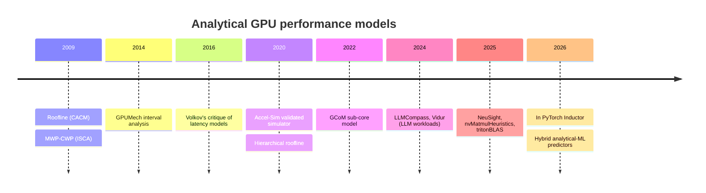
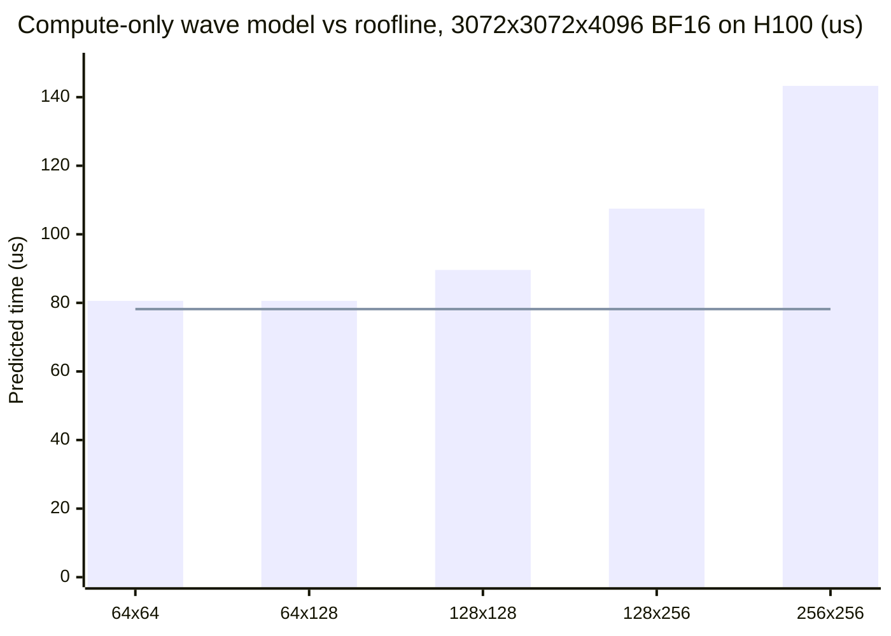
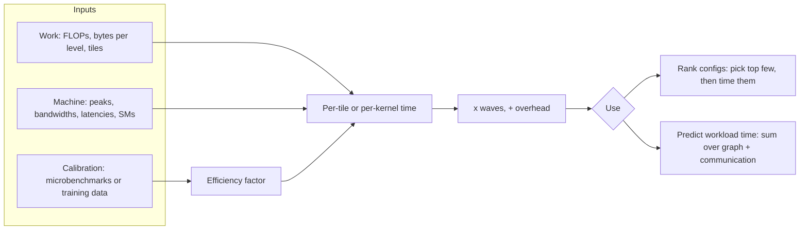

---
tags:
  - gpu-programming
  - kernels-and-optimization
  - performance-models
  - roofline
  - gemm
  - autotuning
  - simulation
aliases:
  - GPU Performance Models
  - Analytical Performance Model
  - MWP-CWP Model
  - Roofline-plus-waves
  - GPU Performance Prediction
status: complete
sources:
  - https://hparch.gatech.edu/papers/hong_report09.pdf
  - https://sites.coecis.cornell.edu/isca50retrospective/files/2023/06/Hong_2009_An.pdf
  - https://www.cs.colostate.edu/~cs475/f19/more_assignments/Labs/L10/RooflineCACM2009.pdf
  - https://hsienhsinlee.github.io/MARS/pub/micro14.pdf
  - https://www2.eecs.berkeley.edu/Pubs/TechRpts/2016/EECS-2016-143.html
  - https://engineering.purdue.edu/tgrogers/papers/khairy.isca2020.pdf
  - https://arxiv.org/abs/2009.05257v3
  - https://unpaywall.org/10.1145%2F3470496.3527384
  - https://arxiv.org/pdf/2312.03134
  - https://arxiv.org/html/2405.05465v1
  - https://arxiv.org/html/2407.13853v3
  - https://arxiv.org/html/2512.04226v1
  - https://arxiv.org/abs/2601.14910
  - https://arxiv.org/pdf/2605.04178
  - https://arxiv.org/html/2606.28565v2
  - https://docs.nvidia.com/cuda/nvidia-matmul-heuristics/
  - https://developer.nvidia.com/blog/improving-gemm-kernel-auto-tuning-efficiency-on-nvidia-gpus-with-heuristics-and-cutlass-4-2
  - https://docs.nvidia.com/cutlass/latest/media/docs/operators/tutorials/007_heuristics.html
  - https://pypi.org/project/rocm-origami/
  - https://rocm.github.io/tritonBLAS/conceptual/analytical-model.html
  - https://rocm.docs.amd.com/projects/hipBLASLt/en/docs-7.2.1/how-to/how-to-use-streamk.html
  - https://rocm.docs.amd.com/projects/tracelens/en/latest/how-to/origami-integration.html
  - https://rocm.blogs.amd.com/software-tools-optimization/primus-projection/README.html
  - https://pytorch.org/blog/pytorch-2-14-release-blog/
  - https://pytorch.org/blog/pytorch-2-15-release-blog/
  - https://www.nvidia.com/en-us/data-center/h100/
created: 2026-11-27
updated: 2026-11-27
---

## Table Of Contents

---

- [[#TL;DR|TL;DR]]
- [[#The Problem|The Problem]]
- [[#Foundations|Foundations]]
    - [[#Four Ways to Predict a Kernel's Time|Four Ways to Predict a Kernel's Time]]
    - [[#The Building Blocks|The Building Blocks]]
    - [[#Accuracy Is Two Different Questions|Accuracy Is Two Different Questions]]
- [[#How We Got Here|How We Got Here]]
- [[#How It Works|How It Works]]
    - [[#Roofline - the Bound|Roofline: the Bound]]
    - [[#MWP-CWP - Overlap Between Warps|MWP-CWP: Overlap Between Warps]]
    - [[#Interval Models - GPUMech and GCoM|Interval Models: GPUMech and GCoM]]
    - [[#Roofline-plus-Waves for Tiled Kernels|Roofline-plus-Waves for Tiled Kernels]]
    - [[#Production GEMM Models - nvMatmulHeuristics, Origami, tritonBLAS|Production GEMM Models: nvMatmulHeuristics, Origami, tritonBLAS]]
    - [[#Hybrid Models - Analytical Features, Learned Efficiency|Hybrid Models: Analytical Features, Learned Efficiency]]
    - [[#Whole-Workload Models for LLMs|Whole-Workload Models for LLMs]]
- [[#Where It Is Now|Where It Is Now]]
- [[#Trade-offs & Open Problems|Trade-offs & Open Problems]]
    - [[#Where the Models Miss|Where the Models Miss]]
    - [[#Open Problems|Open Problems]]
- [[#Resources|Resources]]
- [[#Related Notes|Related Notes]]

## ***TL;DR***
---
*An analytical performance model predicts how long a kernel will take from a few counts (FLOPs, bytes, tiles, warps) and a few hardware numbers, without running it. These models are how GEMM libraries pick a kernel in microseconds, and their blind spots explain why autotuning still exists.*

- **What it is:** a formula, or a small program of formulas, that turns *work* (FLOPs, bytes moved at each memory level, number of tiles, warps in flight) and *machine* (peak FLOP/s, bandwidths, latencies, SM count) into a time.
- **The family tree:**
  1. **Roofline** (2009): time is at least the larger of compute time and memory time ([[Roofline Model and Arithmetic Intensity]]).
  2. **MWP-CWP** (Hong and Kim, ISCA 2009): counts how many warps' memory requests and computation can overlap, with 13.3% geomean error on 2007 to 2008 NVIDIA GPUs (8800GT/GTX, FX5600, GTX280) ([report](https://hparch.gatech.edu/papers/hong_report09.pdf)).
  3. **Interval models** (GPUMech 2014, GCoM 2022): walk a representative warp's stalls; GCoM reached 10.0% mean error against the Accel-Sim simulator, versus 44.9% for the previous best model ([ISCA 2022](https://unpaywall.org/10.1145%2F3470496.3527384)).
  4. **Roofline-plus-waves** for tiled kernels: per-tile time multiplied by the number of waves of tiles across the SMs. This is the core of NVIDIA's **nvMatmulHeuristics**, AMD's **Origami** and **tritonBLAS**, and NeuSight.
  5. **Hybrids** (2025 to 2026): analytical features or roofline bounds, with a small learned model for the efficiency factor no formula captures.
- **What they are for:** ranking. tritonBLAS picks Triton GEMM configs with no autotuning at 94.7% of exhaustive-search performance across 150,000 shapes ([arXiv 2512.04226](https://arxiv.org/html/2512.04226v1)). Ranking is easier than predicting absolute time, because shared errors cancel.
- **Where they miss:** irregular memory access, atomics and load imbalance, short kernels dominated by launch overhead, L2 and cache behaviour, clocks and power, and any shape or GPU the model was not calibrated on. A May 2026 study saw its model go from 1.33% error on B200 microbenchmarks to 43.6% on Rodinia when ported to H200 by parameters alone ([arXiv 2605.04178](https://arxiv.org/pdf/2605.04178)).
- **Where it is now (Nov 2026):** models prune, measurement decides. PyTorch 2.14 ranks Inductor's NVGEMM candidates with nvMatmulHeuristics and makes Origami the default ROCm `max-autotune` picker; 2.15 adds a hand-written candidate policy for Blackwell NVFP4 decode shapes "that nvMatmulHeuristics misses" ([2.14](https://pytorch.org/blog/pytorch-2-14-release-blog/), [2.15](https://pytorch.org/blog/pytorch-2-15-release-blog/)).

## ***The Problem***
---
*Timing every option on real hardware is the honest answer, but it is slow, needs the GPU in hand, and cannot say anything about hardware that does not exist yet. A model answers instantly, and the question is how wrong it is allowed to be.*

Four jobs need a prediction rather than a measurement:

| Job | Who | Why measuring is not enough |
|---|---|---|
| Pick a kernel config per shape | cuBLAS, CUTLASS, Triton, Inductor, hipBLASLt | Hundreds of configs per shape; a JIT compiler pays tuning time on every new shape ([[GEMM Autotuning and Kernel Selection]]) |
| Explain why a kernel is slow | Kernel authors | A time alone says nothing about which resource is the limit; a model names it ([[Profiling with Nsight Compute and Nsight Systems]]) |
| Plan a deployment or training run | ML infra teams | Hundreds of parallelism and batch configurations, each needing a cluster to measure ([[LLM Serving]]) |
| Design the next chip | Architects | The hardware does not exist; cycle-level simulation of a full workload is far too slow |

Simulation is the alternative to a formula, and it is expensive. Accel-Sim, the standard validated GPU simulator, runs at about 12.5 thousand warp instructions per second in trace mode and still has 15% mean absolute cycle error on a V100 ([ISCA 2020](https://engineering.purdue.edu/tgrogers/papers/khairy.isca2020.pdf)). A single large GEMM executes billions of warp instructions, so simulating it takes hours where a formula takes microseconds.

The catch is that a GPU's speed comes from overlap: thousands of threads hiding each other's latency ([[Occupancy and Latency Hiding]]). Adding up costs is wrong because most of them overlap, and taking only the largest cost is wrong because overlap is never perfect. Every model in this note is a different answer to "how much overlaps?"

## ***Foundations***
---
*Every model trades fidelity for speed and for the amount of information it needs. Knowing which layer of detail a model works at tells you what it can and cannot see.*

### Four Ways to Predict a Kernel's Time

| Approach | Inputs | Speed | Typical error | Sees | Misses |
|---|---|---|---|---|---|
| Roofline bound | FLOPs, bytes, two peaks | Instant | Optimistic: ~96% mean error as a time predictor on B200 microbenchmarks in one 2026 study | Compute vs memory bound | Latency, overlap, occupancy, tails |
| Analytical (MWP-CWP, waves, tile models) | Instruction and byte counts, latencies, SM count, tile sizes | Microseconds | ~5 to 15% on the cases they target | Overlap, occupancy, wave quantization | Whatever is not in the formula |
| Learned or hybrid | Analytical features plus training data per GPU | Milliseconds | ~4 to 12% per kernel on kernels like the training set | Non-linear efficiency effects | Shapes, kernels and GPUs far from the training data |
| Cycle-level simulation (Accel-Sim) | Instruction traces plus a full machine description | ~10⁴ warp instructions/s | ~15% on V100 | Almost everything modelled | Whatever the machine description gets wrong; new GPUs need a new description |

Error figures above are from the papers cited in [[#How It Works|How It Works]]; they are not comparable across rows because each paper uses its own kernels and baseline.

### The Building Blocks

Almost every model is assembled from five quantities. Knowing them makes every paper below readable.

| Quantity | Formula | Plain English |
|---|---|---|
| Compute time | $T_c = \dfrac{\text{FLOPs}}{P_{\text{peak}}}$ | How long the math takes if the math units never wait |
| Memory time (per level) | $T_m^{(\ell)} = \dfrac{\text{bytes}_\ell}{B_\ell}$ | How long moving the data through level $\ell$ (HBM, L2, shared memory) takes at full bandwidth |
| Waves | $W = \left\lceil \dfrac{\text{tiles}}{\text{SMs} \times \text{CTAs per SM}} \right\rceil$ | How many rounds the SMs need to finish all tiles ([[Persistent Kernels and Stream-K]] removes this rounding) |
| Little's Law | $\text{in flight} = \text{latency} \times \text{throughput}$ | How much independent work must be outstanding to keep a unit busy ([[Occupancy and Latency Hiding]]) |
| Overhead | $T_o$ = launch + sync + tail | Fixed costs that dominate short kernels ([[CUDA Graphs]], [[Programmatic Dependent Launch]]) |

The simplest combination is

$$T \approx \max\!\left(T_c,\ \max_\ell T_m^{(\ell)}\right) + T_o$$

*In plain words: the kernel takes as long as its slowest resource, plus fixed costs.* The 2026 Delaware model for B200 and MI300A uses exactly this "max of compute and memory, plus overhead" form as its base ([arXiv 2605.04178](https://arxiv.org/pdf/2605.04178)). The rest of the field refines the $\max$: how much of the smaller term really hides under the larger one.

### Accuracy Is Two Different Questions

- **Absolute accuracy:** is 107 µs predicted when the kernel takes 110 µs? Needed for capacity planning and chip design.
- **Ranking accuracy:** does the model put the fastest config first, or in its top 5? Needed for kernel selection. A model can be 30% off in absolute terms and still rank perfectly, if the error is the same for every candidate.

tritonBLAS says this outright: its model "captures latency trends for comparing configurations, not precise absolute latency prediction" ([arXiv 2512.04226](https://arxiv.org/html/2512.04226v1)). nvMatmulHeuristics separates the two in its API: `nvMatmulHeuristicsGetGemmConfig` ranks, `nvMatmulHeuristicsEstimateRuntime` predicts a time, and the docs warn the estimate "might use a different path" from the ranking ([docs](https://docs.nvidia.com/cuda/nvidia-matmul-heuristics/)).

## ***How We Got Here***
---
*The field moved from "which bound applies" to "how much overlaps" to "what is the efficiency factor", and from research tools to code that runs inside every GEMM library call.*

- **2009, two models in one year.** Williams, Waterman and Patterson publish the roofline in CACM ([paper](https://www.cs.colostate.edu/~cs475/f19/more_assignments/Labs/L10/RooflineCACM2009.pdf)). Hong and Kim publish the MWP-CWP model at ISCA, the first widely used analytical model of GPU execution; their goal was to challenge the belief that maximum occupancy always gives the best performance ([retrospective](https://sites.coecis.cornell.edu/isca50retrospective/files/2023/06/Hong_2009_An.pdf)).
- **2010.** A follow-up ISCA paper adds caches and power modelling ([retrospective](https://sites.coecis.cornell.edu/isca50retrospective/files/2023/06/Hong_2009_An.pdf)).
- **2014, interval analysis.** GPUMech (MICRO-47) brings CPU-style interval analysis to GPUs, modelling warp schedulers and memory queueing, at 13 to 14% error and about 97× faster than detailed simulation ([paper](https://hsienhsinlee.github.io/MARS/pub/micro14.pdf)).
- **2016, the critique.** Volkov's dissertation shows prior GPU models mispredict throughput on simple synthetic workloads by "factors of up to 1.7", mostly through mistakes in applying Little's Law ([Berkeley](https://www2.eecs.berkeley.edu/Pubs/TechRpts/2016/EECS-2016-143.html)).
- **2020, measurement catches up.** Accel-Sim validates a simulator against Volta at 15% error ([ISCA 2020](https://engineering.purdue.edu/tgrogers/papers/khairy.isca2020.pdf)). The hierarchical roofline adds Tensor Core ceilings and per-level bandwidths, measured with Nsight Compute ([arXiv 2009.05257](https://arxiv.org/abs/2009.05257v3)).
- **2022.** GCoM models the sub-core structure of modern SMs, cutting error against Accel-Sim from 44.9% to 10.0% ([ISCA 2022](https://unpaywall.org/10.1145%2F3470496.3527384)).
- **2024, models move to LLM workloads.** LLMCompass (ISCA) and Vidur (MLSys) predict whole LLM inference runs ([LLMCompass](https://arxiv.org/pdf/2312.03134), [Vidur](https://arxiv.org/html/2405.05465v1)).
- **2025, models move into libraries.** NeuSight (ASPLOS) combines tiles, waves and roofline bounds with a learned utilization curve ([arXiv 2407.13853](https://arxiv.org/html/2407.13853v3)). nvMatmulHeuristics ships with CUTLASS 4.2 ([NVIDIA, Sep 2025](https://developer.nvidia.com/blog/improving-gemm-kernel-auto-tuning-efficiency-on-nvidia-gpus-with-heuristics-and-cutlass-4-2)); tritonBLAS appears in Dec 2025.
- **2026, models in the frameworks.** PyTorch 2.14 and 2.15 wire nvMatmulHeuristics and Origami into Inductor; hybrid predictors (PipeWeave, KernelSight-LM) and a Blackwell/MI300A analytical model appear on arXiv.

## ***How It Works***
---
*Each model below adds one piece of the machine the previous one ignored. Reading them in order is the fastest way to see what a GPU actually spends its time on.*

### Roofline - the Bound

*The roofline does not predict time; it gives the fastest time the kernel could possibly have.*

$$T \ge \max\!\left(\frac{\text{FLOPs}}{P_{\text{peak}}},\ \frac{\text{bytes}}{B_{\text{HBM}}}\right)$$

Worked example, a BF16 GEMM with $M = N = 3072$, $K = 4096$ on an H100 SXM ($P_{\text{peak}} \approx 989$ TFLOP/s dense BF16, $B = 3.35$ TB/s, [H100 page](https://www.nvidia.com/en-us/data-center/h100/)):

- FLOPs $= 2MNK = 7.73 \times 10^{10}$, so $T_c = 78.2$ µs.
- Minimum bytes (read A and B once, write C once) $= 2(MK + KN + MN) = 69.2$ MB, so $T_m = 20.7$ µs.
- Bound: **78.2 µs, compute-bound.**

*In plain words: no kernel can do this GEMM in under 78 µs on this GPU.* Real kernels land above it, and the models below explain by how much. The hierarchical roofline adds a line per memory level (L1, L2, HBM) and per compute unit, so the bound can be computed against whichever level the kernel actually stresses ([arXiv 2009.05257](https://arxiv.org/abs/2009.05257v3)).

### MWP-CWP - Overlap Between Warps

*Hong and Kim asked how many warps can have memory requests in flight at once (MWP), and how many warps' worth of computation fits under one memory wait (CWP). Whichever is smaller decides the regime.* Definitions from the tech report ([report](https://hparch.gatech.edu/papers/hong_report09.pdf)):

| Term | Formula | Plain English |
|---|---|---|
| $\text{MWP}_{\text{no BW}}$ | $\min\!\left(\dfrac{\text{Mem}_L}{\text{Departure delay}},\ N\right)$ | How many requests can be in flight if only latency limits it (and at most $N$, the active warps per SM) |
| $\text{BW}_{\text{per warp}}$ | $\dfrac{f \cdot \text{bytes per warp load}}{\text{Mem}_L}$ | Bandwidth one warp consumes |
| $\text{MWP}_{\text{peak BW}}$ | $\dfrac{B}{\text{BW}_{\text{per warp}} \times \text{active SMs}}$ | How many warps the memory bandwidth can feed |
| MWP | $\min(\text{MWP}_{\text{no BW}},\ \text{MWP}_{\text{peak BW}},\ N)$ | Memory parallelism actually available |
| CWP | $\min\!\left(\dfrac{\text{Mem cycles} + \text{Comp cycles}}{\text{Comp cycles}},\ N\right)$ | How many warps' computation fits in one warp's memory wait |

The execution time per SM-round (multiplied by the number of rounds, $\#\text{Rep}$) then takes one of three forms:

| Case | Cycles per round | Meaning |
|---|---|---|
| MWP = CWP = N | $\text{Mem} + \text{Comp} + \dfrac{\text{Comp}}{\#\text{mem insts}}(\text{MWP} - 1)$ | Not enough warps to hide anything |
| CWP ≥ MWP | $\text{Mem} \cdot \dfrac{N}{\text{MWP}} + \dfrac{\text{Comp}}{\#\text{mem insts}}(\text{MWP} - 1)$ | Memory-bound: requests queue in batches of MWP |
| MWP > CWP | $\text{Mem}_L + \text{Comp} \cdot N$ | Compute-bound: one memory latency shows, all computation serializes |

**Worked example** (round illustrative numbers, not a specific GPU). Each warp issues 10 coalesced loads of 128 bytes, $\text{Mem}_L = 400$ cycles, departure delay 8 cycles, $N = 32$ active warps:

- $\text{MWP}_{\text{no BW}} = \min(400/8,\ 32) = 32$.
- $\text{BW}_{\text{per warp}} = 128 / 400 = 0.32$ bytes/cycle. If the SM's share of DRAM bandwidth is 4 bytes/cycle, $\text{MWP}_{\text{peak BW}} = 4 / 0.32 = 12.5$, so **MWP = 12.5**.
- **Memory-heavy warp** (40 compute cycles): Mem cycles $= 10 \times 400 = 4000$, CWP $= \min(4040/40, 32) = 32 \ge$ MWP, so it is memory-bound: $4000 \times 32 / 12.5 + 4 \times 11.5 = 10{,}286$ cycles. Sanity check: the SM moves $32 \times 10 \times 128 = 40{,}960$ bytes at 4 bytes/cycle, which is 10,240 cycles. The model agrees with the bandwidth bound plus a small latency tail.
- **Compute-heavy warp** (2000 compute cycles): CWP $= 6000/2000 = 3 <$ MWP, so it is compute-bound: $400 + 2000 \times 32 = 64{,}400$ cycles. Only one memory latency is exposed.

*In plain words: the model decides whether warps are waiting on each other's memory traffic or on each other's arithmetic, and charges the right one.* The authors noted afterwards that their first two cases match the roofline's two regimes, while the "not enough parallelism" case is something the roofline cannot express and turned out to matter most to programmers ([retrospective](https://sites.coecis.cornell.edu/isca50retrospective/files/2023/06/Hong_2009_An.pdf)). It reported 5.4% geomean error on microbenchmarks and 13.3% on applications across four NVIDIA GPUs from the 8800 to the GTX280, and was most accurate on the GPU used to fit its parameters ([report](https://hparch.gatech.edu/papers/hong_report09.pdf)).

### Interval Models - GPUMech and GCoM

*Interval models walk through a warp's instruction stream and charge each stall, then work out how much of the stall other warps hide. They see scheduler policy and queueing, which closed-form models cannot.*

- **GPUMech** collects a trace by functional simulation, picks a *representative warp* by k-means clustering, models round-robin and greedy-then-oldest schedulers, and treats MSHRs and DRAM as queues (DRAM as an M/D/1 queue). It produces CPI stacks that show what each cycle was spent on. Error was 13.2% (round-robin) and 14.0% (GTO) against a cycle simulator on 40 kernels, at about 97× the simulator's speed ([MICRO 2014](https://hsienhsinlee.github.io/MARS/pub/micro14.pdf)).
- **GCoM** adds what modern SMs changed: stalls from too few functional units per sub-core, L1 bank conflicts and sectored caches, and load imbalance between and within cores. Against Accel-Sim it reached 10.0% mean absolute error, down from 44.9% for the previous best analytical model ([ISCA 2022](https://unpaywall.org/10.1145%2F3470496.3527384)).

Both still need a trace from a simulator or profiler, which makes them tools for architects more than for libraries.

### Roofline-plus-Waves for Tiled Kernels

*Tiled kernels (GEMM, attention, convolution) are regular enough that a model can count tiles instead of instructions. Per-tile time times number of waves is the backbone of every production GEMM model.*

$$T \approx W \cdot t_{\text{tile}}, \qquad t_{\text{tile}} = \max\!\left(\frac{2 B_M B_N K}{P_{\text{SM}}},\ \frac{(B_M + B_N) K \cdot s}{B_{\text{SM}}}\right)$$

where $P_{\text{SM}}$ and $B_{\text{SM}}$ are one SM's share of compute and of the bandwidth feeding its tiles, and $s$ is bytes per element. *In plain words: one tile is limited by its own math or its own loads, and the GPU runs tiles in rounds.*

Applying only the compute term to the 3072 × 3072 × 4096 BF16 GEMM above (132 SMs, $P_{\text{SM}} = 989/132 = 7.49$ TFLOP/s, one CTA per SM):

| CTA tile | Tiles | Waves | Wave efficiency | Time per tile | Predicted time | Bytes read through L2 |
|---|---|---|---|---|---|---|
| 64 × 64 | 2,304 | 18 | 97.0% | 4.48 µs | 80.6 µs | 2.42 GB |
| 64 × 128 | 1,152 | 9 | 97.0% | 8.96 µs | 80.6 µs | 1.81 GB |
| 128 × 128 | 576 | 5 | 87.3% | 17.9 µs | 89.6 µs | 1.21 GB |
| 128 × 256 | 288 | 3 | 72.7% | 35.8 µs | 107.5 µs | 0.91 GB |
| 256 × 256 | 144 | 2 | 54.5% | 71.7 µs | 143.3 µs | 0.60 GB |

(Arithmetic from the formulas above; L2 bytes $= \text{tiles} \times (B_M + B_N) \times K \times 2$.)

This model is wrong in an instructive way. It says the smallest tiles win, because they fill waves best. In practice small tiles lose, because the last column shows them pulling four times as much data through L2 and shared memory, and because the compute term assumes every tile runs at the SM's full [[Tensor Cores|Tensor Core]] rate, which a tile with little data reuse does not reach while it waits on loads. Whether 128 × 128's better waves beat 128 × 256's 25% fewer L2 bytes depends on L2 and shared-memory bandwidth, which NVIDIA does not publish. That is exactly the term production models calibrate with microbenchmarks ("discovery" in nvMatmulHeuristics), and why the full model needs a per-level memory term, not just compute and waves.

NeuSight (ASPLOS 2025) makes the same decomposition and replaces the missing terms with a learned curve: it splits each kernel into identical tiles, multiplies per-tile latency by the wave count, caps per-tile throughput with roofline bounds, and uses small MLPs to predict a utilization curve that rises with wave count, held below 1 by a sigmoid ([arXiv 2407.13853](https://arxiv.org/html/2407.13853v3)).

### Production GEMM Models - nvMatmulHeuristics, Origami, tritonBLAS

*These are roofline-plus-waves models with the memory hierarchy filled in and calibrated per GPU. They exist to rank configs, not to report times.*

| Model | Vendor | What it models | Used by | Accuracy reported |
|---|---|---|---|---|
| nvMatmulHeuristics | NVIDIA | Runtime, bandwidth and throughput, L2 hit rate, energy; tuned per kernel family by "discovery" benchmarks ([docs](https://docs.nvidia.com/cuda/nvidia-matmul-heuristics/)) | Some cuBLAS heuristics, CUTLASS 4.2+ builds, CUTLASS Operators ranking, Inductor NVGEMM | 16 predicted configs reached 96% of peak for Llama 3 405B shapes on H100, against 700+ minutes for exhaustive search ([NVIDIA](https://developer.nvidia.com/blog/improving-gemm-kernel-auto-tuning-efficiency-on-nvidia-gpus-with-heuristics-and-cutlass-4-2)) |
| Origami | AMD | Compute and memory latencies to choose tile size, occupancy and workgroup mapping ([PyPI](https://pypi.org/project/rocm-origami/)) | hipBLASLt Stream-K libraries (`TENSILE_SOLUTION_SELECTION_METHOD=2`, the only strategy on MI350), Inductor ROCm `max-autotune`, TraceLens, Primus Projection | No public numbers in the docs |
| tritonBLAS | AMD | Hierarchical tiling from matrix instruction to CU to XCD L2, an L2 hit-rate term, waves with a partial tail wave | Triton GEMMs on MI300X | 94.7% of exhaustive autotuning over 150,000 shapes, microsecond selection ([arXiv 2512.04226](https://arxiv.org/html/2512.04226v1)) |

tritonBLAS's published pieces show what such a model contains ([arXiv 2512.04226](https://arxiv.org/html/2512.04226v1)):

- **Compute per tile:** count matrix instructions per tile, $N_{\text{MI}} = \prod_X \lceil MT_X / MI_X \rceil$, and multiply by one instruction's latency.
- **L2 hit rate:** if $m_t \times n_t$ workgroup tiles share a cache, unique reads are $U = (m_t M_T + n_t N_T) K_T$ and total reads $R = m_t n_t (M_T + N_T) K_T$, so $h = 1 - U/R$. *In plain words: tiles that sit next to each other share their A rows and B columns, and the more of them share an L2, the more of the reads hit.*
- **Waves:** full occupancy for every wave except the last, whose active CUs are $T_{\text{out}} \bmod N_{\text{CU}}$.

On NVIDIA the CUTLASS Operators API shows the ranking in practice: for a 4096³ FP16 GEMM on B200, 892 compatible kernels were "sorted and pruned to 26" by nvMatmulHeuristics, and the docs call the ranking "an estimate" valid only "for non-blockscaled GEMMs on SM100" ([CUTLASS tutorial](https://docs.nvidia.com/cutlass/latest/media/docs/operators/tutorials/007_heuristics.html)). Details of how these slot into libraries are in [[GEMM Autotuning and Kernel Selection]] and [[CUTLASS and CuTe]].

### Hybrid Models - Analytical Features, Learned Efficiency

*The newest models keep the analytical skeleton (tiles, waves, pipelines, bounds) and learn only the efficiency factor. The skeleton makes them generalize; the learned part makes them accurate.*

- **PipeWeave** (arXiv 2601.14910, Jan 2026, revised Apr 2026; first posted as SynPerf). An analytical stage computes each kernel's demand on the GPU's separate instruction pipelines (tensor, FMA and others), and a small ML model learns how the pipelines interfere. It reports 6.1% kernel-level and 8.5% end-to-end inference error over 11 GPU types from four generations, 6.7× and 4.4× lower than prior methods, and used its predicted ceiling to speed up a production fused MoE Triton kernel by up to 1.7× ([arXiv](https://arxiv.org/abs/2601.14910)).
- **KernelSight-LM** (AWS and Boston University, Jul 2026). Each kernel's time is a roofline lower bound scaled by a learned efficiency, with a launch-time floor, inside a Vidur-based serving simulator. With datasheet numbers only, predicting a held-out GB200 from A100, H200-NVL and L40S, per-kernel error was 12.1% against 22.0% for plain roofline; with one microbenchmark sweep on the target, 3.8% ([arXiv 2606.28565](https://arxiv.org/html/2606.28565v2)).
- **NeuSight** (ASPLOS 2025): 8.9% mean error across GPUs and workloads against 140% for Habitat and 60.8% for a linear-regression approach, including GPUs it was never trained on such as H100 ([arXiv 2407.13853](https://arxiv.org/html/2407.13853v3)).

The common lesson: pure ML predictors extrapolate badly (NeuSight's study saw MLP and Transformer predictors exceed 70% error out of distribution), so the analytical part is what lets a model transfer to a new GPU.

### Whole-Workload Models for LLMs

*Above the kernel, models add up kernels along a model's graph and add communication and scheduling. Their kernel-level accuracy is the floor on their end-to-end accuracy.*

| System | Kernel model | End-to-end model | Reported error |
|---|---|---|---|
| LLMCompass (ISCA 2024) | Tiling plus a mapper search per memory level; systolic arrays via SCALE-Sim | Device template of cores, buffers and interconnect | Matmul 9.0% and overall operators 10.4%; inference 4.1% average across A100, MI210 and TPUv3 ([arXiv 2312.03134](https://arxiv.org/pdf/2312.03134)) |
| Vidur (MLSys 2024) | Profile some sizes, random forest for the rest | Discrete-event serving simulator | Under 9% across the range ([arXiv 2405.05465](https://arxiv.org/html/2405.05465v1)) |
| Primus Projection (AMD, Apr 2026) | Benchmark a few layers, or Origami for GEMMs plus an FA3 tile simulator | Communication models plus pipeline-schedule simulation | Within 10% on four 8-node projections ([AMD](https://rocm.blogs.amd.com/software-tools-optimization/primus-projection/README.html)) |

Vidur's authors rejected simple polynomial fits because they miss "non-linear GPU kernel effects such as tile and wave quantization" ([Vidur](https://arxiv.org/html/2405.05465v1)): the same waves this note's GEMM example turns on. See [[LLM Serving]] for what these simulators are used to decide.

## ***Where It Is Now***
---
*As of November 2026, analytical models are standard inside GEMM libraries and ML compilers as a pruning step, hybrids lead the research accuracy tables, and every production user still times the shortlist.*

- **In frameworks.** PyTorch 2.14 (Sep 2026) ranks Inductor's NVGEMM (CuTeDSL) candidates with nvMatmulHeuristics and makes Origami the default ROCm `max-autotune` tile picker "instead of paying for a full autotuning sweep" ([2.14 blog](https://pytorch.org/blog/pytorch-2-14-release-blog/)). PyTorch 2.15 (Oct 2026) adds "a bounded, shape-aware candidate policy" for Blackwell NVFP4 decode shapes "that nvMatmulHeuristics misses" ([2.15 blog](https://pytorch.org/blog/pytorch-2-15-release-blog/)): the newest formats and smallest shapes are still where the models are weakest.
- **In libraries.** hipBLASLt on MI350 selects only through Origami with Stream-K, and on MI300 that path is opt-in ([hipBLASLt docs](https://rocm.docs.amd.com/projects/hipBLASLt/en/docs-7.2.1/how-to/how-to-use-streamk.html)). CUTLASS Operators ranks Blackwell kernels with nvMatmulHeuristics ([CUTLASS tutorial](https://docs.nvidia.com/cutlass/latest/media/docs/operators/tutorials/007_heuristics.html)).
- **In profiling.** AMD's TraceLens can print an "Origami Time" next to each measured GEMM and attention kernel, so the model doubles as an expected-time baseline ([TraceLens docs](https://rocm.docs.amd.com/projects/tracelens/en/latest/how-to/origami-integration.html)). Nsight Compute's hierarchical roofline remains the NVIDIA-side equivalent ([[Profiling with Nsight Compute and Nsight Systems]]).
- **In research.** The 2026 models are hybrids (PipeWeave, KernelSight-LM) or per-architecture analytical models for Blackwell's TMA and tensor memory. The Delaware model reports 1.33% mean error on 21 B200 microbenchmarks against 96.1% for a naive roofline, but 9.6% on SPEChpc and much worse when ported to other GPUs by parameters alone ([arXiv 2605.04178](https://arxiv.org/pdf/2605.04178)).

## ***Trade-offs & Open Problems***
---
*A model is only as good as the parts of the machine it includes and the inputs it is fed. The failures cluster in a few predictable places.*

### Where the Models Miss

| Miss | Why | Evidence |
|---|---|---|
| Irregular access, atomics, load imbalance | Byte counts and hit rates depend on the data, not the shape | BFS 41 to 45% error, sparse SpMV 13.6% ([arXiv 2605.04178](https://arxiv.org/pdf/2605.04178)); see [[Graph Analytics on GPUs]], [[Sparse Linear Algebra on GPUs]] |
| Short kernels | Launch and setup overhead dominates and varies with the host | backprop 21 to 33% error from launch overhead ([arXiv 2605.04178](https://arxiv.org/pdf/2605.04178)); see [[CUDA Graphs]] |
| Caches | L2 replacement, set conflicts and cross-tile reuse are hard to count | Not modelled in the Delaware model; tritonBLAS needs an explicit hit-rate term |
| Clocks and power | Peak FLOP/s assumes a clock the GPU may not hold under sustained load | Thermal throttling listed as unmodelled ([arXiv 2605.04178](https://arxiv.org/pdf/2605.04178)) |
| New formats and shapes | Calibration data does not cover them yet | PyTorch 2.15's NVFP4 decode policy ([2.15 blog](https://pytorch.org/blog/pytorch-2-15-release-blog/)) |
| New GPUs | Parameters transfer; behaviour does not | Same model ported to H200: Rodinia 43.6%, SPEChpc 555% ([arXiv 2605.04178](https://arxiv.org/pdf/2605.04178)) |
| Bad inputs | Estimating FLOPs and bytes by hand instead of measuring them | MI300A SPEChpc error rose to 92.5% with first-principles counts, which the authors call "a failure of the inputs" ([arXiv 2605.04178](https://arxiv.org/pdf/2605.04178)) |
| Latency hiding itself | Misapplying Little's Law to concurrency | Prior models off by up to 1.7× on simple workloads ([Volkov](https://www2.eecs.berkeley.edu/Pubs/TechRpts/2016/EECS-2016-143.html)) |

Two things follow. First, a model's error on its home GPU says little about its error elsewhere: Hong and Kim's model was best on the GPU used to fit it, and that pattern still holds in 2026. Second, a model can only be checked against honest measurements; if the timings used to calibrate or evaluate it include warm caches or unlocked clocks, the model learns those errors ([[Benchmarking GPU Kernels Correctly]]).

### Open Problems

- **Absolute vs ranking accuracy.** Library models optimize ranking, research models report absolute error, and few papers report both. Top-1 and top-k hit rates would make models comparable.
- **Transfer to unreleased hardware.** Datasheet-only prediction (KernelSight-LM's Tier A) still roughly doubles error compared with one microbenchmark sweep on the target. Architects need the datasheet case.
- **Fused and persistent kernels.** Models built for one GEMM struggle with [[Megakernels]], [[Warp Specialization|warp-specialized]] pipelines and [[Work Stealing and Dynamic Load Balancing|dynamically scheduled]] work, where the "tile" and "wave" are no longer fixed. PipeWeave's scheduling simulator for persistent kernels is one attempt.
- **Multi-GPU.** tritonBLAS lists multi-GPU and attention as future work; end-to-end LLM models fall back on simple collective models that ignore contention ([AMD Primus](https://rocm.blogs.amd.com/software-tools-optimization/primus-projection/README.html); see [[Multi-GPU Communication - NVLink and NCCL]]).
- **Openness.** nvMatmulHeuristics and Origami are shipped binaries or packages with little published about their internals or error, so users cannot tell in advance which shapes they will miss.

## ***Resources***
---
*Start with the roofline and Hong and Kim for the core ideas, read tritonBLAS for a modern model you can see inside, and NeuSight or PipeWeave for the hybrid direction.*

**Papers (foundations)**
- [Roofline: An Insightful Visual Performance Model for Multicore Architectures](https://www.cs.colostate.edu/~cs475/f19/more_assignments/Labs/L10/RooflineCACM2009.pdf): Williams, Waterman, Patterson, CACM 2009.
- [An Analytical Model for a GPU Architecture with Memory-level and Thread-level Parallelism Awareness](https://hparch.gatech.edu/papers/hong_report09.pdf): Hong and Kim, ISCA 2009 (tech report with full equations); [ISCA@50 retrospective](https://sites.coecis.cornell.edu/isca50retrospective/files/2023/06/Hong_2009_An.pdf).
- [GPUMech: GPU Performance Modeling Technique based on Interval Analysis](https://hsienhsinlee.github.io/MARS/pub/micro14.pdf): Huang, Lee, Kim, Lee, MICRO 2014.
- [Understanding Latency Hiding on GPUs](https://www2.eecs.berkeley.edu/Pubs/TechRpts/2016/EECS-2016-143.html): Volkov, Berkeley PhD thesis, 2016.
- [GCoM: A Detailed GPU Core Model for Accurate Analytical Modeling of Modern GPUs](https://unpaywall.org/10.1145%2F3470496.3527384): ISCA 2022.
- [Accel-Sim](https://engineering.purdue.edu/tgrogers/papers/khairy.isca2020.pdf): Khairy et al., ISCA 2020. The simulator analytical models are checked against.
- [Hierarchical Roofline Performance Analysis for Deep Learning Applications](https://arxiv.org/abs/2009.05257v3): Yang, Wang, Farrell, Kurth, Williams, 2020.

**Papers (2024 to 2026)**
- [LLMCompass](https://arxiv.org/pdf/2312.03134): Zhang et al., ISCA 2024.
- [Vidur](https://arxiv.org/html/2405.05465v1): Agrawal et al., MLSys 2024.
- [NeuSight: Forecasting GPU Performance for Deep Learning Training and Inference](https://arxiv.org/html/2407.13853v3): Lee et al. (Georgia Tech, Microsoft Research), ASPLOS 2025.
- [tritonBLAS](https://arxiv.org/html/2512.04226v1): Swann et al. (AMD), Dec 2025.
- [PipeWeave](https://arxiv.org/abs/2601.14910): Zhang et al., Jan 2026 (rev. Apr 2026).
- [Microbenchmark-Driven Analytical Performance Modeling Across Modern GPU Architectures](https://arxiv.org/pdf/2605.04178): Jarmusch and Chandrasekaran (Delaware), 2026.
- [KernelSight-LM](https://arxiv.org/html/2606.28565v2): Yao et al. (AWS, BU), Jul 2026.

**Docs and tools**
- [nvMatmulHeuristics](https://docs.nvidia.com/cuda/nvidia-matmul-heuristics/) and [CUTLASS Operators heuristics tutorial](https://docs.nvidia.com/cutlass/latest/media/docs/operators/tutorials/007_heuristics.html).
- [Origami on PyPI](https://pypi.org/project/rocm-origami/), [tritonBLAS analytical model](https://rocm.github.io/tritonBLAS/conceptual/analytical-model.html), [hipBLASLt Origami and Stream-K](https://rocm.docs.amd.com/projects/hipBLASLt/en/docs-7.2.1/how-to/how-to-use-streamk.html), [TraceLens Origami integration](https://rocm.docs.amd.com/projects/tracelens/en/latest/how-to/origami-integration.html).

**Blogs**
- [Improving GEMM kernel auto-tuning with heuristics and CUTLASS 4.2](https://developer.nvidia.com/blog/improving-gemm-kernel-auto-tuning-efficiency-on-nvidia-gpus-with-heuristics-and-cutlass-4-2): NVIDIA, Sep 2025.
- [Primus Projection](https://rocm.blogs.amd.com/software-tools-optimization/primus-projection/README.html): AMD, Apr 2026.
- [PyTorch 2.14](https://pytorch.org/blog/pytorch-2-14-release-blog/) and [2.15](https://pytorch.org/blog/pytorch-2-15-release-blog/) release blogs.

## ***Related Notes***
---
*The roofline and occupancy notes supply the ideas these models formalize; the autotuning and benchmarking notes are where the models meet measurement.*

- [[Roofline Model and Arithmetic Intensity]] — The bound every model starts from.
- [[Occupancy and Latency Hiding]] — Little's Law and the overlap MWP-CWP models.
- [[GEMM Autotuning and Kernel Selection]] — Where these models prune the search.
- [[Tiled Matrix Multiplication (GEMM)]] — The tiles and waves being counted.
- [[Persistent Kernels and Stream-K]] — Removing wave quantization instead of modelling it.
- [[Benchmarking GPU Kernels Correctly]] — The measurements models are fitted and judged against.
- [[Profiling with Nsight Compute and Nsight Systems]] — Hierarchical roofline and measured counts as model inputs.
- [[GPU Memory Hierarchy]] — The per-level bandwidths in the memory terms.
- [[Tensor Cores]] — The compute ceiling for tiled kernels.
- [[CUTLASS and CuTe]] — Operators API ranking with nvMatmulHeuristics.
- [[Triton]] — tritonBLAS and analytical config selection.
- [[ROCm and HIP]] — Origami, hipBLASLt and AMD's tooling.
- [[CUDA Graphs]] — Removing the launch overhead models struggle to predict.
- [[Megakernels]] — Fused workloads that break per-kernel models.
- [[LLM Serving]] — What end-to-end simulators like Vidur are used for.
- [[Microarchitectural Performance Models]] — The CPU-side counterpart (llvm-mca, uiCA) for basic-block throughput.
- [[GPU Microbenchmarking]] — Measuring the latencies and bandwidths models need (planned).
- [[GPU Power, Thermals and Power Smoothing]] — Why sustained clocks differ from peaks (planned).
