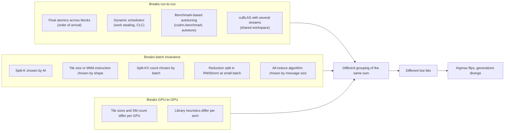
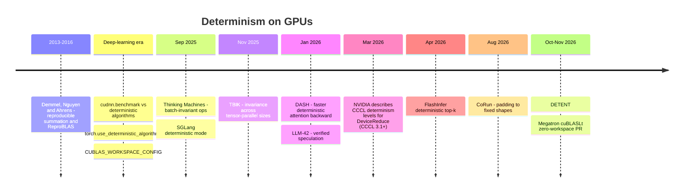

---
tags:
  - gpu-programming
  - kernels-and-optimization
  - cuda
  - determinism
  - reproducibility
  - batch-invariance
  - llm-inference
  - floating-point
status: complete
sources:
  - https://www.thinkingmachines.ai/blog/defeating-nondeterminism-in-llm-inference/
  - https://nvidia.github.io/cccl/unstable/cccl/determinism.html
  - https://nvidia.github.io/cccl/unstable/cub/determinism.html
  - https://developer.nvidia.com/blog/controlling-floating-point-determinism-in-nvidia-cccl
  - https://nvidia.github.io/cccl/unstable/cub/device_topk_requirements.html
  - https://docs.nvidia.com/cuda/archive/12.9.2/cublas/index.html#results-reproducibility
  - https://docs.nvidia.com/cuda/cublasdx/warnings/bit_identical_sm.html
  - https://docs.pytorch.org/docs/2.15/notes/randomness.html
  - https://docs.nvidia.com/deeplearning/cudnn/backend/v9.26.0/release-notes.html
  - https://bebop.cs.berkeley.edu/reproblas
  - https://www2.eecs.berkeley.edu/Pubs/TechRpts/2015/EECS-2015-229.html
  - https://www.lmsys.org/blog/2025-09-22-sglang-deterministic
  - https://docs.sglang.io/advanced_features/deterministic_inference.html
  - https://docs.vllm.ai/en/stable/features/batch_invariance/
  - https://github.com/vllm-project/vllm/issues/27433
  - https://docs.nvidia.com/megatron-core/developer-guide/latest/apidocs/core/core.transformer.custom_layers.batch_invariant_kernels.html
  - https://github.com/NVIDIA/Megatron-LM/pull/8708
  - https://arxiv.org/pdf/2511.17826
  - https://arxiv.org/html/2601.21824
  - https://arxiv.org/pdf/2601.17768v2
  - https://arxiv.org/pdf/2608.14376
  - https://arxiv.org/pdf/2611.10611
  - https://rocm.docs.amd.com/projects/primus/en/main/04-technical-guides/determinism-and-reproducibility.html
  - https://github-users.yhajoa.workers.dev/flashinfer-ai/flashinfer/pull/2661
  - https://developer.nvidia.com/blog/nvidia-hopper-architecture-in-depth/
  - https://people.eecs.berkeley.edu/~demmel/ma221_Fall23/B20_Repro_BLAS_SIAMNews18.pdf
  - https://iclr.cc/virtual/2026/poster/10008616
created: 2026-11-28
updated: 2026-11-28
---

## Table Of Contents

---

- [[#TL;DR|TL;DR]]
- [[#The Problem|The Problem]]
- [[#Foundations|Foundations]]
    - [[#Why the Same Sum Gives Different Bits|Why the Same Sum Gives Different Bits]]
    - [[#Four Strengths of Determinism|Four Strengths of Determinism]]
    - [[#Where the Bits Diverge|Where the Bits Diverge]]
- [[#How We Got Here|How We Got Here]]
- [[#How It Works|How It Works]]
    - [[#Run-to-Run: Fixed Trees Instead of Atomics|Run-to-Run: Fixed Trees Instead of Atomics]]
    - [[#GPU-to-GPU: Reproducible Accumulators|GPU-to-GPU: Reproducible Accumulators]]
    - [[#Batch-Invariant Matmul|Batch-Invariant Matmul]]
    - [[#Batch-Invariant Normalization and Attention|Batch-Invariant Normalization and Attention]]
    - [[#Deterministic Sampling|Deterministic Sampling]]
    - [[#Across GPUs: Tensor-Parallel Invariance|Across GPUs: Tensor-Parallel Invariance]]
    - [[#Deterministic Training: The Backward Pass|Deterministic Training: The Backward Pass]]
    - [[#Worked Example: Why Small Batches Split K|Worked Example: Why Small Batches Split K]]
    - [[#Cheaper Than Full Batch Invariance|Cheaper Than Full Batch Invariance]]
- [[#Where It Is Now|Where It Is Now]]
- [[#Trade-offs & Open Problems|Trade-offs & Open Problems]]
- [[#Resources|Resources]]
- [[#Related Notes|Related Notes]]

## ***TL;DR***
---
*A GPU kernel is deterministic when the same inputs give the same bits. Most kernels are already deterministic run to run; what breaks LLM inference is that the reduction order for one request changes with the size of the batch it was packed into.*

- **The root cause is floating-point non-associativity.** $(a + b) + c$ and $a + (b + c)$ can round differently, so any change in *how a sum is split up* changes the low bits. Atomics, dynamic schedules, split-K, split-KV, autotuned kernel choice and collective-algorithm switching all change that split.
- **Run-to-run determinism is mostly solved.** Libraries guarantee it under fixed conditions: cuBLAS gives "the same bit-wise results at every run" on GPUs "with the same architecture and the same number of SMs" with one stream active ([cuBLAS docs](https://docs.nvidia.com/cuda/archive/12.9.2/cublas/index.html#results-reproducibility)); CUB's `DeviceReduce` defaults to `run_to_run` and offers `gpu_to_gpu` through a reproducible accumulator at a 20 to 30% cost on large inputs ([NVIDIA, Mar 2026](https://developer.nvidia.com/blog/controlling-floating-point-determinism-in-nvidia-cccl)).
- **Batch invariance is the LLM-serving problem.** Thinking Machines (Sep 2025) showed the forward pass uses no atomics, yet 1,000 temperature-0 completions of one prompt gave 80 different outputs, because matmul, RMSNorm and attention pick a different reduction strategy when the batch changes. Fixing one strategy per op made all 1,000 identical ([Thinking Machines](https://www.thinkingmachines.ai/blog/defeating-nondeterminism-in-llm-inference/)).
- **The price is parallelism.** Split-K and split-KV exist to fill the GPU at small batch; batch-invariant kernels give that up or constrain it. Reported slowdowns: 1.6x (Thinking Machines' test), 34% average (SGLang), 18 to 35% throughput in vLLM v0.27, versus 1.04 to 1.17x per-token latency for DETENT, which keeps fast kernels and pins only the batch-dependent choices ([DETENT](https://arxiv.org/pdf/2611.10611)).
- **Where it is now (Nov 2026).** vLLM (`VLLM_BATCH_INVARIANT=1`, beta), SGLang (`--enable-deterministic-inference`) and Megatron Core ship batch-invariant modes; RL teams use them for bitwise-identical sampler and trainer logprobs. Research has moved to making determinism cheap: pinning kernel selection (DETENT), padding to fixed shapes (CoRun), verify-and-rollback (LLM-42), tree-ordered kernels that are invariant across tensor-parallel sizes (TBIK, ICML 2026) and faster deterministic attention backward (DASH).

## ***The Problem***
---
*Users, testers and RL trainers all assume "same input, same output". On a GPU that assumption fails in ways that look random but are not: the result depends on things the caller never sees, such as which other requests share the batch.*

Run a model at temperature 0 and you expect one answer. Thinking Machines asked Qwen3-235B-A22B "Tell me about Richard Feynman" 1,000 times at temperature 0 through vLLM and got **80 unique completions**; the most common appeared 78 times. All 1,000 agreed for 102 tokens, then split at token 103: 992 said "Queens, New York", 8 said "New York City" ([Thinking Machines](https://www.thinkingmachines.ai/blog/defeating-nondeterminism-in-llm-inference/)).

Why it matters:

| Who | What breaks |
|---|---|
| Debugging and testing | A bug that shows up once in 80 runs; golden-output tests that flake; a "regression" that is only a different batch |
| Evaluation | Benchmark scores move with server load; A/B comparisons mix model change with batching noise |
| RL post-training | The sampler (vLLM, SGLang) and the trainer (FSDP, Megatron) compute different probabilities for the same tokens, so "on-policy" RL is quietly off-policy; Thinking Machines saw reward collapse without importance weighting and a flat KL of exactly 0 with bitwise-identical sampler and trainer ([Thinking Machines](https://www.thinkingmachines.ai/blog/defeating-nondeterminism-in-llm-inference/); see [[RL for Reasoning]]) |
| Training reproducibility | Two runs from the same seed diverge; a loss spike cannot be replayed to find its cause |
| Kernel correctness | A new kernel's output differs from the reference; is it a bug or a different summation order? ([[Benchmarking GPU Kernels Correctly]]) |

The common folk explanation, "GPUs run threads concurrently, floats aren't associative, so results vary", is "not entirely wrong" but incomplete. The LLM forward pass contains no atomic adds and is run-to-run deterministic for a fixed batch. What changes from request to request is **the batch**, because the server batches whatever traffic is in flight ([Thinking Machines](https://www.thinkingmachines.ai/blog/defeating-nondeterminism-in-llm-inference/)).

## ***Foundations***
---
*Three ideas carry the whole topic: floating-point addition depends on grouping, "deterministic" comes in several strengths, and each strength is broken by a different mechanism.*

### Why the Same Sum Gives Different Bits

A float keeps a fixed number of significant bits, so every addition rounds. Grouping decides which roundings happen.

**Worked example in BF16.** BF16 keeps 8 significant bits (see [[Low-Precision Formats - FP8, FP4 and MX]]). Between 256 and 512 the gap between neighbouring BF16 values is 2, so 257 is not representable and rounds to the even neighbour, 256.

$$
(256 + 1) + 1 = 256 + 1 = 256 \qquad\text{but}\qquad 256 + (1 + 1) = 256 + 2 = 258
$$

Read it as: add the ones one at a time and each is rounded away; add them together first and they survive. A dot product of length 4,096 does thousands of such roundings, and the result depends on how the 4,096 terms were grouped. The classic double-precision version is $(0.1 + 10^{20}) - 10^{20} = 0$ while $0.1 + (10^{20} - 10^{20}) = 0.1$ ([[Parallel Reduction and Scan]]).

Two consequences follow:

- **Every parallel reduction picks a grouping.** A warp shuffle tree, a block tree, a grid of partial sums, a split-K of a matmul: each is a particular bracketing of the same sum. Change the tree and you change the bits, even though every tree is "correct" to within rounding error.
- **The differences are tiny but they compound.** A one-ulp difference in a logit can flip an argmax when two tokens are nearly tied, and after that the two generations see different prefixes and diverge completely, as at token 103 above.

### Four Strengths of Determinism

| Guarantee | Same bits when... | Typical way to get it | Who offers it |
|---|---|---|---|
| **Run-to-run** | The same call is repeated on the same GPU, build, tuning and launch configuration | No float atomics across blocks; fixed tree; fixed kernel choice | CCCL `run_to_run` ([CCCL](https://nvidia.github.io/cccl/unstable/cccl/determinism.html)); cuBLAS on same arch and SM count, one stream |
| **Batch-invariant** | The same request is computed inside batches of different size or content | One reduction strategy per op, independent of batch shape | Thinking Machines `batch_invariant_ops`; vLLM, SGLang, Megatron modes |
| **Parallelism-invariant** | The model runs at a different tensor-parallel size (TP=1 vs TP=4) | A reduction tree whose shape doesn't depend on how the sum is split across GPUs | TBIK ([Zhang et al., ICML 2026](https://arxiv.org/pdf/2511.17826)) |
| **GPU-to-GPU** | The same call runs on a different GPU model (Ampere vs Hopper) | An accumulator whose result is independent of order | CCCL `gpu_to_gpu` (reductions only) |

CCCL orders its levels `not_guaranteed` ⊆ `run_to_run` ⊆ `gpu_to_gpu` and is explicit about what sits outside all of them: different CCCL or CUDA versions, and a changed tuning policy ([CCCL determinism](https://nvidia.github.io/cccl/unstable/cccl/determinism.html)). cuBLAS likewise promises nothing across toolkit versions, and cuBLASDx warns that the same BLAS call on GPUs of different CUDA architectures is not guaranteed to be bit-identical ([cuBLAS](https://docs.nvidia.com/cuda/archive/12.9.2/cublas/index.html#results-reproducibility); [cuBLASDx](https://docs.nvidia.com/cuda/cublasdx/warnings/bit_identical_sm.html)). PyTorch says the same at the framework level: "Completely reproducible results are not guaranteed across PyTorch releases, individual commits, or different platforms" ([PyTorch](https://docs.pytorch.org/docs/2.15/notes/randomness.html)).

Batch invariance is orthogonal to run-to-run determinism: a kernel can be perfectly run-to-run deterministic for each batch size and still give request A different bits in a batch of 8 than in a batch of 64.

### Where the Bits Diverge



The first box is the classic HPC worry; the second box is what Thinking Machines identified as the dominant cause in LLM serving; the third is why "same code on a new GPU" is a separate guarantee. Dynamic schedulers only matter when they change *who sums what*: a tile computed whole by whichever SM grabs it gives the same bits, while partial tiles combined in arrival order do not ([[Work Stealing and Dynamic Load Balancing]], [[Persistent Kernels and Stream-K]]).

## ***How We Got Here***
---
*Reproducible summation was an HPC research topic in the 2010s; deep-learning frameworks added "deterministic" switches for training; then in 2025 LLM serving and RL turned batch invariance into a production feature, and 2026 research went after its cost.*



| Era | What changed | Source |
|---|---|---|
| 2013 to 2016: reproducible summation | Demmel and Nguyen's binned accumulators make a sum independent of order, partitioning and processor count in one read-only pass and one reduction; ReproBLAS uses a 6-word accumulator, about 4x slower than MKL for a 4,096-element dot product on one core, under 1.2x slower summing $10^6$ doubles on more than 512 cores | [ReproBLAS](https://bebop.cs.berkeley.edu/reproblas), [Ahrens, Nguyen and Demmel](https://www2.eecs.berkeley.edu/Pubs/TechRpts/2015/EECS-2015-229.html) |
| Deep-learning frameworks | cuDNN benchmarking may pick different convolution algorithms run to run; `torch.use_deterministic_algorithms(True)` swaps in deterministic ops or raises an error; cuBLAS adds `CUBLAS_WORKSPACE_CONFIG` for multi-stream determinism | [PyTorch](https://docs.pytorch.org/docs/2.15/notes/randomness.html), [cuBLAS](https://docs.nvidia.com/cuda/archive/12.9.2/cublas/index.html#results-reproducibility) |
| Sep 2025: batch invariance named | Thinking Machines (Horace He et al.) traces serving nondeterminism to batch-dependent reduction strategies and releases batch-invariant matmul, RMSNorm and attention | [Thinking Machines](https://www.thinkingmachines.ai/blog/defeating-nondeterminism-in-llm-inference/) |
| Sep 2025: in a serving engine | SGLang ships deterministic inference on FlashInfer, FA3 and Triton attention, with chunked prefill and seeded sampling, at a 34% average slowdown | [LMSYS](https://www.lmsys.org/blog/2025-09-22-sglang-deterministic) |
| Nov 2025 to Jan 2026: beyond one GPU and one pass | TBIK makes outputs independent of tensor-parallel size; DASH speeds up deterministic FlashAttention backward; LLM-42 makes determinism a per-request opt-in | [TBIK](https://arxiv.org/pdf/2511.17826), [DASH](https://arxiv.org/html/2601.21824), [LLM-42](https://arxiv.org/pdf/2601.17768v2) |
| 2026: libraries expose the contract | CCCL lets callers require a determinism level per call; cuDNN adds deterministic SDPA backward on Blackwell (9.18 FP16, 9.19 FP8); FlashInfer adds deterministic top-k | [NVIDIA](https://developer.nvidia.com/blog/controlling-floating-point-determinism-in-nvidia-cccl), [cuDNN notes](https://docs.nvidia.com/deeplearning/cudnn/backend/v9.26.0/release-notes.html), [FlashInfer #2661](https://github-users.yhajoa.workers.dev/flashinfer-ai/flashinfer/pull/2661) |
| Aug to Nov 2026: making it cheap | CoRun pads to fixed shapes; DETENT pins only kernel-selection inputs and reaches near-stock speed | [CoRun](https://arxiv.org/pdf/2608.14376), [DETENT](https://arxiv.org/pdf/2611.10611) |

## ***How It Works***
---
*Each guarantee has its own recipe: run-to-run means removing order-of-arrival effects, GPU-to-GPU means removing dependence on order entirely, and batch invariance means choosing one reduction strategy per op and never changing it with the batch.*

### Run-to-Run: Fixed Trees Instead of Atomics

The textbook grid-wide sum ends with every block doing `atomicAdd` into one float. The atomics are correct, but blocks finish in a different order each run, so the additions happen in a different order ([[CUDA Memory Model and Atomics]]). The deterministic version gives each block a fixed slot and sums the slots in a second, fixed step:

```cuda
// (a) Not deterministic: blocks add into one float in whatever order they finish.
__global__ void sum_atomic(const float* x, float* out, int n) {
    float s = block_sum(x, n);                 // fixed tree inside the block
    if (threadIdx.x == 0) atomicAdd(out, s);   // arrival order varies run to run
}

// (b) Run-to-run deterministic: one slot per block, summed later in index order.
__global__ void sum_partials(const float* x, float* partial, int n) {
    float s = block_sum(x, n);                 // same fixed tree
    if (threadIdx.x == 0) partial[blockIdx.x] = s;  // slot chosen by block index
}
// A second launch reduces partial[0 .. gridDim.x) with one block and the same tree.
```

Line by line:

- `block_sum` stands for a block reduction (warp shuffles then shared memory, as in [[Parallel Reduction and Scan]]). Inside one block the tree is fixed by thread index, so it is already deterministic.
- In (a), `atomicAdd(out, s)` is the only source of variation: the hardware serializes the adds, but in arrival order.
- In (b), each block writes to `partial[blockIdx.x]`, a position that depends only on the block's index, not on timing.
- The second launch sums the partials with a fixed tree, so the full bracketing is fixed by `(n, gridDim.x, blockDim.x)`.

That last point is why the guarantee is "run-to-run": change the grid size (a different GPU with a different SM count, or a different tuning) and the bracketing changes. It is exactly CCCL's `run_to_run` level, which uses "a fixed hierarchical reduction tree instead of atomics", costs a second kernel, and performs close to the atomic version ([NVIDIA](https://developer.nvidia.com/blog/controlling-floating-point-determinism-in-nvidia-cccl)).

Library-level run-to-run checklist:

- **cuBLAS.** Deterministic per toolkit, architecture and SM count, but only with one active stream; with several streams sharing a handle it may pick different internal implementations. Fixes: a workspace per stream (`cublasSetWorkspace`), a handle per stream, `cublasLtMatmul` with a user-owned workspace, or `CUBLAS_WORKSPACE_CONFIG=:16:8` (may limit performance) or `:4096:8` (about 24 MiB more GPU memory). Routines put in atomics mode with `cublasSetAtomicsMode` (for example `symv`, `hemv`) are not bitwise reproducible ([cuBLAS](https://docs.nvidia.com/cuda/archive/12.9.2/cublas/index.html#results-reproducibility); [[cuBLAS and cuDNN]]).
- **cuDNN and PyTorch.** `torch.backends.cudnn.benchmark = True` times several algorithms and may pick a different one per run; `False` selects deterministically; `cudnn.deterministic = True` makes the chosen convolution algorithm deterministic; `torch.use_deterministic_algorithms(True)` covers other ops too and raises an error for ops with no deterministic version (CUDA `index_add_` for example). With deterministic mode on, `fill_uninitialized_memory` (default `True`) fills `torch.empty` results so uninitialized memory can't leak in ([PyTorch](https://docs.pytorch.org/docs/2.15/notes/randomness.html)).
- **Autotuners.** Any "time a few kernels, keep the fastest" step can pick differently from run to run. AMD's Primus deterministic mode turns off hipBLASLt and Primus-Turbo autotuning and `torch.compile`, and sets `ROCBLAS_DEFAULT_ATOMICS_MODE=0` and `NCCL_ALGO=Ring` ([Primus](https://rocm.docs.amd.com/projects/primus/en/main/04-technical-guides/determinism-and-reproducibility.html); [[GEMM Autotuning and Kernel Selection]]).

### GPU-to-GPU: Reproducible Accumulators

A fixed tree is still tied to the grid. To get the same bits on any GPU, the result must not depend on order *at all*. The trick, from Demmel and Nguyen's reproducible summation, is to "divide the range of all floating-point exponents into 'bins' of a certain fixed width" and split each input's bits across them. Within a bin the values share an exponent range, so adding them works like fixed-point arithmetic: exact, and therefore the same in any order. Only the few highest bins are kept, in an accumulator of about six floats, and a final fixed step turns it back into one float ([SIAM News, 2018](https://people.eecs.berkeley.edu/~demmel/ma221_Fall23/B20_Repro_BLAS_SIAMNews18.pdf)). ReproBLAS's bound for its default double-precision accumulator is:

$$
|\hat s - s| \;\le\; n \cdot 2^{-80} \cdot \max_j |x_j| \;+\; 7\,\varepsilon \,\Big|\sum_j x_j\Big|, \qquad \varepsilon = 2^{-53}
$$

Read it as: the error is a tiny term from the dropped low-order bits ($2^{-80}$ per input, relative to the largest input) plus seven units of rounding on the final answer. For $n = 10^6$ inputs with largest magnitude 1 and a true sum of 1,000, the first term is about $10^6 \times 8.3 \times 10^{-25} \approx 8 \times 10^{-19}$ and the second about $7 \times 1.1 \times 10^{-16} \times 1000 \approx 7.8 \times 10^{-13}$: tighter than ordinary recursive summation and identical on every machine ([ReproBLAS](https://bebop.cs.berkeley.edu/reproblas)).

CCCL's `gpu_to_gpu` level uses a Reproducible Floating-point Accumulator (RFA) of this kind: inputs are grouped into a fixed number of exponent ranges, three bins by default; more bins give more accuracy and cost more ([NVIDIA](https://developer.nvidia.com/blog/controlling-floating-point-determinism-in-nvidia-cccl)). Requesting it:

```cpp
auto env = cuda::execution::require(cuda::execution::determinism::gpu_to_gpu);
auto err = cub::DeviceReduce::Sum(d_in.begin(), d_out.begin(), n, env);
```

- `cuda::execution::require(...)` builds an *execution environment* that carries requirements to the algorithm.
- `determinism::gpu_to_gpu` asks for the strongest level; the alternatives are `run_to_run` (the `DeviceReduce` default) and `not_guaranteed`.
- The environment goes to the single-phase API (no separate temp-storage query); the two-phase API doesn't accept one.
- An unsupported combination "is rejected at compile time", so you cannot silently get a weaker guarantee ([CUB determinism](https://nvidia.github.io/cccl/unstable/cub/determinism.html)).

On an H200, `gpu_to_gpu` cost 20 to 30% extra time at large sizes; `run_to_run` was close to `not_guaranteed` ([NVIDIA](https://developer.nvidia.com/blog/controlling-floating-point-determinism-in-nvidia-cccl)).

### Batch-Invariant Matmul

A matmul is batch-invariant if row $i$ of $C = AB$ comes out with the same bits whether $A$ has 1 row or 1,000. Each element of $C$ is a length-$K$ dot product; the kernel's job is to sum those $K$ products in the same bracketing regardless of $M$ (the batch dimension). Three things in a normal GEMM library break this ([Thinking Machines](https://www.thinkingmachines.ai/blog/defeating-nondeterminism-in-llm-inference/)):

| Mechanism | What it does | Why it breaks invariance |
|---|---|---|
| **Split-K** | When $M$ and $N$ give too few output tiles to fill the SMs, split the $K$ loop across blocks and add the partials | The bracketing of each dot product now depends on $M$ ([[Persistent Kernels and Stream-K]]) |
| **Instruction and tile choice** | Small $M$ may use a smaller MMA instruction or no [[Tensor Cores]] | Each instruction reduces inside itself in its own order |
| **Stream-K** | Splits $K$ unevenly so every SM gets equal work | Not even invariant to a row's *position* in the batch |

The fix is to **compile one kernel configuration and use it for every shape**: no split-K, fixed tile sizes, fixed instruction. Data-parallel over output tiles only, so each output element's $K$ loop runs start to finish inside one block. Thinking Machines put the cost at about 20% against cuBLAS ([Thinking Machines](https://www.thinkingmachines.ai/blog/defeating-nondeterminism-in-llm-inference/)). In practice it is often a persistent Triton kernel; Megatron Core's `matmul_persistent` sizes its grid from the number of compute units ([Megatron Core](https://docs.nvidia.com/megatron-core/developer-guide/latest/apidocs/core/core.transformer.custom_layers.batch_invariant_kernels.html)). An illustrative launch:

```python
BLOCK_M, BLOCK_N, BLOCK_K = 128, 128, 64          # illustrative; never chosen from M
num_tiles = cdiv(M, BLOCK_M) * cdiv(N, BLOCK_N)
grid = (min(NUM_SMS, num_tiles),)                 # persistent: loop over tiles
matmul_persistent[grid](a, b, c, M, N, K,
                        BLOCK_M=BLOCK_M, BLOCK_N=BLOCK_N, BLOCK_K=BLOCK_K)
```

- The block sizes are constants, so the MMA instruction and the $K$-loop step never change with the batch.
- `grid` *does* depend on `M`, and that is fine: a persistent program loops over whole tiles, and each tile's $K$ loop runs in the same order whichever program picks it up. The schedule changes; the bracketing of every dot product doesn't.
- There is no split-K argument at all; the kernel simply has no way to split $K$.

You can also get this from a vendor library by taking split-K off the table. cuBLASLt needs workspace memory to choose a split-K kernel, so a **zero workspace** forbids it. Megatron's open PR (approved Nov 17, 2026) routes PyTorch's native GEMMs to cuBLASLt with workspace 0 in batch-invariant mode, after finding that a bias-free `torch.matmul` (the output layer) still went to cuBLAS with a full workspace and could split $K$ by row count, breaking bit-equality between inference and training ([Megatron-LM #8708](https://github.com/NVIDIA/Megatron-LM/pull/8708)).

### Batch-Invariant Normalization and Attention

**RMSNorm (and other row reductions).** The data-parallel strategy gives each row to one block, so each row's sum of squares is reduced inside one block with a fixed tree. Larger batches just give each block more rows in sequence. The temptation is at small batch, where most SMs sit idle and a split reduction would help; batch-invariant kernels decline it, and Thinking Machines call ignoring that case "not completely unreasonable" ([Thinking Machines](https://www.thinkingmachines.ai/blog/defeating-nondeterminism-in-llm-inference/)). Megatron's version computes the statistics in FP32 ([Megatron Core](https://docs.nvidia.com/megatron-core/developer-guide/latest/apidocs/core/core.transformer.custom_layers.batch_invariant_kernels.html)).

**Attention** has two extra traps ([Thinking Machines](https://www.thinkingmachines.ai/blog/defeating-nondeterminism-in-llm-inference/); [[FlashAttention]], [[KV Cache]]):

1. **The KV cache must look the same however the tokens got there.** A token's attention over its prefix must reduce in the same order whether the prefix came from the cache or from the current prefill chunk. The fix is to write the new keys and values into the KV cache and page table *before* the attention kernel runs, so every query reads one consistent layout.
2. **Split-KV must use a fixed split size, not a fixed number of splits.** Decode has one query per sequence, too little parallelism, so FlashDecoding-style kernels split the KV length across blocks and merge the partials. If the kernel chooses "4 splits" from the batch, the split boundaries move. With a fixed split size of 256, a KV length of 1,000 always becomes $256 + 256 + 256 + 232$, with boundaries at fixed positions 256, 512 and 768, whatever else is in the batch.

SGLang applies the same ideas per backend: FlashInfer with a fixed split size, FA3 with one split, Triton with a fixed decode split size, and chunked-prefill boundaries aligned to multiples of the split size so a chunk never cuts a split in two ([LMSYS](https://www.lmsys.org/blog/2025-09-22-sglang-deterministic)).

### Deterministic Sampling

At temperature 0, batch-invariant logits are enough. At temperature above 0 the random draw must also be reproducible, and tied to the *request*, not to its slot in the batch:

- **Seeded per-request noise.** SGLang replaces `torch.multinomial` with seeded, hash-based Gumbel noise added to the logits; with no seed it uses 42, and a per-request `sampling_seed` gives different but reproducible outputs, useful for GRPO groups ([LMSYS](https://www.lmsys.org/blog/2025-09-22-sglang-deterministic); [SGLang docs](https://docs.sglang.io/advanced_features/deterministic_inference.html)). CoRun binds RNG state to the request rather than its batch slot for the same reason ([CoRun](https://arxiv.org/pdf/2608.14376)). See [[Random Number Generation on GPUs]].
- **Tie-breaking in top-k.** When several logits tie at the $k$-th value, a parallel top-k returns an arbitrary subset. CUB's top-k uses the same three determinism levels but defines determinism over *which* items are selected, with separate `tie_break` and `output_ordering` controls ([CUB determinism](https://nvidia.github.io/cccl/unstable/cub/determinism.html), [Top-K requirements](https://nvidia.github.io/cccl/unstable/cub/device_topk_requirements.html)); FlashInfer's opt-in deterministic top-k costs 7 to 10% on an A100 ([FlashInfer #2661](https://github-users.yhajoa.workers.dev/flashinfer-ai/flashinfer/pull/2661)). Details in [[Top-k and Sampling Kernels]].

### Across GPUs: Tensor-Parallel Invariance

With tensor parallelism, row-parallel layers (attention output and MLP down projections) end in an **all-reduce**, a sum across GPUs. Two things vary:

- **Algorithm switching.** Collective libraries pick ring, tree or custom kernels by message size, and message size grows with the batch. vLLM's batch-invariant mode keeps its custom all-reduce with a fixed reduction order and disables the FlashInfer, AITER and QuickReduce all-reduces; it still can't cover tensors whose size isn't a multiple of 16 bytes, which may switch between NCCL and the custom kernel with batch size ([vLLM](https://docs.vllm.ai/en/stable/features/batch_invariance/); [[Multi-GPU Communication - NVLink and NCCL]]).
- **TP size itself.** At TP=1 one GPU sums all $K$ terms; at TP=4 each GPU sums a quarter and the all-reduce adds four partials. Different bracketing, different bits, even with every kernel batch-invariant. This bites RL because trainers often run FSDP at TP=1 while rollouts run vLLM at higher TP.

**TBIK** (Tree-Based Invariant Kernels) fixes the second problem by using one binary-tree reduction order for both the in-GPU matmul (in Triton) and the cross-GPU all-reduce, so that splitting the tree across 1, 2, 4 or 8 GPUs just cuts it at different levels without changing its shape. Combined with batch-invariant ops on `o_proj` and `down_proj`, it gave one output per prompt across all configurations tested. Cost on Qwen3-8B, four H20s, batch 64: 22 to 63% more latency than BF16 (batch-invariant ops alone: 10 to 33%); the tree matmul reaches about 63% of cuBLAS BF16 throughput (about 120 vs 190 TFLOPS) at large batch. In a GSM8K GRPO run (vLLM TP=4 vs FSDP TP=1), Pass@1 was 0.73 with TBIK, 0.68 with batch-invariant ops only and 0.60 with plain BF16 ([Zhang et al., ICML 2026](https://arxiv.org/pdf/2511.17826)).

### Deterministic Training: The Backward Pass

The forward pass of a transformer has no atomics; the backward pass does. In FlashAttention's backward, many blocks contribute to the same $dQ$ rows and the default implementation accumulates them with `atomicAdd`. FA3's deterministic mode serializes the $dQ$ accumulation with barriers in a fixed order (for example, by block index), up to **37.9% slower**. DASH (Jan 2026; ICLR 2026, [poster](https://iclr.cc/virtual/2026/poster/10008616)) argues the slowdown comes from the tile schedule fighting the fixed accumulation order rather than from serialization itself, and reorders the schedule (descending query tiles for causal masks, phase-shifted assignment of work to SMs) for up to 1.28x over FA3's deterministic backward on H800 ([DASH](https://arxiv.org/html/2601.21824)).

Full training reproducibility needs every layer to cooperate. SGLang's RL work (slime) needed FlashAttention 2 instead of 3 for a deterministic backward, Megatron's deterministic mode, NCCL and cuBLAS environment variables and `torch.use_deterministic_algorithms(True)` to get two identical Qwen3-8B GRPO training curves ([LMSYS](https://www.lmsys.org/blog/2025-09-22-sglang-deterministic)). On AMD, Primus found DeepSeek-V4's Triton, Gluon and Turbo attention backends use `atomic_add` in backward and falls back to eager attention, which only fits short sequences ([Primus](https://rocm.docs.amd.com/projects/primus/en/main/04-technical-guides/determinism-and-reproducibility.html)). Weight gradients of [[Grouped GEMM and Ragged Batches|grouped GEMMs]] have the same issue when their ragged token reductions are split dynamically.

### Worked Example: Why Small Batches Split K

Take a decode-step projection on an H100 SXM5 (132 SMs, [NVIDIA Hopper in depth](https://developer.nvidia.com/blog/nvidia-hopper-architecture-in-depth/)): $C = AB$ with $M = 8$ tokens, $N = K = 4096$, and $128 \times 128$ output tiles.

$$
\text{tiles} = \Big\lceil \tfrac{M}{128} \Big\rceil \cdot \Big\lceil \tfrac{N}{128} \Big\rceil = 1 \cdot 32 = 32, \qquad \text{SM use} = \tfrac{32}{132} \approx 24\%
$$

Read it as: with no split, only 32 blocks exist, so 100 SMs idle. Split $K$ four ways and there are $32 \times 4 = 128$ blocks, about 97% of the SMs, each summing 1,024 products; the four partials are then added. At $M = 1024$ there are $8 \times 32 = 256$ tiles, enough to fill the GPU twice over, so the library stops splitting.

So the *same* token's dot product is one 4,096-term sum when the batch is large and four 1,024-term sums plus a combine when the batch is small. Both are correct; their bits differ. A batch-invariant kernel refuses the split and accepts the 24% utilization at $M = 8$, which is where most of its cost comes from. Decode GEMMs are memory-bound ([[Roofline Model and Arithmetic Intensity]]), so 32 busy SMs don't mean 4x slower, but they do mean less of the memory bandwidth gets used.

Measured end-to-end costs of full batch invariance:

| Measurement | Overhead | Source |
|---|---|---|
| Thinking Machines, Qwen3-8B, one GPU, 1,000 sequences | 26 s default, 55 s unoptimized deterministic, 42 s with better attention | [Thinking Machines](https://www.thinkingmachines.ai/blog/defeating-nondeterminism-in-llm-inference/) |
| SGLang deterministic mode | 34.35% average slowdown (25 to 45% per workload) | [LMSYS](https://www.lmsys.org/blog/2025-09-22-sglang-deterministic) |
| vLLM v0.27, Qwen3-1.7B, one GPU | Throughput down 29.9% (RTX 4090 D, compiled), 35.0% (H20, compiled); the persistent matmul is about 96.6% of the added kernel time on H20 | [vLLM #27433](https://github.com/vllm-project/vllm/issues/27433) |
| Triton batch-invariant GEMM vs cuBLAS | 194 vs 527 TFLOPS peak | [LLM-42](https://arxiv.org/pdf/2601.17768v2) |
| SGLang and vLLM deterministic modes vs stock | 1.67 to 10.3x per-token latency in DETENT's deployments | [DETENT](https://arxiv.org/pdf/2611.10611) |

### Cheaper Than Full Batch Invariance

Three 2026 systems attack the cost from different sides:

| System | Idea | Result |
|---|---|---|
| **DETENT** (vLLM, SGLang) | Many fast kernels are already batch-invariant; the problem is *kernel selection* reading batch-dependent values. Write selection in a small DSL, find the fewest values to pin with a min-cut, tune the rest per workload. Uses DeepGEMM, Triton fused-MoE, fixed rank-order all-reduce and an FA3 that keeps split-KV with batch-independent boundaries | 1.04 to 1.17x stock p50 per-token latency on Llama-3.1-70B and Qwen3-30B-A3B over 4 H100s; 3.4 to 5.7x faster than vLLM's deterministic mode; rollout and trainer logprobs bit-identical at 1.03x stock. Dynamic per-tensor FP8 scales break it ([DETENT](https://arxiv.org/pdf/2611.10611)) |
| **CoRun** | Most kernels are *position*-invariant; control the shape each request sees instead. Prefill each prompt alone, pad decode to the maximum concurrency (256) and replay one CUDA Graph, drop split-KV, use fixed-tree collectives | 15 to 324% more throughput than batch-invariant kernels; worse than them at low concurrency, so aimed at RL rollouts and evals ([CoRun](https://arxiv.org/pdf/2608.14376); [[CUDA Graphs]]) |
| **LLM-42** | Borrow [[Speculative Decoding]]: decode on the fast path, replay a window under a fixed-shape schedule to verify, roll back on mismatch; opt in per request | Within 1 to 8% of non-deterministic throughput when 5 to 50% of traffic is deterministic; worst case recomputed 10.97% of tokens ([LLM-42](https://arxiv.org/pdf/2601.17768v2)) |

All three keep the same scope limit as the batch-invariant modes: determinism holds for fixed weights, software stack, hardware and parallel configuration.

## ***Where It Is Now***
---
*As of November 2026: libraries state determinism as an explicit contract, the two main open-source LLM servers and Megatron ship batch-invariant modes used mainly for RL and debugging, and research is closing the speed gap.*

- **CCCL.** `DeviceReduce` supports all three levels (default `run_to_run`, `gpu_to_gpu` for some type/operator combinations), `DeviceScan` defaults to `not_guaranteed` with partial support for the stronger levels, `DeviceSegmentedReduce` supports up to `run_to_run`, and `DeviceTopK` has its own selection-based contract; NVIDIA says more algorithms will follow ([CUB determinism](https://nvidia.github.io/cccl/unstable/cub/determinism.html); [NVIDIA, Mar 2026](https://developer.nvidia.com/blog/controlling-floating-point-determinism-in-nvidia-cccl)). CCCL 4.0 will require top-k's `determinism` and `tie_break` to be given together ([Top-K requirements](https://nvidia.github.io/cccl/unstable/cub/device_topk_requirements.html)).
- **cuBLAS and cuDNN.** cuBLAS's guarantee is still per toolkit, architecture and SM count with stream caveats; cuDNN added deterministic SDPA backward on Blackwell in 9.18 (FP16) and 9.19 (FP8) ([cuDNN notes](https://docs.nvidia.com/deeplearning/cudnn/backend/v9.26.0/release-notes.html); [[cuBLAS and cuDNN]]). No documented batch-invariant mode turned up in cuBLAS's docs; frameworks get one by forbidding split-K (zero workspace) or replacing the GEMM with their own kernel.
- **vLLM.** `VLLM_BATCH_INVARIANT=1` is beta, on NVIDIA GPUs of compute capability 8.0+, AMD Instinct (gfx90a, gfx942, gfx950) and Intel XPUs, with a validated model list that includes DeepSeek-V3/R1, Qwen3 dense and MoE, Llama 3 and GPT-OSS. It runs tensor parallelism with a fixed-order custom all-reduce, and on Ada, Hopper and Blackwell uses breakable CUDA graphs instead of `torch.compile` ([vLLM docs](https://docs.vllm.ai/en/stable/features/batch_invariance/)). Open items: prefix caching is untested and a cold-vs-warm divergence is reported on FLASH_ATTN, FlashInfer MLA is blocked upstream, and a high-concurrency logprob mismatch (#51187) has no known cause ([vLLM #27433](https://github.com/vllm-project/vllm/issues/27433)).
- **SGLang.** `--enable-deterministic-inference` on FlashInfer, FA3 (the default) and Triton attention, with CUDA graphs, chunked prefill and temperature > 0; radix cache works with FA3 and Triton but not FlashInfer ([SGLang docs](https://docs.sglang.io/advanced_features/deterministic_inference.html)).
- **Megatron Core.** A batch-invariant mode patches `aten::mm`, `addmm`, mean and log-softmax and Transformer Engine GEMM and RMSNorm, with Triton and TE backends ([Megatron Core](https://docs.nvidia.com/megatron-core/developer-guide/latest/apidocs/core/core.transformer.custom_layers.batch_invariant_kernels.html)); the cuBLASLt zero-workspace change for native GEMMs was approved on Nov 17, 2026 but not yet merged ([#8708](https://github.com/NVIDIA/Megatron-LM/pull/8708)).
- **AMD.** Primus's `PRIMUS_DETERMINISTIC=1` sets ring collectives, no atomics in rocBLAS, no nondeterministic TE kernels and no autotuning, and is recommended for debugging and validation rather than throughput runs ([Primus](https://rocm.docs.amd.com/projects/primus/en/main/04-technical-guides/determinism-and-reproducibility.html); [[ROCm and HIP]]).
- **Research.** TBIK (ICML 2026) for TP-size invariance, DASH (ICLR 2026) for deterministic attention backward, LLM-42, CoRun and DETENT for cheaper serving determinism. DETENT's near-stock numbers suggest the remaining cost is mostly engineering, not physics.

## ***Trade-offs & Open Problems***
---
*Determinism is a dial, not a switch: each stronger guarantee rules out a performance trick, and every guarantee stops at the edge of a fixed software and hardware stack.*

| Choice | Gains | Costs |
|---|---|---|
| Float atomics, dynamic split-K, autotuning | Fastest; fills the GPU at any shape | Bits vary run to run and with batch |
| Fixed tree, fixed kernel (`run_to_run`) | Same bits for the same call on the same GPU | An extra pass or launch; still varies across GPUs and batch shapes |
| Reproducible accumulator (`gpu_to_gpu`) | Same bits on any GPU | 20 to 30% slower at large sizes; reductions only, some types only |
| Batch-invariant kernels | Same bits regardless of batchmates | Gives up split-K and flexible split-KV; roughly 18 to 60% lower throughput or longer runtime in current engines, more in per-token latency |
| Tree-ordered kernels (TBIK) | Same bits across TP sizes | 5 to 30% on top of batch invariance; tree matmul about 63% of cuBLAS |
| Pinned selection (DETENT) | Near-stock speed | Selection logic must be rewritten in a DSL; tuned tuple can be slow on other traffic (up to 4.17x) |
| Padding or verification (CoRun, LLM-42) | Keep fast kernels | Wasted compute at low concurrency; rollbacks and pauses |

Open problems:

- **Prefix caching and speculative decoding.** Both change how a request's tokens get computed (from cache, or verified in a batch of drafts). vLLM's batch-invariant mode doesn't yet cover prefix caching, and LLM-42 doesn't support prefix-cache sharing or speculative decoding ([vLLM #27433](https://github.com/vllm-project/vllm/issues/27433); [LLM-42](https://arxiv.org/pdf/2601.17768v2)).
- **Low precision.** Dynamic per-tensor FP8 scales are computed over the whole batch, so a request's quantization depends on its batchmates ([DETENT](https://arxiv.org/pdf/2611.10611)). Batch-invariant quantization needs per-token or static scales.
- **MoE.** Expert routing groups tokens by expert, so the grouped GEMM's shapes depend on everyone's routing; vLLM and DETENT cover MoE with fixed configurations, and routing replay is a separate fix on the RL side ([[Mixture of Experts]], [[Grouped GEMM and Ragged Batches]]).
- **Across versions and hardware.** No production stack promises the same bits across library versions or GPU generations for full models; only CCCL's reductions reach `gpu_to_gpu`. Reproducing an old result means pinning the whole stack.
- **Is bitwise determinism the right target?** Thinking Machines' RL result says exact sampler-trainer agreement helps; some argue for importance weighting or FP16 instead (see [[RL for Reasoning]]), and DETENT found no accuracy difference on GSM8K between its mode and SGLang's. The answer depends on whether you need reproducibility (debugging, audits, testing) or only small, unbiased differences (RL).
- **Testing "correct" kernels.** With nondeterminism allowed, correctness means "close to a reference within a tolerance", which is how faulty generated kernels slip through; deterministic modes make exact comparison possible ([[Benchmarking GPU Kernels Correctly]], [[Correctness Checking for Generated Kernels]]).

## ***Resources***
---
*Start with the Thinking Machines post for the batch-invariance argument, the CCCL blog and determinism pages for the library contract, then the vLLM and SGLang docs for practice and the 2026 papers for the cost frontier.*

**Core explanations**
- [Defeating Nondeterminism in LLM Inference](https://www.thinkingmachines.ai/blog/defeating-nondeterminism-in-llm-inference/): Horace He and Thinking Machines Lab, Sep 2025. Batch invariance, kernels, the RL result.
- [Controlling Floating-Point Determinism in NVIDIA CCCL](https://developer.nvidia.com/blog/controlling-floating-point-determinism-in-nvidia-cccl): Al Awar and Singanaboina, NVIDIA, Mar 2026.
- [ReproBLAS](https://bebop.cs.berkeley.edu/reproblas) and [Efficient Reproducible Floating Point Summation and BLAS](https://www2.eecs.berkeley.edu/Pubs/TechRpts/2015/EECS-2015-229.html): Ahrens, Nguyen and Demmel. The reproducible-summation background.

**Library contracts**
- [CCCL determinism](https://nvidia.github.io/cccl/unstable/cccl/determinism.html), [CUB determinism](https://nvidia.github.io/cccl/unstable/cub/determinism.html), [CUB Top-K requirements](https://nvidia.github.io/cccl/unstable/cub/device_topk_requirements.html).
- [cuBLAS results reproducibility](https://docs.nvidia.com/cuda/archive/12.9.2/cublas/index.html#results-reproducibility), [cuBLASDx bit-identical warning](https://docs.nvidia.com/cuda/cublasdx/warnings/bit_identical_sm.html), [cuDNN release notes](https://docs.nvidia.com/deeplearning/cudnn/backend/v9.26.0/release-notes.html).
- [PyTorch reproducibility notes](https://docs.pytorch.org/docs/2.15/notes/randomness.html).

**Serving and training stacks**
- [vLLM batch invariance](https://docs.vllm.ai/en/stable/features/batch_invariance/) and its [roadmap issue #27433](https://github.com/vllm-project/vllm/issues/27433).
- [Towards Deterministic Inference in SGLang](https://www.lmsys.org/blog/2025-09-22-sglang-deterministic) (LMSYS, Sep 2025) and [SGLang deterministic inference docs](https://docs.sglang.io/advanced_features/deterministic_inference.html).
- [Megatron Core batch-invariant kernels](https://docs.nvidia.com/megatron-core/developer-guide/latest/apidocs/core/core.transformer.custom_layers.batch_invariant_kernels.html) and [Megatron-LM PR #8708](https://github.com/NVIDIA/Megatron-LM/pull/8708).
- [Primus determinism and reproducibility](https://rocm.docs.amd.com/projects/primus/en/main/04-technical-guides/determinism-and-reproducibility.html) (AMD).
- [FlashInfer deterministic top-k, PR #2661](https://github-users.yhajoa.workers.dev/flashinfer-ai/flashinfer/pull/2661).

**Papers**
- [Deterministic Inference across Tensor Parallel Sizes That Eliminates Training-Inference Mismatch](https://arxiv.org/pdf/2511.17826): Zhang et al., ICML 2026. TBIK.
- [DASH: Deterministic Attention Scheduling for High-throughput Reproducible LLM Training](https://arxiv.org/html/2601.21824): Qiang et al. (SJTU, ByteDance Seed), Jan 2026.
- [LLM-42: Enabling Determinism in LLM Inference with Verified Speculation](https://arxiv.org/pdf/2601.17768v2): Gond, Kamath, Ramjee and Panwar (Microsoft Research, UW), 2026.
- [CoRun: Padding is Simple and Efficient for Deterministic LLM Inference](https://arxiv.org/pdf/2608.14376): Zhao et al., Aug 2026.
- [DETENT: Batch-Invariant LLM Serving and RL Rollouts at Near-Stock Speed](https://arxiv.org/pdf/2611.10611): Xin et al., 2026.

## Related Notes

- [[Parallel Reduction and Scan]] — The trees whose shape decides the bits; CCCL's determinism levels started there.
- [[CUDA Memory Model and Atomics]] — Why float atomics make sums order-dependent.
- [[Tiled Matrix Multiplication (GEMM)]] — Tiles and the K loop whose bracketing batch invariance fixes.
- [[Persistent Kernels and Stream-K]] — Split-K and Stream-K, the decompositions batch-invariant matmul gives up.
- [[Work Stealing and Dynamic Load Balancing]] — When dynamic schedules do and don't change results.
- [[Grouped GEMM and Ragged Batches]] — Ragged reductions in MoE weight gradients.
- [[Top-k and Sampling Kernels]] — Tie-breaking and deterministic sampling.
- [[Random Number Generation on GPUs]] — Seeds and per-request RNG state.
- [[cuBLAS and cuDNN]] — The vendor libraries' reproducibility guarantees and switches.
- [[GEMM Autotuning and Kernel Selection]] — Kernel selection by shape, the thing DETENT pins.
- [[Multi-GPU Communication - NVLink and NCCL]] — All-reduce algorithm choice and fixed-order collectives.
- [[Tensor Cores]] — MMA instructions with their own internal reduction order.
- [[Low-Precision Formats - FP8, FP4 and MX]] — Why BF16 and FP8 make reordering errors larger.
- [[CUDA Graphs]] — Fixed-shape replay used by CoRun and by vLLM's batch-invariant mode.
- [[Roofline Model and Arithmetic Intensity]] — Why idle SMs in a memory-bound decode GEMM cost less than they seem.
- [[Benchmarking GPU Kernels Correctly]] — What "correct" means when results may vary.
- [[Correctness Checking for Generated Kernels]] — Tolerances and reference checks (planned).
- [[ROCm and HIP]] — Determinism settings on AMD.
- [[FlashAttention]] — Deterministic backward and split-KV decode.
- [[KV Cache]] — Why cache layout must not depend on how tokens arrived.
- [[LLM Serving]] — Dynamic batching, the source of batch-dependent shapes.
- [[RL for Reasoning]] — The training-inference mismatch that made batch invariance a production feature.
- [[Speculative Decoding]] — The draft-and-verify pattern LLM-42 borrows.
- [[Mixture of Experts]] — Routing makes GEMM shapes depend on the whole batch.
