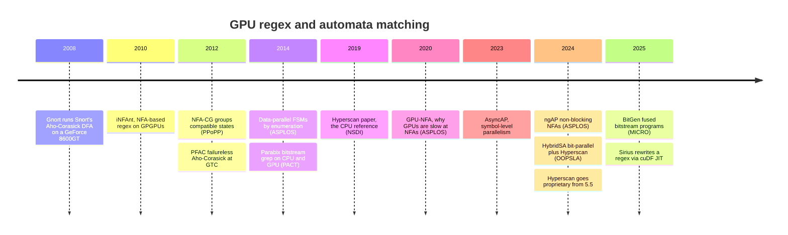
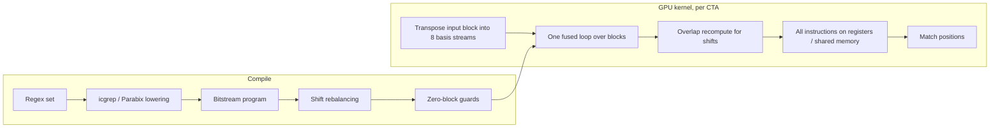
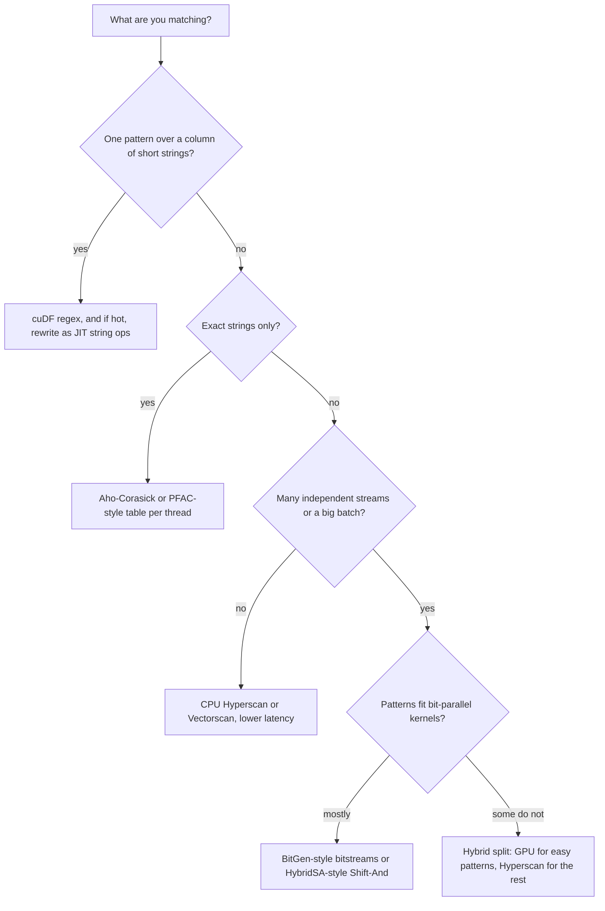

---
tags:
  - gpu-programming
  - kernels-and-optimization
  - cuda
  - regex
  - automata
  - nfa
  - dfa
  - bit-parallelism
  - string-matching
  - intrusion-detection
status: complete
sources:
  - https://getianao.github.io/papers/micro25bitgen.pdf
  - https://getianao.github.io/files/micro25bitgen-slides.pdf
  - https://github.com/getianao/BitGen
  - https://getianao.github.io/papers/asplos24ngap.pdf
  - https://par.nsf.gov/servlets/purl/10488575
  - https://par.nsf.gov/servlets/purl/10618058
  - https://dl.acm.org/doi/full/10.1145/3689771
  - https://researchwith.stevens.edu/en/publications/why-gpus-are-slow-at-executing-nfas-and-how-to-make-them-faster/
  - https://microsoft.com/en-us/research/wp-content/uploads/2016/02/asplos302-mytkowicz.pdf
  - https://www2.cs.sfu.ca/~ashriram/papers/2014_PACT_GREP.pdf
  - https://developer.download.nvidia.com/GTC/PDF/GTC2012/PresentationPDF/S0054-GTC2012-PFAC-GPU-Algorithm.pdf
  - https://www.ics.forth.gr/_pdf/brochures/gnort.raid08.pdf
  - https://hgpu.org/?p=2438
  - https://dl.acm.org/doi/abs/10.1145/2145816.2145833
  - https://usenix.org/system/files/nsdi19-wang-xiang.pdf
  - https://lists.ipfire.org/development/20240514103956.3559-1-adolf.belka@ipfire.org/1-a.txt
  - https://docs.nvidia.com/cudf/26.12/libcudf/md_regex/
  - https://docs.rapids.ai/api/libcudf/stable/regex__program_8hpp_source
  - https://developer.nvidia.com/blog/nvidia-gpu-accelerated-sirius-achieves-record-setting-clickbench-record/
  - https://nvidia.github.io/cudf-spark/docs/compatibility.html
  - https://developer.nvidia.com/blog/cybert-rapids-ai/
  - https://docs.nvidia.com/morpheus/examples/log_parsing/README.html
  - https://arxiv.org/pdf/1905.13415
created: 2026-11-28
updated: 2026-11-28
---

## Table Of Contents

---

- [[#TL;DR|TL;DR]]
- [[#The Problem|The Problem]]
- [[#Foundations|Foundations]]
    - [[#DFAs and NFAs|DFAs and NFAs]]
    - [[#Shift-And: an NFA in a Register|Shift-And: an NFA in a Register]]
    - [[#Bitstreams and MatchStar|Bitstreams and MatchStar]]
    - [[#Transition Functions Compose|Transition Functions Compose]]
    - [[#Four Sources of Parallelism|Four Sources of Parallelism]]
- [[#How We Got Here|How We Got Here]]
- [[#How It Works|How It Works]]
    - [[#Table-Driven DFAs per Thread|Table-Driven DFAs per Thread]]
    - [[#NFA Frontiers and Worklists|NFA Frontiers and Worklists]]
    - [[#Bit-Parallel NFAs per Thread (HybridSA)|Bit-Parallel NFAs per Thread (HybridSA)]]
    - [[#Fused Bitstream Programs (BitGen)|Fused Bitstream Programs (BitGen)]]
    - [[#Speculation and Enumeration|Speculation and Enumeration]]
    - [[#Regex Inside Dataframe Libraries|Regex Inside Dataframe Libraries]]
    - [[#Choosing an Approach|Choosing an Approach]]
    - [[#Worked Example: Where the Time Goes|Worked Example: Where the Time Goes]]
- [[#Where It Is Now|Where It Is Now]]
- [[#Trade-offs & Open Problems|Trade-offs & Open Problems]]
- [[#Resources|Resources]]
- [[#Related Notes|Related Notes]]

## ***TL;DR***
---
*Matching thousands of regular expressions against gigabytes of logs, packets or genomes is a classic "GPUs should be great at this" problem that turned out to be hard, because an automaton steps one symbol at a time and jumps around memory. The field's answer, after fifteen years, is to stop simulating automata state by state and turn matching into bitwise arithmetic.*

- **Why it's hard.** A finite automaton reads input one symbol at a time, each step depends on the last, and each step is a table lookup at an unpredictable address. That is the opposite of what a GPU wants: independent work, the same instruction in every lane and [[Memory Coalescing|coalesced]] loads. HybridSA's authors put it plainly: automata simulation "needs irregular memory access, which GPUs handle poorly" ([Le Glaunec et al., OOPSLA 2024](https://par.nsf.gov/servlets/purl/10618058)).
- **Three generations of GPU designs.** (1) One DFA per thread over a lookup table, used for exact strings (Gnort 2008, PFAC 2012). (2) NFA simulation with worklists of active states (iNFAnt 2010 through GPU-NFA 2020, AsyncAP 2023 and ngAP 2024). (3) Bit-parallel matching, where NFA states are bits and a step is a few shifts and ANDs: HybridSA (OOPSLA 2024) per thread, and BitGen (MICRO 2025) over whole bitstreams.
- **Current best.** BitGen compiles regexes into bitstream programs and fuses them into one block-by-block loop. On an RTX 3090 it is 19.5× faster (geomean) than ngAP and 1.7× faster than Hyperscan on 32 CPU threads across ten real rule sets, cutting per-CTA DRAM reads from 177.9 MB to 0.2 MB ([Ge, Chu and Liu, MICRO 2025](https://getianao.github.io/papers/micro25bitgen.pdf)).
- **CPU is still a serious rival.** Hyperscan multi-threaded beats BitGen on 3 of 10 apps, and the CPU wins on single-stream latency, where the GPU has too little parallel input to fill it ([BitGen](https://getianao.github.io/papers/micro25bitgen.pdf); [ngAP, ASPLOS 2024](https://getianao.github.io/papers/asplos24ngap.pdf)). HybridSA's design point is a split: easy patterns on the GPU, the rest on Hyperscan.
- **In production, regex on GPUs means cuDF.** The shipped engine is libcudf's per-string regex interpreter, which lacks lookaround and pattern backreferences; the fastest results come from rewriting a regex into plain string operations with JIT ([[GPU String Processing]]; [Sirius, Dec 2025](https://developer.nvidia.com/blog/nvidia-gpu-accelerated-sirius-achieves-record-setting-clickbench-record/)). No vendor library ships a multi-pattern GPU regex engine as of November 2026.

## ***The Problem***
---
*Network intrusion detection, malware scanning, log analytics, spam filtering and genomics all match large rule sets (hundreds to tens of thousands of patterns) against huge inputs. CPUs got very good at this with SIMD; GPUs have far more bandwidth but a poor fit with automata.*

The workloads, with the rule sets research papers benchmark on:

| Domain | Rule set used in papers | What a pattern looks like |
|---|---|---|
| Network intrusion detection | Snort, Suricata, Bro217, Dotstar | Byte strings and regexes over packet payloads |
| Malware and file scanning | ClamAV, Yara | Hex signatures with wildcards and gaps |
| Biology | Protomata, Prosite, CRISPR, Hamming/Levenshtein motifs | Protein or DNA motifs, often with approximate matching |
| Text and logs | Brill (part-of-speech rules), SpamAssassin | Word and phrase regexes |

These come from the AutomataZoo, ANMLZoo and Regex benchmark suites ([ngAP](https://getianao.github.io/papers/asplos24ngap.pdf); [BitGen](https://getianao.github.io/papers/micro25bitgen.pdf); [HybridSA](https://par.nsf.gov/servlets/purl/10618058)).

Why each GPU strength turns into a weakness here:

| What GPUs want | What automata do | Consequence |
|---|---|---|
| Independent work per thread | Step $i+1$ needs the state after step $i$ | One input stream is inherently serial unless you break the dependency |
| Same work in every lane | Some states see many matches, most see none | Lanes idle; ngAP measured 32.6% average thread utilization for a blocking baseline, under 3% on some apps |
| Coalesced, predictable loads | Next state = `table[state][byte]`, a data-dependent gather | Scattered loads that waste most of each 32-byte sector |
| Small working sets | DFAs for big rule sets explode in size; NFAs keep many states live | Tables spill out of [[Shared Memory and Bank Conflicts|shared memory]] and L1 |
| Long-running uniform kernels | Matches are rare and bursty | Output is sparse and irregular; it needs [[Parallel Reduction and Scan|compaction]] |

The first row is the root problem. Everything else is a consequence of trying to work around it.

## ***Foundations***
---
*Four ideas carry the topic: DFAs vs NFAs, the Shift-And trick that puts an NFA in a register, bitstreams that run many positions at once, and the fact that automaton steps compose associatively. The deeper theory of regex engines lives in [[Regular Expression Engines]].*

### DFAs and NFAs

A regular expression compiles to a finite automaton: states, plus transitions labelled by input symbols.

| | DFA | NFA |
|---|---|---|
| Active states at once | Exactly one | Any subset |
| Step cost | One table lookup | One lookup per active state, then a union |
| Size | Can blow up exponentially when many patterns are combined | Linear in pattern size |
| GPU fit | Great per thread if the table fits in cache | Needs a set of states per stream: worklists or bit vectors |

Hyperscan, the reference CPU engine, uses a DFA "when possible" and falls back to a bit-based NFA once the DFA would pass 16,384 states ([Wang et al., NSDI 2019](https://usenix.org/system/files/nsdi19-wang-xiang.pdf)). That threshold shows how fast combined DFAs grow.

Two NFA constructions matter. Thompson's has ε (empty) transitions. Glushkov's has none, and it is **homogeneous**: every edge into a state carries the same character class, so the class can be stored on the state instead of the edge. Hyperscan, HybridSA and BitGen's front end all build on Glushkov-style NFAs because that property is what makes bit encodings work ([HybridSA](https://par.nsf.gov/servlets/purl/10618058); [Hyperscan](https://usenix.org/system/files/nsdi19-wang-xiang.pdf)).

### Shift-And: an NFA in a Register

If a pattern's states sit on a line, so most transitions go from state $j$ to $j+1$, the whole set of active states fits in one machine word $D$, with bit $j$ meaning "the first $j+1$ characters have matched". For each pattern build a mask $B[c]$ with bit $j$ set when the pattern's $j$-th character is $c$. Then one input character $c$ updates every state at once:

$$D \leftarrow \big((D \ll 1) \;|\; 1\big) \;\&\; B[c]$$

and a match ends here when $D \;\&\; F \neq 0$, where $F$ marks the final state ([HybridSA](https://par.nsf.gov/servlets/purl/10618058)).

**In plain English:** shift every partial match forward by one position, start a new partial match at state 0 (the `| 1`), then keep only those whose next expected character is the one you just read.

**Worked example.** Pattern `gpu`, so bit 0 is `g`, bit 1 is `p`, bit 2 is `u`: $B[g]=001$, $B[p]=010$, $B[u]=100$, $F = 100$. Input `ggpu`:

| Read | $(D \ll 1) \,|\, 1$ | $\& \, B[c]$ | New $D$ | Match? |
|---|---|---|---|---|
| start | | | 000 | |
| `g` | 001 | 001 | 001 | no |
| `g` | 011 | 001 | 001 | no |
| `p` | 011 | 010 | 010 | no |
| `u` | 101 | 100 | 100 | **yes**, ends at position 3 |

That's 3 or 4 integer operations per character whatever the pattern, with no branches and no data-dependent addresses except the mask lookup. HybridSA counts 4 operations per character for its base kernel on 32-bit words ([HybridSA](https://par.nsf.gov/servlets/purl/10618058)). The catch is the shape: plain Shift-And handles only straight-line patterns up to the word width. Loops (`*`), gaps (`.{0,5}`) and branches need extra masks and operations, covered in [[#Bit-Parallel NFAs per Thread (HybridSA)|the HybridSA section]].

### Bitstreams and MatchStar

Shift-And packs **states** into bits and walks the input one character at a time. The bitstream approach, from the Parabix project at Simon Fraser University, flips the axes: pack **input positions** into bits and process a whole block of text per instruction ([Cameron et al., PACT 2014](https://www2.cs.sfu.ca/~ashriram/papers/2014_PACT_GREP.pdf)).

1. **Transpose.** Turn $N$ input bytes into 8 basis bitstreams of $N$ bits each; stream $i$ holds bit $i$ of every byte.
2. **Character classes.** Compute a stream per class (`[a]`, `[0-9]`) from the basis streams with bitwise logic. A 1 at position $p$ means "byte $p$ is in the class".
3. **Markers.** A marker stream has a 1 wherever a partial match currently stands. Concatenation is "advance the markers one position, AND with the next class". Alternation is OR.
4. **Kleene star.** Repetition of a class uses MatchStar, an addition trick:

$$\text{MatchStar}(M, C) = \Big(\big((M \,\&\, C) + C\big) \oplus C\Big) \;|\; M$$

**In plain English:** a marker sitting at the start of a run of class characters, once added to the run, produces a carry that ripples to the end of the run. XOR with $C$ lights up every position the carry passed through, which is every place the star could stop.

**Worked example**, `a[0-9]*b` on the text `a12b`. Write streams with position 0 on the right, so "advance" is a left shift and carries move forward through the text. $C_a = 0001$, $C_{digit} = 0110$, $C_b = 1000$.

| Step | Operation | Result |
|---|---|---|
| Match `a`, advance | $M_0 = C_a \ll 1$ | 0010 (marker at position 1) |
| `[0-9]*` | $T_0 = M_0 \,\&\, C_{digit}$ | 0010 |
| | $T_1 = T_0 + C_{digit} = 0010 + 0110$ | 1000 (the carry ran through positions 1 and 2) |
| | $T_2 = T_1 \oplus C_{digit}$ | 1110 |
| | $M_1 = T_2 \,|\, M_0$ | 1110 (markers at 1, 2, 3) |
| Match `b`, advance | $(M_1 \,\&\, C_b) \ll 1$ | 10000: a match ends after position 3 |

Every line is one wide bitwise or add instruction over the whole block, so 32 or 64 text positions move per operation per lane. The one non-local step is the addition, whose carries cross word boundaries; Parabix computes it with a carry mask and a second MatchStar over all-ones words, and its GPU version simulated those mask steps through shared memory ([PACT 2014](https://www2.cs.sfu.ca/~ashriram/papers/2014_PACT_GREP.pdf)). Shifts by more than one position cross block boundaries too, which is the problem BitGen solves.

### Transition Functions Compose

The serial dependency has an escape hatch. For a chunk of input $x$, let $f_x : Q \to Q$ map each possible start state to the state the DFA ends in after reading $x$. Then for consecutive chunks

$$f_{x_1 x_2} = f_{x_2} \circ f_{x_1}$$

and function composition is associative. So every chunk can be processed in parallel from **every** start state, and a [[Parallel Reduction and Scan|prefix scan]] over the $f$'s tells each chunk its true start state ([Mytkowicz, Musuvathi and Schulte, ASPLOS 2014](https://microsoft.com/en-us/research/wp-content/uploads/2016/02/asplos302-mytkowicz.pdf)).

**In plain English:** you don't know what state you'll be in at byte one million, so try them all, keep a cheap record of where each one ends up, and stitch the records together afterwards.

The cost is $|Q|$ times the work, which is fine only because real automata **converge**: different start states quickly land in the same state. Mytkowicz et al. found most Snort regex FSMs drop to 16 or fewer distinct live states. The same trick finds field and record boundaries in GPU CSV parsing (ParPaRaw: one state-transition vector per chunk, composed by a scan) ([Stehle and Jacobsen, PVLDB 2020](https://arxiv.org/pdf/1905.13415); [[GPU Parquet and File Decoding]]).

### Four Sources of Parallelism

The Liu, Pai and Jog line of work names where a GPU can find independent work in automata processing ([AsyncAP, 2023](https://par.nsf.gov/servlets/purl/10488575)):

| Source | What runs in parallel | Who used it |
|---|---|---|
| Input-stream | Different packets, files or log lines | Gnort, iNFAnt, every throughput design |
| Automaton | Different patterns (NFAs) in a rule set | Most designs; HybridSA packs 32 NFAs per warp |
| State | Different active states of one NFA | iNFAnt, NFA-CG, GPU-NFA |
| Symbol | Different positions of one stream | PFAC, AsyncAP, ngAP; bitstreams take it to the limit |

Input-stream parallelism is free when you have many independent inputs. When you have one big stream (a single log file, one network flow), symbol-level parallelism is what fills the GPU.

## ***How We Got Here***
---
*The story runs from porting CPU intrusion-detection automata to the GPU (2008 to 2012), through a long effort to make NFA simulation GPU-friendly (2010 to 2024), to bit-parallel designs that skip state-by-state simulation (2024 onwards).*



- **2008, Gnort.** Vasiliadis et al. (FORTH) moved Snort's string matching to an NVIDIA GeForce 8600GT. The Aho-Corasick DFA was a 256-column table in texture memory; with 1500-byte packets the GPU passed 2.3 Gbit/s, 3.2× the CPU version, and in a traffic replay Gnort started dropping packets at about 600 Mbit/s against stock Snort's 300 Mbit/s. Packets under 100 bytes were faster on the CPU ([Gnort](https://www.ics.forth.gr/_pdf/brochures/gnort.raid08.pdf)).
- **2010, iNFAnt.** Cascarano, Rolando, Risso and Sisto (Politecnico di Torino) built the first NFA-based GPU regex engine, using GPU threads to handle the NFA's non-determinism so that "very large and complex rule sets" could be compiled without DFA blow-up ([ACM SIGCOMM CCR](https://hgpu.org/?p=2438)).
- **2012, NFA-CG and PFAC.** NFA-CG (PPoPP 2012) grouped compatible states for memory-efficient GPU NFAs ([ACM](https://dl.acm.org/doi/abs/10.1145/2145816.2145833)). PFAC (Lin et al., GTC 2012) removed Aho-Corasick's failure transitions so each thread starts at one byte and stops early: 143 Gbit/s raw on a GTX 580, but 15 Gbit/s once host transfers were counted ([PFAC slides](https://developer.download.nvidia.com/GTC/PDF/GTC2012/PresentationPDF/S0054-GTC2012-PFAC-GPU-Algorithm.pdf)).
- **2014, two parallelization ideas.** Mytkowicz et al. broke the serial dependency with enumeration ([ASPLOS 2014](https://microsoft.com/en-us/research/wp-content/uploads/2016/02/asplos302-mytkowicz.pdf)). Cameron et al. introduced MatchStar and bitstream regex (icgrep), with an OpenCL GPU version up to 55% faster than their SSE2 code ([PACT 2014](https://www2.cs.sfu.ca/~ashriram/papers/2014_PACT_GREP.pdf)).
- **2019, the CPU bar rises.** Intel's Hyperscan paper described decomposing regexes into literal strings (matched by SIMD shift-or filters) and small automata run only near literal hits: 24.8× to 40.1× faster than PCRE, and an 8.73× faster Snort ([NSDI 2019](https://usenix.org/system/files/nsdi19-wang-xiang.pdf)). Every later GPU paper compares against it.
- **2020 to 2024, making NFAs GPU-friendly.** Liu, Pai and Jog asked "Why GPUs are slow at executing NFAs" (ASPLOS 2020, GPU-NFA: hot states in registers, cold states in worklists) ([Stevens](https://researchwith.stevens.edu/en/publications/why-gpus-are-slow-at-executing-nfas-and-how-to-make-them-faster/)). AsyncAP (2023) added symbol-level parallelism ([AsyncAP](https://par.nsf.gov/servlets/purl/10488575)). ngAP (ASPLOS 2024) removed the per-symbol barrier ([ngAP](https://getianao.github.io/papers/asplos24ngap.pdf)).
- **2024 to 2025, bit parallelism wins.** HybridSA (OOPSLA 2024) and BitGen (MICRO 2025) stopped simulating automata state by state ([HybridSA](https://par.nsf.gov/servlets/purl/10618058); [BitGen](https://getianao.github.io/papers/micro25bitgen.pdf)). BitGen shares two authors (Ge and Liu) with ngAP, and they measured it at 19.5× over their own previous engine.

## ***How It Works***
---
*Six designs, each a different answer to "what does one thread own?": a start position, an active state, a whole pattern, a block of bits, a chunk of input from every start state, or a whole string.*

### Table-Driven DFAs per Thread

The simplest port: give each thread a piece of input and a DFA table, and loop. Gnort did this per packet ([Gnort](https://www.ics.forth.gr/_pdf/brochures/gnort.raid08.pdf)). PFAC changed the work unit to **one start position per thread** and removed failure links, so a thread only follows one pattern prefix and quits the moment it can't continue ([PFAC slides](https://developer.download.nvidia.com/GTC/PDF/GTC2012/PresentationPDF/S0054-GTC2012-PFAC-GPU-Algorithm.pdf)). A sketch in that style:

```cuda
// One thread per input byte; table[state*256 + byte] gives the next state, or -1.
// States are numbered so that every final state is below num_final.
__global__ void pfac(const uint8_t* text, int n, const int* table,
                     int initial, int num_final, int* match) {
  int start = blockIdx.x * blockDim.x + threadIdx.x;
  if (start >= n) return;
  int state = initial, found = -1;
  for (int pos = start; pos < n; ++pos) {
    state = table[state * 256 + text[pos]];
    if (state < 0) break;                    // no transition: stop early
    if (state < num_final) found = state;    // a pattern ends here
  }
  match[start] = found;
}
```

- **`start = ...`:** thread *k* owns the match attempt that begins at byte *k*, so there are no chunk boundaries to patch up.
- **`table[state * 256 + text[pos]]`:** one row per state, one column per byte value. PFAC kept this table in texture memory and the first row in shared memory, because every thread starts at the initial state.
- **`if (state < 0) break`:** with failure links gone, a mismatch ends the thread. Most threads die after one or two bytes, which keeps total work near $O(N)$ in practice.
- **`state < num_final`:** renumbering states so final ones come first turns "is this a match?" into a compare, with no separate output table.

The worst case is $O(mN)$ for longest pattern length $m$, and lanes that live long make the rest of the warp wait ([[Warp Divergence and Warp-Level Primitives]]). It works for exact strings because the trie is small. For large regex sets the DFA explodes, which is why the field moved to NFAs.

### NFA Frontiers and Worklists

An NFA keeps a set of active states, which on a GPU becomes a frontier processed like a BFS in [[Graph Analytics on GPUs]]: read a symbol, expand every active state, union the results, synchronize, repeat.

| Design | Year | Idea | Main limitation |
|---|---|---|---|
| iNFAnt | 2010 | Topology-driven: threads statically mapped to the NFA's states | Many threads idle when few states are active; one symbol per step |
| NFA-CG | 2012 | Group compatible states, for memory efficiency and thread utilization | Still one symbol per step |
| GPU-NFA | 2020 | Hot states in registers, cold states in a shared worklist | Barrier after every symbol |
| AsyncAP | 2023 | Thread *k* starts at input position *k*; per-thread worklists; no cross-thread sync | Long patterns cause warp imbalance (PEN app 22.7× slower) |
| ngAP | 2024 | Work items are (state, position) pairs in a sliding window; no per-symbol barrier | Memo tables can reach GBs; tuning per app |

Sources: [ngAP](https://getianao.github.io/papers/asplos24ngap.pdf), [AsyncAP](https://par.nsf.gov/servlets/purl/10488575).

ngAP is the end point of this line. Three optimizations stack on the non-blocking worklist: **prefetching** always-active states against upcoming symbols in batches of 256 (thread utilization 33.2% → 83.6%), **prefix memoization** that precomputes matches of always-active states for every $p$-symbol prefix (a table of $|\Sigma|^p$ entries, $256^3 \approx 16.8$ million for the default $p=3$), and **work privatization** that keeps new work in registers. Together they reach 7.7× over the blocking baseline, and the tuned ngAP-best runs 7.9× (geomean) faster than GPU-NFA and 11.5× faster than Hyperscan in throughput mode on an RTX 3090 ([ngAP](https://getianao.github.io/papers/asplos24ngap.pdf)). The non-blocking change alone was about 10% **slower**; it pays only because it lets the other three work.

### Bit-Parallel NFAs per Thread (HybridSA)

HybridSA gives each thread one whole NFA, encoded as a Shift-And bit vector, and runs 32 NFAs per warp over the same input ([HybridSA](https://par.nsf.gov/servlets/purl/10618058)). A sketch of the base kernel's shape:

```cuda
// masks[c * num_nfas + nfa]: bit j set if NFA nfa's state j accepts byte c.
__global__ void shift_and(const uint8_t* text, int n, const uint32_t* masks,
                          const uint32_t* final_mask, int num_nfas, int* hits) {
  int nfa = blockIdx.x * blockDim.x + threadIdx.x;
  if (nfa >= num_nfas) return;
  uint32_t D = 0, F = final_mask[nfa];
  int count = 0;
  for (int i = 0; i < n; ++i) {
    uint8_t c = text[i];                          // same byte for all lanes
    D = ((D << 1) | 1u) & masks[c * num_nfas + nfa];
    count += (D & F) != 0;                        // no branch
  }
  hits[nfa] = count;
}
```

- **`nfa = ...`:** the thread's identity is a pattern, not a position.
- **`text[i]`:** every lane reads the same address, which the hardware serves as one broadcast load.
- **`masks[c * num_nfas + nfa]`:** lanes read 32 neighbouring words for the same character, so the load is fully coalesced. This layout is the core trick.
- **`count += (D & F) != 0`:** a predicate instead of an `if`, so the warp never diverges. HybridSA's kernels use no shared memory and have no data-dependent branches.

Real rule sets need more than straight lines, so HybridSA has a family of kernels, chosen per regex by a Rust compiler:

| Kernel | Adds | Ops per character |
|---|---|---|
| ShiftAnd | Straight-line patterns | 4 |
| ShiftAndGap | Gaps like `b{0,k}` in constant time | 9 |
| ShiftAndDist⟨D⟩ | Transitions of distance 0 to D, including self-loops | $4D + 3$ |
| ShiftAndOps⟨M,N⟩ | Long shifts, back edges, one-to-many and many-to-one edges | grows with M, N |

Words can be 32 to 256 bits (multi-word ops). Rewrites such as distributing $(A_1 + A_2)A_3$ and splitting big bounded repeats keep distances short. Patterns that fit no kernel go to Hyperscan on the CPU, and a training run chooses the split so GPU and CPU finish at about the same time. Most data sets put at least 75% of regexes on the GPU. On an RTX 4060 Ti, the optimized system beat the GPU baseline HotStart by at least 18× on every data set (about 230× on Yara) and Hyperscan alone by 4× to 60×, with 1 GB inputs split into 8 KB streams ([HybridSA](https://par.nsf.gov/servlets/purl/10618058)). The abstract claims 4× to 233× and the conclusion 3× to 35×, so read the headline ranges with care.

### Fused Bitstream Programs (BitGen)

BitGen keeps Parabix's bitstream model (regexes compiled by icgrep into AND, OR, NOT, SHIFT plus `if`/`while`) and fixes how it runs on a GPU ([BitGen](https://getianao.github.io/papers/micro25bitgen.pdf)).

The naive way runs each instruction as its own loop over the whole input, materializing every intermediate bitstream in DRAM. On their benchmarks that meant on average 260.7 loops and 317.8 intermediate streams per CTA, 177.9 MB of DRAM reads and 85.2 MB of writes per CTA, and about 102 GB of DRAM traffic in total for the Brill rule set. A bitstream program is pure bitwise logic with very low [[Roofline Model and Arithmetic Intensity|arithmetic intensity]], so all that traffic is the runtime.



The three techniques:

1. **Interleaved, block-wise execution with dependency-aware thread-data mapping.** All instructions are fused into one loop that walks the input a block at a time, so intermediate streams live in registers and shared memory ([[Kernel Fusion]]). The hard part is that `SHIFT` pulls bits from the previous block. Instead of synchronizing across blocks, each block **recomputes** a small overlap, sized from the cumulative shift distance of the program (including dynamic loop counts). Result: zero materialized intermediates and 0.2 MB of DRAM reads per CTA.
2. **Shift rebalancing.** Rewrite $(A \gg n) \,\&\, B$ into $(A \,\&\, (B \ll n)) \gg n$ to shorten chains of dependent shifts, so independent shifts share a barrier. Barriers fell from 305.1 to 35.3.
3. **Zero-block skipping.** A path of only ANDs and shifts stays zero once its input is zero, and matches are rare, so the compiler inserts guarded jumps that skip such blocks (checked every 8 by default).

On an RTX 3090 over ten apps (1 MB inputs), BitGen's geomean speedup is 19.5× over ngAP (394.9× on ClamAV), 25.3× over CPU icgrep, 3.0× over single-threaded Hyperscan and 1.7× over 32-thread Hyperscan on a Xeon Platinum 8562Y+. Moving to an H100 NVL gave 1.6× and an L40S 2.0× over the 3090 ([BitGen](https://getianao.github.io/papers/micro25bitgen.pdf)). HybridSA appears only in related work, so there is no head-to-head between the two bit-parallel designs.

### Speculation and Enumeration

When there is one long stream and one automaton, split the stream into chunks and use the [[#Transition Functions Compose|composition trick]]. Each chunk runs from all start states (or a predicted few), then a scan fixes up the boundaries. Mytkowicz et al. did this with SIMD shuffle instructions as the table lookup and reached up to 3× on one core and 21× on 8 cores for Snort regexes ([ASPLOS 2014](https://microsoft.com/en-us/research/wp-content/uploads/2016/02/asplos302-mytkowicz.pdf)). On GPUs the pattern shows up mostly in parsing: ParPaRaw's state-transition vectors for CSV ([PVLDB 2020](https://arxiv.org/pdf/1905.13415)) and the planned [[GPU CSV and JSON Parsing]] note. AsyncAP avoids speculation entirely by noting that most patterns may start anywhere, so thread *k* can simply start fresh at position *k* ([AsyncAP](https://par.nsf.gov/servlets/purl/10488575)).

### Regex Inside Dataframe Libraries

Production GPU regex is a different problem: one pattern, millions of short strings in a column. libcudf compiles a pattern into a `regex_program` and runs it with per-string working memory sized by the number of strings ([regex_program.hpp](https://docs.rapids.ai/api/libcudf/stable/regex__program_8hpp_source)), so each string is matched independently by an interpreter loop. That is input-stream parallelism only, with the divergence and register cost covered in [[GPU String Processing]].

The dialect covers classes, anchors, word boundaries, greedy and lazy quantifiers up to 999 repeats, capturing and non-capturing groups and replacement backreferences `\1` to `\99`; turning flags off and `(?x)` are unsupported, and ignore-case is limited to simple case mappings ([libcudf regex features, 26.12](https://docs.nvidia.com/cudf/26.12/libcudf/md_regex/)). Spark RAPIDS translates Java regex into this dialect and falls back to the CPU for lookaround, possessive quantifiers, repetition counts over 999, named groups and most inline flags ([Spark RAPIDS compatibility](https://nvidia.github.io/cudf-spark/docs/compatibility.html)).

The biggest production win came from not running a regex at all: Sirius rewrote ClickBench q28's regex as character comparisons and substring operations in a cuDF JIT transform, 13× faster, with warp occupancy rising from 32% to 85% ([NVIDIA, Dec 2025](https://developer.nvidia.com/blog/nvidia-gpu-accelerated-sirius-achieves-record-setting-clickbench-record/); [[Query Compilation and JIT on GPUs]]).

### Choosing an Approach



This is a summary of the papers' findings, not a benchmark of its own: the CPU wins single-stream latency (ngAP), Hyperscan still wins some rule sets (BitGen), and lookaround and backreferences have no GPU path in the systems above.

### Worked Example: Where the Time Goes

**Transfers.** PFAC on a GTX 580 matched 256 MB of input at 143.16 Gbit/s counting only the kernel, but 15.00 Gbit/s end to end ([PFAC slides](https://developer.download.nvidia.com/GTC/PDF/GTC2012/PresentationPDF/S0054-GTC2012-PFAC-GPU-Algorithm.pdf)). With $256\,\text{MB} \approx 2.15 \times 10^9$ bits:

$$T_\text{kernel} = \frac{2.15 \times 10^9}{143.16 \times 10^9} \approx 15\ \text{ms}, \qquad T_\text{total} = \frac{2.15 \times 10^9}{15.00 \times 10^9} \approx 143\ \text{ms}$$

**In plain English:** the matching itself was about a tenth of the time; the rest was moving data across PCIe and back. Every later paper reports kernel-only throughput for this reason, and HybridSA's timings also exclude host-device transfers ([HybridSA](https://par.nsf.gov/servlets/purl/10618058)). In a real system, input already on the GPU (from [[GPUDirect RDMA and Storage]] or a cuDF column) is what makes GPU matching pay.

**Materialized bitstreams.** A rough model (mine, not the paper's) for running a bitstream program one instruction at a time over $N$ input bytes: each stream is $N/8$ bytes, and an instruction reads about two streams and writes one, so

$$\text{traffic} \approx 3 \cdot I \cdot \frac{N}{8}$$

for $I$ instructions. With $N = 10^6$ bytes (BitGen's input size) and $I \approx 300$ (close to its average of 260.7 loops), that's $3 \cdot 300 \cdot 125\ \text{KB} \approx 112\ \text{MB}$, the same order as the 263 MB per CTA BitGen measured (177.9 MB read plus 85.2 MB written). The fused version reads the input about once: 0.2 MB of reads, about 900× fewer. Bitstream logic does almost no arithmetic per byte, so that traffic gap, not compute, is where fusion's speedup comes from.

## ***Where It Is Now***
---
*As of November 2026, bit-parallel designs lead GPU regex research, CPU engines remain the production default for rule-set matching, and GPU regex in practice means libcudf's per-string engine plus JIT rewrites.*

- **Research state of the art.** BitGen (MICRO 2025) is the newest peer-reviewed multi-pattern GPU regex engine found in a November 2026 search, with HybridSA (OOPSLA 2024) the main alternative. BitGen's artifact is public; it needs compute capability 8.6 or newer, 24 GB of device memory and CUDA 12.4, and validates results against icgrep ([BitGen GitHub](https://github.com/getianao/BitGen)). Its README notes that overlapping matches across regex groups are not deduplicated, so counts can differ from the reference.
- **NFA worklists are no longer the frontier.** ngAP's own authors moved to bitstreams; the worklist line (GPU-NFA, AsyncAP, ngAP) remains the reference for automata that don't map to bit vectors (large, irregular NFAs).
- **Hyperscan's licence changed.** From version 5.5 Intel's Hyperscan moved from BSD to a proprietary paid licence; the open-source community fork Vectorscan is what distributions such as IPFire began moving to in May 2024 ([IPFire patch](https://lists.ipfire.org/development/20240514103956.3559-1-adolf.belka@ipfire.org/1-a.txt)). This matters for GPU work because every paper benchmarks against Hyperscan and HybridSA runs its CPU half on it.
- **Production GPU regex.** libcudf 26.12 documents the dialect above, with no lookaround or pattern backreferences ([libcudf](https://docs.nvidia.com/cudf/26.12/libcudf/md_regex/)); Spark RAPIDS falls back to the CPU for those ([compatibility](https://nvidia.github.io/cudf-spark/docs/compatibility.html)); AMD's hipDF mirrors cuDF's string API ([[ROCm and HIP]]). No NVIDIA or AMD library offers a multi-pattern regex engine like Hyperscan.
- **ML instead of regex for logs.** NVIDIA's cyBERT (2020, now an example pipeline in Morpheus) parses security logs with a BERT model instead of a regex library, because regex parsers "are prone to failure if a log deviates at all from its specific format" ([NVIDIA, Jan 2020](https://developer.nvidia.com/blog/cybert-rapids-ai/); [Morpheus log parsing example](https://docs.nvidia.com/morpheus/examples/log_parsing/README.html)). For logs, part of the GPU market moved from matching to inference.
- **Hardware trend.** BitGen gained 1.6× on H100 and 2.0× on L40S over an RTX 3090 without retuning; its kernel is bitwise integer work, so it gains from bandwidth and integer throughput rather than from [[Tensor Cores]].

## ***Trade-offs & Open Problems***
---
*Each design trades generality for GPU-friendliness, and the most GPU-friendly ones cover the fewest regex features.*

- **Generality vs speed.** Table DFAs explode on big rule sets; NFA worklists handle any NFA but leave lanes idle; bit-parallel kernels are fast but need patterns that fit word widths and shift distances. HybridSA's answer is to send the rest to a CPU, which needs a training run to balance.
- **Throughput vs latency.** All GPU designs need many streams or very long inputs to fill the machine; on one stream the CPU wins (ngAP). Batching adds latency, which matters in packet inspection.
- **Features with no GPU path.** Backreferences, lookaround and capture-heavy extraction aren't regular, or aren't cheap as automata. They're CPU fallbacks in cuDF and Spark RAPIDS, and none of the research engines above supports them.
- **Memory.** ngAP's memo tables reach hundreds of MB to several GB; BitGen asks for a 24 GB GPU. Rule sets keep growing.
- **Match semantics.** Research engines report "all matches" or match end positions; applications often need leftmost-longest matches with start offsets and capture groups, which costs another pass.
- **Comparisons are hard.** Papers differ in GPU (RTX 3090, 4060 Ti), input size (1 MB to 1 GB), stream size, and whether transfers count; HybridSA and BitGen never benchmark each other. A shared, transfer-inclusive benchmark is missing.
- **Data movement.** Kernel-only numbers hide PCIe cost (PFAC's 10×). Engines that already hold data on the GPU (dataframes, GPU-side packet capture) get the full benefit; offloading from a CPU pipeline may not.

## ***Resources***
---
*Read BitGen for the current design, ngAP for why NFA simulation hits a wall, HybridSA for Shift-And on GPUs, and Hyperscan for the bar every GPU engine is measured against.*

**Current research**
- [Interleaved Bitstream Execution for Multi-Pattern Regex Matching on GPUs](https://getianao.github.io/papers/micro25bitgen.pdf): Ge, Chu and Liu, MICRO 2025 (BitGen). [Slides](https://getianao.github.io/files/micro25bitgen-slides.pdf), [code](https://github.com/getianao/BitGen).
- [HybridSA: GPU Acceleration of Multi-pattern Regex Matching using Bit Parallelism](https://par.nsf.gov/servlets/purl/10618058): Le Glaunec, Kong and Mamouras, OOPSLA 2024 ([ACM](https://dl.acm.org/doi/full/10.1145/3689771)).
- [ngAP: Non-blocking Large-scale Automata Processing on GPUs](https://getianao.github.io/papers/asplos24ngap.pdf): Ge, Zhang and Liu, ASPLOS 2024.
- [Asynchronous Automata Processing on GPUs](https://par.nsf.gov/servlets/purl/10488575): Liu, Pai and Jog, POMACS / SIGMETRICS 2023.
- [Why GPUs are Slow at Executing NFAs and How to Make them Faster](https://researchwith.stevens.edu/en/publications/why-gpus-are-slow-at-executing-nfas-and-how-to-make-them-faster/): Liu, Pai and Jog, ASPLOS 2020.

**Foundations**
- [Bitwise Data Parallelism in Regular Expression Matching](https://www2.cs.sfu.ca/~ashriram/papers/2014_PACT_GREP.pdf): Cameron et al., PACT 2014. MatchStar and Parabix.
- [Data-Parallel Finite-State Machines](https://microsoft.com/en-us/research/wp-content/uploads/2016/02/asplos302-mytkowicz.pdf): Mytkowicz, Musuvathi and Schulte, ASPLOS 2014.
- [Hyperscan: A Fast Multi-pattern Regex Matcher for Modern CPUs](https://usenix.org/system/files/nsdi19-wang-xiang.pdf): Wang et al., NSDI 2019.

**History**
- [Gnort: High Performance Network Intrusion Detection Using Graphics Processors](https://www.ics.forth.gr/_pdf/brochures/gnort.raid08.pdf): Vasiliadis et al., FORTH, 2008.
- [iNFAnt: NFA Pattern Matching on GPGPU Devices](https://hgpu.org/?p=2438): Cascarano et al., ACM SIGCOMM CCR, 2010.
- [GPU-based NFA implementation for memory efficient high speed regular expression matching](https://dl.acm.org/doi/abs/10.1145/2145816.2145833): PPoPP 2012 (NFA-CG).
- [PFAC: Parallel Failureless Aho-Corasick](https://developer.download.nvidia.com/GTC/PDF/GTC2012/PresentationPDF/S0054-GTC2012-PFAC-GPU-Algorithm.pdf): Lin et al., GTC 2012.

**Production**
- [libcudf regex features (26.12)](https://docs.nvidia.com/cudf/26.12/libcudf/md_regex/) and [regex_program.hpp](https://docs.rapids.ai/api/libcudf/stable/regex__program_8hpp_source).
- [Spark RAPIDS regex compatibility](https://nvidia.github.io/cudf-spark/docs/compatibility.html).
- [Sirius ClickBench record](https://developer.nvidia.com/blog/nvidia-gpu-accelerated-sirius-achieves-record-setting-clickbench-record/): NVIDIA, Dec 2025. The JIT regex rewrite.
- [cyBERT](https://developer.nvidia.com/blog/cybert-rapids-ai/): NVIDIA, Jan 2020, and the [Morpheus cyBERT log parsing example](https://docs.nvidia.com/morpheus/examples/log_parsing/README.html). ML log parsing instead of regex.
- [ParPaRaw: Massively Parallel Parsing of Delimiter-Separated Raw Data](https://arxiv.org/pdf/1905.13415): Stehle and Jacobsen, PVLDB 2020. The enumeration trick in a GPU parser.

## Related Notes

- [[GPU String Processing]] — String layouts, thread vs warp per string, and libcudf's regex interpreter in context.
- [[Regular Expression Engines]] — Thompson, Glushkov, backtracking and DFA engines on the CPU; the theory under this note.
- [[SIMD Text Search]] — The CPU SIMD techniques (shift-or filters, Teddy-style matchers) GPU engines compete with.
- [[Lexing and Parsing]] — Regular expressions and finite automata from the compiler side.
- [[Grammar-Constrained Decoding]] — Automata over tokens that mask LLM outputs on the GPU.
- [[Query Compilation and JIT on GPUs]] — The JIT route that rewrote a regex into simple string ops.
- [[GPU Databases and Dataframes]] — Where production GPU regex runs today.
- [[GPU Parquet and File Decoding]] — ParPaRaw's DFA-plus-scan trick for CSV and JSON.
- [[GPU CSV and JSON Parsing]] — Planned note on DFA state-transition vectors and tokenizers.
- [[Parallel Reduction and Scan]] — Composing transition functions and compacting sparse matches.
- [[Warp Divergence and Warp-Level Primitives]] — Why per-thread automata stall warps, and branch-free kernels avoid it.
- [[Memory Coalescing]] — The mask layout that makes Shift-And loads coalesced.
- [[Shared Memory and Bank Conflicts]] — Where DFA rows and bitstream blocks live.
- [[Kernel Fusion]] — BitGen's core idea applied to bitstream programs.
- [[Roofline Model and Arithmetic Intensity]] — Why bitstream programs are memory-bound until fused.
- [[Register Pressure and Spilling]] — The cost of big regex interpreters.
- [[Occupancy and Latency Hiding]] — The 32% to 85% occupancy jump from rewriting a regex.
- [[Graph Analytics on GPUs]] — Frontier-based traversal, the same pattern as NFA worklists.
- [[Work Stealing and Dynamic Load Balancing]] — Shared worklists and privatization, as in ngAP.
- [[GPUDirect RDMA and Storage]] — Getting packets and files onto the GPU without a PCIe round trip.
- [[ROCm and HIP]] — hipDF's regex string methods on AMD.
- [[Tokenization and Embeddings]] — Regex pre-tokenization in LLM tokenizers.
