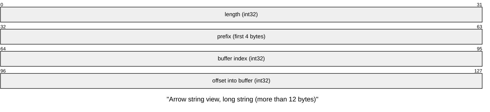
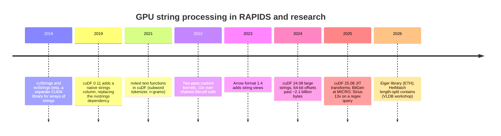
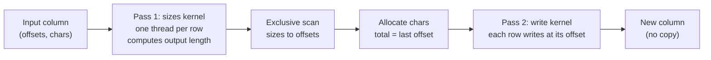
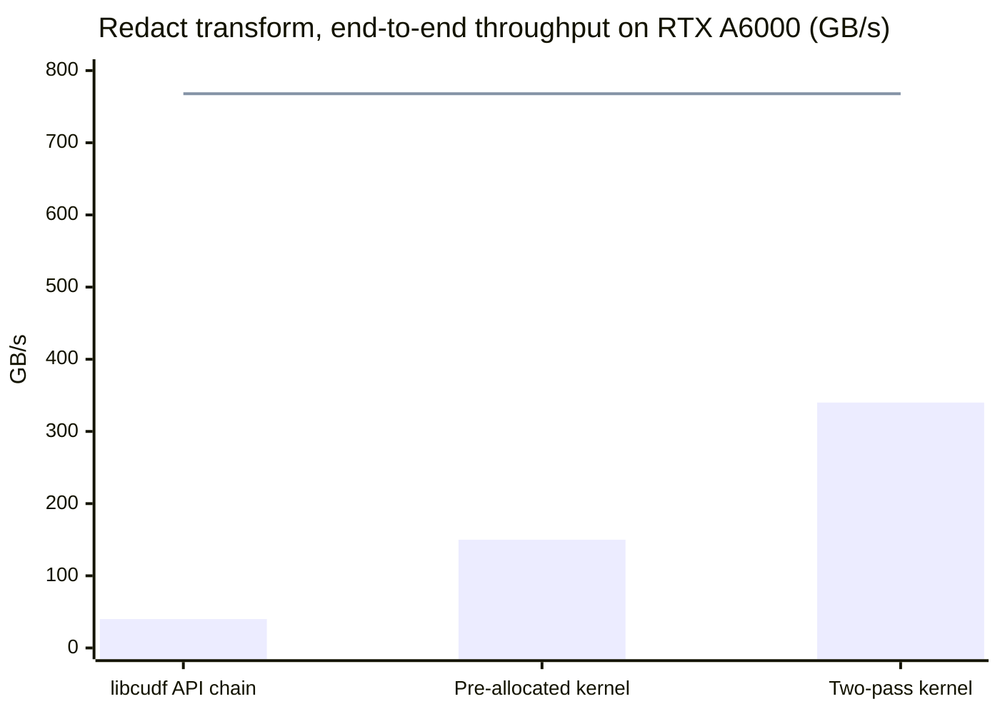

---
tags:
  - gpu-programming
  - kernels-and-optimization
  - cuda
  - strings
  - regex
  - dataframes
  - apache-arrow
  - dictionary-encoding
status: complete
sources:
  - https://developer.nvidia.com/blog/mastering-string-transformations-in-rapids-libcudf/
  - https://developer.nvidia.com/blog/efficient-transforms-in-cudf-using-jit-compilation/
  - https://developer.nvidia.com/blog/nvidia-gpu-accelerated-sirius-achieves-record-setting-clickbench-record/
  - https://www.vldb.org/2026/Workshops/VLDB-Workshops-2026/ADMS/ADMS26_8.pdf
  - https://arxiv.org/pdf/2607.04489
  - https://arxiv.org/html/2312.00720v2
  - https://arrow.apache.org/docs/format/Columnar.html
  - https://aetperf.github.io/arrow/2026/05/27/German-Style-Strings-in-Apache-Arrow.html
  - https://docs.nvidia.com/cudf/26.12/libcudf/developer_guide/DEVELOPER_GUIDE/
  - https://docs.nvidia.com/cudf/26.12/libcudf/md_regex/
  - https://docs.rapids.ai/api/libcudf/stable/regex__program_8hpp_source
  - https://docs.nvidia.com/cudf/26.12/libcudf/api_docs/dictionary_encode/
  - https://docs.nvidia.com/cudf/26.12/libcudf/api_docs/dictionary_apis/
  - https://medium.com/rapids-ai/rapids-24-08-better-scalability-performance-and-cpu-gpu-interoperability-f88086386da6
  - https://medium.com/rapids-ai/rapids-up-to-11-2d857864f2e7
  - https://medium.com/rapids-ai/real-data-has-strings-now-so-do-gpus-994497d55f8e
  - https://developer.nvidia.com/blog/__trashed-4/
  - https://developer.nvidia.com/blog/encoding-and-compression-guide-for-parquet-string-data-using-rapids/
  - https://nvidia.github.io/cudf-spark/docs/compatibility.html
  - https://researchwith.stevens.edu/en/publications/interleaved-bitstream-execution-for-multi-pattern-regex-matching-/
  - https://par.nsf.gov/servlets/purl/10618058
  - https://arxiv.org/html/2507.11941v1
  - https://rocm.docs.amd.com/projects/hipDF/en/docs-26.03/reference/pylibhipdf/strings/findall.html
created: 2026-11-28
updated: 2026-11-28
---

## Table Of Contents

---

- [[#TL;DR|TL;DR]]
- [[#The Problem|The Problem]]
- [[#Foundations|Foundations]]
    - [[#The Offsets Layout|The Offsets Layout]]
    - [[#The View Layout|The View Layout]]
    - [[#Dictionary Encoding|Dictionary Encoding]]
    - [[#Why Variable Length Hurts a Warp|Why Variable Length Hurts a Warp]]
- [[#How We Got Here|How We Got Here]]
- [[#How It Works|How It Works]]
    - [[#Thread per String|Thread per String]]
    - [[#Building New Strings in Two Passes|Building New Strings in Two Passes]]
    - [[#Warp per String|Warp per String]]
    - [[#Choosing the Granularity|Choosing the Granularity]]
    - [[#Regex on the GPU|Regex on the GPU]]
    - [[#JIT String Transforms|JIT String Transforms]]
    - [[#Sorting, Grouping and Joining on Strings|Sorting, Grouping and Joining on Strings]]
    - [[#Worked Example: Bandwidth and Divergence|Worked Example: Bandwidth and Divergence]]
- [[#Where It Is Now|Where It Is Now]]
- [[#Trade-offs & Open Problems|Trade-offs & Open Problems]]
- [[#Resources|Resources]]
- [[#Related Notes|Related Notes]]

## ***TL;DR***
---
*Strings break the GPU's favourite assumption, that every thread does the same amount of work on a fixed-size value. GPU string processing is mostly about two choices: how the bytes are laid out, and how many threads work on each string.*

- **Layout: offsets plus bytes.** GPU dataframes store a string column the Apache Arrow way: all UTF-8 bytes packed back to back in one buffer, plus an offsets array of $n+1$ integers so row $i$ is `chars[offsets[i] : offsets[i+1]]`. libcudf uses this layout and switches the offsets from 32-bit to 64-bit only when a column passes about 2.1 billion bytes (cuDF 24.08) ([NVIDIA, Oct 2022](https://developer.nvidia.com/blog/mastering-string-transformations-in-rapids-libcudf/); [RAPIDS 24.08](https://medium.com/rapids-ai/rapids-24-08-better-scalability-performance-and-cpu-gpu-interoperability-f88086386da6)).
- **Granularity: thread or warp per string.** One thread per string is simple and wins for short strings, but a warp waits for its longest string. One warp per string reads long strings coalesced but wastes lanes on short ones. cuDF's `contains` picks one kernel for the whole column from the mean length (64 bytes); HetMatch (VLDB 2026 workshop) splits each column by length and runs both kernels, for 2.5× geomean on skewed synthetic data and 1.3× on 11 real datasets ([Kim and Yu](https://www.vldb.org/2026/Workshops/VLDB-Workshops-2026/ADMS/ADMS26_8.pdf)).
- **New strings are built in two passes.** Output lengths aren't known in advance, so kernels compute each row's size, scan the sizes into offsets, allocate once, then write. A hand-written two-pass kernel ran a string transform about 10× faster than chaining libcudf calls (31 kernel launches down to 4) ([NVIDIA](https://developer.nvidia.com/blog/mastering-string-transformations-in-rapids-libcudf/)).
- **Regex is the worst case, and JIT is the current fix.** A general regex kernel is big, branchy and register-hungry. cuDF 25.08 added runtime-compiled (NVRTC) transforms that fuse string steps into one kernel; Sirius used them for a 13× speedup on ClickBench's regex query, with warp occupancy rising from 32% to 85% ([NVIDIA, Aug 2025](https://developer.nvidia.com/blog/efficient-transforms-in-cudf-using-jit-compilation/); [NVIDIA, Dec 2025](https://developer.nvidia.com/blog/nvidia-gpu-accelerated-sirius-achieves-record-setting-clickbench-record/)).
- **Dictionary encoding turns strings into integers.** Replace each value with a small integer code into a sorted table of unique keys, and sorts, group-bys and joins run on fixed-width ints. Wu et al. measured up to 2.63× from dictionary encoding in GPU grouped aggregation ([SIGMOD 2025](https://arxiv.org/html/2312.00720v2)).

## ***The Problem***
---
*Real tables are full of strings: names, URLs, log lines, JSON, product titles. A GPU engine that is fast on integers but slow on strings loses on real queries, and strings are where it most often does.*

Integers and floats map perfectly onto a GPU: thread $i$ loads element $i$, every thread does the same work, and neighbouring threads read neighbouring addresses ([[Memory Coalescing]]). Strings break all three properties:

| Property GPUs rely on | What strings do instead | Consequence |
|---|---|---|
| Fixed-size elements | Each row has its own length, from 0 bytes to megabytes | Element $i$ can't be found by arithmetic; you need an offsets lookup |
| Equal work per thread | Work is proportional to length | Lanes in a warp finish at different times ([[Warp Divergence and Warp-Level Primitives]]) |
| Output size known up front | `replace`, `upper` on UTF-8, `concat`, regex `extract` all change lengths | Can't allocate the output before you compute it |
| Simple per-element math | Pattern matching, case rules, Unicode | Large, branchy kernels with high [[Register Pressure and Spilling|register pressure]] |
| Cheap comparisons | Comparing two strings walks bytes until they differ | Sorting and hashing cost grows with length ([[Sorting and Hashing on GPUs]]) |

These costs show up in benchmarks. In Sirius's ClickBench run, the regex query (q28) needed a special JIT path, and q23 stayed limited by string `contains` ([NVIDIA, Dec 2025](https://developer.nvidia.com/blog/nvidia-gpu-accelerated-sirius-achieves-record-setting-clickbench-record/)). See [[GPU Databases and Dataframes]] for the engine-level picture.

## ***Foundations***
---
*Three layouts and one divergence formula carry the topic. The layout decides how a thread finds its string; the formula says how much of the warp is wasted while it works.*

### The Offsets Layout

Arrow's "variable-size binary" layout, which libcudf uses for every strings column:

| Buffer | Contents | Example for `["GPU", "", "warp", "SIMT"]` |
|---|---|---|
| `chars` (data) | All UTF-8 bytes, back to back | `GPUwarpSIMT` (11 bytes) |
| `offsets` | $n+1$ signed integers, starting at 0 | `[0, 3, 3, 7, 11]` |
| validity bitmap | One bit per row; null rows have length 0 | `1 1 1 1` |

- **Row length** is `offsets[i+1] - offsets[i]`; the last offset is the total byte count ([NVIDIA](https://developer.nvidia.com/blog/mastering-string-transformations-in-rapids-libcudf/)).
- **Offsets width.** Arrow defines 32-bit offsets (String) and 64-bit offsets (LargeString) ([Arrow spec](https://arrow.apache.org/docs/format/Columnar.html)). libcudf offsets columns are "either `int32_t` or `int64_t`", chosen by the number of bytes ([libcudf developer guide](https://docs.nvidia.com/cudf/26.12/libcudf/developer_guide/DEVELOPER_GUIDE/)). Before cuDF 24.08 a column could hold only about 2.1 billion characters; now it switches to 64-bit offsets past that and keeps 32-bit below it, to save memory and bandwidth ([RAPIDS 24.08](https://medium.com/rapids-ai/rapids-24-08-better-scalability-performance-and-cpu-gpu-interoperability-f88086386da6)).
- **Offsets are bytes, not characters.** UTF-8 characters are 1 to 4 bytes, so "the 5th character" means scanning from the start of the string.
- **Immutable.** libcudf strings columns are never edited in place; every transform builds a new column ([NVIDIA](https://developer.nvidia.com/blog/mastering-string-transformations-in-rapids-libcudf/)).

Why GPUs like it: a scan over the column reads `chars` as one dense stream, the offsets array is a plain integer array, and slicing rows is just a sub-range of offsets.

### The View Layout

Arrow format 1.4 (pyarrow and Arrow C++ 14 onward) added a second layout, **string view** (BinaryView), adapted from the "German-style" strings of the Umbra database and already used by Velox and DuckDB ([aetperf, May 2026](https://aetperf.github.io/arrow/2026/05/27/German-Style-Strings-in-Apache-Arrow.html); [Arrow spec](https://arrow.apache.org/docs/format/Columnar.html)). Each row is a 16-byte struct:



For strings of 12 bytes or fewer, the 12 bytes after the length hold the string itself, so short strings need no second lookup.

| | Offsets layout | View layout |
|---|---|---|
| Per-row overhead | 4 or 8 bytes | 16 bytes |
| Short string read | Two loads (offset, bytes) | One 16-byte load, data inline |
| Long string read | Two loads | Prefix inline; bytes need a third lookup via buffer index |
| Sort, filter, gather | Rewrite bytes and offsets | Move only the 16-byte views |
| Inequality compare | Read bytes | Often settled by the 4-byte prefix (useless when all values share a prefix, like URLs on one host) |
| Fragmentation | None | Buffers fragment after slices; needs compaction |

ETH Zurich's Eiger library (Jul 2026) chose the offsets layout over the German format for its GPU kernels because the German format spends extra space on an explicit length and a read takes up to three steps with more branches, while Arrow's needs one extra lookup ([Wu et al.](https://arxiv.org/pdf/2607.04489)). It gets the main benefit of the prefix another way, extracting 4-byte prefixes only when sorting (see [[#Sorting, Grouping and Joining on Strings|below]]).

### Dictionary Encoding

A dictionary column stores each distinct value once and replaces rows with integer codes. In libcudf, `encode` produces keys that are "non-null, unique values that are in a strict, total order" plus an indices column, `INT32` by default ([libcudf dictionary encode](https://docs.nvidia.com/cudf/26.12/libcudf/api_docs/dictionary_encode/)):

| Column | Contents |
|---|---|
| Input | `["us", "de", "us", "fr", "de"]` |
| Keys (sorted, unique) | `["de", "fr", "us"]` |
| Indices | `[2, 0, 2, 1, 0]` |

Because the keys are sorted, comparing two codes gives the same answer as comparing the strings, so sort, group-by, equality joins and range filters can run entirely on integers. libcudf also has `decode`, `get_index`, `add_keys`, `remove_keys`, `remove_unused_keys`, `set_keys` and `match_dictionaries` for keeping two columns' codes consistent before a join ([libcudf dictionary APIs](https://docs.nvidia.com/cudf/26.12/libcudf/api_docs/dictionary_apis/)). It pays off when distinct values are few: NVIDIA's Parquet study suggests dictionary encoding below about 100K distinct values, and notes most writers fall back to plain encoding once a dictionary page passes about 1 MiB ([NVIDIA, Jul 2024](https://developer.nvidia.com/blog/encoding-and-compression-guide-for-parquet-string-data-using-rapids/)).

### Why Variable Length Hurts a Warp

A warp issues one instruction for 32 lanes ([[GPU Architecture Basics]]). If each lane handles one string and loops over its bytes, the warp runs until its longest string is done, and lanes with short strings sit idle. The useful fraction of the warp's work is

$$
\eta_{\text{thread}} = \frac{\sum_{k=1}^{32} L_k}{32 \cdot \max_k L_k}
$$

In words: total bytes the warp actually needed to process, divided by what it paid for (32 lanes times the longest string). With 32 strings of equal length, $\eta = 1$. With 31 strings of 16 bytes and one of 1,000 bytes,

$$
\eta = \frac{31 \cdot 16 + 1000}{32 \cdot 1000} = \frac{1496}{32000} \approx 4.7\%
$$

so 95% of the warp's issue slots go to waiting. If instead a whole warp works on one string, $B$ bytes per step, the waste moves to the tail of each string:

$$
\eta_{\text{warp}} = \frac{L}{B \cdot \lceil L / B \rceil}
$$

For a 20-byte string with one byte per lane ($B = 32$), $\eta = 20/32 = 62.5\%$; with a 128-byte cache line per step, as cuDF's warp-per-string `contains` reads ([Kim and Yu](https://www.vldb.org/2026/Workshops/VLDB-Workshops-2026/ADMS/ADMS26_8.pdf)), it is $20/128 \approx 16\%$. Short strings want threads; long strings want warps; skewed columns want both.

## ***How We Got Here***
---
*GPU strings started as a side library with its own storage, moved into cuDF as an Arrow-style column, and since 2022 the work has been about squeezing out kernel launches, handling huge columns and fixing divergence and regex.*



- **2018, a separate library.** cuStrings was a beta CUDA library providing a "GPU-accelerated columnar interface for manipulating and performing parallel operations on arrays of strings", with Python bindings called nvStrings; native integration into cuDF was still planned ([Becker and Gelhausen, Dec 2018](https://medium.com/rapids-ai/real-data-has-strings-now-so-do-gpus-994497d55f8e)).
- **2019, a native column.** cuDF's old `gdf_column` "only supported flat columns of fixed-width data", so strings relied on nvstrings. The hierarchical `cudf::column` in 0.11 added "a new native strings column type which is supported throughout the library" ([RAPIDS 0.11](https://medium.com/rapids-ai/rapids-up-to-11-2d857864f2e7)): a parent column holding the bytes and a child offsets column.
- **2021, Arrow format and text functions.** An NVIDIA post credited the switch to Arrow format string columns with memory savings and speedups, and listed new `nvtext` functions including `character_ngrams`, `ngram_tokenize` and `subword_tokenize`, a GPU BERT tokenizer ([Jawa, May 2021](https://developer.nvidia.com/blog/__trashed-4/)).
- **2022, custom kernels.** Wendt and Kimball showed how to write a string transform as raw CUDA over libcudf columns, and that the two-pass pattern beats both chained API calls and per-row `malloc` ([NVIDIA, Oct 2022](https://developer.nvidia.com/blog/mastering-string-transformations-in-rapids-libcudf/)).
- **2024, large strings.** cuDF 24.08 lifted the 2.1-billion-character column limit with automatic 64-bit offsets ([RAPIDS 24.08](https://medium.com/rapids-ai/rapids-24-08-better-scalability-performance-and-cpu-gpu-interoperability-f88086386da6)).
- **2025, JIT and engines.** cuDF 25.08 shipped JIT transforms ([NVIDIA, Aug 2025](https://developer.nvidia.com/blog/efficient-transforms-in-cudf-using-jit-compilation/)); Sirius applied them to regex on ClickBench (Dec 2025). In research, BitGen (MICRO 2025) reworked bit-parallel regex for GPUs.
- **2026, adaptive kernels.** HetMatch and Eiger both attack the "one granularity for every string" assumption.

## ***How It Works***
---
*Every GPU string kernel answers the same three questions: which threads own which strings, how output sizes are found before writing, and how much of the work can be done on integers instead of bytes.*

### Thread per String

The default in libcudf: "libcudf API functions launch at least one kernel per call, with one thread per string" ([NVIDIA](https://developer.nvidia.com/blog/mastering-string-transformations-in-rapids-libcudf/)). Each thread looks up its row's offsets and loops over its bytes.

- **Good for short strings.** Most real columns (names, codes, categories) are tens of bytes, and one thread per row gives full parallelism with no cooperation.
- **Bad for long or skewed strings.** Divergence as in the formula above, and poor coalescing: lane $k$ reads string $k$, so a warp's loads land in 32 different places in `chars` at once.

### Building New Strings in Two Passes

When the output length depends on the input, the standard pattern is size, scan, allocate, write:



A small CUDA version that inserts a space after every comma (so `"a,b"` becomes `"a, b"`, and the output can be longer than the input):

```cuda
__device__ int add_space_after_commas(const char* s, int len, char* out) {
    int n = 0;
    for (int i = 0; i < len; ++i) {
        if (out) out[n] = s[i];
        ++n;
        if (s[i] == ',') { if (out) out[n] = ' '; ++n; }
    }
    return n;                                  // output length of this row
}

__global__ void sizes_kernel(const char* chars, const int* offsets,
                             int n_rows, int* out_offsets) {
    int row = blockIdx.x * blockDim.x + threadIdx.x;
    if (row >= n_rows) return;
    int begin = offsets[row];
    out_offsets[row] = add_space_after_commas(chars + begin,
                                              offsets[row + 1] - begin, nullptr);
}

__global__ void write_kernel(const char* chars, const int* offsets, int n_rows,
                             const int* out_offsets, char* out_chars) {
    int row = blockIdx.x * blockDim.x + threadIdx.x;
    if (row >= n_rows) return;
    int begin = offsets[row];
    add_space_after_commas(chars + begin, offsets[row + 1] - begin,
                           out_chars + out_offsets[row]);
}

// host: sizes_kernel -> set out_offsets[n_rows] = 0 ->
//       thrust::exclusive_scan(thrust::device, out_offsets,
//                              out_offsets + n_rows + 1, out_offsets)
//       -> total = out_offsets[n_rows] -> cudaMalloc(total) -> write_kernel
```

Line by line:

- `add_space_after_commas` holds the transform once. Called with `out == nullptr` it only counts; called with a buffer it writes. This avoids keeping two copies of the logic in sync, which the NVIDIA post recommends ([NVIDIA](https://developer.nvidia.com/blog/mastering-string-transformations-in-rapids-libcudf/)).
- `sizes_kernel` gives each thread one row, reads its byte range from the offsets, and stores that row's output length in `out_offsets[row]`.
- The exclusive scan turns lengths `[3, 0, 5]` into start positions `[0, 3, 3, 8]`; the last entry is the total output size ([[Parallel Reduction and Scan]]).
- One allocation of exactly `total` bytes, then `write_kernel` runs the same function again, each thread writing at its own start position. No thread needs to know any other's output.

The NVIDIA post measured four versions of a name-redaction transform on 600K rows on an RTX A6000:

| Approach | Time | Kernel launches | Notes |
|---|---|---|---|
| Chain of libcudf string APIs | ~3.5 ms | 31 | Every step writes an intermediate column |
| Kernel with per-row `malloc`/`free` | ~108 ms | | Device heap serializes threads; >30× slower |
| Kernel into pre-allocated buffer | ~1.1 ms | | Fixed worst-case buffer, then compact |
| Two-pass kernel | ~0.3 ms | 4 | Bytes moved fell from 12.6× to 1.75× of input plus output |



The line is the A6000's 768 GB/s peak; the two-pass kernel reached about 320 to 340 GB/s, roughly 44% of peak, versus about 40 GB/s for the API chain ([NVIDIA](https://developer.nvidia.com/blog/mastering-string-transformations-in-rapids-libcudf/)). The win comes from [[Kernel Fusion|fusion]]: fewer launches and fewer round trips of intermediate strings through memory.

### Warp per String

For long strings, a whole warp takes one string. Lanes read consecutive bytes, so loads coalesce ([[Memory Coalescing]]), and per-lane results are combined with warp votes. A substring `contains`:

```cuda
__global__ void contains_warp(const char* chars, const int* offsets, int n_rows,
                              const char* pat, int m, bool* out) {
    int warp = (blockIdx.x * blockDim.x + threadIdx.x) / 32;
    int lane = threadIdx.x % 32;
    if (warp >= n_rows) return;               // whole warp leaves together
    const char* s = chars + offsets[warp];
    int len = offsets[warp + 1] - offsets[warp];
    bool found = false;
    for (int i = lane; i + m <= len && !found; i += 32) {
        int j = 0;
        while (j < m && s[i + j] == pat[j]) ++j;
        found = (j == m);
    }
    found = __any_sync(0xffffffff, found);    // did any lane match?
    if (lane == 0) out[warp] = found;
}
```

- Each warp gets row number `warp`; with `blockDim.x` a multiple of 32, the early `return` is the same for all 32 lanes, so the later full-mask vote is safe.
- Lane $k$ tests match start positions $k, k+32, k+64, \dots$. At each inner step $j$, the 32 lanes read 32 consecutive bytes `s[i + j]`: one coalesced load.
- `__any_sync` is a warp vote: true if any lane found a match ([[Warp Divergence and Warp-Level Primitives]]). Lane 0 writes the answer.
- A lane that matches stops early but the others keep scanning; a production kernel would vote inside the loop so the whole warp stops. The pattern `pat` would normally sit in shared or constant memory ([[Shared Memory and Bank Conflicts]]).

Eiger generalizes the group size: 2, 4, 8 or more threads per string via [[Cooperative Groups]], plus "packed" 4-byte loads that compare several characters at once. To handle misalignment it keeps $k$ shifted copies of the pattern in shared memory so one is always aligned with the load ([Wu et al., Jul 2026](https://arxiv.org/pdf/2607.04489)).

### Choosing the Granularity

| Strategy | Who uses it | Works when | Fails when |
|---|---|---|---|
| Thread per string | libcudf default | Strings are short and similar | One long string stalls its warp |
| Warp per string | cuDF `contains` when mean length > 64 B | Strings are long | Short strings waste most lanes |
| Tunable group (2 to 32 threads) | Eiger | Length roughly known | Length varies a lot inside the column |
| Split by length, run both | HetMatch | Skewed or bimodal lengths | Nearly all strings very short (partition cost dominates) |
| Block per string | BlockBPE tokenizer | Each string is a long, independent job | Many short strings |

**cuDF's rule.** For `contains`, cuDF computes the column's mean length $\mu$ and uses thread-per-string if $\mu \le 64$ bytes, else warp-per-string, for every row ([Kim and Yu](https://www.vldb.org/2026/Workshops/VLDB-Workshops-2026/ADMS/ADMS26_8.pdf)). A mean hides skew: a column of mostly 10-byte strings with a few 10 KB ones gets the thread kernel and stalls.

**HetMatch's fix** (Kim and Yu, UW-Madison, ADMS'26): partition an index array (not the strings) so rows of at most 128 bytes go to the thread kernel and longer rows to the warp kernel, using Thrust's unstable `partition`. On an H100 PCIe with cuDF 25.10:

- Synthetic skewed and bimodal columns: 2.5× geomean over cuDF, peak 13.5×.
- Active threads per instruction (ideal 32): HetMatch's thread kernel 20.2, warp kernel 29.6, cuDF 16.8; L1 requests down 3.8× on average.
- 11 real datasets (Reddit, Twitter, Amazon reviews, GitHub commit messages, Common Crawl URLs, LLM chat logs and others): 1.3× geomean, up to 2.0× (URLs).

This is the same idea as [[Work Stealing and Dynamic Load Balancing|load-balanced]] graph kernels and ragged batches ([[Grouped GEMM and Ragged Batches]]): bin work by size, give each bin the right granularity.

### Regex on the GPU

libcudf supports regex in `contains_re`, `matches_re`, `count_re`, `extract`, `findall`, `replace_re`, `split_re` and related calls ([libcudf regex features](https://docs.nvidia.com/cudf/26.12/libcudf/md_regex/)):

| Supported | Not supported or limited |
|---|---|
| Classes, `\d \w \s`, anchors, `\b` | Pattern backreferences, lookahead and lookbehind (not listed; Spark falls back to CPU for lookaround) |
| Greedy and lazy quantifiers, counts up to 999 | Turning flags off (`(?-i)`) and `(?x)` |
| Capture and non-capture groups, alternation | Case-insensitive match only for characters the C++ STL handles under `C.UTF-8` |
| Inline `(?i)`, `(?m)`, `(?s)`; `\1`–`\99` in replacements | Invalid patterns give undefined behavior, not an error |

A pattern is compiled into a `regex_program` with a count of instructions and capture groups; executing it needs working memory sized by the number of strings (`compute_working_memory_size(num_strings)`) ([regex_program.hpp](https://docs.rapids.ai/api/libcudf/stable/regex__program_8hpp_source)). So each string is matched by an interpreter loop over the program, one string per thread, with per-string state in memory. That is general but heavy: the Sirius team notes that naive GPU regex "can produce large kernels with high register pressure and complex control flow" ([NVIDIA, Dec 2025](https://developer.nvidia.com/blog/nvidia-gpu-accelerated-sirius-achieves-record-setting-clickbench-record/); [[Register Pressure and Spilling]], [[Occupancy and Latency Hiding]]).

Engines layered on cuDF translate their dialect first. The Spark RAPIDS plugin parses Java regex, rewrites it into cuDF's dialect, and falls back to the CPU for lookaround, possessive quantifiers, repetition counts over 999, named groups and most inline flags; GPU regex is on by default only under a UTF-8 locale ([Spark RAPIDS compatibility](https://nvidia.github.io/cudf-spark/docs/compatibility.html)).

Research engines take other routes, mostly for many patterns at once (security rules, log scanning):

- **Bit-parallel NFAs.** HybridSA (OOPSLA 2024) runs simple patterns on the GPU with Shift-And variants, where each NFA state is one bit and a step is a few bitwise ops, and sends hard patterns to Hyperscan on the CPU ([Le Glaunec et al.](https://par.nsf.gov/servlets/purl/10618058)).
- **Bitstream programs.** BitGen (Ge, Chu and Liu, MICRO 2025) compiles regexes to bitstream instructions and fuses them into one loop that walks the input block by block instead of running each instruction over the whole input. It handles cross-block dependencies by recomputing data, rebalances shift chains to cut barriers and skips all-zero blocks, for 19.5× geomean over the previous best GPU regex engine ([MICRO 2025](https://researchwith.stevens.edu/en/publications/interleaved-bitstream-execution-for-multi-pattern-regex-matching-/)).

### JIT String Transforms

The alternative to a general interpreter is to compile the exact operation. cuDF 25.08's JIT transforms take a user function written as C++ in a string, compile it with NVRTC into one fused kernel, and keep intermediates in registers instead of writing columns between steps ([NVIDIA, Aug 2025](https://developer.nvidia.com/blog/efficient-transforms-in-cudf-using-jit-compilation/)). On a GH200 with 200M rows:

| Example | Precompiled APIs | JIT transform |
|---|---|---|
| `extract_email` | 49 ms, 19 kernels | 22 ms, 4 kernels |
| `format_phone` | 81 ms, 34 kernels | 35 ms, 6 kernels |
| `localize_phone` | 114 ms, 45 kernels | 25 ms, 4 kernels |

- **Cost:** about 600 ms to compile a kernel, paid at runtime or avoided by pre-filling the JIT cache; a cached kernel (about 130 KB) loads in about 3 ms.
- **Memory:** no intermediate columns, so JIT handled about 30% larger inputs before hitting the GPU's memory limit.
- **Regex via JIT.** Sirius rewrote ClickBench q28's regex as plain character comparisons and substring operations in a JIT function instead of calling `replace_with_backrefs`: 13× faster, warp occupancy 32% to 85% ([NVIDIA, Dec 2025](https://developer.nvidia.com/blog/nvidia-gpu-accelerated-sirius-achieves-record-setting-clickbench-record/)). The planned [[Query Compilation and JIT on GPUs]] note covers the compile-cost side.

### Sorting, Grouping and Joining on Strings

Radix sort needs fixed-width keys, so string sorts fall back to comparison sorts, and every comparison may walk many bytes ([[Sorting and Hashing on GPUs]]). Three tricks recur:

- **Dictionary encode first.** Sort, group or join on the integer codes, then decode at the end. Wu, Koutsoukos and Alonso reported up to 2.63× in grouped aggregation from dictionary encoding on an A100 ([SIGMOD 2025](https://arxiv.org/html/2312.00720v2)). Eiger builds an order-preserving dictionary on the GPU with hashing, argsort and scatter/gather so the codes sort like the strings ([Wu et al.](https://arxiv.org/pdf/2607.04489)).
- **Prefix extraction.** Eiger's merge sort copies each string's first 4 bytes into a dense array, compares prefixes first and reads full strings only on ties. On a GH200 sorting $2^{26}$ strings of 256 bytes, naive merge sort took 261.6 ms; with prefixes, 104.1 ms of merging plus 2.9 ms block sort plus 1.9 ms extraction, about 2.4× faster. It decides at runtime, using HyperLogLog++ sketches, whether prefixes are distinct enough to help; URLs that all start `https://` skip it ([Wu et al.](https://arxiv.org/pdf/2607.04489)).
- **Hash instead of sort.** libcudf defaults to sort-based group-by for string keys; the Sirius authors measured that as slower than hash-based grouping ([[GPU Databases and Dataframes]]).

### Worked Example: Bandwidth and Divergence

**Setup.** 100 million strings averaging 20 bytes, `contains("error")`, on an H100 PCIe (about 2.0 TB/s HBM).

**Bytes moved.** `chars` is $10^8 \times 20 = 2.0$ GB; 32-bit offsets add $4 \times (10^8 + 1) \approx 0.4$ GB, 20% overhead (64-bit offsets would make it 40%, which is why libcudf keeps 32-bit when it can). The output is $10^8$ bools, 0.1 GB.

$$
t_{\min} = \frac{2.0 + 0.4 + 0.1\ \text{GB}}{2.0\ \text{TB/s}} \approx 1.25\ \text{ms}
$$

Read it as: even a perfect kernel can't beat about 1.25 ms, because the work is a few byte compares per byte loaded. This is deep in the memory-bound region of the [[Roofline Model and Arithmetic Intensity|roofline]], so every wasted load counts.

**Divergence.** Suppose 99.5% of rows are 16 bytes and 0.5% are 1,000 bytes (the shape of HetMatch's skewed tests). The mean is $0.995 \times 16 + 0.005 \times 1000 \approx 21$ bytes, under 64, so cuDF's rule picks thread-per-string. A warp of 32 rows contains at least one long row with probability $1 - 0.995^{32} \approx 15\%$, and such a warp runs at about $\eta \approx 4.7\%$ (from the formula above). Those 15% of warps take about 1,000 steps while the rest take 16:

$$
\text{average steps per warp} \approx 0.85 \times 16 + 0.15 \times 1000 \approx 164
$$

versus about 21 if every warp had uniform work, roughly 8× slower than the bandwidth bound suggests. Splitting the 0.5% of long rows into a warp-per-string kernel removes the stragglers, which is HetMatch's whole idea.

**Dictionary alternative.** If the column has only 200 distinct values (say, country names), it encodes to $10^8$ INT32 indices (0.4 GB) plus a few KB of keys. `contains` runs once per key (200 strings) and then becomes an integer lookup per row, cutting bytes read by about 6×.

## ***Where It Is Now***
---
*As of November 2026, the offsets layout plus thread-per-string kernels is still the production default; the progress is in fusion (JIT), adaptive granularity and engines that route around regex.*

- **libcudf (26.12 docs).** Strings columns are a parent `STRING` column whose data buffer holds all characters, with a child offsets column of `INT32` or `INT64` ([libcudf developer guide](https://docs.nvidia.com/cudf/26.12/libcudf/developer_guide/DEVELOPER_GUIDE/)). The regex dialect still lacks lookaround and pattern backreferences ([regex features](https://docs.nvidia.com/cudf/26.12/libcudf/md_regex/)). JIT transforms (since 25.08) are the route for fused string logic.
- **Engines.** Sirius (DuckDB on GPU) uses cuDF's JIT for regex and still names string `contains` as a bottleneck (Dec 2025). Spark RAPIDS translates Java regex and falls back to the CPU for unsupported constructs. More engine context: [[GPU Databases and Dataframes]].
- **Research (2025 to 2026).** HetMatch (ADMS'26, VLDB 2026 workshops) shows length-adaptive dispatch beating cuDF's single-kernel rule and lists regex and string updates as next targets. Eiger (ETH Zurich and NVIDIA, Jul 2026) adds tunable thread groups, packed loads and prefix-accelerated string sorting on top of cuDF-style layouts. BitGen (MICRO 2025) leads multi-pattern GPU regex.
- **Tokenization.** BlockBPE (ICML 2025 workshop) runs byte-pair encoding with one thread block per string, a block-wide reduction to find the next merge and a prefix scan to compact; it reaches up to 2× tiktoken's and 2.5× HuggingFace Tokenizers' throughput at high batch, but swapping regex pre-tokenization for byte-level rules dropped Llama-3.1-8B's GSM8K score from 0.781 to 0.224 ([You](https://arxiv.org/html/2507.11941v1); [[Tokenization and Embeddings]]).
- **AMD.** AMD's hipDF (docs 26.03 and later) documents a cuDF-style API with string methods such as `contains`, `extract`, `findall` and `replace_with_backrefs` ([hipDF docs](https://rocm.docs.amd.com/projects/hipDF/en/docs-26.03/reference/pylibhipdf/strings/findall.html); [[ROCm and HIP]]).
- **Storage formats.** Parquet string columns are dictionary-encoded by default; delta encodings help high-cardinality short strings (10 to 30% smaller files), and compression choice matters more than encoding ([NVIDIA, Jul 2024](https://developer.nvidia.com/blog/encoding-and-compression-guide-for-parquet-string-data-using-rapids/)). Decoding those pages on the GPU is the planned [[GPU Parquet and File Decoding]] note; codecs are in [[GPU Data Compression]].

## ***Trade-offs & Open Problems***
---
*Each layout and granularity wins on some length distribution and loses on another, and real columns rarely announce their distribution in advance.*

- **Offsets vs views.** Views make gather, filter and sort cheaper and put short strings inline, at 16 bytes per row and an extra hop for long strings. GPU libraries (libcudf, Eiger) have stayed with offsets; whether views pay off for GPU operators like joins and shuffles is open.
- **One kernel vs many.** Choosing granularity from a column-wide statistic (cuDF's mean) is cheap but misses skew; partitioning by length (HetMatch) costs a pass and loses when nearly all strings are tiny. Per-warp or per-block adaptive choice is not yet standard.
- **Interpreter vs compiler.** A precompiled regex interpreter works for any pattern but is register-hungry and divergent; JIT kernels are fast but cost about 600 ms per new kernel, so they fit repeated queries and cached patterns, not ad-hoc one-offs.
- **Regex coverage.** Lookaround, backreferences and full Unicode case rules are still CPU fallbacks in the main GPU stacks. Fallback means a device-to-host round trip that can erase the GPU's lead.
- **Two passes double the work.** The sizes pass runs the logic once just to count. For cheap transforms that's fine; for expensive ones (regex `extract`), an upper-bound allocation plus compaction can win, at the cost of memory.
- **Dictionary maintenance.** Codes are only comparable within one dictionary; joining two columns needs `match_dictionaries`, and high-cardinality columns gain little. Building an order-preserving dictionary is itself a sort.
- **UTF-8.** Byte offsets make character-indexed operations (substring by character, length in characters) need a scan; case mapping and normalization outside ASCII stay hard.
- **Memory pressure.** Every immutable transform makes a new column; JIT fusion helps (about 30% larger inputs in NVIDIA's test), and very large string columns still push engines toward spilling or chunking.

## ***Resources***
---
*Start with the libcudf two-pass post for the kernel pattern, the JIT post for fusion, then HetMatch and Eiger for where kernel design is going.*

**Core explanations**
- [Mastering String Transformations in RAPIDS libcudf](https://developer.nvidia.com/blog/mastering-string-transformations-in-rapids-libcudf/): Wendt and Kimball, NVIDIA, Oct 2022. Layout, two-pass kernels, benchmarks.
- [Efficient Transforms in cuDF Using JIT Compilation](https://developer.nvidia.com/blog/efficient-transforms-in-cudf-using-jit-compilation/): Ayantunde, Wendt and Kimball, NVIDIA, Aug 2025.
- [Apache Arrow columnar format](https://arrow.apache.org/docs/format/Columnar.html): offsets, view and dictionary layouts.
- [German Style Strings in Apache Arrow](https://aetperf.github.io/arrow/2026/05/27/German-Style-Strings-in-Apache-Arrow.html): aetperf, May 2026. The view layout and its costs.

**Library documentation**
- [libcudf developer guide](https://docs.nvidia.com/cudf/26.12/libcudf/developer_guide/DEVELOPER_GUIDE/), [regex features](https://docs.nvidia.com/cudf/26.12/libcudf/md_regex/), [regex_program.hpp](https://docs.rapids.ai/api/libcudf/stable/regex__program_8hpp_source), [dictionary encode](https://docs.nvidia.com/cudf/26.12/libcudf/api_docs/dictionary_encode/) and [dictionary APIs](https://docs.nvidia.com/cudf/26.12/libcudf/api_docs/dictionary_apis/).
- [Spark RAPIDS compatibility: regular expressions](https://nvidia.github.io/cudf-spark/docs/compatibility.html).
- [hipDF documentation](https://rocm.docs.amd.com/projects/hipDF/en/docs-26.03/reference/pylibhipdf/strings/findall.html) (AMD).

**History**
- [Real Data has Strings. Now, so do GPUs.](https://medium.com/rapids-ai/real-data-has-strings-now-so-do-gpus-994497d55f8e): Becker and Gelhausen, Dec 2018.
- [RAPIDS Up to 0.11](https://medium.com/rapids-ai/rapids-up-to-11-2d857864f2e7): the native strings column.
- [NLP and Text Processing with RAPIDS](https://developer.nvidia.com/blog/__trashed-4/): Jawa, May 2021.
- [RAPIDS 24.08](https://medium.com/rapids-ai/rapids-24-08-better-scalability-performance-and-cpu-gpu-interoperability-f88086386da6): large strings.

**Engines and benchmarks**
- [Sirius ClickBench record](https://developer.nvidia.com/blog/nvidia-gpu-accelerated-sirius-achieves-record-setting-clickbench-record/): Yu, Yogatama, Yang and Aramburu, NVIDIA, Dec 2025.
- [Encoding and Compression Guide for Parquet String Data](https://developer.nvidia.com/blog/encoding-and-compression-guide-for-parquet-string-data-using-rapids/): Kimball, Haseeb and Milovanovic, NVIDIA, Jul 2024.

**Papers**
- [HetMatch: GPU-Accelerated Heterogeneous String Pattern Matching](https://www.vldb.org/2026/Workshops/VLDB-Workshops-2026/ADMS/ADMS26_8.pdf): Kim and Yu, UW-Madison, ADMS'26.
- [Eiger: An Efficient Library for GPU-based Data Analytics](https://arxiv.org/pdf/2607.04489): Wu, Kabić, Hepkema, Mageirakos, Alonso (ETH Zurich) and Kozyrakis (NVIDIA, Stanford), Jul 2026.
- [Efficiently Processing Joins and Grouped Aggregations on GPUs](https://arxiv.org/html/2312.00720v2): Wu, Koutsoukos and Alonso, SIGMOD 2025.
- [Interleaved Bitstream Execution for Multi-Pattern Regex Matching on GPUs](https://researchwith.stevens.edu/en/publications/interleaved-bitstream-execution-for-multi-pattern-regex-matching-/): Ge, Chu and Liu, MICRO 2025.
- [HybridSA: GPU Acceleration of Multi-pattern Regex Matching using Bit Parallelism](https://par.nsf.gov/servlets/purl/10618058): Le Glaunec, Kong and Mamouras, OOPSLA 2024.
- [BlockBPE: Parallel BPE Tokenization](https://arxiv.org/html/2507.11941v1): You, ES-FoMo at ICML 2025.

## Related Notes

- [[GPU Databases and Dataframes]] — The engines (libcudf, Sirius, Spark RAPIDS) whose string operators this note opens up.
- [[Warp Divergence and Warp-Level Primitives]] — Why uneven string lengths idle lanes, and the warp votes used in warp-per-string kernels.
- [[Memory Coalescing]] — Why warp-per-string reads long strings efficiently and thread-per-string does not.
- [[Parallel Reduction and Scan]] — The exclusive scan that turns output sizes into offsets.
- [[Kernel Fusion]] — Why the two-pass kernel and JIT transforms beat chained API calls.
- [[Sorting and Hashing on GPUs]] — Comparison sorts and hash tables for string keys.
- [[Work Stealing and Dynamic Load Balancing]] — Binning uneven work, the idea behind length-split dispatch.
- [[Grouped GEMM and Ragged Batches]] — Another ragged-workload problem with the same offsets-array trick.
- [[Register Pressure and Spilling]] — Why general regex kernels run at low occupancy.
- [[Occupancy and Latency Hiding]] — The occupancy jump JIT regex delivered.
- [[Shared Memory and Bank Conflicts]] — Where patterns and shifted pattern copies live.
- [[Cooperative Groups]] — Sub-warp thread groups per string.
- [[Roofline Model and Arithmetic Intensity]] — String scans are memory-bound; offsets overhead is real cost.
- [[GPU Architecture Basics]] — Warps and SIMT, the root of the divergence problem.
- [[GPU Data Compression]] — Codecs that string columns pass through on load.
- [[GPU Parquet and File Decoding]] — Dictionary and delta string pages decoded on the GPU (planned).
- [[Query Compilation and JIT on GPUs]] — NVRTC, compile cost and kernel caches (planned).
- [[Distributed GPU Shuffles]] — Moving string columns between GPUs for joins (planned).
- [[Numba and CuPy]] — Writing custom string kernels from Python.
- [[ROCm and HIP]] — hipDF and string processing on AMD GPUs.
- [[Coherent CPU-GPU Superchips]] — GH200, the hardware behind the JIT, Sirius and Eiger results.
- [[Tokenization and Embeddings]] — GPU tokenizers as a string-processing workload.
- [[Lexing and Parsing]] — Regular expressions and finite automata, the theory under regex engines.
