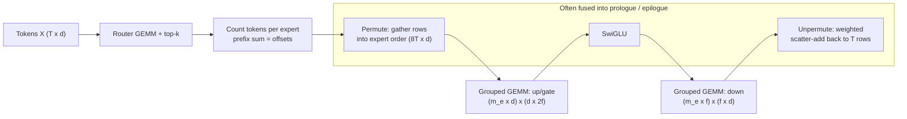
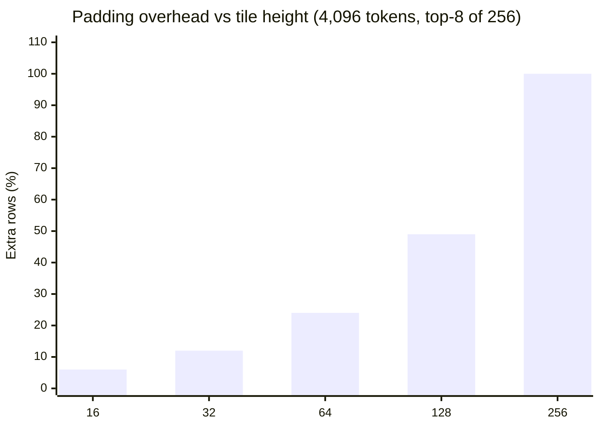
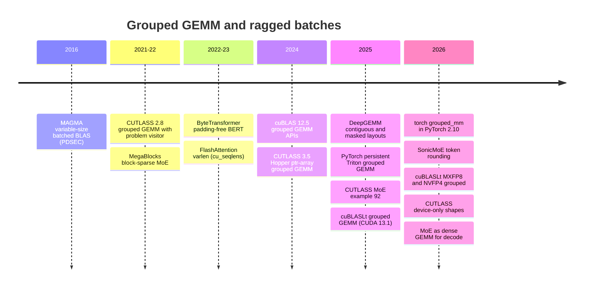
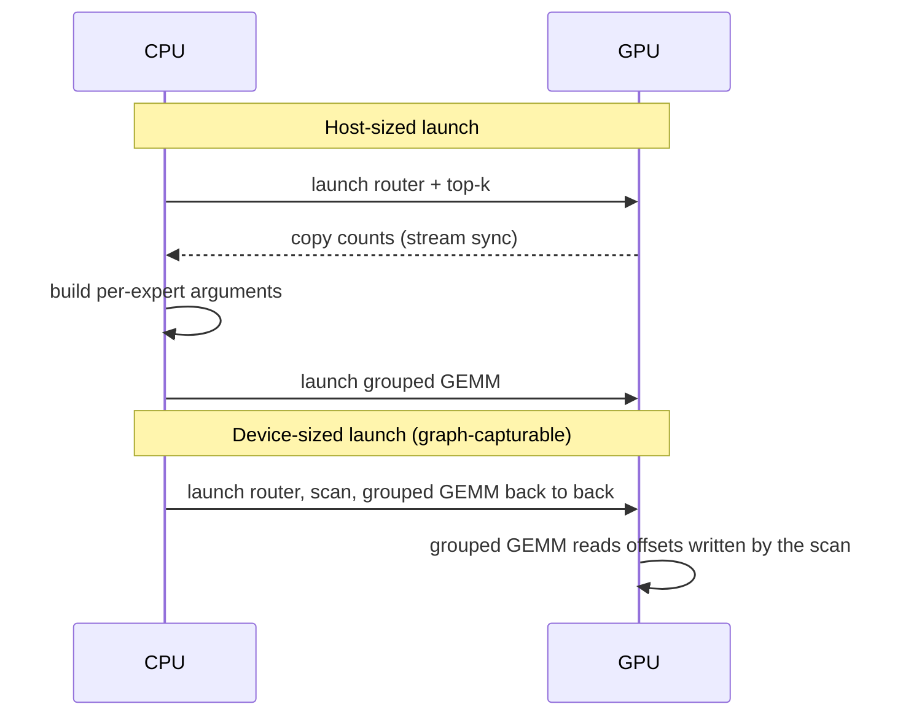

---
tags:
  - gpu-programming
  - kernels-optimization
  - gemm
  - grouped-gemm
  - mixture-of-experts
  - ragged-batches
  - variable-length
  - load-balancing
status: complete
sources:
  - https://developer.nvidia.com/blog/introducing-grouped-gemm-apis-in-cublas-and-more-performance-updates
  - https://developer.nvidia.com/blog/nvidia-cuda-13-1-powers-next-gen-gpu-programming-with-nvidia-cuda-tile-and-performance-gains/
  - https://docs.nvidia.com/cuda/archive/13.4.2/cuda-toolkit-release-notes/index.html
  - https://docs.nvidia.com/cutlass/4.8.0/media/docs/cpp/grouped_scheduler.html
  - https://docs.nvidia.com/cutlass/latest/media/docs/operators/tutorials/005_grouped_gemm_contiguous_offset.html
  - https://github.com/NVIDIA/cutlass/blob/main/CHANGELOG.md
  - https://docs.pytorch.org/docs/main/generated/torch.nn.functional.grouped_mm.html
  - https://triton-lang.org/main/getting-started/tutorials/08-grouped-gemm.html
  - https://pytorch.org/blog/accelerating-moes-with-a-triton-persistent-cache-aware-grouped-gemm-kernel/
  - https://github.com/deepseek-ai/DeepGEMM
  - https://arxiv.org/abs/2211.15841
  - https://arxiv.org/abs/2512.14080
  - https://arxiv.org/abs/2508.16584
  - https://docs.vllm.ai/en/latest/api/vllm/model_executor/layers/fused_moe/moe_align_block_size/
  - https://nvidia.github.io/TensorRT-LLM/1.3.0rc29/blogs/tech_blog/blog24_MoE_as_Dense_GEMM.html
  - https://arxiv.org/abs/2603.07685
  - https://docs.nvidia.com/deeplearning/cudnn/latest/fe-oss-apis/gemm_fusions/grouped_gemm.html
  - https://rocm.blogs.amd.com/software-tools-optimization/primus-moe-package/README.html
  - https://icl.utk.edu/node/940
  - https://arxiv.org/abs/2210.03052
  - https://github.com/Dao-AILab/flash-attention
  - https://research.colfax-intl.com/dynamic-persistent-tile-scheduling-with-cluster-launch-control-clc-on-nvidia-blackwell-gpus/
  - https://huggingface.co/deepseek-ai/DeepSeek-V3/blob/main/config.json
  - https://newreleases.io/project/github/NVIDIA/cutlass/release/v2.8.0
  - https://docs.nvidia.com/cutlass/4.6.0/CHANGELOG.html
created: 2026-11-26
updated: 2026-11-26
---

## Table Of Contents

---

- [[#TL;DR|TL;DR]]
- [[#The Problem|The Problem]]
- [[#Foundations|Foundations]]
    - [[#Batched, Strided, Grouped and Ragged|Batched, Strided, Grouped and Ragged]]
    - [[#An MoE Layer as GEMMs|An MoE Layer as GEMMs]]
    - [[#Arithmetic Intensity per Expert|Arithmetic Intensity per Expert]]
    - [[#Tile Quantization and Padding|Tile Quantization and Padding]]
- [[#How We Got Here|How We Got Here]]
- [[#How It Works|How It Works]]
    - [[#Data Layouts - Pointer Arrays vs Contiguous Offsets|Data Layouts - Pointer Arrays vs Contiguous Offsets]]
    - [[#Building the Groups - Count, Scan, Permute|Building the Groups - Count, Scan, Permute]]
    - [[#Scheduling Tiles Across Problems|Scheduling Tiles Across Problems]]
    - [[#Keeping Sizes on the Device|Keeping Sizes on the Device]]
    - [[#Fusing Gather, Activation and Scatter|Fusing Gather, Activation and Scatter]]
    - [[#The Backward Pass - Varlen-K|The Backward Pass - Varlen-K]]
    - [[#Small Batches - Masked and Dense Formulations|Small Batches - Masked and Dense Formulations]]
    - [[#Ragged Batches Beyond MoE|Ragged Batches Beyond MoE]]
    - [[#Choosing an Implementation|Choosing an Implementation]]
- [[#Where It Is Now|Where It Is Now]]
- [[#Trade-offs & Open Problems|Trade-offs & Open Problems]]
- [[#Resources|Resources]]
- [[#Related Notes|Related Notes]]

## ***TL;DR***
---
*A grouped GEMM runs many matrix multiplications of different sizes in one kernel launch. It is the workhorse of Mixture-of-Experts layers, where every expert gets a different, data-dependent number of tokens, and the hard parts are padding, scheduling and keeping those sizes off the CPU.*

- **What it is:** a list of independent GEMMs $\{(M_g, N_g, K_g)\}_{g=1}^{G}$ computed by one launch. A **batched** GEMM requires every problem to have the same shape; a **grouped** GEMM lets shapes (and transposes, scales, pointers) differ per group ([NVIDIA, Jun 2024](https://developer.nvidia.com/blog/introducing-grouped-gemm-apis-in-cublas-and-more-performance-updates)). A **ragged** batch is the data-layout version of the same idea: variable-length rows packed end to end, described by an offsets array instead of padding.
- **Why it matters now:** in a [[Mixture of Experts]] layer each expert multiplies the tokens routed to it by its own weights. With 256 experts and top-8 routing that is 256 GEMMs per projection per layer, all with the same $N$ and $K$ but a different $M$ that is only known on the GPU after routing.
- **The three costs:** (1) **launch and tail overhead** if experts run one by one; (2) **tile quantization**, padding each expert's rows up to the tile height (with 128-row tiles and uniform routing of 4,096 tokens, about 49% extra rows, by the simulation below); (3) **host synchronization**, copying the per-expert counts to the CPU to build launch arguments, which stalls the stream and breaks [[CUDA Graphs]].
- **How kernels solve them:** a [[Persistent Kernels and Stream-K|persistent]] tile loop walks the tiles of all groups; a prefix sum of per-group tile counts maps a tile index to its group; operands are either a **pointer array** per group or one **contiguous** tensor sliced by **offsets**; problem sizes and TMA descriptors are read or built **on the device**; the gather of routed tokens, the SwiGLU activation and the weighted scatter are fused into prologue and epilogue.
- **Where it is now (Nov 2026):** cuBLASLt has an experimental grouped GEMM with device-side shapes (CUDA 13.1, Dec 2025), extended to MXFP8 and NVFP4 in 13.2 and dynamically scheduled on Blackwell in 13.4; CUTLASS 4.x has a dedicated MoE grouped GEMM (example 92) and CuTe DSL grouped kernels with device-only shapes; PyTorch exposes `torch.nn.functional.grouped_mm` (2.10+); DeepGEMM, SonicMoE, TensorRT-LLM and cuDNN's frontend ship MoE-specific variants. For tiny decode batches the frontier has moved to masked layouts and even to running all experts as one dense GEMM.

## ***The Problem***
---
*A GPU needs big, uniform matrix multiplications to reach peak. MoE layers and variable-length batches hand it hundreds of small, uneven ones whose sizes are decided at runtime.*

Take one MoE layer of DeepSeek-V3: hidden size 7,168, 256 routed experts, each token routed to 8, expert width 2,048 ([config.json](https://huggingface.co/deepseek-ai/DeepSeek-V3/blob/main/config.json); [[Mixture of Experts]]). For a batch of $T$ tokens the router produces $8T$ (token, expert) pairs, so expert $e$ receives $m_e$ tokens with $\sum_e m_e = 8T$. Each expert then computes

$$Y_e = \text{SwiGLU}(X_e W^{\text{up}}_e)\,W^{\text{down}}_e, \qquad X_e \in \mathbb{R}^{m_e \times 7168}$$

which is two GEMMs with the same $N$ and $K$ for every expert and a different $M = m_e$.

| Naive approach | What goes wrong |
|---|---|
| Loop over experts, one cuBLAS call each | 256 launches per projection per layer; each small GEMM leaves most SMs idle and pays its own tail ([[Occupancy and Latency Hiding]]) |
| Pad every expert to the same capacity and run one batched GEMM | Wasted FLOPs and memory on padding, or dropped tokens when an expert overflows its capacity ([[Mixture of Experts]]) |
| One stream per expert | Fewer idle SMs, but still hundreds of launches; NVIDIA reports its device-side grouped GEMM up to 4x faster than a multi-stream implementation for MoE ([CUDA 13.1 blog](https://developer.nvidia.com/blog/nvidia-cuda-13-1-powers-next-gen-gpu-programming-with-nvidia-cuda-tile-and-performance-gains/)) |
| Read the counts on the host, then launch | `counts.tolist()` is a device-to-host copy: the CPU waits for routing to finish, the GPU waits for the next launch, and the step can no longer be captured in a CUDA graph ([[Streams, Events and Async Execution]]) |

The same shape problem appears whenever a batch is ragged: sequences of different lengths in a transformer batch, per-request KV caches in serving, variable-size dense blocks in sparse solvers. Padding to the longest item is simple and wasteful; packing items end to end is efficient and needs kernels that understand offsets.

## ***Foundations***
---
*Four ideas carry the whole topic: the difference between batched and grouped interfaces, the GEMMs inside an MoE layer, why a few tokens per expert makes those GEMMs memory-bound, and how much padding to a tile size costs.*

### Batched, Strided, Grouped and Ragged

| Interface | Shapes | How operands are found | Example API |
|---|---|---|---|
| Batched | All identical | One pointer per matrix | `cublasGemmBatchedEx` |
| Strided batched | All identical | `base + i * stride` | `cublasGemmStridedBatchedEx`; per-head attention ([[cuBLAS and cuDNN]]) |
| Grouped (pointer array) | Any $(M_g, N_g, K_g)$, transposes and scales per group | Arrays of pointers, sizes and leading dimensions | `cublasGemmGroupedBatchedEx`; CUTLASS ptr-array grouped GEMM; Triton tutorial 08 |
| Grouped (contiguous / ragged) | One dimension varies; the others shared | One packed tensor plus an offsets array | `torch.nn.functional.grouped_mm`; CUTLASS `IndexPtrGroupedGemmArguments`; DeepGEMM contiguous layout |

NVIDIA calls grouped GEMM "a generalization of the batched APIs" that can vary shapes, transpositions and scaling factors per group ([NVIDIA, Jun 2024](https://developer.nvidia.com/blog/introducing-grouped-gemm-apis-in-cublas-and-more-performance-updates)). The contiguous form is the special case that MoE needs: only $M$ varies, so all groups' $A$ operands stack into one $(\sum_g M_g) \times K$ tensor, $B$ is a $(G, K, N)$ stack of expert weights, and an offsets array marks where each group ends ([CUTLASS tutorial](https://docs.nvidia.com/cutlass/latest/media/docs/operators/tutorials/005_grouped_gemm_contiguous_offset.html)). DeepGEMM states the restriction plainly: it "groups only the M-axis, while N and K must remain fixed" ([DeepGEMM](https://github.com/deepseek-ai/DeepGEMM)).

### An MoE Layer as GEMMs



Read left to right: the router decides which experts each token visits; a counting pass and a [[Parallel Reduction and Scan|prefix sum]] turn those choices into per-expert row ranges; a permutation copies each token's row once per chosen expert into expert-sorted order (the counting-sort step described in [[Sorting and Hashing on GPUs]]); two grouped GEMMs do the expert math; and an unpermute multiplies each output row by its router weight and adds it back to its token. With [[Multi-GPU Communication - NVLink and NCCL|expert parallelism]], an all-to-all sits between the permute and the first grouped GEMM and another before the unpermute. Megatron Core runs "all local experts ... in a single Grouped GEMM call" through Transformer Engine's grouped MLP ([Megatron Core MoE report, 2026](https://arxiv.org/abs/2603.07685)).

### Arithmetic Intensity per Expert

For one expert projection with $m$ tokens, input width $K$, output width $N$, weights stored in $b_w$ bytes and activations in $b_a$ bytes:

$$I = \frac{2mNK}{b_w NK + b_a m K + b_a m N} \;\approx\; \frac{2m}{b_w} \quad \text{when } m \ll N, K$$

In plain words: when an expert sees only a few tokens, the bytes are dominated by reading its weight matrix once, and each weight element is used for just $m$ multiply-adds. The [[Roofline Model and Arithmetic Intensity|roofline]] says the GEMM is memory-bound until $I$ reaches the GPU's ridge point.

**Worked example (H100 SXM).** Dense BF16 peak is about 989 TFLOP/s and HBM bandwidth 3.35 TB/s, so the ridge is about $989 / 3.35 \approx 295$ FLOP/byte. With BF16 weights ($b_w = 2$), $I \approx m$, so an expert needs roughly **300 tokens** before its GEMM is compute-bound. With FP8 weights ($b_w = 1$) and the FP8 peak of about 1,979 TFLOP/s, $I \approx 2m$ against a ridge of about 590: the answer is again about 300 tokens. Lower precision halves the bytes and doubles the peak, so it does not change how many tokens per expert you need.

Now the batch: 4,096 tokens with top-8 over 256 experts gives $32{,}768 / 256 = 128$ tokens per expert on average, well below 300. Fine-grained, very sparse MoEs therefore run their expert GEMMs largely memory-bound, which is the regime SonicMoE describes as "pushing MoE training toward being memory-bound" ([Guo et al., 2026](https://arxiv.org/abs/2512.14080)). Decode is far worse: 64 tokens give 512 pairs spread over about 226 active experts, about 2 tokens each.

### Tile Quantization and Padding

A GEMM kernel computes $B_M \times B_N$ output tiles. If expert $e$ has $m_e$ rows, its tiles cover $\lceil m_e / B_M \rceil B_M$ rows, and the extra rows are wasted work (the per-problem version of the wave and tile quantization in [[Tiled Matrix Multiplication (GEMM)]]):

$$\text{padding overhead} = \frac{\sum_e \lceil m_e / B_M \rceil B_M}{\sum_e m_e} - 1$$

Many kernels also require each group's rows to *start* on a tile boundary in memory, which turns this compute waste into memory waste: vLLM's `moe_align_block_size` pads each expert's token list to a multiple of the block size, with a worst case of `numel + num_experts * (block_size - 1)` slots ([vLLM](https://docs.vllm.ai/en/latest/api/vllm/model_executor/layers/fused_moe/moe_align_block_size/)); DeepGEMM's contiguous layout aligns every expert segment to its M block size ([DeepGEMM](https://github.com/deepseek-ai/DeepGEMM)); cuDNN's SM100 grouped GEMM requires 256-aligned offsets ([cuDNN frontend](https://docs.nvidia.com/deeplearning/cudnn/latest/fe-oss-apis/gemm_fusions/grouped_gemm.html)).

**Worked example (simulation).** 4,096 tokens, top-8 of 256 experts chosen uniformly at random, averaged over five draws (a quick Python simulation written for this note; real routers are more skewed):

| Tile height $B_M$ | Extra rows from padding | Note |
|---|---|---|
| 16 | 6% | Small tiles, poor Tensor Core efficiency |
| 64 | 24% | |
| 128 | 49% | Counts cluster around 128 ± 11, so half the experts spill into a second tile |
| 256 | 100% | Every expert padded to 256 rows |



The up-projection for those 32,768 rows is $2 \times 32{,}768 \times 7{,}168 \times 4{,}096 \approx 1.9$ TFLOP, about 2 ms at H100's BF16 peak, so 49% padding is close to a millisecond per layer of multiplying zeros. In decode the picture inverts: 2 real rows in a 128-row tile is under 2% utilization, and the cost is dominated by weight loads, not by the padded math.

## ***How We Got Here***
---
*Grouped GEMM grew out of HPC's batched linear algebra, became a CUTLASS feature for many small problems, and turned into a core AI kernel when MoE models scaled to hundreds of experts.*



- **2016, HPC batched BLAS.** Abdelfattah, Haidar, Tomov and Dongarra built variable-size batched BLAS and batched Cholesky for many small matrices of different sizes, because "each one alone doesn't provide enough parallelism" for a GPU; up to 2.5x over two 8-core CPUs with MKL on a K40c ([PDSEC 2016](https://icl.utk.edu/node/940)). These "vbatched" routines live on in MAGMA.
- **2021-2022, CUTLASS grouped GEMM.** CUTLASS 2.8 (late 2021) added `cutlass::gemm::device::GemmGrouped`, "similar to batched GEMM with distinct problem size per group" ([v2.8.0 release notes](https://newreleases.io/project/github/NVIDIA/cutlass/release/v2.8.0)): "a persistent kernel which launches multiple problems ... within a single CUDA kernel launch", with a device-side or host-precomputed schedule ([CUTLASS grouped scheduler](https://docs.nvidia.com/cutlass/4.8.0/media/docs/cpp/grouped_scheduler.html)). In parallel, MegaBlocks (Gale, Narayanan, Young, Zaharia, Nov 2022) recast MoE as block-sparse matmuls so experts could take any number of tokens without dropping or padding to capacity: up to 40% faster than Tutel and 2.4x faster than dense Megatron-LM training ([arXiv:2211.15841](https://arxiv.org/abs/2211.15841)).
- **2022-2023, ragged sequences.** ByteTransformer removed padded tokens from the whole BERT forward pass, with fused attention 6.13x faster than PyTorch on A100 and end-to-end gains of 55% over FasterTransformer ([IPDPS 2023](https://arxiv.org/abs/2210.03052)). FlashAttention 2.0 renamed `flash_attn_unpadded_func` to `flash_attn_varlen_func`, the packed-sequence interface most training stacks now use ([flash-attention](https://github.com/Dao-AILab/flash-attention)).
- **2024, vendor APIs.** cuBLAS 12.5 added `cublas<t>gemmGroupedBatched` and `cublasGemmGroupedBatchedEx`; for MoE generation at batch 8 and 64 in FP16, grouped beat a loop of batched calls by about 1.2x, even though the grouped kernels then used warp-level MMA rather than Hopper's warpgroup `wgmma` ([NVIDIA, Jun 2024](https://developer.nvidia.com/blog/introducing-grouped-gemm-apis-in-cublas-and-more-performance-updates)). CUTLASS 3.5 shipped Hopper ptr-array batched and grouped GEMM examples (56 and 57), and 3.8 (Jan 2025) added a 3.x grouped GEMM to the CUTLASS library for Hopper and Blackwell, with FP8 and NVFP4 Blackwell examples ([CUTLASS 4.6 changelog](https://docs.nvidia.com/cutlass/4.6.0/CHANGELOG.html)).
- **2025, MoE-specific kernels.** DeepSeek's DeepGEMM introduced the **contiguous** layout for training and prefill and the **masked** layout for CUDA-graph decode ([DeepGEMM](https://github.com/deepseek-ai/DeepGEMM)); PyTorch published a persistent, cache-aware Triton grouped GEMM ([PyTorch, Aug 2025](https://pytorch.org/blog/accelerating-moes-with-a-triton-persistent-cache-aware-grouped-gemm-kernel/)); CUTLASS 4.2 added example 92, MoE kernels "where only one problem dimension varies across experts", and 4.3 a ragged contiguous grouped GEMM with a simplified MoE API ([CUTLASS changelog](https://github.com/NVIDIA/cutlass/blob/main/CHANGELOG.md)); CUDA 13.1 introduced cuBLASLt grouped GEMM with device-side shapes ([CUDA 13.1 blog](https://developer.nvidia.com/blog/nvidia-cuda-13-1-powers-next-gen-gpu-programming-with-nvidia-cuda-tile-and-performance-gains/)).
- **2026.** Covered in [[#Where It Is Now|Where It Is Now]].

## ***How It Works***
---
*A grouped GEMM kernel is a normal tiled GEMM with three additions: a way to find each group's operands, a scheduler that maps a flat tile index to (group, tile), and a source of problem sizes that does not need the CPU.*

### Data Layouts - Pointer Arrays vs Contiguous Offsets

| | Pointer array | Contiguous with offsets |
|---|---|---|
| What is passed | Per group: pointers to $A_g, B_g, C_g$, sizes $(M_g, N_g, K_g)$, leading dimensions | One packed $A$ of shape $(\sum M_g, K)$, stacked $B$ of shape $(G, K, N)$, int32 `offsets` of shape $(G,)$ |
| Flexibility | Any shapes, any memory locations | Only $M$ (or $K$) varies |
| TMA ([[TMA and Asynchronous Copies]]) | One descriptor per group, built on host or patched on device | One descriptor for $A$; tiles near group ends must not read the next group's rows |
| Typical users | cuBLAS grouped, CUTLASS ptr-array, Triton tutorial | MoE: `grouped_mm`, DeepGEMM, CUTLASS example 92, cuDNN frontend |

`torch.nn.functional.grouped_mm(mat_a, mat_b, *, offs=None, ...)` covers both MoE cases: a 2D `mat_a` sliced along its rows by `offs` times a 3D `(groups, K, N)` weight stack (the forward pass), and two 2D operands both partitioned along $K$ by the same `offs` (the weight gradient). `offs[i]` is the exclusive end of group $i$; it needs SM80 or newer and FP16, BF16 or FP32 inputs ([PyTorch docs](https://docs.pytorch.org/docs/main/generated/torch.nn.functional.grouped_mm.html)). Before 2.10 the same operator was the private `torch._grouped_mm` ([CUTLASS tutorial](https://docs.nvidia.com/cutlass/latest/media/docs/operators/tutorials/005_grouped_gemm_contiguous_offset.html)).

### Building the Groups - Count, Scan, Permute

```python
counts = torch.bincount(topk_ids.flatten(), minlength=E)    # tokens per expert, shape (E,)
offs   = torch.cumsum(counts, 0, dtype=torch.int32)          # exclusive end row of each expert
order  = torch.argsort(topk_ids.flatten(), stable=True)      # (token, slot) pairs in expert order
x_perm = x[order // k]                                       # gather: one row per (token, expert)
h = F.grouped_mm(x_perm, w_up.transpose(-2, -1), offs=offs)  # all experts' up-projections, one launch
```

Line by line:

1. `topk_ids` is the router's output, shape `(T, k)`: for each token, the $k$ experts it goes to. `bincount` counts how many (token, expert) pairs land on each of the $E$ experts.
2. `cumsum` turns counts into running totals: expert 0 owns rows `[0, offs[0])`, expert 1 owns `[offs[0], offs[1])`, and so on. This is the prefix sum from [[Parallel Reduction and Scan]].
3. `argsort` on the flattened expert ids lists the $Tk$ pairs grouped by expert; `stable=True` keeps tokens in order within an expert.
4. Pair index $p$ came from token $p \div k$, so `x[order // k]` copies each token's row once per expert it visits, now in expert order.
5. `w_up` is stored like `nn.Linear` weights, `(E, N, K)`, so it is transposed to `(E, K, N)`. One call computes every expert's GEMM, and `counts` never leaves the GPU.

Production stacks fuse steps 1 to 4 into one or two kernels (Megatron Core lists permutation fusion and router fusion among its optimizations ([Megatron Core report](https://arxiv.org/abs/2603.07685))), and the fastest kernels skip materializing `x_perm` at all (see [[#Fusing Gather, Activation and Scatter|below]]).

### Scheduling Tiles Across Problems

Group $g$ has $t_g = \lceil M_g / B_M \rceil \lceil N_g / B_N \rceil$ tiles. Number all tiles $0 \ldots \sum_g t_g - 1$. Tile $i$ belongs to the group whose range contains it, which is a search over the prefix sums $S_g = \sum_{h < g} t_h$. The Triton tutorial's static scheduler shows the whole idea:

```python
tile_idx = tl.program_id(0)                  # this program's first tile
last_problem_end = 0
for g in range(group_size):                  # walk the groups in order
    m, n, k = load_sizes(g)                  # M, N, K of group g from a device array
    num_tiles = tl.cdiv(m, BLOCK_M) * tl.cdiv(n, BLOCK_N)
    while tile_idx >= last_problem_end and tile_idx < last_problem_end + num_tiles:
        local = tile_idx - last_problem_end  # tile number inside group g
        tile_m, tile_n = local // tl.cdiv(n, BLOCK_N), local % tl.cdiv(n, BLOCK_N)
        compute_tile(g, tile_m, tile_n, k)   # ordinary tiled GEMM on group g's pointers
        tile_idx += NUM_SM                   # grid-stride to this program's next tile
    last_problem_end += num_tiles
```

1. The kernel launches exactly `NUM_SM` programs, one per SM, regardless of how many groups or tiles there are: a [[Persistent Kernels and Stream-K|persistent kernel]].
2. Each program starts at the tile equal to its id.
3. It walks the groups in order, reading each group's sizes from a small device tensor (`group_gemm_sizes`, shape `[G, 3]` in the tutorial).
4. While its current tile falls inside this group's range, it converts the flat index into a (row, column) tile of the group and computes it.
5. It then jumps ahead by `NUM_SM`, so tiles are dealt round-robin across SMs and a program can move on to later groups.

Simplified from the [Triton tutorial](https://triton-lang.org/main/getting-started/tutorials/08-grouped-gemm.html), which passes pointers and leading dimensions as device arrays and has a TMA variant for compute capability 9.0+.

CUTLASS's C++ grouped kernels formalize the same loop as a **problem visitor** with two modes ([CUTLASS grouped scheduler](https://docs.nvidia.com/cutlass/4.8.0/media/docs/cpp/grouped_scheduler.html)):

| Mode | How a block finds its next tile | Best when |
|---|---|---|
| `kDeviceOnly` (default) | Each warp loads up to 32 problems' sizes, one per lane, and a warp-wide prefix sum finds which problem contains the tile | Sizes were produced by an earlier kernel (MoE routing) |
| `kHostPrecompute` | The host writes each block's list of (problem, starting tile) pairs; the device just reads it | Host work can overlap the previous layer, and blocks do at most one tile per problem |

Two refinements matter in practice. **Order:** sorting problems by descending $K$ improved runtime "by around 30%" on GA100 in CUTLASS's measurements, the longest-first idea from [[Work Stealing and Dynamic Load Balancing]], though CUTLASS warns it "is not guaranteed to improve performance". **Locality:** visiting an expert's tiles in an L2-friendly swizzle keeps its weight panel hot; PyTorch measured 1.33x and a 60% higher L2 hit rate from grouped ordering in its persistent MoE kernel, and up to 1.50x over a non-persistent Triton grouped GEMM ([PyTorch, Aug 2025](https://pytorch.org/blog/accelerating-moes-with-a-triton-persistent-cache-aware-grouped-gemm-kernel/)). On Blackwell, dynamic scheduling replaces round-robin: Colfax reports its CLC-based scheduler "significantly outperforms" static on imbalanced grouped GEMMs ([Colfax, May 2026](https://research.colfax-intl.com/dynamic-persistent-tile-scheduling-with-cluster-launch-control-clc-on-nvidia-blackwell-gpus/)), and cuBLASLt 13.4 credits dynamic scheduling with up to 20% at large group counts ([CUDA 13.4 notes](https://docs.nvidia.com/cuda/archive/13.4.2/cuda-toolkit-release-notes/index.html)).

### Keeping Sizes on the Device



The top half stalls twice per layer and cannot be captured in a [[CUDA Graphs|CUDA graph]], because the arguments depend on data. The bottom half never waits. Making it work needs three things:

- **Sizes in device memory.** cuBLASLt's grouped API takes shapes on the device and is "host-synchronization-free" with CUDA Graph support ([CUDA 13.1 blog](https://developer.nvidia.com/blog/nvidia-cuda-13-1-powers-next-gen-gpu-programming-with-nvidia-cuda-tile-and-performance-gains/)); CUTLASS's CuTe DSL grouped example supports "device-only problem shapes" since 4.4 (Feb 2026) ([CUTLASS changelog](https://github.com/NVIDIA/cutlass/blob/main/CHANGELOG.md)); `grouped_mm` takes `offs` as a device tensor.
- **Descriptors built on device.** A TMA descriptor encodes a tensor's shape, so a host-built descriptor cannot follow a size it has never seen. Kernels either patch descriptors on the GPU (PyTorch's Triton kernel builds them for the routed expert ([PyTorch](https://pytorch.org/blog/accelerating-moes-with-a-triton-persistent-cache-aware-grouped-gemm-kernel/)); CUTLASS 4.3 added asynchronous TMA descriptor updates for grouped GEMM, and 4.8.1 fixed a bug in device-side descriptors shrunk below their original extent) or keep one descriptor over the packed tensor and rely on alignment.
- **A grid that does not depend on sizes.** A persistent grid of one block per SM, or a grid sized to the worst case whose surplus blocks exit, keeps the launch shape fixed. The cost is that the kernel cannot size itself to the actual work.

### Fusing Gather, Activation and Scatter

The permute and unpermute in the MoE flowchart are pure memory traffic: an $8T \times d$ copy each way. The best kernels fold them into the GEMM:

- **Gather in the prologue.** SonicMoE loads routed rows of $X$ straight from their original positions during the global-to-shared copy (`cp.async`), so the gathered input "is never materialized"; on Blackwell's 2-CTA MMA this needs a relay warp to forward completion signals ([Guo et al.](https://arxiv.org/abs/2512.14080)).
- **Activation in the epilogue.** The up-projection's epilogue applies SwiGLU, and the backward kernel applies dSwiGLU, so the intermediate never makes a round trip to HBM ([[Kernel Fusion]]). cuDNN's frontend ships Grouped GEMM + SwiGLU, + dSwiGLU and + Quant variants for SM100 ([cuDNN frontend](https://docs.nvidia.com/deeplearning/cudnn/latest/fe-oss-apis/gemm_fusions/grouped_gemm.html)).
- **Weighted scatter in the epilogue.** The down-projection multiplies each row by its router weight and adds it into the token's output row; TensorRT-LLM's dense formulation applies the router weights in FC2's mainloop and FC1's epilogue ([TRT-LLM blog](https://nvidia.github.io/TensorRT-LLM/1.3.0rc29/blogs/tech_blog/blog24_MoE_as_Dense_GEMM.html)).
- **Communication in the kernel.** The furthest step fuses expert-parallel dispatch and combine with the GEMMs into one MoE kernel ([[Megakernels]]; [[Mixture of Experts]]).

### The Backward Pass - Varlen-K

Training needs three GEMMs per expert projection. The input gradient $dX_e = dY_e W_e^\top$ has the same ragged $M$ as the forward pass. The weight gradient $dW_e = X_e^\top dY_e$ is different: its output is a fixed $K \times N$ matrix per expert and the ragged dimension $m_e$ is now the **reduction** dimension. That is why `grouped_mm` has a 2D x 2D mode partitioned along $K$, and why SonicMoE calls the two shapes **varlen-M** and **varlen-K** ([PyTorch docs](https://docs.pytorch.org/docs/main/generated/torch.nn.functional.grouped_mm.html); [Guo et al.](https://arxiv.org/abs/2512.14080)). Varlen-K balances differently: an expert with few tokens has a short K loop but still a full $K \times N$ output, so every expert costs at least one output tile pass, and an expert with zero tokens must still write zeros (cuBLASLt and CUTLASS both shipped fixes for groups with $k = 0$ in 2025-2026 ([CUDA 13.4 notes](https://docs.nvidia.com/cuda/archive/13.4.2/cuda-toolkit-release-notes/index.html); [CUTLASS changelog](https://github.com/NVIDIA/cutlass/blob/main/CHANGELOG.md))).

### Small Batches - Masked and Dense Formulations

When each expert sees a handful of tokens, padding waste stops being the problem and weight loading takes over. Two designs dominate:

- **Masked layout.** DeepGEMM's decode kernel allocates a fixed-capacity slot per expert and takes a mask (the real counts) on the device, "used when CUDA graphs are enabled and the CPU doesn't know how many tokens each expert receives"; it reads its input directly from DeepEP's low-latency dispatch output. On H800 it reported 815 to 1,233 TFLOPS for FP8 masked grouped GEMMs with 256 to 1,024 rows per group ([DeepGEMM](https://github.com/deepseek-ai/DeepGEMM)).
- **MoE as one dense GEMM.** TensorRT-LLM concatenates all 256 experts along $N$ (FC1) and $K$ (FC2), runs two dense GEMMs and zeroes non-selected experts with a per-token weight mask. On a B200 with DeepSeek-V3 in NVFP4 it is 2.1 to 2.3x faster than its CUTLASS grouped path for 64 to 208 tokens and up to 1.12x faster than its best grouped kernel (TRTLLM-Gen), but 0.18x at one token and 0.73x from 272 tokens, where the work turns compute-bound. The page calls it "not a universal replacement for grouped GEMM" ([TRT-LLM blog](https://nvidia.github.io/TensorRT-LLM/1.3.0rc29/blogs/tech_blog/blog24_MoE_as_Dense_GEMM.html)).

The dense trick works for the same reason as the arithmetic-intensity example: while the layer is memory-bound, extra multiplications by zero are nearly free, and one large regular GEMM schedules better than 200 tiny ones.

### Ragged Batches Beyond MoE

| Workload | What is ragged | Standard representation |
|---|---|---|
| Packed training sequences | Sequence lengths in a batch | Tokens concatenated; `cu_seqlens` of shape `(batch + 1,)` with cumulative lengths; Q, K, V as `(total_tokens, heads, head_dim)` ([FlashAttention source](https://github.com/Dao-AILab/flash-attention)) |
| LLM serving ([[LLM Serving]]) | KV length per request | Paged KV with per-request page tables; plan-then-run attention schedules ([[Work Stealing and Dynamic Load Balancing]]) |
| BERT-style inference | Prompt lengths | Remove padding before the encoder, restore after (ByteTransformer) ([IPDPS 2023](https://arxiv.org/abs/2210.03052)) |
| Sparse direct solvers, small factorizations | Front or block sizes | Variable-size batched BLAS ("vbatched") ([PDSEC 2016](https://icl.utk.edu/node/940)); see [[Batched Small-Matrix Linear Algebra]] |
| Block-sparse matmul | Nonzero blocks per row | Block-CSR, as in MegaBlocks ([[Sparse Linear Algebra on GPUs]]) |

The common pattern is the same as for MoE: replace a padded dense tensor with packed data plus a prefix-sum offsets array, and teach the kernel to map a flat work index back to (item, position) by searching those offsets.

### Choosing an Implementation

| Situation | Reach for | Why |
|---|---|---|
| Few large, differently shaped GEMMs, sizes on host | cuBLAS `cublasGemmGroupedBatchedEx` or CUTLASS ptr-array | Any shapes, mature, no padding |
| MoE training or prefill in PyTorch | `F.grouped_mm` (contiguous offsets) | Device-side sizes, forward and weight-gradient modes |
| FP8 / MXFP8 / NVFP4 MoE on Hopper or Blackwell | DeepGEMM, cuBLASLt grouped, CUTLASS example 92, cuDNN frontend | Block-scaled formats with per-group scales ([[Low-Precision Formats - FP8, FP4 and MX]]) |
| Fine-grained, memory-bound MoE training | Fused gather/epilogue kernels (SonicMoE-style) | Removes permute traffic and activation memory |
| Decode under CUDA graphs | Masked layout; dense formulation at 64-208 tokens on B200 | No host sizes; weight loads dominate |
| AMD Instinct | Composable Kernel grouped GEMM via Primus-Turbo, with per-expert counts kept on the GPU ([AMD, Dec 2025](https://rocm.blogs.amd.com/software-tools-optimization/primus-moe-package/README.html)) | Replaces multi-stream expert loops ([[ROCm and HIP]]) |

## ***Where It Is Now***
---
*As of late November 2026, grouped GEMM with device-side sizes is a first-class API in cuBLASLt, CUTLASS and PyTorch, and the research frontier is about removing the last padding, fusing the data movement around the GEMM, and handling tiny decode batches.*

- **cuBLASLt grouped GEMM has matured fast and still has bugs.** Introduced as experimental in CUDA 13.1 (FP8, FP16, BF16 on compute capability 10.x and 11.0, per-batch FP8 scales, device-side $\alpha$/$\beta$); CUDA 13.2 added MXFP8, then NVFP4 and bias epilogues on Blackwell and BF16/FP16/FP8 on Hopper, with up to 20% for problems larger than L2; CUDA 13.4 added dynamic scheduling on Blackwell data-center GPUs for up to 20% with many groups. The same notes list a string of correctness issues: groups with $k = 0$ ignored (fixed in 13.2), hangs when grouped GEMMs share a workspace on Hopper, wrong results with host pointer mode, and a known issue in 13.4 Update 1 (Sep 2026) of incorrect results on Blackwell and Rubin ([CUDA 13.4 notes](https://docs.nvidia.com/cuda/archive/13.4.2/cuda-toolkit-release-notes/index.html); [[cuBLAS and cuDNN]]).
- **CUTLASS treats MoE as its own kernel family.** Example 92's ragged contiguous grouped GEMM (4.2-4.3, Sep-Nov 2025) added block-scaled variants; 4.4 (Feb 2026) made CuTe DSL grouped GEMMs work with device-only shapes; 4.5 (May 2026) aligned the CuTe DSL grouped style with PyTorch's `grouped_mm` and `scaled_grouped_mm`; 4.8 (Sep 2026) added Rubin grouped and grouped block-scaled examples and the `IndexPtrGroupedGemmArguments` operator API, deprecating `GroupedGemmArguments` ([CUTLASS changelog](https://github.com/NVIDIA/cutlass/blob/main/CHANGELOG.md); [[CUTLASS and CuTe]]).
- **Padding is under attack from both sides.** Kernel side: the TMA-adaptive FP8 grouped GEMM uses a pool of about $\log_2 B_M$ preconfigured descriptors so residual rows need no padding, 1.7% to 20.4% faster than padding plus DeepGEMM on H800 and up to 23.8% less memory ([Su et al.](https://arxiv.org/abs/2508.16584)). Model side: SonicMoE's **token rounding** changes routing so every expert's count is a multiple of the tile size, deviating from top-k by at most one tile per expert, for up to 16% higher kernel throughput; overall SonicMoE reports 1.86x the throughput of ScatterMoE's BF16 kernel on Hopper and 25% (forward) / 15% (backward) over a DeepGEMM-based baseline on B300 ([Guo et al., Mar 2026](https://arxiv.org/abs/2512.14080)).
- **Training stacks run all local experts as one grouped call.** Megatron Core's 2026 report, whose stack runs every local expert in one grouped GEMM and fuses permutation and routing, reaches 1,233 TFLOPS/GPU on GB300 for DeepSeek-V3 end to end ([arXiv:2603.07685](https://arxiv.org/abs/2603.07685)).
- **Decode has split from prefill.** Masked layouts serve CUDA-graph decode, and TensorRT-LLM's dense formulation (blog last updated Sep 26 2026) shows grouped GEMM is not always the right abstraction when each expert sees a few tokens.
- **AMD is catching up through Composable Kernel.** Primus-Turbo replaced multi-stream expert loops with one fused CK grouped GEMM and an autotuned backend choice, with sync-free modes that keep per-expert counts on the GPU ([AMD, Dec 2025](https://rocm.blogs.amd.com/software-tools-optimization/primus-moe-package/README.html)).

## ***Trade-offs & Open Problems***
---
*Every grouped GEMM design trades generality against padding, scheduling overhead and determinism. The open questions are about predicting expert loads, numerical reproducibility and how far fusion should go.*

| Choice | Gains | Costs |
|---|---|---|
| Loop of GEMM calls | Simplest; each call fully tuned | Launch overhead, idle SMs, host sync for sizes |
| Pad to capacity + batched GEMM | One regular kernel | Wasted FLOPs and memory, or dropped tokens |
| Pointer-array grouped | Any shapes | Per-group descriptors and pointer loads; heuristics must judge a whole distribution |
| Contiguous offsets grouped | Device sizes, one descriptor, fits MoE | Only one dimension may vary; alignment padding |
| Masked fixed-capacity layout | CUDA-graph friendly | Memory sized to worst case; idle slots |
| Dense all-experts GEMM | One large regular GEMM | Loads every expert's weights; loses once compute-bound |
| Fused gather/activation/scatter | Removes permute traffic and activation memory | Kernel complexity; harder to reuse across models |

- **Kernel selection for a distribution.** A normal GEMM heuristic sees one shape; a grouped GEMM sees 256 shapes that change every step. cuBLAS's own notes list sub-optimal grouped heuristics for some layouts, and the best tile size depends on the count distribution ([[GEMM Autotuning and Kernel Selection]]).
- **Load prediction.** Longest-first ordering and plan-then-run need expert costs before the kernel runs, but counts are known only after routing on the GPU. Dynamic tile scheduling (CLC) handles it at the cost of determinism ([[Work Stealing and Dynamic Load Balancing]]).
- **Determinism.** Weight gradients reduce over a ragged token dimension; split or dynamically scheduled reductions change summation order run to run ([[Deterministic and Batch-Invariant Kernels]]).
- **Routing changes the kernel's job.** Token rounding shows that the cheapest fix for padding may be in the model, not the kernel, which blurs the line between kernel engineering and architecture design ([[Mixture of Experts]]).
- **Correctness at the edges.** Zero-token experts, groups with $k = 0$, descriptors resized on device and many-wave launches produced most of 2026's grouped-GEMM bug fixes in both cuBLAS and CUTLASS.
- **Expert parallelism.** Each GPU's grouped GEMM can start only when its all-to-all arrives; overlapping the two, or fusing them, is where MoE kernels are heading ([[Multi-GPU Communication - NVLink and NCCL]]; [[GPU-Initiated Communication with NVSHMEM]]).

## ***Resources***
---
*Start with the CUTLASS grouped-scheduler page and the Triton tutorial for the mechanics, then DeepGEMM and SonicMoE for how MoE kernels are built in 2025-2026.*

**Mechanics and APIs**
- [Grouped GEMM scheduler](https://docs.nvidia.com/cutlass/4.8.0/media/docs/cpp/grouped_scheduler.html): CUTLASS docs. Problem visitor, device-only vs host-precompute, sorting by K.
- [Contiguous offset grouped GEMM tutorial](https://docs.nvidia.com/cutlass/latest/media/docs/operators/tutorials/005_grouped_gemm_contiguous_offset.html): CUTLASS operator API, Blackwell.
- [Group GEMM tutorial](https://triton-lang.org/main/getting-started/tutorials/08-grouped-gemm.html): Triton. Static on-device scheduler and TMA variant.
- [torch.nn.functional.grouped_mm](https://docs.pytorch.org/docs/main/generated/torch.nn.functional.grouped_mm.html): PyTorch docs. Offsets semantics and shape cases.
- [Introducing Grouped GEMM APIs in cuBLAS](https://developer.nvidia.com/blog/introducing-grouped-gemm-apis-in-cublas-and-more-performance-updates): Hejazi, NVIDIA, Jun 2024.
- [CUDA 13.1 release blog](https://developer.nvidia.com/blog/nvidia-cuda-13-1-powers-next-gen-gpu-programming-with-nvidia-cuda-tile-and-performance-gains/) and [CUDA 13.4 release notes](https://docs.nvidia.com/cuda/archive/13.4.2/cuda-toolkit-release-notes/index.html): cuBLASLt grouped GEMM history and known issues.
- [CUTLASS changelog](https://github.com/NVIDIA/cutlass/blob/main/CHANGELOG.md): dated record of grouped and MoE kernels.

**MoE kernels**
- [DeepGEMM](https://github.com/deepseek-ai/DeepGEMM): DeepSeek, 2025. Contiguous and masked FP8 grouped GEMMs.
- [Accelerating MoEs with a Triton Persistent Cache-Aware Grouped GEMM Kernel](https://pytorch.org/blog/accelerating-moes-with-a-triton-persistent-cache-aware-grouped-gemm-kernel/): Wright, Hoque, Goon, PyTorch, Aug 2025.
- [SonicMoE](https://arxiv.org/abs/2512.14080): Guo, Mishra, Cheng, Stoica, Dao, 2026 (ICLR'26 preliminary). Varlen-M/K, fused gather, token rounding.
- [TMA-Adaptive FP8 Grouped GEMM](https://arxiv.org/abs/2508.16584): Su et al., Shanghai AI Lab. Padding-free grouped GEMM on Hopper.
- [MoE as Dense GEMM](https://nvidia.github.io/TensorRT-LLM/1.3.0rc29/blogs/tech_blog/blog24_MoE_as_Dense_GEMM.html): TensorRT-LLM tech blog 24, 2026.
- [MegaBlocks](https://arxiv.org/abs/2211.15841): Gale, Narayanan, Young, Zaharia, 2022. MoE as block-sparse matmul.
- [Scalable Training of MoE Models with Megatron Core](https://arxiv.org/abs/2603.07685): NVIDIA, 2026.
- [moe_align_block_size](https://docs.vllm.ai/en/latest/api/vllm/model_executor/layers/fused_moe/moe_align_block_size/): vLLM docs. Block-aligned expert sorting with a worked example.
- [cuDNN frontend Grouped GEMM (SM100)](https://docs.nvidia.com/deeplearning/cudnn/latest/fe-oss-apis/gemm_fusions/grouped_gemm.html) and its SwiGLU, dSwiGLU and Quant variants.
- [MoE Training Best Practices on AMD GPUs](https://rocm.blogs.amd.com/software-tools-optimization/primus-moe-package/README.html): AMD ROCm blog, Dec 2025.

**Ragged batches**
- [On the Development of Variable Size Batched Computation](https://icl.utk.edu/node/940): Abdelfattah, Haidar, Tomov, Dongarra, PDSEC 2016.
- [ByteTransformer](https://arxiv.org/abs/2210.03052): Zhai et al., IPDPS 2023. Padding-free transformer inference.
- [FlashAttention](https://github.com/Dao-AILab/flash-attention): `flash_attn_varlen_func` and `cu_seqlens`.

## Related Notes

- [[Tiled Matrix Multiplication (GEMM)]] — The tile loop a grouped GEMM runs per group; tile and wave quantization.
- [[Persistent Kernels and Stream-K]] — Persistent tile loops, raster order and the PyTorch persistent MoE kernel.
- [[Work Stealing and Dynamic Load Balancing]] — Longest-first ordering, CLC and plan-then-run for uneven experts.
- [[GEMM Autotuning and Kernel Selection]] — Choosing tiles for a distribution of shapes.
- [[cuBLAS and cuDNN]] — Batched, strided and grouped cuBLAS APIs; cuBLASLt grouped GEMM releases.
- [[CUTLASS and CuTe]] — Ptr-array and MoE grouped kernels, CuTe DSL grouped GEMM.
- [[Triton]] — The grouped GEMM tutorial and persistent Triton MoE kernels.
- [[Parallel Reduction and Scan]] — The prefix sums that build offsets and tile ranges.
- [[Sorting and Hashing on GPUs]] — Counting sort for MoE token permutation.
- [[Sparse Linear Algebra on GPUs]] — Block-sparse formulations such as MegaBlocks.
- [[TMA and Asynchronous Copies]] — Descriptors and why ragged groups complicate them.
- [[Kernel Fusion]] — Fusing gather, SwiGLU and scatter into the GEMM.
- [[CUDA Graphs]] — Why sizes must stay on the device.
- [[Streams, Events and Async Execution]] — Host syncs and the multi-stream alternative.
- [[Roofline Model and Arithmetic Intensity]] — Why few tokens per expert means memory-bound.
- [[Occupancy and Latency Hiding]] — Waves, tails and idle SMs from small GEMMs.
- [[Low-Precision Formats - FP8, FP4 and MX]] — Block-scaled grouped GEMMs.
- [[Megakernels]] — Fusing dispatch, expert GEMMs and combine into one kernel.
- [[Multi-GPU Communication - NVLink and NCCL]] — Expert-parallel all-to-all around the grouped GEMM.
- [[ROCm and HIP]] — Composable Kernel grouped GEMM on AMD.
- [[Mixture of Experts]] — The architecture that made grouped GEMM central.
- [[LLM Serving]] — Ragged decode batches and paged KV.
- [[FlashAttention]] — Variable-length attention with `cu_seqlens`.
- [[Batched Small-Matrix Linear Algebra]] — Variable-size batched factorizations (planned).
- [[Deterministic and Batch-Invariant Kernels]] — Reproducible ragged reductions (planned).
- [[GPU-Initiated Communication with NVSHMEM]] — Device-side dispatch for fused MoE kernels (planned).
