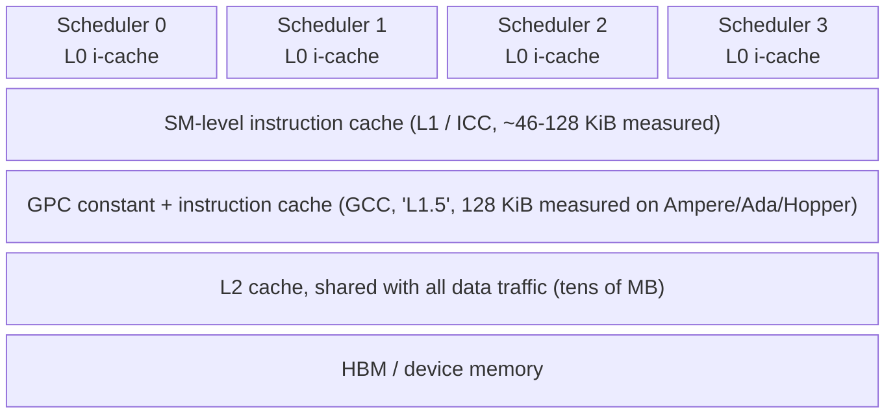
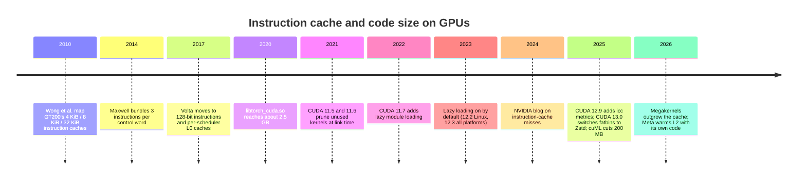

---
tags:
  - gpu-programming
  - kernels-optimization
  - instruction-cache
  - code-size
  - loop-unrolling
  - binary-size
  - megakernels
  - compilers
status: complete
sources:
  - https://developer.nvidia.com/blog/improving-gpu-performance-by-reducing-instruction-cache-misses-2
  - https://lmsys.org/blog/2026-11-05-muse-spark-open-ultrafast/
  - https://www.together.ai/blog/road-to-together-compiler
  - https://arxiv.org/pdf/1804.06826
  - https://arxiv.org/pdf/1903.07486
  - https://bilbo.iut-bm.univ-fcomte.fr/and/gitweb/these_gilles.git/blob/HEAD:/DOCS/gpuarch-ispass2010.pdf
  - https://arxiv.org/pdf/2611.13860
  - https://arxiv.org/html/2507.10789v2
  - https://docs.nvidia.com/nsight-compute/ProfilingGuide/index.html
  - https://www.amd.com/content/dam/amd/en/documents/instinct-tech-docs/white-papers/amd-cdna-3-white-paper.pdf
  - https://lists.llvm.org/pipermail/llvm-commits/Week-of-Mon-20240115/1277418.html
  - https://forums.developer.nvidia.com/t/no-instruction-stalls-every-256-bytes-of-the-binary-code/70424
  - https://forums.developer.nvidia.com/t/instruction-cache-misses-local-stack-and-spills/319611
  - https://forums.developer.nvidia.com/t/issue-about-icache/343902
  - https://developer.nvidia.com/blog/reducing-cuda-binary-size-to-distribute-cuml-on-pypi
  - https://docs.nvidia.com/cuda/pdf/CUDA_Compiler_Driver_NVCC.pdf
  - https://docs.nvidia.com/cuda/archive/13.1.0/cuda-features-archive/index.html
  - https://docs.nvidia.com/cuda/cuda-programming-guide/04-special-topics/lazy-loading.html
  - https://docs.nvidia.com/cuda/archive/12.8.0/cuda-toolkit-release-notes/index.html
  - https://docs.nvidia.com/cutlass/media/docs/cpp/profiler.html
  - https://discuss.pytorch.org/t/libtorch-cuda-so-is-too-large-2gb/103155
  - https://github.com/pytorch/pytorch/pull/146265
  - https://arxiv.org/html/2501.01005v2
created: 2026-11-26
updated: 2026-11-26
---

## Table Of Contents

---

- [[#TL;DR|TL;DR]]
- [[#The Problem|The Problem]]
- [[#Foundations|Foundations]]
    - [[#How Big an Instruction Is|How Big an Instruction Is]]
    - [[#The Instruction Fetch Path|The Instruction Fetch Path]]
    - [[#Hot Footprint and Warp Drift|Hot Footprint and Warp Drift]]
- [[#How We Got Here|How We Got Here]]
- [[#How It Works|How It Works]]
    - [[#Where Code Size Comes From|Where Code Size Comes From]]
    - [[#Seeing It - No Instruction Stalls and icc Metrics|Seeing It: No Instruction Stalls and icc Metrics]]
    - [[#Worked Example - When Two Blocks Stop Fitting|Worked Example: When Two Blocks Stop Fitting]]
    - [[#Fix 1 - Unroll Less, Unroll Smarter|Fix 1: Unroll Less, Unroll Smarter]]
    - [[#Fix 2 - Warm L2 With Your Own Code|Fix 2: Warm L2 With Your Own Code]]
    - [[#Fix 3 - Interpret Instead of Inline|Fix 3: Interpret Instead of Inline]]
    - [[#The Other Code Size - Shipping Binaries|The Other Code Size: Shipping Binaries]]
- [[#Where It Is Now|Where It Is Now]]
- [[#Trade-offs & Open Problems|Trade-offs & Open Problems]]
- [[#Resources|Resources]]
- [[#Related Notes|Related Notes]]

## ***TL;DR***
---
*A GPU kernel's machine code has to be fetched into small caches next to each SM before warps can issue it. Most kernels fit easily, but heavily unrolled, heavily templated or fused kernels can outgrow those caches, and then warps stall waiting for instructions instead of data.*

- **The caches are small and undocumented.** NVIDIA publishes no instruction-cache sizes. Microbenchmarks found about **12 KiB** of L0 per warp scheduler and **128 KiB** of L1 per SM on Volta V100, and about 16 KiB and 46 KiB on Turing T4 ([Jia et al. 2018](https://arxiv.org/pdf/1804.06826); [Jia et al. 2019](https://arxiv.org/pdf/1903.07486)). The Muse Spark Open authors on Blackwell work with "about 128 KB" per SM ([LMSYS, Nov 2026](https://lmsys.org/blog/2026-11-05-muse-spark-open-ultrafast/)).
- **Instructions are big.** Since Volta every SASS instruction is **16 bytes** (128 bits, control bits included), so 128 KiB holds only about **8,192 instructions** ([[PTX and SASS]]).
- **What matters is the hot footprint**, the code that all resident warps are executing at about the same time. Warps start together and drift apart, so a long kernel spreads its warps across more code than any one warp runs at once.
- **The symptom** is the **"No Instruction"** warp stall in Nsight Compute. Since CUDA 12.9 the `sm__icc_requests`, `sm__icc_requests_lookup_hit` and `sm__icc_requests_lookup_miss` metrics count instruction-cache traffic directly ([NVIDIA blog](https://developer.nvidia.com/blog/improving-gpu-performance-by-reducing-instruction-cache-misses-2)).
- **The usual cause** is over-unrolling. In NVIDIA's genomics case on H100, dropping the outer loop's `#pragma unroll` and unrolling an inner loop by just 2 cut the hot footprint from 39,360 to 16,912 instructions and made instruction-cache misses "almost zero" ([[Loop Optimizations]]).
- **Megakernels hit it hardest.** Meta's GB300 decode kernels are 215 to 314 KB of machine code each, so their authors keep loops rolled, prefetch their own code into L2 on every launch and dry-run latency-critical loops to warm the cache ([[Megakernels]]).
- **Code size also means shipping size.** Template instantiation and one SASS copy per GPU architecture make CUDA libraries hundreds of megabytes to gigabytes. The tools are trimming architectures and instantiations, fatbin compression (Zstd since CUDA 13.0), unused-kernel pruning and lazy loading.

## ***The Problem***
---
*CPUs spend a large part of their silicon on fetching code well: branch predictors, big instruction caches and decoded-op caches. GPUs spend almost nothing there, because the classic GPU kernel is a short loop that every warp runs in lockstep, so the trade is right until a kernel stops looking like that.*

A GPU hides **data** latency by switching to another warp ([[Occupancy and Latency Hiding]]). It has no equivalent trick for **instruction** latency when every warp is waiting on code that is not in the cache. A miss in the per-SM instruction caches goes out to a cluster-level cache and then to L2, the same L2 that holds the kernel's data ([[GPU Memory Hierarchy]]). If the code was pushed out of L2 by data traffic, the fetch goes to HBM.

Three trends make this matter more each year:

- **Unrolling and specialisation are the default performance tools.** `#pragma unroll`, template parameters for tile sizes and inlining of every `__device__` function all trade code size for speed, and the compiler rarely sees the instruction cache as a cost.
- **Kernels are getting bigger.** [[Kernel Fusion]] and [[Megakernels]] put many operators into one binary. Meta's per-layer GB300 kernels hold "every phase of a layer" and are 215 to 314 KB each, roughly twice what an SM caches ([LMSYS, Nov 2026](https://lmsys.org/blog/2026-11-05-muse-spark-open-ultrafast/)). Together AI listed instruction-cache pressure among its reasons for dropping megakernels: when a new operation begins, "the SM evicts the previous operation's instructions" and must then refetch them ([Together AI, Nov 2026](https://www.together.ai/blog/road-to-together-compiler)).
- **Binaries are getting bigger too.** A library that ships SASS for many architectures and thousands of template instances can exceed packaging and linker limits, which is a separate code-size problem with the same root (see [[#The Other Code Size - Shipping Binaries|The Other Code Size]]).

Most kernels are not affected. One long-time CUDA expert on NVIDIA's forums reported never seeing instruction-fetch stalls cost "more than 3%" in his own code ([NVIDIA forums, 2019](https://forums.developer.nvidia.com/t/no-instruction-stalls-every-256-bytes-of-the-binary-code/70424)). The point of this note is to recognise the minority that are.

## ***Foundations***
---
*Three facts explain almost everything: how many bytes an instruction takes, which caches sit between L2 and the warp scheduler, and why the code in use at once is larger than one warp's loop.*

### How Big an Instruction Is

SASS, the native NVIDIA instruction set, has changed its encoding twice ([[PTX and SASS]]). The microbenchmark papers decoded it ([Jia et al. 2018](https://arxiv.org/pdf/1804.06826)):

| Generation | Encoding | Bytes per instruction |
|---|---|---|
| Kepler | 64-bit instructions, one 64-bit control word per 7 instructions | about 9.1 |
| Maxwell, Pascal | 64-bit instructions, one control word per 3 instructions | about 10.7 |
| Volta and later (Turing, Ampere, Hopper, Blackwell) | One 128-bit word holding instruction and control bits | 16 |

The control bits are the compiler's scheduling hints: stall cycles, yield, dependency barriers and register-reuse flags. On Volta the authors estimate at least 91 bits for the instruction, at least 23 for control and 14 apparently unused.

The practical reading: **the same instruction count takes 1.5x more bytes on Volta-era GPUs than on Pascal**, and every SASS line you see in `cuobjdump -sass` is 16 bytes of cache.

### The Instruction Fetch Path

Each SM is split into four sub-partitions, each with its own warp scheduler that can issue one warp instruction per cycle. Each scheduler pulls from a small private cache, backed by larger shared ones.



What has been measured or documented, generation by generation:

| GPU | Closest to the scheduler | SM or TPC level | Larger shared level | Source |
|---|---|---|---|---|
| GT200 (2008) | 4 KiB per SM, 256 B lines, 4-way | 8 KiB per TPC, shared with constants | 32 KiB global | [Wong et al., ISPASS 2010](https://bilbo.iut-bm.univ-fcomte.fr/and/gitweb/these_gilles.git/blob/HEAD:/DOCS/gpuarch-ispass2010.pdf) |
| Pascal P100 | 8 KiB L1 per SM | 128 KiB L1.5 per SM | L2 (4 MiB) | [Jia et al. 2018](https://arxiv.org/pdf/1804.06826) |
| Volta V100 | ~12 KiB L0 per scheduler, 3-way, 256 B lines | 128 KiB L1 per SM, 8-way, 512 B lines, shared with constants | L2 (6 MiB) | [Jia et al. 2018](https://arxiv.org/pdf/1804.06826) |
| Turing T4 | ~16 KiB L0 | ~46 KiB L1, shared with constants | L2 (4 MiB) | [Jia et al. 2019](https://arxiv.org/pdf/1903.07486) |
| Ampere A100 | 32 KiB L0 per sub-partition (second-hand, from a GTC talk) | 128 KiB shared with constants | L2 | [NVIDIA forums, Sep 2025](https://forums.developer.nvidia.com/t/issue-about-icache/343902) |
| Ampere, Ada, Hopper (A800, RTX 4090, H100, H20) | not measured | not measured | GCC: 128 KiB per GPC, 256 B lines, 8-way, "also holds instructions" | [Wang et al. 2026](https://arxiv.org/pdf/2611.13860) |
| Hopper, Blackwell | L0 per partition on GH100, listed as "unified" on GB203, no size | not published | not published | [Jarmusch et al. 2025](https://arxiv.org/html/2507.10789v2) |
| AMD CDNA 3 (MI300X) | none | 64 KiB, 8-way, shared by two CUs (double CDNA 2) | L2 | [AMD CDNA 3 white paper](https://www.amd.com/content/dam/amd/en/documents/instinct-tech-docs/white-papers/amd-cdna-3-white-paper.pdf) |

Nsight Compute's own unit glossary names two of these: the **ICC**, an "instruction cache that services all SM sub-partitions in the TPC", whose misses are "fetched from the GCC", and the **GCC**, an "L1.5 constant cache in the General Processing Cluster" that caches "constant data and instructions" ([Nsight Compute Profiling Guide](https://docs.nvidia.com/nsight-compute/ProfilingGuide/index.html)). Two things follow. Instructions and `__constant__` data compete for the same mid-level cache. And the exact sharing (per SM or per TPC of two SMs) differs between the docs and the older papers, so treat any single number as approximate.

There is **no branch predictor**. Fetch appears to be sequential: one user profiling a fully unrolled 122 KB kernel on a P100 saw a "No Instruction" stall every 0x100 = 256 bytes of SASS, consistent with 256-byte lines being fetched as straight-line code streams past ([NVIDIA forums, 2019](https://forums.developer.nvidia.com/t/no-instruction-stalls-every-256-bytes-of-the-binary-code/70424)). AMD exposed the prefetcher to software on its GFX10 and GFX11 (RDNA 1 to 3) GPUs with `s_set_inst_prefetch_distance`, which LLVM's tests show bracketing loops; on RDNA 4 (GFX12) the instruction "can still encode" but "has no effect" ([LLVM, Jan 2024](https://lists.llvm.org/pipermail/llvm-commits/Week-of-Mon-20240115/1277418.html)). NVIDIA has no such instruction.

### Hot Footprint and Warp Drift

The total size of a kernel is not what fills the cache. What fills it is the **hot footprint**: every instruction that some resident warp is about to execute.

At launch, warps on an SM start at the same instruction. They are never explicitly kept together, so data-dependent latency and branches make them drift apart. As they drift, more distinct instructions are live at once and the cache overflows more often ([NVIDIA blog, 2024](https://developer.nvidia.com/blog/improving-gpu-performance-by-reducing-instruction-cache-misses-2)). This is why the problem can get **worse with more work**: in NVIDIA's genomics case, a bigger dataset meant longer-running warps, more drift and more misses. It is also why a kernel can be fine in a microbenchmark and slow in production.

$$F_{\text{hot}} \approx N_{\text{hot}} \times 16\ \text{B}$$

*Plain English:* the bytes the instruction cache must hold are roughly the number of distinct instructions warps are using at about the same time, times 16. A 128 KiB cache holds $131{,}072 / 16 = 8{,}192$ instructions. A loop body of 150 instructions unrolled 32 times is $150 \times 32 \times 16 = 76{,}800$ bytes, already 59% of that budget for one loop.

## ***How We Got Here***
---
*Instruction caches were a footnote in GPU tuning for fifteen years. Two things brought them back: the 128-bit encoding in 2017, and the 2025-2026 push to fuse whole models into single kernels.*



- **2010.** Wong, Papadopoulou, Sadooghi-Alvandi and Moshovos built the first microbenchmarks of GPU instruction caches on GT200: a 4 KiB per-SM cache, an 8 KiB per-TPC cache and a 32 KiB global one, all with 256-byte lines ([ISPASS 2010](https://bilbo.iut-bm.univ-fcomte.fr/and/gitweb/these_gilles.git/blob/HEAD:/DOCS/gpuarch-ispass2010.pdf)).
- **2014 to 2016.** Maxwell and Pascal moved scheduling decisions into the compiler, encoded as control words shared by bundles of three instructions.
- **2017 to 2019.** Volta folded control bits into each instruction, making every instruction 16 bytes, and gave each warp scheduler its own L0 cache. Jia, Maggioni, Staiger and Scarpazza measured the new hierarchy on V100 and T4 by timing ever-longer runs of independent FFMA instructions and watching throughput fall off at each cache size ([2018](https://arxiv.org/pdf/1804.06826), [2019](https://arxiv.org/pdf/1903.07486)).
- **2020 onward, the shipping side.** By November 2020 PyTorch's `libtorch_cuda.so` was about 2.5 GB, too big for build tools with a 2 GB limit, and trimming `TORCH_CUDA_ARCH_LIST` only brought it to 2.3 GB ([PyTorch forums](https://discuss.pytorch.org/t/libtorch-cuda-so-is-too-large-2gb/103155)). Static linking of anything over 2 GB also runs into the default x86-64 code model. CUDA answered with unused-kernel pruning (11.5, default in 11.6), lazy loading (11.7, default from 12.2 on Linux and 12.3 everywhere) and configurable fatbin compression ([CUDA Features Archive](https://docs.nvidia.com/cuda/archive/13.1.0/cuda-features-archive/index.html)).
- **2024.** NVIDIA's Rob Van der Wijngaart and Fred Oh published the first official guide, built on a Smith-Waterman genomics kernel on H100 ([NVIDIA blog](https://developer.nvidia.com/blog/improving-gpu-performance-by-reducing-instruction-cache-misses-2)).
- **2025 to 2026.** [[Megakernels]] made the instruction cache a first-class design constraint. Meta's GB300 kernels for Muse Spark Open warm L2 with their own code on every launch, and Together AI cited refetches as one reason to abandon megakernels.

## ***How It Works***
---
*Find where the code came from, confirm with the profiler that instruction fetch is really the stall, then shrink the hot footprint or keep the code closer to the SM.*

### Where Code Size Comes From

| Source | Why it grows code | Typical size effect |
|---|---|---|
| Loop unrolling (`#pragma unroll`, constant trip counts) | One copy of the body per iteration | Linear in the unroll factor |
| Inlining | `nvcc` inlines `__device__` functions by default; each call site gets a copy | Linear in call sites |
| Templates | Each tile size, data type or flag combination is a separate kernel | Does not hurt the cache unless instances run together, but multiplies binary size |
| Fusion and megakernels | Many operators in one kernel, often selected by a `switch` | Sum of all operator bodies; Meta's: 215 to 314 KB |
| Per-direction or per-case specialisation | `if constexpr` branches and unrolled case loops | One body per case |
| Spills and dynamic indexing | `STL`/`LDL` and address arithmetic add instructions ([[Register Pressure and Spilling]]) | Small, but appears in hot loops |

A forum case shows several of these at once. A stencil-like kernel with an unrolled three-direction loop grew from about 12,000 to 16,000 SASS instructions, stalled on instruction fetch roughly every 48 instructions and ran 19% slower than baseline. Not unrolling it caused 336 bytes of stack instead, because a `constexpr` array was indexed by the loop variable. Replacing the indexing with `dir == 0` conditionals removed the stack and the kernel ended about 25% faster than baseline ([NVIDIA forums, Jan 2025](https://forums.developer.nvidia.com/t/instruction-cache-misses-local-stack-and-spills/319611)). Code size and register pressure pull in opposite directions, and the fix had to address both.

### Seeing It: No Instruction Stalls and icc Metrics

1. **Warp State section, Nsight Compute.** A large **"No Instruction"** bar means warps were waiting on instruction fetch: "the SMs could not be fed instructions fast enough from memory" ([NVIDIA blog](https://developer.nvidia.com/blog/improving-gpu-performance-by-reducing-instruction-cache-misses-2)). Watch how it scales with problem size: in NVIDIA's case it grew as the dataset grew ([[Profiling with Nsight Compute and Nsight Systems]]).
2. **Instruction-cache counters (CUDA 12.9 and later).** `sm__icc_requests`, `sm__icc_requests_lookup_hit` and `sm__icc_requests_lookup_miss` give the hit rate of the per-SM instruction cache directly.
3. **Hot footprint.** In the Source view, count SASS instructions with a non-zero "Instructions Executed" value. This is a better measure than file size: the blog warns that total code size "is not a reliable measure of cache pressure", because cold code costs nothing.
4. **Kernel size.** `cuobjdump -sass app` lists each instruction with its byte offset in a comment such as `/*1deb8*/`; the last offset plus one instruction is roughly the kernel's size in bytes. That is how the 2019 forum user found his kernel was over 122 KB.
5. **Rule out the neighbours.** Answering a similar question about shaders in Nsight Graphics, an NVIDIA engineer advised ignoring "no instruction" stalls when SM pipelines are near full utilisation, and called instruction-cache contention "a 'global' problem": a different part of the program, or other work running concurrently, can be the one evicting your code ([NVIDIA forums](https://forums.developer.nvidia.com/t/finding-cause-of-no-instruction-stall-and-optimizing-for-it/236499)).

### Worked Example: When Two Blocks Stop Fitting

The Muse Spark Open authors measured the cliff directly on GB300 ([LMSYS, Nov 2026](https://lmsys.org/blog/2026-11-05-muse-spark-open-ultrafast/)):

| Experiment | Code in use | Time per block |
|---|---|---|
| One 100 KB block of straight-line code, alone | 100 KB | 12.4 µs |
| Two 100 KB blocks back to back | 200 KB | 19.5 µs each |
| One block shrunk to 20 KB, the other 100 KB | 120 KB | the 100 KB block back to 12.4 µs |

In instructions: 100 KB is about $100{,}000 / 16 \approx 6{,}250$ SASS instructions. Two blocks are about 12,500 instructions against a cache of roughly 8,000, so each pass evicts the other block's code and **every pass refetches**. The cost was about 7 µs per block, 14 µs per pair, with no register spills involved. Shrinking one block to 20 KB brought the total to about 7,500 instructions, under the limit, and the penalty vanished.

The refetches were slower than they had to be because the code was also falling out of L2. A launch brings only "the first 32-64 KB of a kernel's code close to the SMs"; the rest is fetched on first use. Between steps, a sliding-window attention kernel "lost about a tenth of its code from L2", and a global-attention kernel that runs every fourth layer "lost more than half", mostly displaced by the model's own expert-weight prefetch.

### Fix 1: Unroll Less, Unroll Smarter

Unrolling is the cheapest knob. NVIDIA's genomics case tried three settings on the two outermost loops of a Smith-Waterman kernel on H100 ([NVIDIA blog](https://developer.nvidia.com/blog/improving-gpu-performance-by-reducing-instruction-cache-misses-2)):

| Config | Outer loop | Inner loop | Hot instructions | Result |
|---|---|---|---|---|
| A (original) | `#pragma unroll` (compiler's choice) | no pragma | 39,360 | Slower per unit of work as the dataset grew |
| B | no pragma | no pragma | 15,680 | Misses gone, but more registers per thread lowered occupancy and absolute speed |
| C (chosen) | no pragma | `#pragma unroll 2` | 16,912 | Misses "almost zero"; best average across sizes |

An illustrative version of the same idea (not NVIDIA's code), forcing the outer loop to stay rolled:

```cuda
#pragma unroll 1              // keep the outer loop rolled: one copy of its body in SASS
for (int i = 0; i < n_queries; ++i) {
  #pragma unroll 2            // unroll the inner loop by 2: some instruction-level parallelism,
  for (int j = 0; j < n_ref; ++j) {   // but only two copies of its body
    h = cell_update(h, q[i], r[j]);   // inlined device function: copied once per unrolled body
  }
}
```

Line by line:
- `#pragma unroll 1` tells the compiler not to unroll this loop at all, even if the trip count is known at compile time. The loop costs a compare and a branch per iteration but only one body's worth of instruction cache.
- `#pragma unroll 2` produces two copies of the inner body per loop iteration. That gives the scheduler independent instructions to overlap, which full unrolling would also do, at a fraction of the code.
- `cell_update` is inlined, so its size multiplies with each unrolled copy. Marking a rarely-taken helper `__noinline__` turns it into a real call: smaller code, but a call costs instructions and may force registers to be saved.

Meta's rule for the GB300 megakernels is a good default for big kernels: keep a loop rolled unless its iterations hold per-element state in registers, where unrolling lets the compiler keep each element in its own register ([LMSYS, Nov 2026](https://lmsys.org/blog/2026-11-05-muse-spark-open-ultrafast/); [[Register Pressure and Spilling]]).

### Fix 2: Warm L2 With Your Own Code

When a kernel is unavoidably larger than the SM's cache, the next best thing is to make sure every miss hits L2 instead of HBM. Meta's GB300 kernels do this on every launch ([LMSYS, Nov 2026](https://lmsys.org/blog/2026-11-05-muse-spark-open-ultrafast/)):

- One warp in a handful of blocks reads one word from every 128-byte line of the kernel's own code as ordinary data, with an evict-last cache hint, pulling the whole kernel into L2 and asking L2 to keep it. In their [[Warp Specialization]] table this is a dedicated role: "instruction-cache warm".
- Spreading the reads over more warps was slower, because GB300's two dies "each keep their own copy in L2" ([[Blackwell Architecture]]).
- They do it every launch because "the code does not survive even one step in L2".
- For latency-critical loops, they run the loop twice: a **dry pass** with the same instructions and loads but no waits or writes, which "touches exactly the lines the real pass will run", then the real pass from a warm instruction cache. This saved 0.5 to 1 µs per operation in a handful of cases.

This works because instructions are fetched through the same L2 as data, so a data load of a code address warms the instruction path. It is a workaround for the lack of an instruction-prefetch instruction on NVIDIA GPUs.

### Fix 3: Interpret Instead of Inline

The structural answer to an oversized fused kernel is to stop copying code. Instead of inlining every operator, write a small loop that reads an instruction stream from memory and dispatches to a few compact handlers. One forum answer suggests exactly this: emulate the big kernel "with a small emulator" looping over control data ([NVIDIA forums, Sep 2025](https://forums.developer.nvidia.com/t/issue-about-icache/343902)). Megakernel designs such as Hazy Research's on-GPU interpreter and [[Persistent Kernels and Stream-K|persistent kernels]] follow this shape ([[Megakernels]]). The cost is indirect dispatch and less specialisation per operator, which is the same tension [[CUDA Graphs]] and [[Programmatic Dependent Launch]] avoid by keeping operators as separate small kernels.

### The Other Code Size: Shipping Binaries

The same habits that bloat a kernel's hot path bloat the files a library ships. A CUDA fatbinary contains SASS for each target architecture plus PTX for future ones ([[PTX and SASS]]), and every template instance is a separate kernel.

| Problem | Example | Tools |
|---|---|---|
| Template explosion | CUTLASS's full Hopper combinations are "in the order of millions of kernels"; generating and filtering them "can take hours" | Instantiate only what you use: `CUTLASS_LIBRARY_KERNELS` filters ([CUTLASS profiler docs](https://docs.nvidia.com/cutlass/media/docs/cpp/profiler.html)); turn template parameters into runtime arguments where speed allows ([[CUTLASS and CuTe]]) |
| Duplicate kernels across translation units | Whole-program compilation keeps a copy of a kernel in every `.cu` file that launches it | Define each kernel in exactly one file; separable compilation helps but "is not a complete solution" ([NVIDIA blog, Dec 2025](https://developer.nvidia.com/blog/reducing-cuda-binary-size-to-distribute-cuml-on-pypi)) |
| One copy per architecture | Every entry in `-gencode` adds a full SASS copy | Drop old architectures (PyTorch's CUDA 12.8 builds dropped sm50 and sm60 partly for size ([PR 146265](https://github.com/pytorch/pytorch/pull/146265))); ship PTX for the rest |
| Uncompressed device code | — | `nvcc --compress-mode={default,size,speed,balance,none}`; CUDA 13.0 moved fatbin compression from LZ4 to Zstd ([nvcc manual](https://docs.nvidia.com/cuda/pdf/CUDA_Compiler_Driver_NVCC.pdf)) |
| 2 GB limits | Static cuFFT in apps "over 2 GB in total binary size" failed to link on x86-64 in CUDA 12.8; libtorch_cuda at about 2.5 GB broke 2 GB build-tool limits | `-mcmodel=medium` ([CUDA 12.8 release notes](https://docs.nvidia.com/cuda/archive/12.8.0/cuda-toolkit-release-notes/index.html)); CUTLASS's unity build, which puts many instances in one unit, "avoiding linker limitations" |
| Load time and device memory | Loading every kernel at startup costs seconds and memory | Lazy loading: modules load on first use (default since CUDA 12.2/12.3; `CUDA_MODULE_LOADING=EAGER` to disable) ([Programming Guide](https://docs.nvidia.com/cuda/cuda-programming-guide/04-special-topics/lazy-loading.html)) |
| Too many variants to ship at all | Attention variants multiply faster than a library can precompile | JIT: FlashInfer generates kernels from a template "at init time and cached for reuse" ([FlashInfer, MLSys 2025](https://arxiv.org/html/2501.01005v2); [[JIT Compilation]]) |

NVIDIA's RAPIDS team used the first two rows to cut cuML's CUDA 12 shared library from about 690 MB to 490 MB, nearly 30%, to fit PyPI's size limits; in their example, turning a template parameter into a runtime argument left one kernel instance instead of several and cut that binary to almost half ([NVIDIA blog, Dec 2025](https://developer.nvidia.com/blog/reducing-cuda-binary-size-to-distribute-cuml-on-pypi)). Lazy loading has two traps worth knowing: a kernel's first launch now includes loading it, so benchmarks need a warm-up, and kernels that synchronise with each other can deadlock if loading serialises them ([[Forward Progress and Inter-Block Synchronization]]).

## ***Where It Is Now***
---
*As of November 2026, instruction-cache pressure has moved from a forum curiosity to a design constraint for the largest fused kernels, while binary size is a packaging fight that every CUDA library has.*

- **Measurement is better.** Since CUDA 12.9, Nsight Compute has direct instruction-cache hit and miss counters instead of only the "No Instruction" stall ([NVIDIA blog](https://developer.nvidia.com/blog/improving-gpu-performance-by-reducing-instruction-cache-misses-2)).
- **Sizes are still unpublished.** NVIDIA documents no instruction-cache sizes for Hopper or Blackwell. A 2026 microbenchmark study measured the GPC-level GCC, which holds constants and instructions, at 128 KiB with 256-byte lines on A800, RTX 4090, H100 and H20, but did not isolate the per-SM instruction caches ([Wang et al. 2026](https://arxiv.org/pdf/2611.13860)). Blackwell practitioners use "about 128 KB" per SM as a working figure.
- **Megakernels are where it bites (Nov 2026).** Meta's Muse Spark Open decode kernels on GB300 are 215 to 314 KB each, keep loops rolled, warm L2 with their own code on every launch and dry-run latency-critical loops ([LMSYS](https://lmsys.org/blog/2026-11-05-muse-spark-open-ultrafast/)). Together AI named instruction refetches as one cost when it deleted its megakernels the same month ([Together AI](https://www.together.ai/blog/road-to-together-compiler)). See [[Megakernels]].
- **Fatbins are smaller by default.** CUDA 13.0 switched fatbin compression to Zstd and said the default mode became equivalent to `--compress-mode=balance` ([CUDA Features Archive](https://docs.nvidia.com/cuda/archive/13.1.0/cuda-features-archive/index.html)). The CUDA 13.5 nvcc manual (Nov 2026) instead describes `default` as "currently equivalent to speed"; the two NVIDIA documents disagree, so check your toolkit's manual. Compressed binaries need drivers from CUDA 12.4 or later.
- **Libraries are trimming.** cuML's 2025 work cut about 200 MB; PyTorch's CUDA 12.8 and 12.9 builds dropped Maxwell and Pascal partly for size; CUTLASS builds instantiate one tile size per configuration unless asked for more.
- **AMD.** CDNA 3 doubled its instruction cache to 64 KiB shared by two CUs, citing that "the overwhelming majority of the time the same instruction stream will be executed by groups of CUs" ([AMD](https://www.amd.com/content/dam/amd/en/documents/instinct-tech-docs/white-papers/amd-cdna-3-white-paper.pdf); [[ROCm and HIP]]). RDNA 4 dropped the software prefetch-distance control.

## ***Trade-offs & Open Problems***
---
*Almost every fix for instruction-cache pressure costs something elsewhere: registers, instruction-level parallelism, specialisation or startup time. The hardest part is that the cache is invisible to the compiler and undocumented for the programmer.*

| Choice | Gains | Costs |
|---|---|---|
| Unroll fully | Constant indices, no loop overhead, more ILP, values kept in registers | Code size; can push the hot footprint past the cache |
| Keep loops rolled | Small hot footprint | Fewer independent instructions; NVIDIA's config B used more registers and lost occupancy |
| `__noinline__` on cold helpers | One copy instead of one per call site | Call overhead and saved registers on the hot path if it is not really cold |
| Warm L2 with code | Misses hit L2 instead of HBM | Spends a warp and L2 capacity; depends on undocumented behaviour |
| Interpreter-style kernels | Code shared across operators | Dispatch overhead; less specialisation |
| More template instances | Specialised, faster kernels | Binary size, compile time, link limits |
| Runtime arguments instead of templates | One kernel instead of many | May be slower; the cuML post warns of this |
| JIT at startup | Ship only what is used | First-run compile time and a toolchain dependency |

Open problems:

- **The compiler does not model the instruction cache.** Unrolling and inlining heuristics in `nvcc` and `ptxas` optimise single-warp speed. Nothing in the toolchain warns that a kernel's hot path exceeds the cache, so the cost shows up only in the profiler, and often only at production problem sizes.
- **Hardware details are guesswork.** Sizes, line sizes and sharing (per scheduler, per SM, per TPC) come from microbenchmark papers on GPUs up to seven years old and from conflicting secondary sources. No public study has measured the Hopper or Blackwell per-SM instruction caches.
- **No code prefetch instruction.** NVIDIA offers data prefetch and L2 eviction hints but nothing for instructions, so the state of the art is reading your own code as data.
- **Code and data share L2.** A kernel that streams weights through L2 evicts its own code, as Meta found with expert prefetch. Partitioning L2 between code and data is not something software can ask for.
- **Total size is the wrong metric.** Tools report kernel bytes; what matters is the hot footprint under warp drift, which depends on the data. CPU compilers have profile-guided [[Code Layout]] for this; GPU toolchains have no equivalent ([[Profile-Guided Optimization]]).
- **Shipping size keeps growing.** Each new architecture adds a SASS copy and each new format (FP8, FP4, block scales; see [[Low-Precision Formats - FP8, FP4 and MX]]) multiplies template instances, while package and linker limits stay fixed.

## ***Resources***
---
*Start with NVIDIA's 2024 blog for diagnosis and the LMSYS Muse Spark post for what it looks like at the frontier. Use the Jia et al. papers for the hardware, and the cuML post when the problem is file size rather than speed.*

**Primary docs**
- [Improving GPU Performance by Reducing Instruction Cache Misses](https://developer.nvidia.com/blog/improving-gpu-performance-by-reducing-instruction-cache-misses-2): Rob Van der Wijngaart and Fred Oh, NVIDIA, Aug 2024 (icc metrics require CUDA 12.9+).
- [Nsight Compute Profiling Guide](https://docs.nvidia.com/nsight-compute/ProfilingGuide/index.html): NVIDIA. ICC and GCC units, warp stall reasons.
- [CUDA Compiler Driver NVCC, release 13.5](https://docs.nvidia.com/cuda/pdf/CUDA_Compiler_Driver_NVCC.pdf): NVIDIA, Nov 2026. `--compress-mode`, `-Xptxas` options.
- [CUDA Features Archive](https://docs.nvidia.com/cuda/archive/13.1.0/cuda-features-archive/index.html): NVIDIA. Kernel pruning (11.5/11.6), lazy loading (11.7, 12.2, 12.3), Zstd fatbins (13.0).
- [CUDA Programming Guide: Lazy Loading](https://docs.nvidia.com/cuda/cuda-programming-guide/04-special-topics/lazy-loading.html): NVIDIA, CUDA 13.
- [CUDA 12.8 Release Notes](https://docs.nvidia.com/cuda/archive/12.8.0/cuda-toolkit-release-notes/index.html): NVIDIA. The 2 GB static cuFFT link issue.
- [CUTLASS Profiler](https://docs.nvidia.com/cutlass/media/docs/cpp/profiler.html): NVIDIA. Instantiation levels, `CUTLASS_LIBRARY_KERNELS`, unity builds.
- [AMD CDNA 3 Architecture White Paper](https://www.amd.com/content/dam/amd/en/documents/instinct-tech-docs/white-papers/amd-cdna-3-white-paper.pdf): AMD, 2023.

**Practitioner**
- [Muse Spark Open Ultrafast: Pushing beyond 1,000 tokens per second](https://lmsys.org/blog/2026-11-05-muse-spark-open-ultrafast/): Pranjal Shankhdhar, LMSYS blog, Nov 2026.
- [The road to Together Compiler](https://www.together.ai/blog/road-to-together-compiler): Together AI, Nov 2026.
- [Reducing CUDA Binary Size to Distribute cuML on PyPI](https://developer.nvidia.com/blog/reducing-cuda-binary-size-to-distribute-cuml-on-pypi): Divye Gala and Robert Maynard, NVIDIA, Dec 2025.
- ["No instruction" stalls every 256 bytes of the binary code](https://forums.developer.nvidia.com/t/no-instruction-stalls-every-256-bytes-of-the-binary-code/70424): NVIDIA forums, 2019.
- [Instruction cache misses + local stack and spills](https://forums.developer.nvidia.com/t/instruction-cache-misses-local-stack-and-spills/319611): NVIDIA forums, Jan 2025.
- [Issue about iCache](https://forums.developer.nvidia.com/t/issue-about-icache/343902): NVIDIA forums, Sep 2025.
- [Finding cause of "No Instruction" stall and optimizing for it](https://forums.developer.nvidia.com/t/finding-cause-of-no-instruction-stall-and-optimizing-for-it/236499): NVIDIA forums (Nsight Graphics question, answered by an NVIDIA engineer).
- [libtorch_cuda.so is too large (>2GB)](https://discuss.pytorch.org/t/libtorch-cuda-so-is-too-large-2gb/103155): PyTorch forums.
- [AMDGPU: Do not generate s_set_inst_prefetch_distance for GFX12](https://lists.llvm.org/pipermail/llvm-commits/Week-of-Mon-20240115/1277418.html): LLVM, Jan 2024.

**Research**
- [Demystifying GPU Microarchitecture through Microbenchmarking](https://bilbo.iut-bm.univ-fcomte.fr/and/gitweb/these_gilles.git/blob/HEAD:/DOCS/gpuarch-ispass2010.pdf): Wong, Papadopoulou, Sadooghi-Alvandi, Moshovos (Toronto), ISPASS 2010.
- [Dissecting the NVIDIA Volta GPU Architecture via Microbenchmarking](https://arxiv.org/pdf/1804.06826): Jia, Maggioni, Staiger, Scarpazza (Citadel), 2018.
- [Dissecting the NVidia Turing T4 GPU via Microbenchmarking](https://arxiv.org/pdf/1903.07486): Jia, Maggioni, Smith, Scarpazza (Citadel), 2019.
- [Dissecting the NVIDIA Blackwell Architecture with Microbenchmarks](https://arxiv.org/html/2507.10789v2): Jarmusch, Graddon, Chandrasekaran (Delaware), Jul 2025.
- [Uncovering the Memory Hierarchy of Modern NVIDIA GPUs for Accurate Simulation](https://arxiv.org/pdf/2611.13860): Wang, Zhou, Liu, Wang, Chen (HKUST Guangzhou, Tsinghua), 2026.
- [FlashInfer: Efficient and Customizable Attention Engine for LLM Inference Serving](https://arxiv.org/html/2501.01005v2): Ye et al., MLSys 2025.

## Related Notes

- [[Megakernels]] — The kernels that outgrow the instruction cache, and the L2 warming that keeps them fed.
- [[Register Pressure and Spilling]] — The resource that pulls the other way: rolling loops can cost registers.
- [[PTX and SASS]] — The 128-bit SASS encoding and how to read kernel size from `cuobjdump`.
- [[Kernel Fusion]] — Fusion's code-size cost, the start of the hot-footprint problem.
- [[Warp Specialization]] — A dedicated "instruction-cache warm" warp role in Meta's GB300 kernels.
- [[Profiling with Nsight Compute and Nsight Systems]] — The Warp State section, "No Instruction" stalls and `sm__icc_*` metrics.
- [[Occupancy and Latency Hiding]] — Why warp switching hides data latency but not a shared instruction miss.
- [[GPU Memory Hierarchy]] — Where the instruction caches sit beside L1, constant caches and L2.
- [[GPU Architecture Basics]] — SM sub-partitions, warp schedulers and TPCs.
- [[CUTLASS and CuTe]] — Template instantiation, kernel filters and unity builds.
- [[GEMM Autotuning and Kernel Selection]] — Why libraries ship so many kernel variants.
- [[Persistent Kernels and Stream-K]] — Long-running kernels where warp drift accumulates.
- [[Blackwell Architecture]] — GB300's two dies and duplicate L2 copies of code.
- [[ROCm and HIP]] — AMD's shared instruction cache and prefetch control.
- [[Triton]] — A JIT kernel compiler that avoids shipping every variant ahead of time.
- [[Loop Optimizations]] — Unrolling theory and its code-size trade-off.
- [[Code Layout]] — How CPU compilers order hot and cold code to save instruction cache.
- [[Linking and LTO]] — Link-time pruning and the 2 GB code-model limit.
- [[JIT Compilation]] — Compiling variants at run time instead of shipping them.
- [[GPU Kernel Compilers]] — Where GPU compilers make unrolling and inlining decisions.
- [[GPU Data Compression]] — nvCOMP and GPU-side LZ4/Zstd for data, the counterpart to fatbin compression.
