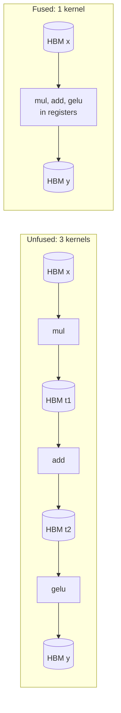
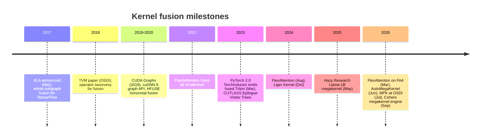
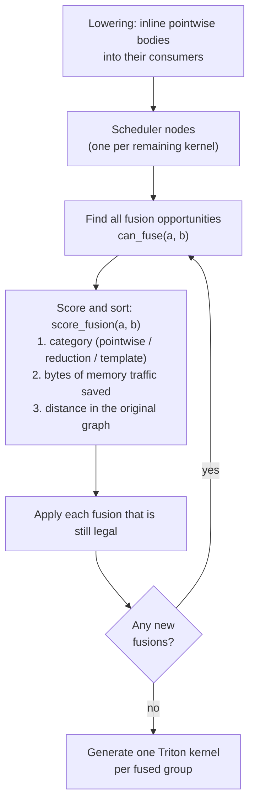
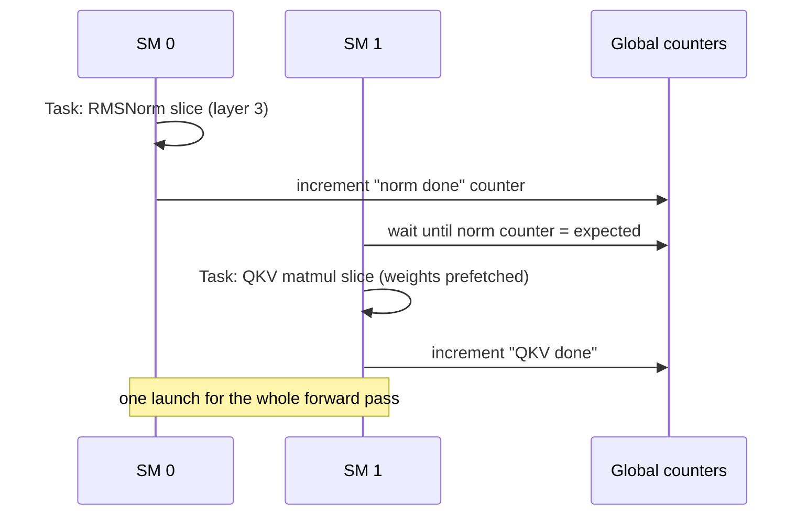

---
tags:
  - gpu-programming
  - kernels
  - optimization
  - compilers
  - kernel-fusion
status: complete
sources:
  - https://horace.io/brrr_intro.html
  - https://www.nvidia.com/en-us/data-center/h100/
  - https://openxla.org/xla/gpu_architecture
  - https://arxiv.org/pdf/2301.13062
  - https://developers.googleblog.com/en/xla-tensorflow-compiled/
  - https://ar5iv.labs.arxiv.org/html/1802.04799
  - https://docs.pytorch.org/assets/pytorch2-2.pdf
  - https://pytorch.org/blog/pytorch-2.0-release/
  - https://ar5iv.labs.arxiv.org/html/2205.14135
  - https://research.colfax-intl.com/epilogue_visitor_tree/
  - https://docs.nvidia.com/deeplearning/cudnn/latest/developer/graph-api.html
  - https://docs.nvidia.com/deeplearning/tensorrt/latest/performance/fusion-catalog.html
  - https://docs.nvidia.com/megatron-core/developer-guide/latest/api-guide/fusions.html
  - https://arxiv.org/abs/2410.10989
  - https://arxiv.org/pdf/2007.01277
  - https://hazyresearch.stanford.edu/blog/2025-05-27-no-bubbles
  - https://www.usenix.org/conference/osdi26/presentation/cheng
  - https://cohere.com/blog/megakernels
  - https://arxiv.org/html/2606.09682v1
  - https://pytorch.org/blog/flexattention/
  - https://pytorch.org/blog/flexattention-flashattention-4-fast-and-flexible/
  - https://arxiv.org/pdf/2511.02043
  - https://developer.nvidia.com/blog/cuda-graphs
created: 2026-11-26
updated: 2026-11-26
---

## Table Of Contents

---

- [[#TL;DR|TL;DR]]
- [[#The Problem|The Problem]]
    - [[#Round Trips Through HBM|Round Trips Through HBM]]
    - [[#Launch Overhead|Launch Overhead]]
- [[#Foundations|Foundations]]
    - [[#Three Regimes|Three Regimes]]
    - [[#Kinds of Fusion|Kinds of Fusion]]
- [[#How We Got Here|How We Got Here]]
- [[#How It Works|How It Works]]
    - [[#A Worked Example|A Worked Example]]
    - [[#What a Fused Kernel Looks Like|What a Fused Kernel Looks Like]]
    - [[#Fusing Into a GEMM|Fusing Into a GEMM]]
    - [[#How Compilers Decide|How Compilers Decide]]
    - [[#Attention, the Hardest Fusion|Attention, the Hardest Fusion]]
    - [[#Megakernels|Megakernels]]
- [[#Where It Is Now|Where It Is Now]]
- [[#Trade-offs & Open Problems|Trade-offs & Open Problems]]
- [[#Resources|Resources]]
- [[#Related Notes|Related Notes]]

## ***TL;DR***
---
*Kernel fusion combines several GPU operations into one kernel so intermediate results stay in registers or shared memory instead of making a round trip through slow HBM, and so the GPU launches one kernel instead of many. It is the single biggest optimization deep-learning compilers do, and FlashAttention is its most famous example.*

- **The problem it fixes:** most operations in a neural network other than matrix multiplies (activations, normalization, softmax, residual adds) do a few arithmetic operations per byte loaded. Run as separate kernels, each one reads its input from HBM and writes its output back, so the GPU spends its time moving data, not computing.
- **The fix:** do all of them in one pass over the data. Horace He calls operator fusion "the most important optimization in deep learning compilers"; fusing `x.cos().cos()` halves memory traffic and so roughly halves runtime ([He, 2022](https://horace.io/brrr_intro.html)).
- **Kinds:** chains of elementwise ops (vertical), reductions with their inputs, extra work folded into a GEMM's prologue or [[CUTLASS and CuTe|epilogue]], independent ops batched side by side (horizontal), whole algorithms rewritten to fuse ([[FlashAttention]]), and whole models in one persistent kernel (megakernels).
- **Who does it:** compilers (XLA, TVM, TorchInductor which writes [[Triton]] kernels, TensorRT), libraries ([[cuBLAS and cuDNN|cuDNN's graph API]], CUTLASS's Epilogue Visitor Trees), and hand-written kernels (Apex, Megatron, Liger). In PyTorch 2's ablation, turning off fusion and inlining made `torch.compile` *slower than eager* ([Ansel et al., ASPLOS 2024](https://docs.pytorch.org/assets/pytorch2-2.pdf)).
- **Where it is now (Nov 2026):** fusion has grown from per-op epilogues to whole-model **megakernels** for low-batch decoding (Hazy Research 2025, Mirage MPK at OSDI 2026, Cohere's production engine Sep 2026) and to compiler-generated fused attention (FlexAttention on FlashAttention-4, Mar 2026). Synchronization bugs and prefill support are the open problems.

## ***The Problem***
---
*A GPU can do arithmetic far faster than it can fetch data from HBM, and every separate kernel pays both an HBM round trip and a few microseconds of launch cost. Deep-learning code written op by op pays those costs dozens of times per layer.*

### Round Trips Through HBM

An A100 has about 1.5 TB/s of HBM bandwidth and 19.5 TFLOPS of FP32 compute: "you can load in 400 billion numbers in the same time that the GPU can perform 20 trillion operations." So an elementwise op stays memory-bound "until you're doing about a hundred operations in your unary operator" ([He, 2022](https://horace.io/brrr_intro.html)). Almost every non-matmul op in a network is far below that. In BERT, normalization and pointwise ops achieve "250x less FLOPS and 700x less FLOPS than our matmuls respectively" ([He, 2022](https://horace.io/brrr_intro.html)). In [[Roofline Model and Arithmetic Intensity|roofline]] terms they sit far left of the ridge point, on the bandwidth roof.

Running such ops one kernel at a time makes it worse: each kernel writes its result to HBM and the next reads it back. Nothing about the math requires those writes; they come from the program being split into separate kernels.



### Launch Overhead

Every kernel launch also costs CPU and driver time. Hazy Research measured about 2.1 µs to launch a dummy kernel on an H100 from a CUDA stream, and about 1.3 µs with [[CUDA Graphs]] ([Hazy Research, May 2025](https://hazyresearch.stanford.edu/blog/2025-05-27-no-bubbles)). That is negligible for a large matmul but dominant for a small tensor: a Llama-1B forward pass is "a hundred separate kernels", and at batch size 1 each one moves very little data. Horace He's diagnostic: "if you double your batch size but your runtime only increases by 10%, you're likely overhead bound" ([He, 2022](https://horace.io/brrr_intro.html)).

## ***Foundations***
---
*GPU time goes to compute, memory bandwidth or overhead. Fusion attacks the last two at once, and different kinds of fusion differ only in which operations they are allowed to merge.*

### Three Regimes

| Regime | What limits you | Symptom | Does fusion help? |
|---|---|---|---|
| Compute-bound | [[Tensor Cores]] or FP units are saturated | Large matmuls, convolutions | Little; fusing more math adds work |
| Memory-bound | HBM bandwidth | Elementwise ops, norms, softmax, small-batch GEMV | Yes: fewer bytes moved |
| Overhead-bound | Kernel launches, Python, framework dispatch | Small tensors, decode at batch 1 | Yes: fewer launches |

([He, 2022](https://horace.io/brrr_intro.html).) The fused kernel's [[Roofline Model and Arithmetic Intensity|arithmetic intensity]] is the total FLOPs of all the fused ops divided by the bytes the fused kernel actually moves:

$$
I_{\text{fused}} = \frac{\sum_{\text{ops}} \text{FLOPs}}{\text{bytes read from HBM} + \text{bytes written to HBM}}
$$

Fusing keeps the numerator and shrinks the denominator. A chain of memory-bound ops usually stays memory-bound after fusion, but runs at the speed of its single input read and output write, so extra fused pointwise work is close to free.

### Kinds of Fusion

| Kind | What merges | Example | Done by |
|---|---|---|---|
| Vertical (pointwise) | A chain of elementwise ops, producer into consumer | bias + GELU + dropout | Every compiler; TVM calls these "injective" ops ([Chen et al., 2018](https://ar5iv.labs.arxiv.org/html/1802.04799)) |
| Reduction | Elementwise inputs into a reduction, or reduce → broadcast → reduce | softmax, LayerNorm, RMSNorm | XLA, Inductor (persistent reductions in [[Triton]]) |
| GEMM prologue/epilogue | Elementwise work before or after a matmul or conv | GEMM + bias + activation + FP8 quantize | CUTLASS EVT, cuDNN, XLA (`triton_gemm` fusions), Inductor templates |
| Horizontal (sibling) | Independent ops with no data dependence | Many small optimizer updates in one launch | XLA horizontal and multi-output fusion, Inductor, HFUSE |
| Algorithmic | A multi-step algorithm restructured so intermediates never leave the chip | [[FlashAttention]] (tiling + online softmax) | Hand-written, increasingly compiler-generated |
| Whole program | All layers in one persistent kernel with an on-GPU scheduler | Megakernels for LLM decode | Hazy Research, Mirage MPK, Cohere |

XLA's GPU compiler states the rules every fuser follows: no intermediate inside a fusion is written to HBM, and one fusion always becomes exactly one kernel ([XLA docs](https://openxla.org/xla/gpu_architecture)).

## ***How We Got Here***
---
*Fusion started as hand-written kernels for hot spots, became the central pass of every ML compiler after 2017, and since 2022 has stretched to whole algorithms and whole models.*



- **Hand-written fused kernels.** Framework teams fused the hottest patterns by hand. NVIDIA's Megatron Core still ships fused bias+dropout+add, bias+GeLU, LayerNorm (from Apex) and scaled-masked softmax kernels ([Megatron Core docs](https://docs.nvidia.com/megatron-core/developer-guide/latest/api-guide/fusions.html)).
- **2017, XLA.** Google's compiler for TensorFlow fused whole subgraphs, reporting up to 50% speedups on NVIDIA GPUs with the largest gains on long elementwise chains. Its launch post's example: softmax built from primitive ops fuses into a kernel as fast as a hand-written one ([Google, Mar 2017](https://developers.googleblog.com/en/xla-tensorflow-compiled/)).
- **2018, TVM.** Classified operators as injective, reduction, complex-out-fusable (like conv2d, which can absorb elementwise ops on its output) and opaque, and fused by category; fusion alone gave 1.2x–2x on a Titan X ([Chen et al., 2018](https://ar5iv.labs.arxiv.org/html/1802.04799)).
- **2020, libraries and horizontal fusion.** cuDNN 8's graph API introduced runtime-compiled fusion engines ([cuDNN docs](https://docs.nvidia.com/deeplearning/cudnn/latest/developer/graph-api.html)). HFUSE put two independent kernels side by side in one thread block so the warp scheduler interleaves them, gaining 2.5%–60.8% ([Li et al., 2020](https://arxiv.org/pdf/2007.01277)).
- **2022, FlashAttention.** Showed that the right fusion can need a new algorithm, not just a merged loop (see [[#Attention, the Hardest Fusion|below]]).
- **2023, PyTorch 2.0.** `torch.compile` with TorchInductor made fusion automatic for PyTorch users, writing fused [[Triton]] kernels for GPUs ([PyTorch 2.0](https://pytorch.org/blog/pytorch-2.0-release/)). CUTLASS added Epilogue Visitor Trees for composable GEMM epilogue fusion (paper at ASPLOS 2024, [Colfax tutorial](https://research.colfax-intl.com/epilogue_visitor_tree/)).
- **2025-2026, megakernels.** Fusing everything into one persistent kernel (see [[#Megakernels|below]]).

## ***How It Works***
---
*Fusion is easy to state (keep intermediates on chip, launch once) and hard to decide (which ops, in what grouping, at what cost in registers). The worked example shows the payoff; the compiler section shows the decision.*

### A Worked Example

Compute $y = \text{GELU}(x \cdot w + b)$ elementwise, where $x$ is a BF16 tensor of $8192 \times 8192 = 67{,}108{,}864$ elements (134.2 MB at 2 bytes each) and $w$, $b$ are small per-channel vectors whose traffic we ignore. GPU: H100 SXM, HBM3 at 3.35 TB/s ([NVIDIA](https://www.nvidia.com/en-us/data-center/h100/)).

| | Kernels | HBM traffic | Bytes | Time at 3.35 TB/s | Launch cost (≈2.1 µs each) |
|---|---|---|---|---|---|
| Unfused | 3 (`mul`, `add`, `gelu`) | 3 reads + 3 writes of the tensor | ≈ 805 MB | ≈ 240 µs | ≈ 6 µs |
| Fused | 1 | 1 read + 1 write | ≈ 268 MB | ≈ 80 µs | ≈ 2 µs |

In plain words: the unfused version writes `x*w` to HBM, reads it back to add `b`, writes that, reads it back for GELU, and writes the result. The fused version reads `x` once and writes `y` once, so it moves a third of the bytes and should run about 3x faster. These are bandwidth floors from the spec sheet, not measurements; real kernels reach somewhat less than peak bandwidth.

Is the fused kernel compute-bound now? H100 SXM does 67 TFLOPS of FP32 non-Tensor-Core math ([NVIDIA](https://www.nvidia.com/en-us/data-center/h100/)), so its ridge point is

$$
\frac{67 \times 10^{12} \text{ FLOP/s}}{3.35 \times 10^{12} \text{ B/s}} = 20 \text{ FLOP/byte}
$$

The fused kernel does a multiply, an add and a GELU (a few to a few dozen FLOPs) per 4 bytes moved, well under 20 FLOP/byte. It is still memory-bound, which means you could fuse in more pointwise work (a residual add, a quantize) at almost no extra cost. This is Horace He's "about a hundred operations" rule in numbers.

At small sizes the picture flips. With $x$ of 4,096 elements (8 KB), moving the data takes nanoseconds, and the cost is launches: about 6 µs for three kernels against about 2 µs for one. Fusion wins on launch count, not bytes, and so does [[CUDA Graphs|capturing the kernels in a CUDA graph]].

### What a Fused Kernel Looks Like

In [[Triton]] the fused version of the example is the obvious code:

```python
@triton.jit
def fused_mul_add_gelu(x_ptr, w_ptr, b_ptr, y_ptr, n_cols, n, BLOCK: tl.constexpr):
    offs = tl.program_id(0) * BLOCK + tl.arange(0, BLOCK)
    mask = offs < n
    col = offs % n_cols
    x = tl.load(x_ptr + offs, mask=mask).to(tl.float32)
    t = x * tl.load(w_ptr + col) + tl.load(b_ptr + col)
    y = 0.5 * t * (1 + tl.math.erf(t * 0.7071067811865476))
    tl.store(y_ptr + offs, y.to(tl.bfloat16), mask=mask)
```

- Line 3-5: each program instance takes a block of element indices, masks the tail, and works out each element's column so it can pick the right per-channel `w` and `b`.
- Line 6: one read of `x` from HBM, upcast to FP32 for accurate math.
- Line 7: multiply and add happen in registers. `t` never goes to memory.
- Line 8: exact GELU, $\tfrac{1}{2} t (1 + \text{erf}(t/\sqrt{2}))$, also in registers.
- Line 9: one write of `y`, back in BF16.

(This sketch is this note's own illustration, not from a source.) `torch.compile` generates kernels of exactly this shape automatically from `F.gelu(x * w + b)`.

### Fusing Into a GEMM

Matrix multiplies are compute-bound, so fusing work *into* them is profitable: the GEMM's output tile already sits in registers at the end, and any elementwise op applied there costs no HBM traffic. Two places to fuse:

- **Epilogue** (after the K loop): bias, activation, scaling, residual add, clamp, conversion to FP8 with a scale, even reductions over the output. CUTLASS's **Epilogue Visitor Tree** (EVT) expresses the epilogue as a tree (or DAG) of nodes: fetch accumulator, load auxiliary tensor, broadcast, compute, reduce, store ([Colfax EVT tutorial](https://research.colfax-intl.com/epilogue_visitor_tree/), see [[CUTLASS and CuTe]]).
- **Prologue / mainloop** (on the inputs as they load): e.g. dequantizing weights or applying a scale. cuDNN's runtime fusion engine has both "mainloop" fusion on matmul inputs and "epilogue" fusion on outputs ([cuDNN docs](https://docs.nvidia.com/deeplearning/cudnn/latest/developer/graph-api.html)).

TensorRT does the same at model build time with a fixed catalog (convolution + ReLU, convolution + elementwise, scale + activation, pointwise chains, attention) and renames fused layers, e.g. `fusedPointwiseNode(add1, relu1)`, in its build log ([TensorRT fusion catalog](https://docs.nvidia.com/deeplearning/tensorrt/latest/performance/fusion-catalog.html)).

### How Compilers Decide

Which ops to fuse is a search problem: fusing everything can blow up registers, and some fusions are illegal. TorchInductor's scheduler, as described in the PyTorch 2 paper ([Ansel et al., ASPLOS 2024](https://docs.pytorch.org/assets/pytorch2-2.pdf)):



- **Inlining vs fusion.** Inlining happens during lowering and "duplicates the body of pointwise kernels into all their consumers"; fusion happens during scheduling and "combines remaining kernels together", including horizontal consumer/consumer fusions.
- **Legality.** `can_fuse` checks data dependencies and whether the two kernels' memory access patterns line up.
- **Greedy order.** Highest-scoring fusions first, repeated until nothing changes.

How much it matters (PyTorch 2 paper, Table 4, FP16 HuggingFace models on A100, geometric-mean speedup over eager):

| Configuration | Inference | Training |
|---|---|---|
| All TorchInductor optimizations | 1.91x | 1.45x |
| Without fusion | 1.68x | 1.27x |
| Without inlining | 1.58x | 1.31x |
| Without fusion and inlining | 0.80x | 0.59x |

The last row is the striking one: "Without both of those passes, TorchInductor generates slowdowns rather than speedups." Inductor first decomposes big ops into primitives, and only fusion puts them back together efficiently.

XLA follows the same pattern with more conservative rules: instruction fusion (producer into consumer, skipping "expensive" ops), a fusion merger that only merges if bytes moved don't increase, multi-output fusion and horizontal fusion. Library calls such as cuBLAS, cuDNN and cuRAND act as fusion barriers ([Snider & Liang, 2023](https://arxiv.org/pdf/2301.13062)).

### Attention, the Hardest Fusion

Standard attention, $\text{softmax}(QK^\top/\sqrt{d})V$, is two matmuls with a softmax between them, and the $n \times n$ score matrix in between is the problem. You can't simply fuse the three steps, because softmax needs a whole row of scores before it can normalize. [[FlashAttention]] fuses them anyway by changing the algorithm: it processes keys in tiles held in on-chip SRAM and keeps a running max and running sum ("online softmax"), rescaling earlier partial results as new tiles arrive. HBM accesses drop from $\Omega(Nd + N^2)$ to $O(N^2 d^2 M^{-1})$ for SRAM size $M$, up to 9x fewer ([Dao et al., 2022](https://ar5iv.labs.arxiv.org/html/2205.14135)). For training it also refuses to store the scores at all and recomputes them in the backward pass: more FLOPs, less memory traffic, faster.

The lesson generalizes: when a fusion seems impossible because of a reduction in the middle, look for an algebraic trick that lets the reduction be computed in pieces.

Compilers now generate these fusions. PyTorch's **FlexAttention** (Aug 2024) lets users write a small `score_mod` function (ALiBi, masks, soft-capping) that `torch.compile` fuses into a FlashAttention-style Triton kernel ([PyTorch, Aug 2024](https://pytorch.org/blog/flexattention/)); since March 2026 it can target a FlashAttention-4 kernel written in CuTe DSL instead ([PyTorch, Mar 2026](https://pytorch.org/blog/flexattention-flashattention-4-fast-and-flexible/)). **Flashlight** (MLSys 2026) goes further and generates FlashAttention-style kernels from plain PyTorch attention code, including variants FlexAttention's templates can't express ([Flashlight](https://arxiv.org/pdf/2511.02043)).

### Megakernels

The logical end of fusion: the whole forward pass as **one** persistent kernel. Each SM runs a loop that fetches its next task (a slice of a matmul, a norm, an attention step) from an instruction list and waits on counters in global memory until the task's inputs are ready. No kernel boundaries means no launch gaps and no "bubbles" where SMs idle between kernels, and the next layer's weights can be loading while the current layer finishes.



| System | Date | Workload | Result |
|---|---|---|---|
| Hazy Research megakernel | May 2025 | Llama-3.2-1B, batch 1, BF16 | 78% of H100 bandwidth, under 1 ms per forward pass; about 2.5x vLLM and over 1.5x SGLang on H100; under 680 µs on B200 |
| Mirage MPK (OSDI 2026) | Jul 2026 | Compiler-generated, multi-GPU | Up to 1.7x lower latency than kernel-per-operator serving systems |
| AutoMegaKernel | Jun 2026 | Agent-tuned megakernels with a static deadlock/race checker | Still trails vLLM with CUDA graphs on H100 (1.65x slower) |
| Cohere North Mini Code engine | Sep 2026 | 30B MoE (3.3B active), one H100 | 292 tok/s at batch 1 (62% of speed of light, 1.58x vLLM); 1.25–1.41x end-to-end at batch 8 |

Sources: [Hazy Research](https://hazyresearch.stanford.edu/blog/2025-05-27-no-bubbles), [MPK](https://www.usenix.org/conference/osdi26/presentation/cheng), [AutoMegaKernel](https://arxiv.org/html/2606.09682v1), [Cohere](https://cohere.com/blog/megakernels). The Hazy kernel also pages the H100's shared memory into 16 KiB pages that tasks borrow and return.

## ***Where It Is Now***
---
*As of November 2026, pointwise and epilogue fusion are solved problems handled by compilers. The frontier is fusion across much larger units: whole attention variants generated by compilers, and whole models in one kernel for decode.*

- **Compilers fuse by default.** `torch.compile` (Inductor → [[Triton]]), XLA (which now hands GEMM and softmax fusions to Triton too, [XLA docs](https://openxla.org/xla/gpu_architecture)) and TensorRT all fuse pointwise chains, reductions and GEMM epilogues automatically.
- **Libraries expose fusion as an API.** cuDNN's graph API and CUTLASS EVT (with a Python emitter for Blackwell) let frameworks request fused GEMM + epilogue kernels. Hand-fused training kernels remain popular where compilers fall short: Liger Kernel's Triton kernels (RMSNorm, RoPE, SwiGLU, and a fused linear + cross-entropy that never materializes the logits) report about 20% more throughput and 60% less memory than HuggingFace defaults ([Hsu et al., 2024](https://arxiv.org/abs/2410.10989)).
- **Attention fusion is compiler territory.** FlexAttention's FA4 backend runs 1.2–3.2x faster than its Triton backend on compute-bound cases; Flashlight extends compiler-generated attention to data-dependent variants.
- **Megakernels are in production.** Cohere's September 2026 engine serves an MoE model with a decode megakernel; MPK made whole-model megakernels a compiler output at OSDI 2026. All current systems target low-batch decode, where launch overhead and bubbles dominate.

## ***Trade-offs & Open Problems***
---
*Fusion is not free: a bigger kernel needs more registers and shared memory, may lose parallelism, and is harder to debug. Knowing when not to fuse is half the skill.*

| Concern | What goes wrong | Example |
|---|---|---|
| Register pressure | Fused kernel needs more registers per thread → fewer warps fit ([[Occupancy and Latency Hiding]]) or values spill to memory | FlexAttention on FA4: keeping pre-softmax scores in registers for a gradient causes "heavy register spilling" |
| Shared-memory limits | Fused tiles plus intermediates don't fit on chip | Megakernels must page shared memory explicitly |
| Compute-bound + compute-bound | Nothing to save; can slow down | HFUSE found little benefit fusing two compute-bound kernels |
| Reductions break parallelism | A reduction in the middle forces sync or a split | Inductor's split reductions; cuDNN allows a reduction only at the epilogue's end |
| Store vs recompute | Training needs intermediates for backward | FlashAttention and Liger recompute instead of storing |
| Fusion barriers | Library calls ([[cuBLAS and cuDNN\|cuBLAS, cuDNN]], [[Random Number Generation on GPUs\|cuRAND]]) can't be fused through | XLA |
| Compile time | Each new fusion is a new kernel to compile and tune | FlexAttention recompiles when captured scalars change |
| Numerics and debugging | Fused math reorders operations; bugs hide inside one big kernel | FlexAttention is not bitwise identical to FlashAttention; Liger's fused RoPE diverged on non-contiguous gradients |
| Synchronization | Megakernel barrier counts miscounted → deadlock | Cohere: "Barrier accounting needs explicit invariants and careful testing" |

Open problems:

- **Megakernels beyond decode.** Current systems handle small-batch decoding; prefill still runs as ordinary kernels, and Cohere's engine caps batch size at 8.
- **Matching hand-tuned GEMV inside a megakernel.** AutoMegaKernel reaches about 63% of HBM peak on its BF16 path where cuBLAS reaches about 90%.
- **Automatic algorithmic fusion.** Compilers can now find FlashAttention-style rewrites for attention, but not yet for arbitrary reduction-in-the-middle patterns.
- **Cost models.** Every compiler fuses greedily with heuristics; choosing groupings that respect register and shared-memory limits on a given GPU is still largely trial and benchmark.

## ***Resources***
---
*Read Horace He's post first for the "why", then the PyTorch 2 paper for how a real compiler decides. FlashAttention is the case study in algorithmic fusion; the Hazy Research post is the case for megakernels.*

**Explainers**
- [Making Deep Learning Go Brrrr From First Principles](https://horace.io/brrr_intro.html): Horace He, 2022. Compute vs bandwidth vs overhead, and why fusion matters.

**Compilers**
- [PyTorch 2: Faster Machine Learning Through Dynamic Python Bytecode Transformation and Graph Compilation](https://docs.pytorch.org/assets/pytorch2-2.pdf): Ansel et al., ASPLOS 2024. TorchInductor's scheduler and the fusion ablation.
- [XLA GPU architecture](https://openxla.org/xla/gpu_architecture) and [Operator Fusion in XLA: Analysis and Evaluation](https://arxiv.org/pdf/2301.13062): XLA's fusion invariants and passes.
- [TVM](https://ar5iv.labs.arxiv.org/html/1802.04799): Chen et al., OSDI 2018. The operator taxonomy for fusion.

**Libraries**
- [CUTLASS Epilogue Visitor Tree tutorial](https://research.colfax-intl.com/epilogue_visitor_tree/): Colfax Research.
- [cuDNN Graph API](https://docs.nvidia.com/deeplearning/cudnn/latest/developer/graph-api.html): runtime fusion engines.
- [TensorRT fusion catalog](https://docs.nvidia.com/deeplearning/tensorrt/latest/performance/fusion-catalog.html).
- [Liger Kernel](https://arxiv.org/abs/2410.10989): LinkedIn, 2024. Hand-fused Triton training kernels.

**Attention and megakernels**
- [FlashAttention](https://ar5iv.labs.arxiv.org/html/2205.14135): Dao et al., 2022.
- [FlexAttention](https://pytorch.org/blog/flexattention/) and [FlexAttention + FlashAttention-4](https://pytorch.org/blog/flexattention-flashattention-4-fast-and-flexible/): PyTorch, 2024 and 2026.
- [Look Ma, No Bubbles!](https://hazyresearch.stanford.edu/blog/2025-05-27-no-bubbles): Hazy Research, May 2025. The megakernel argument with launch-overhead measurements.
- [MPK: A Compiler and Runtime for Mega-Kernelizing Tensor Programs](https://www.usenix.org/conference/osdi26/presentation/cheng): Cheng et al., OSDI 2026.
- [Cohere megakernels](https://cohere.com/blog/megakernels): Sep 2026. A production decode megakernel and its limits.

## Related Notes

- [[Roofline Model and Arithmetic Intensity]] — Why fused memory-bound kernels still sit on the bandwidth roof.
- [[GPU Memory Hierarchy]] — Registers and shared memory, where fused intermediates live.
- [[Occupancy and Latency Hiding]] — The register-pressure cost of bigger kernels.
- [[Triton]] — The language TorchInductor writes fused kernels in.
- [[CUTLASS and CuTe]] — Epilogue Visitor Trees for GEMM fusion.
- [[Tiled Matrix Multiplication (GEMM)]] — The kernel most fusions attach to.
- [[Parallel Reduction and Scan]] — The reductions that complicate fusion.
- [[CUDA Graphs]] — The other answer to launch overhead.
- [[Warp Specialization]] — How megakernels and fused attention overlap work inside one kernel.
- [[FlashAttention]] — The canonical algorithmic fusion.
- [[Memory Coalescing]] — Fused kernels still need coalesced loads and stores.
- [[Numba and CuPy]] — CuPy's ElementwiseKernel and cp.fuse.
- [[Megakernels]] — Fusing a whole model's forward pass into one persistent kernel.
- [[Persistent Kernels and Stream-K]] — Persistent blocks, the launch style megakernels and fused GEMMs build on.
- [[Device-Side Math Libraries (MathDx)]] — Library FFTs, GEMMs and solvers you call inside a fused kernel.
- [[Instruction Cache and Code Size on GPUs]] — The code-size cost of fusing many operators into one kernel.
- [[Random Number Generation on GPUs]] — Counter-based RNG generated inside the consumer kernel, and dropout masks recomputed instead of stored.
- [[Krylov Solvers on GPUs]] — Fusing vector updates with reductions in conjugate gradient, from six-plus kernels per iteration to two.
