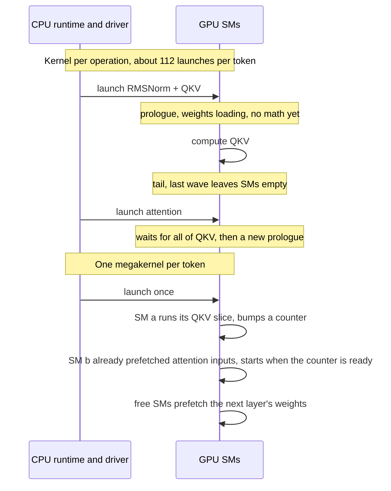
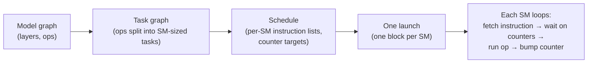
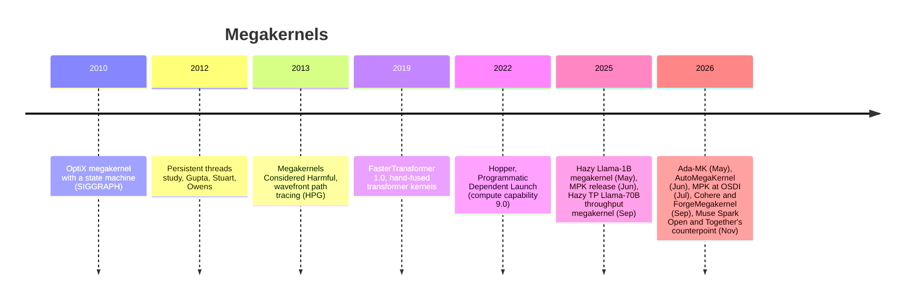
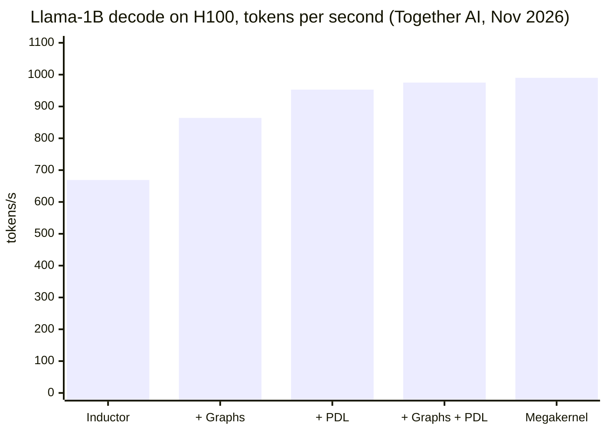

---
tags:
  - gpu-programming
  - kernels
  - optimization
  - megakernels
  - persistent-kernels
  - llm-inference
status: complete
sources:
  - https://hazyresearch.stanford.edu/blog/2025-05-27-no-bubbles
  - https://hazyresearch.stanford.edu/blog/2025-09-28-tp-llama-main
  - https://arxiv.org/html/2512.22219v1
  - https://www.usenix.org/conference/osdi26/presentation/cheng
  - https://github.com/mirage-project/mirage
  - https://news.ycombinator.com/item?id=44321672
  - https://cohere.com/blog/megakernels
  - https://lmsys.org/blog/2026-11-05-muse-spark-open-ultrafast/
  - https://www.together.ai/blog/road-to-together-compiler
  - https://github.com/msaroufim/megakernels-vs-cuda-graphs
  - https://arxiv.org/html/2606.09682v1
  - https://arxiv.org/pdf/2609.12379
  - https://arxiv.org/html/2605.11581v1
  - https://github.com/dangxingyu/megakernel-zoo
  - https://escholarship.org/content/qt3j76d3td/qt3j76d3td.pdf
  - https://research.nvidia.com/publication/2010-08_optix-general-purpose-ray-tracing-engine
  - https://research.nvidia.com/sites/default/files/pubs/2010-08_OptiX-A-General/Parker10Optix.pdf
  - https://research.nvidia.com/publication/2013-07_megakernels-considered-harmful-wavefront-path-tracing-gpus
  - https://github.com/NVIDIA/FasterTransformer
  - https://docs.nvidia.com/cuda/cuda-programming-guide/04-special-topics/programmatic-dependent-launch.html
  - https://docs.nvidia.com/cuda/archive/13.4.1/cuda-programming-guide/04-special-topics/cooperative-groups.html
created: 2026-11-26
updated: 2026-11-26
---

## Table Of Contents

---

- [[#TL;DR|TL;DR]]
- [[#The Problem|The Problem]]
    - [[#Where the Time Goes at Batch 1|Where the Time Goes at Batch 1]]
    - [[#Bubbles - Launch, Prologue, Tail|Bubbles: Launch, Prologue, Tail]]
- [[#Foundations|Foundations]]
    - [[#From Persistent Kernel to Interpreter|From Persistent Kernel to Interpreter]]
    - [[#Dependencies as Counters|Dependencies as Counters]]
    - [[#Co-Residency and Deadlock|Co-Residency and Deadlock]]
    - [[#Shared-Memory Paging|Shared-Memory Paging]]
- [[#How We Got Here|How We Got Here]]
- [[#How It Works|How It Works]]
    - [[#The Interpreter Loop in Code|The Interpreter Loop in Code]]
    - [[#Hand-Written - Hazy Research Llama-1B|Hand-Written: Hazy Research Llama-1B]]
    - [[#Throughput and Multi-GPU Megakernels|Throughput and Multi-GPU Megakernels]]
    - [[#Compiler-Generated - Mirage MPK|Compiler-Generated: Mirage MPK]]
    - [[#Production - Cohere and Muse Spark Open|Production: Cohere and Muse Spark Open]]
    - [[#Agent-Generated Megakernels|Agent-Generated Megakernels]]
- [[#Where It Is Now|Where It Is Now]]
    - [[#The Counter-Argument - CUDA Graphs Plus PDL|The Counter-Argument: CUDA Graphs Plus PDL]]
- [[#Trade-offs & Open Problems|Trade-offs & Open Problems]]
- [[#Resources|Resources]]
- [[#Related Notes|Related Notes]]

## ***TL;DR***
---
*A megakernel runs a whole model's forward pass (or a whole layer) as one persistent kernel. Each SM runs a small interpreter that executes a precomputed list of instructions and waits on counters in global memory for its inputs, so there are no kernel boundaries and no idle gaps between operations.*

- **The idea:** instead of launching about a hundred kernels per generated token, launch one. Every block stays resident on its SM for the whole step, fetches "instructions" (a slice of a matmul, a norm, an attention step), and synchronizes with other SMs through counters, not kernel boundaries. It builds on [[Persistent Kernels and Stream-K|persistent kernels]] and pushes [[Kernel Fusion]] to its limit.
- **Why it exists:** LLM decode at batch 1 is memory-bound and every kernel is tiny. Launch cost (about 2.1 µs per kernel on an H100 stream, 1.3 µs with [[CUDA Graphs]]), each kernel's load prologue and the idle SMs in each kernel's last wave add up to a large share of the token time ([Hazy Research, May 2025](https://hazyresearch.stanford.edu/blog/2025-05-27-no-bubbles)).
- **What it takes:** an on-GPU scheduler (static per-SM instruction lists or dynamic queues), dependency counters with acquire/release semantics ([[CUDA Memory Model and Atomics]]), a grid small enough that all blocks are co-resident or the kernel deadlocks ([[Cooperative Groups]]), and explicit management of shared memory across instructions.
- **History:** the word comes from ray tracing (OptiX's megakernel, 2010, and "Megakernels Considered Harmful", 2013). Persistent threads were studied by Gupta, Stuart and Owens (2012). Hazy Research's Llama-1B megakernel (May 2025) restarted the idea for LLMs: 78% of H100 bandwidth, under 1 ms per forward pass.
- **Where it is now (Nov 2026):** compiler-generated (Mirage MPK, OSDI 2026), in production (Cohere, Sep 2026; Meta's Muse Spark Open per-layer megakernels on GB300, Nov 2026), and generated by coding agents (ForgeMegakernel, megakernel-zoo). Together AI argues the opposite: CUDA Graphs plus Programmatic Dependent Launch recover 98% of the megakernel's speed on Llama-1B, so it "deleted" its megakernels in favor of a fusion compiler.

## ***The Problem***
---
*At batch 1, each decode step reads every weight once and does almost no math per byte. The GPU should be limited only by HBM bandwidth, but splitting the step into a hundred short kernels leaves the memory system idle for a large fraction of the time.*

### Where the Time Goes at Batch 1

A decode step multiplies each weight matrix by a single vector. That is 2 FLOPs (one multiply-add) per 2-byte BF16 weight, about 1 FLOP per byte, far below the H100's ridge point of roughly 295 FLOPs per byte ([[Roofline Model and Arithmetic Intensity]]). So the best possible time per token is simply the time to stream the weights:

$$
t_{\text{HBM}} = \frac{\text{parameters} \times \text{bytes per parameter}}{\text{HBM bandwidth}}
$$

In plain words: at batch 1, a token cannot be produced faster than the GPU can read the model once.

**Worked example: Llama-3.2-1B on H100 SXM.** 1.24 B parameters in BF16 is 2.48 GB; HBM3 bandwidth is 3.35 TB/s ([Hazy Research](https://hazyresearch.stanford.edu/blog/2025-05-27-no-bubbles)).

$$
t_{\text{HBM}} = \frac{2.48\ \text{GB}}{3.35\ \text{TB/s}} \approx 740\ \mu\text{s} \quad\Rightarrow\quad \approx 1{,}350\ \text{forward passes/s}
$$

Now add the cost of running it as separate kernels. Hazy Research's estimate uses 7 kernels per layer, 16 layers, and about 5 µs of stall per kernel boundary:

$$
t_{\text{gaps}} = 7 \times 16 \times 5\ \mu\text{s} = 560\ \mu\text{s}, \qquad t_{\text{total}} \approx 740 + 560 = 1{,}300\ \mu\text{s} \approx 770\ \text{passes/s}
$$

So the kernel-per-op version can reach only about $740 / 1{,}300 \approx 57\%$ of the bandwidth bound, before any inefficiency inside the kernels. The CPU launch cost alone is $112 \times 2.1\ \mu\text{s} \approx 235\ \mu\text{s}$ on a plain stream or $112 \times 1.3 \approx 146\ \mu\text{s}$ with CUDA Graphs, which is 20 to 32% of $t_{\text{HBM}}$. Hazy Research measured that vLLM and SGLang "are only able to use at most 50% of available GPU bandwidth" on this workload. Their megakernel reached about 78%, which is $740 / 0.78 \approx 950\ \mu\text{s}$, consistent with the "under 1 ms" they report.

The same arithmetic for a mixture-of-experts model: Cohere's North Mini Code has 3.3 B active parameters per token, so on one H100 its speed of light is about 470 tokens/s at batch 1, counting weight and KV-cache streaming. vLLM reached 185 tokens/s, 39% of that ([Cohere, Sep 2026](https://cohere.com/blog/megakernels); [[Mixture of Experts]]).

### Bubbles - Launch, Prologue, Tail

Hazy Research names three separate costs at every kernel boundary ([Hazy Research](https://hazyresearch.stanford.edu/blog/2025-05-27-no-bubbles)):

| Bubble | What happens | Size |
|---|---|---|
| **Launch** | CPU runtime and driver build and submit the launch ([[Streams, Events and Async Execution]]) | About 2.1 µs per dummy kernel on an H100 stream, 1.3 µs with [[CUDA Graphs]] |
| **Prologue** | A new kernel's blocks start by loading weights and activations; the SM does no math for "thousands of cycles" | Repeats for every kernel |
| **Tail** | Kernels run in order, so the next kernel's blocks wait until every block of this one is done. SMs that finish early sit idle | See below |
| **Coarse dependencies** | Even with overlap tricks, the next kernel waits for *all* of the previous one. Attention must wait for all of Q, K and V | Whole-kernel granularity |

The tail effect is wave quantization ([[Occupancy and Latency Hiding]]). With $B$ blocks of one per SM on a GPU with $S$ SMs, the last wave leaves

$$
\text{idle SMs} = \left\lceil \frac{B}{S} \right\rceil S - B
$$

For a 512-block down projection on a B200 with 148 SMs: $\lceil 512/148 \rceil = 4$ waves, $4 \times 148 - 512 = 80$ SMs idle in the last wave, the "about 80 SMs" in Hazy Research's example.



[[CUDA Graphs]] remove most of the launch cost but none of the prologue and tail bubbles. Programmatic Dependent Launch (PDL, compute capability 9.0+) lets a dependent kernel start its preamble while the previous kernel is still running, but its `cudaGridDependencySynchronize()` still waits for the whole previous grid ([CUDA Programming Guide, PDL](https://docs.nvidia.com/cuda/cuda-programming-guide/04-special-topics/programmatic-dependent-launch.html)). A megakernel removes the boundary itself.

## ***Foundations***
---
*A megakernel is a persistent kernel plus four additions: an instruction stream per SM, fine-grained dependency counters in global memory, a launch that guarantees every block is resident, and a scheme for sharing shared memory between consecutive instructions.*

### From Persistent Kernel to Interpreter

A [[Persistent Kernels and Stream-K|persistent kernel]] launches only as many blocks as fit on the GPU at once and loops over work items itself. Gupta, Stuart and Owens defined the style by two changes: "maximal launch" (no more blocks than can run concurrently) and software scheduling through a work queue ([Gupta et al., 2012](https://escholarship.org/content/qt3j76d3td/qt3j76d3td.pdf)). A persistent GEMM loops over tiles of *one* operation. A megakernel loops over *different* operations, so each work item must say what to do. That makes the block an interpreter:



The schedule is usually built ahead of time on the host. Hazy Research builds it in Python and reuses it for hundreds of forward passes; all instructions are written against one CUDA template with load, compute and store functions ([Hazy Research](https://hazyresearch.stanford.edu/blog/2025-05-27-no-bubbles)). Cohere's instruction is a descriptor of 32 int32 fields with the opcode in field 0, which a controller warp prefetches into a small shared-memory ring ([Cohere](https://cohere.com/blog/megakernels)). Some systems also use dynamic queues for data-dependent work (attention lengths, MoE routing), covered below.

Inside the block, roles are split the way [[Warp Specialization]] splits them: Cohere's block has 12 warps, with a controller, a producer, a storer and 8 consumer warps. The instruction fetch is just one more role.

### Dependencies as Counters

Kernel boundaries were the old synchronization. In a megakernel, each instruction that produces data increments a counter in global memory when it is done, and each instruction that consumes it spins until the counter reaches a target. Hazy Research keeps a counter array that starts at zero; it splits the MLP intermediate into four chunks, each with its own counter, so a down-projection task waits only for the chunk it reads ([Hazy Research](https://hazyresearch.stanford.edu/blog/2025-05-27-no-bubbles)). That is finer than any kernel boundary or PDL can express.

Correctness depends on the memory model ([[CUDA Memory Model and Atomics]]): the producer's stores must be visible before the counter increment is, and the consumer must not read data before it sees the counter. That means a release on the increment (or a `__threadfence()` before a relaxed `atomicAdd`) and an acquire on the load that observes it. Cohere zeroes counters before each step, spins with `__nanosleep(20)` between polls, and puts fences around the `atomicAdd` that publishes results ([Cohere](https://cohere.com/blog/megakernels)).

A counting barrier has a trap. As Cohere puts it, a counter releases "when *N* threads arrive without checking *which* threads those were". An extra arrival from the wrong task can release a waiter early, and a missing one deadlocks it, possibly much later in the step.

### Co-Residency and Deadlock

Spinning on a counter is only safe if the block that will increment it is already running. If the grid has more blocks than the GPU can hold, the waiting blocks occupy every SM and the producer never gets scheduled: a deadlock, with no error. Gupta et al. list exactly this risk: global synchronization requires all blocks to be resident, and exceeding the maximal launch size deadlocks ([Gupta et al., 2012](https://escholarship.org/content/qt3j76d3td/qt3j76d3td.pdf)).

Two rules follow:

1. **Size the grid to residency.** Megakernels launch one block per SM (Cohere: one threadblock per SM, resident for the whole decode step). A cooperative launch (`cudaLaunchCooperativeKernel`) makes the launch atomic: "if the call succeeds", all requested blocks launch together ([CUDA Programming Guide, Cooperative Groups](https://docs.nvidia.com/cuda/archive/13.4.1/cuda-programming-guide/04-special-topics/cooperative-groups.html); [[Cooperative Groups]]). Cooperative launch is supported on Linux without MPS, and with MPS only on compute capability 7.0 or newer, which matters when the GPU is shared ([[MIG and MPS - Sharing a GPU]]).
2. **Keep each SM's list in a valid order.** Instructions on one SM run in sequence, so if SM 3 waits on something that comes *later* in SM 3's own list, it waits forever. The scheduler must emit each per-SM list in an order consistent with the dependency graph. AutoMegaKernel's static checker tests exactly these properties (graph acyclicity, satisfiable waits, per-SM queue order) plus race-freedom ([AutoMegaKernel](https://arxiv.org/html/2606.09682v1)).

Full grid barriers are possible (`grid.sync()`) but cost about as much as a new launch: Together AI measured 1,043 ns for a cooperative `grid.sync()` on H100 against 1,051 ns for a CUDA Graph kernel boundary ([Together AI, Nov 2026](https://www.together.ai/blog/road-to-together-compiler)). Megakernels use point-to-point counters instead.

### Shared-Memory Paging

A normal kernel owns all its shared memory. In a megakernel, the *next* instruction should start loading its weights while the current one is still computing, so both must share the SM's shared memory. Hazy Research treats it like virtual memory pages ([Hazy Research](https://hazyresearch.stanford.edu/blog/2025-05-27-no-bubbles); [[Shared Memory and Bank Conflicts]]):

- The first 213 kB of the H100's shared memory is split into 13 pages of 16 KiB ($13 \times 16{,}384 = 212{,}992$ bytes); the rest holds instruction parameters.
- Each instruction explicitly requests pages and releases them when done. The interpreter hands released pages straight to the next instruction, which starts its loads early.

MPK does the same with 32 KB pages (7 per SM on H100 and B200, 5 on A100). Its rule that a task "cannot acquire more" pages after releasing one keeps the allocator simple and deadlock-free ([MPK](https://arxiv.org/html/2512.22219v1)). Cohere went the other way: it dropped paging because the bookkeeping was "complex and error-prone", gave each opcode a static shared-memory layout, and gets overlap by prefetching within a run of same-type GEMM tasks and before cross-SM waits ([Cohere](https://cohere.com/blog/megakernels)).

## ***How We Got Here***
---
*The megakernel was born in ray tracing, was declared harmful there, and lived on as "persistent threads" in GPGPU research. LLM decode brought it back in 2025 because it is the one workload where per-kernel overhead is as large as the useful work.*



- **2010, OptiX.** NVIDIA's ray-tracing engine "implements a megakernel by linking together a set of individual user programs" and steps through them with a state machine: each program is a case in a switch, and a "virtual program counter" picks the next one. The authors note it minimizes launch overhead but can lower utilization, because register use is set by the largest program ([Parker et al., SIGGRAPH 2010](https://research.nvidia.com/sites/default/files/pubs/2010-08_OptiX-A-General/Parker10Optix.pdf)). The LLM megakernel's opcode switch is the same design.
- **2012, persistent threads.** Gupta, Stuart and Owens (UC Davis) formalized the style and its four uses: avoiding CPU round trips, load balancing, producer-consumer locality, and global synchronization. Global synchronization gave a consistent 2 to 2.5x over relaunching, but the authors concluded persistent threads are "not a guaranteed winner" and flagged deadlock, atomic contention and debugging cost ([Gupta et al.](https://escholarship.org/content/qt3j76d3td/qt3j76d3td.pdf)).
- **2013, "Megakernels Considered Harmful".** Laine, Karras and Aila (NVIDIA) argued that "simply porting a large CPU program into an equally large GPU kernel is generally not a good approach", because divergent control flow and "high register usage that lessens the latency-hiding capability" hurt. Their wavefront path tracer splits the work into specialized kernels with queues between them ([Laine et al., HPG 2013](https://research.nvidia.com/publication/2013-07_megakernels-considered-harmful-wavefront-path-tracing-gpus)). Those costs still apply; LLM decode avoids most of the divergence because all SMs run the same few dense ops.
- **2019 to 2023, fused transformer kernels.** NVIDIA's FasterTransformer (1.0 in July 2019) shipped hand-fused CUDA kernels for encoders and decoders, later fused multi-head attention; development moved to TensorRT-LLM ([FasterTransformer](https://github.com/NVIDIA/FasterTransformer)). This is fusion *within* a layer ([[Kernel Fusion]]); a decode step was still dozens of kernels.
- **May 2025, "Look Ma, No Bubbles!"** Hazy Research (Stanford) ran all of Llama-3.2-1B's forward pass as one kernel and reported the first sub-millisecond forward pass for a 16-bit 1B+ model on a GPU ([Hazy Research](https://hazyresearch.stanford.edu/blog/2025-05-27-no-bubbles)).
- **June 2025, MPK.** CMU's Mirage team released Mirage Persistent Kernel, a compiler that turns a model into a megakernel ([HN discussion of the announcement, Jun 19 2025](https://news.ycombinator.com/item?id=44321672)); the paper appeared at OSDI 2026.
- **September 2025, throughput megakernels.** Hazy Research's follow-up applied the design to tensor-parallel Llama-70B at large batch on 8 H100s ([Hazy Research, Sep 2025](https://hazyresearch.stanford.edu/blog/2025-09-28-tp-llama-main)).
- **2026.** Industrial deployments and generators: Baidu's Ada-MK (May), AutoMegaKernel (Jun), MPK at OSDI (Jul), Cohere's open-source engine and Tsinghua's ForgeMegakernel (Sep), Meta's Muse Spark Open kernels and Together AI's argument against megakernels (Nov). Details below.

## ***How It Works***
---
*All current systems share one skeleton: one block per SM, an instruction loop, counters for dependencies, and overlap of the next instruction's loads with the current one's math. They differ in who writes the instructions (people, a compiler, or a coding agent) and in how dynamic the schedule is.*

### The Interpreter Loop in Code

A minimal sketch of the device loop. It is simplified (no shared-memory paging, no warp roles) but shows the three moving parts: fetch, wait, signal.

```cpp
#include <cuda/atomic>
struct Instr { int op, arg, wait_ctr, wait_target, done_ctr; };

__global__ void __launch_bounds__(256, 1)
megakernel(const Instr* prog, const int* prog_len, int* ctr, Params p) {
  const Instr* mine = prog + blockIdx.x * MAX_INSTR;          // this SM's list
  for (int pc = 0; pc < prog_len[blockIdx.x]; ++pc) {
    Instr in = mine[pc];
    if (threadIdx.x == 0 && in.wait_ctr >= 0) {
      cuda::atomic_ref<int, cuda::thread_scope_device> c(ctr[in.wait_ctr]);
      while (c.load(cuda::std::memory_order_acquire) < in.wait_target)
        __nanosleep(20);                                       // back off between polls
    }
    __syncthreads();                                           // inputs are ready
    switch (in.op) {
      case OP_RMSNORM_QKV: rmsnorm_qkv(in.arg, p); break;
      case OP_ATTENTION:   attention(in.arg, p);   break;
      case OP_DOWN_PROJ:   down_proj(in.arg, p);   break;
      // ... one case per instruction type
    }
    __syncthreads();                                           // every thread's stores issued
    if (threadIdx.x == 0) {
      cuda::atomic_ref<int, cuda::thread_scope_device> d(ctr[in.done_ctr]);
      d.fetch_add(1, cuda::std::memory_order_release);         // publish this task's output
    }
  }
}
```

Line by line:

- `Instr` is the instruction: an opcode, an argument (which layer, which tile), the counter to wait on and its target, and the counter to bump when done. Real systems pack more fields (Cohere uses 32 ints).
- `__launch_bounds__(256, 1)` tells the compiler one block of 256 threads per SM, so it may use the SM's whole register file. The register count is then set by the *hungriest* case in the switch ([[Register Pressure and Spilling]]).
- `mine` points at this block's own precomputed list. The host built every list so that each one is in dependency order.
- Thread 0 alone polls the counter with an **acquire** load, so 255 threads are not hammering L2. `__nanosleep(20)` backs off between polls, the value Cohere uses.
- The first `__syncthreads()` releases the whole block once thread 0 has seen the counter reach its target. The acquire plus the barrier make the producer's data visible to every thread here.
- The `switch` is the interpreter. Each case is an ordinary device function written like a small kernel body ([[Tiled Matrix Multiplication (GEMM)]], attention, a norm).
- The second `__syncthreads()` makes sure all threads have issued their stores before thread 0 signals.
- `fetch_add(..., memory_order_release)` at device scope publishes the output: any block that acquires this counter value sees the data. A `__threadfence()` followed by a relaxed `atomicAdd` is the older equivalent.

The host side must guarantee co-residency:

```cpp
int per_sm = 0, sms = 0;
cudaOccupancyMaxActiveBlocksPerMultiprocessor(&per_sm, megakernel, 256, smem_bytes);
cudaDeviceGetAttribute(&sms, cudaDevAttrMultiProcessorCount, 0);
if (per_sm < 1) abort();                         // kernel does not fit on an SM at all
void* args[] = {&prog, &prog_len, &ctr, &p};
cudaLaunchCooperativeKernel((void*)megakernel, dim3(sms), dim3(256),
                            args, smem_bytes, stream);
```

- The occupancy query checks that at least one block fits per SM with this shared-memory size.
- The grid is exactly one block per SM (132 on H100), so every block is resident from the start.
- The cooperative launch either starts all blocks together or returns an error, instead of silently queuing some blocks and deadlocking ([CUDA Programming Guide](https://docs.nvidia.com/cuda/archive/13.4.1/cuda-programming-guide/04-special-topics/cooperative-groups.html)).

### Hand-Written - Hazy Research Llama-1B

The May 2025 megakernel runs Llama-3.2-1B decode at batch 1 with seven instruction types per layer ([Hazy Research](https://hazyresearch.stanford.edu/blog/2025-05-27-no-bubbles)):

| # | Instruction |
|---|---|
| 1 | Fused RMSNorm, QKV projection and RoPE |
| 2 | Attention |
| 3 | Attention reduction (for long sequences) |
| 4 | O-projection plus residual |
| 5 | Fused RMSNorm, up and gate projections, SiLU |
| 6 | Down projection plus residual |
| 7 | Final RMSNorm plus LM head |

Design choices worth noting:

- **CUDA cores, not tensor cores, on Hopper.** At batch 1 every op is a matrix-vector product; "on Hopper, we find it better to simply run on the CUDA cores" ([[Tensor Cores]]).
- **Paging** as described above (13 pages of 16 KiB), so instruction $k+1$ loads weights while instruction $k$ computes.
- **Chunked counters** for the MLP so the down projection starts on each quarter of the intermediate as soon as it exists.
- **Custom barriers.** The authors found "CUDA's asynchronous barriers are relatively slow" and used their own.

Results: about 78% of H100 memory bandwidth, under 1 ms per forward pass, almost 2.5x faster than vLLM and over 1.5x faster than SGLang on H100. On B200 the forward pass took under 680 µs, over 3.5x faster than vLLM and more than 1.5x faster than SGLang (32-token prompt, 128 generated tokens, no speculation). The authors' theoretical B200 limit is about 3,000 passes/s; 680 µs is about 1,470 passes/s, so roughly half of it. Their B200 breakdown of a 600 µs pass shows where the rest went: about 250 µs storing, waiting for and loading activations, about 200 µs of RMSNorm and matrix-vector work, about 80 µs of setup and other overhead, about 40 µs of low-level warp synchronization, and only about 30 µs waiting for weights from global memory. Weights are no longer the bottleneck; passing activations between SMs through global memory and counters is.

### Throughput and Multi-GPU Megakernels

Hazy Research's September 2025 follow-up built a megakernel for **tensor-parallel Llama-70B at large batch** on 8 H100s, inside their Tokasaurus engine ([Hazy Research, Sep 2025](https://hazyresearch.stanford.edu/blog/2025-09-28-tp-llama-main)). At large batch the point is not launch overhead but overlapping three resources:

- **Within an SM:** loader, consumer and storer threads ([[Warp Specialization]]), with the next instruction's loads pipelined behind the current one.
- **Across SMs:** a global work queue handed out by an atomic counter, with instructions of different types interleaved so compute-heavy and memory-heavy work run on different SMs at once.
- **Across GPUs:** communication issued from storer threads through ThunderKittens' parallel global layouts, with no NCCL ([[Multi-GPU Communication - NVLink and NCCL]]; [[ThunderKittens and Tile DSLs]]).

At batch 8192, removing the global work queue cost 14.2% (31,516 vs 27,033 tokens/s), removing pipelining 6.1% and removing interleaving 6.4%. End-to-end on 65,536 ShareGPT prompts it reached 23,468 total tokens/s against 19,170 for SGLang, about 22% more. The authors call it research code, sensitive to compiler versions, with register spills and some instructions stalling on synchronization.

### Compiler-Generated - Mirage MPK

MPK (Mirage Persistent Kernel), from CMU with Tsinghua, NVIDIA and others, is "the first compiler and runtime system that automatically transforms multi-GPU model inference into a single high-performance megakernel", exposed as `torch.compile(backend=MPK)` ([MPK paper](https://arxiv.org/html/2512.22219v1); [OSDI 2026](https://www.usenix.org/conference/osdi26/presentation/cheng)).

- **tGraph.** The compiler lowers the model to an SM-level graph of alternating *tasks* (work for one SM, compute or communication) and *events* (synchronization points). It inserts an event wherever one task's output region overlaps another's input, fuses events, and orders tasks so tasks sharing an event are contiguous. An event then only stores a trigger count and a first and last task index.
- **Workers and schedulers.** Most SMs are workers with FIFO task queues; schedulers run as warps that track events and dispatch ready tasks. On H100, 128 of 132 SMs are workers and four host the schedulers. Attention and other data-dependent tasks are dispatched just-in-time; the rest are pre-enqueued round-robin ahead of time.
- **Paging and pipelining.** 32 KB shared-memory pages let the next task preload while the current one computes (1.2 to 1.3x faster on Qwen3-8B's final linear layer on B200).
- **Multi-GPU.** All-reduce becomes transfer tasks (NVSHMEM signals) plus local reduction tasks, so communication overlaps compute inside the kernel.
- **Results.** Up to 1.7x lower end-to-end latency than kernel-per-operator serving systems (1.0 to 1.7x on serving); on A100, Qwen3-8B decode fell from 14.5 ms per token (vLLM and SGLang) to 12.5 ms against a 10 ms bandwidth bound; 1.1 to 1.4x over SGLang and vLLM on 8 H100s.
- **Limits.** One precompiled tGraph per power-of-two batch size; decentralized scheduling only; evaluation is offline and batched. Gains are largest for small models on new GPUs.

### Production - Cohere and Muse Spark Open

**Cohere (Sep 2026)** serves North Mini Code, a 30B MoE with 3.3B active parameters, from a decode megakernel on one H100, open-sourced as `cohere-ai/cohere-megakernel` and built on ThunderKittens tiles ([Cohere](https://cohere.com/blog/megakernels)).

- 16 opcodes cover the step (dense GEMMs, attention, MoE routing, MoE GEMMs, a fused add plus RMSNorm). All GEMMs share one warp-specialized pipeline.
- Mostly static schedule: task $k$ goes to SM $k \bmod 132$, with a tuned wave order. Attention and MoE use dynamic work stealing through "claimer" tasks that pull from shared queues.
- 292 tokens/s at batch 1, 62% of the 470 tokens/s speed of light and 1.58x vLLM. In the server, 1.25 to 1.41x average decode throughput. Accuracy matched vLLM on SciCode and LiveCodeBench.
- Schedule matters: putting all attention first instead of the tuned order lost 19% at batch 1 and 7% at batch 8. "After the kernels are fast, the schedule is the rest of the speedup."
- Limits: batch size at most 8 (a configuration limit), decode only, prefill pauses decoding and uses ordinary PyTorch kernels.

**Muse Spark Open on GB300 (Nov 2026).** Pranjal Shankhdhar's post on the LMSYS blog describes Meta's kernels for this 62-layer MoE model, served TP8 on eight GB300s with speculative decoding ([LMSYS, Nov 2026](https://lmsys.org/blog/2026-11-05-muse-spark-open-ultrafast/); code at `facebookresearch/sgl-muse-mega`). It is a **per-layer** megakernel: one launch covers one layer's attention through the next layer's QKV projection, with 12-warp blocks on 144 SMs in clusters of four ([[Thread Block Clusters and Distributed Shared Memory]]).

- The decode step went from about 1,450 kernels (12.9 ms) to 97 (5.9 ms): 517 to 1,109 tokens/s at batch 1, 2.1x.
- Warp 0 prefetches the next operation's weights into a shared-memory ring; other weights go to L2 with an evict-first hint.
- Cross-GPU handoffs are fence-free: receive buffers are pre-filled with a sentinel value (all bits set) and the consumer polls until real data replaces it.
- The roughly 128 KB per-SM instruction cache became a bottleneck, so the authors shrank code and warmed L2 with the kernel's own code.
- Profiling uses `globaltimer` timestamps written by each block, because a profiler sees one long kernel ([[Profiling with Nsight Compute and Nsight Systems]]).

### Agent-Generated Megakernels

Because each megakernel is model-, batch- and GPU-specific, 2026 work uses coding agents to write them:

| System | Who, when | What | Result |
|---|---|---|---|
| ForgeMegakernel | Tsinghua and ModelBest, Sep 2026 | Agents follow a 10-milestone recipe (interpreter, counters instead of grid barriers, buffer pool) and write CUDA from scratch; a test oracle checks per-layer state | 50.5 to 85.9% memory-bandwidth utilization on H100 against 36.5 to 78.9% for SGLang and 20.6 to 75.9% for MPK; 1.21x geomean over SGLang; median 14.7 agent-hours and $177 per megakernel ([paper](https://arxiv.org/pdf/2609.12379)) |
| AutoMegaKernel | RightNow AI, Jun 2026 | Compiles Llama-family models to one cooperative kernel; static deadlock and race checker with zero false accepts on 7,160 schedules | Still 1.65x slower than vLLM with CUDA Graphs on H100 (SmolLM2-135M, FP32); BF16 GEMV at about 63% of measured peak vs about 90% for cuBLAS ([paper](https://arxiv.org/html/2606.09682v1)) |
| megakernel-zoo | Xingyu Dang, Nov 2026 | 19 agent-written engines for 8 models on H100 and B200, with a server | Self-reported 1.13 to 1.77x the fastest general engine at one sequence, 1.02 to 1.46x at eight ([repo](https://github.com/dangxingyu/megakernel-zoo)) |

ForgeMegakernel reproduced the Hazy Llama-1B kernel at 74.6% bandwidth utilization (Hazy reported 78%) and its own generated version reached 74.0%.

## ***Where It Is Now***
---
*As of November 2026, megakernels are a proven technique for low-batch decode, with compilers, open-source production engines and agent generators. They are also contested: careful use of CUDA Graphs and PDL gets most of the benefit, and at least one team has abandoned them.*

- **Production.** Cohere's open-source MoE decode engine (Sep 2026) and Meta's per-layer GB300 kernels for Muse Spark Open (Nov 2026), whose post says SGLang is moving toward megakernels. Baidu's Ada-MK embeds a megakernel as a TensorRT-LLM plugin for decode (prefill stays on native operators) in a commercial advertising system, the first industrial deployment by its own account; on an L20 it reports up to 23.6% over TensorRT-LLM and up to 50.2% over vLLM at small batch ([Ada-MK](https://arxiv.org/html/2605.11581v1)).
- **Compilers.** MPK (OSDI 2026) is the reference compiler. The other generators (ForgeMegakernel, AutoMegaKernel, megakernel-zoo) use coding agents writing CUDA, not a tile language; ForgeMegakernel's megakernels also run inside SGLang for serving, with 1.11x geomean speedup on GSM8K ([[GPU Kernel Compilers]]).
- **Granularity is loosening.** Muse Spark Open uses one kernel per layer (97 per step), not one per model, and still gets a 2.1x speedup. "Megakernel" now means "few, long-lived kernels with on-GPU dependencies" more than "exactly one".
- **NVIDIA's tools.** No NVIDIA library in this survey ships megakernels; NVIDIA's own answers to launch gaps are [[CUDA Graphs]] and PDL. NVIDIA researchers co-author MPK, and Blackwell's Cluster Launch Control gives persistent kernels a hardware tile scheduler ([[Persistent Kernels and Stream-K]]).
- **Blackwell.** Hazy Research's B200 pass ran at about half its theoretical limit, with activation traffic between SMs as the main cost; newer work (Muse Spark Open) leans on clusters, L2 prefetch and code-size control ([[Blackwell Architecture]]).

### The Counter-Argument - CUDA Graphs Plus PDL

Together AI, which provided the GPUs for Hazy Research's original work, published "Last year we built megakernels. This year we deleted them" in November 2026, concluding that "megakernels were the wrong objective for a system to target" ([Together AI](https://www.together.ai/blog/road-to-together-compiler)). Their Llama-1B measurements on H100:



- CUDA Graphs plus fine-grained PDL reached 975 tokens/s, 98% of the megakernel's 990. A kernel boundary with Graphs plus PDL cost 645 ns on H100, the same as the megakernel's own grid sync (646 ns).
- The megakernel's single launch configuration made some GEMMs 1.2 to 1.5x slower, and forcing unrelated ops into one kernel slowed things 5 to 19%. Packed megakernel binaries can overflow the instruction cache.
- Their replacement, an agent-driven fusion compiler, reported over 1,100 tokens/s on H100 and 2,118 tokens/s on B200 against 1,649 for the megakernel.

An independent study by msaroufim ran the original Hazy kernel against a 100-kernel CUDA Graphs plus PDL decode step: the megakernel was 0.69% faster on H100 and 4.59% on H200, while on GB300 a megakernel for a speculative-decoding drafter was 3.06% slower. The conventional path passed numerical checks against an FP32 reference; the Hazy megakernel did not ([megakernels-vs-cuda-graphs](https://github.com/msaroufim/megakernels-vs-cuda-graphs)).

The two views fit together. The *launch* bubble is mostly solved by Graphs plus PDL. What a megakernel adds is finer-than-kernel dependencies (chunked counters, per-task events), cross-op weight prefetch and in-kernel communication. Those matter most for MoE routing, multi-GPU overlap and speculative decoding, which is where the 2026 production wins (Cohere, Muse Spark Open) come from.

## ***Trade-offs & Open Problems***
---
*A megakernel trades one class of overhead for a large, rigid, hard-to-debug program. It wins when per-op overhead is comparable to useful work, which means small batches, small models or fast GPUs, and loses ground as the batch grows.*

| Concern | What goes wrong | Example |
|---|---|---|
| Register pressure | The whole kernel gets the registers of its hungriest op; spills hurt every op | OptiX 2010 noted register use is set by the largest program; Hazy's 70B kernel has spills ([[Register Pressure and Spilling]]) |
| One launch configuration | Block size, warps and shared memory are fixed for all ops, so GEMMs lose their best tiles | Together: some GEMMs 1.2 to 1.5x slower |
| Shared memory | Ops must share it across instruction boundaries | Paging (Hazy, MPK) vs static per-opcode layouts (Cohere, which found paging error-prone) |
| Instruction cache | Many op bodies in one binary exceed the per-SM instruction cache | Muse Spark Open shrank code and warmed L2; Together saw refetches |
| Deadlock | Miscounted barriers or bad per-SM order hang silently | Cohere: "Barrier accounting needs explicit invariants and careful testing"; AutoMegaKernel adds a static checker, MPK has none |
| Debugging and profiling | One kernel, so Nsight shows one bar; races are timing-dependent | `globaltimer` instrumentation (about 2.8% overhead in Muse Spark Open); [[Debugging with compute-sanitizer and cuda-gdb]] |
| Numerics | Different reduction orders than the reference | Hazy kernel failed msaroufim's FP32 fidelity check |
| Build cost | One megakernel per model, batch size, precision and GPU | Together: "one batch size (1), one precision (BF16), and one customer"; MPK compiles one graph per power-of-two batch; ForgeMegakernel: $177 and 14.7 agent-hours each |
| Portability | Tied to SM count, shared-memory size and async-copy hardware | MPK worker counts must match SM count; Ada-MK had to port to Ada (no TMA, 128 KB shared memory) |
| Sharing the GPU | Every SM is held for the whole step | Cooperative launch under MPS needs compute capability 7.0 or newer ([[MIG and MPS - Sharing a GPU]]) |

**When megakernels lose.** As the batch grows, arithmetic intensity rises toward the ridge point, each op runs longer, and launch overhead becomes a small fraction of it. The ops then want tensor-core GEMMs with their own tile shapes, which a single launch configuration cannot give. The gains shrink accordingly: megakernel-zoo reports 1.02x for North Mini Code at eight sequences, and Cohere's microbenchmark falls to 1.14x at batch 8 under uniform routing. Hazy Research's 70B work shows the exception: at large batch a megakernel can still win (22% over SGLang) by overlapping compute, memory and network, not by saving launches.

Open problems:

- **Prefill.** Every production system runs prefill as ordinary kernels and pauses decode for it.
- **Global scheduling.** Schedules are static or locally greedy; MPK lists globally coordinated scheduling as future work, and Cohere's wave-order tuning shows how much is at stake.
- **Verification.** Static deadlock and race checking exists (AutoMegaKernel) but is not a proof, and production kernels ship without it.
- **Generality.** The Muse Spark Open author describes the long-term goal as a general on-GPU scheduler, "an operating system for the GPU" ([[CPU Scheduling]]); Hazy Research suggests a more general instruction set could make training megakernels viable.
- **Whether to bother.** Together AI's results suggest that for dense models, Graphs plus PDL plus good fusion get within a few percent. The open question is which workloads (MoE, multi-GPU, speculative decoding) keep a lasting advantage.

## ***Resources***
---
*Start with Hazy Research's "Look Ma, No Bubbles!" for the motivation and design, then read Cohere's post for a production engine and Together AI's post for the strongest counter-argument. The MPK paper is the reference for compiling megakernels.*

**Primary**
- [Look Ma, No Bubbles! Designing a Low-Latency Megakernel for Llama-1B](https://hazyresearch.stanford.edu/blog/2025-05-27-no-bubbles): Hazy Research (Stanford), May 2025.
- [MPK: A Compiler and Runtime for Mega-Kernelizing Tensor Programs](https://arxiv.org/html/2512.22219v1): Cheng, Zhang, Zhou, Ji et al. (CMU and others), OSDI 2026 ([USENIX page](https://www.usenix.org/conference/osdi26/presentation/cheng); [code](https://github.com/mirage-project/mirage)).
- [CUDA Programming Guide: Programmatic Dependent Launch](https://docs.nvidia.com/cuda/cuda-programming-guide/04-special-topics/programmatic-dependent-launch.html) and [Cooperative Groups](https://docs.nvidia.com/cuda/archive/13.4.1/cuda-programming-guide/04-special-topics/cooperative-groups.html): NVIDIA, CUDA 13.

**Practitioner**
- [Cohere's North Mini Code Megakernel Serving Engine](https://cohere.com/blog/megakernels): Tong, Zhu, Wang (Cohere), Sep 2026.
- [Muse Spark Open, ultrafast decode on GB300](https://lmsys.org/blog/2026-11-05-muse-spark-open-ultrafast/): Pranjal Shankhdhar, LMSYS blog, Nov 2026.
- [We Bought the Whole GPU, So We're Damn Well Going to Use the Whole GPU](https://hazyresearch.stanford.edu/blog/2025-09-28-tp-llama-main): Hazy Research, Sep 2025.
- [The road to Together Compiler](https://www.together.ai/blog/road-to-together-compiler): Lim, Abhyankar, Arora (Together AI), Nov 2026.
- [Megakernels vs CUDA Graphs](https://github.com/msaroufim/megakernels-vs-cuda-graphs): msaroufim, 2026.
- [megakernel-zoo](https://github.com/dangxingyu/megakernel-zoo): Xingyu Dang, Nov 2026.

**Research and history**
- [ForgeMegakernel](https://arxiv.org/pdf/2609.12379): Tsinghua and ModelBest, Sep 2026.
- [AutoMegaKernel](https://arxiv.org/html/2606.09682v1): Jaber and Jaber (RightNow AI), Jun 2026.
- [Ada-MK](https://arxiv.org/html/2605.11581v1): Baidu, May 2026.
- [A Study of Persistent Threads Style GPU Programming for GPGPU Workloads](https://escholarship.org/content/qt3j76d3td/qt3j76d3td.pdf): Gupta, Stuart, Owens (UC Davis), 2012.
- [OptiX: A General Purpose Ray Tracing Engine](https://research.nvidia.com/publication/2010-08_optix-general-purpose-ray-tracing-engine): Parker et al. (NVIDIA), SIGGRAPH 2010.
- [Megakernels Considered Harmful: Wavefront Path Tracing on GPUs](https://research.nvidia.com/publication/2013-07_megakernels-considered-harmful-wavefront-path-tracing-gpus): Laine, Karras, Aila (NVIDIA), HPG 2013.
- [FasterTransformer](https://github.com/NVIDIA/FasterTransformer): NVIDIA, 2019 to 2023.

## Related Notes

- [[Persistent Kernels and Stream-K]] — The one-block-per-SM loop that megakernels extend from one op to a whole model.
- [[Kernel Fusion]] — Megakernels as the last step of fusion; launch overhead and fusion trade-offs.
- [[CUDA Graphs]] — The main alternative for removing launch overhead, with PDL edges.
- [[Cooperative Groups]] — Cooperative launch, co-residency and `grid.sync()`.
- [[CUDA Memory Model and Atomics]] — Acquire/release counters that replace kernel boundaries.
- [[Warp Specialization]] — Loader, consumer, storer and controller warps inside each megakernel block.
- [[Shared Memory and Bank Conflicts]] — The resource that megakernels page between instructions.
- [[Register Pressure and Spilling]] — Why the hungriest op sets the register budget for all of them.
- [[Occupancy and Latency Hiding]] — Tail effects and one block per SM.
- [[Roofline Model and Arithmetic Intensity]] — Why batch-1 decode is bandwidth-bound and when it stops being so.
- [[Multi-GPU Communication - NVLink and NCCL]] — In-kernel communication in MPK and Hazy's 70B kernel.
- [[ThunderKittens and Tile DSLs]] — The tile library under the Hazy and Cohere megakernels.
- [[Profiling with Nsight Compute and Nsight Systems]] — Why one long kernel needs in-kernel timestamps.
- [[Debugging with compute-sanitizer and cuda-gdb]] — Finding races and hangs in a single persistent kernel.
- [[LLM Serving]] — The decode loop megakernels accelerate, and where prefill still runs.
- [[Mixture of Experts]] — Dynamic routing that megakernels handle with in-kernel work stealing.
